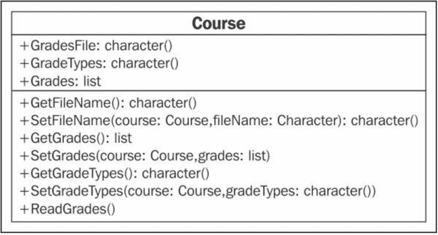
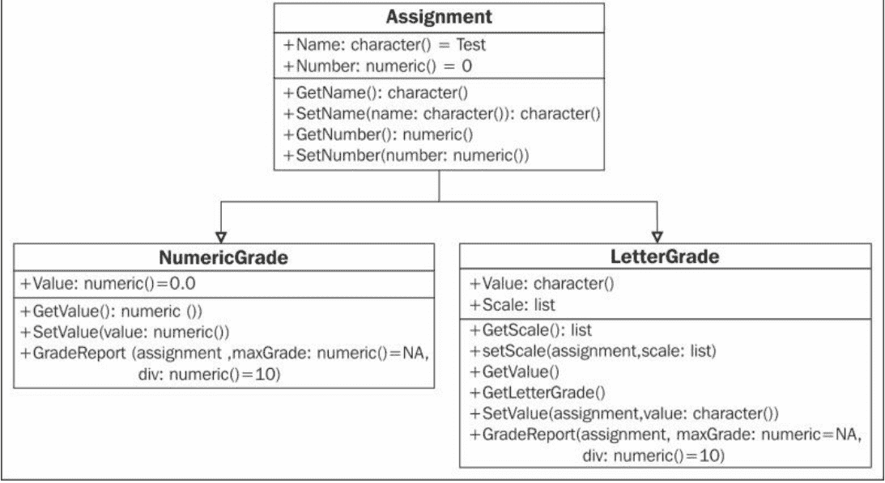

## 第10章 案例研究——课程成绩

本章是我们第一个案例研究。我们将前几章的思路汇集在一起并提供一个扩展示例。引入了一些新思想，在完整示例的背景下它们应该更容易理解。

本章大致分为四个部分：

- **The Course class**: 本节为您概述将包含课程成绩列表的 S4 类。成绩保存在一个列表中，每个评分任务都是一个单独的对象。
- **The assignment classes**: 本节为您概述用于保存特定评分任务成绩的 S4 类。此类有两个派生类。一个派生类用于跟踪具有数值分数的成绩，另一个用于跟踪由字母组成的成绩。
- **Extending existing functions**: 本节简要讨论了如何扩展现有函数以对属于 assignment 类的对象做出适当反应。我们重点关注 summary、plot 和 show 命令。
- **Extending operations**: 本节讨论了如何通过构建在现有方法之上来扩展算术和访问函数。

### 概述

所有前几章都专注于特定主题，而在这里我们将多个不同主题汇集起来以检查一个扩展示例。这里检查的所有类都是 S4 类。这些类用于读取包含班级学生成绩的 CSV 文件。其中一个类定义了如何读取成绩文件以及如何解释一列。另一组类被定义并且这些类用于跟踪单个作业的信息。此类的一个对象将包含所有学生的作业所有分数。

我们首先讨论新的 Course 类，它用于跟踪所有作业。接下来，我们讨论用于跟踪单个作业成绩的 assignment 类。一旦类被定义，就会给出扩展 summary、plot 和 show 命令的细节，以演示如何扩展常用命令以便在传递新定义的对象时做出反应。最后，重新定义了一些基本的算术和访问运算符，以便 R 系统在使用熟悉的操作（如加法或乘法）时做出适当反应。

Course 类包含其类型为 assignment 类之一的对象，似乎更自然地先定义 assignment 类。assignment 类的行为更复杂且包含更多细节，而 Course 类相对简单。为了让类介绍更温和，我们将先讨论 Course 类。

### 课程类

Course 类用于跟踪课程的所有成绩。此类将从文件中读取信息，判断成绩是数值成绩还是字母成绩，并创建适当的 assignment 对象来保存成绩。类的细节如以下图所示。我们将先讨论数据，然后讨论与该类相关的方法。然后我们将给出如何定义类的一些细节。出于简洁考虑，与访问器相关的代码大部分被省略，但完整代码可在本书相关网站上获得。



首先，该类有三个数据结构（slots）。第一个是包含班级所有成绩的 CSV 文件的名称。第二个是用于确定文件中有哪些类型的评分任务的向量前缀。最后一个是包含所有作业的列表。

共有七个方法。除了一个之外，其余都用于设置和获取三个 slots 的值。获取和设置文件名的访问器例程在此给出，而其他例程未在此文中包含。最后一个例程用于读取成绩，这是一个复杂的方法，它从文件中读取数据，然后判断作业是否有数值或字母成绩。然后它定义一个适当的 assignment 对象。

#### 课程类的定义

给出 Course 类的定义，然后说明 slots 的访问器。这是一个 S4 类。在本例中，我们不提供任何检查以确保 slots 中的信息一致，以降低示例的复杂性：

```
###########################################
# Create the Course class to keep track of all grades
Course <- setClass(
    # Set the name for the class
    "Course",

    # Define the slots
    slots = c(
        GradesFile = "character",
        GradeTypes = "character",
        Grades     = "list"
    ),

    # Set the default values for the slots. (optional)
    prototype=list(
        GradesFile = "",
        GradeTypes = c("test","hw","quiz","project"),
        Grades     = list()
    ),

    # Make a function that can test to see if the data is consistent.
    # This is not called if you have an initialize function defined!
    validity=function(object)
    {
        return(TRUE)
    }
)
```

每个 slots 都包含一组访问器函数，以帮助检索或设置类跟踪的信息。我们只提供其中一组访问器的细节。设置和获取文件名的 methods 给出。默认 R 环境中不存在这些方法，因此必须先创建，如下所示：

```
# Define the methods used to retrieve or set the values within a Course object.
setGeneric(name="GetFileName",
           def=function(course)
           {
               standardGeneric("GetFileName")
           }
)

setMethod(f="GetFileName",
          signature="Course",
          definition=function(course)
          {
              return(course@GradesFile)
          }
)
```

### 从文件读取成绩

最后检查的方法是从给定文件读取数据的方法。在提供列表之前，我们将先检查 `Course` 类中的 `Grades` 列表。此 slot 是一个列表，列表中的每个元素都是一个 assignment 对象。 （assignment 类在下一节中讨论。）列表中对象的名称与 CSV 文件第一行中找到的名称相同。

`ReadGrades` 方法首先读取 `csv` 文件。然后它遍历从文件中读取的列，并且假设列名在文件第一行中。如果列名的第一个字母与 `GradeTypes` slot 中的向量中的一个字符串匹配，则假设该列代表一个评分项目。有两种类型的作业：数值成绩或字母成绩。如果从数据文件中确定某列为评分项目，则检查其类型。如果类型为数值类型，则假设课程类型为数值成绩（`NumericGrade` 类的对象）；否则，假设为字母成绩（`LetterGrade` 类的对象）：

```r
setGeneric(name="ReadGrades",
           def=function(course)
           {
               standardGeneric("ReadGrades")
           }
)
```

```r
setMethod(f="ReadGrades",
          signature="Course",
          definition=function(course)
          {
              grades <- read.csv(GetFileName(course))
              convertedGrades <- list()
              courseTypes <- GetGradeTypes(course)
              for (gradeItem in names(grades))
              {
                  # Go through each column from the file.
                  for (type in courseTypes)
                  {
                      # go through each course type and determine if
                      # this column is a quiz/test/hw?
                      if(length(grep(type,gradeItem))>0)
                      {
                          # The prefix for the name matches one of
                          # the predefined types.
                          if((class(grades[[gradeItem]])=="numeric" ||
                             (class(grades[[gradeItem]])=="integer")) {
                              thisItem <- NumericGrade()
                              #print(paste("This item,",gradeItem,
                              #   ",is a numeric grade item.",
                              #   class(thisItem)))
                          } else {
                              thisItem <- LetterGrade()
```


```
#print(paste("This item ",gradeItem,
#    ", is a letter grade.",
#    class(thisItem)))
}
# Convert the values into their
# respective grades.
thisItem <- SetValue(thisItem,
                     grades[[gradeItem]])
#print(paste("class: ",class(thisItem)))
convertedGrades[gradeItem] <- thisItem
        }
    }
}
return(SetGrades(course,convertedGrades))
}
)
```

Course类用于组织整个班级的成绩。单个作业的分数保存在某个作业类中，下一节将讨论这些类。

### 作业类

有两个作业类，它们都派生自Assignment类。第一个类是NumericGrade类，用于跟踪数值型成绩。第二个类是LetterGrade类，用于跟踪字母型成绩。类的详细信息如下图所示。Assignment类的定义在下图中给出，为简洁起见，访问器的细节被省略。完整的代码可在本书网站上获取。



NumericGrade和LetterGrade类的详细信息在后面的独立小节中给出。在给出这些类之后，将提供示例，演示如何使用Course类从文件中读取成绩并创建相应的作业对象。

Assignment类是NumericGrade和LetterGrade类的基类。该类只有两个槽：名称和数字。名称用于显示与作业相关的信息，数字可以进一步标识成绩集合。例如，某个班级的测试3的成绩可能具有名称Test，数字设为3。

该类的定义如下：

```
######################################
# Create the base assignment class
#
# This is used to represent the grades for one assignment.
Assignment <- setClass(
    # Set the name for the class
```

### NumericGrade类

我们考察的第一个继承自`Assignment`类的类是`NumericGrade`类。此类用于保存成绩为数字的作业成绩。该类只有一个槽，即成绩的数字向量。定义如下：

```
###########################################
# Create the class to keep track of the grades that are numeric in
# nature.
#
# This is used to represent the numeric grades for one assignment.
NumericGrade <- setClass(
    # Set the name for the class with a numeric grade associated with
    # it.
    "NumericGrade",

    # Define the slots
    slots = c(
        Value = "numeric"
    ),

    # Set the default values for the slots. (optional)
    prototype=list(
        Value = 0.0
    ),

    # Make a function that can test to see if the data is consistent.
    # (optional)
    # This is not called if you have an initialize function defined!
    validity=function(object)
    {
        if(object@Value < 0) {
            object@Value <- 0
            warning(paste("A negative number for the assignment value",
            "is passed. It is set to zero."))
        }
        return(TRUE)
    },

    # This class inherits from the Assignment class
    contains="Assignment"

)
```

该类的方法包括设置和获取成绩值的例程，以及打印报告的方法。此处以获取成绩的方法为例：

```
# Create the methods to retrieve and set the values of the NumericGrade
class.
setGeneric(name="GetValue",
           def=function(assignment)
           {
               standardGeneric("GetValue")
           }
```
```r
setMethod(f="GetValue",
          signature="NumericGrade",
          definition=function(assignment)
          {
              return(assignment@Value)
          }
)
```
```

还需要定义另一个方法，用于根据分数打印报告。成绩报告的方法会打印成绩的五数汇总、按百分之十分组（90–100%、80–90%、70–80%等）的成绩频数、成绩的茎叶图，以及排序后的成绩列表。报告方法包含对summary命令的调用，以获取成绩的五数汇总。summary函数被重写，具体细节将在后面的*重新定义现有函数*一节中给出。

报告方法的定义如下：

```
```r
setGeneric(name="GradeReport",
           def=function(assignment,maxGrade=NA,div=10)
           {
               standardGeneric("GradeReport")
           }
)

setMethod(f="GradeReport",
          signature="Assignment",
          definition=function(assignment,maxGrade=NA,div=10)
          {
              print(noquote(paste("Grade report for",
                  GetName(assignment))))
              print(noquote(''))
              print(summary(assignment))  # Print out a five
                                         # point summary for the data
              values <- GetValue(assignment)  # Get the raw scores.
              if(is.na(maxGrade)) {
                  # The maxGrade was not set. Assume the max score
                  # from the data is the maximum possible.
                  maxGrade <- max(values)
                  warning(paste("The max grade is not set, and it is",
                                "assumed to be",maxGrade))
              }

              skip <- maxGrade*div/100;                    # Set the
width of the intervals.
              # Move the max grade up to make sure that the left sided
              # cut will have an interval to contain the top scores.
              while(maxGrade<=max(values))
              {
                  maxGrade = maxGrade + skip
              }

              # Determine the number of intervals.
```
```
```r
numLower <- ceiling((maxGrade-min(values))/skip)

# Determine all of the cutoff points
bins=c(seq(maxGrade-numLower*skip,
          max(c(values,maxGrade)),by=skip))

# Convert the data into factors
levs <- cut(values,breaks=bins,right=FALSE)

# Determine the frequencies for the different levels.
gradeFreqs <- table(levs)

        print(noquote(''))
        print(noquote("Stem Leaf plot of grades:"))
        print(stem(values))
        print(noquote(''))

        print(noquote("Grade Frequencies:"))
        print(gradeFreqs)
        print(noquote(''))

        print(noquote("Sorted Grades:"))
        print(sort(values))
    }
)
```
```

该类具有通常的访问器方法来获取和设置槽的值。我们给出了设置成绩值的方法，因为这是一个复杂的操作。该方法必须将每个成绩转换为字符，因为它们可能作为因子传递。该方法还必须逐一检查每个成绩是否已经是已定义的成绩。它使用`grep`命令和`Scales`槽中列表的名称来完成此操作，如下所示：

```
setMethod(f="SetValue",
          signature="LetterGrade",
          definition=function(assignment,value)
          {
              # Loop through each item in the vector of values. Also,
              # convert the value to a character vector. We need the
              # scale list inside the loop so grab a copy now for
              # later use.
              lupe <- 1
              value <- as.character(value)
              theScale <- GetScale(assignment)
              theNames <- names(theScale)
              while(lupe <= length(value))
                  {
                  # Determine whether this item can be found in the
                  # list of scale items. Express it as a regular
                  # expression and make sure it is an exact match
                  # by using first and last place markers.
                  thePattern <- paste("^",sub("\\+","\\\\+",
                      value[lupe]),"$",sep="")
                  pos <- grep(thePattern,theNames)
                  if(value[lupe]=="") {
                      #An empty string was passed.
                      value[lupe] <- "NA"
                  } else if(length(pos) != 1) {
                      # This item was not found. Print a warning and make it an NA
                      warning(paste("The grade \\\"",value[lupe],
                          "\\\"is not recognized. It is set to NA.",
                          sep=""))
                      value[lupe] <- "NA"
                  }
                  lupe <- lupe + 1
                  }
              assignment@Value <- value
              return(assignment)
          }
)
```

这里考察的最后一个方法是打印成绩报告的方法。与`NumericGrade`类中的同名方法相比，它更简单。在这种情况下，只需打印每个可能字母成绩出现的频数：

```
setMethod(f="GradeReport",
          signature="LetterGrade",
          definition=function(assignment,maxGrade=NA,div=10)
          {
```


### 示例 – 从文件读取成绩

下面给出一个简短示例，演示如何读取班级文件。我们假设当前工作目录下有一个名为 `shortList.csv` 的 CSV 文件。首先要完成的任务是执行包含类定义的文件 `grades.R`。类定义完成后，设置文件名，然后读取文件。

首先，在本示例中，包含 `shortList.csv` 成绩的文件内容假设如下：

```csv
section,test1,project1,final
3,75,B+,89
2,68,B,94
3,98,B+,110
2,76,A-,93
1,96,A+,112
1,81,B+,91
2,19,A,70
2,52,B+,70
2,88,A,71
```

Course 类中 `GradeTypes` 槽位的默认值如下：

```r
GradeTypes = c("test","hw","quiz","project")
```

文件中任何列名以 `GradeTypes` 向量中某个字符串开头的列，都被视为可识别的成绩项。`test1`、`test2`、`hw1`、`hw2`、`hw3`、`quiz1`、`quiz2` 和 `project1` 列被识别为成绩项。列名为 `final` 的列不在默认向量中，因此不会被识别，所以需要替换 `GradeTypes` 槽位：

```r
> source('grades.R')
> dir(pattern='csv$')
[1] "math100.csv" "shortList.csv"
> course <- Course()
> course <- SetGradeTypes(course,c("test","hw","quiz","project",
+                                  "final"))
> course <- SetFileName(course,"shortList.csv")
> course <- ReadGrades(course)
> course
An object of class "Course"
Slot "GradesFile":
[1] "shortList.csv"

Slot "GradeTypes":
[1] "test"    "hw"      "quiz"    "project" "final"

Slot "Grades":
$test1
An object of class "NumericGrade"
Slot "Value":
[1] 75 68 98 76 96 81 19 52 88

Slot "Name":
[1] "Test"

Slot "Number":
[1] 1

$project1
An object of class "LetterGrade"
Slot "Value":
[1] "B+" "B"  "B+" "A-" "A+" "B+" "A"  "B+" "A"

Slot "Scale":
$'A+'
[1] 98

$A
[1] 95

$'A-'
[1] 92

$'B+'
[1] 88

$B
[1] 85

$'B-'
[1] 83

$'C+'
[1] 78

$C
[1] 75

$'C-'
[1] 73

$'D+'
[1] 68

$D
[1] 65

$'D-'
[1] 63

$'F+'
[1] 58

$F
[1] 55

$'F-'
[1] 53

$'NA'
[1] 0

Slot "Name":
[1] "Test"

Slot "Number":
[1] 1

$final
An object of class "NumericGrade"
Slot "Value":
[1] 89  94 110  93 112  91  70  70  71

Slot "Name":
[1] "Test"

Slot "Number":
[1] 1
```

### 定义索引操作

Course 类的对象在其 Grades 槽位中可以包含许多作业对象。我们没有定义专门的方法来获取某个特定作业，也没有定义保存作业的方法。本节我们将研究如何实现这一点，讨论围绕重新定义 `[` 操作展开。

首先，我们重新定义用于获取作业的 `[` 操作。思路是：我们希望通过在方括号内写入原始文件中定义的作业名称来获取该作业的副本。为此，我们可以重新定义该操作。在这种情况下，我们希望能够在方括号内传递任意类型的对象，这样我们也可以使用整数按列表中的位置进行索引：

```r
setMethod("[",
         signature(x="Course",i="ANY"),
         definition=function(x,i=1)
         {
             #print(paste("Get grade item",i))
             return(x@Grades[[i]])
         }
)
```

我们还希望能够获取某个作业内的单个成绩。在这种情况下，我们将在方括号内传递两个参数。第一个任务是使用前面的定义获取作业，然后获取该作业中索引与第二个参数匹配的成绩：

```r
setMethod("[",
         signature(x="Course",i="ANY",j="numeric"),
         definition=function(x,i=1,j=1)
         {
             #print(paste("course value",i,j))
             allGrades <- GetValue(x[i])
             return(allGrades[[j]])
         }
)
```

我们假设这些操作定义在名为 `ops.R` 的文件中。一旦这些方法被读取并执行，就可以在下面的示例中使用 `[` 操作来获取 `test1` 的副本，或查看 `test1` 中的第三个成绩：

```r
> source('grades.R')
> source('ops.R')
> source('overriding.R')
> course <- Course()
> course <- SetFileName(course,"shortList.csv")
> course <- ReadGrades(course)
> course['test1']
[1] Assignment: Test
[1] (9) Grades:
[1] 75 68 98 76 96 81 19 52 88
> course['test1',3]
[1] 98
```

本节要讨论的最后一个主题是使用 `[` 操作来设置某个条目的值。其方法与前面获取信息的方法类似。唯一的区别是，我们不再使用 `setMethod` 函数，而是使用 `setReplace` 方法，并且函数的最后一个参数是要在相应对象中设置对应条目的值：

```r
setReplaceMethod("[",
                 signature("NumericGrade"),
                 definition=function(x,i,value)
                 {
                     #print(paste("grade value",i,value))
                     x@value[i] = value
                     return(x)
                 }
                 )

setReplaceMethod("[",
                 signature("Course"),
                 definition=function(x,i,j,value)
                 {
                     #print(paste("course grade",i,j,value))
                     grades <- x@Grades[[i]]
                     grades[j] <- value
                     x@Grades[i] <- grades
                     return(x)
                 }
                 )
```

有了这些定义，就可以轻松地设置课程中某个特定成绩的值，如下所示：

```r
> source('grades.R')
> source('ops.R')
> source('overriding.R')
>
> course <- Course()
> course <- SetFileName(course,"shortList.csv")
> course <- ReadGrades(course)
> print(course['test1'])
[1] Assignment: Test
[1] (9) Grades:
[1] 75 68 98 76 96 81 19 52 88
> print(course['test1',3])
[1] 98
>
> course['test1',3] <- 99.1
> print(course['test1',3])
[1] 99.1
>
```

### 重新定义现有函数

如前所述，`summary`、`show` 和 `plot` 命令被扩展为在接收到 `NumericGrade` 或 `LetterGrade` 对象时以适当的方式作出反应。扩展这些函数只需使用 `setMethod` 命令为这些函数定义新方法即可。这些命令都已存在，因此无需使用 `setGeneric` 命令来保留名称。也就是说，我们只需定义当传入 `NumericGrade` 或 `LetterGrade` 类的成员对象时与该命令关联的方法。

在第一个示例中，我们扩展了 `summary` 命令。在这种情况下，如果传递给函数的对象是 `NumericGrade` 而不是 `LetterGrade`，函数应该有不同的行为。对于 `LetterGrade` 对象，`summary` 命令会获取成绩并打印成绩的频率表：

```r
setMethod(f="summary",
          signature="LetterGrade",
          definition=function(object,...)
          {
              # Get the letter grades as factors and return the
              # frequency table.
              values <- GetLetterGrade(object)
              return(summary(as.factor(values)))
          }
)
```

在本示例中，唯一可以创建的其他类型的作业是 `NumericGrade`，但将来可能会扩展该类。我们不是仅为 `NumericGrade` 类创建 summary 函数，而是为其基类 `Assignment` 创建一个 summary 函数。这样，传递给 summary 命令的、从 `Assignment` 类派生的参数将获得该对象的成绩，并且这些成绩被假定为一个数值向量。然后可以对向量调用 summary 命令：

```r
setMethod(f="summary",
          signature="Assignment",
          definition=function(object,...)
          {
              # Get the grade values and return the five point
              # summary.
              values <- GetValue(object)
              return(summary(values))
          }
)
```

在下面的示例中，读取了必要的文件，并读取了 `shortList.csv` 文件中的信息。找到两个不同作业（`test1` 和 `project1`）的副本，并打印每个对象的摘要：

```r
> source('grades.R')
> source('ops.R')
> source('overriding.R')
```


```
Creating a generic function for 'plot' from package 'graphics' in the global environment
Creating a generic function for 'summary' from package 'base' in the global environment
>
> course <- Course()
> course <- SetFileName(course,"shortList.csv")
> course <- ReadGrades(course)
> x <- course['test1']
> summary(x)
   Min. 1st Qu.  Median    Mean 3rd Qu.    Max.
  19.00   68.00   76.00   72.56   88.00   98.00
> p <- course['project1']
> summary(p)
A A+ A-  B B+
2  1  1  1  4
>
```

本书仓库中可用的文件包含了 show、summary 和 plot 命令的定义。我们在这里再检查一个。NumericGrade 对象的 plot 命令比其他示例稍微复杂一些。plot 命令从传递给它的对象中获取成绩，输出直方图，在直方图顶部添加箱线图，并使用 rug 命令在同一绘图上显示数据值。

该命令的参数包括作业的最高分。这个参数是必需的，因为在某些情况下，成绩有额外加分，一些学生的得分可能高于分配给班里其他学生的分数；而在另一些情况下，可能没有学生能获得满分。如果未提供此参数，则使用最高分。

第二个参数用于指示要使用的百分比。默认值是 10，表示直方图的分箱间断点按分数的 10% 标记处划分。例如，如果使用默认值 10，则 90-100 范围内的分数会被合并计数。

最后一个参数是省略号（...），表示可以将其他参数传递给该函数。方法内部的 plot 命令也使用了相同的符号。其思路是所有额外参数都会传递给 plot 命令。这使我们能够通过该方法设置各种各样的绘图参数，而无需处理任何特殊情况：

```
setMethod(f="plot",
          signature="Assignment",
          definition=function(x,maxGrade=NA,div=10,...)
          {

              #print("Plotting an assignment")

              values <- GetValue(x) # Get the raw scores
              if(is.na(maxGrade)) {
                  # The maxGrade was not set. Assume the max score from
                  # the data is the maximum possible.
```

### 重新定义算术运算

我们要检查的最后一个主题是如何对作业定义基本的算术运算。具体来说，我们将研究如何对两个 `NumericGrade` 对象执行算术运算，以及如何向一个 `NumericGrade` 对象添加一组值。在 R 环境中，可以通过扩展一组用于收集类似操作的泛型组之一来完成。这些不同的组包括 `Arith`、`Compare`、`Ops`、`Logic`、`Math`、`Math2`、`Summary` 和 `Complex` 组。`Ops` 组包含 `Arith`、`Compare` 和 `Logic` 操作，我们扩展该组以包含 `NumericGrades` 类的对象。

我们使用 `setMethod` 函数为 `Ops` 组定义涉及 `NumericGrade` 对象的操作。生成的函数获取成绩，并使用 `callGeneric` 命令执行所需操作。该系统的一个特殊之处是它必须返回一个 `NumericGrade` 对象，而最后一步是设置传递给函数的第一个 `NumericGrade` 对象的成绩值：

```
setMethod("Ops", signature(e1="NumericGrade", e2="NumericGrade"),
          function(e1, e2) {
              theSum <- callGeneric(GetValue(e1), GetValue(e2))
              return(SetValue(e1,theSum))
          }
)

setMethod("Ops", signature(e1="NumericGrade", e2="numeric"),
          function(e1, e2) {
              theSum <- callGeneric(GetValue(e1), e2)
              return(SetValue(e1,theSum))
          }
)

setMethod("Ops", signature(e1="numeric", e2="NumericGrade"),
          function(e1, e2) {
              theSum <- callGeneric(e1, GetValue(e2))
              return(SetValue(e1,theSum))
          }
)
```

在下面的示例中，读取了 `math100.csv` 文件中的成绩。获取了取自 `test1` 和 `test2` 作业的成绩副本，并通过将二者相加再除以二得到简单平均值：

```
> source('grades.R')
> source('ops.R')
> source('overriding.R')
>
> course <- Course()
> course <- SetFileName(course,"math100.csv")
> course <- ReadGrades(course)
> x <- course['test1']
> y <- course['test2']
> z <- (x + y)/2
> print(z)
[1] Assignment: Test
[1] (327) Grades:
  [1]   80.0  76.0  95.5  83.0  98.0  87.0  45.5  66.5  94.0  76.5  63.5
83.5
  [13]  66.0  52.5  85.5  35.5  82.5  90.5  89.5  51.0  71.0  53.5  80.0
75.5
  [25]  39.0  61.5   0.0  72.5  84.0  70.0  97.5  76.0  52.0  73.0  68.5
55.5
  [37]  44.0  86.0  64.0  59.0  61.5  58.0  43.5  95.5  53.5  60.0  77.5
56.5
  [49]  93.5  52.5  97.5  55.0  98.0  68.0  63.0  46.5  74.5  26.5  78.5
69.0
  [61]  84.5  92.5  78.5  78.0  84.5  11.0  51.0  96.0  73.0  95.0  94.0
82.5
  [73]  93.0   0.0  86.0  44.5  75.0  51.5  57.5 100.0  48.0  64.5  57.0
65.0
  [85]  75.5  76.5  62.0  19.0  52.0  52.5  79.0  71.5  63.0  24.0  91.0
99.5
  [97]   0.0  73.0  62.0   0.0  66.5  88.5  77.5  91.5  48.0  63.5  53.5
87.5
 [109]  80.5   0.0  55.5  85.0  40.5  79.0   0.0  92.5  60.5  91.5  41.5
51.0
 [121]  67.0  76.0  76.5  60.5  85.5  64.5  87.5  31.0  87.0   0.0  98.5
60.5
 [133]  91.0  86.5  48.0  54.5  54.0  34.0  56.5   0.0  61.5  84.5  44.5
64.0
 [145]  64.0  59.5  75.5  60.5  61.5  83.0  66.0  52.5  72.0  66.5  72.5
81.0
 [157]  98.0  64.5  78.5  77.0  19.0  80.5  33.0  53.5  44.0  74.0  74.0
58.5
 [169]  45.0  83.0  60.0  78.0  70.0  79.0  60.0  96.5  68.5  92.0  63.5
93.5
 [181]  62.5  64.0  82.5  90.0  57.5  71.0  54.0  29.5  45.0  79.5  27.5
94.5
 [193]  74.5  71.0   0.0   0.0  31.0  77.0  49.0  48.5  52.0 100.5  75.5
90.5
 [205]  79.0  62.0  92.5  57.5  83.0   0.0  45.5  72.5  76.5  85.0  34.5
90.5
 [217] 100.5  74.5  82.0   0.0  63.0  79.5  47.5  67.5  80.5  58.0  82.0
60.0
 [229]  68.0  61.5  62.0  54.5  68.5  69.0  87.5  44.0  65.5  53.0  47.0
66.0
 [241]  64.0  93.0  52.0  51.5  81.0  67.0  92.5  85.0  36.0  76.5  78.0
49.5
 [253]  42.5  86.0  76.0  43.0  74.0  90.5  44.5  40.5  45.0  50.5  48.0
80.0
 [265]  87.0  88.0  59.5  59.5  48.0  62.0  94.0  80.0  71.0  64.0  65.0
43.5
 [277]  61.0   0.0  57.0  33.0  91.0 100.0  66.0  91.5  98.0  70.0  60.0
91.5
 [289]  91.0  81.5  42.0  80.0  67.0  64.5  64.5  55.5  88.5  73.5  81.5
99.5
 [301]  59.5  65.0  77.5  58.5  89.5 100.5  44.5  85.5   0.0  70.5  90.0
85.5
 [313]  81.0  64.5  51.0  76.5  54.5  88.0  58.5  56.0  23.0  36.0  88.5
71.5
 [325]  56.0  66.5  16.5
>
```
