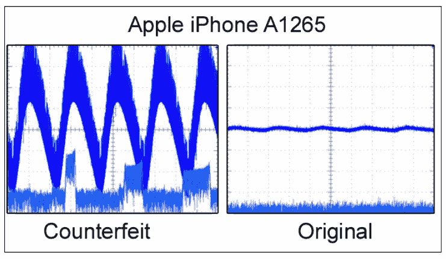
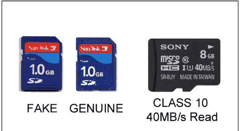

## 1 使用 Raspberry Pi 入门

连接到网络应该像插入一根电缆一样简单。问题是，在连接到互联网或本地网络后，我们可以在 Raspberry Pi 上做什么？这就是为什么必须了解 Raspberry Pi 的硬件前提和功能，以便您的想法在理论上是可实现的。同样，深入了解您的硬件将使本书后面处理故障排除问题变得容易得多。

与 Raspberry Pi 相关的最常见问题与电源有关。这些问题可能导致其重新启动、出现意外行为，或如果您连接了外部显示器，在启动过程中可能显示彩虹屏。

本章全部关于识别您正在使用或可能与之一起使用的 Raspberry Pi 及其外设。您应该了解有关 Raspberry Pi 的两个主要信息：型号和版本。

### 硬件要求

本书假设您使用的是 Raspberry Pi 2，型号 B。

Raspberry Pi 2 与其前身大部分向后兼容。每当出现兼容性问题时，都会明确告知用户，如果可能，会提供替代解决方案。

Raspberry Pi 的最新版本在最基本层面上只需要电源和 Micro SD 卡即可运行。为了使初始配置更轻松，建议您还配备 HDMI 电缆、带 HDMI 输入的宽屏显示器或电视、以太网电缆以及 USB 键盘。

下表描述了各种型号之间的主要差异：

| 型号 | 第二代 Model B | Model B+ | Model A+ |
|---|---|---|---|
| SoC | BCM2836 | BCM2835 |  |
| CPU | 900 MHz Quad Core ARMv7 | 700 MHz single core ARMv6 |  |
| GPU | VideoCore IV @ 250Mhz / OpenGL ES 2.0 / H.264/MPEG-4 AVC | VideoCore IV @ 250Mhz / OpenGL ES 2.0 / H.264/MPEG-4 AVC | VideoCore IV @ 250Mhz / OpenGL ES 2.0 / H.264/MPEG-4 AVC |
| SDRAM | 1 GB | 512 MB | 256 MB |
| USB | 4 | 2 | 1 |
| 音频输入 | 无直接输入，两块修订版板通过 I2S，均使用 USB | 无直接输入，两块修订版板通过 I2S，均使用 USB | 无直接输入，两块修订版板通过 I2S，均使用 USB |
| 网络 | 10/100 Mbit/s | 10/100 Mbit/s | None |
| GPIO | 17 | 17 | 17 |
| 接口 | 40 pins | 26 pins | 26 pins |
| 功耗 | 800 mA (4.0 W) | 800 mA (4.0 W) | 200 mA (1 W) |
| SD 卡 | Micro SD slot | Micro SD slot | Micro SD slot |

随着 Raspberry Pi 的最新型号，大多数外设应可即插即用，因为这些版本已升级为专用电源电路，以处理峰值负载，同时降低整体功耗。只有 plus 型号才具有此新电路，而所有旧版本的 Raspberry Pi 可能因电路效率低下而出现电源问题。最节能的 Raspberry Pi 是 Model A+，通常使用电池供电。我们将在本书后面的章节讨论使用电池为 Raspberry Pi 供电。

### 电源

Raspberry Pi 2 理想情况下应使用 2 安培 USB 电源供电，如果您计划将外设连接到 USB 端口。家中最常见的电源是 1 安培电源，通常随智能手机、平板电脑或迷你电脑提供。这些充电器通常由优质组件制成，可以轻松处理额外电力、电力峰值，并产生干净的直流电源，这对于 Wi-Fi 或串行外设非常重要。

您还应注意使用的 USB 电缆，因为有些电缆生产廉价，内部铜线非常细，在需要时难以提供 1 安培或更多的电流。

在一次独立测试中，最佳 USB 充电器被证明是 HP TouchPad 充电器（P/N 157-10157-00），其次是 Apple A1265、Apple iPad A1357 和 Samsung Cube ETA0U80JBE。它们被认为是最好的，因为它们产生的直流电非常干净，并且能够在长时间内承受峰值负载。不过要小心，因为现在也有很多假冒充电器在销售，尤其是 Apple A1265。随着时间的推移，其中一些电源可能会过时。尝试搜索更新的测试。

为了帮助可视化直流噪声问题，请查看以下图像。左侧的波形极其嘈杂，会对 Wi-Fi、Bluetooth 或甚至串口等通信外设造成严重问题。右侧的波形被认为干净且稳定：

在互联网上搜索如何识别假冒充电器的技巧。

## USB hub

当您购买带电 USB 集线器时，通常会配备 2 或 3 安培的电源。这足以为 Wi-Fi 适配器、USB 硬盘、一些其他外设，甚至是 Raspberry Pi 本身供电。

典型的問題出現在 HD USB 相機上，運行一段時間後畫面會變黑。使用带电 USB 集线器可以解决这个问题。

## SD cards

SD 卡看起来都一样，但实际上有些使用多种不同的控制器和 NAND Flash 内存芯片。所有这些组合构成了卡的可靠性和速度；通常最便宜的也是最差的。话虽如此，花大价钱购买 SD 卡也不是一个好主意。SD 卡的速度用数字符号标记，从 1（最慢）到 10（最快）。Class 6 或 8 的 SD 卡在性能和价格之间取得了良好的平衡。

然而，并非所有 Class 10 卡都是最佳选择。唯一确定的方法是使用可靠的速度测试应用程序来验证卡是否达到标称的读写速度；这是识别假冒卡的最佳方法：

SD 卡应仅用作安装在其上的操作系统和应用程序的主分区。将 SD 卡用于频繁更改的数据（如数据库）并不是一个好主意，因为它会比预期更快地降低卡的使用寿命。相反，我们应使用外部存储设备，如硬盘或网络附加存储（NAS）来处理频繁更改的数据，同时也有助于存储大量媒体。

本书假定您至少使用 8 GB 的 SD 卡。

## Extra peripherals

Raspberry Pi 被[content]
在一次独立测试中，最佳 USB 充电器被证明是 HP TouchPad 充电器（P/N 157-10157-00），其次是 Apple A1265、Apple iPad A1357 和 Samsung Cube ETA0U80JBE。它们被认为是最好的，因为它们产生的直流电非常干净，并且能够在长时间内承受峰值负载。不过要小心，因为现在也有很多假冒充电器在销售，尤其是 Apple A1265。随着时间的推移，其中一些电源可能会过时。尝试搜索更新的测试。

为了帮助可视化直流噪声问题，请查看以下图像。左侧的波形极其嘈杂，会对 Wi-Fi、Bluetooth 或甚至串口等通信外设造成严重问题。右侧的波形被认为干净且稳定：

在互联网上搜索如何识别假冒充电器的技巧。

## USB hub

当您购买带电 USB 集线器时，通常会配备 2 或 3 安培的电源。这足以为 Wi-Fi 适配器、USB 硬盘、一些其他外设，甚至是 Raspberry Pi 本身供电。

典型的問題出現在 HD USB 相機上，運行一段時間後畫面會變黑。使用带电 USB 集线器可以解决这个问题。

## SD cards

SD 卡看起来都一样，但实际上有些使用多种不同的控制器和 NAND Flash 内存芯片。所有这些组合构成了卡的可靠性和速度；通常最便宜的也是最差的。话虽如此，花大价钱购买 SD 卡也不是一个好主意。SD 卡的速度用数字符号标记，从 1（最慢）到 10（最快）。Class 6 或 8 的 SD 卡在性能和价格之间取得了良好的平衡。

然而，并非所有 Class 10 卡都是最佳选择。唯一确定的方法是使用可靠的速度测试应用程序来验证卡是否达到标称的读写速度；这是识别假冒卡的最佳方法：

SD 卡应仅用作安装在其上的操作系统和应用程序的主分区。将 SD 卡用于频繁更改的数据（如数据库）并不是一个好主意，因为它会比预期更快地降低卡的使用寿命。相反，我们应使用外部存储设备，如硬盘或网络附加存储（NAS）来处理频繁更改的数据，同时也有助于存储大量媒体。

本书假定您至少使用 8 GB 的 SD 卡。

## Extra peripherals

Raspberry Pi 被品牌化为一台计算机，我们期望可以连接各种不同的设备。Raspbian 基于 Debian，并且为 Raspbian 移植了绝大多数驱动程序和软件付出了巨大的努力。你可能有一些旧的 USB 外设，比如一个游戏手柄。如果你在其他任何 Linux 平台上能找到驱动程序，就应该能够让它在 Raspbian 上工作。将其插入，使用 `lsusb` 命令行实用程序，并检查是否已被检测到。如果你凭借自己的知识成功让它工作，你应该在论坛上分享这些知识以造福其他用户。

## Essential peripherals

你应该考虑购买这些外设并专门用于你的 Raspberry Pi。它们将使设置一切变得更容易，并且甚至可用于长期用途：

- **Wireless USB network adapters**: 在撰写本书时，当前的 Raspbian 镜像支持多种无线适配器，无需安装任何额外驱动程序。许多迷你、纳米或微型版本可以直接从 Pi 的 USB 端口运行，不需要带电 USB 集线器。
- **USB hubs**: 因为某些版本的 Raspberry Pi 仅限于两个 USB 端口，所以拥有一个兼容的带电 USB 集线器是明智的。带电是关键，因为这将允许你同时插入任何 USB 设备或多个设备，而不会影响 Pi 的供电稳定性。在撰写本文时，Raspbian 尚未完全兼容三个 USB 集线器。
- **Keyboards and mice**: 大多数有线键盘和鼠标可以直接从 Raspberry Pi USB 端口运行。许多蓝牙键盘和鼠标也可以直接从 Pi 的 USB 端口工作，但需要使用有线键盘进行初始设置。一些无线键盘，例如 Microsoft 3000 系列，无需任何配置，因为 USB  dongle 模拟了 PS/2 有线键盘，可以在启动时直接使用，无需额外配置。

> 你可以访问 http://elinux.org/RPi_VerifiedPeripherals 获取兼容外设的最新列表。

## Useful peripherals

随着你对 Raspberry Pi 越来越熟悉，你会为你的项目想出新的、更大的想法。有了这些想法，你可能需要一些更有用的设备来帮助你。

## Internet 3G dongles

你可以使用 3G 加密狗连接到互联网。这些设备需要大量电力，并且需要从带电集线器运行才能全速工作。它们是在你所在国家最偏远的地方也能轻松将 Raspberry Pi 连接到互联网的绝佳方式。只要你有基本的语音信号，你就应该始终能够使用 GPRS（单通道 57.5 kbps 或双通道 115 kbps），这足以发送大量的日志文本数据。一些国家提供免费短信，这也可以用来收发最少量的数据。如果你计划运行服务器，建议你改用连接到 ADSL/DSL 连接的 LAN 或 Wi-Fi。

## Audio recording

Raspberry Pi 拥有自己的音频输出硬件，能够通过 HDMI 或通过 3.5 毫米插孔的模拟音频为你提供高清音质。

你可能会遇到想要从线路输入或麦克风录制音频的情况；你可以使用任何 USB 1.1 或 USB 2.0 声音采集设备来完成此操作。

## Other media add-ons

- **IR receivers**: 红外（IR）接收器是使用传统遥控器控制 Raspberry Pi 的绝佳方式。FLIRC USB IR 遥控 dongle 是你开始这样做的绝佳方式。
- **TV and radio receivers**: 这是将你的 Raspberry Pi 变成完整 DVR 系统的终极方式。从 HD 卫星或数字电视录制、播放或暂停直播电视。你也可以收听你喜欢的广播频道。
- **Webcams**: Raspberry Pi 有一个专用的 HD 摄像头模块端口。拥有其中一个摄像头是一种真正的享受，最新版本的 Raspbian 支持 UV4L（Video for Linux）。多种 USB 网络摄像头也受支持并支持 UV4L。曾经是一项相当复杂的任务，现在变得容易多了。
- **Multicard readers**: 如果你使用各种卡类型，这些会很有帮助。通用类型的支持有限，但 USB 3.0 USRobotics 一体式读卡器工作得非常好，你可以同时挂载全部六张卡。
- **AlaMode**: WyoLum 是一家初创企业，创建了适用于各种应用的有用附加组件。具体来说，AlaMode 是一款 Arduino 兼容板，带有实时时钟和 microSD 插槽，放置在 Raspberry Pi 之上。你可以使用 Pi 的专用 UART（通用异步收发传输器）与 Arduino 通信，并且它可以从 Pi 的电源运行。如果你喜欢电子项目并且已经熟悉 Arduino，这值得一看。你甚至可以用它来刷新其他 Arduino 兼容芯片或上传固件使其独立运行！
- **HDMI to VGA**: 如果你使用较旧或备用的仅支持 VGA 的显示器、电视或 LCD 屏幕，你可以从你喜欢的在线拍卖网站或电子商店购买一条内置 HDMI 转 VGA 转换器。你必须确保购买主动转换器，其价格略高于被动转换器。主动意味着它包含一个微控制器，使用 HDMI 端口的电力将数字信号转换为 VGA 标准。Raspberry Pi 能够为这种类型的设备供电。

## 有趣的外设

你可能在你的小工具箱里有一些这些东西。希望阅读关于这些使用较少的设备的内容能激发一些创造性的想法：

- **摇杆**：微软的 Xbox 360 手柄在使用 **xboxdrv** 时在 X 中像鼠标一样工作，该程序可以从软件包仓库安装。其他摇杆可能需要移植的驱动程序，可以在互联网论坛上找到。
- **USB 转 SATA**：你可以购买简单的 USB 转 SATA 控制器，使用专用电源为其供电，从而连接 SATA 硬盘。真正的乐趣始于使用基于硬件 RAID 的 USB 转 SATA 控制器，它们可以以各种配置串联使用，从而提供海量存储、高冗余或最大性能。
- **CAN 总线**：CAN 总线是所有现代机动车使用的标准。它是一个标准端口，提供任何人都可以解读的强制性数据，例如油门值、气缸失火或空燃比。PEAK-System 拥有多种与树莓派兼容的外设和软件。如果你能够访问制造商特定的代码，甚至可以用这些工具调整发动机映射。
- **家庭自动化**：名为 TellStick 的兼容设备作为树莓派的第三方家庭自动化设备运行良好，但作为高级 Linux 用户，你应该努力使用实时微控制器自行制作应用程序，例如 AlaMode 上的 Arduino，或非常便宜的 PICAXE 微控制器。
- **USB 导弹发射器**：可在各种网站和商店获得，这是如果你需要向不明物体发射毛绒导弹的完美小工具！这纯粹是一个娱乐外设，但你也可以将其用于 DIY 项目。

> 然而要小心，你能达到的最大吞吐速度受 USB 2.0 带宽的限制。理论上，这最大速度为 60 MBps，但由控制器上的所有设备共享，而不是每个端口。有关此内容的更多信息将在本书后面介绍。

> 调整非标准值可能会损坏你的 ECU 并使任何保修失效。

- **指纹扫描仪：** Futronic 的指纹扫描仪与 Raspbian 配合良好，并且网上可以找到许多示例。它们是独立的可编程设备，通过 USB-UART 使用简单消息与 Pi 通信，并且随设备提供详尽的文档。
- **气象站：** Sparkfun 销售一套相当完整的气象站，包括风向标、风速计和翻斗式雨量计。套件包含夹具和安装支架。你可以轻松且不花太多钱添加光照、温度和湿度传感器。挑战在于使用实时微控制器并构建自己的数据库来记录所有数据。但不用担心，网上有许多教程可以帮助你更进一步。

## 在树莓派上安装 Raspbian

Pi 上可以运行许多发行版。有些是特定的实时操作系统，例如 RISC OS，或主流操作系统，例如 Raspbian 或 Archlinux。还有一些家庭媒体中心版本，例如 OpenElec 或 OSMC（以前称为 XBMC）。截至 2015 年 6 月，你还将能够安装 Windows 10 物联网。近期不预计会有 Android 支持。

树莓派基金会建议你使用他们名为 NOOBS（New Out Of Box Software，即开箱即用软件）的镜像，其中包含经常更新的不同操作系统的列表。在本书中，我们将使用 Raspbian。它由基金会支持，并且在易用性方面具有最佳兼容性。Raspbian 基于 Debian，与许多其他 Linux 操作系统相似。安装 Raspbian 的步骤如下：

1. 对于 Windows 和 Macintosh 用户，树莓派基金会建议你使用来自 `http://www.sdcard.org/` 的 SD Formatter。
   对于 Windows，请执行以下步骤：
   1. 安装 SD 卡格式化工具。
   2. 在 **选项** 菜单中将 **格式化大小调整** 选项设置为 **开启**。
   3. 确保已选择正确的 SD 卡。
   4. 点击 **格式化** 按钮。
   对于 Macintosh，请执行以下步骤：
   1. 安装 SD 卡格式化工具。
   2. 选择 **覆盖格式化**。
   3. 确保已选择正确的 SD 卡。
   4. 点击 **格式化** 按钮。

对于 Linux，请执行以下步骤：
   1. 建议你在 Linux 中使用 GParted 或 Parted 工具。
   2. 将整个磁盘格式化为 FAT。

2. 你应该从 http://www.raspberrypi.org/downloads/ 下载最新的 NOOBS 归档文件。
3. 解压归档文件。
4. 将提取的文件复制到格式化的 SD 卡上。
5. 将 SD 卡插入树莓派。插入 HDMI 或其他视频线缆，连接兼容的键盘并通电。
6. Pi 将启动并显示操作系统列表；选择 **Raspbian**。
7. 如果你的显示器空白，请在 Pi 启动时尝试按此处列出的数字键：
   - 1：HDMI 模式
   - 2：HDMI 安全模式
   - 3：复合 PAL
   - 4：复合 NTSC

## 了解树莓派的设计

树莓派的 PCB 上有两个可识别的微芯片：

- 中央有一个芯片，上面清楚地标有 Broadcom 标志和以 BCM283x 开头的文字，这是主处理器
- 树莓派 2 的 RAM 芯片位于 PCB 背面。
- 靠近 USB 端口处有一个较小的芯片，具体取决于型号，它是 USB 集线器或 USB/LAN 芯片。

BCM283x 实际上是一个高性能 GPU，内置 ARM 处理器。它是一个 SoC（片上系统），这意味着在它打开时执行的代码有少量空间。这在启动过程中被称为第 1 阶段。

## 启动过程

启动过程中需要执行一些网络操作，了解各个阶段是有益的，以防需要排查问题。启动过程如下：

1. 第 1 阶段在 GPU 上开始并执行 SoC 固件代码，该代码开始将第 2 阶段代码加载到 L2 缓存中。
2. 第 2 阶段从 SD 卡读取 `bootcode.bin`。它初始化 SDRAM（同步动态随机存取存储器）并加载第 3 阶段。
3. 第 3 阶段是 `loader.bin` 文件。它加载 `start.elf`，从而启动 GPU。
4. 在 `start.elf` 期间，它准备加载 `kernel.img`。
5. 然后内核映像读取 `config.txt`、`cmdline.txt` 和 `bcm283x.dtb`。
6. 如果 `.dtb` 文件存在，它将在 0x100 处加载，而内核将在内存中 0x8000 处加载。
7. 内核映像是在 ARM CPU 上运行的第一个二进制文件，并且可以编译为特定硬件提供自定义支持。
8. 操作系统开始加载。

第 1 到第 3 阶段的所有源代码均为闭源并受 Broadcom 保护。这些闭源文件仅由 Broadcom 编译和发布；你可以通过在 Raspbian 中运行固件升级来更新 SD 卡上的这些文件，这将在后面介绍。

`kernel.img` 文件将应用程序连接到硬件。任何具有操作系统的计算机都有某种内核。在 Linux 中，可以编译自己的内核，这可能是你想要自行修改的第一个文件。这允许你更改启动画面、加载自定义驱动程序或执行可能需要的其他任务。这是一项高级任务，本书不涵盖。

## 其他功能

BCM283x 还具有专用音频硬件以及视频编码/解码功能。这使树莓派能够播放高清（MPEG-4）内容，例如视频，或使用 OpenGL ES 渲染游戏。你可以购买额外的编码器/解码器许可证以获得额外功能，例如用于 DVD 视频编码的 MPEG-2 和用于微软 WMV 格式的 VC-1。这也用于 Silverlight 直播。

SD 卡也由 Broadcom 芯片使用专用硬件输入/输出和中断直接接口。

All that dedicated hardware means that while those sections of the chip are fully utilized, the ARM CPU will be idle or hardly used. This allows you to compute other transactions synchronously, and this is what makes the Raspberry Pi a truly unique single board, credit card-sized computer!

## 硬件限制

All this hardware that is crammed into one tiny space has its drawbacks. Some are deliberate and others are not. You should consider that these are theoretical calculations; real-world performance may vary, but are usually slower than theoretically estimated.

## 网络速度

It may be disappointing that the Raspberry Pi Foundation decided to use a 100 Mbps LAN chip instead of a gigabit one. We need to crunch some numbers to justify this decision, though. Let's convert megabits to a more familiar megabytes. To get to megabytes per second from megabits per second, we divide 100 Mbps by 8 (there are eight bits in a byte). This equates to 12.5 megabytes per second at 100% LAN capacity. For a single user, this is only roughly 20% of what the USB hub can handle. This means that by design, this is an unchangeable bandwidth limitation for networking.

If you plan to share files with several users at the same time, each new user will bump down the other user's bandwidth to accommodate their own. As a workaround, you could add a USB gigabit LAN peripheral. But due to speed constraints of the USB hub, you will only use approximately 48% of the gigabit LAN. To make matters worse, any hard drives running on the USB port will start to fight for bandwidth. The USB controller has to share 480 Mbps across all ports! One port is used by the 100 Mbit network card, and the other connects the hub to the GPU. For one user, this means a maximum bandwidth of 240 Mbps. Why 240 Mbps? This is because 240 Mbps goes to the LAN and 240 Mbps goes to the hard drive, and theoretically, there is no USB bandwidth left for anything else.

This could be a problem for a multiuser environment, but for home use, you would not run into any major problems as the bandwidth can accommodate HD video streams while serving other clients. This is why the cheaper 100 Mbps version was used.

## USB 瓶颈

As it was made clear by the bottlenecks found in the LAN, the worst thing about USB bottlenecks is that there is no way to work around this problem! This is because the USB controller connects to the Broadcom and LAN chips, respectively, on the PCB without any possibility of expanding or bypassing this chip.

## 时间

The Raspberry Pi also does not come with a real-time clock, so timekeeping is left to Internet-based time servers. For many people, this might not cause a problem, but if you wanted to create a remote, disconnected device that depends on recording events at various times of the day, you might be left a little bit disappointed.

One easy and reliable way to do this is to connect a USB or I²C RTC that runs off a small battery. There is an easier and free option, though, but it is not as accurate; you may want to install the fake-hwclock package. All you need to do is set the time once, and the software will keep track of time using a file. If you have a power outage, the software will read the file and set the time back to the last known time. The drawback is that you lose that time as there is no way to determine how long the outage lasted for.

To get time without using the Internet, you can find a cheap GPS receiver. When the GPS gets a good lock, it will provide you with extremely accurate time. This same method is used to synchronize GSM voice calls on mobile phone technologies across the world.

Another method is to use the time broadcasted by long wave radio signals. These also broadcast extremely accurate time using atomic clocks. The availability depends on your location, though. These are currently available in Colorado for most of the US; Germany, Russia, the UK for Europe; and finally, Japan. The radio waves operate on different frequencies and more research is required for this method.

## 参考文献

The following are the references for this chapter:

- 有关 USB 功耗基准的更多信息请访问 http://www.righto.com/2012/10/a-dozen-usb-chargers-in-lab-apple-is.html.
- Crystal Disk Mark is a great SD card benchmarking tool with a lot of test results available online for comparison.

## 总结

One of the most popular questions found on the Internet was how to increase the Pi's performance! With the release of the Generation 2, ARM V7, quad core 900 MHz, this is no longer the case. At the time of writing this book, one of the most popular questions is how to run the Raspberry Pi using batteries, which we will cover in a later chapter!

The purpose of understanding the architecture is vital to a successful long term project. The Raspberry Pi works like any other computer, but it was designed purely for experimental and learning purposes. It should not be used in production environments, but it is an extremely attractive solution for production nevertheless.

It is an excellent platform to share media between friends at school; it is fantastic to stream HD media on your TV and is robust enough for many standalone applications.

In the next chapter, you learn how to set up networks on the Raspberry Pi.
