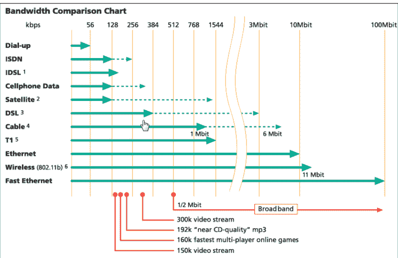

## 2 准备网络

It is important to learn how your network works, especially if you plan to connect your Raspberry Pi to the Internet. A home user will typically use an Internet package designed to browse websites and read e-mails. Business packages, on the other hand, need to do a lot more than you think. These two different ISP packages usually carry important technical differences that dictate how your network can be reached.

In this chapter, you will learn how to connect to the Internet and look at how to solve some common problems for home users. You will also learn how to benchmark your network and try to isolate any network-related issues.

## 本地局域网 (LAN)

Using the standard Raspbian package, both essential and non-essential drivers are included. All essential drivers are loaded and some non-essential ones are as well.

We will start by plugging in a network cable between the Raspberry Pi and the router provided by your ISP. By default, your router has a DHCP server that automatically assigns an IP address to your Raspberry Pi.

You may also use network switches to make a more complex network but because the Raspberry Pi has a 100 megabit network port, it may downgrade your entire network to 100 megabits. Some switches can negotiate separate connections to lower speed interfaces without downgrading the entire network, but you need to consult the specifications of the device in order to do this.

To check whether your LAN is up and running, just type `ifconfig`, and you will get text containing your current settings:

```
eth0      Link encap:Ethernet  HWaddr b8:27:eb:45:bb:fa
          inet addr:192.168.1.135  Bcast:192.168.1.255  Mask:255.255.255.0
          inet6 addr: fe80::ba27:ebff:fe45:bbfa/64 Scope:Link
          UP BROADCAST RUNNING MULTICAST  MTU:1500  Metric:1
          RX packets:89  errors:0  dropped:0  overruns:0  frame:0
          TX packets:96  errors:0  dropped:0  overruns:0  carrier:0
          collisions:0  txqueuelen:1000
          RX bytes:7943  (7.7 KiB)  TX bytes:14104  (13.7 KiB)

lo        Link encap:Local Loopback
          inet addr:127.0.0.1  Mask:255.0.0.0
          inet6 addr:  ::1/128 Scope:Host
          UP LOOPBACK RUNNING  MTU:16436  Metric:1
          RX packets:0  errors:0  dropped:0  overruns:0  frame:0
          TX packets:0  errors:0  dropped:0  overruns:0  carrier:0
          collisions:0  txqueuelen:0
          RX bytes:0  (0.0 B)  TX bytes:0  (0.0 B)
```

Let's try to understand the different keywords from the preceding output:

- **HWaddr**: This is your Pi's MAC address, which identifies a vendor and should ideally provide a globally unique address.
- **inet addr**: This is your current LAN IP address, which belongs to a private range of either `10.x.y.z` (Class A), `172.16.x.x` (Class B), or `192.168.x.x` (Class C). They are known as private addresses because they do not exist on the Internet.
- **Bcast**: This is a reserved address that's calculated by your network mask, and it transmits global messages within your private network.
- **Mask**: This is used in all networks but should only be concerned with advanced configurations. Masks divide a network into subnetworks and depend on the class your network belongs to.
- **inet6 addr**: This is your IPv6 address. It will show only if your router supports this, but it is more difficult to remember.
- **RX**: This shows how many packets have been received.
- **TX**: This shows how many packets have been sent.

## eth0 端口

The Raspberry Pi will typically use **eth0** as its on-board LAN interface. If you add USB LAN devices, they will have an incremented number after *eth*; this will increment the interface number.


## wlan0 接口

当我们添加无线适配器时，ifconfig 会使用 wlan 而不是 eth 前缀来表示这些接口。所有细节都相同，但有助于直观区分有线网络和无线网络。

## 回环（LO）接口

这被称为回环地址，因为它指的是本地设备，并且有一个保留范围，从 127.0.0.1 开始，到 127.255.255.254 结束。这是一个虚拟接口，绕过本地硬件接口和规则。它通常因安全原因和在软件测试期间而使用。例如，您可能只允许 MySQL 对 localhost 的 root 访问（这将包括 IPv4 的 127.0.0.1 或 IPv6 的 ::1）。这意味着只有计算机上的用户或服务才会被授予访问此资源的权限。它是保留的，localhost 也不可以 127.x.y.z 分配给互联网上的用户。

## 无线配置（Wi-Fi）

Wi-Fi 是一种方便的方式，让您的 Raspberry Pi 在无线网络内的无线环境中运行。对于服务器来说，这并不是理想的解决方案，因为传输数据时延迟会增加，而且许多 Wi-Fi 网络会受到同一频率上其他网络产生的噪声影响。

有许多类型的无线适配器可用，并非所有驱动程序都包含在 Raspbian 中。您可能需要安装特定的驱动程序，但这通常是一个简单的过程。谈到无线配置时，您需要针对适配器上使用的芯片，而不是销售它的最终厂商。

## 推荐的无线适配器

最稳定且价格实惠的芯片组之一是 Realtek RT8191，它支持 802.11n 标准。它也兼容较旧的 802.11b/g 规范，以防您的路由器不支持更新的 802.11n 规范。然而，它不支持 5 GHz 频率或 40 MHz 双频带。


> 在 http://elinux.org/RPi_USB_Wi-Fi_Adapters 上有兼容适配器的全面列表。

多方比较以找到最佳价格，最好不要选择那些声称是 Raspberry Pi 唯一和最佳的昂贵适配器。


> 您应该注意，默认情况下，无线和有线网络不能以组合模式工作。配置 Wi-Fi 后，您需要移除有线连接并重新启动 Raspberry Pi。这将正确配置无线接口。连接有线连接通常会在 Raspberry Pi 启动后使无线连接掉线。

## 从桌面设置

在桌面上使用菜单栏中找到的 Wi-Fi 配置工具是几秒钟内连接到无线网络最方便的方式。如果您刚刚安装了 Raspbian 并计划使用 Wi-Fi 而不是以太网连接，建议您从这里开始。您的 SSID，即无线接入点的可读名称，必须由您的路由器广播才能工作。如果您将其隐藏，则应改用控制台方法。按照以下步骤设置桌面：

- 1. 在右侧菜单栏末尾左键单击网络图标。
- 2. 所有未隐藏的网络都将显示。
- 3. 左键单击您想要连接的网络。
- 4. 输入您的密码并单击确定。
- 5. 经过几秒钟后，图标将停止闪烁。
- 6. 您可以通过右键单击网络图标来调整网络设置。

## 从控制台设置

如果您计划以无头模式运行 Raspberry Pi（即未连接显示器或键盘），默认情况下您不需要访问桌面，也无法使用桌面网络实用程序。

在 Raspbian 的最新发行版中，SSH 服务默认启用，您可以 SSH 进入 Raspberry Pi。如果您刚刚加入 Wi-Fi 网络，可以调整其设置。这是在使用以太网设置 Wi-Fi 时的意图。现在您可以通过 SSH 登录，并输入以下命令：

```
sudo nano /etc/network/interfaces
```

这将打开包含的文件编辑器 nano，并向您展示当前的接口配置。我们关注最后几行。如果您看不到某些行，可以手动输入：

```
auto lo

iface lo inet loopback
iface eth0 inet dhcp

allow-hotplug wlan0
auto wlan0

iface wlan0 inet dhcp
    wpa-ssid "ssid"
    wpa-psk "yourpassword"
```

要保存文件，请按 CTRL + X，然后按 Y，最后按 Enter 完成。

allow-hotplug 命令将按其名称所述执行：它允许您插拔分配给 wlan0 接口的无线适配器。Auto wlan0 告诉 Raspbian 根据您提供的设置自动配置接口。

我们需要用路由器详细信息替换 SSID 和密码，保持文本在引号内。这是可以使用最基本的配置。

不过此配置有一个问题：如果无线与路由器断开连接，接口不会自动重新启动。有许多脚本试图解决这个问题。配置要求您了解有关无线配置的额外详细信息。下一节提供了一种完全自动化的方式来执行此操作。我们将使用 wpa-supplicant，它现在默认随 Raspbian 安装。在 /etc/network/interfaces 中，我们将最后几行更改为以下内容：

```
allow-hotplug wlan0
iface wlan0 inet manual
wpa-roam /etc/wpa_supplicant/wpa_supplicant.conf
iface default inet dhcp
```

我们需要进入 /etc/wpa_supplicant 目录，创建文件并编辑 wpa_supplicant.conf：

```
sudo touch wpa_supplicant.conf
nano wpa_supplicant.conf
```

## 下载示例代码

您可以从 http://www.packtpub.com 的账户下载本书的示例代码文件。如果您在其他地方购买了本书，可以访问 http://www.packtpub.com/support 并注册以直接将文件通过电子邮件发送给您。

您可以通过以下步骤下载代码文件：

- 使用您的电子邮件地址和密码登录或注册我们的网站。
- 将鼠标指针悬停在顶部 **SUPPORT** 选项卡上。
- 单击 **Code Downloads & Errata**。
- 在 **Search** 框中输入书名。
- 选择您要下载代码文件的书籍。
- 从下拉菜单中选择您购买本书的来源。
- 单击 **Code Download**。


您也可以通过单击 Packt Publishing 网站上书籍网页上的 **Code Files** 按钮来下载代码文件。可以通过在 **Search** 框中输入书名来访问此页面。请注意，您需要登录到您的 Packt 账户。

下载文件后，请确保使用最新版本解压缩或提取文件夹：

- Windows 的 WinRAR / 7-Zip
- Mac 的 Zipeg / iZip / UnRarX
- Linux 的 7-Zip / PeaZip

在 nano 中，一个简单的文本编辑器，我们需要输入以下内容：

```
ctrl_interface=DIR=/var/run/wpa_supplicant GROUP=netdev
update_config=1

network={
    ssid="ssid"
    proto=WPA RSN
    key_mgmt=WPA-PSK
    pairwise=CCMP TKIP
    group=CCMP TKIP
    psk="password"
}
```

配置文件包含有关连接的一些额外详细信息。supplicant 的工作方式是它将尝试使用为 proto、pairwise 和 group 定义的参数进行连接。您可能需要调整 key_mgmt，但 WPA-PSK 是现代无线路由器最常见的配置。

此方法还允许您在路由器不广播其 SSID 时连接到路由器。

> 普遍的误解是禁用 SSID 广播可以保护您的网络。即使您关闭了此功能，使用普通无线网卡仍有工具可以毫不费力地找到 SSID 名称。最佳的安全措施是使用最新的加密协议和复杂的密码。

## 使用 wicd-curses

使用 wicd-curses 包是在控制台中设置无线甚至有线接口的更简单方法。该包允许您编辑高级选项，例如静态 IP、DNS 和主机名。后台还运行一个守护进程，如果无线信号中断会自动重新连接接口，这是在信号较差区域维护无线网络的更可靠方式。要使用此包，您应该在 wpa_supplicant 接口文件中注释掉任何设置：

> 安装此包将安装许多其他依赖包，并可能占用超过 8 MB 的额外空间。一些来源还声称运行此守护进程会使用更多开销，但这听起来是为了易用性和可靠性而付出的公平价格，尤其是在 Raspberry Pi 2 上。

```
sudo apt-get install wicd-curses
sudo wicd-curses
```

您将获得一个控制台屏幕，其中列出可用的无线接入点。使用光标键选择您的接入点，然后按右箭头键编辑其属性。

> 如果您看到未检测到无线网络的消息，请尝试按 P 打开首选项窗口，并在无线接口字段中输入 wlan0。

一旦进入无线网络配置首选项屏幕，您只需在密钥字段中输入密码即可。按 F10 保存设置。


如果你使用有线连接来设置无线连接，你需要按下 C，这将连接到接入点。留意你的 Wi-Fi 上的状态 LED（如果有的话）。你应该会看到它开始闪烁，几秒钟后它会变得常亮，这意味着连接已建立。此时，SSH 会话很可能会中断，因为有线连接会被禁用。你应该拔掉有线连接，并使用无线 IP 或主机名重新连接。

> 可以通过 Web 界面登录路由器并查看 DHCP 列表来找到无线 IP。

## 静态网络地址

有些路由器的 DHCP 服务器倾向于不时更改你的私有地址。设置静态私有地址是防止这种情况发生的快速方法，而且更容易记住 IP 地址是什么。

然而，许多较新的路由器能够在 DHCP 设置中分配首选 IP 地址，或根据设备的 MAC 地址自动分配长期 IP。长期 IP 通常意味着路由器被重置为出厂默认设置，或它将耗尽 IP 地址并替换 DHCP 列表中最旧的条目。

使用大多数家用路由器时使用静态地址的弊端是路由器可能不知道此设备。原因在于它必须无休止地扫描整个网络，从而占用宝贵的资源。如果 DNS 服务未通告 Raspberry Pi 的 IP 地址，你将无法使用其主机名（默认为 `raspberry`），而必须输入完整的 IP 地址。此外，如果你想将 Raspberry Pi 用作媒体中心，它将花费更长时间或甚至可能不会出现在网络列表中。最糟糕的是，如果设备不在 DHCP 客户端列表中，一些路由器将不允许你将端口转发到你的 Raspberry Pi。

最好始终让 DHCP 服务器控制网络上的 IP 地址分配，以便与其并行运行的 DNS 服务器能够正常工作。使用 `wicd-curses` 设置静态 IP 地址很容易，但你也可以在路由器上禁用 DHCP 和 DNS，并使用 Raspberry Pi 作为独立的防火墙、DHCP 和 DNS 服务器。

本书未涵盖设置自己的 DHCP 和 DNS，因为该主题本身根据你的需求可能需要数章篇幅。

## 测试和基准测试你的网络

这些是可执行的必要测试，用于排查网络问题。
你也可以使用这些高级技术来基准测试你的网络。

### 基础测试

检查是否已连接到互联网的最简单方法是 ping 远程地址。


> 以下测试是在 Wi-Fi 上进行的，不仅是为了测试 Wi-Fi 连接的可靠性，也是为了实现最佳稳定性；始终建议使用以太网连接。这些示例演示了使用 Wi-Fi 时可能遇到的各种瓶颈。

我们可以 ping http://www.google.com，但我们也可以使用简写和易于记忆的 IP 地址，例如 8.8.8.8，这是 Google 的公共 DNS 服务器。此 IP 地址将解析到你所在区域最近的 Google DNS 服务器，即使它宕机，也有许多备份服务器，使其成为可靠的测试：

```
ping -c 1 google.com
ping -c 1 8.8.8.8
```

```
root@nas:~# ping -c 1 www.google.com
PING www.google.com (31.55.166.217) 56(84) bytes of data.
64 bytes from 31.55.166.217: icmp_req=1 ttl=57 time=16.7 ms

--- www.google.com ping statistics ---
1 packets transmitted, 1 received, 0% packet loss, time 0ms
rtt min/avg/max/mdev = 16.720/16.720/16.720/0.000 ms
root@nas:~#
root@nas:~#
root@nas:~# ping -c 1 8.8.8.8
PING 8.8.8.8 (8.8.8.8) 56(84) bytes of data.
64 bytes from 8.8.8.8: icmp_req=1 ttl=43 time=31.1 ms

--- 8.8.8.8 ping statistics ---
1 packets transmitted, 1 received, 0% packet loss, time 0ms
rtt min/avg/max/mdev = 31.118/31.118/31.118/0.000 ms
root@nas:~#
```

ping 可以帮助你确定是否可以访问互联网。你可能想检查向 Raspberry Pi 下载文件的速度。我们将使用热门网站 http://www.speedtest.com 来帮助我们直接在命令行中执行此操作。这可以用一行表示：

```
wget --output-document=/dev/null
    http://speedtest.wdc01.softlayer.com/downloads/test500.zip
```

我的 Raspberry Pi 连接到一个快速的无线网络连接，该连接连接到一个 75 兆比特下行能力 ISP。在下面的屏幕截图中，你可以看到我实现了大约 4.27 兆字节。这因站点而异。这里使用的服务器位于美国。

```
root@nas:~# wget --output-document=/dev/null http://speedtest.wdc01.softlayer.com/downloads/test500.zip
--2013-09-02 22:38:56--  http://speedtest.wdc01.softlayer.com/downloads/test500.zip
Resolving speedtest.wdc01.softlayer.com (speedtest.wdc01.softlayer.com)... 208.43.102.250
Connecting to speedtest.wdc01.softlayer.com (speedtest.wdc01.softlayer.com)|208.43.102.250|:80... connected.
HTTP request sent, awaiting response... 200 OK
Length: 524288000 (500M) [application/zip]
Saving to: '/dev/null'

2% [>                                                                                         ] 14,135,558  4.27M/s   eta 2m 21s
```

### 高级基准测试工具

你可能对网络性能更感兴趣。以下是一些将网络推向最大极限的高级方法。

### 速度测试应用程序

GitHub 上有一个速度测试应用程序可用。它提供的选项比我们之前使用的命令行技术更先进，因为它会自动选择最近的服务器并从那里下载大文件。使用最近服务器的好处将更好地展示你的无线网络或使用有线连接时的 ISP 下行最大容量。

此外，该应用程序还对你的上行带宽进行基准测试。如果你考虑为公共互联网使用托管应用程序，这可能对你很重要。

我们需要使用 aptitude 的包管理器安装 git。我们通过在命令行中输入 apt-get 来执行此操作：

```
sudo apt-get install git-core
```

按照屏幕上的说明安装 git 包。使用 /tmp 目录非常适合短期应用程序。Raspbian 中的此目录在每次重启或断电时都会被清除。如果你希望将速度测试应用程序保留供将来使用，请在主目录中创建一个新目录并相应地更新路径：

```
cd /tmp
git clone https://github.com/sivel/speedtest-cli.git
cd speedtest-cli
./speedtest_cli.py
```

### iPerf

iPerf 是网络管理员的秘密工具，已包含在 Raspbian 中。它是一种通过创建 TCP 和 UDP 流来测试网络的工具。iPerf 具有客户端和服务器功能，因此需要另一台计算机，即服务器。这可以是另一台安装了 iPerf 的 Raspberry Pi 或计算机。

此应用程序将推动你的网络接口和架构的极限。你也可以使用 iPerf 检测复杂网络，例如互联网中的丢包。如果你在互联网上有虚拟机，请尝试在上面安装 iPerf 并将你的本地网络结果与互联网上的结果进行比较。让我们在 Raspberry Pi 和远程计算机上安装 iPerf：

```
sudo apt-get install iperf
```

服务器将侦听连接类型，因此输入以下内容：

```
iperf -s
```

客户端将显示与所执行测试相关的所有统计信息：

```
iperf -c <ip address of server or domain name of public server>
```

## 推荐带宽

对于任何低使用托管，推荐的基本带宽为 256 千比特的上行和下行。你可以用 64 千比特应付个人使用，例如基本网站或传输 JSON 等文本数据。

家庭 ISP 提供商提供远大于此的下行带宽已成为标准做法，随着许多国家将互联网重新分类为公共事业，访问互联网应该比以前更快、更容易。但家庭和企业套餐之间有一个主要区别：当尝试向互联网上的用户提供内容时，上行带宽很重要。通常，家庭互联网的上行带宽仅为下行带宽的一小部分，而企业通过购买同步 DSL（SDSL）可获得更大比例的上行带宽，有时甚至相等。


如果你计划使用 Asterisk 进行 VoIP，微小的上行带宽可能会导致严重的延迟和抖动。但 Asterisk 附带了许可的 GSM 编解码器，对于单次通话，上行带宽为 64 千比特即可工作。你可以购买闭源编解码器，它们可以在更慢的连接上工作，但会以语音质量为代价。



## Internet 配置

在成功托管任何类型的 Internet 应用之前，需要解决一些障碍。解决方案受 ISP 为你提供的套餐影响，但几乎每个问题都可以找到变通方法。

## 家用套餐

家用套餐最基本的部分是你几乎总是拥有一个动态 IP 地址。IPv6 的日益普及旨在通过为你的所有设备分配一个 IPv6 地址来消除这个问题，任何知道该地址的人都可以从世界任何地方访问。一些 ISP 会允许你升级到静态 IP，但仍可能存在一些限制。拥有动态 IP 的问题在于它可能会在没有通知的情况下更改。因此，如果你某天尝试使用该 IP 从 Internet 访问你的网络，它肯定会在一段时间后停止工作。这个租期因 ISP 而异，因为有些租期短至几个小时，而其他租期可长达数年。如果你身处偏远地区而不知道当前的 Internet IP 地址，查明它会相当不方便。

最为人所知的解决方案之一是使用动态 DNS 服务。许多 Internet 路由器都会提供某种动态 DNS 设置，甚至你 ISP 提供的路由器也不例外。动态 DNS 客户端是一个程序，可自动更新公共域名 的 DNS 记录。有少数免费的动态 DNS 服务。

## 企业套餐

企业套餐几乎总是包含静态 IP 地址或购买选项。这确实省去了为家用套餐需要应用的变通方法的大量工作。你可以使用 ISP 提供的 IP 地址，但在极少数情况下，它可能会更改为另一个 IP；不过，你会提前收到警告。

其他好处是 ISP 会允许你更改 IP 的反向 DNS 查找，这项服务在家庭套餐中不可用。如果计划运行小型邮件服务器，这项服务非常重要。这是需要配置的前提条件之一，以便其他邮件域知道你的身份。在家解决此问题的唯一方法是使用付费邮件交换，使用自定义域名发送和接收电子邮件。

许多企业套餐提供无限且未整形的流量。ISP 可能会故意限制家庭宽带连接上的某些端口，使其变慢且可靠性降低。一些 ISP 会采取极端措施，在家庭套餐上阻止这些端口；例如，端口 25、80、110 和 443 用于邮件和 Web 服务器。

如果你计划将 Raspberry Pi 用于一些家庭实验、私人使用或教育目的，那么你需要做的就是花一些额外时间正确配置一切。但请注意，在家庭宽带上托管生产服务可能会违反你的合同条款和条件。如果你预计使用量很高，购买企业套餐是更好的选择。

## 动态 DNS

动态 DNS 是更新公共 DNS 名称记录的一种方式。付费解决方案通常提供实时更新，而免费服务在更改发布前有最短时间。

我一直在使用 NO-IP 的付费服务，其价格对于提供的功能来说相当合理。它还提供免费域名和服务。它还为许多操作系统提供客户端，包括兼容 Raspbian Linux 的客户端。你可以使用任何你喜欢的服务，因为协议对每个人都相同。

## 安装客户端

我在 NO-IP 注册了一个高级账户。我分配了一个名为 pi.kula.solutions 的子域名。它自动检测到我的公共 IP 并相应地设置了域名的记录。

> 访问 http://www.mxtoolbox.com 以验证域名记录的实时更改。它还有其他几个有用的工具。

一旦你创建了动态 DNS 账户，你就可以在 Raspberry Pi 上安装客户端。在安装过程中，系统会要求你提供凭据以及要更新的域名。

> make -j4 命令可加快 Raspberry Pi 2 上的编译时间。如果你没有使用它，请不要使用 -j4。

安装客户端的命令如下：

```
mkdir /home/pi/noip
cd /home/pi/noip
wget http://www.no-ip.com/client/linux/noip-duc-linux.tar.gz
tar xzvf noip-duc-linux.tar.gz
cd noip-{version}
sudo make -j4
sudo make install
```

运行 make 安装后，系统会提示你使用 No-IP 账户用户名和密码登录。间隔必须为 5 分钟或更长。现在你可以启动服务：

```
sudo /usr/local/bin/noip2
```

现在你有一个指向家庭 IP 地址的域名。随着本书的进展，你可能想测试各种应用程序，为此你需要在路由器上开放端口。

不幸的是，配置路由器不在本书范围内，因为每个厂商的处理方式不同。请参阅随路由器附带的说明书，了解如何开放和转发端口。开放不必要的端口会使你面临更高的被黑客攻击风险。

## 免费动态 DNS 域名的变通方法

你可能不喜欢动态 DNS 提供商提供的域名，或者你可能负担不起高级服务。相反，你可能想使用你已经拥有的但托管在其他地方的域名。我拥有另一个未在 NO-IP 注册的域名，称为 http://www.piotrkula.com。我将以此为例，使用免费的 NO-IP 域名（如 http://randomname.no-ip.me）通过 http://pi.piotrkula.com/ 访问我的 Raspberry Pi。

登录你的域名 DNS 面板，并添加一个新子域名。编辑 DNS 记录，并确保它们没有任何关联的 A 记录。你需要添加一个新的 CNAME 记录及其值；在我的例子中，它是 randomname.no-ip.me。

现在 http://pi.piotrkula.com/ 域名会告诉访客改查看 randomname.no-ip.me 的 DNS 记录。访客将在 NO-IP 处找到一个 A 记录，这将告诉他们正确的 IP 地址，即你的家庭 IP 且端口 80 转发到 Raspberry Pi。这不是重定向，顶级域名不会更改。访客甚至不会知道你在使用动态 DNS，除非他们检查你的私有域名记录并追踪该 CNAME 属于动态 DNS 公司。但只要域名正常工作，就没有理由去检查它。

使用此变通方法的唯一缺点是速度。每当访客首次查找 DNS 记录时，建立连接可能需要几秒钟。首次请求后，一切都很顺利，因为客户端通常会在会话期间缓存 IP，无论你的 A 记录上设置了什么 TTL。每次新会话都可能出现此延迟，因为 TTL 迫使客户端再次读取 DNS。一些动态 DNS 提供商甚至可能会故意减慢 DNS 查找速度，希望你升级到付费 DNS 服务器以获得高级服务。据我所知，NO-IP 从未这样做，即使我使用免费域名时也表现得非常快。

## 摘要

了解你的网络如何配置非常重要；这包括 Internet 端和本地网络。这种深入的理解肯定会帮助你自行排查特定问题。

我们现在已将 Raspberry Pi 连接到私有网络，并配置了一个可供 Internet 上任何人访问的域名。

在接下来的几章中，你将了解更多可通过 Internet 提供给朋友的各种服务。


