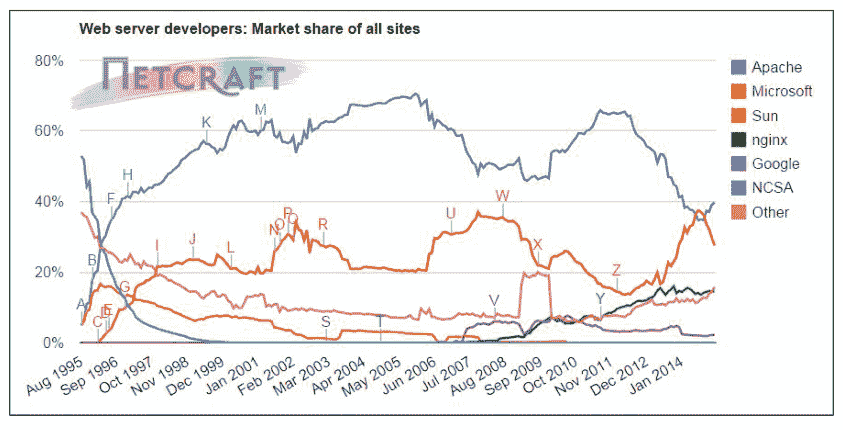
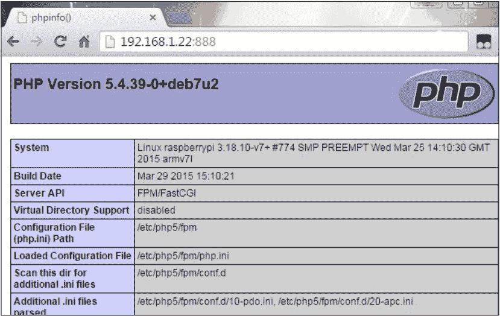

## 4 使用快速 Web 服务器和数据库

## 

得益于其四核架构，Raspberry Pi 2 现在作为 Web 服务器的工作效果更好。本章中描述的所有内容仍然与 Raspberry Pi 1 兼容，但在此运行的任何性能测试严格适用于 Raspberry Pi 2。本章将涵盖以下主题：

- Apache 与 nginx 与 Kestrel 对比
- nginx 的额外框架
- 安装数据库

## Apache 与 nginx 与 Kestrel 对比

随着 .NET 5 的发布，Microsoft 已成功将完整的 C# 部署目标堆栈带到 Linux。诸如流行的 ASP.MVC 之类的 ASP Web 应用程序可以通过使用 Kestrel 在 Linux 上托管，Kestrel 是一个基于 libuv 的开发 Web 服务器。Libuv 主要为 Node.js 开发，专注于异步输入/输出。

Nginx 仍然是嵌入式设备中管理 HTTP 流量的首选，因为它是一个极其快速且轻量级的反向代理服务器，优于 Apache。

Apache 仍然是最受欢迎的 HTTP 服务器之一，因为它随镜像一起捆绑，而且也非常易于安装和配置。然而，它通常用于完整的桌面机器或服务器，因为它需要大量资源。不建议在 Raspberry Pi 或其他嵌入式设备上使用 Apache，本书中也不会涵盖它。

从 Netcraft 报告中，我们可以看到前三大服务器是 Apache、Microsoft 和 nginx。Microsoft 一直在努力超越 Apache，但在 2014 年 8 月，在过去 10 年中首次，他们成功在一个月内获得了第一名。这很可能导致 ASP.NET 5 在 beta 版本 1 发布，数百万开发者涌入测试 ASP.NET 在 Linux、Macintosh 和 Windows 上的运行。



为了实现完全的灵活性，我们将配置 nginx 作为前端 HTTP 代理，这将使我们能够同时运行各种编程语言的组合。Nginx 将允许我们托管生产就绪的服务器。对于托管网站，nginx 几乎没有限制，在本章中，我将演示其中最受欢迎的一些。Nginx 本身非常适合提供静态文件，例如 HTML、JavaScript 或图像。

## 安装 nginx

安装 nginx 的最简单方法是使用 apt-get。不幸的是，wheezy 仓库只有 1.2 版本的软件包：

```
sudo apt-get update
sudo apt-get install nginx
```

> 要升级到更高版本的 nginx，请按照第 6 章《设置游戏服务器》中的选择性升级说明进行操作。然后，使用 -t jessie 开关重新安装 nginx。

默认情况下，nginx 从 /usr/share/nginx/www 提供页面，但大多数 Linux 管理员更熟悉 /var/www 位置。只要您选择一个约定并坚持使用它，文件保存在哪里并不重要。我们将在本章中使用 /var/www：

```
sudo mkdir /var/www
```

在此目录内，我们将创建更多目录来保存各种虚拟主机。虚拟主机是域名（在 nginx 中称为 server blocks），它们告诉 Web 服务器有关请求域或子域的配置。我们最初将创建一个名为 html 的目录和一个名为 web 的目录来保存静态文件，但稍后会添加新的 location 块，称为虚拟目录：

```
sudo mkdir /var/www/html
```

```
sudo mkdir /var/www/html/web
```

## 配置 nginx 虚拟主机

在 nginx 中，虚拟主机是一组称为 server blocks 的规则，指定如何为指定域提供 HTTP 流量。在我们的配置中，我们将在端口 80 上为任何域提供内容。您可以使用具有特定域名的单独 server blocks 为不同的域或子域提供服务，这需要更多配置，本书中未涵盖。

Nginx 使用目录 /etc/nginx/sites-available/ 来存储虚拟主机的配置文件。启动时，它会检查另一个目录 /etc/nginx/sites-enabled/，通常这些文件是 sites-available 中配置文件的符号链接。如果文件存在于那里，它将加载配置文件。

应该有一个名为 default 的文件，这是 nginx 提供服务的默认网站。我们将删除默认网站的符号链接，创建一个新的配置文件和符号链接，最后重新启动 nginx：


> 我们将使用符号名称 nginxhtml，但您可以随意为虚拟主机使用任何名称。

```
sudo service nginx stop
```

```
sudo unlink /etc/nginx/sites-enabled/default
```

```
sudo touch /etc/nginx/sites-available/nginxhtml
```

编辑位于 `/etc/nginx/sites-available/nginxhtml` 的配置文件并添加以下内容：

```
server {
    listen 80 default_server;

    location / {
        root /var/www/html/web;
        index index.html;
    }
}
```

这是为任何浏览器提供标准静态文件最基本的配置。这足以让我们使用 jQuery 运行客户端脚本，该脚本将使用 AJAX 请求我们稍后在本章中创建的 API。让我们启用网站：

```
cd /etc/nginx/sites-enabled
sudo ln -s /etc/nginx/sites-available/nginxhtml
sudo service nginx start
```

要开始提供基本页面，请按照以下步骤操作：

- 1. 在 `/var/www directory` 中创建一个名为 `index.html` 的文件名。
- 2. 在其中放置一些基本的 HTML 标记（请查看代码文件夹，其中包含完整的示例文件，其中包含 jQuery 下载说明以及调用我们将创建的各种 API 的示例）。
- 3. 在可以访问您的 Raspberry Pi 的网络上的另一台计算机上使用浏览器，并输入地址 `http://raspberrypi` 或 `http://your.pi.ip.address`。
- 4. 您现在应该可以看到您的基本网页。

每次配置更改后，我们都应通过键入以下命令行重新加载 nginx：

```
service nginx reload
```

如果您收到 `start failed`，您可以运行以下命令来测试配置文件，这将显示任何错误及其详细信息：

```
sudo nginx -c /etc/nginx/nginx.conf -t
```


## Nginx 的额外框架

现在 nginx 已经运行起来，我们有多种框架或编程语言可供选择，可用于创建程序以向我们的基本 HTML 页面公开 API。

我们将利用 nginx location 块（虚拟目录），以便混合搭配编程语言，使用 jQuery JavaScript 向简单的 HTML 页面提供丰富的内容。

## Python API

Python 已预装在 Raspbian 中，是 Raspberry Pi 的首选编程语言。它拥有丰富的库，可让你访问 GPIO 和其他系统软件，并且在互联网上可获得大量文档。

它是一种易于学习的入门语言，因为你可以用比 C++ 或 Java 更少的代码行创建应用程序。你需要明白 Python 是一种编程语言，而不是 Web 内容交付框架。话虽如此，通过编写特定响应，仍然可以用 Python 交付 Web 内容。这将使我们能够利用 Python 编程语言创建简单的 API，为调用 API URL 的任何其他软件提供数据。

### 执行 Python

你可以在终端执行任何 Python 脚本，但 nginx 无法直接执行 Python 脚本。为此，我们需要安装 uWSGI。我们将配置一个新的 location 块，让 uWSGI 代替 nginx 执行 Python， resulting 文本将发送回客户端。我们将使用直接从其网站下载的最新版 uWSGI。这将在 `/home/pi` 目录中构建并放置必要的文件。在 Raspberry Pi 2 上编译大约需要 80 秒：

```
cd /home/pi
sudo curl http://uwsgi.it/install | bash -s cgi /home/pi/uwsgi
```

这会将 uWSGI 二进制文件放置在 /home/pi 中，我们需要在该目录中为 uWSGI 创建一个配置文件。创建一个名为 uwsgi_config.ini 的文件并输入以下文本：

```
[uwsgi]
plugins = cgi
socket = 127.0.0.1:9000
chdir = /usr/lib/cgi-bin/
```

```
module = pyindex
cgi=/cgi-bin=/usr/lib/cgi-bin/
cgi-helper =.py=python
```

实际的 Python 脚本文件将位于 `/usr/lib/cgi-bin` 而不是 `/var/www/`，因为 `nginx` 并不会真正执行 Python 文件；它将执行重定向到 `uWSGI`。我们还需要在 `uWSGI` 配置文件中将 `nginx` location 块 `/cgi-bin` 映射到 `/usr/lib/cgi-bin`。现在我们可以使用配置启动 `uWSGI` 进程。这会阻塞你的终端；它必须一直运行，以便 `nginx` 能够与守护进程通信。打开一个新的终端或在 `screen` 中运行：

```
cd /home/pi
sudo ./uwsgi ./uwsgi_config.ini
```

接下来，我们将为默认服务器添加一个新的 location 块，专门用于 Python 的执行。这个新的 location 块也称为虚拟目录，其中对位置 http://raspberrypi/cgi-bin 的每个请求实际上都会要求 `uWSGI` 在 `/usr/lib/cgi-bin` 目录中执行 Python 文件。

在现有的 `nginxhtml` 文件中，在之前的 location 块下添加以下 location 块：

```
location / {
    include uwsgi_params;
    uwsgi_modifier1 9;
    uwsgi_pass 127.0.0.1:9000;
}
```

在 `/usr/lib/cgi-bin` 中，我们将创建一个名为 `temp.py` 的文件，它将简单地为浏览器返回一个 HTTP 头和 CPU 温度文本。这里缩进很重要，因为它定义了函数块：

```
#!/usr/bin/env python
import os
### Return CPU temperature as a character string
def getCPUtemperature():
    res = os.popen('vcgencmd measure_temp').readline()
    return(res.replace("temp=","").replace("'C\n",""))

#We have to print a valid HTTP header first so the browser
#will know how to decode the data
print "Content-type: text/html\n\n"
templ=float(getCPUtemperature())
print templ
```

我们需要做的最后一件事是使 Python 脚本可执行：

```
chmod +x temp.py
```

如果你重新加载使用提供的示例代码的网页，你现在应该能在 Python 段落中每秒看到 Raspberry Pi 的温度刷新。你也可以通过在浏览器中导航到 http://raspberrypi/cgi-bin/temp.py 来测试它。

这是一个极其基础的示例，说明如何以 Web API 的方式从 Python 提供数据。这不是标准的 Web API JSON/XML 实现，但它极其轻量且快速，是通过 HTTP 请求提供数据的一种简便方法。

## Node.js

Node.js 是一个基于 Google V8 JavaScript 引擎构建的平台，使用事件驱动和非阻塞 I/O。

它被称为 JavaScript Web 编程语言。表面上这是正确的，但在 Node.js 二进制的深处，它使用 C/C++ 来访问本地系统资源，然后用 JavaScript 编写的标准模块（文件系统、网络缓冲、密码学、数据流等）公开 API，你可以从中扩展自己的应用程序。你永远不需要实际编写任何 C/C++，所有软件包都以 JavaScript 提供；这就是 Node.js 易于使用并被称为 JavaScript 编程语言的原因。

它是对 Raspberry Pi 的绝佳运行时环境，因为它对资源极其轻量，但经过优化可处理数百个跨多个 node 应用的请求。

### 安装 Node.js

我们将使用 Node.js 的自动设置脚本。执行以下命令：

```
curl -sL https://deb.nodesource.com/setup | sudo bash -
```

现在我们可以从新仓库安装 Node.js。

```
sudo apt-get install nodejs
```

Node.js 和 NPM 现在已安装。要检查 Node.js 是否正确安装，可以执行以下命令：

```
node --version
```

```
npm --version
```

### 什么是 NPM

**NPM 代表 Node Package Manager。** 你可以在 http://www.npmjs.com 找到许多即用型应用程序和库。它们可通过单个命令行安装，该命令行在软件包的着陆页上提供。

> 尝试在网站上搜索 Raspberry，以找到一些专门为 Raspberry Pi 制作的有趣软件包。

### Node.js 服务器

通常，你会使用 node helloworld.js 执行 Node.js 文件，这将运行程序但不具备任何 Web 功能。为了以 Web API 的方式使用 Node.js，我们需要创建一个 Node HTTP 服务器，然后它可以响应通过 Nginx 代理的 Web 请求。

与所有示例一样，我们希望 nginx 能够提供一种标准且简单的方式，通过端口 80 将 Web 请求代理到 Raspberry Pi 内部运行的应用程序中。这使得记住 URL 变得容易，更简单地构建前端页面，并在你将 Raspberry Pi 开放给万维网时提供一些安全性。

我们将在 /etc/sites-available/nginxhtml 目录中的现有文件添加一个新的 location 块：

> 你可以通过创建新的 location 块名称（虚拟目录）并调整你的 node 应用程序绑定的 proxy pass 设置来像这样运行多个 node 应用程序。

```
location /node {
    proxy_set_header X-Forwarded-For $proxy_add_x_forwarded_for;
    proxy_set_header Host $http_host;
    proxy_set_header X-NginX-Proxy true;
    proxy_pass http://127.0.0.1:5000;
    proxy_redirect off;
}
```

我们将安装两个软件包来帮助获取 Raspberry Pi 的电压设置。首先，我们将安装一个名为 **express** 的软件包，它将允许我们轻松创建 RESTful API，然后是 pi-volts 模块。

使用软件包的典型方法是在你的应用程序目录中安装它们，该目录保存在 /node_modules 中且仅对该应用程序可访问。我们将使用 -g 开关，这将一次性将软件包安装到 /usr/lib/node_modules/ 目录中，该目录将对你创建的任何 node 应用程序全局可用。这可以节省 SD 卡上的空间，但意味着使用该全局软件包的所有应用程序必须使用该特定版本。你也可以将软件包如 express 全局安装，然后为单个应用程序如 pi-volts 安装一个小型软件包。

每当你创建一个新的应用程序目录时，你必须使用 npm 初始化应用程序。这会创建一个配置文件并让 Node.js 知道你希望将应用程序特定的软件包（非全局）安装到此目录。会显示几个屏幕问题；如果你愿意，可以对所有问题都按 Enter。因为 nginx 不执行或提供原始 Node.js 文件，我们将保持命名约定与 Python 相似。我将在接下来的几行命令中演示这种方法：

```
sudo npm install express -g
cd /usr/lib
sudo mkdir node_bin
cd node_bin
sudo mkdir volts
cd volts
npm init
sudo npm install pi-volts
touch index.js
```

你现在已为你的应用程序设置了基本框架，并仅为此 Node.js 应用程序安装了 pi-volts 软件包。编辑 index.js 并插入以下文本：

```
var http = require('http');
var express = require('express');
var app = express();
var volt = require("pi-volts");

// Express route for incoming requests (GET)
app.get('/node/core/voltage/', function(req, res) {
  res.send(String(volts));
});

// configure Express to listen on port 5000
app.listen(5000);
```


我们现在可以运行这个基础的 Node 服务器，它提供一个简单的 API 文本响应，返回当前的 CPU 核心电压。你可以在 http://raspberrypi/node/core/voltage 发起一个 AJAX GET 请求，由于这是 GET 请求，你只需在启动服务器后将该地址输入浏览器即可测试：

```
node index.js
```

现在，你可以更新位于 /var/www/html/web 的 index.html 文件，并使用 jQuery 执行一个简单的 GET 请求来更新页面上的元素。结果在 1.2 到 1.3125 之间变化（完整示例在代码库中提供）：

```
$.get('/node/core/voltage', function(data) {
  $('#cpuvoltage').text(data);
});
```

## .NET and ASP.NET MVC

为了使用 Microsoft 的 .NET 框架，我们首先需要安装最新版本的 Mono。典型的方法是从 Git 源码编译 Mono，但在 Raspberry Pi 2 上完成大约需要 6 小时。我曾尝试制作一个交叉编译教程，但未能找到足够简单或稳健的内容以在此书中演示。

不幸的是，当时 Wheezy 和 Jessie 仓库中只有不支持 .NET 5 的版本。更快更好的一种方式是使用官方 Xamarin 仓库维护的新版本。

以下命令将添加官方 Xamarin 仓库，更新任何必需的软件包，最后安装 Mono，约需 300 MB 空间，耗时约 10 分钟。输入以下命令：

```
sudo apt-key adv --keyserver keyserver.ubuntu.com --recv-keys 3FA7E0328081BFF6A14DA29AA6A19B38D3D831EF
```

```
echo "deb http://download.mono-project.com/repo/debian wheezy main" | sudo tee /etc/apt/sources.list.d/mono-xamarin.list
```

```
sudo apt-get update && sudo apt-get upgrade
```

```
sudo apt-get install mono-complete
```

## Prerequisites for .NET 5

> 请注意，随着 .NET vNext 项目推进到版本 1，术语和命令可能会发生变化。如果任何命令无法工作，请参考 https://github.com/aspnet/home 获取更多信息。


此时，我们可以通过输入以下命令检查 Mono 是否已正确安装：

```
mono --version
```

为了让 Kestrel 正常工作，我们需要手动编译 Libuv 并链接新的库：

```
sudo apt-get install automake libtool curl unzip
wget https://github.com/libuv/libuv/archive/v1.4.2.tar.gz
sudo tar zxfv v1.4.2.tar.gz -C /usr/local/src
cd /usr/local/src/libuv-1.4.2
sudo sh autogen.sh
sudo ./configure
sudo make
sudo make install
sudo ldconfig
```

Linux 上的 .NET 5 带来了一些新的术语，我会尽力解释：

DNX 是 Dot Net Execution Environment 的缩写，用于引导和执行 .NET 应用程序。要安装 DNX，我们首先需要安装 DNVM，即 Dot Net Version Manager 的缩写。

DNVM 允许你并行安装多个版本的 DNX，以便应用程序能够在不同版本的 .NET 5 上运行。

DNU，即 Dot Net Package Updater 的缩写，本质上提供了一种在 Pi 上恢复项目所依赖的 NuGet 包的方式，类似于 Node.js 的 NPM。

## Installing DNVM, DNU and DNX

DNVM、DNU 和 DNX 可以通过终端上的单行命令安装，这得益于一个脚本，该脚本将执行所有其他必需操作。请注意，稳定版使用旧的命令行：K、KRE、KPM 和 KVM。为了保持与补丁同步，我们将使用 dev（前沿）分支。这些补丁移除了许多额外的命令，这里不会涉及。一旦版本 1 发布，请使用稳定分支：

```bash
cd /home/pi
curl -sSL https://raw.githubusercontent.com/aspnet/Home/dev/dnvminstall.sh | DNX_BRANCH=dev sh && source /home/pi/.dnx/dnvm/dnvm.sh
```

## Installing DNX

要安装最新版本的 DNX（.NET 5），截至撰写时为 Beta4，在 dev 上，我们现在只需输入以下单行命令：

```bash
dnvm upgrade
dnx
```

恭喜，你现在已在 Raspberry Pi 上安装了 .NET 5！

## Running the MVC website

在之前的过程中，只安装了 .NET 5 运行时环境，这允许跨平台执行 .NET 应用程序。

为了快速运行一个 MVC 网站，我们将使用 ASPNET Github 仓库中的示例。在 beta 期间，请确保选择已安装的 DNX 版本的正确目录。本章其余部分我们将使用 v1.0.0-beta4 目录和 DNX。当最终版发布时，它将被命名为 v1.0.0。

> 请再次核对你使用的 DNX 版本和示例版本。不匹配的 DNX 和示例会导致部分示例无法运行。

我们将克隆主要的 ASPNET Home 示例并进入特定的 beta 目录。我们将在此目录中运行包恢复以安装所有必需的依赖项，例如 Kestrel：


> DNU restore 第一次下载所需包可能需要一些时间。dnx . kestrel 命令第一次执行也可能需要一些时间；它会在 Kestrel 启动并绑定端口之前引导并预构建 MVC 网站。

```
cd /var/www
sudo mkdir dotnet
cd dotnet
sudo git clone -b dev https://github.com/aspnet/Home.git
```

Git clone 以 root 用户执行，将 /Home 目录中的所有文件创建为 root。这会在恢复包时导致问题，并可能出现其他奇怪情况。我们需要递归地将该目录的用户更改为 pi 以修复权限问题：

```
sudo chown -R pi /var/www/dotnet/Home
```

我们现在将从官方稳定仓库恢复所需的包。你需要在任何新项目（或示例项目）上始终运行此操作，但会快很多，因为包现在已缓存（将 beta 替换为你正在运行的 DNX 版本）：

```
cd /Home/samples/v1.0.0-beta4/HelloMVC
dnu restore
dnx . kestrel
```

最后一条命令使用 dnx 根据名为 project.json 的配置文件中指定的配置启动 MVC 网站。Kestrel 绑定的端口也在 project.json 文件中定义，默认为 5004。

运行 dnx . kestrel 后，你的终端屏幕将被占用并显示 .NET 生成的一些消息。服务器启动后，会显示一条消息告知它已启动并绑定了哪个端口。直到你按 Enter 终止服务器之前，会看到一个闪烁的下划线。

在按 Enter 之前，使用网络上另一台计算机的 Web 浏览器导航到 http://raspberrypi:5004。你现在应该能看到一个基础的 MVC 示例网站。

继续尝试编译其他示例或使用 Visual Studio Community 版创建自己的项目。

## MVC and nginx

你可以在不安装 nginx 的情况下直接使用 Kestrel 使用 MVC，但强烈建议使用 nginx 作为前端代理，这将允许你在混合环境中管理各种 Web 应用程序。Nginx 还提供更多功能，例如绑定 SSL 证书，而 Kestrel 单独使用时尚不支持。

我们现在可以为 `dotnet` 代理添加另一个 location 块：

```
location /dotnet {
    proxy_pass http://127.0.0.1:5004;
}
```

你现在可以导航浏览器到 http://raspberrypi/dotnet，你应该会看到与 5004 端口相同的页面。

这样做的好处是，你现在已配置 nginx 对此虚拟主机执行更高级的操作。

出于安全原因，你应仅允许转发到 nginx 虚拟主机中定义的端口，并阻止其余端口，例如 Kestrel 的 5004。这样可以确保在 Kestrel 仍作为开发服务器开发期间，其中的任何漏洞都无法被利用。唯一的缺点是像 Netcraft 这样的服务会将此网站识别为 nginx 而非 Microsoft 的 Kestrel。但从安全角度来看这是好的，因为潜在攻击者不会知道强大的 nginx 代理后面实际发生了什么。

## Other .NET applications

Mono 支持完整的 .NET 5 堆栈，这意味着你现在可以在 Visual Studio 中轻松创建控制台应用程序并在 Raspberry Pi 上执行。只需复制你的 .exe 文件并使用 `MONO file.exe` 运行即可。

你也可以创建传统的 Windows Forms 并使用相同的方法 `MONO formsapp.exe` 在 LXDE 中执行。原生样式的表单应出现在 LXDE 中。


> 如果将 Windows IoT 安装为你的操作系统，你将能够利用 Windows 10 API 创建通用应用，创建全硬件渲染的表单，并通过 DirectX 图形访问 OpenGL 以及用于开发 Raspberry Pi 2 物联网应用的丰富 API。基础内容将在第 10 章《Windows IoT Core》中介绍。


## 安装 PHP

如前所述，nginx 是一个代理，可极快地处理 Web 请求，而要让 PHP 与 nginx 协同工作，我们需要安装一个名为 **FastCGI** 的接口。这将允许 nginx 向 PHP 发送请求并接收和显示响应。为了提高 PHP 性能，我们还将安装一个名为 APC 的 PHP 扩展，其全称为 **Alternative PHP Cache**。它比标准 PHP 缓存更快，使用资源更少。

安装后，PHP 应该正在运行，但我们将重启它以确保所有扩展都已正确加载：

```
sudo apt-get install php5-fpm php-apc
sudo service php5-fpm restart
```

在 `/var/www/` 下创建一个名为 `PHP` 的新目录，并在其中创建子目录 `web`。在 `web` 目录中，我们将创建一个名为 `index.php` 的新文件并添加以下内容：

```
<?php
    phpinfo();
?>
```

这次我们将在不同的端口上运行它，因为 PHP 有不同的要求。我们将新主机绑定到 888 端口。我们将创建一个新的 server 块；你可以将其放在现有配置文件中，也可以按需创建一个新的 `sites-available/php` 文件：

> 请避免使用端口 8080，因为它稍后将被用于实时流媒体。
> 请注意 `fastcgi_pass` 设置，该设置也将用于任何其他 PHP 网站。

```
server {
    listen 888;
    root /var/www/php/web;
    index index.php;

    location ~ \.php$ {
        fastcgi_pass unix:/var/run/php5-fpm.sock;
        fastcgi_index index.php;
        include fastcgi_params;
    }
}
```

重启 nginx，然后在另一台计算机的浏览器中访问 http://raspberrypi:888。你应该会看到如下页面：



## 安装数据库

当我们想到 Linux 机器上的数据库时，首先想到的通常是 MySQL。它是首选，因为它免费、开源、可靠，并且附带丰富的工具集。在具有四核的 Raspberry Pi 2 上，MySQL 变得更具吸引力，但我仍将介绍轻量且稳健的 SQLite 替代方案。

### 安装 MySQL

MySQL 已存在很长时间，除非你正在寻找特定版本，否则你可以使用当前仓库安装 MySQL 5.5 版本：

```
sudo apt-get update
sudo apt-get install mysql-server
```

你将看到带有蓝色背景的屏幕，要求你输入 root 用户密码。你应该将其记下并保存在安全位置，但将密码存储在 `KeePass` 等应用程序中会更方便也更安全。

> 最佳实践是永远不要对 Web 应用程序，尤其是可在互联网上访问的生产环境，使用 MySQL 的 root 用户。

### 安装 phpMyAdmin

一个非常流行的 SQL 管理工具 `phpMyAdmin` 可以安装并用于进一步管理你的数据库，甚至对其进行操作。

`phpMyAdmin` 是唯一需要以 root 设置运行的应用程序，以便它可以完全管理 MySQL。`phpMyAdmin` 的最佳实践是仅允许通过本地网络或 SSH 进行管理连接。这是因为它将用于创建或删除数据库、用户和密码，并对这些数据库应用权限访问。如果你需要，可以创建权限较低的用户通过互联网登录：

```
sudo apt-get install phpMyAdmin
```

在安装过程中，你将看到另一个蓝色屏幕，要求选择应自动配置的 Web 服务器。可惜的是，`nginx` *不在* 列表中；不要勾选任何框并点击 **OK**。过一会儿，最终屏幕会询问 `dbconfig-common`；点击 **NO**。

我们需要像为 nginx 配置任何其他网站一样手动配置 phpMyAdmin。PhpMyAdmin 将其文件放在共享位置 `/usr/share/phpmyadmin`，并且任何有权访问系统的人都可以使用此共享网站仅访问其数据库。

在 `sites-available` 中，创建一个名为 `phpmyadmin` 的新文件；现在使用以下配置。记得在 `sites-enabled` 中创建符号链接，然后重新加载 nginx：

```
server {
    location /phpmyadmin {
        root /usr/share/;
        index index.php;
    }
    location ~ ^/phpmyadmin/(.+\.php)$ {
        try_files $uri =404;
        root /usr/share/;
        fastcgi_pass unix:/var/run/php5-fpm.sock;
        fastcgi_index index.php;
        fastcgi_param SCRIPT_FILENAME $document_root$fastcgi_script_name;
        include /etc/nginx/fastcgi_params;
    }
    location ~* ^/phpmyadmin/(.+\.(jpg|jpeg|gif|css|png|js|ico|html|xml|txt))$ {
        root /usr/share/;
    }
    location /phpMyAdmin {
        rewrite ^/* /phpmyadmin last;
    }
}
```

此虚拟主机配置为在端口 80 上运行，但位于虚拟目录中。该虚拟目录中的应用程序在自己的线程上运行，与端口 80 上运行的其他任何内容分开。如果你更喜欢这种方式而不是不同的端口号，可以将之前的虚拟主机配置为以相同方式运行。

现在你可以浏览到 http://raspberrypi/phpmyadmin/setup 并按照屏幕上的说明进行操作。你可以暂时忽略有关配置目录的消息。你需要你的 MySQL root 数据库密码。在服务器部分，点击 Server 按钮上的 new 并在 Authentication 选项卡下输入 root 的密码。

> 按照屏幕上的指南获取最新版本和有关最佳实践的信息。

完成后，你可以将浏览器导航到虚拟目录 http://raspberrypi/phpmyadmin，并使用 root 凭据登录。你应该做的第一件事是设置一个新用户。

## 安装 SQLite

SQLite3 是一个自包含、易于安装、轻量级的事务数据库。该产品的网站宣称它是世界上部署最广泛的数据库。据维基百科所知，它实际上是嵌入式设备上部署最广泛的数据库，这仍然使 MySQL 成为使用最广泛的数据库。这些对我们来说其实并不重要，因为这两种数据库在各自的领域都很出色，只是如果你希望在 Raspberry Pi 1 上获得更好的性能，SQLite 是更好的选择：

```
sudo apt-get install sqlite3 php5-sqlite
```

我们将使用 phpliteadmin，这是一个专门为 SQLite 2 和 3 版本制作的单文件管理实用程序。同时，为 phpliteadmin 创建一个新子目录。请注意，Google 代码库即将关闭，该软件包可能很快会迁移到 GitHub。如果你无法解析链接，可以在互联网上搜索：

```
sudo mkdir /var/www/phpliteadmin/
sudo mkdir /var/www/phpliteadmin/web
cd /var/www/phpliteadmin/web
wget https://phpliteadmin.googlecode.com/files/phpliteAdmin_v1-9-5.zip
sudo unzip phpliteAdmin_v1-9-5.zip
```

让 phpliteadmin 在本地工作的最简单方法是将其运行在自己的专用端口上。

使用以下内容创建一个新的虚拟主机文件 sqladmin：

```
server {
    listen 81;

    root /var/www/phpliteadmin/web/;
    index phpliteadmin.php;
    location ~ \.php$ {
        fastcgi_pass   unix:/var/run/php5-fpm.sock;
        fastcgi_index  phpliteadmin.php;
        include        fastcgi_params;
    }
}
```

重新加载 nginx 并导航到 http://raspberrypi:81。默认密码是 admin。此时，你会收到错误消息，提示没有数据库且目录不可写。

SQLite 创建包含所有数据的平面文件，你可以管理这些文件的位置。没有服务器管理这些文件，任何 SQLite 兼容的客户端都可以连接这些文件。

你可以使用 SQLite3 命令行在 /var/www/phpliteadmin/web 中创建一个测试数据库：

```
sudo sqlite3 test.db
BEGIN;
CREATE TABLE temps (theDate DATE, name TEXT);
COMMIT;
.exit
```

刷新你导航到 `phpliteadmin` 的网页。你将看到新的布局，左侧列出数据库。如果你使目录可写，还可以创建新数据库。

> 强烈建议不要允许从互联网访问此虚拟网站，因为未实现任何安全功能。

## 总结

在本章中，我们介绍了如何在 .NET 或 PHP 主机平台上创建各种基本网站。Nginx 确实是一个多功能且快速的代理服务器，有助于我们实现可以提供的各种 Web 应用程序。

我们研究了如何托管 .NET MVC 和 PHP，以及安装两种不同类型的数据库引擎，所有这些都在和谐地并行运行。

在下一章中，我们将为本地网络设置文件共享，并为基于互联网的存储设置 *ownCloud*。


