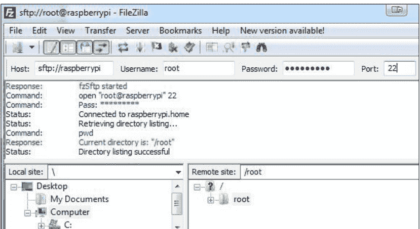
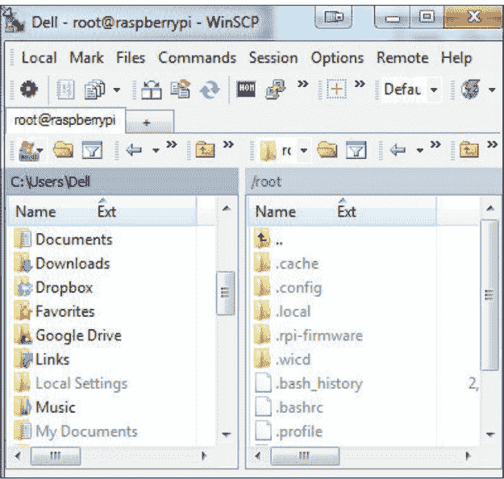
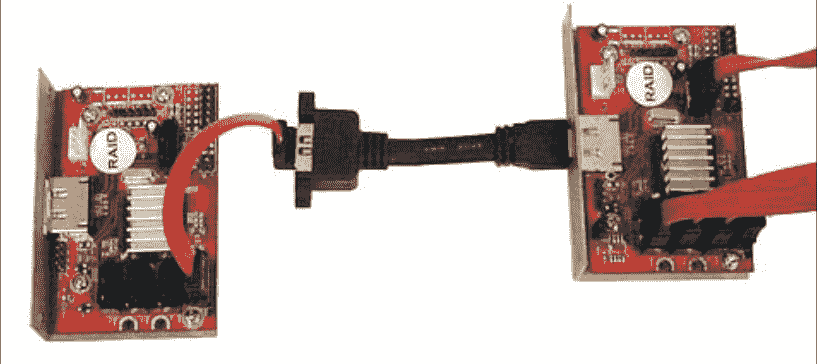
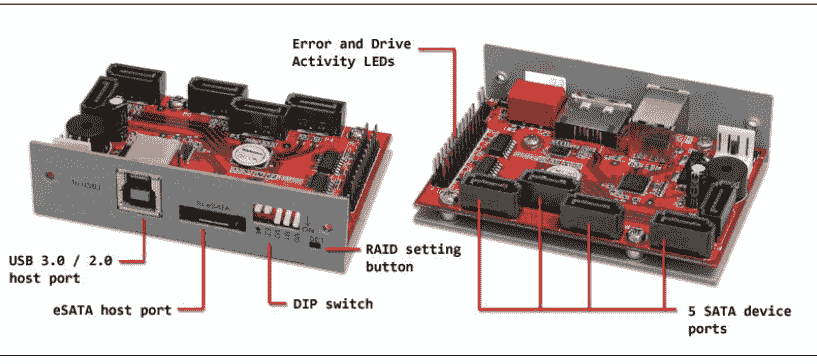

## 5 将 Raspberry Pi 设置为文件服务器

## 

Windows、Linux 和 Mac OS X 都使用不同的文件系统，并且它们在网络上共享文件的方式也不同。除此之外，您还会有网络特定的协议，例如在互联网上使用的协议。

如果您在想哪一个最好，您永远找不到答案；相反，您应该使用最适合您的应用并且您最熟悉的技术。

### 连接外部存储

Raspberry Pi 没有 SATA 接口，连接此存储的唯一方式是通过 USB 端口。您可以通过连接一个带电的 USB 集线器来进一步扩展 USB 端口的数量。

由于 USB 总线上有 480 MBps 的限制，我们应该考虑最优的设置。我们为以太网保留 100 MBps，这足以流式传输任何高清视频。这就剩下 380 Mbps（47 MBps），这很好，因为我们通过以太网最多也只能发送 12 MBps 的数据。

如果您真的想榨取更多传输速度，可以使用兼容的 802.11n 或 802.11ac 无线 USB 外设。使用 WiFi 您可能会达到超过 100 MBps，但需要额外确保信号良好，并且您的整体环境没有被其他无线路由器占用。您期望的最乐观传输速度大约为 25-30 MBps。

### 准备存储介质

此时，使用外部供电的 USB 集线器是非常好的主意。通过 USB 连接的硬盘需要这种额外的电力才能正常运行。如果您正在使用无线适配器和其他 USB 外设，您应该考虑将它们移到带电的 USB 集线器上。

> 请确保您没有使用包含重要文件的驱动器。本章将向您展示如何格式化驱动器和使用其他文件系统。您驱动器上的所有数据都将丢失。

为了简单起见，在本章中，我们将使用一个 8 GB 的 USB 闪存盘；但概念对于 USB 硬盘也是相同的。

### 列出可用驱动器

在控制台中，您可以使用 fdisk 命令来获取驱动器和分区的列表，如以下命令行所示：

```
sudo fdisk -l
```

fdisk 命令会向您显示 Linux 中使用的磁盘名称、其完整大小和分区。/dev/mmcblk 下的驱动器是内置 SD 卡，您不希望对该设备做任何操作。相反，您应该始终查找标记为 /dev/sdXn 的驱动器，其中 x 通常是代表物理驱动器的字母，n 是代表设备分区按升序排列的数字。

不幸的是，设备名称不是按任何特定顺序分配的，并且不能保证相同的名称会用于相同的驱动器。当您开始使用两个或更多硬盘时，这可能会成为一个问题。分区号永远不会改变，它们代表分区创建的确切顺序。

以下屏幕截图显示 USB 闪存盘已作为 /dev/sda 设备出现，并且它具有 7803 MB 的 FAT32 文件系统：

```
root@raspberrypi:~# fdisk -l

Disk /dev/mmcblk0: 3904 MB, 3904897024 bytes
4 heads, 16 sectors/track, 119168 cylinders, total 7626752 sectors
Units = sectors of 1 * 512 = 512 bytes
Sector size (logical/physical): 512 bytes / 512 bytes
I/O size (minimum/optimal): 512 bytes / 512 bytes
Disk identifier: 0x000c7b31

Device Boot      Start         End      Blocks   Id  System
/dev/mmcblk0p1            8192      122879      57344   c  W95 FAT32 (LBA)
/dev/mmcblk0p2          122880     7626751     3751936  83  Linux

Disk /dev/sda: 7803 MB, 7803174912 bytes
122 heads, 58 sectors/track, 2153 cylinders, total 15240576 sectors
Units = sectors of 1 * 512 = 512 bytes
Sector size (logical/physical): 512 bytes / 512 bytes
I/O size (minimum/optimal): 512 bytes / 512 bytes
Disk identifier: 0xc3072e18

Device Boot      Start         End      Blocks   Id  System
/dev/sda1   *           8064    15240575     7616256   b  W95 FAT32
```

### 格式化驱动器

Raspberry Pi 能够读写 Windows 使用的 NTFS。它也可以读写 Macintosh 使用的 HFS+。如果您需要快速复制某些内容，这两种方法对于临时连接可移动介质都是可以的。

NTFS 和 HFS+ 文件系统不是 Linux 原生的，并且在 Linux 理解的数据和其它文件系统理解的数据之间进行转换需要大量开销。可能会发生一些意外的错误并导致数据丢失，而这不是任何人想要的！

Ext4 是 Linux 中首选的存储文件系统。使用该文件系统在 Linux 中挂载的介质非常快速可靠。有方法可以在 Mac OS X 和 Windows 上使用它，但这不是本章的目标。您应该承诺将介质用作长期存储，并保持连接到 Raspberry Pi。

我们首先需要通过将其擦除回干净状态来准备硬盘。


> 警告：此步骤将销毁目标驱动器上的所有数据。

此命令将快速从您的硬盘中删除所有内容，包括分区和引导扇区。请务必使用您在 fdisk 中看到的正确设备名称。在本例中，它是 sda，但您需要在 Raspberry Pi 上再次仔细检查，因为它可能不同。这可以使用以下命令完成：

```
sudo dd if=/dev/zero of=/dev/sda bs=512 count=1
```

### 创建 EXT4 分区

我们将使用 fdisk 创建一个新分区。我想使用整个驱动器并使用 fdisk 提供的默认值。您可以在 fdisk 中随时使用 m 命令获取更多帮助，如以下命令行片段所示：

```
sudo fdisk /dev/sda
n "new partition"
<enter> "Uses p as the default"
<enter> "Uses l as the default"
<enter> "Uses default first sector"
<enter> "Uses last sector available on drive"
w "write partition data and exit"
```

我们将发出的最后一个命令用于在 sda1 分区上创建 EXT4 文件系统。以下命令行中的 -L 标志提供分区名称。您可以使用任何喜欢的简短名称：

```
sudo mkfs.ext4 /dev/sda1 -L nas001
```

### 挂载驱动器

Linux 有一个名为 /mnt 的目录，您可以在其中为各种硬盘或其他网络连接创建挂载点。还有一个名为 /media 的目录，您可以在其中挂载驱动器。这是 Linux 中通用的约定，以便人们知道如何组织这些文件。这些只是普通目录；如果您愿意，您可以创建一个名为 /nas 的目录，并在其中挂载所有与网络附加存储 (NAS) 相关的驱动器。

我将创建一个名为 /nas 的目录并在此处挂载我的 USB 驱动器。然后，我将创建一个名为 USB001 的子目录。我们还将创建用于共享的目录，如以下命令行片段所示：

```
sudo mkdir /nas
cd /nas
sudo mkdir USB001
```

```
sudo mount -t ext4 -v /dev/sda1 /nas/USB001/
cd USB001
sudo mkdir public
sudo mkdir work
```

### 重启后重新挂载磁盘

在重启后重新挂载驱动器的最快方法是向控制文件系统配置的 fstab 文件添加几行，该文件位于 /etc/fstab。

只需添加以下行。第一部分是分区，后一部分是挂载点。您需要根据硬件进行调整。最后的选项用于自动挂载。不要更改这些选项：

/dev/sda1 /media/USB001 auto noatime 0 0

### 访问文件

我们将介绍几种允许访问 Raspberry Pi、网络和互联网上的文件的方法。您应选择最适合您的方法，因为启用多种方式会更容易在网络上使系统受到损害。

### FTP 服务

文件传输协议规范最初于 1971 年发布，但我们目前使用的是 1985 年的规范，每个人真的应该开始远离。FTP 使用端口 21。

一种更新得多的规范，被称为安全文件传输协议 (SFTP)，支持 IPv6 和安全套接层 (SSL) 加密。安装 FTP 只会浪费时间，因为 OpenSSL (SSH) 已内置支持并默认启用 SFTP。SFTP 通常使用端口 22，这与 SSH 相同。

您应该为 SFTP 访问创建并使用单独的用户。为了简化，我将演示如何使用 root 账户通过两个流行客户端连接到您的 Raspberry Pi。


## 使用 FileZilla 连接

FileZilla 是开源的，可以在 Windows、Mac OS X 或 Linux 上运行。在你的电脑上下载并安装它。我们使用以下步骤连接到树莓派：

- 1. 在“主机”字段中，输入你的 Pi 的 IP 地址或 DNS 名称；
- 2. 在“用户名”字段中，输入 Pi 上的用户名。例如，root。
- 3. 在“密码”字段中，输入该用户的密码。
- 4. 在“端口”字段中，将端口名称输入为 22。这告诉 FileZilla 你想要使用 SFTP 连接。

以下屏幕截图将展示 FileZilla 如何连接到我们的 Pi：



## 使用 WinSCP 连接

WinSCP 是所有需要连接到运行 SSH 或 SFTP 服务器的 Linux 主机的 Windows 用户首选客户端。

WinSCP 还提供 Secure Copy Protocol（SCP），该协议未被任何标准指定。它使用 Secure Shell 进行数据传输并使用相同的身份验证方法。

前往 http://winscp.net/ 并找到 [前往下载页面] 链接，从那里你将获得安装程序或便携式二进制文件。

就像使用 FileZilla 一样，你将输入主机名、用户名和密码。你可以使用 SFTP 或 SCP，如以下屏幕截图所示：



## Samba 服务

Samba 是 SMB/CIFS 网络协议的实现，该协议主要用于运行 Microsoft Windows 的计算机上。它基本上是一种允许 Windows 计算机连接到 Linux 系统并访问其共享文件或打印机的机制。它不是由 Windows 创建，最初由 Andrew Tridgell 开发。

如果你想在网络上的其他 Windows 计算机之间共享来自 Linux 的媒体，Samba 是最佳的软件选择。

### 安装和配置 Samba

你需要使用以下命令行安装 Samba 以及 Samba 使用的通用库：

```
sudo apt-get install samba samba-common-bin
```

然后你可以导航到 `/etc/samba` 并编辑 `smb.conf` 文件。在个人使用的私有网络上，你可以跳过任何需要使用密码挂载网络共享的步骤。在暴露或生产环境中，始终使用身份验证。

如果你不喜欢在内部网络共享上设置安全性，那么这是完全安全的。由于这些文件无法从互联网访问，你可能只想自由浏览网络并在不输入密码的额外痛苦下复制或移动文件。

默认情况下，Samba 设置为匿名（未经身份验证）访问。要更改此设置，请向下滚动并通过删除前面的 `#` 来取消注释 `security = user` 行。这将告诉 Samba 对你创建的用户进行身份验证。

我们将快速创建一个用户用于演示，因为需要额外步骤将用户添加到 Samba 身份验证列表中。以下命令行片段是创建系统用户以访问 Samba 的示例：

```bash
sudo useradd bond007 -m -G users
sudo passwd bond007
sudo smbpasswd -a bond007
```

### 网络共享

在 `smb.conf` 文件底部，我们将添加两个共享，如以下命令行片段所示。一个帐户是用于无需身份验证的访客，而另一个帐户将只能由我们的新用户——James Bond 访问：

```ini
[public] comment = Media share
path = /nas/USB001/public
force user = "root"
read only = no
guest ok = yes
public = yes

[work]
comment = Work share
path = /nas/USB001/work
valid users = "bond007" #or @users to allow the group users access
force group = users
read only = no
writeable = yes
```

Samba 在权限方面可能相当难以理解。我们先从公共共享开始。你会注意到我们在 smb.conf 中放置了一行说 force user = "root"。我们这样做是因为我们以 root 用户身份创建了公共目录，所以应用于目录和稍后创建的所有文件的权限只能用于 root 用户！因此，我们告诉 Samba 模仿访客，作为 root，以便他们可以像 root 用户一样进行读写。

同样适用于用户 James Bond 及其目录。如果你以 root 用户或 Raspberry Pi 身份创建了 work 目录，即使是 James Bond 也不会被允许写入新文件。为了解决这个问题，你可以简单地通过输入以下命令行来更改文件夹的所有者：

```
chown bond007:users /mnt/USB001/work
```

你也可以通过将 bond007 替换为 users 来将目录分配给整个组。命令将如下所示 chown users:users。这意味着现在组中的任何人都可以写入和删除此文件夹上的文件。

配置文件具有许多高级功能，我建议阅读在线手册以了解有关安全性、共享打印机以及如何让 Samba 充当 Windows 域服务器的更多信息！

现在你可以使用任何 Windows 计算机浏览网络并访问新创建的共享。

## 用于 Macintosh 的 AFP

Samba 也适用于 Macintosh，但 Apple 有自己的网络协议称为 Apple Filing Protocol（AFP）。你可以在树莓派上安装软件，以便你的 Macintosh 计算机可以检测到树莓派。

### 安装和配置 Netatalk

安装 Netatalk 已变得非常容易，因为大多数配置默认已设置。在撰写本书时，使用的是 2.3.3 版本：

```
sudo apt-get install netatalk
```

在 30 秒内，你将在 Macintosh 的共享部分看到你的树莓派弹出。共享的默认目录是你登录时使用的用户的 home 目录，例如用户 Pi。

### 共享和 Time Machine

我们将创建一些条目以使用你的外部驱动器进行所需的共享，并且此版本的 Netatalk 还支持 Time Machine。

你需要按如下方式编辑此文件以自定义一些设置：

/etc/netatalk/AppleVolumes.default
#Amend default to look like this
:DEFAULT: options:upriv,usedots,rw,tm
#Add this to end of the file
/nas/USB001/public "Public"
/nas/USB001/work "James Bond"

阅读配置文件以了解更多选项和调整安全性。保存后，你必须使用以下命令重启 Netatalk：

```
service netatalk restart
```

## BitTorrent Sync

你可能听说过有关 torrent 的所有坏事，主要是由私人公司故意放置感染文件以试图跟踪分享受版权保护材料的用户或恶意用户试图获取你的个人详细信息所造成的。

Sync 不是公共网络；它只使用来自传统 torrent 的革命性点对点技术，这使你能够与无限数量的计算机共享无限量的数据。文件不会存储在云端。它们存储在安装了 BTSync 的所有计算机上，你可以控制谁有权访问以及这些文件存储在哪里。BTSync 包括文件版本控制、与手机共享、LAN 同步和增量更新。它还允许在文件系统支持此类大文件的情况下，无问题地进行数 GB 的大规模文件传输。

### 安装 BTSync 2

在撰写本书时，有几个存储库保留了此软件包及其启动脚本。警告：不要信任默认启用的以外的其他来源。人们可以轻松更改代码并放置自己的二进制版本，其中包含一些讨厌的后门。前往官方网站，或使用官方网站提供的链接。

我们将创建新目录、下载 BTSync 的 ARM 版本并按以下命令行片段所示提取它：

```
mkdir ~/.btsync && cd ~/.btsync
wget http://download-cdn.getsyncapp.com/stable/linux-arm/BitTorrent-Sync_arm.tar.gz -O btsync_arm.tar.gz
tar -xvf btsync_arm.tar.gz
```

我们将创建一个服务文件。在 /etc/init.d 中，创建 btsync 文件并复制以下文本：

```
#!/bin/sh
### /etc/init.d/btsync
#
### Carry out specific functions when asked to by the system
case "$1" in
start)
    /opt/btsync/bin/btsync --config /opt/btsync/bin/btsync.conf
;;
stop)
    killall btsync
;;
*)
    echo "Usage: /etc/init.d/btsync {start|stop}"
    exit 1
;;
esac

exit 0
```

我们需要为新文件设置正确的权限：

```
sudo chmod 755 /etc/init.d/btsync
sudo update-rc.d btsync defaults
sudo service btsync start
```

BTSync 现在将在你的 Raspberry Pi 2 每次重启时启动。你可以查看 /opt/btsync/bin/btsync.conf 配置文件，但默认值效果相当好。

现在你可以在同一网络上的浏览器中导航到你的 Pi 的地址 http://raspberrypi:8888/gui。


在 GUI 中，添加硬盘上的目录。现在，在你的 Mac OS X、Windows、Linux 机器或智能手机上安装该应用程序。使用 GUI 在用户之间共享目录。它可以检测同一网络上的机器，从而提高同步速度。

Sync 尽力配置端口，并使用协议通过互联网进行通信。理论上，你现在可以打电话给朋友，请他们安装 Sync，并通过电子邮件共享目录。他们现在将开始看到与你相同的文件。


> BitTorrent Sync 2 用于跟踪目的的外部分服务器，但实际文件不会存储在上面；跟踪器文件没有公共访问权限。
> 
> BitTorrent Sync 声称使用 SRP 进行相互身份验证和前向保密，其中所有数据随后使用 AES-128 Counter Mode 和唯一的会话密钥进行加密。这是一种非常复杂的方式来确保没有人能猜出你的密钥，甚至 BitTorrent 也不能。所有内容都是动态即时生成的，然后客户端在传输过程中协商更多密钥。这听起来非常好，但你必须相信他们的话，因为该项目是闭源的。

## 硬件 RAID

树莓派板载没有 SATA 控制器，除了通过 USB 端口外，没有办法连接额外的硬盘。好消息是你可以使用 USB RAID 控制器。这使得树莓派上的文件存储成为一个非常有吸引力的选择。技术上，这里需要的外设称为 USB SATA 倍增器。

## 配置

没有一步到位的指南来配置这些倍增器。有些需要使用 Windows 或 Linux 中的软件进行配置，而其他一些可能具有 DIP 开关，可将倍增器配置为特定配置。

Addonics 是一款知名且相对容易采购的倍增器。你需要在互联网、在线拍卖和商店中搜索它。价格与树莓派大致相同，但如果你正在寻找冗余存储，那么这些就是你能找到的最便宜的选择。

## 海量存储

如果你想创建真正海量的存储，可以轻松地将一个倍增器与另一个串联，有时可达三到四次。最近，Addonics 开发了另一种可以无限串联的设备！

假设我们可以串联最多三级，并使用 2 TB 硬盘。我们将所有倍增器配置为在所有驱动器上跨越数据且无冗余；也就是说，五乘五，再乘五。我们最终得到 125 个可用 SATA 端口，总共 250 TB 的存储空间。这个数字对于家庭用户来说非常不切实际，因为所有这些硬盘都会消耗大量电力。有些人在家里有这样的硬盘设备，所以我认为使用六个倍增器实现 25 个 SATA 端口对某些读者来说是完全可行且便宜的选择！下图是使用 SATA 端口倍增器将一个 SATA 端口复制为另外五个端口的简单示例：



## 冗余存储

我们所有人一生中都丢失过太多重要数据，所以你应该考虑冗余而不是海量存储。我们可以使用一组四个 1 TB 硬盘，配置为 RAID 5 + S。这给了我们 3 TB 的可用空间。此外，如果任何一个硬盘崩溃，你可以快速更换它，所有重新同步的数据都将无损存储。以下是解释 SATA 端口复制器每个功能的图示：



## 总结

本章演示了树莓派能够做任何普通计算机或服务器能做的事情。它能够与各种平台共享文件。你可以使用最新的安全 FTP 连接到树莓派。它能够使用一些巧妙的硬件附加组件存储大量数据。

在下一章中，我们将设置各种游戏服务器。
