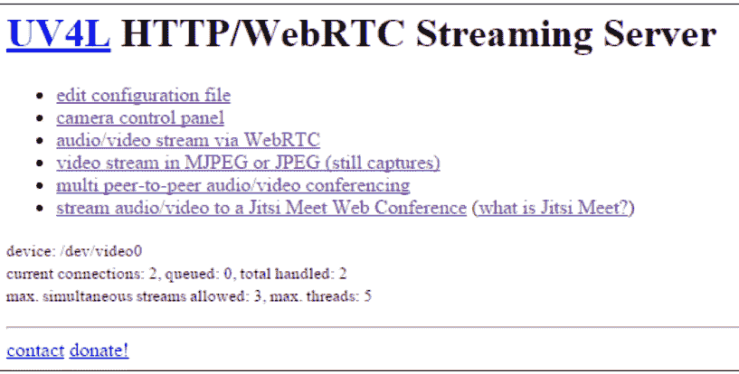

## 7 流式传输实时高清视频

## 

在本章中，我们将使用由 Raspberry Pi 基金会设计的官方 HD 摄像头模块。借助新的四核处理器和 UV4L 的作者，我们现在可以直接以低延迟将视频流式传输到浏览器。

在开始本章之前，你应该已按照随摄像头模块附带的说明安装并启用摄像头模块。建议分配 256 MB GPU 内存。

本章仅适用于 Raspberry Pi 2 或更新版本，配备四核处理器或更好。

## 安装 UV4L

UV4L 是一个专为 Raspberry Pi 设计的用户空间网络摄像头驱动程序。它还包含本章将讨论的其他一些功能。UV4L 是由运营网站 http://linux-projects.org 的 Luca Risolia 编写和开发的定制代码。我们将添加他的仓库以获取 UV4L 驱动程序：

```
curl http://www.linux-projects.org/listing/uv4l_repo/lrkey.asc | sudo apt-key add -
```

在 /etc/apt/sources.list 中添加以下行：

```
deb http://www.linux-projects.org/listing/uv4l_repo/raspbian/ wheezy main
```

> 如果你尚未运行 rpi-update，则建议现在执行。UV4L 驱动程序需要最新的基金会内核和模块才能正确安装。


现在我们需要更新仓库列表，然后就可以安装 UV4L 驱动程序。我们将使用以下命令执行这些操作：

```bash
sudo apt-get update
sudo apt-get install uv4l uv4l-raspicam
sudo apt-get install uv4l-server uv4l-raspicam-extras
```


> UV4L 驱动程序使从树莓派流式传输视频变得非常容易。考虑通过访问他的网站来支持 Luca，为他的事业捐款或购买本章后面描述的叠加模块的序列号。

## 配置 UV4L-RaspiCAM

配置文件位于 /etc/uv4l/uv4l-raspicam.conf，用于配置初始视频流。存在一些默认设置，以下要点是文件中包含的设置，您可能有兴趣手动更改以供自己使用。


> 如果使用 VLC 捕获流，这些是您可能想要使用的一些典型设置。驱动程序是自适应的，如果您请求 MJPEG 流，它将更改配置，或者它将从浏览器启动 WebSockets 流，从技术上允许您进行多路流。多路流是实验性的，不过。

以下是一些典型设置：

- 编码：
  - 流式传输：H264, mjpeg, jpeg, yuv420
  - 专用：nv21, yuv420, rgb565, rgb565x, rgb24, bgr24, rgba.
- 帧率：
  - 0 设置为自动
  - 1080p 下为 30
  - 720p 下为 60
  - VGA 下为 90.
- 比特率：17000000（默认值）
- 帧内周期：这仅用于 H264；如果您在流中遇到伪影，请尝试调整此值。通常，伪影是由丢失的帧和糟糕的网络性能引起的。此值越低，使用带宽越多。良好的起点是 FPS / 2。
- 质量：
  - 这仅适用于 JPEG 和 MJPEG 流式传输
  - 85 是默认值。
- * 文本叠加：取消注释这两个属性，因为本章后面需要它。
- * 无预览：如果您将显示器连接到 HDMI，您将看到原始流预览。如果您在使用 1 A 电源和 Wi-Fi 时遇到树莓派重启，请取消注释此项。

其中大多数配置设置可以通过导航到 http://raspberrypi:8080 的 Web 界面进行更改。带 * 标记的选项必须在配置文件中配置，并且必须重新启动 UV4L。

## 安装 WebRTC

Web 实时通信（WebRTC）是一种协议，允许现代 Web 浏览器建立点对点链接以交换数据。UV4L 使用 WebRTC 创建到树莓派的套接字并接收实时 H264 视频流，消除了转码的需求，并允许我们直接在浏览器中观看高质量、低延迟的视频。

要为 uv4l-server 安装 WebRTC 模块，我们只需要发出一个命令并重新启动 UV4L：

```bash
sudo apt-get install uv4l-webrtc
sudo service uv4l_raspicam restart
```

## WebRTC 流式传输

请注意，UV4L WebRTC 流以自适应比特率和分辨率进行流式传输。流式传输到客户端的比特率和分辨率将根据连接质量自适应调整。这意味着您应用的任何配置都不会适用于 WebRTC 流，但叠加层仍将工作。它也可能断开不使用 WebRTC 的其他流。

## 流式传输实时高清视频

您现在可以导航到 http://raspberrypi:8080，您将看到类似以下内容的屏幕：



您可以点击通过 WebRTC 的音频/视频流。然后，在下一页上，点击开始按钮。建立链接可能需要几秒钟，如果一切按计划进行，您现在将看到来自树莓派摄像头的实时流。

在树莓派 1 上，设置类似的流极其复杂，几乎没有资源留给 Pi。WebRTC 模块在从树莓派流式传输方面确实节省了大量时间。

## 实时 HTTP 流式传输

要配置 HTTP 流，您可以点击 UV4L 网页上的“相机控制面板”链接并设置您想要的格式和其他选项。

或者，如果您不想访问网页，您可以按需配置 raspicam 配置文件，然后您可以在 VLC 或第三方应用程序中使用相应的 URL 捕获流：

- HTTP/MJPEG：http://raspberrypi:8080/stream/video.mjpeg
- HTTP/原始 H264：http://raspberrypi:8080/stream/video.h264
- HTTP/JPEG：http://raspberrypi:8080/stream/video.jpeg

要使用 VLC 接收 H264 流，我发现调整一些插件设置对我来说效果最好：

- 1. 点击 **工具** | **首选项**。
- 2. 在左下角的 **显示设置** 面板中点击 **全部**。
- 3. 点击 **输入/编解码器** | **解复用器**。
- 4. 将解复用模块从 **自动** 更改为 **H264** 视频解复用器。
- 5. 点击 **解复用器** | **H264**。
- 6. 您会注意到它设置为每秒 25 帧。不幸的是，更改此值不会按预期工作。您最好更改树莓派上的配置以以每秒 25 帧的速度流式传输。
- 7. 在树莓派上，为您的流选择合适的比特率。在局域网中，这可能是默认值，但在 Wi-Fi 上，我建议您尝试较低的比特率。

此配置最适合更高质量的流式传输。有必要将 VLC 解复用器更改为 H264，因为它似乎无法自行识别格式。您也可以指定额外的选项 `:demux=h264`，但我发现严格将解复用器设置为 H264 效果更好。

我们还需要将树莓派上的帧率调整为 25 fps，以匹配 VLC 中 H264 模块的默认值。将 VLC 模块中的帧率调整为 30fps 没有帮助。调整帧率的原因是我注意到移动物体上出现了奇怪的伪影。这表明存在带宽问题，但在局域网上也会发生。

我最终找到了这个解决方案，并意识到树莓派发送的是 30 fps，而解复用器以 25 fps 解码，导致关键帧不同步。尽管听起来很奇怪，但它确实能产生高质量的流，尽管缓冲时间约为 1+ 秒。

如果您遇到无视频、大量伪影或长时间延迟，请参阅第 2 章 *准备网络*，了解如何运行 `iperf` 测试以确保您拥有足够的带宽。带宽问题也可能是由电源不良引起的，尤其是在使用无线适配器时。

## 网络会议

在 UV4L 的最新版本中，有一个有趣的用于音频和视频网络会议的新功能。此功能内置于 `webrtc` 模块中，无需额外配置。

任何支持 WebRTC 的设备，例如智能手机、笔记本电脑或标准台式机，只要使用现代浏览器，都可以通过访问 http://raspberrypi:8080/conference 加入会议。这将在您的局域网内工作，但如果您希望允许来自互联网的连接，您需要在信令服务器字段中提供正确的 IP 地址并打开必要的端口。

这纯粹作为服务器工作，不使用 Pi 的摄像头，但您可以在 X 客户端和浏览器中从树莓派加入会议。如果您想在树莓派上使用音频，请确保已安装 pulseaudio 并配备兼容的 USB sound 卡和麦克风。

## 流式传输 X 桌面

您也可以使用 UV4L 驱动程序流式传输实际的 X 桌面。可以将其视为类似屏幕投射的东西，类似于 Miracast。如果您的智能电视浏览器支持 WebRTC，您只需输入 URL 即可在电视上获得桌面的无线视频 feed。

要使用此功能，我们需要安装一个额外的模块。

```bash
sudo apt-get install uv4l-xscreen
```

然后您可以使用 raspi-config 启用启动到桌面/scratch 以在启动时启动。如 WebRTC 部分所述，目前唯一的限制是它仅适用于特定分辨率。未来可能会支持其他分辨率。您需要按如下方式编辑 /boot/config.txt 文件：

```
framebuffer_width=640
framebuffer_height=480
framebuffer_depth=32
framebuffer_ignore_alpha=1
```

您现在可以通过 SSH 登录到树莓派并发出以下命令：

```
uv4l --driver xscreen --auto-video_nr --display :0 --framerate 10 --server-option '--port=9000'
```

忽略所有警告。此命令启动一个新的 UV4L 服务器并创建一个名为 /dev/video1 的设备，可以使用实时 HTTP 流式传输部分中描述的相同命令。它在 9000 端口下创建 Web 服务器。8080 端口仍然有效，可以继续流式传输您的网络摄像头，同时单独流式传输 X 视频。

您可以在以下地址查看视频传输：http://raspberrypi:9000/stream/webrtc。


## 文本叠加

文本叠加是一个功能，允许您在不进行任何转码的情况下将文本行叠加到视频帧上。UV4L 驱动程序在高清流和高帧率（高于 30）下工作得非常出色，并支持 mjpeg、H264、yuv420 等视频格式。


> 启用时，图像的宽度和高度应为 16 的倍数。对于 1080p，您需要使用 1920 x 1088，720p 则为 1280 x 720，以此类推。

在最基本层面上，文本从 JSON 格式的文件中读取，该文件包含每行位置、颜色、粗细和缩放属性。默认配置文件将显示视频帧率，如正在传输时。配置文件在首次启动摄像头时加载，但可以用特定命令更新，使抬头显示器（HUD）成为现实。

要启用文本叠加，您需要在首次加载摄像头页面之前使用以下 /etc/uv4l/uv4l-raspicam.conf 配置启动驱动程序。如果已有正在进行的流，则无法启用此功能：

```
text-overlay = yes
text-filename = /usr/share/uv4l/raspicam/text.json
```

text.json 文件包含您可用的所有选项的示例。将此文件复制到 /home/pi 是一个好主意。


> 如果您计划频繁更新文件，建议将文件存储在 /tmp 中，因为文件实际上会存储在 RAM 中。

重新启动 uv4l_raspicam 服务后，您现在将在视频流上看到一些示例叠加文本。

您可以编辑 text.json 文件并在控制台执行以下命令以更新叠加文本：

```
v4l2-ctl --set-ctrl=text_overlay=1
```

这是一种非常基本的方法来更新视频流上的叠加，例如运行您编写的单独程序，每隔一段时间覆盖文件并发出刷新命令。

使用这种方法，您无法比每秒一次更快地更新叠加。如果您希望实现实时叠加更新，请参阅 HUD 示例部分。

有关如何删除 http://www.linux-projects.org 叠加的更多详细信息将在本章后面提供。

## 对象检测与跟踪

对象检测和跟踪可以随时打开和关闭。此功能仅适用于 yuv420、H264 和 mjpeg 编码。

此功能所需的 CPU 开销取决于您执行的任务的复杂程度。例如，在 Pi 2 上，您可以使用 640 x 480 在 15 FPS 下进行人脸识别，并伴随较重的 CPU 使用。在 Pi 1 上，大约是其一半：

```
uv4l --driver raspicam --auto-video_nr --object-detection --min-object-size 80 80 --main-classifier /usr/share/uv4l/raspicam/lbpcascade_frontalface.xml --object-detection-mode accurate_detection --width 320 --height 240 --framerate 15 --encoding h264
```

## 删除叠加水印

我已与 UV4L 作者 Luca Risolia 联系，他同意为您提供独家优惠；作为本书的读者，您将是第一个知道他同意为您提供一种方法来删除您拥有的 3 台 Raspberry Pi 上的白色 http://www.linux-projects.org 水印的人！

您需要做的就是发送电子邮件至 info@linux-projects.com，并附上从您的 Raspberry Pi 执行并复制此命令结果的以下详细信息：

```
uv4l --driver raspicam --serial-number
```

我确信 Luca 会感谢您为三个序列号提供的少量捐赠，这将使他能够继续为这个出色的驱动程序创建更多功能。

## HUD 示例

如 Wikipedia 所定义，抬头显示器，也称为 HUD，是一种透明显示器，可在用户无需将视线从主要活动移开的情况下呈现数据。名称的起源来自飞行员能够在头部保持抬起或向前的位置查看信息，而不是向下看一些仪器。

因此，为了让我们不要低头看控制台，我认为在视频流上直接查看有关我们 Raspberry Pi 的一些信息是个好主意。

在 Luca 的帮助下，我创建了 C++ 代码，该代码允许您使用 UV4L API 直接几乎在每一帧上更新叠加，这意味着几乎没有 CPU 开销。

如果您熟悉 C++11，我已在代码下载页面上提供了完整的代码示例，您可以添加自己的变量。

我还提供了一个编译好的二进制文件，其中包含多种流行的资源变量，您只需将其放置在模板文件中使用一次，即可在流上实时更新。

## 使用叠加二进制文件

二进制文件需要两个参数：源视频设备和源文件，将其称为模板文件。模板文件与 text.json 的格式完全相同，但不同之处在于您使用此处列出的内联变量构造文本字段。建议将模板文件复制到 /tmp/file.tpl 并将其作为源模板提供。

您还需要更新 uv4l-raspicam.conf 文件以指向新位置 /tmp/text.json（不是模板文件），并重新启动 UV4L 服务。将在 /tmp/text.json 中创建一个新文件，UV4L API 调用将从中读取替换后的变量。请勿更改此文件。在 /tmp 中使用这些文件对于实现最佳视频性能至关重要，同时也可以消除 SD 卡的 I/O，这可能会在长时间使用期间导致不必要的磨损。


> 顺便说一下，您可以在二进制文件运行时更新模板 /tmp/file.tpl 文件。C++ 二进制文件使用以只读模式打开且锁定最少的流读取模板文件。

使用以下命令行执行二进制文件：

```
./overlay /dev/video0 /tmp/text.tpl
```

## 内联变量

以下是来自 Raspberry Pi 通用资源的某些有用变量：

- {sysinfo.cputemp}

无线信息（默认为 wlan0）：

- `{wlaninfo.level}`: 信号强度
- `{wlaninfo.quality}`: 信号质量
- `{wlaninfo.bitrate}`: 比特率

网络带宽（默认为 eth0）：

- `{netinfo.downspeed}`
- `{netinfo.upspeed}`

示例文本行将如下所示：

```
"ETH0 UP: {netinfo.upspeed} CPU temp {sysinfo.cputemp}"
```

要更改默认值，您需要修改 C++ 文件并重新编译。如果您已经要编辑代码，请以基础代码为例并尝试添加其他内容。如果您从未编辑过 C++ 或任何其他代码，只需逐行理解主类，到最后您将理解基本的 C++。

## 自己编译叠加代码

C++ 代码以 C++11 标准编写，需要安装 G++ 版本 4.8 才能编译此代码。此示例不需要额外的库，例如 libboost：

```
sudo apt-get install g++-4.8
```

安装最新 G++ 后，您只需通过执行以下命令编译主代码文件和额外代码文件以及您所做的任何更改：

```
sudo g++-4.8 -Ofast -std=c++11 *.cpp -o overlay
```

Luca 还提供了一个文本滚动示例，可以从 http://www.linux-projects.org/downloads/examples/uv4l-overlay.cpp 下载，但它需要 Boost C++ 库。不幸的是，包含此库会导致代码编译时间明显更长。这就是我在代码中删除了所有 Boost 库依赖项的原因；它为现代编程语言中使用的任务和结构提供了大量额外支持，值得一试：

```
sudo apt-get install libboost-all-dev
```

如果您是 Visual Studio 开发者，您会很高兴知道我已使用 **VisualGDB** 在 Visual Studio 中创建了叠加二进制文件。VisualGDB 允许您在桌面上的 Visual Studio 中使用 C++ IntelliSense 编写代码。它将自动复制您的文件并通过 SSH 在 Raspberry Pi 上编译它们。另一个很棒的功能是您可以在 Visual Studio 中调试在 Pi 上运行的代码！您无需在 Raspberry Pi 上安装任何额外软件。有关如何开始使用 VisualGDB 的教程可在 `http://visualgdb.com/tutorials/raspberry/` 获取。

该网站上还有其他教程您可能会感兴趣。您可以使用 30 天试用。

## 摘要

流式传输视频仍然是 Raspberry Pi 在互联网上最受欢迎的搜索词之一。有很多不同的示例和解决方案，有些非常复杂，有些非常简单。

得益于 UV4L 驱动程序的工作，视频流式传输变得更容易实现。与 *Raspberry Pi Server Essentials, Packt Publishing, 我的* 前一本书相比，本章由于现在实现的简易性而被极大地缩短了。不仅更短，我们还有更多功能可以使用，并且可以用最少的努力在 Raspberry Pi 2 上享受高清视频流式传输。

在下一章中，我们将研究如何将 Pi 设置为媒体中心。


