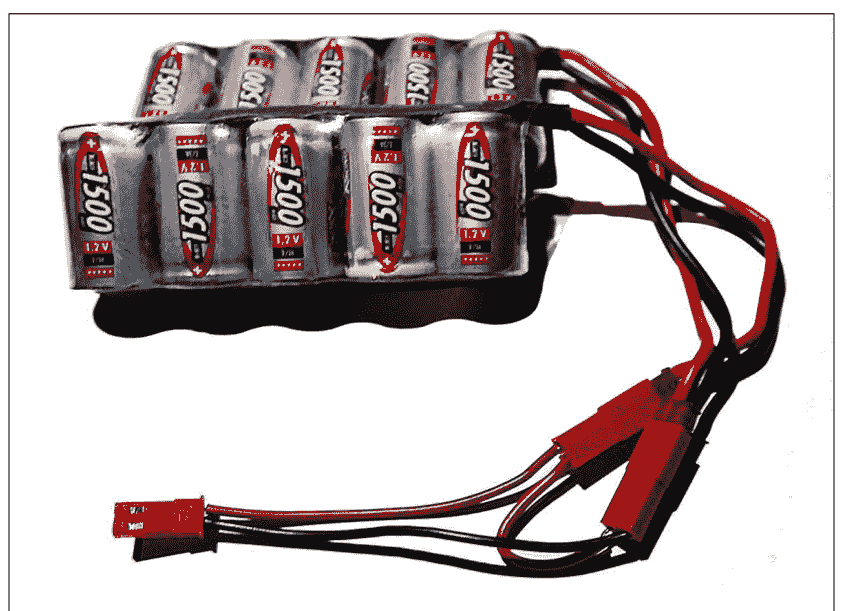
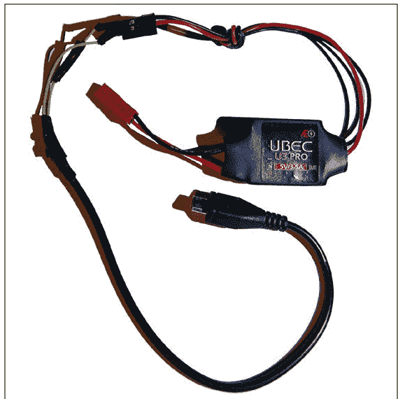
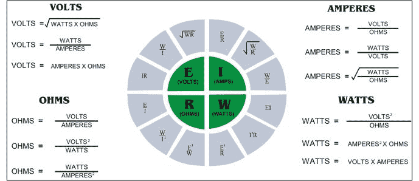
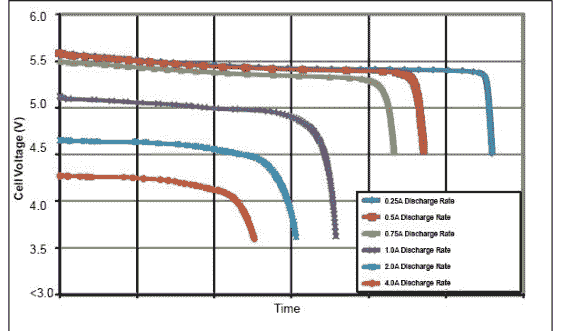
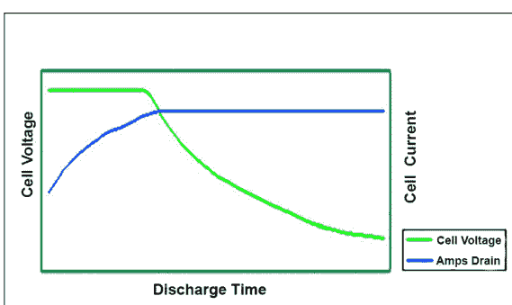

## 9 使用电池电源运行你的 Pi

## 

你通常会使用市电供电的 USB 适配器运行服务器。Raspberry Pi 体积非常小，与完整的台式电脑不同，如果电池设置正确，它可以长时间由电池供电。

你可能需要为远程控制应用使用电池为 Raspberry Pi 供电，例如偏远地区的气象站、遥控汽车等类似情况。

嵌入式设备最常见的问题与电源有关。你购买了 2 A 电源，但你看不到的一点是电源产生的噪声有多大。

本章会很短，但我将演示如何创建一个持久、超干净、99.8% 无噪声的电源。这对于依赖干净稳定电源的无线通信非常理想。

## 硬件要求

如果你真的认真考虑使用电池为 Raspberry Pi 供电，你需要为一些额外设备准备预算。这些要求不会让你倾家荡产，但我也会包含更昂贵的解决方案及其优点。本章基于我通常使用的最低必要设备。

最低要求如下：

- 一个电池充电站
- NiMH 电池组
- 一个电压调节器

这些是获得一个相当不错且安全的电池电源所需的最小部件。

电池充电站和电压调节器可以重复使用多年，唯一的额外费用将是新电池或更高质量的设备部件。

剩余章节将使用这些部件作为我的测试平台，每个组件的估计价格如下：

- Charger: IMAX B6 (35 EUR/40 USD)
- Batteries: 2 x 1500 mAh 6.0V NiMH High power series (18 EUR/22 USD)
- Voltage regulator: 3 A/5 A UBEC with capacitor (4 EUR/6 USD)

## 充电站

这将是你需要购买的最昂贵的部分，但它是一次性支出。我推荐的充电站是众所周知的 IMAX B6。它可以为多种电池充电：Li-ion、LiPo、LiFe、NiCd、NiMH 以及 Pb。它具有内置安全功能；非常可靠且紧凑，几乎是最便宜的全能充电解决方案。

这个充电器的最后一个优点是，你可以使用 12V 至 18V 之间的任何电源包为其供电。不过需要注意的是，电压越接近 12V，电源砖所需的安培数越高，但这也取决于你为电池充电的速率。如果你决定使用快速充电电池，请使用更高电压和安培数的电源包。请看下一张图片：

> 我强烈建议你尝试采购正品，以保证电池使用寿命最长。使用仿制品可能足够安全，但请尝试降低最高充电限制或遵循校准说明以防止过充。请始终在安全且通风良好的房间远离易燃物并远离儿童的地方为电池充电。

## 电池组

在我的短名单中，我推荐 NiMH（镍金属氢化物）电池，因为它们是最安全的电池。这些电池在过充时不会变得不稳定；换句话说，你不必担心其他类型电池可能发生的剧烈爆炸。过充这些电池会造成永久性损坏，如果发生这种情况，电池必须更换。

不过它们有较快的自放电率，因此如果充满电后存放以备后用，不会持续很久。最好在充电后不久使用它们。

一个重要因素是它们购买价格相当便宜。随着最近的纳米电池 NiMH 技术，你可以多付一点钱来获得比领先的 Li-Po 电池更好的功率输出和容量。请看以下图片：

## 电压调节器

你可能想知道为什么我们不直接使用 5V 电池为 Raspberry Pi 供电，从而减少额外电池和电压调节器的成本。

这都取决于与家庭用电相同的原理。发电站以超过数万伏的极高电压传输电力，但你的电脑运行只需要 12V。

所有这些的答案是欧姆定律。要以最简单的术语理解这一定律，你可以想象一个跷跷板，一侧是伏特，另一侧是安培（电流）。请看以下图片：

伏特越多，你需要使用的安培数就越少。安培数越多，你需要提供的伏特数就越少。欧姆定律是通用的且易于调整，但你仍需记住电阻，它始终在跷跷板两侧与你对抗，这与你使用的电线厚度有关。

使用 2 x 6V（12V）电池组电源为 5V 系统供电，我们可以获得一些好处：

- 我们可以在一段时间内提供更高的恒定功率（安培）
- 我们可以将电池电芯用到最后一伏特；它会在不向 Raspberry Pi 断电的情况下为我们提供电力
- 提供峰值功率（高功率需求的突发）要容易得多，如果你想使用电机或传输高功率数据突发，这非常理想，而且使用更高电压这样做更高效
- 通常，在这种情况下，这是 Raspberry Pi 最稳定的配置

## 欧姆定律

下图是欧姆定律的简化版本。它展示了计算特定值所需的所有计算，如前所述。例如，如果你想计算需要多少安培，你可以找到安培标题并选择合适的方程。合适的方程是指你可以在右侧填入所有未知数的方程。应用计算，结果就出来了：

## 放电曲线

当电池电芯开始耗尽时，在其容量的最后 10% 内提供的电压会下降得快得多。查看此图表，你可以轻松了解在各种放电速率下该曲线是什么样的。如果我们使用 5V 电池电源，树莓派只能运行约 60% 的电池电量，因为它很快就会降至稳定运行所需的 4.9V 以下。但如果我们使用更高电压的电芯，就能利用每一滴电压来保持树莓派运行：

## 放电特性

随着每个电芯的电压下降，电压调节器会从电池中抽取更多功率（安培）以保持输出电压稳定。还记得跷跷板效应和欧姆定律吗？最后一部分电量会被迅速用完，但会持续为 Pi 提供稳定的输出功率：

## 综合起来

要找到所有额外的部件，例如连接器和电线，你应该去最近的 RC 爱好商店。你可以购买所有零件并自行压接，但也有为此特定设置准备好的成品线。

我强烈建议你通过 USB 连接器为 Raspberry Pi 2 供电。Raspberry Pi 基金会在 Raspberry Pi 2 上特别注意创建了一个新的电源滤波系统，以帮助稳定 Raspberry Pi。主要是因为市面上有很多奇怪的 USB 电源，额外的滤波和保护总是好的。

如果你有任何额外的外设，最好将它们直接连接到电压调节器输出，而不是从 Pi 的 GPIO 或 USB 端口供电。这将减轻 Raspberry Pi 的不必要压力，而电压调节器可以轻松处理更高的负载。

## 能用多久？

电池容量使用 mAh（毫安小时）来衡量：

- 通过串联电池，如本设计所示，你不会获得更多容量而是获得更高电压
- 通过并联电池，你会获得更多容量但电压保持不变。
- 找到最佳平衡取决于你的需求

要正确计算电池能运行多久可能会变得非常复杂。你需要考虑很多因素。在本设计中，使用更高电压可以让我们有更多时间，因为电压调节器需要使用更少的电流（安培）；更高的放电电流会降低电池可用性。

在理想世界中，你可以说我们能够提供每小时 1,500 毫安。这相当于整整一小时的 1.5 安培。如果你想延长电池寿命，可以在现有电路的并联上添加一个单独的电池电路，例如本章中演示的那样。这样，你就可以获得 2 小时的 1.5 安培或 1 小时的 3 安培。

根据我的经验，我能够通过 Wi-Fi 将 HD 视频流式传输到我网络上的另一台计算机，持续近 3 小时。

## 总结

你了解到，如果不了解欧姆定律和电池的一些基本特性，使用电池供电很快就会变得复杂。

使用这种经过测试的设计，你现在应该能够更轻松地扩展你的需求，但我鼓励你在更改此设计的某些方面时始终进行更多研究。

如果有疑问，请找一家口碑良好的 RC 爱好商店；他们在这种设备中使用的原理在这里完全相同，你可以在那里获得所有零件和知识。

在下一章中，你将学习如何安装 Windows IoT 并在 Visual Studio Community 中创建简单的通用应用程序。
