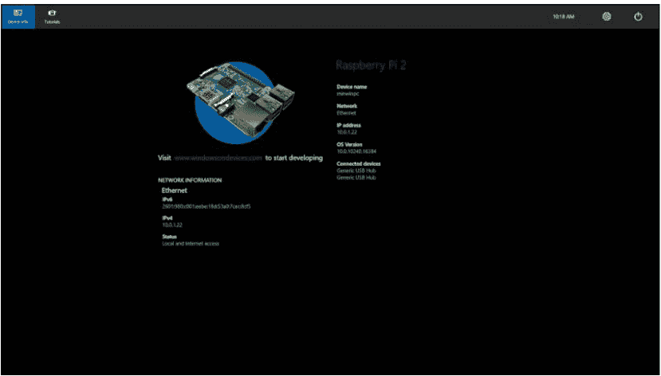
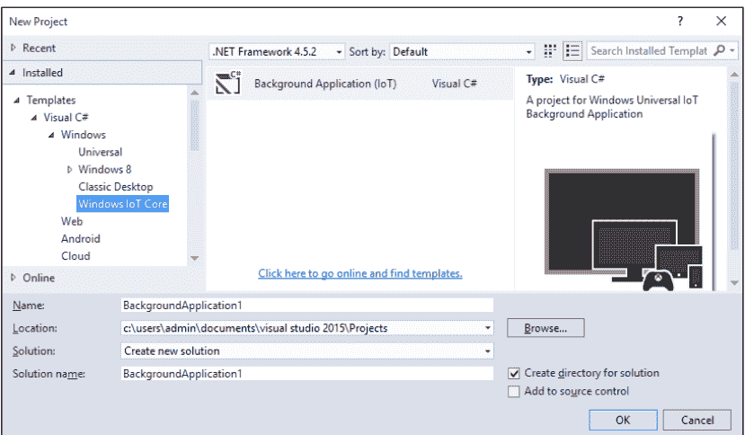
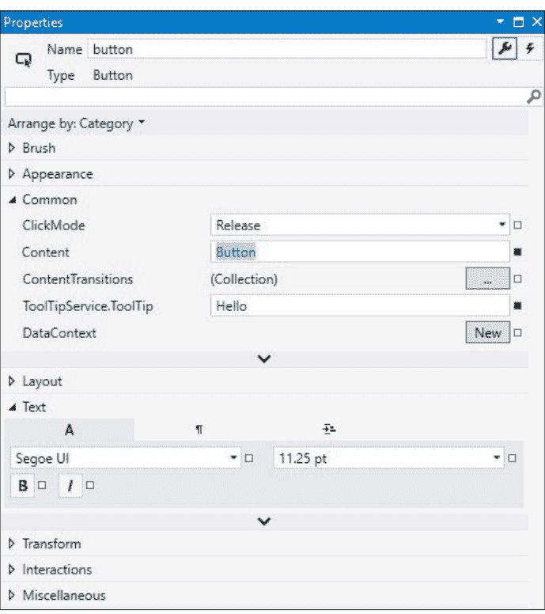
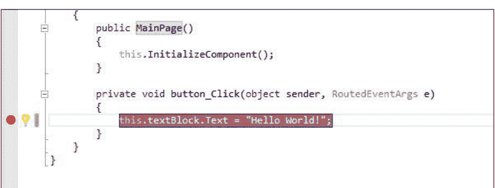
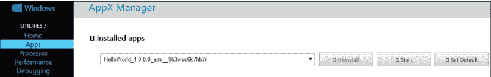

## 10 Windows IoT Core

Windows IoT Core 的主要目标是教育和业余爱好用户。它确实有一个 GUI 堆栈，但仅限于微软的通用应用平台（UAP），如果你有兴趣使用 XAML 或 HTML 开发 C# 应用程序，这并不是坏事。

你并不严格局限于前面提到的技术。微软试图支持一些其他编程语言，例如使用 UAP SDK 的 C++ 和 Python，但也支持具有一些限制的原生 Win32 应用程序或服务。

开发通用应用的另一个好处是，你可以将其安装在运行 Windows 10 的任何设备上，甚至是完整的桌面。因此，很容易将一个代码库分发到 Raspberry Pi 2、Intel Galileo 或 MinnowBoard 用于嵌入式应用。也可用于远程管理控制台到你的 Windows 10 手机、平板电脑、桌面或 Xbox。

Windows IoT 因 Linux 社区对其为何要费心做这一切而受到很多批评。本质上，目的不是取代 Linux 或试图排挤 Linux 用户，而是帮助更多人参与嵌入式原型制作。作为一名 .NET 开发者，你会欣赏到你终于可以在你喜爱的 IDE 中为嵌入式设备创建应用，实现流畅的工作流程。Visual Studio 具有完整的调试功能，能够在可以测量你鱼缸温度的设备上嵌入你最喜欢的 NuGet 包。

> 在撰写本章时，请注意 IoT 刚刚发布；仍有许多问题有待解决，还有更多功能有待添加，因此从现在起只会越来越好。


### 开始

要充分受益于本章，你需要一台 Windows 7 或更高版本的桌面机器。推荐 Windows 10 但不是必需的。

要为 Windows 创建通用应用程序，IoT 需要安装 Visual Studio 2015。你可以安装一个完全免费的版本，称为 Community 版。只有 2015 版支持通用应用。你也可以在 Community 版中完全免费创建其他类型的项目。

要开始开发通用应用，你必须拥有 Visual Studio 2015。你可以免费下载 Community 版，但你需要创建一个实时账户并在 Visual Studio 社区中登录该账户，以保持你的免费订阅处于活跃状态。

### 刷写 IoT

建议使用 Windows 10 桌面下载并烧录 IoT 镜像到 SD 卡。要获取镜像，你需要打开 https://dev.windows.com/en-us/iot 并点击 Get started now。然后你可以点击 Raspberry Pi 2 并按照那里的步骤操作。

SD 卡镜像以仅在 Windows 10 上支持的 FFU 格式分发。为了能够在旧版本的 Windows 上烧录，我们需要将镜像转换为原始镜像文件。

### 适用于 Linux 或 Windows 7 和 8 的 Python

Windows 10 具有 DISM 二进制的新版本，用于将 FFU 镜像文件类型烧录到 SD 卡。在以前版本的 Windows 中，我们需要使用 Python。Python 也用于基于 Linux 的机器。

如果你在 Windows 或 Linux 机器上安装了 Python，可以使用一个由昵称为 t0x0 的人创建的脚本，它可以从以下位置下载。该脚本同时适用于 Windows 版 Python 和 Linux 版 Python：https://raw.githubusercontent.com/t0x0/random/master/ffu2img.py

此时，你需要为 Windows 安装 Python 2.7 或更新版本，你可以从 https://www.python.org/downloads 获取最新的安装文件。

将 FFU2IMG Python 脚本复制到你提取 Windows IoT 镜像的目录中。打开一个命令窗口，导航到该目录，并使用以下命令转换镜像：

```
python ffu2img.py Flash.ffu
```

Then, you can flash the image onto an 8 GB minimum SD card from your Linux machine:

```
sudo dd bs=1m if=Flash.img of=/dev/<your_SD_card>
```

Or you can use Win32 DiskImager to burn the image from Windows, as described in Chapter 1, Getting Started with the Raspberry Pi for Raspbian.

## 首次启动

插入 SD 卡，连接有线网络和 HDMI 显示器，然后打开电源。首次启动需要几分钟，屏幕会出现闪烁和奇怪的图形或文字。它会自动重启，然后你会看到语言选择屏幕。如果没有连接键盘，默认（英语）会自动被选中；之后，你会看到类似下图的屏幕：



在此屏幕上，你会看到分配给 Raspberry Pi 的 IP 地址。你可以将 IP 地址加上端口 8080 输入浏览器，即可看到 Web GUI。

默认用户名是 administrator，密码是 p@ssw0rd。

## 远程连接

你可以通过 Windows 中的 PowerShell 或 SSH 连接连接到 Windows IoT，这将为你提供在 Windows IoT 上运行的 PowerShell 命令行。

最简单的方法是使用 Putty 或类似工具通过 SSH 连接，就像你通常连接到任何基于 Linux 的机器一样。

要从 Windows 使用 PowerShell 连接，请执行以下操作：

- 1. 点击 **开始** 菜单并开始输入 `powershell`。
- 2. 右键点击 **Powershell** 并点击 **以管理员身份运行**。
- 3. 然后，我们需要输入几条命令以便首次连接到 IoT：

```
net start WinRM
Set-Item WSMan:\localhost\Client\TrustedHosts -Value <IP Address>
```

之后，你就可以使用以下命令从 Windows PowerShell 连接到 IoT PowerShell：

```
Enter-PSSession -ComputerName <IP> -Credential localhost\Administrator
```


> 连接过程可能需要长达 30 秒。
> 建立连接后，你会在提示符前看到设备的 IP 地址。

## Visual Studio (VS)

本节将介绍如何为 IoT 准备 Visual Studio 2015，并查看 Hello World 应用程序以熟悉 IDE。

## 安装 Visual Studio 2015

使用你喜欢的浏览器搜索 **Visual Studio 2015 Community edition**，它完全免费使用且没有时间限制；下载并安装它。

安装 VS 后启动一次，并在需要时使用下载 VS 时使用的 Live 账户登录。一旦全部加载完成，我们需要关闭它以安装用于 Raspberry Pi（或其他运行 Win 10 IoT 的嵌入式设备）开发所需的 IoT 模板

再次使用你喜欢的搜索引擎搜索 **Windows IoT Core Project Templates**。你应使用官方 Microsoft `http://www.visualstudiogallery.msdn.microsoft.com/` 链接。那里可能有重要信息，请阅读。点击 **下载** 按钮并运行可执行文件。这将安装额外的 **通用 Windows 平台 (UWP)** 模板，这些模板不仅能让你为 Visual Studio 在无头 Pi 上编写后台应用程序，还包含我们在通用应用中会使用的特定库。

再次启动 Visual Studio，并在 C# 下找到新模板。验证模板是否已正确安装：



## Hello World 应用程序

此应用程序需要连接显示器，因为我们首先要创建一个 Windows 通用应用程序。它还展示了如何准备解决方案以便在 Raspberry Pi 上使用：

- 1. 我们将使用此模板创建一个新项目；导航到 **模板** | **Visual C#** | **Windows** | **通用** | **空白应用**（通用）。
- 2. 将其命名为 `HelloWorld` 并点击 **确定**。
- 3. 如果你使用的是 Windows 10，可能会提示 **启用开发者模式**；导航到 **设置** | **更新和安全** | **开发者**。
- 4. 最后一步是添加对 Raspberry Pi 特定功能（如 GPIO）所需的 IoT 扩展的引用。
- 5. 右键点击 **引用** | **添加引用** | **通用 Windows** | **扩展** 并勾选 **Windows IoT Extensions for the UWP**。

Windows 使用 XAML 标记设计。如果你曾经使用过 Silverlight，那么你应该熟悉 XAML。XAML 是一种通用对象实例化语言，大多是声明式的，如 HTML，但带有 XML 的特点。但无需担心底层标记，因为 Visual Studio 允许你可视化设计！


> 还有一个专门的软件叫做 Blend，纯粹用于为可能需要的应用程序创建复杂的 XAML 布局。

- 1. 在 Windows 中的 **解决方案资源管理器** 窗格中，找到并双击 **MainPage.xaml**。
- 2. 一个新的空白设计器视图将打开。
- 3. 从顶部选择 `40" IoT Device`，因为我们将为大屏幕的 IoT 设备制作此视图。如果你使用迷你 LCD，也可选较小的屏幕选项。这有助于你在透视图中布局设计。在高级技术中，你可以使用单独的 XAML 文件为各种设备创建单独的视图。这些视图将尽可能最好地缩放以适应可用屏幕。
- 4. 现在你可以展开右侧的 **工具箱** 并查看 **XAML 控件** 下的内容。
- 5. 从工具箱中，点击并拖动按钮控件到白色设计器区域。然后将其放入 **TextBlock**。
- 6. 调整按钮控件大小，使其更大，因为它可能以非常小的尺寸放置。
- 7. 在按钮控件被选中的情况下，将右侧视图中的 **窗格** 更改为 **属性**。
- 8. 找到 **常规** 选项卡并更改内容值以更改按钮上显示的文本；例如，`Hello World!`
- 9. 你也可以更改文本块的一些属性，例如字体大小。
- 10. 然后在设计视图中双击按钮。这会创建代码片段；将视图更改为代码区域，并将光标定位在按钮点击事件代码上：



在代码中，我们将使用以下一行代码更改 textBlock.Text 值：

```
this.textBlock.Text = "Hello World!";
```

## 部署应用程序

将应用程序部署到 Raspberry Pi 非常简单，但首先我们将更改包名。不幸的是这并不明显，但请按照以下步骤操作：

- 1. 在 **解决方案资源管理器** 窗格窗口中，点击 **解决方案资源管理器** 选项卡。
- 2. 右键点击 **HelloWorld** 项目（不是解决方案）并选择 **属性**。
- 3. 导航到 Package **清单 | 打包**。
- 4. 包名中的默认值是一个唯一 ID，这是在 IoT 上创建的进程的名称。现在我们可以将其更改为不带空格的 **HelloWorld**。当你想将应用发布到商店时，你需要使用 **命名空间**，例如 `My.RaspberryPi.HelloWorld`。
- 5. 按下 *Ctrl + S* 保存解决方案，然后关闭窗口。

现在，要发布，我们需要更改一些设置并选择目标设备：

- 1. 将顶部工具栏中的 `x86` 值更改为 `ARM`。
- 2. 接下来，在绿色播放按钮旁边有一个小下拉按钮；点击它并选择 **远程机器**。
- 3. 这将打开一个新窗口，自动发现网络上运行的 Windows IoT 设备。确保你的 Raspberry Pi 已启动到 Windows 10 仪表板应用。
- 4. 点击在 **自动检测** 下找到的设备条目，然后点击 **选择**（每个会话只需执行一次）。
- 5. 项目将开始构建；如果没有错误，它将被发布到 Raspberry Pi 并运行你的应用程序。Visual Studio 不处于调试模式！
- 6. 在 Raspberry Pi 上，点击你的按钮，文本框将使用你在代码中输入的文本进行更新。
- 7. 要停止调试，点击红色的 **停止** 按钮。

你现在已经为 Raspberry Pi 创建了第一个通用应用程序。

## 调试

Visual Studio 最伟大的功能之一是调试功能。所有这些功能已在安装在你的 Raspberry Pi 上的 Windows 10 IoT 上启用，无需额外配置。


After you click on **部署** (the green start button), Visual Studio automatically goes into debug mode. In this mode, you cannot change any of the code; you can add or remove breakpoints, view output in the debug console, and use various other debug tools.

Visual Studio will also automatically break on unexpected errors and take you to the code that caused this exception with details about the problem.


> As a long-time C# developer, I can admit that these errors might not make a lot of sense sometimes. The best thing is to search the Web for part of the error message and see what other developers have done to correct the problem. Stack Overflow usually provides high-quality answers for many ambiguous error messages.

## 断点

While the application is in the code edit mode, look at the source code of the button that we created earlier. You can add or remove breakpoints by clicking on the dark grey bar at the left, which will highlight the line of code in red:



Click on **部署并运行**. Your breakpoint will be hit before you click on the button. To continue, click on the green Play button again, or *F10* for step over, or *F11* to step in (if it is a method you created or the source code is available)

## 未处理的异常

To experience this feature, we will create a deliberate unhandled exception.
It would be nice to demonstrate a Stack Overflow, but let's stick with a basic arithmetic function:

- 1. Under your breakpoint, add these lines of code, and do not add any breakpoint to them:
- 2. Click on Deploy and run.
- 3. Click on the button on the IoT device and your first breakpoint will become a hit.
- 4. Press Continue to continue executing the code.
- 5. Straight after continuing, you should get an unhandled exception message:

```
int zero = 0;
this.textBlock.Text = (0 / zero).ToString();
```

```
DivideByZeroException was unhandled by user code
```

This is a simple, self-explanatory exception. If you ever run into deeper water, you can use View Detail... under action to reveal some more debugging information.

These types of exception cause the application to crash whether you are in the Debug or Release mode.

If you suspect that an operation may result in an unhandled exception, for example, lots of arithmetic calculations, working with indexes, long running operations, or external calls, you can wrap this code in try block, which will prevent your application from crashing.

Amend the divide by the zero code as follows:

```
try
{
int zero = 0;
this.textBlock.Text = (0 / zero).ToString();
}
catch (Exception ex)
{
this.textBlock.Text = ex.ToString();
}
```

You can use the method to display error messages to the user or log exceptions to a database.

## 示例

There is a large sample code package available to download from the code area. These are official Microsoft Samples, and they demonstrate not only how to create more advanced applications but also how to use the GPIO and other features on the Raspberry Pi.

## Windows 10 IoT WebGUI

You can access your Raspberry Pi via your browser. Simply enter the IP with port 8080 and use the default username and password provided earlier in this chapter.

As time goes on, this page will be updated to support more features and may even completely change in the future. For now, we have access to various common commands, such as Shutdown, reboot, processes, live performance graph, and so on.

## 设置启动应用

The following are the steps to set up the startup app:

- 1. You can click on **应用** on the left-hand side menu.
- 2. From the installed apps, find your app and click on it.
- 3. Once it is selected, click on **设为默认**.
- 4. Your application will now start up after each boot:



- 5. Click on **重启** to test it.

WebGUI will still be available while your application runs.

## 外设

I tried to plug in various devices and see what happens with most of them not doing anything. Popular ones seem to work, such as a USB mouse and keyboard transceiver.

Just remember that power is still an issue on USB, so it may be a good idea to use a powered hub.

You can find more information on supported devices by visiting: http://ms-iot.github.io/content/en-US/win10/SupportedInterfaces.htm.

## 蓝牙

Bluetooth is still a fairly new addition to Windows IoT as of writing this chapter. I tried a generic Bluetooth dongle (unbranded), and it was installed successfully. It found my TV and my Bluetooth keyboard while I was on WebGUI.

I was successful in pairing my keyboard and navigating the screen.

You may also succeed in pairing Bluetooth serial port transceivers as it seems to be supported on generic Bluetooth.

## 无线

Wireless support has been rapidly extended since the release candidate, and it supports the official Raspberry Pi dongle and other popular chipsets used in many other brands.

## 总结

Even though Windows has various other ARM and MCU systems, Windows IoT was developed from a blank canvas. With time, the support will continue to grow for new devices and other ways to develop applications.

If you are interested in learning C# or are already a seasoned C# developer, this finally looks like the light at the end of the tunnel for an alternative embedded OS, other than the ever dominating *nix operating systems that were designed for these sorts of devices years ago.

There are many advantages in using Visual Studio and the Universal App architecture, but as of writing this chapter, there is still a lot of work to do for Microsoft.
