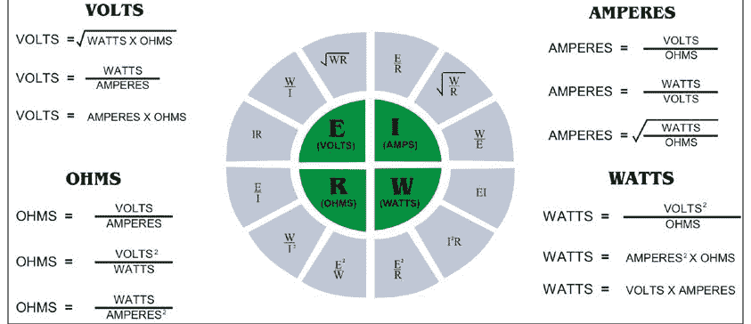
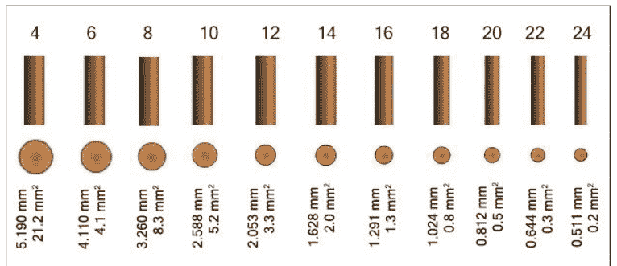
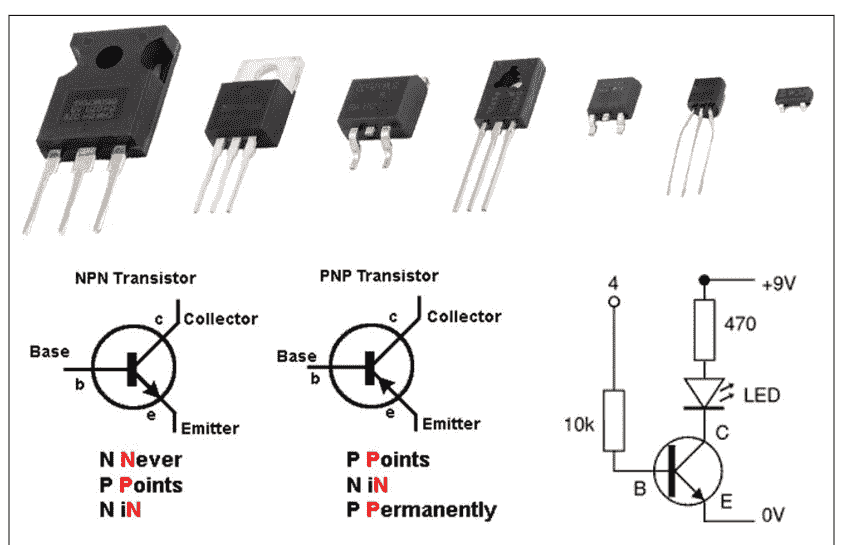
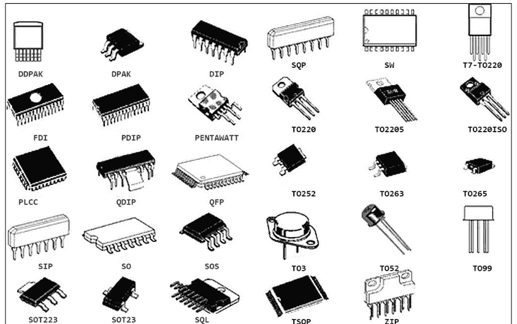
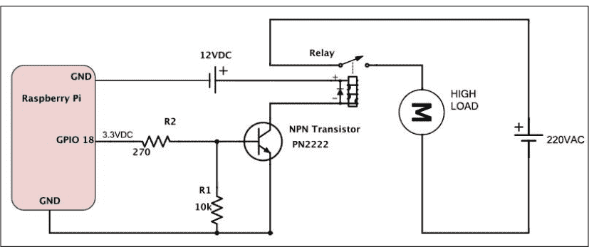

## 12 物联网 – 云中的传感器

现在您已经学习了在 Raspberry Pi 2 上运行软件应用程序的基础知识，是时候应用您新获得的知识了。本章将介绍与操作系统无关的语言编程。

如果您愿意接受任务，请在我在电气原型制作方面帮助您建立基础的同时，找到您最喜欢的操作系统和编程语言。

在本章中，我们将重点关注以下主题：

- 了解功耗需求并选择正确的电缆
- 使用晶体管
- 了解集成电路（IC）及其用途
- Windows IoT、事件和实时系统
- 为物联网集成而使用云

这些主题将扩展您基本的电子知识，并展示可在任何嵌入式平台上使用的良好原型制作实践，例如您的 Raspberry Pi 2。

软件的最终决定完全取决于您个人的偏好。通过这样做，您将增强解决问题的信心，并欣赏互联网上庞大的工具和资源。

如果您在软件问题上遇到困难，最好的解决方案是离开电脑休息 90 分钟，或去睡觉，第二天再回来处理。如果您似乎在某个特定的软件问题上卡了好几天，请考虑换一种方式提问。不要执着于一种特定方法，因为您的问题很可能已经被解决，并且已经有很好的解决方案存在。

## 什么是物联网？

物联网是 *things*，它们配备传感器并嵌入电子设备和软件。这些事物连接到网络，很可能是互联网。

物联网始于机器对机器设备，例如报警系统或 GPS 追踪器，并逐渐扩展到家庭便利小工具，例如电网监控工具或某种形式的家庭自动化。

> “专家估计，到 2020 年物联网将包含近 500 亿个物体。”
> 
> – Wikipedia

要构建成功的物联网设备，您需要学习软件，其基础知识在本书中有所介绍。您还需要学习电子知识，这也将在本章中介绍。

## 欧姆定律

欧姆定律是在您进入原型制作领域之前需要尝试理解的基本概念。欧姆定律被广泛误解的主要原因之一是它有各种方程，这些方程源自一个单一的数学方程。

您可以在 *Chapter 9, Running Your Pi from a Battery's Power Source* 中找到有关此图表和欧姆定律的更多信息。我在此包含此图表以供快速参考，因为我将演示如何使用提供的一些方程：

## 功率有多大？

在欧姆定律中，功率（W）称为瓦特。理解如何计算瓦特几乎是最重要的问题，您应该能够轻松回答。

例如，我需要多大的电缆？

- 电缆的额定值为可承载多少安培。如果您知道所需的安培数，那么您就知道使用哪种电缆。

> 如果您选择了错误的电缆尺寸，通常会导致电气火灾，因为摩擦会使这些电缆发热直至熔化并最终点燃。

要计算设备使用多少瓦特（W），通常将伏特（E）乘以安培（I）。

> 瓦特 = 伏特 x 安培 (W = EI)

- 5 伏特 x 1 安培 = 5 瓦特（例如 Raspberry Pi）
- 如果您有一个需要 60 瓦且额定电压为 240 伏的设备，那么您可以通过将瓦特除以伏特来计算这些安培。

> 安培 = 瓦特 / 伏特 (I = W/E)

- 60 瓦 / 240 伏 = 0.25 安培（这是一个灯泡）
- 一旦您知道需要传输多少安培，您可以使用美国线规（AWG）表来检查在所需距离上所需的电缆尺寸：

美国线规 (AWG)
| 长度（英尺） | 长度（米） | 5 | 10 | 15 | 20 | 25 | 30 | 40 | 50 | 60 | 70 |
|---|---|---|---|---|---|---|---|---|---|---|---|
| 3 | 1 | 18 | 18 | 18 | 18 | 16 | 16 | 16 | 12 | 12 | 12 |
| 15 | 4 | 16 | 12 | 10 | 10 | 8 | 8 | 6 | 6 | 4 | 4 |
| 20 | 6 | 14 | 12 | 10 | 8 | 8 | 6 | 6 | 4 | 4 | 4 |
| 25 | 7 | 14 | 10 | 8 | 8 | 6 | 6 | 4 | 4 | 2 | 2 |
| 30 | 9 | 12 | 10 | 8 | 6 | 6 | 4 | 4 | 2 | 2 | 2 |
| 40 | 12 | 12 | 8 | 6 | 6 | 4 | 4 | 2 | 2 | 1 | 1/0 |
| 50 | 15 | 10 | 8 | 6 | 4 | 4 | 2 | 2 | 1 | 1/0 | 1/0 |
| 60 | 18 | 10 | 6 | 6 | 4 | 2 | 2 | 1 | 1/0 | 2/0 | 2/0 |
| 70 | 21 | 10 | 6 | 4 | 2 | 2 | 2 | 1/0 | 2/0 | 2/0 | 3/0 |
| 80 | 24 | 8 | 6 | 4 | 2 | 2 | 1 | 1/0 | 2/0 | 3/0 | 3/0 |
| 90 | 27 | 8 | 4 | 4 | 2 | 1 | 1/0 | 2/0 | 3/0 | 3/0 | 4/0 |

> 通常建议如果接近电缆的极限，则选择更小一号（更粗的电缆）。这通常在容量的 10% 以内。

这里有一幅说明 AWG 尺寸如何工作以及半径和面积的公制毫米转换的插图：

Higher voltage is your friend over longer distances. Generally, the higher the voltage, the thinner the cable you need to use to supply the same amount of amps, reducing the cost of the cable.

> In most cases, the highest voltage that we can use is what is supplied to our home grid 110v/220v, and this will still be the most efficient way to transport power for distances up to 300 feet (100 meters).

You will find this useful in many projects that you are ready to put into *生产* away from your prototyping bench. For example, to power remote devices, such as a weather station that controls an irrigation system 120 meters away from the nearest socket, but it may as well be something in your loft, connected within one box:

- Raspberry Pi 2: 5 volts 1 amp
- USB GPRS Modem: 5 volts 0.8 amp
- Medium water pump: 24 volts 2.5 amp
- 6 x Solenoids: 9 volts 1 amp
- Relay board: 12 volts 0.5 amp

You will learn how to apply Ohm's law and use IC to deal with this problem efficiently later in this chapter.

## Choosing sensors

The answer to this question depends on what you want to build. Sensors come as a variety of packages, operated by various voltages, and interfaced with some kind of communication standard.

## Resistors, fuses, and diodes

These are typically the easiest elements of electrical design to understand. If you are planning to create a device, you should find a basic electronics course to gain good understanding of these basics before continuing.

## Transistors

Everybody that uses a computer will have probably heard of a transistor. What is a transistor really? It is a semiconductor device that can be used to amplify or switch electronic signals and electrical power. A semiconductor is a solid substance that can conduct electricity when a certain condition has been met; otherwise they act as an insulator.

Their packages are easily identified as they usually consist of three wires (legs). These legs are named Base (b), Collector (c), and Emitter (e):

The preceding illustration shows various packages that a transistor can be found in. The ones that look like they have two legs, actually have their base on the other side.

The illustration also shows two different types of transistors: NPN and PNP. They essentially do the same thing, but NPN transistors are used to switch higher voltages and PNP lower voltage than what's used in your main circuit. Also, PNP transistors are turned on when pulling the base low while NPN is turned on when you provide a voltage to the base.

Usually, in prototyping, we are mostly interested in switching higher voltages, and from here on, we will be working with NPN transistors.

It may sound confusing at first, but just think of a transistor as a plain old switch. When you apply the correct amount of current to an NPN transistor's base, it is like your finger pushing a button. Once you get to the correct pressure, the switch will turn on, and the current will flow through the collector to the emitter. The amount of power (A) used to trigger a transistor is typically very low and safe for the GPIO's on the Raspberry Pi.

Looking at the sample circuit (bottom right) in the illustration, you can see a 9v power source connected to a resistor, LED, and then to the collector of the transistor. The emitter is connected to GND. This is pretty much how you will wire a switch. In the digital world, to turn on this switch, we need an extra input—base. For example, we will use GPIO PIN 4. This can be an output from any kind of embedded device with a 3.3v, 5.0v, or a higher voltage. The maximum voltage depends on the resistor's technical specification.

The 10k resistor can be of any value between 1K and 20K, and it should always be connected before the base of the transistor. The resistor is there to limit the maximum current that flows through the base of the transistor, preventing damage to the transistor.

Once the I/O is set high in software, the switch will close and the LED will illuminate.

> You just learned the basics of transistors. As you build more designs, you will find new circuits that require a combination of transistors to achieve a specific goal.

Using transistors in such a way makes switching other voltages much easier from an embedded platform, using a low amount of current.

You should always try and find the transistor marking, and you should search for its datasheet to understand the minimum and maximum values it can handle. The datasheet will also provide the minimum current required on the base to turn it on.

Transistors are typically used in low-voltage designs. To turn on high voltage, such as 220 volts, you should almost always use a relay. Yes, you can use the transistor to turn the relay on.

## Integrated Circuit Packages

These are a variety of other IC packages that you will find. You should be able to use any of these with nothing more than a soldering iron or breadboard.

> Other packages such as QFN require specialist equipment to be prototyped with. An example of such a package is BCM2836, and it can be found on your Raspberry Pi 2.

## Putting it all together

This circuit demonstrates switching a high-voltage 48 volt DC motor.

> Be very careful when working with high voltages. Incorrect wiring will cause irreparable damage. Switching mains voltages may be lethal, and please do not attempt this if you are in doubt.

## Accurate data using Arduino

The Raspberry Pi typically runs on event-driven Operating Systems. This means that a queue of events gets processed by the processor as fast as the processor can handle it. Unfortunately, even if your processor is idle, there is still an overhead in the event system that causes significant problems with real-time sensors or applications.

There are real-time Operating Systems for the Raspberry Pi, but this will severely limit the capabilities that you have learned to use and love. Real-time Operating systems guarantee that an action, such as some code, will be completed in the predefined time. A very popular Operating System for these types of simple yet extremely accurate tasks is the Arduino family IC. They are amongst the best for doing millions of tasks over and in a very precise time.

We will look at some examples of how an Arduino IC will help you gather data by showing a use case of building a weather station.

## Building a weather station

A great project to work on is building a weather station. The Raspberry Pi 2 has so much processing power to offer:

- It can store a large amount of data in a database with ease
- It can be its own web server running with a variety of programming languages
- It can crunch numbers, create statistics, and eventually become nice graphs
- It can even stream live videos using WebRTC or RTSP

## Real-time embedded devices

Atmel AVR (used on Arduino) and PICAXE are very well-known microcontrollers that run code with real-time precision. The advantage of these microcontrollers is that you can program them with simple code once, upload the code, disconnect them from the development board, and use them like a standalone IC.

Your initial cost for a development board may be about the same as a Raspberry Pi on its own, but after this, getting the programmable Microcontroller Unit (MCU) will cost a few dollars, and will be even cheaper for tiny versions.

There are expansion boards available for some of these embedded devices, mostly for Arduino.

## The data communication

Real-time devices also offer very precise or faster data communication between various other devices by not only offering hardware interfaces but also software bit banging.

> Bit banging is a technique for any kind of serial communication using software instead of some dedicated hardware.

## Real-time events

The essential benefit of an MCU is that you would require it when building a weather station. It is required when counting time-sensitive actions, such as wind speed, which must be calculated every second without any delay.

You write a small function of code that executes when a selected pin is triggered. This is known as an interrupt. This code is as simple as incrementing a counter.

The main program is an endless loop of code or an internal-timed interrupt. Not all MCUs offer internal-timed interrupts, but what is critical is that it always runs at a selected time, for example, every 60 seconds. On an MCU, this is guaranteed to run every 60 seconds to the microsecond. This is crucial to make sure that you can run an algorithmic function, which uses your wind counter to save the wind speed. On an event driven OS, you may get highly inaccurate readings caused by delayed processor queues or the optimized execution.

## Analog inputs

The Raspberry Pi lacks analog inputs. MCUs usually have more analog inputs than digital ones. On tiny versions, they may even completely lack digital inputs.

Analog inputs will be very useful to read the direction of the wind, as wind vanes usually output a calculated sub-voltage from the input voltage to inform you of the direction. Something like a potentiometer, but more simply, it is like various resistors connected to a reed switch, which will activate a given circuit.

There are still a lot of other applications that can be useful for analog inputs.

## Parts required

The most affordable and pretty complete package is offered by Sparkfun—a wind vane, anemometer, and rain counter, with cables and a complete installation mount. Adding extras to this, such as instruments to measure UV light, atmospheric pressure, and temperature, is a breeze.

You will also need a Raspberry Pi and a programmed Arduino MCU or similar.

## Storing data on the Cloud

At some point of any project, you will, most certainly, want to store collected data somewhere. Usually, this is from collecting sensors, but it could also be debugging data.

The Cloud is a network of servers that can provision virtual machines for any use. Usually, you start from one server, but you always have the ability to increase the size or bundle several virtual machines to act as one endpoint. All this is usually handled by a nice frontend, such as Azure, Amazon AWS, or the Google Cloud platform.

## Phant

Phant is a logging tool developed by Sparkfun Electronics and is ready to be used free of charge at https://data.sparkfun.com; it stores data in JSON format. JSON is easy to read and compress, but most importantly, it's dynamic; dynamic meaning that you don't build relationships between each data packet, as in traditional SQL servers. This means that each data packet can contain any variety of structures that you save to Phant.

You can find yourself a very cheap Linux-based virtual machine and install your own Phant platform to take full control of your cloud data. This is an extremely easy way to allow you access to shared data anywhere in the world, as long as you have an Internet connection.

## Summary

In this chapter, you learned the basics of electrical engineering and the external system's integration. The possibilities are endless and only confined to your own imagination. In case you ever seem to get stuck, it is worth visiting some of these great sites for more information.

For Stack Exchange, use the following:

- Electrical Engineering: http://electronics.stackexchange.com/
- Raspberry Pi: http://raspberrypi.stackexchange.com/
- Stack Overflow (Programming): http://stackoverflow.com/
- Ask Ubuntu (Linux related): http://askubuntu.com/

For other sites, use the following:

- Arduino Forums: https://forum.arduino.cc/
- PICAXE Forums: http://www.picaxeforum.co.uk/
- Searching the internet

Thank you for your interest in this book, and I wish you happy prototyping!

## Index

## Symbols

## A

## B

## C

.NET
about 48
and ASP.MVC 48
DNX, installing 50
MVC 52
MVC Website, running 50, 51
nginx 52
other .NET applications 52
prerequisites 49
adapters
URL 17
admin configuration
about 128
apps, installing 129
Calendar Plus 130
other apps 130
server admin 128
AJAX GET Request
URL 48
Alamode 6
alsamixer
using 96
Apache
versus Kestrel 39
versus nginx 39
Aplay
for audio playback 95
Apple Filing Protocol (AFP)
about 67
Netatalk, configuring 67
Netatalk, installing 67
shares and time machine 68
Arduino
Forums, URL 144
used, for data accuracy 141
Ask Ubuntu (Linux related)
URL 144
ASP.MVC 48
audio, playing
about 95
AirPlayer, using 96
alsamixer, using 96
Aplay, for audio playback 95
OMXPlayer, for audio playback 95
audio recording 6
battery power source
about 101
capacity 107, 108
hardware requirements 101, 102
implementing 107
BitTorrent Sync
about 68
BTSync 2, installing 68-70
boot process 10
Broadcom chip 35
BTSync 2
installing 68-70
CAN bus 7
Cloud
data, storing on 143
Phant 144
Crystal Disk Mark 12

## D

daily functionality
about 131
World Wide Access 131
data
accuracy, Arduino used 141
database, installing
MySQL, installing 54
phpMyAdmin, installing 55, 56
SQLite, installing 56, 57
decoders
enabling 35
licenses, buying 35
distribution
updating 32
Dot Net Execution Environment (DNX)
about 49
installing 50
Dot Net Package Updater (DNU)
about 49
installing 50
Dot Net Version Manager (DNVM)
about 49
installing 50
drive, formatting
disk, remounting after reboot 63
drives, mounting 62
EXT4 partition, creating 62
drivers
listing 60
Dynamic DNS
about 28
client, installing 28, 29
free network 29
## E
Electrical Engineering
URL 144
eth0 port 16
Ext4
about 61
partition, creating 62
external storage
connecting 59
## F
FastCGI 53
files, accessing
about 63
FTP service 63
File Transfer Protocol (FTP) service
about 63
FileZilla, connecting with 64
WinSCP, connecting with 64, 65
FileZilla
connecting with 64
Fingerprint scanners 8
firmware
updating 32
Freeciv
about 76
configuring 76
installing 76
playing 77
## G
games servers 74
## H
hardware, limitations
about 11
network speeds 11
time 12
USB bottlenecks 11
hardware RAID
about 70
configuring 70
massive storage 71
redundant storage 72
hardware requirements, battery power source
battery packs 103
charging station 102
voltage regulator 104, 105
hardware watchdog
about 33
enabling 34
testing 35
HDMI Pi 94
HDMI to VGA converter 6
home automation 7
HTTP streaming
  about 84, 85
  object detection and tracking 88
  overlay watermark, removing 88
  text overlay 87
  web conferencing 85, 86
  X desktop, streaming 86
HUD sample
  about 88
  inline variables 89, 90
  overlay binary, using 89
  overlay code, compiling 90
## L
licenses
  URL 35
Local Area Network (LAN)
  about 15, 16
  Bcast 16
  eth0 port 16
  HWaddr 16
  inet6 addr 16
  inet addr 16
  loopback (LO) interface 17
  Mask 16
  wlan0 interface 17
## I
inline variables 90
Internet 3G dongles 5
internet configurations
  about 26
  business packages 27
  home packages 27
Internet of Things (IoT)
  about 110, 134
  first boot 111
  Python, for Linux 110
  Python, for Windows 7 and 8 110, 111
  remote connections 112
  requisites 110
  URL 110
iPerf 25
## M
Macintosh
  Apple Filing Protocol (AFP) for 67
media add-ons
  Alamode 6
  HDMI to VGA 6
  IR receivers 6
  Multiscard readers 6
  TV and radio receivers 6
  Webcams 6
Micro Controller Unit (MCUs) 142
Minecraft
  about 78
  configuring 79
  installing 79
  playing 80
MPEG-2 36
MVC
  and nginx 52
MySQL
  installing 54, 55
## J
Java Hard-Float
  installing 78
JavaScript web programming language 45
Jessie
  updating to 73
## N
Netatalk
  configuring 67
  installing 67
network
  bandwidth, recommended 25
  basic tests 23, 24
  benchmarking 23
  benchmarking tools 24
## K
Kestrel
  versus Apache 39
  versus nginx 39
iPerf 25
speedtest application 24
testing 23
Network Attached Storage (NAS) 4, 62
nginx
extra frameworks 43
installing 40, 41
versus Apache 39
versus Kestrel 39
virtual hosts, configuring 41, 42
Node.js
about 45
installing 45
Node Package Manager (NPM)
about 46
Node.js server 46, 47
URL 46
NO-IP domain
URL 29
NOOBS
URL 9
## O
Ohm's law
about 134
power (W) 135-137
OMXPlayer
for audio playback 95
for video playback 95
OpenArena
about 77
configuring 77
installing 77
playing 78
OpenTTD
about 74
configuring 75
installing 75
lan_internet 75
playing 75
server_advertise 75
server_bind_ip 75
server_name 75
server_port 75
OSMC
about 96
add-ons, using 98
AirPlay 98
CEC, enabling 99
configuring 97
installing 96
media sources 98
other codecs, enabling 97
overclocking 99
performance optimization 99
remotes, enabling 99
wireless configuration 97
overlay binary
URL 88
using 89
overlay watermark
removing 88
ownCloud
about 121
admin configuration 128
first configuration 126, 127
MySQL 122
nginx and PHP 122-125
permissions 126
requisites 121
URL 129, 130
## P
packages
updating 32
peripherals
about 4, 120
Bluetooth 120
CAN bus 7
fingerprint scanners 8
home automation 7
Internet 3G dongles 5
Joysticks 7
keyboards and mice 5
URL 5, 120
USB hubs 5
USB missile launcher 7
USB to SATA 7
weather station 8
wireless 120
Wireless USB network adapters 5
Phant 144

## P
### PHP
- 安装 53
### phpMyAdmin
- 安装 55, 56
### PICAXE Forums
- 网址 144
### pi.kula.solutions 28
### 功率 (W) 135-137
### Python
- 适用于 Linux 110
- 适用于 Windows 7 110
- 适用于 Windows 8 110
- 网址 45
### Python API
- 关于 43
- 执行 43, 44

## R
### Raspberry Pi
- 启动过程 10
- 设计 9
- 硬件、限制 11
- 其他功能 10
- Raspbian，安装 8, 9
- 更新 31
- 网址 69, 144
### Raspberry Pi 2
- 硬件要求 1, 2
- 电源 2, 3
- SD 卡 4
- USB 集线器 3
### Raspbian
- 在 Raspberry Pi 上安装 8

## S
### Samba
- 关于 65
- 配置 65, 66
- 安装 65, 66
- 网络共享 66, 67
### SD 卡 4
### SD Formatter
- 网址 8
### 选择性设置 73, 74
### 自签名证书
- 网址 123
### 传感器
- 二极管 137
- 熔断器 137
- 合并 141
- 电阻器 137
- 选择 137
- 晶体管 138-140
### shairport 96
### 幻灯片放映
- 关于 93
- 使用 fbi 94
- 播放视频 94
### Sparkfun Electronics
- 网址 144
### speedtest 应用 24
### SQLite
- 安装 56, 57
### Stack Exchange 144
### Stack Overflow (编程)
- 网址 144
### 静态网络地址 22
### 存储
- 介质，准备 60

## T
### 文本叠加 87

## U
### 通用应用平台 (UAP) 109
### 更新，Raspberry Pi
- 发行版，更新 32
- 固件，更新 32
- 结果 33
- 软件包，更新 32
### USB 瓶颈 11
### USB 集线器 3-5
### USB 导弹发射器 7
### USB 转 SATA 控制器 7
### UV4L
- 安装 81, 82
- 网址 81
### UV4L-RaspiCAM，配置 82, 83
### Web 实时通信 (WebRTC)
- 安装 83
### WebRTC 流媒体 83, 84

## V
### VC-1 36
### 虚拟目录
- 网址 44
### VisualGDB
- 关于 91
- 网址 91
### Visual Studio
- 关于 112
- 应用程序，部署 116
- 调试 116
- 调试，断点 117
- 调试，未处理的异常 118
- Hello World 应用程序 113-115
- 示例 119
### Visual Studio 2015，安装 112, 113
### 电压调节器
- 关于 104
- 放电特性 107
- 放电曲线 106
- 欧姆定律 104-106

## W
### 气象站
- 关于 8
- 模拟输入 143
- 构建 142
- 数据通信 142
- 零件 143
- 实时嵌入式设备 142
- 实时事件 142, 143
### 网络会议 85, 86
### WebRTC
- 关于 83
- 流媒体 83, 84
### Windows 10 IoT WebGUI
- 关于 119
- 启动应用，设置 119
### WinSCP
- 连接 64
- 网址 64, 65
### 无线配置 (Wi-Fi)
- 关于 17
- 从控制台设置 18-21
- 从桌面设置 18
- 使用 wicd-curses 21, 22
### 无线适配器 17, 18
### 无线 USB 网络适配器 5
### wlan0 接口 17
### 全球访问 (WWW) 131
### 万维网 (WWW) 121

## X
### xboxdrv 7
### X 桌面
- 流媒体 86
