## 1 树莓派和 Python 简介

借助树莓派和 Python，可以以轻松的方式学习计算机科学主题。树莓派系列单板计算机使用 Python 作为首选开发语言。使用树莓派和 Python 学习编程和计算机科学相关概念，是开启这段充满创造可能性的奇妙计算机世界之旅的最佳方式之一。我们将在本书中探索这些可能性。

我们将在本章开始我们的旅程，通过熟悉以下主题：

- 单板计算机
- 树莓派
- Raspbian
- 设置树莓派
- Python 基础
- 使用 Python 进行 Turtle 编程

### 单板计算机

单板计算机系统是一个完整的计算机集成在单一电路板上。该板包括处理器、RAM、输入/输出 I/O 和用于连接设备的网络端口。与传统计算机系统不同，单板计算机不是模块化的，其硬件无法升级，因为它已集成在板上本身。单板计算机用作学术、研究和嵌入式系统中的低成本计算机。单板计算机在嵌入式系统中的使用相当普遍，许多个人和组织都基于单板计算机开发并发布了完全可用的产品。

由 John Titus 于 1976 年设计的微型计算机训练器 MMD-1 是基于 Intel C8080A 的第一台真正的单板微型计算机。它在原型阶段被称为 **dyna-micro**，量产单元被称为 **MMD-1**（**Mini Micro Designer 1** 的缩写）。

市场上流行的单板计算机包括但不限于 Raspberry Pi、Banana Pro、BeagleBone Black 和 Cubieboard。以下图片分别是 BeagleBone Black、Banana Pro 和 Cubieboard 4 的正面视图：

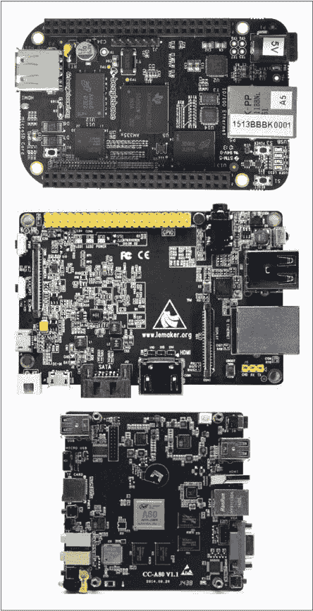

### 树莓派

树莓派是由英国树莓派基金会开发的一系列低成本、掌心大小的单板计算机。创建树莓派的初衷是为了促进学校中基础计算机技能的教学，其在这方面发挥了很好的作用。树莓派已远远超出了其预期用途，渗透到嵌入式系统市场和计算机科学研究中。


> 这是树莓派基金会的首页：
> 
> http://www.raspberrypi.org.

树莓派是在与 Newark element14、RS Components、Allied Electronics 和 Egoman 的许可协议下制造的。这些公司制造和销售树莓派。所有制造商的硬件都相同。

下表显示了制造商网站的 URL，您可以在这些网站上在线购买 Pi 及相关产品：

| Manufacturer | Website |
|---|---|
| Newark element14 | `http://www.newark.com` |
| RS Components | `http://uk.rs-online.com` |
| Egoman | `http://www.egoman.com.cn` |
| Allied Electronics | `http://www.alliedelec.com` |

您也可以在以下链接购买 Pi 和其他第三方附加组件：

- `http://shop.pimoroni.com`
- `http://www.adafruit.com`

### 树莓派型号

以下是在撰写本文时，树莓派的主要型号：

- Model A（已停产；为生产更新型号而停产）
- Model A+（目前在生产中，可购买）
- Model B（可购买但未生产）
- Model B+（目前在生产中，可购买）
- Raspberry Pi 2 Model B（目前在生产中，可购买）

查看树莓派的 **Product** 页面
http://www.raspberrypi.org/products/.

此外，树莓派还提供一种更灵活的形态因子，专为工业和嵌入式应用设计。它被称为 **Compute Module**。基金会还提供 Compute Module 原型套件。

分别查看 Compute Module 和 Compute Module 开发套件的以下 URL：

http://www.raspberrypi.org/products/compute-module/

http://www.raspberrypi.org/products/compute-module-development-kit/

下表比较了目前可用的 Pi 型号：

| | Model A | Model B | Model B+ | Pi 2 Model B |
|---|---|---|---|---|
| SOC (System on a chip) | Broadcom BCM2835 (CPU, GPU, DSP, SDRAM, one USB port) | | | Broadcom BCM2836 (CPU, GPU, DSP, SDRAM, one USB port) |
| CPU | 700 MHz single-core ARM1176JZF-S | | | 900 MHz quad-core ARM Cortex-A7 |
| GPU | Broadcom videoCore IV @ 250 MHz | | | |
| Memory (shared with GPU) | 256 MB SDRAM | 512 MB SDRAM | | 1 GB SDRAM |
| USB 2.0 ports | 1 | 2 | | 4 |
| On Board Storage | MicroSD slot | SD / MMC / SDIO card slot | | MicroSD slot |
| Networking | None | 10/100 Mbit/s Ethernet, no Bluetooth or Wi-Fi | | |
| Power Source | 5V via Micro USB or GPIO Headers (Power supply through micro USB is recommended.) | | | |
| Power Ratings | 200mA (1 W) | 700mA (3.5 W) | 600mA (3.5 W) | 800mA (4 W) |

以下图片显示了树莓派 Model B 正面的俯视图：

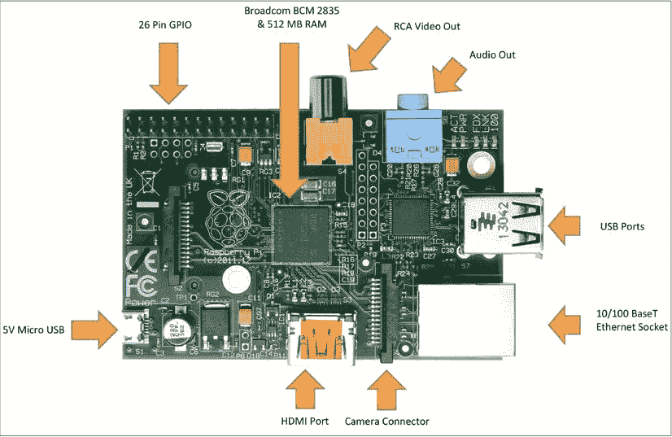

以下图片显示了树莓派 Model B 翻转一侧的俯视图：

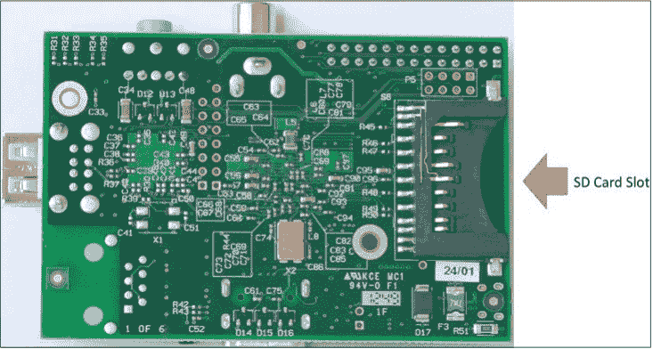


然而，近期推出的树莓派 2 基于 ARM Cortex A7，能够运行 Windows 10 和 Ubuntu（Snappy Core）。以下操作系统由所有型号的树莓派官方支持，可在下载页面下载：

- Raspbian：本书中我们将使用它与树莓派
- OpenELEC
- Pidora（Fedora Remix）
- RaspBMC
- RISC OS

> Windows 10 和 Ubuntu 仅由近期推出的 Pi 2 支持。

## Raspbian

Raspbian 是为 *hard float* 代码编译的 Debian armhf（ARM Hard Float）非官方变种，可在树莓派计算机上运行。它是基于 Debian 的免费操作系统，针对树莓派硬件进行了优化。

> 要了解更多关于 Raspbian 的信息，请访问 `http://www.raspbian.org/`。

## 设置树莓派

我们需要以下硬件来设置 Pi。

- Raspberry Pi 2 Model B（此后仅称为 Pi）。
- 电源：Micro USB 电源。

  考虑到我们将对 Pi 进行略微耗电的使用（如连接 Pi Camera、网络摄像头和 Pi 的第三方传感器），建议使用 5V 2A 电源。Micro USB 接口显示在以下图片中：

  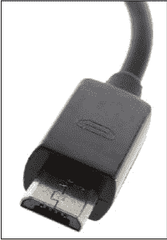

  > 你可以在网上找到类似的产品  
  > `http://www.adafruit.com/product/1995`。

- 标准 USB 键盘
- MicroSD 卡和 MicroSD 转 SD 卡转换器

  我们需要最小 4 GB 的 Micro SD 卡。

- USB 鼠标
- 显示器

  你可以使用 HDMI 显示器或标准 VGA 显示器。

以下是 Windows 用户的说明：

1. 下载 Win32DiskImager 安装程序，可在 http://sourceforge.net/projects/win32diskimager/files/latest/download 获取，然后安装它。
2. 下载 WinZip 可安装版本，可在 http://www.winzip.com/prod_down.html 获取，并安装它。
3. 访问 http://www.raspberrypi.org/downloads 并下载 Raspbian 的最新镜像。它将是 ZIP 格式的压缩文件，需要解压。
4. 使用 WinZip 解压 ZIP 文件。解压后的文件将为 .img 格式。
5. 将 microSD 卡插入读卡器并将读卡器插入电脑。许多电脑如今内置 SD 卡读卡器。在这种情况下，你需要将 microSD 卡插入 microSD 转 SD 卡转换器并插入电脑的内置 SD 卡读卡器。MicroSD 转 SD 卡转换器通常与 microSD 卡捆绑在同一包装中。如果不是这种情况，则需要单独采购。
6. 运行 Win32DiskImager.exe 并将镜像写入 SD 卡：

   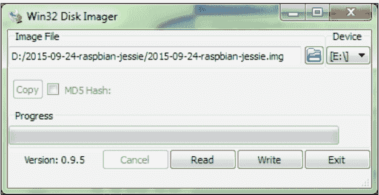

   如果读卡器的写保护打开，你可能会收到以下消息：

   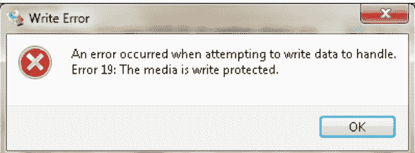

7. 切换写保护缺口并重试。你将看到以下消息：

   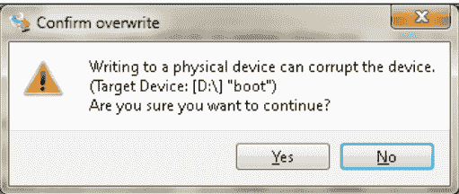

8. 点击 Yes，它将开始向 microSD 卡写入镜像文件：

   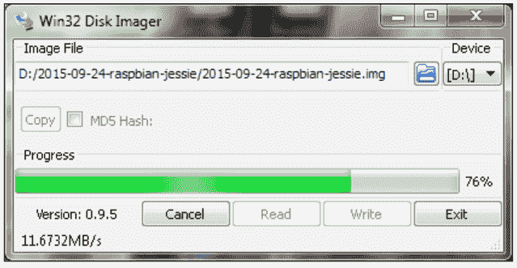

## 首次启动我们的 Pi

让我们使用 microSD 卡首次启动 Pi：

1. 将 microSD 卡插入 Pi 的 microSD 卡插槽。
2. 将 Pi 连接到 HDMI 显示器。如果你连接 VGA 显示器，请使用 HDMI 转 VGA 转换器连接。
3. 连接 USB 鼠标和 USB 键盘。
4. 使用 micro USB 电源线将 Pi 连接到电源。此时请确保电源处于关闭状态。
5. 检查所有连接后，然后打开 Pi 的电源。

此时，我们的 Pi 将开始启动。你会看到 Pi 板上的绿色灯闪烁。这意味着它正在工作！现在，在我们真正开始使用 Pi 之前，还有一些事情需要做。启动后，它将显示桌面如下：

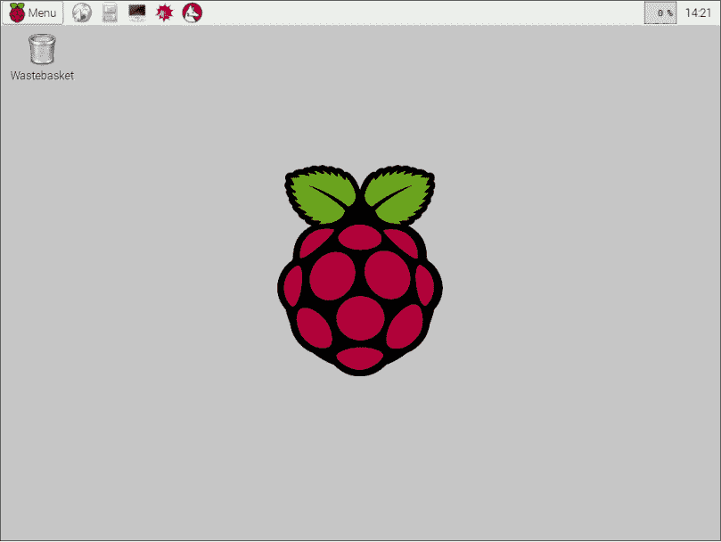

桌面可见后，进入 **Menu** | **Accessories** | **lxterminal**。然后，输入 `sudo raspi-config`。将出现如下文本菜单：

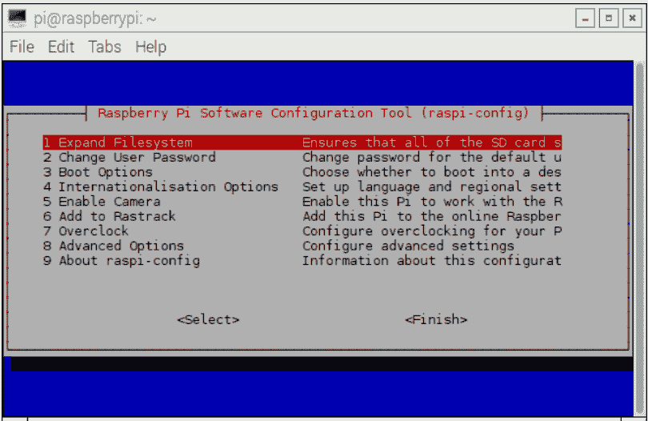

执行以下步骤。我们需要使用方向键和 Enter 键在文本菜单中选择选项。按 Enter 选择菜单项。此外，我们也可以使用 Tab 键直接进入 Select 和 Finish 按钮：

1. 选择 **Expand Filesystem**。
2. 在 **Boot Options** 中，选择 **B4 Desktop Autologin**，如下图所示：

   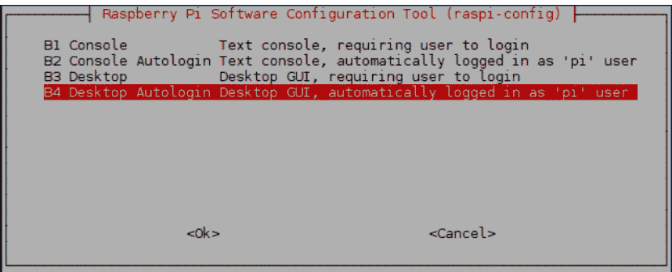

   默认用户名为 pi，密码为 raspberry。我们在不选择前面任何自动登录选项时需要它。我们可以从 raspi-config 菜单的第二个选项更改此密码。

   我们也可以通过选择前面菜单中的前两个选项中的任何一个来启动到控制台。Raspbian 的默认 shell 是 Bash。我们可以通过输入以下命令确认：
   `echo $SHELL`

   我们始终可以通过在控制台中输入 startx 命令从命令行进入图形桌面。

3. 进入 **Internationalisation Options | Change Timezone**。
4. 进入 **Internationalisation Options | Change Keyboard Layout | 将其更改为 US**（默认是 UK）。

   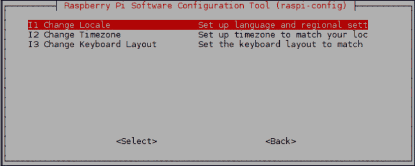

5. 选择 **Enable Camera**。
6. 选择 **Advanced Options**。
7. 在此选项下，选择 **Memory Split** 并输入 64MB 用于 GPU。

   此选项决定 **GPU（图形处理器）** 使用多少 RAM。分配给 GPU 的 RAM 越多，可进行的图形处理就越密集。64 MB 对于大多数图形用途来说是一个不错的值。

修改完所有这些选项后，选择 **Finish**。这将提示重启 Pi。选择 **Yes** 并让它重启。重启后，它将自动带我们回到 Raspbian 桌面。

你始终可以从命令行提示符使用以下命令调用 `raspi-config` 工具并更改设置：

```bash
sudo raspi-config
```

## 安全关机和重启 Pi

在 Raspbian 菜单中，有选项可关机和重启 Pi。

如果我们点击桌面上的以下 **Menu** 按钮，它将显示多个选项：

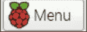

以下图片显示最后一个选项：


如果我们点击前面的选项，以下窗口将出现：

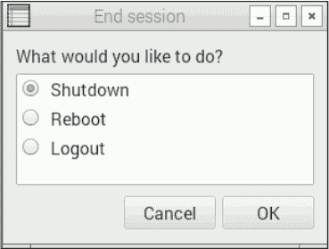

此外，从命令行 LXTerminal，我们也可以通过发出以下命令安全关机 Pi：

```bash
sudo shutdown -h now
```

此命令的替代命令如下：

```bash
sudo halt
```

你可以使用以下命令重启 Pi：

```bash
sudo reboot
```

## 更新 Pi

现在我们有一个运行 Raspbian OS 的可用 Pi。让我们更新我们的 Pi。确保你有稳定的有线或无线互联网连接，速度合理以进行此活动：

1. 使用以太网线将 Pi 连接到互联网调制解调器或路由器，或将 Wi-Fi 适配器插入其中一个 USB 端口。
2. 运行以下命令重启网络服务：

   ```bash
   sudo service networking restart
   ```

3. 通过输入以下命令确保你的 Raspberry Pi 已连接到互联网：

   `ping -c4 www.google.com`

4. apt（高级打包工具）是 Debian 及其变体中用于安装和删除软件的实用程序。我们需要使用它来更新 Pi 软件。
5. 按顺序运行以下命令：

   - `sudo apt-get update`：此命令从源同步软件包列表。所有软件包的索引都会刷新。在发出升级命令之前必须发出此命令。
   - `sudo apt-get upgrade`：此命令将安装所有已安装软件的最新版本。任何过时的软件包/实用程序不会自动删除。如果任何软件已是最新版本，则保持原样。
   - `sudo rpi-update`：此命令用于升级固件。内核和固件作为 Debian 软件包安装，因此它们也会获得更新。这些软件包在经过广泛测试后不频繁更新。
   - `sudo reboot`：这将重启计算机。

## 开始使用 Python

Python 是一种高级通用编程语言。它支持多种编程范式，如面向对象编程、命令式编程、函数式编程、过程式编程、面向方面编程和元编程。它具有动态类型系统、自动内存管理和庞大的标准库来执行各种任务。它强调代码可读性，其语法允许你用比 C 或 C++ 等其他编程语言更少的代码行完成任务。

Python 由 Guido van Rossum 在荷兰 CWI 构思并实现，作为 ABC 语言的继任者，能够进行异常处理并与 Amoeba 操作系统平台接口。Van Rossum 是 Python 的主要作者，他继续在决定 Python 方向方面发挥核心作用。他已被全球 Python 社区授予 **终身 benevolent dictator for life (BDFL)** 的称号。


## Raspberry Pi 与 Python 简介

Python 编程语言的核心哲学在这个网址中有所提及：https://www.python.org/dev/peps/pep-0020/；其开头的几行如下：

> “优美胜于丑陋。
> 显式胜于隐式。
> 简单胜于复杂。
> 复杂胜于错综。
> 扁平胜于嵌套。
> 稀疏胜于密集。
> 可读性很重要。”

Python 是 Raspberry Pi 系列计算机的首选编程语言。其解释器随 Raspbian 预装，无需任何额外安装即可开始编写代码。建议您为本书中的代码示例按章节创建目录，如下图所示：

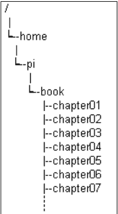

让我们开始使用 Python。打开 Raspbian 的命令提示符 LXTerminal。它位于任务栏上的一个快捷方式。或者，我们可以通过导航到 **菜单 | 附件 | 终端** 找到它。我们可以通过在提示符中输入 python 然后按 *Enter* 键以交互模式启动 Python。它将带我们进入 Python 交互式 shell，如下所示：

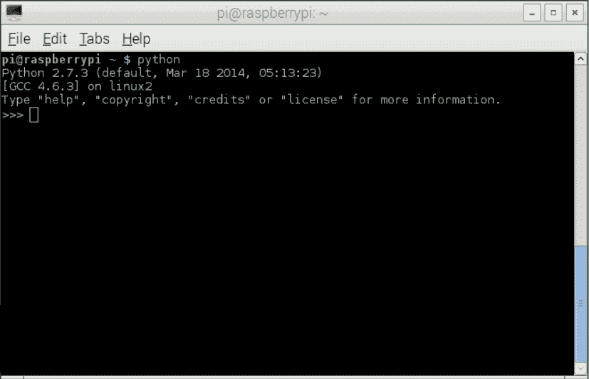

现在输入以下行并按 *Enter*：

```python
print "Hello World!"
```

输出如下：

```text
Python 2.7.3 (default, Mar 18 2014, 05:13:23)
[GCC 4.6.3] on linux2
Type "help", "copyright", "credits" or "license" for more information.
>>> print "Hello World!"
Hello World!
```

恭喜！我们已经开始 Python 编程了。Python 的交互模式适用于小型程序。按 *Ctrl + D* 退出交互式 shell。对于大型和代码密集型项目，建议使用脚本模式。在本书中，除非明确说明，否则我们将使用脚本模式。让我们看看如何在脚本模式下使用 Python。

在 /home/pi 目录中为本书的代码示例创建一个子目录 book。我们可以使用 `mkdir book` 来完成（默认情况下，我们在 /home/pi 目录中）。然后，使用 `cd book` 命令导航到这个新创建的目录。我们可以使用 `pwd` 命令验证当前目录。它返回当前目录如下：

```text
pi@raspberrypi ~ $ mkdir book

pi@raspberrypi ~ $ cd book

pi@raspberrypi ~/book $ pwd
/home/pi/book
pi@raspberrypi ~/book $
```

如前所述，我们需要将每章的代码放在单独的目录中，以便更好地组织。现在，在当前 book 目录中使用 `mkdir chapter01` 为本章创建 `chapter01` 目录。使用 `cd chapter01` 导航到该目录。在每章开始时，我们需要在 `/home/pi/book` 下为该章的代码示例创建一个目录。

我们现在将创建一个脚本文件来存放代码并运行它。

使用 Nano 文本编辑器创建和编辑脚本文件。如果我们输入 `nano prog1.py`，Nano 将打开 `prog1.py` 进行编辑（如果它已存在于当前目录中）；否则，它将创建一个名为 `prog1.py` 的新文件。您可以通过按 Ctrl + X 退出 Nano 编辑器。

> 你可以在以下网址找到更多关于 nano 的信息：
> http://www.nano-editor.org/。

或者，您可以使用 Leafpad 文本编辑器。我们可以通过导航到 **菜单 | 附件** 找到它。或者，我们可以通过 `leafpad prog1.py` 命令从命令提示符调用它。

最后，您也可以使用 vim，但您需要通过运行以下命令来安装它：

```bash
sudo apt-get install vim
```

> 这是一个关于 vim 的交互式教程的链接：
> http://www.openvim.com/。

让我们编写相同的 Python 代码并将其作为脚本运行。使用 Nano、Leafpad 或 vim 编写以下代码，并将其保存为 prog1.py：

```python
print "Hello World!"
```

要运行前面的程序，请使用 python prog1.py 命令，输出如下。

我们将以相同的方式运行本书中的所有其他 Python 程序。

让我们尝试更多示例，以便更加熟练地使用 Python。

以下是计算给定正整数阶乘的迭代程序：

```python
def fact(n):
    num = 1
    while n >= 1:
        num = num * n
        n = n - 1
    return num

print (fact(10))
```

在前面的程序中，def fact(n) 是一个接受参数的用户定义函数。用于计算正整数阶乘的逻辑遵循该定义，函数返回计算出的阶乘。程序的最后一行调用阶乘函数并打印返回的输出，如下所示：

```text
pi@raspberrypi ~/book/chapter01 $ python prog2.py
3628800
```

以下是斐波那契数列的迭代程序：

```python
def fib(n):
    a=0
    b=1
    for i in range(n):
        temp=a
        a=b
        b=temp+b
    return a

for i in range(0,10):
    print (fib(i))
```

前面的程序打印斐波那契数列中的前 10 个数字。编写同一程序的更“Python 风格”的方式（消除了临时变量的使用）如下：

```python
def fib(n):
    a,b = 0,1
    for i in range(n):
        a,b = b,a+b
    return a

for i in range(0,10):
    print (fib(i))
```

前面两个程序的输出相同，如下所示：

```text
pi@raspberrypi ~/book/chapter01 $ python prog4.py
0
1
1
2
3
5
8
13
21
34
```

### 使用 Python 进行 Turtle 编程

Turtle 图形是初学者学习编程的最佳方式之一。最初，它是 Logo 编程语言的一部分，Logo 主要用于在学校引入编程。Python 有 turtle 模块，它是原始 turtle 提供的相同功能的实现。我们可以用过程式以及面向对象的方式使用这个模块编写程序。

在 Python 中，当我们需要访问当前代码之外的模块时，我们需要导入它。在本书中，我们将根据需要导入各种模块，这将为我们提供特定的功能。

让我们开始导入 turtle 模块，如下所示：

```python
import turtle
```

以下代码分别创建 turtle 和 screen 类的对象：

```python
t=turtle.Turtle()
disp=turtle.Screen()
```

我们将使用 `t.color()` 函数，通过它我们可以设置画笔和填充颜色，如下所示：

```python
t.color("black","yellow")
```

我们将调用 `t.begin_fill()` 和 `t.end_fill()` 函数来让我们的形状填充填充颜色：

```python
t.begin_fill()
t.end_fill()
```

绘制我们需要的实际形状的代码将位于这两个函数调用之间，如下所示：

```python
t.begin_fill()
while 1:
    t.forward(100)
    t.left(190)
    if abs(t.pos())<1:
        break
t.end_fill()
disp.exitonclick()
```

在前面的代码中，`t.forward()` 用于将 turtle 向前移动指定的距离，`t.left()` 用于将 turtle 向左旋转 190 度。`t.pos()` 返回 turtle 当前的坐标。

最后，我们使用 `disp.exitonclick()` 在点击退出按钮时关闭当前输出窗口。

> 开始时，turtle 光标位于 (0,0) 并指向 x 轴的正方向（面向右）。


程序的输出将是一个光标逐步绘制所需形状，这有助于程序员理解程序实际是如何工作的。前面程序的最终输出如下：

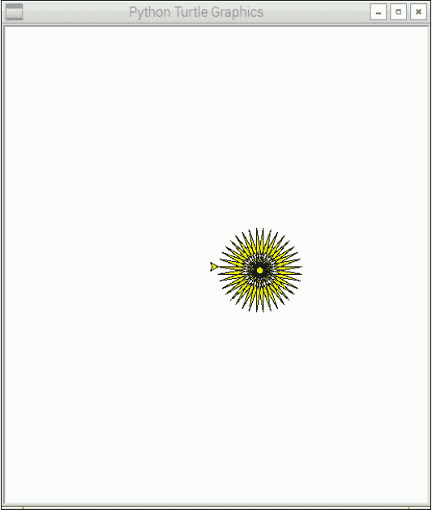

> 可以在以下网址找到 turtle API 的详细文档：
> https://docs.python.org/2/library/turtle.html。

接下来，我们将学习递归的概念。在编程方面，递归意味着在同一段代码内调用自身。对于过程式和模块化的编程风格，这代表在自身内部调用函数或方法。通常，这样做是为了将一个大问题分解为输入规模较小的相似问题，然后收集所有这些较小问题的输出，以得出大问题的输出。查看递归工作的最佳方式之一是使用 turtle 将其可视化。我们现在将编写一个使用递归绘制分形树的程序。


首先，我们开始导入所需的库，如下所示：

```
import turtle
import random
```

我们需要 random 库中的 `randint()` 函数，它会在给定范围内返回一个随机整数。这是为了让我们生成的树每次看起来都不同。然后，我们将定义一个函数来递归绘制树的一部分：

```
def fractal_tree(b_len,t):
    if b_len > 5:
        temp=random.randint(1, b_len)
        temp_angle = random.randint(1, 25)
        t.forward(temp)
        t.right(temp_angle)
        fractal_tree(b_len-10,t)
        t.left(2 * temp_angle)
        fractal_tree(b_len-10,t)
        t.right(temp_angle)
        t.backward(temp)
```

在前面的程序中，我们两次调用同一个函数，以绘制树的后续分支。如果 `b_len` 参数小于或等于 5，则它将是叶子（这意味着函数不会被再次调用）；否则，递归将继续。在这里绘制分支时，我们随机化了海龟移动的角度和长度；否则，树将是对称的，这在现实中非常不可能。`t.forward()`、`t.backward()`、`t.left()` 和 `t.right()` 的组合确保每次函数调用结束时，海龟光标都处于其起始位置。

最后，我们编写调用这个递归函数的例程：

```
t=turtle.Turtle()
disp=turtle.Screen()
t.left(90)
t.up()
t.backward(100)
t.down()
t.color("green")
fractal_tree(120,t)
disp.exitonclick()
```

在 `t.up()` 和 `t.down()` 函数调用之间，光标不会绘制移动轨迹。在前面的代码中，我们将光标向下移动 100 个位置，以便树能够适应海龟图形窗口。当我们以 120 作为参数调用 `fractal_tree()` 时，由于递归程度很高，需要 30 多分钟。前面程序的输出如下：

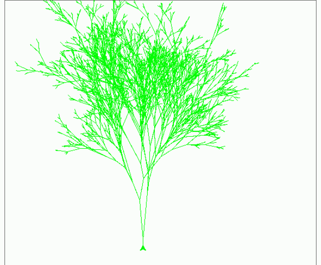

## 总结

在本章中，我们了解了树莓派和 Python 的背景。我们了解了不同型号 Pi 的详细信息。我们学习了如何为编程设置树莓派。我们还动手编写了一些 Python 程序。然后，我们学习了一些使用 turtle 库的图形编程。这让我们开始接触 Pi 和 Python 编程语言，我们将在本书的其余部分使用它们。

在下一章中，我们将学习如何玩 Minecraft Pi 并对其进行编程。
