## 2

Minecraft Pi

在上一章中，我们学习了如何设置 Pi，并简要了解了 Python 和 turtle 模块。在本章中，我们将探索一款热门电脑游戏的 Pi 版本——*Minecraft*。我们还将学习如何使用 Python 作为编程接口来对 Minecraft 进行编程，并使用它来编写用户操作脚本和构建奇妙的东西。

本章将涵盖以下主题：

- 介绍 Minecraft Pi
- 玩 Minecraft Pi
- 使用 Python 编程 Minecraft Pi

## Minecraft Pi 简介

Minecraft 是一款非常受欢迎的开源世界游戏。与所有其他开放世界游戏一样，玩家可以在 Minecraft Pi 游戏中自由探索虚拟世界。Minecraft 由马库斯·佩尔松（Markus Persson）创建，该游戏后来由 Mojang 公司开发和发布，该公司现在是 Microsoft Game Studios 的子公司。延斯·伯根斯坦（Jens Bergensten）是当前的首席设计师和首席开发人员。该游戏的 alpha 版本于 2009 年在 PC 上发布，完整版本于 2011 年发布。该游戏可用于多种平台，包括 PC、Linux、Mac OS、iOS、Android、PlayStation、Xbox 和 Raspberry Pi。

> 你可以在以下网址获取有关 Minecraft 的更多信息：
> 
> https://minecraft.net/。

## Minecraft Pi

该游戏的树莓派版本称为 Minecraft Pi，于 2013 年发布。它由 Aron Nieminen 和 Daniel Frisk 开发。Minecraft Pi 专注于游戏的创造和建造方面，不包括收集资源和战斗。

## 玩 Minecraft Pi

最新版本的 Raspbian 中预装了 Minecraft Pi。因此，无需额外安装。可以通过导航到 **菜单 | 游戏** 找到 Minecraft Pi。或者，我们可以在 lxterminal 中输入 `minecraft-pi` 来启动它。一旦我们启动游戏，将出现以下屏幕：

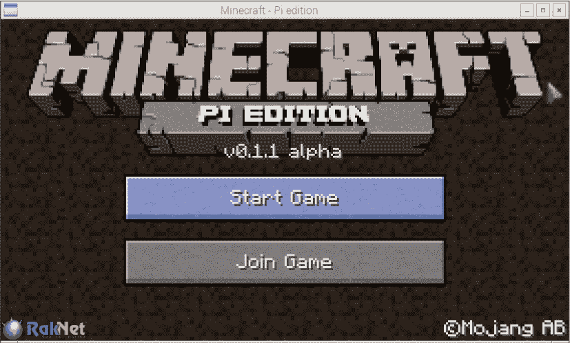

## Minecraft Pi

一旦生成了游戏用的新世界，玩家角色就会被放置在虚拟世界中。游戏中的默认视角是第一人称视角。如下所示：

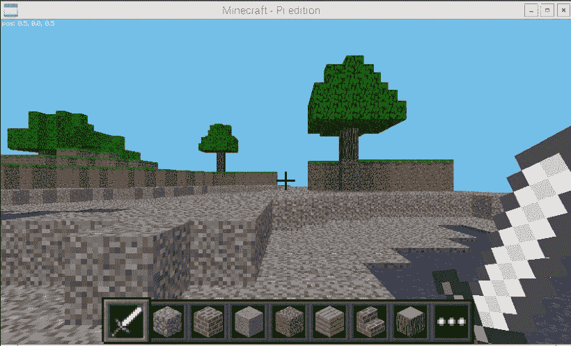

> 在 Minecraft Pi 中，新世界是按程序化方式随机生成的。这意味着世界是通过算法随机创建的，而不是使用预先确定的组件。因此，Minecraft Pi 中不会有两个相同的世界。你可以从 https://en.wikipedia.org/wiki/Procedural_generation 了解更多关于程序化生成的信息。

我们可以通过按 *Esc* 键或单击以下按钮来切换视角，从第一人称视角切换到第三人称视角：

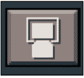

一旦单击此按钮，它将变为以下按钮：

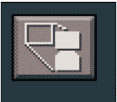

此时，一旦我们按 Esc 键或单击“返回游戏”按钮返回游戏，我们将以第三人称视角看到我们的 Minecraft Pi 角色，如下所示：

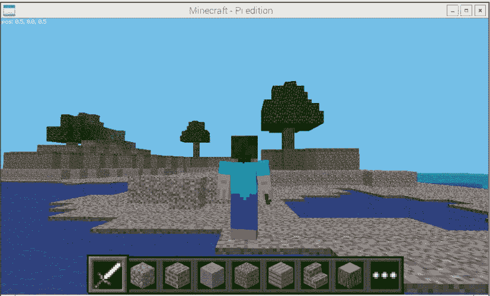

我们可以按照前面的步骤再次将该视角切换为第一人称视角。

## Minecraft Pi 中的移动控制

我们可以使用鼠标环顾四周，也可以使用以下按键进行移动：

| 按键 | 操作 |
| --- | --- |
| W | 前进 |
| S | 后退 |
| A | 左移 |
| D | 右移 |
| Spacebar | 跳跃 |
| Double spacebar | 飞行或下落 |

与大多数第一/第三人称游戏一样，移动由键盘上的 WSAD 键控制。按一次空格键角色会跳跃。如果连续按两次空格键，角色会升到空中，如下面的截图所示：

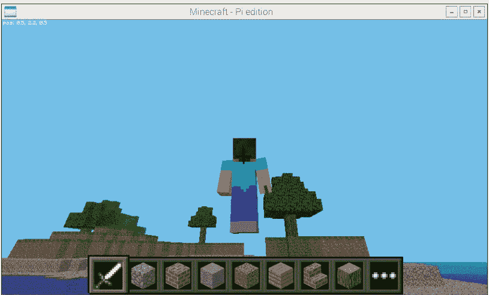

此时，可以使用 WSAD 键在空中飞行。飞行时按空格键可以提高高度。下面的截图显示了从更高处看到的游戏世界视图：

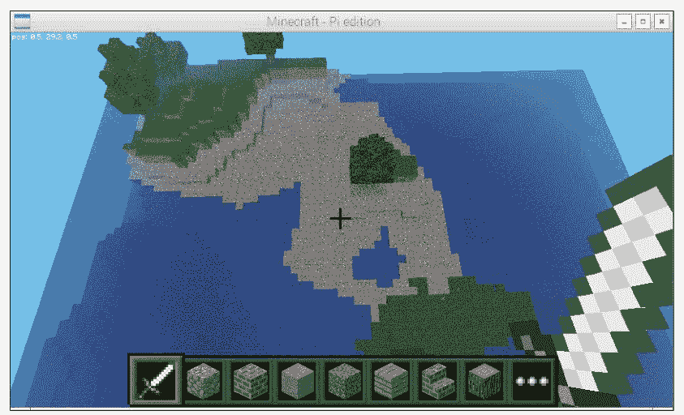

如果在飞行时按两次空格键，角色将落到地面。当角色下落时，如果我们按两次空格键，它将停止下落。

## Minecraft Pi 中的操作控制

默认情况下，玩家角色手持剑开始游戏。如果我们手持剑右键单击，它将移除角色前方的方块。

屏幕底部有一个快捷物品栏，如下所示：

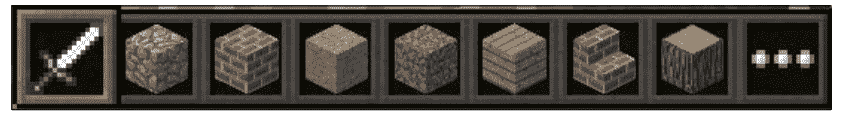

可以通过滚动鼠标滚轮或使用键盘上的数字键来选择任何物品。快捷物品栏始终容纳八个物品，当前手中的物品会高亮显示，如下所示：

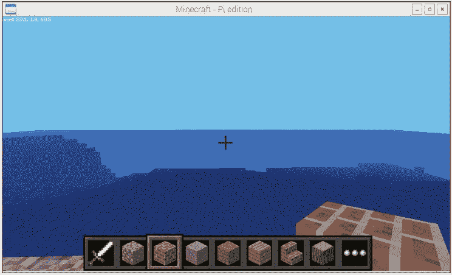

按 E 键可以访问更多物品。这将打开物品栏，如下所示：

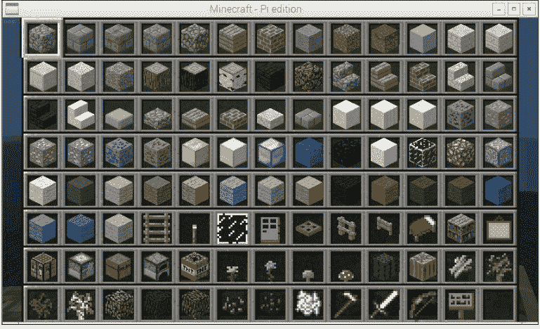

可以使用 WSAD 键浏览物品栏中的物品。在物品栏打开时，如果按下 *Esc* 键，将取消物品栏而不选择任何物品。可以通过单击物品来选择物品栏中的物品，该物品将被添加到快捷物品栏以及角色的手中，如下所示：

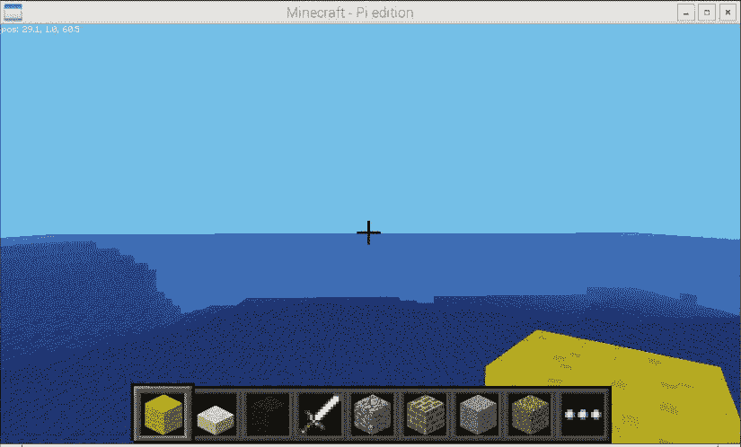

当角色手中持有方块时，右键单击将把方块放置在角色前方，左键单击将移除它。玩家角色可用的方块数量是无限的。

Minecraft Pi 具有创造模式，因此角色不会受到环境伤害（例如，角色坠落时不会死亡），也不会受饥饿影响。这种游戏模式帮助玩家专注于建造和创建大型项目。

与 Minecraft 的其他版本不同，Minecraft Pi 没有其他游戏模式。


## Minecraft Pi 中的其他控制

游戏运行时，按 Tab 键可让焦点移出游戏，鼠标光标会被释放，从而可以与桌面上的其他窗口交互。按 Esc 键将暂停游戏并进入游戏菜单，我们可以在此切换视角（如前面所述）、启用/禁用声音以及退出主窗口。

> 现在，掌握了 Minecraft Pi 虚拟游戏世界中的移动和操作信息后，在继续阅读本章剩余内容之前，试着创建一些东西。

## Minecraft Pi 的 Python 编程

Minecraft Pi 自带 Python 编程接口。这意味着可以使用 Python 来编写游戏中角色的动作。在本节中，我们将学习如何使用 Python 编程实现角色动作，并在 Minecraft 世界中创造惊人的效果。

启动 Minecraft Pi 并创建世界。完成后，在游戏运行时，按 Tab 键释放鼠标并打开 lxterminal。创建 /home/pi/book/chapter02 目录，进入该目录并在 prog1.py 文件中编写以下代码：

```
import mcpi.minecraft as minecraft

mc = minecraft.Minecraft.create()

mc.postToChat("Hello Minecraft World!")
```

上述程序首先导入 Minecraft Pi Python API。第二条语句创建与 Minecraft 的连接，第三条语句将消息发送到游戏聊天框。

运行上述代码，输出如下：

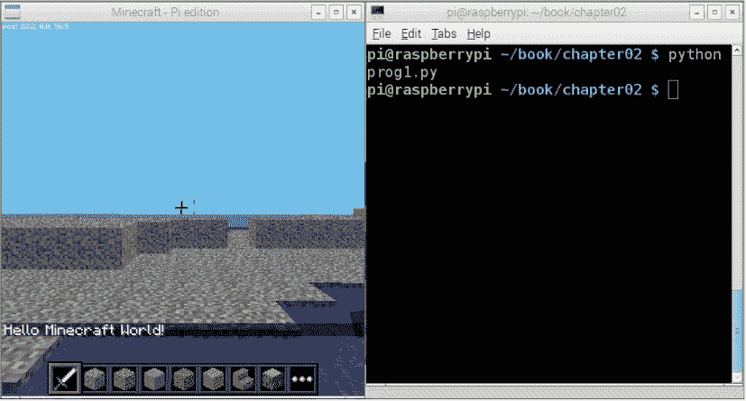

让我们来看看 Minecraft Pi Python API 中一些最重要的函数。

我们可以从游戏窗口左上角看到玩家当前的坐标。我们可以用 `getPos()` 获取这些坐标。以下是获取玩家角色当前坐标并打印出来的代码：

```python
import mcpi.minecraft as minecraft
mc = minecraft.Minecraft.create()
cur_pos = mc.player.getPos()
print cur_pos.x ; print cur_pos.y ; print cur_pos.z
```

这会将当前坐标打印到屏幕上。另外，也可以使用以下语法来实现同样的效果：

```python
import mcpi.minecraft as minecraft
mc = minecraft.Minecraft.create()
cur_x , cur_y , cur_z = mc.player.getPos()
print cur_x ; print cur_y ; print cur_z
```

setPos() 函数可用于设置角色的位置。我们需要将角色的目标坐标传递给该函数，如下所示：

```
import mcpi.minecraft as minecraft
mc = minecraft.Minecraft.create()
cur_x , cur_y , cur_z = mc.player.getPos()
mc.player.setPos(cur_x+10, cur_y, cur_z)
```

上述代码会将角色在 x 轴上移动 10 个方块。

以下代码会将角色位置设置为比当前位置高 100 个方块，而角色将因此开始下落：

```
mc.player.setPos(cur_x, cur_y + 100 , cur_z)
```

我们可以使用 setBlock() 函数放置我们选择的方块。我们需要将方块的坐标（前三个参数）以及方块类型（第四个参数）传递给该函数，如下所示：

```
import mcpi.minecraft as minecraft
import mcpi.block as block
mc = minecraft.Minecraft.create()
cur_x , cur_y , cur_z = mc.player.getPos()
mc.setBlock(cur_x + 1 , cur_y , cur_z , block.ICE.id )
```

你会在面前发现一个冰方块。如果找不到，请环顾四周；它可能就在你旁边或身后。

某些方块（如羊毛和木头）具有附加属性。对于羊毛和木头方块类型，我们可以将这个附加属性作为第五个参数传入函数。以下代码创建了一根包含所有可能颜色的羊毛方块柱：

```
import mcpi.minecraft as minecraft
import mcpi.block as block
mc = minecraft.Minecraft.create()
cur_x , cur_y , cur_z = mc.player.getPos()

for i in range (0 , 15):
    mc.setBlock(cur_x + 1 , cur_y + i , cur_z , block.WOOL.id, i )
```

运行上述代码，亲自检查输出结果。

我们可以使用 `setBlocks()` 在给定空间内放置多个方块。以下示例会放置多个金方块：

```python
import mcpi.minecraft as minecraft
import mcpi.block as block
mc = minecraft.Minecraft.create()
cur_x , cur_y , cur_z = mc.player.getPos()

mc.setBlocks(cur_x + 1 , cur_y + 1 , cur_z + 1 , cur_x + 6 ,
cur_y + 6 , cur_z + 6 , block.GOLD_BLOCK.id)
```

我们还可以使用数学方程在游戏世界中绘制几何形状。现在我们知道 `setBlock()` 用于放置单个方块。我们可以在单个 `for` 循环中使用该函数来创建一排方块。在双重 `for` 循环中调用该函数则可创建二维几何形状。我们可以再引入一个 `for` 循环来进一步扩展，从而创建三维形状。以下代码会在玩家位置附近放置一个金色球体。我们将在坐标满足半径为 10 个方块的球体方程的位置放置金方块：

```python
import mcpi.minecraft as minecraft
import mcpi.block as block

mc = minecraft.Minecraft.create()

r = 10

cur_x , cur_y , cur_z = mc.player.getPos()

for x in range(r*-1,r):
    for y in range(r*-1, r):
        for z in range(r*-1,r):
            if x**2 + y**2 + z**2 < r**2:
                mc.setBlock(cur_x + x, cur_y + ( y + 20 ) , cur_z - (
                z + 20 ) , block.GOLD_BLOCK)
```

## Minecraft Pi

以下是上述程序的输出：

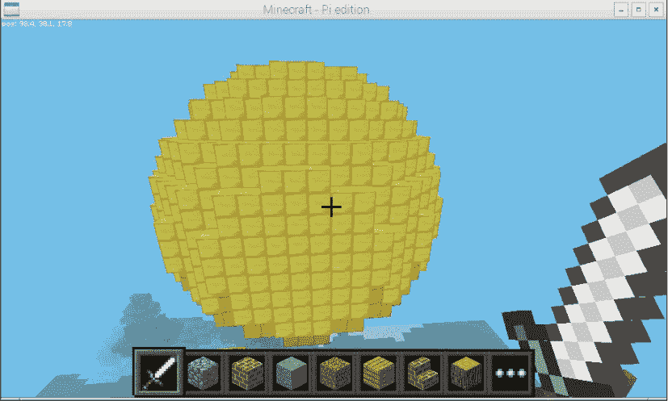

以下代码会在玩家当前位置下方放置一个金方块，直到按 **Ctrl + C** 终止代码的运行为止：

```python
import mcpi.minecraft as minecraft
import mcpi.block as block
import time

mc = minecraft.Minecraft.create()

while 1:
    cur_x, cur_y, cur_z = mc.player.getPos()
    mc.setBlock(cur_x,cur_y-1,cur_z,block.GOLD_BLOCK.id)
    time.sleep(0.1)
```

以下是上述代码的输出：

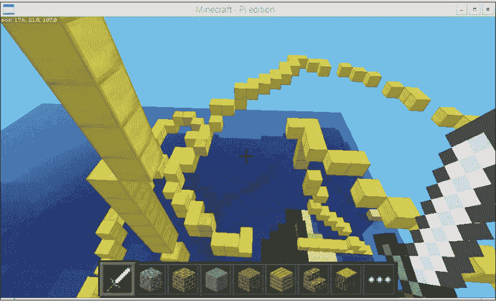

现在，我们以一些爆炸效果来结束本章。我们可以在附近放置一个 TNT 方块。手持剑时左键单击即可激活它。它会在几秒钟后爆炸。爆炸会摧毁爆炸半径内的一些方块：

```python
cur_x, cur_y , cur_z = mc.player.getPos()
mc.setBlocks(cur_x+1,cur_y,cur_z,block.TNT.id,1)
```

放置多个 TNT 方块可以让效果更加壮观，如下所示：

```python
import mcpi.minecraft as minecraft
import mcpi.block as block

mc = minecraft.Minecraft.create()

cur_x, cur_y , cur_z = mc.player.getPos()
mc.setBlocks(cur_x+1,cur_y,cur_z,cur_x+4,cur_y+3,
cur_z+3,block.TNT.id,1)
```

放置好方块后，用剑激活 TNT 方块。以下是激活上述代码放置的 TNT 方块后发生爆炸的截图：

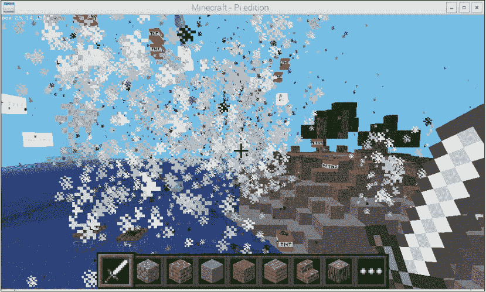

> 详细的 Minecraft Pi Python API 可在 http://www.stuffaboutcode.com/p/minecraft-api-reference.html 中找到。

## 总结

在本章中，我们熟悉了 Minecraft Pi 的游戏玩法，并学习了如何使用 Python API 对其进行编程。我们学习了如何放置和移除方块。此外，我们还实现了创建一些精美几何形状所需的代码。最后，我们学习了如何激活并引爆 TNT 方块，以炸毁游戏世界中的大面积区域。

在下一章中，我们将学习如何使用 Pygame 库为 Pi 创建游戏。
