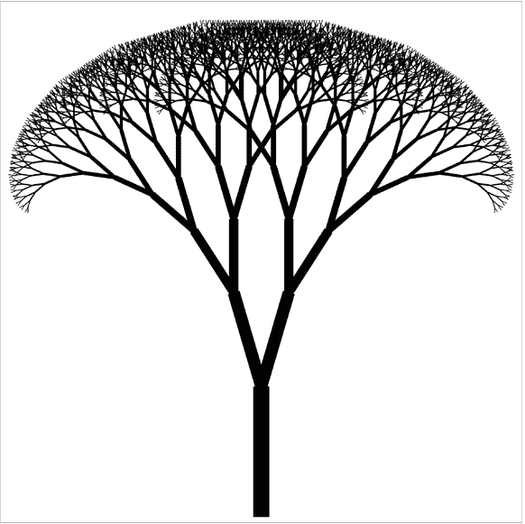
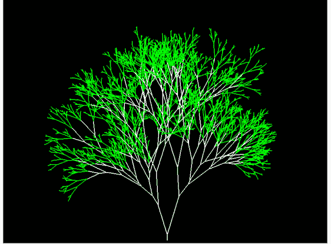
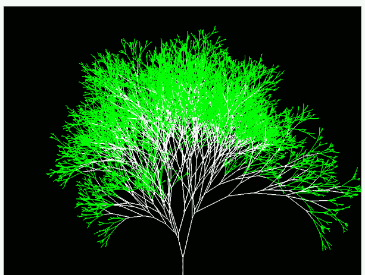
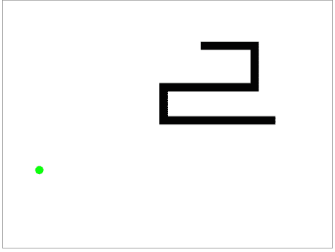
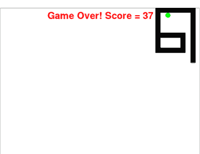

## 使用 PyGame 构建游戏

在上一章中，我们学习了如何在 Raspberry Pi 上开始使用 Minecraft，掌握其玩法，并使用 Python 操作各种事物。延续同一主题，我们现在来看看 Python 中一个名为 PyGame 的游戏库，并学习如何使用它创建简单的游戏。在本章中，我们将依次介绍以下主题：

-   介绍 PyGame
-   绘制分形树
-   构建一个简单的贪吃蛇游戏

### 介绍 PyGame

PyGame 是一组用于编写视频游戏的 Python 模块。它构建在现有的 **简单直接媒体层（SDL）** 库之上，并可与多种后端配合使用，例如 OpenGL、DirectX、X11 等。它的设计目标是让游戏编程更简单、更快速，而无需接触传统上用于实现良好实时性能的低级 C 代码。它也非常灵活，支持众多操作系统。它能轻松利用多核 CPU，并对核心功能使用经过优化的 C 和汇编代码，因此运行速度非常快。


PyGame 是在 PySDL 开发被停止后构建的替代品。最初由 Pete Shinners 编写，它是 2004 年的一个社区项目，并以开源自由软件 GNU 通用公共许可证的次要条款发布。由于它非常简单易用且是开源的，国际社区中有很多成员，因此它可以访问其他库可能缺乏的大量资源。有许多教程可以使用 PyGame 构建不同的游戏。它包含以下模块

| Module | The description |
|---|---|
| cdrom | Manages CD-ROM devices and audio playback |
| cursors | Loads cursor images and includes standard cursors |
| display | Controls the display window or screen |
| draw | Draws simple shapes onto a surface |
| event | Manages events and the event queue |
| font | Creates and renders TrueType fonts |
| image | Saves and loads images |
| joystick | Manages joystick devices |
| key | Manages the keyboard |
| mouse | Manages the mouse |
| movie | Used for the playback of MPEG movies |
| sndarray | Manipulates sounds with Numeric |
| surfarray | Manipulates images with Numeric |
| time | Controls timing |
| transform | Scales, rotates, and flips images |

> 有关 PyGame 库的更多信息，您可以访问 www.pygame.org。

## Installing PyGame

PyGame 通常随最新的 Raspbian 发行版一起安装，但如果没有，您可以使用以下命令安装它：

```
sudo apt-get install python-pygame
```

通过在普通终端中输入 python 并按 *Enter* 打开 Python 终端来测试您的安装。现在，执行以下命令：

```
import pygame
```

现在您已设置好系统，并且希望已查看 PyGame 网站以探索其完整功能，我们将继续构建二进制分形树，以便向您介绍 PyGame 的工作原理。让我们开始吧！

## Drawing a binary fractal tree

二进制分形树通过二进制分支递归定义。通常，它由长度为 1 的树干组成，分裂成两个长度递减或相等的分支，每个分支与树干方向成角度 Q。 此外，这两个分支都分为两个分支，每个分支与父分支方向成角度 Q，依此类推。以这种方式继续，我们可以无限地制造分支，集体图称为 **fractal tree**。下图直观地显示了这种分形树可能是什么样子：



现在，让我们继续查看代码，了解如何使用 PyGame 构造这样的分形树。以下段落之后是完整的代码，我们将在后面的段落中逐条语句进行讲解：

```
import pygame
import math
import random
import time

width = 800
height = 600

pygame.init()
window = pygame.display.set_mode((width, height))
pygame.display.set_caption("Fractal Tree")
screen = pygame.display.get_surface()

def Fractal_Tree(x1, y1, theta, depth):
    if depth:
        rand_length=random.randint(1,10)
        rand_angle=random.randint(10,20)
        x2 = x1 + int(math.cos(math.radians(theta)) * depth * rand_length)
        y2 = y1 + int(math.sin(math.radians(theta)) * depth * rand_length)
        if ( depth < 5 ):
            clr = ( 0 , 255 , 0 )
        else:
            clr = ( 255, 255 , 255 )
        pygame.draw.line(screen, clr , (x1, y1), (x2, y2), 2)
        Fractal_Tree(x2, y2, theta - rand_angle, depth - 1)
        Fractal_Tree(x2, y2, theta + rand_angle, depth - 1)

Fractal_Tree( (width/2), (height-10) , -90, 12)
pygame.display.flip()

while True:
    for event in pygame.event.get():
        if event.type == pygame.QUIT or event.type == pygame.KEYDOWN:
            pygame.quit()
            exit(0)
```

将上述代码保存为 prog1.py，然后运行以下命令：

```
python prog1.py
```

您现在将得到以下输出：



如果将深度增加 2 并稍微增加画布区域，分形树现在看起来像这样：



新树看起来比原来的树密集得多，分枝也更多。

现在，既然您知道输出是什么样子，让我们拿起放大镜，仔细梳理程序以了解其工作原理！

前四行是为了满足构建程序所需的依赖项。这些是 PyGame、数学库、用于生成随机数的库以及用于跟踪时间以进行延迟函数的库。接下来，我们指定程序所需的屏幕空间的尺寸。

pygame.init() 方法初始化作为导入 pygame 的第一条语句的一部分加载的所有模块。如果您想使用 PyGame 的任何功能，则需要执行它。 display.set_mode() 方法创建一个新的 Surface 对象，表示用户在屏幕上可见的区域。它以包含窗口尺寸的元组作为参数：本例中的 width 和 height 变量。它实际上就是您可以绘制的画布。您对该对象所做的任何操作都将显示给用户。图像和其他对象表示为 PyGame 对象，您可以将它们叠加在主表面上。然后，我们使用 caption() 方法设置窗口标题，最后，screen 变量实际上获取显示存储的对象。因此，现在我们的画布存储在 screen 变量中，我们将使用它对画布进行任何更改。

Fractal_Tree 函数应该很容易理解。它接受四个参数：分支的起点 (x1, y1)、分支相对于正 x 轴的角度——即当您看着计算机屏幕时向右的水平线，以及分形树的深度（表示树中的层级）。它在第 28 行首次使用适当的参数调用。您可能会注意到，在函数末尾，它使用不同的参数调用自身。这类函数称为递归函数，在存在重复且需要以细微差异执行相同任务的任务中非常有用。

如果深度为正，它会通过 random 包的 randint() 方法选择一个随机整数来为下一个分支选择随机长度和角度。然后它指定该分支末端的坐标，标记为 x2 和 y2。如果深度小于 5，则将线的颜色选择为绿色；否则为白色。这里，重要的是要理解颜色以 RGB 格式表示。因此，(0, 255, 0) 表示绿色。同样，(255, 0, 0) 将为红色。元组中的三个数字代表 RGB 颜色的强度；因此，我们可以使用这三种强度的混合选择任何颜色。

最后，有对自身的递归调用 (`Fractal_Tree`)，程序然后绘制分形树的第二层，依此类推，直到深度变为零。有两个递归调用：一个用于绘制左分支，另一个用于绘制右分支。如果您注意到了，函数直到第 28 行才实际执行。一旦执行，由于函数的递归性，完整图案会一次绘制出来，但它仍然不会显示。下一行 `pygame.display.flip()` 负责在屏幕上显示绘制的形状：

```
while True:
    for event in pygame.event.get():
        if event.type == pygame.QUIT or event.type == pygame.KEYDOWN:
            pygame.quit()
            exit(0)
```

这段代码用于确保 PyGame 正确退出并指定如何关闭程序。 `event.get()` 方法清除事件队列，以便您始终获得发生的最后一个事件。事件队列由所有发生的按键和鼠标点击组成，它们以 **Last In First Out (LIFO)** 方式存储。您将在几乎每个 PyGame 程序中看到这个 `while` 循环，因为它能正确处理程序的退出。如果您使用 IDLE，则未正确关闭 PyGame 可能会导致其挂起。在这种情况下，当执行 `pygame.quit()` 时，PyGame 会退出。最后，通过 `exit(0)`，Python 也会退出并关闭应用程序。

由于我们每次函数调用自身时都会随机化长度和角度，因此没有两个分支会完全相同，使其具有真实树木的不规则外观。通过归纳，没有两棵树会相同。

您可以修改此代码的某些部分，亲眼看看更改一些变量，例如 `theta` 和 `depth` 时树的行为如何变化。现在我们已经完成了 PyGame 的所有基础知识，并且可以实现相当复杂的问题，我们现在准备好进入真正的挑战：制作一个真正的游戏。

## Building a snake game

谁不记得经典游戏 Snake，它涉及一条追逐食物碎屑的蛇？这可能是您小时候玩的第一个游戏。游戏的基本前提是您控制一条蛇并将其引导到食物碎屑。每当蛇吃掉那块食物时，它就会增长一个单位长度，如果蛇撞到边界墙或自身，它就会死亡。现在正如您所想象的，您玩得越多，蛇就越长，这使得控制蛇变得更加困难。在某些版本的游戏中，蛇的速度也会增加，使其控制起来更加困难。最终会出现您耗尽屏幕空间的时刻，蛇不可避免地会撞到墙壁或自身，游戏结束。


## 使用 PyGame 构建游戏

在这里，我们将学习如何构建这样一个游戏。游戏的基本逻辑是：有一个移动的矩形，我们已知其前导点的坐标。这将作为我们的蛇。它将由四个方向键控制。食物会在屏幕上随机初始化。由于我们在每个时间点都知道蛇的位置，因此我们会检查矩形是否撞到了边界墙壁或自身。如果撞到了，程序就会退出。现在，让我们逐节查看代码；每一节代码之后都会给出相应的解释：

```python
from pygame.locals import *
import pygame
import random
import sys
import time

pygame.init()

fpsClock = pygame.time.Clock()

gameSurface = pygame.display.set_mode((800, 600))
pygame.display.set_caption('Pi Snake')

foodcolor = pygame.Color(0, 255, 0)
backgroundcolor = pygame.Color(255, 255, 255)
snakecolor = pygame.Color(0, 0, 0)
textcolor = pygame.Color(255, 0, 0)

snakePos = [120, 240]
snakeSeg = [[120, 240], [120, 220]]
foodPosition = [400, 300]
foodSpawned = 1
Dir = 'D'
changeDir = Dir
Score = 0
Speed = 5
SpeedCount = 0
```

现在，我们将了解每一块代码的作用，但为了简洁起见，非常基础的内容将被跳过，因为我们在前面的章节中已经学习过它们。

`finish()` 函数之前的前几行代码会初始化 PyGame 并设置游戏参数。`pygame.time.Clock()` 函数用于跟踪游戏内的时间，这主要用于帧率（每秒帧数，即 FPS）。虽然看起来有点微不足道，但 FPS 非常重要，而且可以进行调节。我们可以通过提高或降低 FPS 来控制游戏速度。继续看后面的代码，我们可以选择一些选项，例如屏幕尺寸、蛇的颜色、起始位置、起始速度等。`snakePos` 列表变量存储了蛇头的位置，`snakeSeg` 将以嵌套列表的形式包含蛇身体各段的初始坐标。第一个元素包含蛇头的坐标，第二个元素包含蛇尾的坐标。这段代码还定义了食物的初始位置、食物的状态、初始方向、初始速度和玩家的初始得分：

```python
def finish():
    finishFont = pygame.font.Font(None, 56)
    msg = "Game Over! Score: " + str(Score)
    finishSurf = finishFont.render(msg, True, textcolor)
    finishRect = finishSurf.get_rect()
    finishRect.midtop = (400, 10)
    gameSurface.blit(finishSurf, finishRect)
    pygame.display.flip()
    time.sleep(5)
    pygame.quit()
    exit(0)
```

前面的代码块定义了游戏的结束流程。正如我们将在后面的代码中看到的，当蛇撞到墙壁或自身时，就会调用 `finish()`。在这个过程中，我们首先指定想要显示的消息及其属性（例如字体），然后将最终得分添加到其中。接着，我们通过 `render()` 函数渲染消息，该函数作用于 `finishFont` 变量。然后，我们通过 `get_rect()` 获取一个矩形，最后通过 `blit()` 函数将它们绘制出来。在使用 PyGame 时，`blit()` 是一个非常重要的函数，它允许我们将一个图像绘制在另一个图像之上。在我们的场景中，这非常有用，因为它允许我们在游戏结束时显示的消息之上绘制一个边界矩形。最后，我们通过 `display.flip()` 函数将消息渲染到屏幕上，并在延迟 5 秒后退出游戏：

```python
while 1:
    for event in pygame.event.get():
        if event.type == QUIT:
            pygame.quit()
            exit(0)
        elif event.type == KEYDOWN:
            if event.key == ord('d') or event.key == K_RIGHT:
                changeDir = 'R'
            if event.key == ord('a') or event.key == K_LEFT:
                changeDir = 'L'
            if event.key == ord('w') or event.key == K_UP:
                changeDir = 'U'
            if event.key == ord('s') or event.key == K_DOWN:
                changeDir = 'D'
            if event.key == K_ESCAPE:
                pygame.event.post(pygame.event.Event(QUIT))
                pygame.quit()
                exit(0)

    if changeDir == 'R' and not Dir == 'L':
        Dir = changeDir
    if changeDir == 'L' and not Dir == 'R':
        Dir = changeDir
    if changeDir == 'U' and not Dir == 'D':
        Dir = changeDir
    if changeDir == 'D' and not Dir == 'U':
        Dir = changeDir

    if Dir == 'R':
        snakePos[0] += 20
    if Dir == 'L':
        snakePos[0] -= 20
    if Dir == 'U':
        snakePos[1] -= 20
    if Dir == 'D':
        snakePos[1] += 20
```

然后，我们继续看无限 while 循环，它包含了游戏的大部分逻辑。另外，如前所述，pygame.event.get() 函数会获取事件的类型；根据按下的按键，它会改变一些参数的状态。例如，按下 Esc 键会导致游戏退出，而按下方向键会改变蛇的方向。之后，我们会检查新方向是否与旧方向完全相反，并且只会在不是相反方向时才改变方向。在这种情况下，changeDir 只是一个中间变量。然后，我们根据所选方向来改变蛇的位置。每次位置移动都代表屏幕上 20 像素的位移：

```python
snakeSeg.insert(0, list(snakePos))
if snakePos[0] == foodPosition[0] and snakePos[1] == foodPosition[1]:
    foodSpawned = 0
    Score = Score + 1
    SpeedCount = SpeedCount + 1
else:
    snakeSeg.pop()

if SpeedCount == 5:
    SpeedCount = 0
    Speed = Speed + 1

if foodSpawned == 0:
    x = random.randrange(1, 40)
    y = random.randrange(1, 30)
    foodPosition = [int(x * 20), int(y * 20)]
    foodSpawned = 1

gameSurface.fill(backgroundcolor)
for position in snakeSeg:
    pygame.draw.rect(gameSurface, snakecolor, Rect(position[0], position[1], 20, 20))
pygame.draw.circle(gameSurface, foodcolor, (foodPosition[0] + 10, foodPosition[1] + 10), 10, 0)
pygame.display.flip()
if snakePos[0] > 780 or snakePos[0] < 0:
    finish()
if snakePos[1] > 580 or snakePos[1] < 0:
    finish()
for snakeBody in snakeSeg[1:]:
    if snakePos[0] == snakeBody[0] and snakePos[1] == snakeBody[1]:
        finish()
fpsClock.tick(Speed)
```

需要记住的是，在此时，屏幕上还没有渲染任何内容。我们只是在实现游戏逻辑，只有当我们完成这些逻辑之后，才会在屏幕上渲染内容。这将通过 pygame.display.flip() 函数完成。另一件重要的事情是，还有一个名为 pygame.display.update() 的函数。这两者之间的区别在于，update() 函数只更新表面的特定区域，而 flip() 函数则更新整个表面。但是，如果我们不给 update() 函数提供任何参数，那么它也会更新整个表面。

现在，既然我们已经改变了蛇头的位置，就必须更新 `snakeSeg` 变量，以反映蛇身上的这一变化。为此，我们使用 `insert()` 方法，并传入要追加的对象位置以及新的坐标。这样就能将蛇头的新坐标添加到 `snakeSeg` 变量中。接下来是有趣的部分：我们检查蛇是否到达了食物所在的位置。如果是，我们就增加分数，将 foodSpawned 状态设置为 False，并将 SpeedCount 增加 1。因此，一旦速度计数达到 5，速度就会增加 1 个单位。如果不是，我们就用 `pop()` 方法移除最后一个坐标。这很有趣，因为如果蛇吃到了食物，那么它的长度就会增加；因此，`else` 语句中的 `pop()` 方法不会执行，蛇的长度就会增加 1 个单位。

在下一段代码中，我们检查食物是否已经生成；如果没有，我们会在考虑屏幕尺寸的情况下随机生成它。random 包中的 `randrange()` 函数正好可以帮助我们做到这一点。

最后，我们进入实际渲染的部分。渲染不过是一个术语，指的是在屏幕上生成并显示某些内容所需的过程。第一条语句用我们选择的背景颜色填充屏幕，以便屏幕上的所有其他内容都清晰可见：

```python
for position in snakeSeg:
    pygame.draw.rect(gameSurface, snakecolor,
                     Rect(position[0], position[1], 20, 20))
```

前面的代码块会遍历 `snakeSeg` 变量中存在的所有坐标，并用初始化代码中为我们的蛇指定的颜色填充它们之间的空间。rect 函数接收三个输入：游戏运行的窗口名称、矩形的颜色，以及由 Rect 函数给出的矩形坐标。Rect 函数本身接收四个参数：矩形的 x 和 y 位置以及高度和宽度。这意味着，对于 `snakeSeg` 变量中包含的每个坐标，我们都会绘制一个尺寸为 20 x 20 像素的矩形。因此，我们可以看到，我们不需要把蛇作为一个整体来跟踪；只需要跟踪描述蛇的坐标即可。

接下来，我们使用 PyGame 包中 draw 模块的 `circle()` 方法来绘制食物。该方法接收五个参数：窗口名称、颜色、圆心、半径以及圆的宽度。圆心由一个元组给出，该元组包含我们之前选择的 x 和 y 坐标。下一条语句 `pygame.display.flip()` 会实际显示我们刚刚绘制的内容。


然后，我们检查游戏可以结束的条件：撞到墙壁或撞到自己。当它满足退出条件时，会调用 `finish()` 函数。该函数的前两行不言自明。第三行中，`render()` 基本上使文本可显示，但此时尚未显示。只有当我们调用 `pygame.display.flip()` 函数时，它才会显示。接下来的两行设置了将显示在窗口上的文本框的位置。最后，我们在延迟 5 秒后退出 PyGame 窗口和程序。

将此程序保存为名为 `prog2.py` 的文件，并使用以下命令运行它：

```
python prog2.py
```

你将看到如下画面：



我们可以随心所欲地玩这个游戏（而且我们应该玩，因为这是我们自己的创作），当我们退出时，游戏会显示与 `finish()` 函数中定义的相同消息！



你可能已经注意到，在上面的截图中，黑色形状是蛇，绿色圆圈是它的食物。你可以玩玩看，试着了解这个游戏背后的逻辑，以及它可能是如何编程实现的。

至此，我们完成了贪吃蛇游戏的实现，你应该亲自尝试一下这个程序。要完全理解程序的工作原理，一个更好的方法是更改一些参数，看看它们如何影响游戏体验。

## 总结

在本章中，我们学习了 PyGame 及其功能。我们还学习了如何构建具有随机分支的二叉树分形。

此外，我们构建了一个贪吃蛇游戏，并以此获得了使用 PyGame 编写游戏的更多经验。你还可以修改游戏，添加你喜欢的任何额外功能。

以这些示例为灵感，你也可以尝试构建自己的游戏。你可以结合关于 Minecraft 的那一章知识，构建一个简单的 Minecraft 克隆版！

在下一章中，我们将学习 Pi Camera 及其网络摄像头的基础知识，以及如何使用它们捕捉图像。我们还将使用 Python 语言构建一些实际示例。
