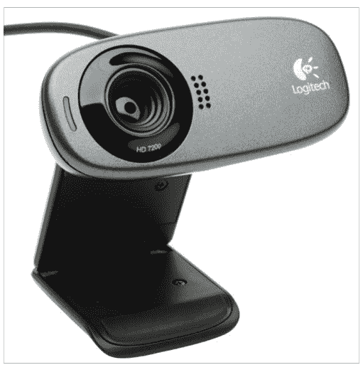
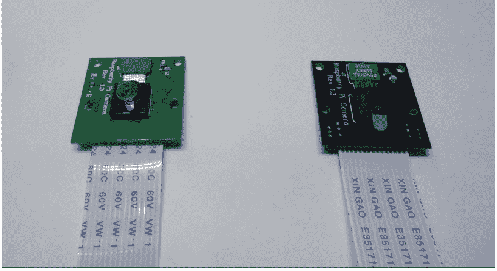
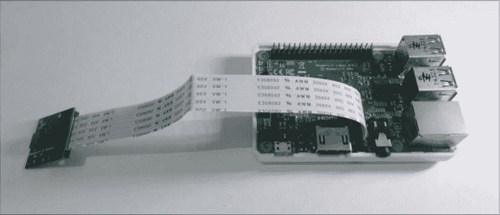
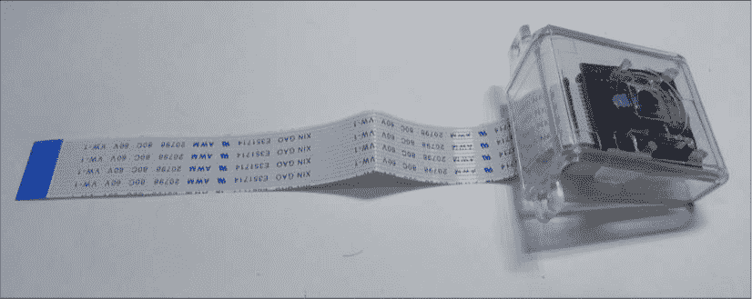
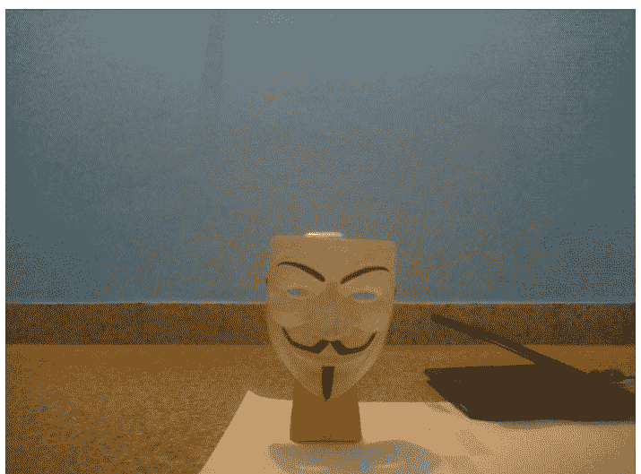
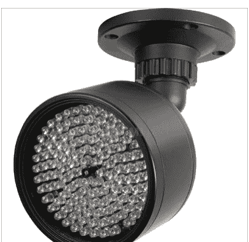

## 使用网络摄像头和 Pi Camera

在上一章中，我们学习了如何使用 pygame 设置和编写我们自己的游戏。在本章中，我们将学习如何将不同类型和用途的摄像头与我们的 Pi 一起使用。让我们看看本章将要学习和实现的主题：

- 使用网络摄像头
- Crontab
- 使用网络摄像头进行延时摄影
- 网络摄像头视频录制与播放
- Pi Camera 与 Pi NoIR 对比
- 使用 Pi Camera 进行延时摄影
- Python 中的 PiCamera 模块

### 使用网络摄像头

USB 网络摄像头是捕捉图像和视频的绝佳方式。Raspberry Pi 支持常见的 USB 网络摄像头。

> 为了安全起见，这里是 Pi 支持的网络摄像头列表：
> http://elinux.org/RPi_USB_Webcams.

我使用的是 Logitech HD c310 USB 网络摄像头，如下图所示：



> 你可以在网上购买，产品详情和规格可在 http://www.logitech.com/en-in/product/hd-webcam-c310 查看。

通过 Pi 上的 USB 端口将 USB 网络摄像头连接到 Raspberry Pi，然后在终端中运行 `lsusb` 命令。此命令列出连接到计算机的所有 USB 设备。根据连接 USB 网络摄像头所用的端口，输出应类似于以下输出：

```
pi@raspberrypi ~/book/chapter04 $ lsusb
Bus 001 Device 002: ID 0424:9514 Standard Microsystems Corp.
Bus 001 Device 001: ID 1d6b:0002 Linux Foundation 2.0 root hub
Bus 001 Device 003: ID 0424:ec00 Standard Microsystems Corp.
Bus 001 Device 004: ID 148f:2070 Ralink Technology, Corp. RT2070 Wireless Adapter
Bus 001 Device 007: ID 046d:081b Logitech, Inc. Webcam C310
Bus 001 Device 006: ID 1c4f:0003 SiGma Micro HID controller
Bus 001 Device 005: ID 1c4f:0002 SiGma Micro Keyboard TRACER Gamma Ivory
```

然后，通过运行以下命令安装 **fswebcam** 实用程序：

```
sudo apt-get install fswebcam
```

**fswebcam** 是一个简单的命令行实用程序，用于在 Linux 计算机上通过网络摄像头捕捉图像。安装完成后，您可以使用以下命令为输出图像创建目录：

```
mkdir /home/pi/book/output
```

然后，运行以下命令来捕捉图像：

```
fswebcam -r 1280x960 --no-banner ~/book/output/camtest.jpg
```

这将捕捉分辨率为 1280 x 960 的图像。你可能想尝试其他分辨率以供学习。**--no-banner** 命令将禁用时间戳横幅。图像将以提到的文件名保存。如果你多次使用相同的文件名运行此命令，图像文件将每次都覆盖。因此，如果你想保存之前捕捉的图像，请确保更改文件名。该命令的文本输出应类似于以下输出：

```
--- Opening /dev/video0...
Trying source module v4l2...
/dev/video0 opened.
No input was specified, using the first.
--- Capturing frame...
Corrupt JPEG data: 2 extraneous bytes before marker 0xd5
Captured frame in 0.00 seconds.
--- Processing captured image...
Disabling banner.
Writing JPEG image to '/home/pi/book/output/camtest.jpg'.
```

### Crontab

**Cron** 是类 Unix 计算机操作系统中的基于时间的作业调度器。它由 **crontab**（cron 表）文件驱动，该文件是一个配置文件，指定了在给定计划上定期运行的 shell 命令。它用于调度命令或 shell 脚本在固定时间、日期或间隔定期运行。

**crontab** 调度命令或脚本的语法如下：

```
1 2 3 4 5 /location/command
```

以下是定义：

- 1：分钟（0-59）
- 2：小时（0-23）
- 3：日期（0-31）
- 4：月份 [0-12（1 表示一月）]
- 5：星期 [0-7（7 或 0 表示星期日）]
- `/location/command`：要调度的脚本或命令名称

**crontab** 中用于每分钟运行任何脚本或命令的条目如下：

```bash
* * * * * /location/command 2>&1
```

在本书的许多章节中，我们都会使用 **crontab**。在下一节中，我们将学习如何使用 **crontab** 调度脚本定期捕捉图像，以创建延时摄影序列。

> 你可以参考此 URL 了解更多关于 crontab 的详细信息：
> http://www.adminschoice.com/crontab-quick-reference.

### 使用 fswebcam 创建延时摄影序列

**延时摄影**是指以固定间隔拍摄照片，并以高于拍摄频率的时间频率播放这些图像。例如，如果你以每分钟一张的频率拍摄 10 小时，你会得到 600 张图像。如果你将所有图像以每秒 30 张的帧率合成视频，你会得到 10 小时的延时视频压缩在 20 秒内。你可以使用 Raspberry Pi 和 USB 网络摄像头来实现这一点。我们已经知道如何使用 Raspberry Pi 搭配网络摄像头和 fswebcam 实用程序来捕捉图像。诀窍是编写一个脚本，用不同的名称捕捉图像，然后将此脚本添加到 **crontab** 中，并使其定期运行。

首先为捕捉的图像创建一个目录：

```bash
mkdir /home/pi/book/output/timelapse
```

打开你选择的编辑器，编写以下代码，并将其保存为 **timelapse.sh**：

```bash
#!/bin/bash
DATE=$(date +"%Y-%m-%d_%H%M")
fswebcam -r 1280x960 --no-banner /home/pi/book/output/timelapse/garden_$DATE.jpg
```

使用以下命令使脚本可执行：

```bash
chmod +x timelapse.sh
```

此 shell 脚本捕捉图像，并在文件名中保存当前时间戳。因此，每次我们都会得到一个具有新文件名的图像，因为文件名中包含时间戳。脚本中的第二行创建了我们在文件名中使用的时间戳。手动运行一次此脚本，并确保图像以 **garden_<timestamp>.jpg** 的名称保存在 **/home/pi/book/output/timelapse** 目录中。

为了定期运行此脚本，我们需要在 **crontab** 中进行调度。

**crontab** 中每分钟运行我们脚本的条目如下：

```bash
* * * * * /home/pi/book/chapter04/timelapse.sh 2>&1
```

使用 **crontab -e** 打开 Pi 用户的 **crontab**。它将使用 **nano** 作为编辑器打开 crontab。将上述行添加到 crontab，保存并退出。

一旦你退出 **crontab**，它将显示以下消息：

```text
no crontab for pi - using an empty one
crontab: installing new crontab
```

我们的延时摄影摄像头设置现已生效。如果你想更改图像捕捉频率，则必须更改 crontab 设置。要设置为每 5 分钟，请将其更改为 `*/5 * * * *`。要设置为每 2 小时，请使用 `0 */2 * * *`。确保你的 MicroSD 卡有足够的可用空间来存储你需要的延时摄影设置时间段内的所有图像。


捕获所有图像后，下一步是将它们编码成快速播放的视频，最好每秒20到30帧。对于这部分，推荐使用mencoder工具。以下是在树莓派或任何Debian/Ubuntu机器上使用mencoder创建延时摄影视频的步骤：

- 1. 使用 sudo apt-get install mencoder 安装mencoder
- 2. 使用以下命令导航到输出目录：
  cd /home/pi/book/output/timelapse
- 3. 使用以下命令创建延时序列图像的列表：
  ls garden_*.jpg > timelapse.txt
- 4. 使用以下命令创建视频：
  mencoder -nosound -ovc lavc -lavcopts vcodec=mpeg4:aspect=16/9:vbitrate=8000000 -vf scale=1280:960 -o timelapse.avi -mf type=jpeg:fps=30 mf://@timelapse.txt

这将在当前目录中创建一个名为timelapse.avi的视频，包含timelapse.txt中列出的所有图像，帧率为30 fps。该语句包含了视频编解码器、宽高比、比特率和缩放尺寸的详细信息。有关更多信息，可以在命令提示符下运行man mencoder。我们将在下一节介绍如何播放视频。

## 网络摄像头视频录制与播放

我们可以使用avconv通过网络摄像头录制实时视频。使用sudo apt-get install libav-tools安装avconv。使用以下命令录制视频：

```
avconv -f video4linux2 -r 25 -s 1280x960 -i /dev/video0 ~/book/output/VideoStream.avi
```

它将在屏幕上显示以下输出：

```
pi@raspberrypi ~ $ avconv -f video4linux2 -r 25 -s 1280x960 -i /dev/video0 ~/book/output/VideoStream.avi
avconv version 9.14-6:9.14-1rpilrpil, Copyright (c) 2000-2014 the Libav developers
  built on Jul 22 2014 15:08:12 with gcc 4.6 (Debian 4.6.3-14+rpil)
[video4linux2 @ 0x5d6720] The driver changed the time per frame from 1/25 to 2/15
[video4linux2 @ 0x5d6720] Estimating duration from bitrate, this may be inaccurate
```

```
Input #0, video4linux2, from '/dev/video0':
    Duration: N/A, start: 629.030244, bitrate: 147456 kb/s
    Stream #0:0: Video: rawvideo, yuyv422, 1280x960, 147456 kb/s, 1000k tbn, 7.50 tbc
Output #0, avi, to '/home/pi/book/output/VideoStream.avi':
    Metadata:
        ISFT            : Lavf54.20.4
    Stream #0:0: Video: mpeg4, yuv420p, 1280x960, q=2-31, 200 kb/s, 25 tbn, 25 tbc
Stream mapping:
    Stream #0:0 -> #0:0 (rawvideo -> mpeg4)
Press ctrl-c to stop encoding
frame= 182 fps= 7 q=31.0 Lsize=     802kB time=7.28 bitrate=902.4kbits/s
video:792kB audio:0kB global headers:0kB muxing overhead 1.249878%
Received signal 2: terminating.
```

你可以按Ctrl + C终止录制过程。

我们可以使用omxplayer播放视频。它随最新的raspbian一起提供，因此无需安装。要播放名为vid.mjpg的文件，请使用以下命令：

```
omxplayer ~/book/output/VideoStream.avi
```

它将播放视频并显示一些输出，类似于以下内容：

```
pi@raspberrypi ~ $ omxplayer ~/book/output/VideoStream.avi
Video codec omx-mpeg4 width 1280 height 960 profile 0 fps 25.000000
Subtitle count: 0, state: off, index: 1, delay: 0
V:PortSettingsChanged: 1280x960@25.00 interlace:0 deinterlace:0 anaglyph:0 par:1.00 layer:0
have a nice day ;)
```

尝试使用omxplayer播放延时摄影和录制的视频。

## 使用Pi Camera和NoIR Camera模块

这些摄像头模块是专门为树莓派制造的，适用于所有可用型号。你需要将摄像头模块连接到位于以太网端口后面的CSI端口，并使用`raspi-config`工具激活摄像头（如果尚未激活）。

> 你可以在http://www.raspberrypi.org/help/camera-module-setup/ 找到将摄像头模块连接到树莓派的视频说明。

此页面列出了可用的摄像头模块类型：http://www.raspberrypi.org/products/。

Pi有两种摄像头模块可用。它们分别是Pi Camera和Pi NoIR Camera，可以在https://www.raspberrypi.org/products/camera-module/ 和 https://www.raspberrypi.org/products/pi-noir-camera/ 找到。

下图并排显示了Pi Camera和Pi NoIR Camera板：



下图显示了连接到Pi的Pi Camera板：



下图是放置在摄像头外壳中的Pi Camera板：



Pi Camera和Pi NoIR Camera之间的主要区别在于，Pi Camera在良好光照条件下效果更好，而Pi NoIR（NoIR代表无红外）用于低光摄影。要在完全黑暗中使用NoIR Camera，我们需要用红外光照射要拍摄的物体。

> 现在是查看树莓派各种外壳的好时机。你可以在https://www.adafruit.com/categories/289 在线找到各种外壳。

## 使用网络摄像头和Pi Camera

以下是正常光照且无背光的图像：



对于NoIR摄像头在夜间低光照条件下的使用，使用红外照明灯可以获得更好的效果。你可以在线购买。一个典型的适合我们用途的现成LED红外照明灯看起来像这样：



## 在Python中使用picamera与Pi Camera模块

picamera是一个Python包，为Pi Camera模块提供编程接口。最新版本的raspbian已预装picamera。如果你尚未安装，可以使用以下命令安装：

```
sudo apt-get install python-picamera
```

以下程序快速演示了使用picamera模块捕获图像的基本用法：

```
import picamera
import time

with picamera.PiCamera() as cam:
    cam.resolution=(1024,768)
    cam.start_preview()
    time.sleep(5)
    cam.capture('/home/pi/book/output/still.jpg')
```

我们必须首先导入time和picamera模块。cam.start_preview()将启动预览，time.sleep(5)将等待5秒，然后cam.capture()捕获图像并保存到指定文件中。

picamera中有一个内置函数用于延时摄影。以下程序演示了其用法：

```
import picamera
import time

with picamera.PiCamera() as cam:
    cam.resolution=(1024,768)
    cam.start_preview()
    time.sleep(3)
    for count, imagefile in enumerate(cam.capture_continuous('/home/pi/book/output/image{counter:02d}.jpg')):
        print 'Capturing and saving ' + imagefile
        time.sleep(1)
        if count == 10:
            break
```

在前面的代码中，`cam.capture_continuous()`用于使用Pi摄像头模块捕获延时序列。

> 在http://picamera.readthedocs.org/ 查看picamera模块的更多示例和API参考。

## Pi Camera与网络摄像头的对比

现在，在使用过网络摄像头和Pi Camera之后，是时候了解它们之间的差异、优点和缺点了。

Pi Camera板不使用USB端口，直接与Pi接口连接。因此，在帧率和分辨率方面，它比网络摄像头提供更好的性能。我们可以直接在Python中使用`picamera`模块来处理图像和视频。但是，Pi Camera不能与任何其他计算机一起使用。

网络摄像头使用USB端口进行接口，因此它可以与任何计算机一起使用。然而，与Pi Camera相比，它在帧率和分辨率方面的性能较低。

## 总结

在本章中，我们学习了如何使用网络摄像头和Pi摄像头。我们还学习了如何使用`fswebcam`、`avconv`、`raspistill`、`raspivid`、mencoder和omxplayer等工具。我们介绍了如何使用`crontab`。我们使用Python的`picamera`模块以编程方式处理Pi摄像头板。最后，我们比较了Pi Camera和网络摄像头。我们很快将在一些实际项目中重新使用所有这些代码示例和概念。

在下一章中，我们将学习如何使用PiGlow（一个第三方Pi扩展板）对Pi GPIO进行编程。


