## 5 GPIO 编程入门

在上一章中，我们学习了如何使用网络摄像头和 Pi Camera 拍摄图像和视频。我们还搭建了一个延时摄影盒子，以获得所学知识在现实生活中的使用经验。

在本章中，我们将采用硬件为重点的方法，并使用树莓派最常被提及的功能：其 GPIO（通用输入输出）引脚。具体来说，我们将学习如何在树莓派 B+ 和树莓派 2 上使用 GPIO 引脚。一旦我们熟悉了引脚的使用方法，我们还将构建一个实际项目来进一步加深对其使用的了解。本章将涵盖以下主题：

- 介绍 GPIO 引脚
- 使用 GPIO 引脚点亮 LED
- 添加按钮控制
- 了解 PiGlow

## 介绍 GPIO 引脚

你们大多数人可能都知道 GPIO 引脚在树莓派上的位置。如果不知道，下面的插图会让它变得清晰：

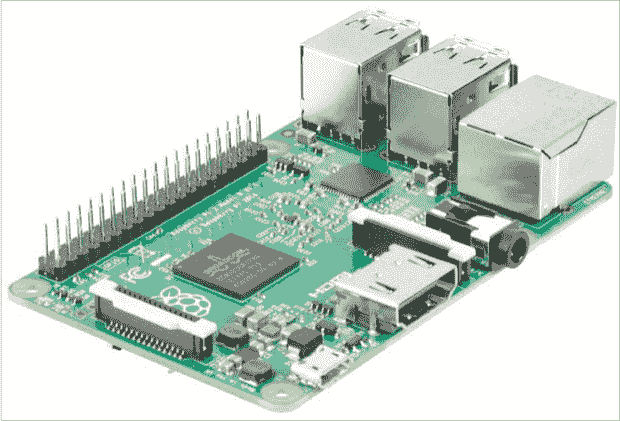

下面是树莓派 B+ 板的俯视图，这将帮助你更清晰地看到组件：

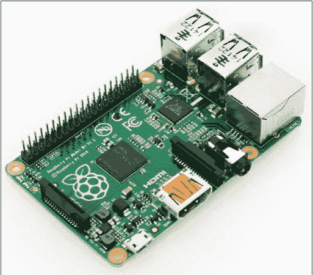

下面的 GPIO 引脚图提供了有关命名约定和每个引脚功能的详细信息：

> 请注意，树莓派 B+ 和 Pi 2 的 GPIO 引脚是相同的。

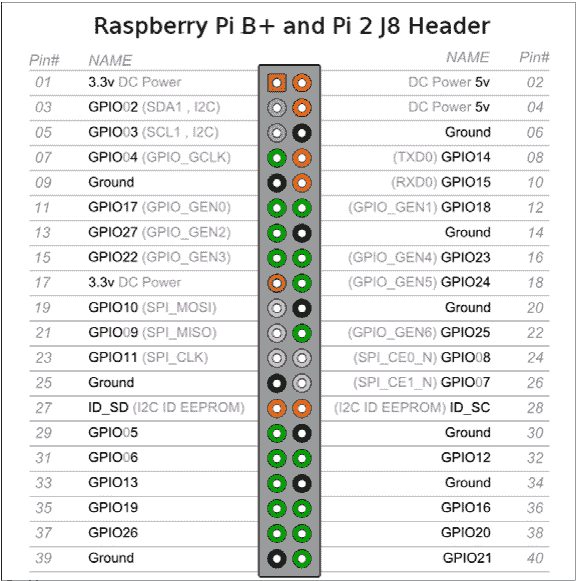

正如前面的图表所示，有四个电源引脚，其中两个为 3.3V，两个为 5V，8 个地线引脚分布在导轨上，26 个 GPIO 引脚——其中一些还提供 UART、SPI、PCM、PWM、I2C 等协议——以及两个保留用于通过 I2C 访问 EEPROM 的引脚。

GPIO 引脚可以是开或关，高或低。当 3.3V 引脚为高时，输出 3.3V；当为低时，输出 0V。GPIO 引脚可以作为输入也可以作为输出，但不能同时作为两者。将它用作输出与将引脚状态设置为开或关一样简单。

为了使用 GPIO 引脚，我们将使用一个简单的 Python 库 RPi.GPIO，它消除了所有繁琐的工作，使配置和使用引脚变得容易。配置引脚为输出或输入只需要一个语句。我们现在将看到如何操作 GPIO 引脚以使用此库。

请注意使用 Broadcom 芯片名称来标识 GPIO 引脚。你可以在前面给出的图表中查找。如果我们的引脚已设置为输出模式，我们也可以将其激活或电压电平设置为 HIGH 或 LOW。请记住，在树莓派的情况下，高电压由 3.3V 表示，低电压由 0V 表示。如果将 5V 设备连接到其 3.3V GPIO 引脚，会损坏树莓派。然而，你可以使用两个 5V 引脚为小型附加设备供电，例如 LED 或蜂鸣器。如果你计划使用需要更大电流的设备，请确保使用单独的电源，因为 Pi 只能提供有限的电流。因此，直接从 Pi 为电机供电不是一个好主意。

输入引脚可以做令人惊叹的事情。不仅可以从按钮获取输入，还可以连接传感器，例如光传感器、烟雾传感器和温度传感器来构建各种令人惊叹的项目。你也可以使用联网的树莓派从世界任何地方控制你的输出！但网络部分超出了本章的范围。

此时一个简单的项目就是构建一个简单的 LED 闪烁程序。那么让我们看看它是如何工作的！

## 构建 LED 闪烁器

对于这个项目，你需要一个普通的低功率 LED，颜色自选，可以在当地五金店获得或在线订购。树莓派将同时充当开关和电源。事实上，我们将从同一个输出引脚为 LED 供电并切换它。完整的代码和接线图已在此给出。我们将按照图表逐行学习代码。按所示将你的 LED 连接到树莓派。在 LED 中，较长的腿按惯例是正极引脚，较短的腿为负极。因此请注意正确连接，否则可能会损坏：

```
import RPi.GPIO as GPIO
import time

GPIO.setmode(GPIO.BOARD)
GPIO.setup(7, GPIO.OUT)

def Blink(speed):
    GPIO.output(7,True)
    time.sleep(speed)
```

```
GPIO.output(7,False)
time.sleep(speed)
GPIO.cleanup()
```

Blink(1)

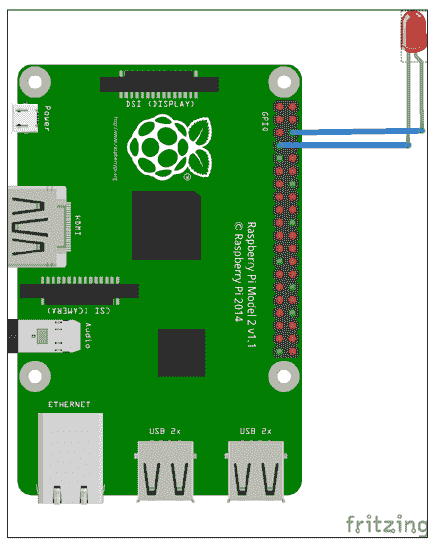

连接好 LED 后，继续将代码保存为 prog1.py，并执行以下命令：

```
python prog1.py
```

如果一切按计划进行，你现在应该看到你的 LED 在闪烁。现在我们将分析代码，看看到底做了什么。

与往常一样，我们通过导入所需的依赖项开始 Python 程序。RPi.GPIO 是提供 API 使我们能够使用 GPIO 引脚的 Python 库。它已预装在 Raspbian 操作系统中。然后，我们导入 time 模块，它将为我们提供闪烁的延迟。

GPIO.setmode() 设置 GPIO 引脚的寻址模式。有两种模式，即 BOARD 和 BCM。BOARD 模式按板上给出的编号寻址引脚。例如，在前面的 GPIO 图中，GPIO04 是引脚 7。另一种模式是 BCM，它根据树莓派上的 Broadcom 固件定义引脚。因此，GPIO04 引脚将被引用为 4 而不是 7。下一个语句 GPIO.setup() 根据参数将指定的引脚配置为输出或输入。

现在，我们将进入代码的主要部分，即 Blink() 函数。GPIO.output() 函数接受两个参数：引脚号和要执行的逻辑操作。在第一个输出语句中，我们将引脚 7 设置为 HIGH，然后在第二个输出语句中将其设置为 LOW。在这两个函数之间，我们有来自 time 包的 sleep() 函数，它只接受一个参数：以秒为单位的时间。它什么都不做，只是将下一个语句的执行延迟输入的秒数，这也可以是 0.5 或 0.2 这样的分数。Blink() 函数中的最后一个语句是 cleanup() 函数，它将你使用过的所有端口重置回输入模式。这可以防止在你将引脚设置为 HIGH 输出然后意外将其连接到地线从而导致端口短路时损坏引脚。因此，更安全的做法是让端口保持为输入。

## 连接按钮

正如我们在上一节看到的，将 LED 连接到 GPIO 引脚很容易，代码也很简单。在本节中，我们将使用相同的通用代码来编程 GPIO 引脚从按钮获取输入，如果按下按钮，则点亮我们在上一节中已连接的 LED。我们现在来看一下代码，然后解释那些在上一节中未遇到的行：

```
```python
import RPi.GPIO as GPIO
import time

GPIO.setmode(GPIO.BOARD)

GPIO.setup(12, GPIO.IN, pull_up_down = GPIO.PUD_UP)
GPIO.setup(7, GPIO.OUT)

while True:
    input_state = GPIO.input(12)

    if input_state == False:
        print('Button Pressed')
    GPIO.output(7, True)
```
```

```
else:
    print('Button Not Pressed')
GPIO.output(7, False)
```

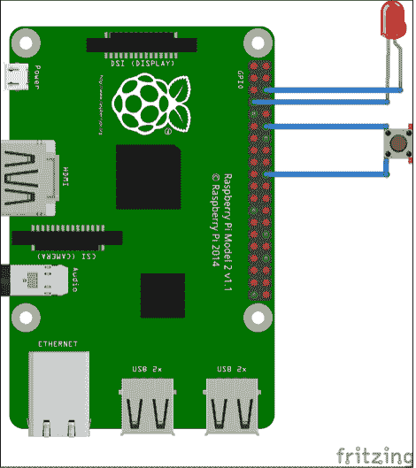

现在，将代码保存为 `prog2.py` 并使用以下命令运行它：

```
python prog2.py
```

在本节中，我们通过与上一节中使用的相同的 `GPIO.setup()` 语句将引脚 #12（按板编号）配置为输出。但这里我们有一个额外的参数，`pull_up_down=GPIO.PUD_UP`。这意味着 GPIO 引脚的内部电阻被上拉到 3.3V，并且在按下按钮时会返回 `False`。这有点违反直觉，但如果不进行上拉或下拉，输入将被置于“浮动”状态，这意味着 Pi 将无法确定按钮是否被按下，因为它没有可用于比较电压电平的东西！

现在我们进入无限的 `while` 循环，在其中使用 `GPIO.input()` 函数检查按钮状态。如前所述，如果按下按钮，`input_state` 将返回 `False`，LED 将被点亮。如果按钮不再被按下，LED 将熄灭！

简单，不是吗？让我们继续一个更复杂的附加设备。


## 安装 PiGlow

下图显示了 PiGlow 板：

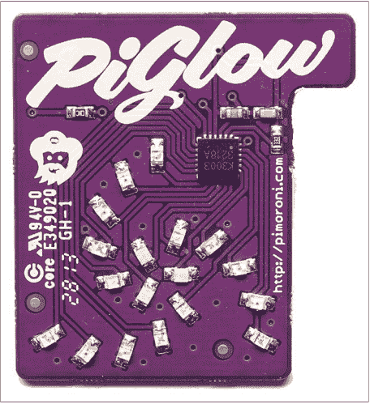

由于我们已经学习了如何通过 Raspberry Pi GPIO 引脚控制 LED 和按钮，现在我们将进入一个名为 PiGlow 的模块，它是 Raspberry Pi 的扩展板，提供 18 个可单独控制的 LED，并且你可以通过提供的库来使用它。我们现在将使用 Pimoroni 本身提供的脚本来安装 PiGlow 的软件需求。要安装 PiGlow，请在新的终端中运行以下命令：

```bash
curl get.pimoroni.com/piglow | bash
```

要检查 PiGlow 是否已正确安装，请打开一个 Python 终端并执行以下命令：

```python
import piglow
```

如果成功，则继续。

要确认是否已启用 I2C，请通过输入以下命令打开 Raspberry Pi 配置工具：

```bash
sudo raspi-config
```

然后，从显示的选项中选择 **Advanced Options** 菜单。

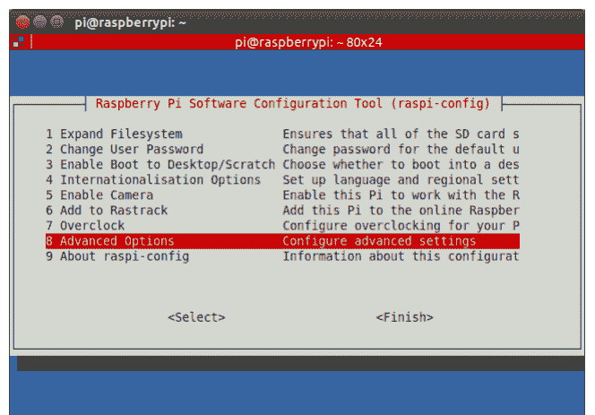

当我们进入 raspi-config 的 **Advanced Options** 菜单时，会出现以下屏幕。我们现在将选择 A7 选项，即 I2C。

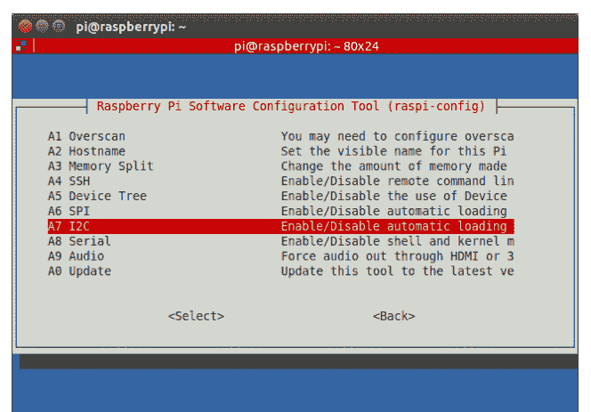

一旦我们选择 I2C 菜单，就会显示以下内容：

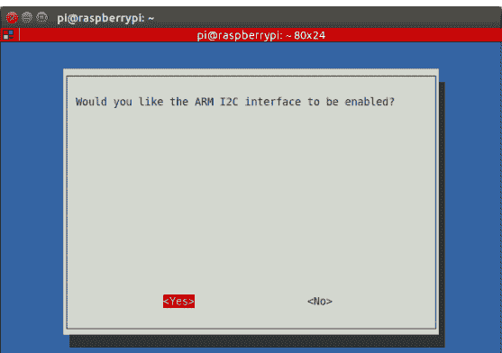

对前一个屏幕和下一个屏幕都选择 Yes：

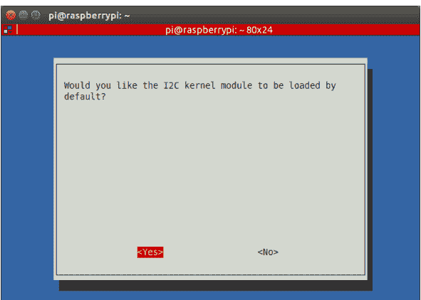

## 使用 PiGlow

PiGlow 配备了一组母 GPIO 导轨，覆盖了 Raspberry Pi 的公 GPIO 引脚。对于 Raspberry Pi 2 和 B+，PiGlow 中的导轨尺寸较短，因此我们需要确保 PiGlow 仅连接到 Raspberry Pi 上编号较低的引脚。

> 你可以在 Pimoroni 网站上了解更多关于 PiGlow 的信息，网址为
> https://shop.pimoroni.com/products/piglow。

我们现在可以继续控制 PiGlow 板上的 LED。打开一个 Python 终端并按顺序执行以下语句：

```python
import piglow
piglow.red(64)
```

这里，我们首先在 Python 中导入特定的库。`red()` 方法选择 PiGlow 板上的所有红色 LED。它只接受一个参数，即 LED 的亮度，可以是 0 到 255 之间的数字。你也可以尝试将数字 255 传递给 `red()` 方法，看看它如何影响 LED 的亮度。在这种情况下，传递 0 意味着 LED 关闭。但一旦我们执行了前面两个语句，什么都不会发生。我们必须通过发出以下命令来更新 PiGlow 的更改：

```python
piglow.show()
```

为什么？因为如果我们正在设置一个图案，点亮 LED 会花费时间和资源。然而，我们可以使用 show 方法即时绘制更改。如果你觉得这很奇怪，可以通过以下命令关闭它并打开自动更新：

```python
piglow.auto_update = True
```

与前面使用的 `red()` 方法类似，我们还有控制不同颜色的功能，即白色、蓝色、绿色、黄色和橙色。

但也许我们想控制灯的每个臂，而不是单一颜色的所有灯。好吧，我们可以用 `arm()` 函数做到这一点！看一下：

```python
piglow.arm(0, 128)
```

arm 函数接受两个参数。第一个是臂的编号，第二个是从 0 到 255 的亮度。例如，在之前的语句中，我们将第一个臂的 LED 设置为亮度值 128，即最大亮度的一半。假设我们想根据我们指定的方式控制任意 LED。我们很幸运！`set()` 函数让我们可以控制单个 LED。它可以按以下方式使用：

- `set(0, 255)`: 这将 LED 0 设置为全亮度
- `set([1, 3, 5], 200)`: 这将 LED 1、3 和 5 设置为 200 级亮度
- `set(0, [255, 255, 255])`: 这将从 0 索引开始的三个 LED 设置为全亮度

现在我们已经学习了使用 PiGlow 的基础知识，我们将继续使用它构建实际的示例。首先，我们将构建一个非常简单的示例，看起来 PiGlow 的臂就像自行车的辐条。很酷，对吧？代码如下，并附有解释：

```python
import time
import piglow

i = 0

while True:
    print(i)
    piglow.all(0)
    piglow.set(i % 18, [15, 31, 63, 127, 255, 127, 63, 31, 15])
    piglow.show()
    i += 1
    time.sleep(0.1)
```

现在将程序保存为 prog1.py 并使用以下命令运行它：

```bash
python prog1.py
```

与每个 Python 程序一样，我们首先导入所需的依赖项，在本例中是 time 库和我们刚刚安装的 PiGlow 库。接下来，我们设置计数器以跟踪我们想要点亮哪个 LED，并进入无限 while 循环来执行程序的大部分内容。此 while 循环将继续点亮 LED，直到我们终止程序。

首先，我们打印计数器的状态，然后执行 all() 函数，它将刷新所有 LED 并确保它们在开始时关闭。然后我们使用前面看到的 set() 函数的第三种形式。这意味着从第零个 LED 开始，我们以递增然后递减的方式点亮九个 LED。i % 18 将给出 i 除以 18 的余数，以便 LED 的索引始终保持在 0 到 18 的范围内。然后，我们通过 show() 函数实际显示我们在前面语句中设置的图案。最后，我们递增计数器并添加 100 毫秒的延迟。

此图案会为每个 LED 重复，并在快速连续进行时，看起来辐条正在循环。

这是一个非常基础的示例，现在我们准备进入更复杂的示例，即构建一个二进制时钟。让我们开始吧！

## 构建二进制时钟

在本示例中，我们将使用 PiGlow 构建一个二进制时钟，其中每个小时、分钟和秒由 PiGlow 的三个臂表示。数字以二进制格式显示。我们现在来看代码并学习每个部分的作用：

```python
import piglow
from time import sleep
from datetime import datetime

piglow.auto_update = True

show12hr = 1
ledbrightness = 10

piglow.all(0)

hourcount = 0
currenthour = 0
```

像之前的示例一样，我们导入 PiGlow 和时间库，但我们还导入了额外的库 datetime，它提供当前时间。然后，我们将自动更新参数设置为 true，以便 PiGlow 在我们对其进行更改后立即更新，而不是一次性推送所有更改。我们现在将设置一些自定义参数，即在 12 小时格式或 24 小时格式之间选择以及 LED 的亮度。完成后，我们将 LED 刷新到 0 级并设置小时计数器。现在我们准备进入代码的核心部分：

```python
while True:
    time = datetime.now().time()
    print(str(time))
    hour = time.hour
    min = time.minute
    sec = time.second

    if show12hr == 1:
        if hour > 12:
            hour = hour - 12

    if currenthour != hour:
        hourcount = hour
    currenthour = hour

    for x in range(6):
        piglow.led(13 + x, (hour & (1 << x)) * ledbrightness)

    for x in range(6):
        piglow.led(7 + x, (min & (1 << x)) * ledbrightness)

    for x in range(6):
        piglow.led(1 + x, (sec & (1 << x)) * ledbrightness)

    if hourcount != 0:
        sleep(0.5)
        piglow.white(ledbrightness)
        sleep(0.5)
        hourcount = hourcount - 1
    else:
        sleep(0.1)
```

主要代码逻辑在无限 while 循环内执行，以便程序永不停止。

## GPIO 编程简介

要理解以下代码片段的作用，我们需要深入了解二进制数字和位运算的世界。你还会注意到在 `led()` 函数的参数中，我们正在对数字进行位运算。为什么呢？在 `for` 循环的第一次迭代中，x 的值为 0，1 的二进制表示为 00000001。所以，位移操作不会引入任何变化。然而，在第二次迭代中，x 的值将为 1。所以，1 位左移将导致二进制数 00000010，即整数 2 的表示。同样，第三次迭代将导致 00000100，即 4 的二进制表示。现在，变量中保存的小时、分钟和秒值上还有位与操作。例如，假设当前小时为下午 3 点。它的二进制表示将为 00000011。如果我们在第一次迭代中进行位与操作，我们得到 00000001。这等于 1 并乘以 ledbrightness 变量；我们以亮度 10 点亮第 13 + 0 = 13 个 LED。此 LED 是由小时表示的臂的第一个 LED。现在，在第二次迭代中进行位与操作，我们有 hour = 00000011 和 1 << x = 00000010。结果是 00000010，即整数 2。这意味着第 14 个 LED 将以亮度 20 点亮。但在第三次迭代中，由于 1 << x = 00000100，我们在输出处得到整数 0，这意味着第 15 个 LED 根本不会点亮！

如果时间是下午 4 点，应用相同的逻辑，第 13 个 LED 不会点亮，第 14 个 LED 不会点亮，但第 15 个 LED 将以亮度 40 点亮。沿着相同的方向，我们现在直观地理解了二进制时钟如何表示小时、分钟和秒。

最后，我们设计程序在小时结束时闪烁所有白色 LED。我们还在闪烁的两侧添加了 500 毫秒的延迟，以便它不会显得太突然。然后，我们递减小时计数，整个程序使用更新后的时间重复。

现在，将代码保存为 `prog3.py` 并使用以下命令运行它：

```bash
python prog3.py
```

你现在将能够在 PiGlow 上看到小时、分钟和秒以二进制数字表示！


## Summary

本章特别有趣且动手实践性强，因为我们学习了如何通过软件操控硬件！这正是 Raspberry Pi 以及其他带有 GPIO 引脚的开发板如此受欢迎的原因。它们允许你用软件控制现实生活中的硬件应用。

我们只需更换连接到 Pi 的传感器并调整代码，就能为 Pi 创建几乎无限的应用。我们可以用这块小板搭建家庭自动化系统、安全应用、可穿戴设备等等！在本章中，我们从这些项目的 humble beginnings 开始，首先学习如何点亮一个 LED，这本身并不算令人印象深刻。然后，我们学习如何用一个按钮控制同一个 LED，这就更有趣了。

接着，我们学习了 PiGlow 以及如何将其连接到 Raspberry Pi。我们学习了用于控制 PiGlow 上 LED 的各种 API 命令，并利用这些命令制作了一个二进制时钟。

在打下这些坚实基础后，我们接着进行了一个更复杂的任务，其中包含一点理论和一点巧妙的 Python 编程，这大大减少了我们的努力。

在下一章中，我们将学习如何创建动画电影。我们将采用更偏向软件的方法，并制作诸如定格动画之类的动画。

## Setting up the prerequisites

除了 Raspberry Pi 外，本章我们还需要以下物品：

- Pi Camera
- Tactile push button
- Breadboard
- A few jumper cables

1. 触觉按钮可以从当地的硬件商店购买，或在线从 Adafruit 等卖家处购买。它可能看起来像这样：

   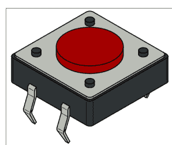

2. 麵包板基本上是电子元件的临时连接机制。5 针排中的每个引脚彼此相连，因此它们对连接到同一排的每个元件都表现为公共端子。侧边导轨上的所有引脚在电气上是连通的，主要用作电源线。麵包板看起来像这样：

   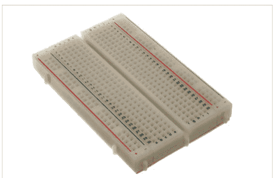

3. 跳线只是允许我们连接麵包板中不同排的电线，看起来像这样：

   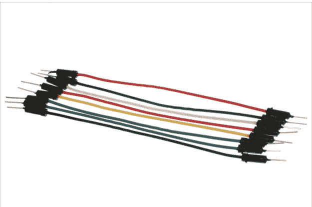

我们需要在 Pi 上安装 ffmpeg 库。可以使用以下命令安装：

```bash
sudo apt-get install ffmpeg
```

安装完成后，你可以通过执行以下命令来测试它：

```bash
avconv
```

如果安装正确，你应该会看到有关 avconv 工具的一些信息。如果没有，请尝试正确安装它，然后再次运行命令。

## Setting up and testing the camera

在启动 Pi 之前，我们需要将 Pi Camera 连接到它。这很简单，只需找到以太网端口旁边的摄像头端口，将摄像头排线插入其中，然后向下按压卡扣以固定它。

现在你可以测试它是否正常工作。启动 Pi 后，输入以下命令：

```bash
raspistill -o image.jpg
```

如果一切顺利，你现在应该在主目录中看到一张图片。打开它以检查摄像头是否拍出了令人满意的照片。如果图片是倒置的也不用担心，我们稍后会纠正它。它可能看起来像这样：

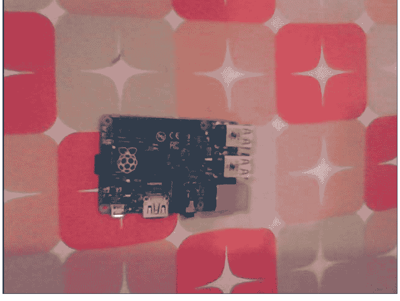

现在，我们来看一下用 Python 拍照的代码。像之前一样，我们将先完整查看代码，然后逐条学习它做了什么。这里就是：

```python
import picamera
from time import sleep

with picamera.PiCamera() as camera:
    camera.start_preview()
    sleep(3)
    camera.capture('/home/pi/image.jpg')
    camera.stop_preview()
```

我们首先导入 Pi 摄像头库，这是使用 PiCam 拍照所必需的。我们还导入了 time 库，以便在拍照时提供延迟。下一条语句本质上确保我们可以以相同的 camera 访问 picamera.PiCamera()。camera.start_preview() 方法启动摄像头的预览屏幕，在延迟 3 秒后，capture() 方法拍摄照片。capture 命令的参数给出图像文件的名称。最后，stop_preview() 方法停止预览。

将文件保存为 prog1.py 并使用以下命令运行它，因为这是一个 python3 程序：

```bash
python3 prog1.py
```

现在，从文件资源管理器中双击新的图像文件并检查它是否倒置。如果是，请在 start_preview() 方法之前添加以下两行以纠正它：

```python
camera.vflip = True
camera.hflip = True
```

## Adding the hardware button

在我们当前的设置中，我们将添加一个硬件输入按钮，以便在按下该按钮时拍照。因此，如下图所示将一个触觉按钮连接到 Raspberry Pi：

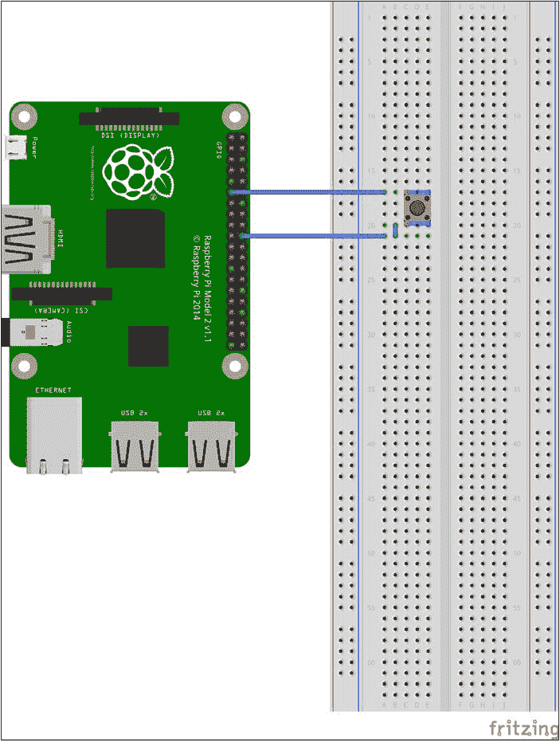

这次，我们在指定 GPIO 引脚时将使用 BCM 规范。我们将按钮连接到 GPIO17 引脚。然后，我们将修改代码，使其如下所示：

```python
import picamera
from RPi import GPIO

GPIO.setmode(GPIO.BCM)
GPIO.setup(17, GPIO.IN, GPIO.PUD_UP)

with picamera.PiCamera() as camera:
    camera.start_preview()
    GPIO.wait_for_edge(17, GPIO.FALLING)
    camera.capture('/home/pi/image.jpg')
    camera.stop_preview()
```

将上述程序保存为 prog2.py 并使用以下命令运行它：

```bash
python3 prog2.py
```

我们现在将了解每行代码的作用，除了我们在上一个程序中已经看到过的部分。要使用 GPIO 引脚，我们必须导入 RPi.GPIO 库，就像我们在上一章中所做的那样。然后，我们将 GPIO 地址模式设置为 BCM，这使用 Broadcom 规范而不是对板上引脚进行编号。这意味着我们可以按其 GPIO 编号而不是板编号来寻址 GPIO 引脚。通过 setup() 方法，我们将引脚配置为输入并将其设置为默认上拉。

真正发挥魔力的函数是 wait_for_edge()。它将引脚号作为第一个参数，将 GPIO_FALLING 作为第二个参数。这意味着该函数只有在引脚 17 上的信号从高变低或下降时才会被触发。因此，它会在按钮从未按下状态变为按下状态时被触发；也就是说，它会在我们按下按钮时被触发，而不是在我们松开按钮时被触发。接下来的语句捕获并保存图像，然后退出预览。如果我们想自拍，可以在 wait_for_edge() 函数之后添加一个延迟，以便我们有时间摆好姿势。另外，如果需要纠正倒置图片，也不要忘记添加那两个命令。

现在我们已经成功使用摄像头拍摄了单张照片，是时候尝试拍摄一系列静止图像并将它们组合起来制作定格动画了。为了避免你的主文件夹变得杂乱，我们可以创建一个新文件夹并进入其中，使用以下命令：

```bash
mkdir stopmotion
cd stopmotion
```

修改给定的代码并添加一个循环，以便每次按下按钮时都拍摄一张照片。新的代码如下所示：

```python
import picamera
from RPi import GPIO

GPIO.setmode(GPIO.BCM)
GPIO.setup(17, GPIO.IN, GPIO.PUD_UP)

with picamera.PiCamera() as camera:
    camera.start_preview()
    frame = 1
    while True:
        GPIO.wait_for_edge(17, GPIO.FALLING)
        camera.capture('/home/pi/stopmotion/frame%03d.jpg' % frame)
        frame += 1
    camera.stop_preview()
```

> 小心 SD 卡的存储空间限制。如果我们长时间按住按钮，Pi 可能会用完空间并在耗尽空间时崩溃，导致我们丢失所有数据并可能损坏 SD 卡。

现在，将程序保存为 prog3.py 并使用以下命令运行它：

```bash
python3 prog3.py
```

运行程序并收集制作定格动画项目所需的尽可能多的图像。按 *Ctrl + C* 退出程序并打开文件管理器查看你的图像。

## Rendering the video

我们现在准备好从刚刚收集的图像序列中渲染视频。我们将通过进入终端窗口开始渲染视频。使用以下命令导航到 stopmotion 文件夹：

```bash
cd /home/pi/stopmotion
```

然后，执行以下命令开始渲染视频：

```bash
avconv -r 10 -qscale 2 -i frame%03d.jpg animation.mp4
```


我们现在来看看这个命令的每个部分的作用：

- `-r` 指定视频的帧率，目前设置为 10
- `-qscale` 指定视频的质量，范围为 2-5
- `-i` 指定输入文件

渲染完成后，你可以用以下命令播放它：

```
omxplayer animation.mp4
```

恭喜！你刚刚创建了自己的逐帧动画制作工具！继续尝试吧。制作你自己的有趣动画并上传到 YouTube。

## Summary

在本章中，我们复习了如何使用树莓派配合 Pi Camera 并用它拍照。我们学习了一个巧妙的技巧来纠正照片如果颠倒了的情况。我们还学习了如何使用 GPIO 来使用触觉按钮作为图像的触发器。

一旦我们获得了制作动画所需的图像，我们就将这些图像合并成一个视频，其中我们指定了帧率和质量。最后，我们使用 ffmpeg 库渲染了视频。

在下一章中，我们将学习流行的开源图像处理库 OpenCV，并将其安装在树莓派上。我们还将实现一些有趣的项目，例如视频处理、图像上的逻辑运算、颜色空间转换等等！
