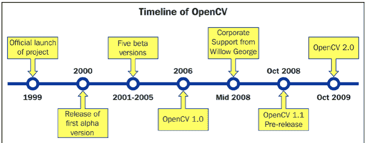
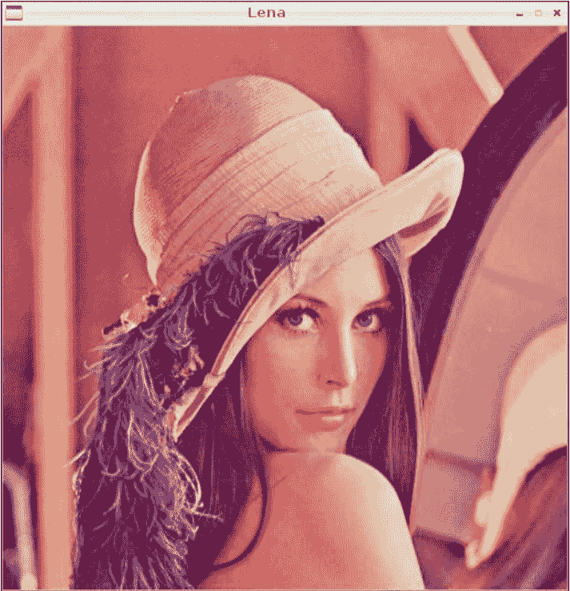
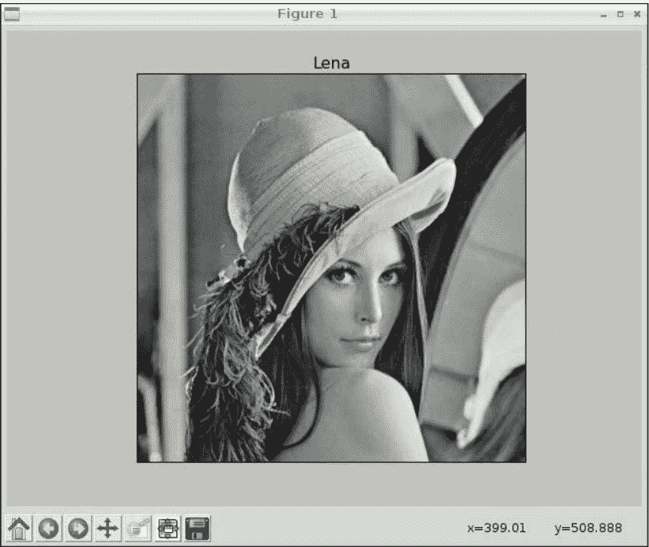
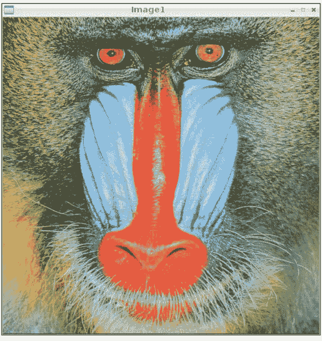
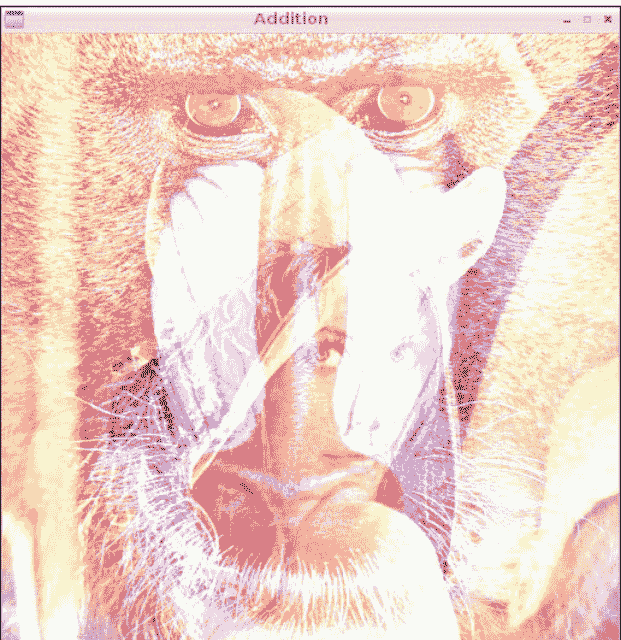
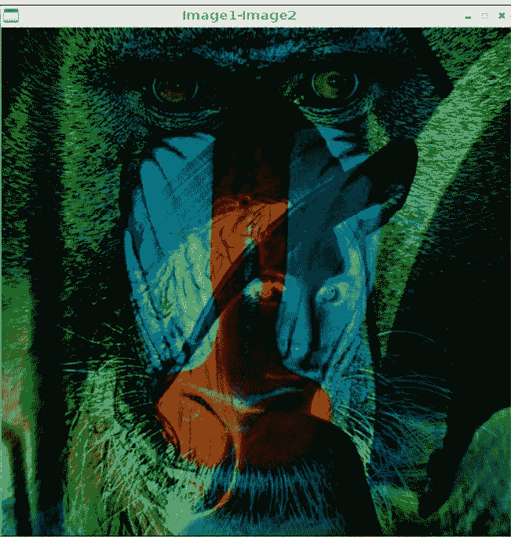
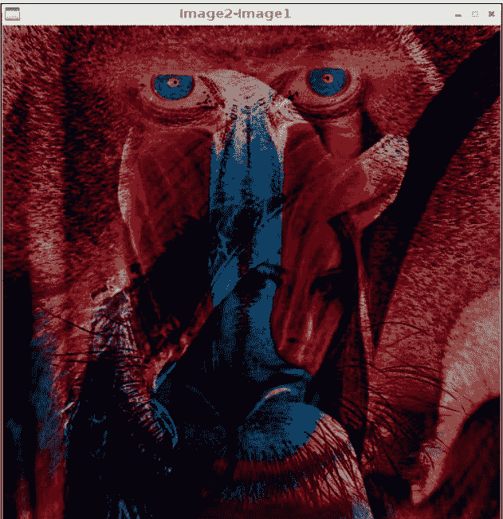
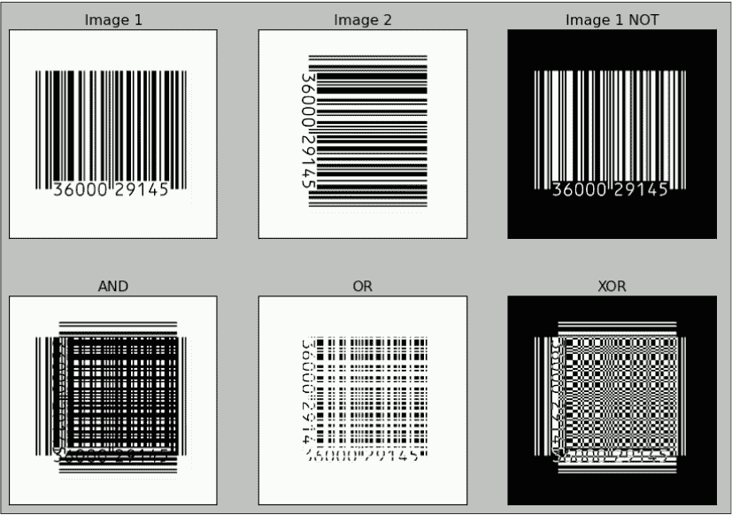
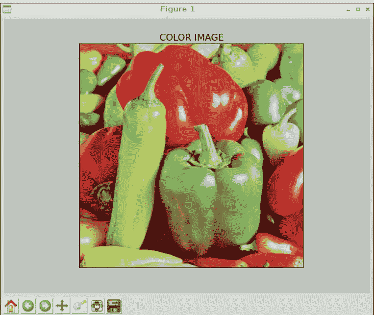
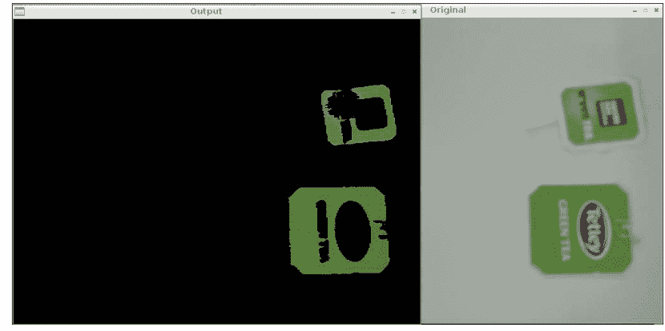

## Introduction to Computer Vision

在上一章中，我们实现了一个电池供电的便携式 Pi 延时摄影盒和一个定格录制系统。在本章中，我们将使用 OpenCV 库介绍 Pi 计算机视觉的基础知识。OpenCV 是任何计算机视觉爱好者的简单而强大的工具。人们可以通过用 Python 编写 OpenCV 程序以一种简单的方式学习计算机视觉。使用树莓派计算机和 Python 进行 OpenCV 编程是开始计算机视觉之旅的最佳方式之一。我们将在本章中详细介绍以下主题：

- 介绍计算机视觉
- 介绍 OpenCV
- 为计算机视觉和 NumPy 设置 Pi
- OpenCV 中的图像基础
- 使用 OpenCV 进行网络摄像头视频处理
- 图像上的算术和逻辑运算
- 颜色空间和颜色空间转换
- 基于颜色的目标跟踪

## Introducing Computer Vision

计算机视觉是计算机科学、数学和电气工程的一个领域。它包括获取、处理、分析和理解来自现实世界的图像和视频的方法，以便模仿人类视觉。此外，与人类视觉不同，计算机视觉还可以用于分析和处理深度和红外图像。计算机视觉还涉及从图像和视频中提取信息的理论。计算机视觉系统可以接受不同形式的数据作为输入，包括但不限于图像、图像序列和视频，这些视频可以从多个来源流式传输以进一步处理并从中提取有用的信息用于决策。人工智能和计算机视觉共享许多主题，例如图像处理、模式识别和机器学习技术。

## Introducing OpenCV

**OpenCV**（**Open Source Computer Vision** 的缩写）是一个用于计算机视觉的编程函数库。它最初由位于下诺夫哥罗德的英特尔俄罗斯研究中心开发，目前由 Itseez 维护。

> 你可以在 `http://itseez.com/` 阅读更多关于 Itseez 的信息。

这是一个跨平台库，这意味着它可以在不同的操作系统上实现和运行。它主要专注于图像和视频处理。除此之外，它还为用户方便提供了几个 GUI 和事件处理功能。

OpenCV 在 **Berkeley Software Distribution (BSD)** 许可证下发布，因此它对学术和商业用途都是免费的。它为流行的编程语言（如 C/C++、Python 和 Java）提供了接口，并且可以在多种操作系统上运行，包括 Windows、Android 和类 Unix 操作系统。

> 你可以探索 OpenCV 主页，`www.opencv.org`，以获取更多详细信息。

OpenCV 最初是英特尔研究的一项计划，用于开发分析图像的工具。以下是 OpenCV 的简要时间线：



2012 年 8 月，OpenCV 的支持由非营利基金会 www.OpenCV.org 接管，该基金会目前正在进一步开发它。它还维护 OpenCV 的开发者和用户网站。

> 在撰写本文时，OpenCV 的稳定版本是 2.4.10。3.0 Beta 版也可用。

## Setting up Pi for Computer Vision

请确保你拥有一个工作正常的、有线且速度合理的互联网连接来进行此活动。现在，让我们为计算机视觉准备我们的 Pi：

- 1. 通过以太网或 Wi-Fi USB 适配器将你的 Pi 连接到互联网。
- 2. 运行以下命令重启网络服务：
  `sudo service networking restart`
- 3. 通过输入以下命令确保树莓派已连接到互联网：
  `ping -c4 www.google.com`

  如果命令失败，请使用其他设备检查互联网连接并解决问题。之后，再次重复前面的步骤。

- 4. 按顺序运行以下命令：

  ```bash
  sudo apt-get update
  sudo apt-get upgrade
  sudo rpi-update
  sudo reboot -h now
  ```

- 5. 之后，我们需要安装一些必要的软件包和 OpenCV 的依赖项。以下是我们需要安装的软件包列表。你只需将 Pi 连接到互联网并输入以下内容：

  ```bash
  sudo apt-get install <package-name> -y
  ```

  这里，`<package-name>` 是以下软件包之一：

|  |  |  |
|---|---|---|
| libopencv-dev | libpng3 | libdc1394-22-dev |
| build-essential | libpnglite-dev | libdc1394-22 |
| libavformat-dev | zlib1g-dbg | libdc1394-utils |
| x264 | zlib1g | libv4l-0 |
| v4l-utils | zlib1g-dev | libv4l-dev |
| ffmpeg | pngtools | libpython2.6 |
| libcv2.3 | libtiff4-dev | python-dev |
| libcvaux2.3 | libtiff4 | python2.6-dev |
| libhighgui2.3 | libtiffxx0c2 | libgtk2.0-dev |
| libpng++-dev | libtiff-tools | libunicap2-dev |
| opencv-doc | libjpeg8 | libeigen3-dev |
| libcv-dev | libjpeg8-dev | libswscale-dev |
| libcvaux-dev | libjpeg8-dbg | libjpeg-dev |
| libhighgui-dev | libavcodec-dev | libwebp-dev |
| python-numpy | libavcodec53 | libpng-dev |
| python-scipy | libavformat53 | libtiff5-dev |
| python-matplotlib | libgstreamer0.10-0-dbg | libjasper-dev |
| python-pandas | libgstreamer0.10-0 | libopenexr-dev |
| python-nose | libgstreamer0.10-dev | libgdal-dev |
| v4l-utils | libxine1-ffmpeg | python-tk |
| libgtkglext1-dev | libxine-dev | python3-dev |
| libpng12-0 | libxine1-bin | python3-tk |
| libpng12-dev | libunicap2 | python3-numpy |

例如，你需要安装 x264，那么你需要输入以下内容：

```
sudo apt-get install x264 -y
```

这将安装必要的软件包。同样，安装所有之前提到的软件包。如果某个软件包已安装在你的 Pi 上，那么它会显示以下消息：

```
Reading package lists... Done
Building dependency tree
Reading state information... Done
x264 is already the newest version.
0 upgraded, 0 newly installed, 0 to remove and 0 not upgraded.
```

在这种情况下，不用担心。这个软件包已经安装并且是最新版本。只需继续逐一安装列表中的所有其他软件包。

- 6. 最后，使用以下命令为 Python 安装 OpenCV：

```
sudo apt-get install python-opencv -y
```

这是安装 Python 版 OpenCV 的最简单方法；然而，这里有一个问题。Raspbian 仓库可能并不总是包含最新版本的 OpenCV。例如，在撰写本文时，Raspbian 仓库包含 2.4.1，而最新的 OpenCV 版本是 2.4.10。就 Python API 而言，最新版本将始终包含更好的支持和更多功能。

为了读者的方便，所有这些命令都包含在代码包中的可执行 shell 脚本 chapter07.sh 中。只需使用以下命令运行脚本：

```
./chapter07.sh
```

这将安装开始在 Pi 上使用 OpenCV 所需的所有软件包和依赖项。


> 另一种实现相同功能的方法是从源码编译 OpenCV，我不推荐初学者这样做，因为它有点复杂且会花费大量时间。

## 使用 Python 测试 OpenCV 安装

在 Python 中，使用 OpenCV 编程非常容易。与 C/C++ 相比，它需要的代码行数很少，并且可以利用 NumPy 等强大的库来处理图像处理所需的多维数据结构。

打开一个终端并输入 python，然后输入以下行：

```
>>> import cv2
>>> print cv2.__version__
```

这将显示 Pi 上安装的 OpenCV 版本，在我们的例子中是 2.4.1。

## 介绍 NumPy

NumPy 是用于 Python 科学计算的基础包，它是用于线性代数的矩阵库。NumPy 还可以用作通用数据的有效多维容器。可以定义和使用任意数据类型。NumPy 是 Python 编程语言的扩展，为大型多维数组和矩阵添加了支持，并附带了大量用于对这些数组进行操作的高级数学函数库。我们将在本书中全程使用 NumPy 数组来表示图像并对其执行复杂的数学运算。NumPy 带有许多内置函数用于所有这些操作，因此我们不必担心所有基本数组操作。我们可以直接专注于计算机视觉的概念和代码。所有 OpenCV 数组结构都转换为 NumPy 数组并从 NumPy 数组转换而来。因此，你可以在 NumPy 中计算的任何操作，我们都可以用 OpenCV 处理。

在本書中，我们将大量使用 NumPy 与 OpenCV。让我们从一些简单的示例程序开始，这些程序将展示 NumPy 的真正威力。

在终端中打开 python 并尝试以下示例。

## 数组创建

让我们看一些数组创建的示例。`array()` 方法在本书的其余部分中会被频繁使用。有许多方法可以创建不同类型的数组。我们将在本书的其余部分中根据需要探索这些方法：

```
>>> import numpy as np
>>> x=np.array([1,2,3])
>>> x
array([1, 2, 3])
```

```
>>> y=range(10)
>>> y
array([0, 1, 2, 3, 4, 5, 6, 7, 8, 9])
```

## 数组的基本操作

我们现在要学习 `linspace()` 函数。它接受三个参数：`start_num`、`end_num` 和 `count`。这会创建一个从 `start_num` 开始到 `end_num` 结束的等间距点数组。尝试以下示例：

```
>>> a=np.array([1,3,6,9])
>>> b=np.linspace(0,15,4)
>>> c=a-b
>>> c
array([ 1., -2., -4., -6.])
```

以下是计算数组中每个元素的平方的代码：

```
>>> a**2
array([ 1,  9, 36, 81])
```

## 线性代数

让我们探索一些线性代数示例。我们将查看 `transpose()`、`inv()`、`solve()` 和 `dot()` 函数，这些函数对线性代数很有用：

```python
>>> a=np.array([[1,2,3],[4,5,6],[7,8,9]])

>>> a.transpose()
array([[1, 4, 7],
       [2, 5, 8],
       [3, 6, 9]])

>>> np.linalg.inv(a)
array([[-4.50359963e+15,  9.00719925e+15, -4.50359963e+15],
       [ 9.00719925e+15, -1.80143985e+16,  9.00719925e+15],
       [-4.50359963e+15,  9.00719925e+15, -4.50359963e+15]])

>>> b=np.array([3,2,1])

>>> np.linalg.solve(a,b)
array([ -9.66666667,  15.33333333,  -6.        ])

>>> c = np.random.rand(3,3)

>>> c
array([[ 0.69551123,  0.18417943,  0.0298238 ],
       [ 0.11574883,  0.39692914,  0.93640691],
       [ 0.36908272,  0.53802672,  0.2333465 ]])

>>> np.dot(a,c)
array([[ 2.03425705,  2.59211786,  2.60267713],
       [ 5.57528539,  5.94952371,  6.20140877],
       [ 9.11631372,  9.30692956,  9.80014041]])
```

> 你可以在 http://www.numpy.org/ 详细探索 NumPy。

## 处理图像

让我们开始介绍 OpenCV Python API 的基础知识。我们将编写和运行的所有脚本都将使用 OpenCV 库，必须使用 `import cv2` 行导入。我们将根据需要导入更多库，在接下来的章节中，`cv2.imread()` 将用于导入图像。它接受两个参数。第一个参数是图像文件名。图像应位于 Python 脚本所在的同一目录中，或向 `cv2.imread()` 提供绝对路径。它读取图像并将它们保存为 NumPy 数组。

第二个参数是一个标志，指定图像应以何种模式读取。该标志可以具有以下值：

- cv2.IMREAD_COLOR：这会加载彩色图像；它是默认标志
- cv2.IMREAD_GRAYSCALE：这会以灰度模式加载图像
- cv2.IMREAD_UNCHANGED：这会按原样加载图像，包括 alpha 通道

前述标志的数值分别为 1、0 和 -1。

请看以下代码：

```
import cv2 #This imports opencv
#This reads and stores image in color into variable img
img = cv2.imread('lena_color_512.tif',cv2.IMREAD_COLOR)
```

现在，前述代码中的最后一行与此相同：

```
img = cv2.imread('lena_color_512.tif',1)
```

我们将在本书中全程使用该标志的数值。

以下代码用于显示图像：

```
cv2.imshow('Lena',img)
cv2.waitKey(0)
cv2.destroyWindow('Lena')
```

`cv2.imshow()` 函数用于显示图像。第一个参数是窗口名称的字符串，第二个参数是保存要显示的图像的变量。

`cv2.waitKey()` 是一个键盘函数。它的参数是毫秒为单位的时间。该函数等待指定的毫秒时间等待任何键盘按键。如果传递 0，则无限期等待按键。它是获取和处理事件的唯一方法。我们必须为 `cv2.imshow()` 使用此函数，否则屏幕上不会显示图像。

`cv2.destroyWindow()` 函数以窗口名称作为参数并销毁该窗口。如果我们想销毁当前程序中的所有窗口，可以使用 `cv2.destroyAllWindows()`。

我们也可以预先创建一个具有特定名称的窗口，然后稍后将图像分配给该窗口。在许多情况下，我们必须在有图像之前创建窗口。这可以使用以下代码完成：

```
cv2.namedWindow('Lena', cv2.WINDOW_AUTOSIZE)
cv2.imshow('Lena',img)
cv2.waitKey(0)
cv2.destroyAllWindows()
```

把所有内容放在一起，我们有以下脚本：

```
import cv2
img = cv2.imread('lena_color_512.tif',1)
cv2.imshow('Lena',img)
cv2.waitKey(0)
cv2.destroyWindow('Lena')
```

总之，前述脚本导入图像、显示它并等待按键关闭窗口。截图如下：



`cv2.imwrite()` 函数用于将图像保存到特定路径。第一个参数是文件名，第二个是指向要保存的图像的变量。此外，`cv2.waitKey()` 可用于检测特定按键。让我们在以下代码片段中测试这两个函数的使用：

```python
import cv2
img = cv2.imread('lena_color_512.tif', 1)
cv2.imshow('Lena', img)
keyPress = cv2.waitKey(0)
if keyPress == ord('q'):
    cv2.destroyWindow('Lena')
elif keyPress == ord('s'): cv2.imwrite('output.jpg', img)
cv2.destroyWindow('Lena')
```

这里，`keyPress = cv2.waitKey(0)` 用于将按键值保存到 `keyPress` 变量中。对于长度为一的字符串，`ord()` 返回表示字符的 Unicode 代码点整数，当参数是 Unicode 对象时，或当参数是 8 位字符串时返回字节的值。根据 `keyPress`，我们要么退出，要么在保存图像后退出。例如，如果按下 Esc 键，`cv2.waitKey()` 函数将返回 27。

### 使用 matplotlib

我们也可以使用 `matplotlib` 来显示图像。`matplotlib` 是 Python 的 2D 绘图库。它提供广泛的绘图选项，我们将在下一章中使用。让我们看一个 `matplotlib` 的基本示例：

```python
import cv2
import matplotlib.pyplot as plt
#Program to load a color image in gray scale and to display using
#    matplotlib
img = cv2.imread('lena_color_512.tif',0)
plt.imshow(img,cmap='gray')
plt.title('Lena')
plt.xticks([])
plt.yticks([])
plt.show()
```


In this example, we are reading an image in grayscale and displaying it using `matplotlib`. The following screenshot shows the plot of the image:



The `plt.xticks([])` and `plt.yticks([])` functions can be used to disable x and y axis. Run the preceding code again, and this time, comment out the two lines with the `plt.xticks([])` and `plt.yticks([])` functions.

The `cv2.imread()` OpenCV function reads images and saves them as NumPy arrays of Blue, Green, and Red (BGR) pixels.

## API 文档

### 1. 简介

本 API 用于管理用户账户、商品信息和订单数据。所有接口均返回 JSON 格式的数据。

### 2. 身份认证

除登录接口外，所有接口都需要在请求头中携带 Token：

```
Authorization: Bearer <token>
```

### 3. 用户接口

- `GET /users` - 获取用户列表
- `POST /users` - 创建用户
- `GET /users/{id}` - 获取用户信息
- `PUT /users/{id}` - 更新用户信息
- `DELETE /users/{id}` - 删除用户

### 4. 商品接口

- `GET /products` - 获取商品列表
- `POST /products` - 创建商品
- `GET /products/{id}` - 获取商品详情
- `PUT /products/{id}` - 更新商品信息
- `DELETE /products/{id}` - 删除商品

You can find out the number of cameras and associated device indexes using the following command:

```
ls -l /dev/video*
```

Once `cam.read()` returns a Boolean value `ret` and the frame, which is the image it captured. If the image capture is successful, then `ret` will be True; otherwise, it will be False. The previously listed code will capture an image with the camera device, `/dev/video0`, display it, and then save it. `cam.release()` will release the device.

This code can be used with slight modifications to display live video stream from the webcam:

```
import cv2

cam = cv2.VideoCapture(0)
print 'Default Resolution is ' + str(int(cam.get(3))) + 'x' + str(int(cam.get(4)))
w=1024
h=768
cam.set(3,w)
cam.set(4,h)
print 'Now resolution is set to ' + str(w) + 'x' + str(h)

while(True):
    # Capture frame-by-frame
    ret, frame = cam.read()

    # Display the resulting frame
    cv2.imshow('Video Test',frame)

    # Wait for Escape Key
    if cv2.waitKey(1) == 27 :
        break

# When everything done, release the capture
cam.release()
cv2.destroyAllWindows()
```

You can access the features of the video device with `cam.get(propertyID)`. 3 stands for the width and 4 stands for the height. These properties can be set with `cam.set(propertyID, value)`.

The preceding code first displays the default resolution and then sets it to 1024 x 768 and displays the live video stream till the Esc key is pressed. This is the basic skeleton logic for all the live video processing with OpenCV. We will make use of this in future.

## Saving a video using OpenCV

We need to use the `cv2.VideoWriter()` function to write a video to a file. Take a look at the following code:

```
import cv2
cam = cv2.VideoCapture(0)
output = cv2.VideoWriter('VideoStream.avi',
cv2.cv.CV_FOURCC(*'WMV2'),40.0,(640,480))

while (cam.isOpened()):
    ret, frame = cam.read()
    if ret == True:
        output.write(frame)
        cv2.imshow('VideoStream', frame )
        if cv2.waitKey(1) == 27 :
            break
    else:
        break

cam.release()
output.release()
cv2.destroyAllWindows()
```

In the preceding code, `cv2.VideoWriter()` accepts the following parameters:

- **Filename:** This is the name of the video file.
- **FourCC:** This stands for Four Character Code. We have to use the `cv2.cv.CV_FOURCC()` function for this. This function accepts FourCC in the `*'code'` format. This means that for DIVX, we need to pass `*'DIVX'`, and so on. Some supported formats are DIVX, XVID, H264, MJPG, WMV1, and WMV2.
- **Framerate:** This is the rate of the frames to be captured per second.
- **Resolution:** This is the resolution of the video to be captured.

> You can read more about FourCC at www.fourcc.org.

The preceding code records the video till the *Esc* key is pressed and saves it in the specified file.

## Pi Camera and OpenCV

The following code demonstrates the use of Picamera with OpenCV. It shows a preview for 3 seconds, captures an image, and displays it on screen using `cv2.imshow()`:

```python
import picamera
import picamera.array
import time
import cv2

with picamera.PiCamera() as camera:
    rawCap=picamera.array.PiRGBArray(camera)
    camera.start_preview()
    time.sleep(3)
    camera.capture(rawCap,format="bgr")
    image=rawCap.array
    cv2.imshow("Test",image)
    cv2.waitKey(0)
    cv2.destroyAllWindows()
```

## Retrieving image properties

We can retrieve and use many image properties with OpenCV functions. Take a look at the following code:

```python
import cv2
img = cv2.imread('lena_color_512.tif',1)
print img.shape
print img.size
print img.dtype
```

The `img.shape` operation returns the shape of the image, that is, its dimensions and the number of color channels. The output of the previously listed code will be as follows:

```text
(512, 512, 3)
786432
uint8
```

If the image is colored, then `img.shape` returns a triplet containing the number of rows, the number of columns, and the number of channels in the image. Usually, the number of channels is three, representing the red, green, and blue channels. If the image is grayscale, then `img.shape` only returns the number of rows and the number of columns. Try to modify the preceding code to read the image in the grayscale mode and observe the output of `img.shape`.

The `img.size` operation returns the total number of pixels, and `img.dtype` returns the image datatype.

## Arithmetic operations on images

In this section, we will take a look at the various arithmetic operations that can be performed on images. Images are represented as matrices in OpenCV. So, arithmetic operations on images are the same as arithmetic operations on matrices. Images must be of the same size in order to perform arithmetic operations with images, and these operations are performed on individual pixels. `cv2.add()` method is used to add two images, where images are passed as parameters.

The `cv2.subtract()` method is used to subtract one image from another.

> We know that subtraction operation is not commutative; so, `cv2.subtract(img1,img2)` and `cv2.subtract(img2,img1)` will yield different results, whereas `cv2.add(img1,img2)` and `cv2.add(img2,img1)` will yield the same result as the addition operation is commutative. Both the images have to be of the same size and type as that explained earlier.

Check out the following code:

```
import cv2
img1 = cv2.imread('4.2.03.tiff',1)
img2 = cv2.imread('4.2.04.tiff',1)
cv2.imshow('Image1',img1)
cv2.waitKey(0)
cv2.imshow('Image2',img2)
cv2.waitKey(0)
cv2.imshow('Addition',cv2.add(img1,img2))
cv2.waitKey(0)
cv2.imshow('Image1-Image2',cv2.subtract(img1,img2))
cv2.waitKey(0)
cv2.imshow('Image2-Image1',cv2.subtract(img2,img1))
cv2.waitKey(0)
cv2.destroyAllWindows()
```

The preceding code demonstrates the usage of arithmetic functions on images. Image2 is the same *Lena* image that we experimented with in the previous chapter, so I am not including its output window. The following is the output window of **Image1**:



The following is the output of the **Addition**:



The following is the output window of **Image1-Image2**:



The following is the output window of **Image2-Image1**:



## Splitting and merging image color channels

On several occasions, we might be interested in working separately with the red, green, and blue channels. For example, we might want to build a histogram for each channel of an image.

The `cv2.split()` method is used to split an image into three different intensity arrays for each color channel, whereas `cv2.merge()` is used to merge different arrays into a single multichannel array, that is, a color image. Let's take a look at an example:

```python
import cv2
img = cv2.imread('4.2.03.tiff',1)
b,g,r = cv2.split(img)
cv2.imshow('Blue Channel',b)
cv2.imshow('Green Channel',g)
cv2.imshow('Red Channel',r)
img=cv2.merge((b,g,r))
cv2.imshow('Merged Output',img)
cv2.waitKey(0)
cv2.destroyAllWindows()
```

The preceding program first splits the image into three channels (blue, green, and red) and then displays each one of them. The separate channels will only hold the intensity values of that color, and they will be essentially displayed as grayscale intensity images. Then, the program will merge all the channels back into an image and display it.

## Negating an image

In mathematical terms, the negative of an image is the inversion of colors. For a grayscale image, it is even simpler! The negative of a grayscale image is just the intensity inversion, which can be achieved by finding the complement of the intensity from 255. A pixel value ranges from 0 to 255 and, therefore, negation is the subtraction of the pixel value from the maximum value, that is, 255. The code for this is as follows:

```python
import cv2
img = cv2.imread('4.2.07.tiff')
grayscale = cv2.cvtColor(img,cv2.COLOR_BGR2GRAY)
negative = abs(255-grayscale)
cv2.imshow('Original',img)
cv2.imshow('Grayscale',grayscale)
cv2.imshow('Negative',negative)
cv2.waitKey(0)
cv2.destroyAllWindows()
```

> The negative of a negative will be the original grayscale image. Try this on your own by taking the image negative of a negative again.


## 图像上的逻辑运算

OpenCV 提供了图像上的位逻辑运算函数。我们将查看提供位逻辑 AND、OR、XOR（异或）和 NOT（反转）功能的函数。这些函数可以用灰度图像更直观地展示。我将使用水平和垂直方向的条形码图像来进行演示。请看下面的代码：

```python
import cv2
import matplotlib.pyplot as plt

img1 = cv2.imread('Barcode_Hor.png',0)
img2 = cv2.imread('Barcode_Ver.png',0)
not_out=cv2.bitwise_not(img1)
and_out=cv2.bitwise_and(img1,img2)
or_out=cv2.bitwise_or(img1,img2)
xor_out=cv2.bitwise_xor(img1,img2)

titles = ['Image 1','Image 2','Image 1 NOT','AND','OR','XOR']
images = [img1,img2,not_out,and_out,or_out,xor_out]

for i in xrange(6):
    plt.subplot(2,3,i+1)
    plt.imshow(images[i],cmap='gray')
    plt.title(titles[i])
    plt.xticks([]),plt.yticks([])
plt.show()
```

我们首先以灰度模式读取图像并计算 NOT、AND、OR 和 XOR，然后使用 matplotlib 以整洁的方式显示它们。这里我们利用了 `plt.subplot()` 函数来显示多张图像。在此示例中，我们为图像创建了一个两行三列的网格，并在网格的每个部分显示每张图像。你可以修改这一行并将其改为 `plt.subplot(3,2,i+1)` 以创建三行两列的网格。

我们也可以不使用循环以以下方式实现。对于每张图像，你需要编写以下语句。我只在这里为第一张图像写出。请自行为其余五张图像写出：

```python
plt.subplot(2,3,1) , plt.imshow(img1,cmap='gray') , plt.title('Image 1') , plt.xticks([]),plt.yticks([])
```

最后，使用 `plt.show()` 来显示。这种技术适用于需要显示的图像数量非常少的情况：通常为 2 或 3 张。输出结果与以下完全相同，如下所示：



> 你可能想要记下这样一个事实：逻辑 NOT 运算是图像的负片。
> 你可以在 http://docs.opencv.org/modules/refman.html 查看 Python OpenCV API 文档。

## 颜色空间及转换

**颜色空间** 是用于表示颜色的数学模型。通常，颜色空间用于以数值形式表示颜色并对其进行数学和逻辑运算。在本书中，我们主要使用的颜色空间是 BGR（OpenCV 的默认颜色空间）、RGB、HSV 和灰度。BGR 代表蓝色、绿色和红色。HSV 以色相、饱和度和明度格式表示颜色。OpenCV 具有 `cv2.cvtColor(img, conv_flag)` 函数，可让我们更改图像的颜色空间，而源颜色空间和目标颜色空间则在 `conv_flag` 参数中指定。我们了解到 OpenCV 以 BGR 格式加载图像，而 matplotlib 使用 RGB 格式显示图像。因此，在使用 matplotlib 显示图像之前，我们需要将图像从 BGR 转换为 RGB 颜色空间。请看下面的代码。程序使用 `cv2.imread()` 以彩色模式读取图像，该函数以 BGR 颜色空间导入图像。然后，它使用 `cv2.cvtColor()` 将其转换为 RGB，最后使用 matplotlib 显示图像：

```python
import cv2
import matplotlib.pyplot as plt

img = cv2.imread('4.2.07.tiff',1)
img = cv2.cvtColor( img , cv2.COLOR_BGR2RGB )
plt.imshow( img ), plt.title('COLOR IMAGE'), plt.xticks([]),
    plt.yticks([])
plt.show()
```

将图像从 BGR 转换为 RGB 的另一种方法是首先将图像拆分为三个独立的通道（B、G 和 R 通道），然后以 RGB 顺序合并它们。然而，这需要更多时间，因为拆分和合并操作本质上计算成本高昂，从而使其更慢且效率低下。下面的代码展示了这种方法：

```python
import cv2
import matplotlib.pyplot as plt
img = cv2.imread('4.2.07.tiff',1)
b,g,r = cv2.split( img )
img=cv2.merge((r,g,b))
plt.imshow( img ), plt.title('COLOR IMAGE'), plt.xticks([]),
    plt.yticks([])
plt.show()
```

两个程序的输出结果与以下截图所示相同：



如果你需要了解颜色空间转换标志，那么以下代码片段将帮助你找到当前 OpenCV 安装中可用的标志列表：

```python
import cv2
j=0
for filename in dir(cv2):
    if filename.startswith('COLOR_'):
        print filename
        j=j+1

print 'There are ' + str(j) + ' Colorspace Conversion flags in OpenCV'
```

输出的最后几行将如下所示（由于篇幅限制，我未包含完整输出）：

```
COLOR_YUV420P2BGRA
COLOR_YUV420P2GRAY
COLOR_YUV420P2RGB
COLOR_YUV420P2RGBA
COLOR_YUV420SP2BGR
COLOR_YUV420SP2BGRA
COLOR_YUV420SP2GRAY
COLOR_YUV420SP2RGB
COLOR_YUV420SP2RGBA
There are 176 Colorspace Conversion flags in OpenCV
```

下面的代码将颜色从 BGR 转换为 HSV 并打印出来：

```python
>>> import cv2
>>> import numpy as np
>>> c = cv2.cvtColor(np.uint8([[[255,0,0]]]),cv2.COLOR_BGR2HSV)
>>> print c
[[[120 255 255]]]
```

前面的代码片段打印了以 BGR 表示的蓝色 HSV 值。

色相、饱和度、明度（HSV）是一种描述颜色的颜色模型，用色相或色调、阴影（饱和度或灰度量）以及亮度（明度或亮度）来描述颜色。色相表示为表示红色、黄色、绿色、青色、蓝色和洋红色的色调的数字。饱和度是颜色中的灰度量。明度与饱和度协同工作，描述颜色的亮度或强度。

## 基于颜色的实时跟踪

让我们研究一下这一概念的实际应用。在 HSV 格式中，识别颜色范围要容易得多。如果我们需要跟踪特定颜色的对象，我们将需要在 HSV 中定义一个颜色范围，然后将捕获的图像转换为 HSV 格式并检查该图像的部分是否落在我们感兴趣的 HSV 颜色范围内。我们可以使用 cv2.inRange() 函数来实现这一点。该函数接收图像、颜色的上下界，然后对每个像素检查范围条件。如果像素值落在给定的颜色范围内，则输出图像中对应的像素为 0；否则为 255，从而创建二值掩码。我们随后可以使用 bitwise_and() 利用此二值掩码提取我们感兴趣的颜色范围。请看下面的代码以了解这一概念：

```python
import numpy as np
import cv2

cam = cv2.VideoCapture(0)

while (True):
    ret, frame = cam.read()
    hsv = cv2.cvtColor(frame, cv2.COLOR_BGR2HSV)
    image_mask = cv2.inRange(hsv, np.array([40, 50, 50]),
        np.array([80, 255, 255]))
    output = cv2.bitwise_and(frame, frame, mask = image_mask)
    cv2.imshow('Original', frame)
    cv2.imshow('Output', output)
    if cv2.waitKey(1) == 27:
        break
cv2.destroyAllWindows()
cam.release()
```

我们在这个程序中跟踪绿色物体。输出应类似于以下图。我使用了绿茶袋标签作为测试对象。



前一幅图中未包含掩码图像。你可以通过在代码中添加 cv2.imshow('Image Mask',image_mask) 来自行查看。它将是一幅二值（纯黑白）图像。

我们也可以通过稍微修改这段代码来跟踪多种颜色。我们需要通过为另一个颜色范围创建掩码来修改前面的代码。然后，我们可以使用 cv2.add() 来获取两个不同颜色范围的合并掩码，如下所示：

```python
blue=cv2.inRange(hsv, np.array([100,50,50]),
    np.array([140,255,255]))
green=cv2.inRange(hsv,np.array([40,50,50]),np.array([80,255,255]))
image_mask=cv2.add(blue,green)
output=cv2.bitwise_and(frame,frame,mask=image_mask)
```

请自行尝试这段代码并检查输出。

## 总结

在本章中，我们学习了使用 OpenCV 和 Pi 进行计算机视觉的基础知识。我们还学习了基本图像处理操作，并实现了一个实际项目，用于基于颜色在实时视频流中跟踪对象。

在下一章中，我们将学习计算机视觉中的一些更高级概念，并使用这些概念实现一个功能齐全的基于 Pi 和网络摄像头的运动检测系统。


