## 创建自己的运动检测与跟踪系统

在上一章中，我们学习了OpenCV库的基础知识。我们为树莓派配置了Python环境以进行OpenCV编程，并基于实时网络摄像头输入实现了一个简单的项目，通过颜色跟踪物体。在本章中，我们将学习一些更高级的概念，并基于OpenCV再实现一个项目。在本章中，我们将学习以下主题：

- 阈值化
- 噪声消除
- 图像的形态学操作
- OpenCV中的轮廓
- 实时运动检测与跟踪

## 图像阈值化

**阈值化**是一种图像分割方法。虽然阈值化方法和算法也适用于彩色图像，但它在灰度图像上效果最佳。阈值化通常（但并非总是）将灰度图像转换为二值图像（在二值图像中，每个像素只能取两个可能值之一：白色或黑色）。图像阈值化通常是许多图像处理应用的第一步。

阈值化的工作原理非常简单。我们定义一个阈值。对于灰度图像中的像素，如果灰度强度值大于阈值，则我们为该像素赋一个值（例如白色）；否则，我们为像素赋予黑色值。这是最简单的阈值化形式。此外，这种方法还有许多其他变体，我们现在将逐一了解。

在OpenCV中，`cv2.threshold()` 函数用于对图像进行阈值化。其输入包括灰度图像、阈值、maxVal和阈值方法作为参数，并返回阈值化后的图像作为输出。maxVal是当像素强度大于（在某些方法中为小于）阈值时分配给该像素的值。OpenCV提供了许多阈值方法；最初，我们看到的阈值化最简单形式是 `cv2.THRESH_BINARY`。让我们看看一些阈值方法的数学表示。

假设 (x,y) 是输入像素，那么各阈值方法的操作将如下所示：

- `cv2.THRESH_BINARY`  
  如果 intensity(x,y) > threshold，则设置 intensity(x,y)=maxVal；否则，设置 intensity(x,y)=0
- `cv2.THRESH_BINARY_INV`  
  如果 intensity(x,y) > threshold，则设置 intensity(x,y)=0；否则，设置 intensity(x,y)=maxVal
- `cv2.THRESH_TRUNC`  
  如果 intensity(x,y) > threshold，则设置 intensity(x,y)=threshold；否则，保持 intensity(x,y) 不变
- `cv2.THRESH_TOZERO`  
  如果 intensity(x,y) > threshold，则保持 intensity(x,y) 不变；否则，设置 intensity(x,y)=0
- `cv2.THRESH_TOZERO_INV`  
  如果 intensity(x,y) > threshold，则设置 intensity(x,y)=0；否则，保持 intensity(x,y) 不变

阈值功能的演示通常在具有渐变的灰度图像上效果最佳。在以下示例中，我们将阈值设置为127，因此图像根据像素的强度值被分割成两组像素：

```python
import cv2
import matplotlib.pyplot as plt

img = cv2.imread('gray21.512.tiff',0)
th=127
max_val=255
ret,o1 = cv2.threshold(img,th,max_val,cv2.THRESH_BINARY)
ret,o2 = cv2.threshold(img,th,max_val,cv2.THRESH_BINARY_INV)
ret,o3 = cv2.threshold(img,th,max_val,cv2.THRESH_TOZERO)
ret,o4 = cv2.threshold(img,th,max_val,cv2.THRESH_TOZERO_INV)
ret,o5 = cv2.threshold(img,th,max_val,cv2.THRESH_TRUNC)

titles = ['Input Image','BINARY','BINARY_INV','TOZERO',
          'TOZERO_INV','TRUNC']
output = [img, o1, o2, o3, o4, o5]

for i in xrange(6):
    plt.subplot(2,3,i+1),plt.imshow(output[i],cmap='gray')
    plt.title(titles[i])
    plt.xticks([]),plt.yticks([])
plt.show()
```

上述代码的输出如下：

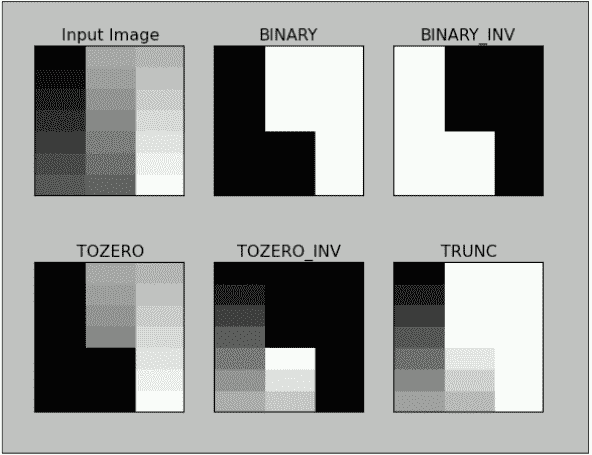

### 大津法

大津阈值化方法会自动确定直方图中有两个峰值的图像（双峰直方图）的阈值。下面是一个双峰直方图：


这通常意味着图像包含背景和前景像素，而大津法是在不指定阈值的情况下自动分离这两组像素的最佳方法。

对于不符合背景和前景模型的图像，大津法不是最佳方法，如果应用可能产生不正确的输出。

此方法与其他方法结合使用，阈值参数传递为0。尝试以下代码：

```python
ret,output=cv2.threshold(image,0,255,cv2.THRESH_BINARY+cv2.THRESH_OTSU)
```

其输出如下。这是沙漠中坦克的截图：


## 噪声

**噪声**意味着不需要的信号。图像/视频噪声是指强度（对于灰度图像）或颜色（对于彩色图像）的不期望变化，这些变化在正在拍摄或记录的实物中并不存在。图像噪声是一种电子干扰形式，可能来自多种来源，例如相机传感器以及数字或模拟相机的电路。数字相机中的噪声相当于模拟相机的胶片颗粒。尽管任何电子设备的输出中总是存在些许噪声，但大量的图像噪声会显著降低整体图像质量，使其无法达到预期目的。为了表示电子输出（在本文中即数字图像）的质量，数学术语**信噪比（SNR）**是一个非常有用的概念。其数学定义如下：

$$SNR = \frac{SignalPower}{NoisePower}$$

> 更高的信噪比意味着更好的图像质量。

### 用于噪声去除的核

在以下概念及其实现中，我们将使用核。**核**是图像处理中使用的方阵。我们可以将核应用于图像以获得不同结果，例如图像的模糊、平滑、边缘检测和锐化。核的主要用途之一是向图像应用低通滤波器。低通滤波器会平均掉图像像素强度的快速变化。这基本上会平滑或模糊图像。一个简单的平均核可以用数学公式表示如下：

$$K = \frac{All\ Ones\ Matrix}{Rows * Cols}$$

当 row = cols = 3 时，核如下所示：

$$K = \frac{\begin{bmatrix}1 & 1 & 1 \\ 1 & 1 & 1 \\ 1 & 1 & 1\end{bmatrix}}{9}$$

核中行和列的值始终为奇数。

我们可以使用以下NumPy代码创建这个核：

```python
K=np.ones((3,3),np.uint32)/9
```

### 2D卷积滤波

cv2.filter2D() 函数将前面提到的核与图像进行卷积，从而对图像应用线性滤波。该函数接受源图像、目标图像深度（在我们的示例中为-1，其中-1表示与源图像相同的深度）以及核。请看以下代码，它将一个7x7平均滤波器应用于图像：

```python
import cv2
import numpy as np
from matplotlib import pyplot as plt

img = cv2.imread('4.2.03.tiff',1)

input = cv2.cvtColor(img,cv2.COLOR_BGR2RGB)
output = cv2.filter2D(input,-1,np.ones((7,7),np.float32)/49)

plt.subplot(121),plt.imshow(input),plt.title('Input')
plt.xticks([]), plt.yticks([])
plt.subplot(122),plt.imshow(output),plt.title('Output')
plt.xticks([]), plt.yticks([])
plt.show()
```

输出将是一个滤波后的图像，如下所示：


### 低通滤波

正如核部分所讨论的，低通滤波器在去除尖锐分量（高频信息）方面非常出色，例如边缘和噪声，同时保留低频信息（即所谓的低通滤波），从而使图像模糊或平滑。

让我们探索OpenCV中可用的低通滤波函数。我们不必创建核并将其作为参数传递给这些函数；相反，这些函数会根据我们作为参数传递的核大小来创建核。

cv2.boxFilter() 函数以图像、深度和核大小为输入，并对图像进行模糊。我们可以将normalize指定为True或False。如果为True，核中的矩阵系数为1/(rows*cols)；因此，该矩阵称为归一化盒式滤波器。如果normalize为False，则系数为1，这将是一个非归一化盒式滤波器。非归一化盒式滤波器用于计算每个像素邻域上的各种积分特征，例如图像导数的协方差矩阵（用于密集光流算法等）。以下代码演示了归一化盒式滤波器：

```python
output=cv2.boxFilter(input,-1,(3,3),normalize=True)
```

代码的输出如下所示，由于核矩阵的尺寸较小，它的平滑程度将低于前一个输出：

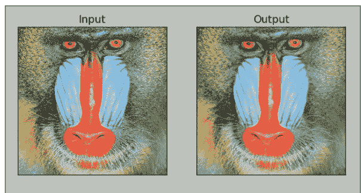

cv2.blur() 函数直接提供归一化盒式滤波器，它接受输入图像和核大小作为参数，无需指定normalize参数。以下代码的输出将与上述输出完全相同：

```python
output = cv2.blur(input,(3,3))
```


作为一个练习，尝试将 `normalize` 设为 `False`，为未归一化的盒式滤波器调用 `cv2.boxFilter()`，并查看输出。

`cv2.GaussianBlur()` 函数使用高斯核代替要应用的盒式滤波器。该滤波器对高斯噪声非常有效。以下是可以用于此函数的代码：

```
output = cv2.GaussianBlur(input, (3,3),0)
```

> 你可能想阅读更多关于高斯噪声的内容，网址为 http://homepages.inf.ed.ac.uk/rbf/HIPR2/noise.htm。

以下是前面代码的输出，其中输入是带有高斯噪声的图像，输出是去除了高斯噪声的图像。


## 创建你自己的运动检测与跟踪系统

`cv2.medianBlur()` 用于使用中值滤波器对图像进行中值模糊处理。它计算内核下所有值的中值，并将内核中的中心像素替换为计算出的中值。在此滤波器中，窗口沿图像滑动，窗口内像素的中值强度值成为被处理像素的输出强度。这对椒盐噪声非常有效。我们需要向该函数传递一个输入图像和一个奇数正整数（而不是前两个函数那样的行列元组）。以下代码在图像中引入椒盐噪声，然后应用 `cv2.medianBlur()` 来去除噪声：

```
```python
import cv2
import numpy as np
import random
from matplotlib
import pyplot as plt

img = cv2.imread('lena_color_512.tif', 1)

input = cv2.cvtColor(img, cv2.COLOR_BGR2RGB)

output = np.zeros(input.shape, np.uint8)
p = 0.2# probability of noise
for i in range(input.shape[0]):
    for j in range(input.shape[1]):
        r = random.random()
        if r < p / 2:
            output[i][j] = 0, 0, 0
        elif r < p:
            output[i][j] = 255, 255, 255
        else:
            output[i][j] = input[i][j]

noise_removed = cv2.medianBlur(output, 3)

plt.subplot(121), plt.imshow(output), plt.title('Noisy Image')
plt.xticks([]), plt.yticks([])
plt.subplot(122), plt.imshow(noise_removed), plt.title('Median Filtering')
plt.xticks([]), plt.yticks([])
plt.show()
```
```

你会发现椒盐噪声被大幅减少，图像对人眼来说也更加易于理解。

```
erosion = cv2.erode(img,kernel,iterations = 2)
dilation = cv2.dilate(img,kernel,iterations = 2)
gradient = cv2.morphologyEx(img, cv2.MORPH_GRADIENT, kernel)

titles=['Original','Erosion','Dilation','Gradient']
output=[img,erosion,dilation,gradient]

for i in xrange(4):
    plt.subplot(2,2,i+1),plt.imshow(output[i],cmap='gray')
    plt.title(titles[i]),plt.xticks([]),plt.yticks([])
plt.show()
```

输出将如下所示：


## 运动检测与跟踪

现在，我们将使用简单的逻辑构建一个成熟的运动检测与跟踪系统：找出视频源（如网络摄像头流）中后续帧之间的差异，并在检测到差异的区域周围绘制轮廓。

让我们导入所需的库并初始化网络摄像头：

```
import cv2
import numpy as np

cap = cv2.VideoCapture(0)
```

我们需要一个用于膨胀操作的内核，我们将提前创建它，而不是在循环中每次都创建：

```
k=np.ones((3,3),np.uint8)
```

以下代码将捕获并存储后续帧：

```
t0 = cap.read()[1]
t1 = cap.read()[1]
```

现在我们启动 while 循环，计算帧之间的差异，并将输出转换为灰度图像以供进一步处理：

```
while(True):
	d=cv2.absdiff(t1,t0)

grey = cv2.cvtColor(d, cv2.COLOR_BGR2GRAY)
```

输出将如下所示，它显示了帧之间像素的差异：


此图像可能包含一些噪声，因此我们将首先对其进行模糊处理：

```
blur = cv2.GaussianBlur(grey,(3,3),0)
```

我们使用二进制阈值将这种去噪后的输出转换为二值图像，代码如下：

```
ret, th = cv2.threshold( blur, 15, 255, cv2.THRESH_BINARY )
```

最后的操作是膨胀图像，以便我们更容易清晰地找到边界：

```
dilated=cv2.dilate(th,k,iterations=2)
```

上一步的输出如下：


然后，我们用以下代码为前面的图像查找并绘制轮廓：

```
contours, hierarchy =
cv2.findContours(dilated,cv2.RETR_TREE,cv2.CHAIN_APPROX_SIMPLE)

t2=t0
cv2.drawContours(t2, contours, -1, (0,255,0), 2 )

cv2.imshow('Output', t2 )
```

最后，我们将最新帧赋给旧帧，并用以下代码通过网络摄像头捕获下一帧：

```
t0=t1
t1=cap.read()[1]
```

像往常一样，一旦检测到 Esc 键按下，我们就终止循环：

```
if cv2.waitKey(5) == 27 :
    break
```

循环终止后，我们释放摄像头并销毁显示窗口：

```
cap.release()
cv2.destroyAllWindows()
```

这将在检测到运动的区域大致绘制轮廓，如下面的截图所示：

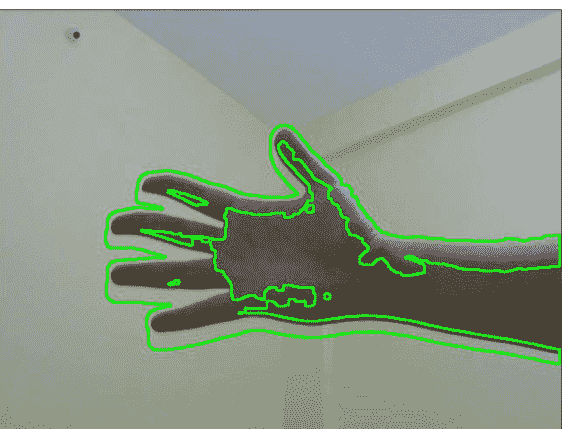

这段代码对于缓慢移动效果很好。你可以通过使用不同颜色绘制轮廓来使输出更有趣。此外，你可以找出轮廓的质心，并绘制与质心对应的十字线或圆。

> 如果你想更深入地探索 OpenCV 与 Raspberry Pi 的结合使用，请阅读《Raspberry Pi Computer Vision Programming》。链接如下：https://www.packtpub.com/hardware-and-creative/raspberry-pi-computer-vision-programming。

## 小结

在本章中，我们学习了使用 OpenCV 和 Pi 进行计算机视觉的高级主题。

我们学习了高级图像处理技术，如阈值处理、降噪、轮廓和形态学操作。最后，我们实现了所有这些技术，构建了一个真实的图像处理应用。

在下一章中，我们将学习将 Pi 与 Grove Shield 和 Grove 传感器接口连接的基础知识。

你可以使用传感器与周围世界交互并进行监控，然后将数据存储在 Raspberry Pi 上，从而弥合与现实世界的鸿沟！

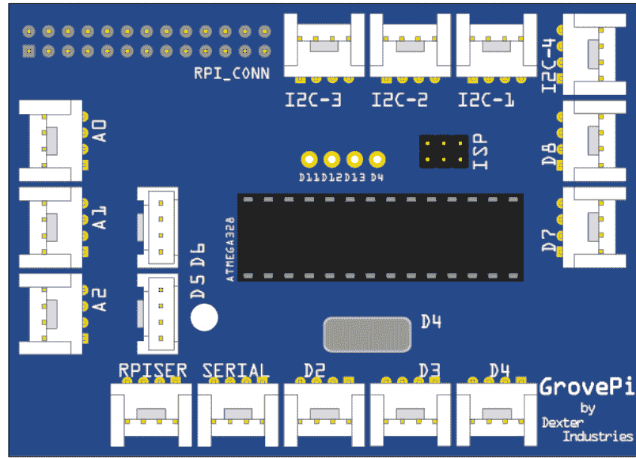

从前面的图片可以看出，GrovePi 直接插在 Raspberry Pi 上，具有多种插座，可容纳你可能想要添加到 Raspberry Pi 上的不同传感器。它与 Raspberry Pi 型号 A、A+、B、B+、2 兼容，并使用其创建者提供的开源库，允许用户使用 Python、C、C++、Go 和 NodeJS 进行编程。

在本章中，我们将需要以下组件：

- 湿度和温度传感器 (http://www.seeedstudio.com/depot/Grove-TempHumi-Sensor-p-745.html?cPath=25_125)
- LED (http://www.seeedstudio.com/depot/Grove-Red-LED-p-1142.html?cPath=81_35)
- 超声波测距仪 (http://www.seeedstudio.com/depot/Grove-Ultrasonic-Ranger-p-960.html?cPath=25_31)
- OLED 显示屏 (http://www.seeedstudio.com/depot/Grove-OLED-Display-096-p-824.html?cPath=34_36)
- 蜂鸣器 (http://www.seeedstudio.com/depot/Grove-Buzzer-p-768.html?cPath=38)
- GrovePi+ (http://www.seeedstudio.com/depot/GrovePi-p-2241.html)

以上所有组件都可以在 SeeedStudio 网站上找到。

> 你可以在其创建者的网站上了解更多关于 GrovePi 和传感器的信息：
> http://www.dexterindustries.com/

## 设置 GrovePi

让我们看一下 GrovePi 的图片：

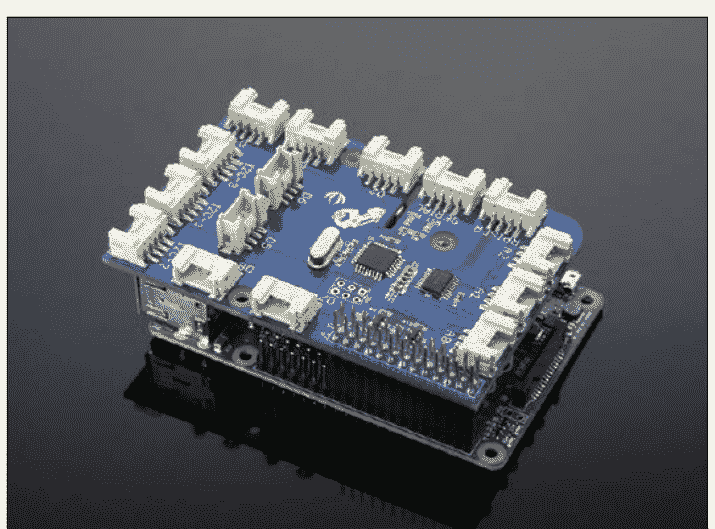

从前面的图片可以看出，GrovePi 有一个插座，可以直接插入 Raspberry Pi。完成此操作后，我们就可以在 Raspberry Pi 上设置软件来使用该扩展板。步骤如下。

- 1. 在不连接 GrovePi 的情况下打开 Raspberry Pi，通过显示器或 ssh 打开终端窗口：

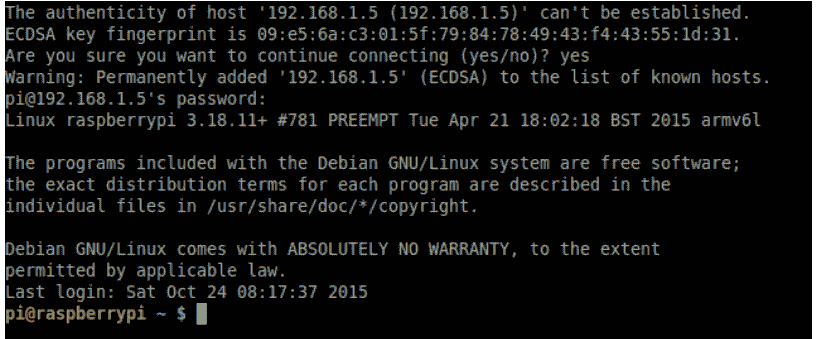

- 2. 建议将 GrovePi 安装在桌面上，因此我们首先使用以下命令进入桌面目录：
- $ cd /home/pi/Desktop

- 3. 现在使用以下命令将 GitHub 仓库克隆到桌面：
- $ sudo git clone https://github.com/DexterInd/GrovePi

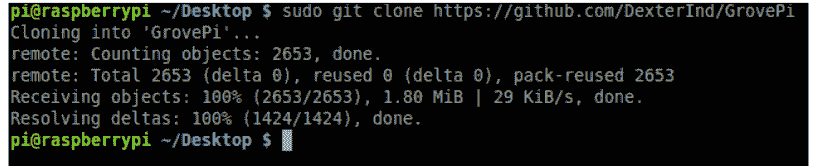


4. 我们现在准备执行 GrovePi 的安装脚本。但我们必须先使脚本可执行，然后再运行它：

```
$ cd /home/pi/Desktop/GrovePi/Script
$ sudo chmod +x install.sh
$ sudo ./install.sh
```

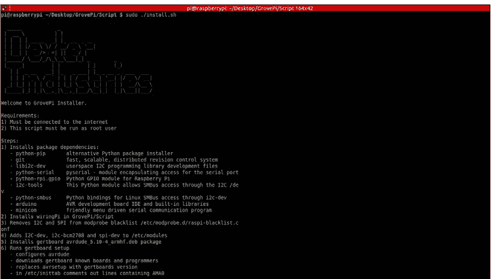

5. 终端会提示你按 ENTER 然后按 Y 继续，请按 Enter 安装所有必需的软件包。

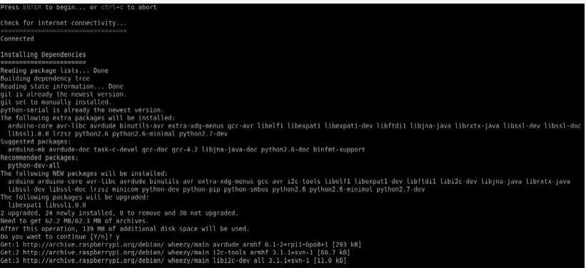

设置现在将完成，并且你的 Raspberry Pi 会自动重启。在 Raspberry Pi 关闭电源的情况下，连接 GrovePi，然后再打开电源。

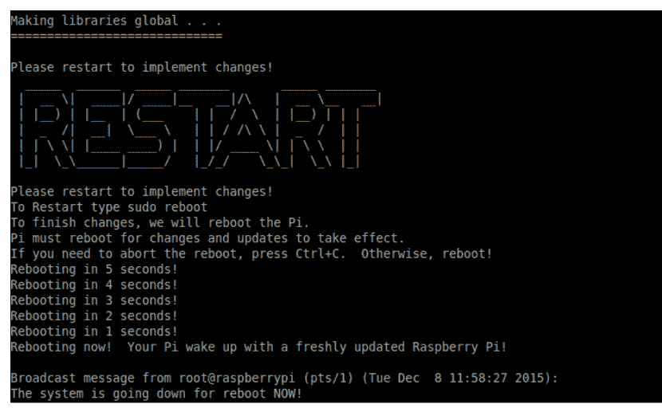

现在我们将检查 Raspberry Pi 在重启后是否检测到 GrovePi。运行：

```
$ sudo i2cdetect -y 1
```

命令 `i2cdetect` 会检测连接到 Raspberry Pi I2C 引脚上的任何外设，对于 Pi B+ 和 Pi 2 来说，这些引脚是 GPIO02 和 GPIO03。这些就是 GrovePi Shield 用于与 Raspberry Pi 建立连接的引脚。

如果你的 Raspberry Pi 型号是在 2012 年 10 月之前生产的，你可以运行以下命令：

```
```bash
$ sudo i2cdetect -y 0
```
```

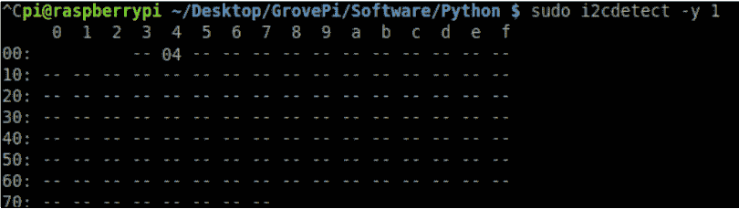

如果在输出矩阵中看到 '04'，则表示 GrovePi 已被 Raspberry Pi I2C 端口检测到。我们现在可以测试它是否正常工作。要进行测试，将 LED 模块连接到 D4 端口并运行随我们之前步骤中克隆的 Github 仓库一起提供的 LED 闪烁 Python 示例。要执行此操作，请运行以下命令：

```
```bash
$ cd /home/pi/Desktop/GrovePi/Software/Python
$ sudo python grove_led_blink.py
```
```

如果之前步骤中一切都安装正确，D4 端口上的 LED 现在应该开始闪烁。

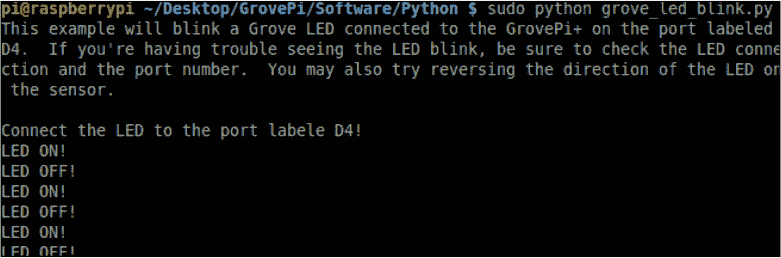

恭喜，我们已成功将 GrovePi 设置为与 Raspberry Pi 配合使用，我们现在将继续进行一些复杂且有趣的示例来探索 GrovePi 的功能。

## 显示天气

对于我们的第一个项目，我们将使用 Grove 阵列的湿度和温度传感器，并使用其测量值在 OLED 显示屏上显示。你需要这两个模块和一些连接线来为此项目设置硬件。

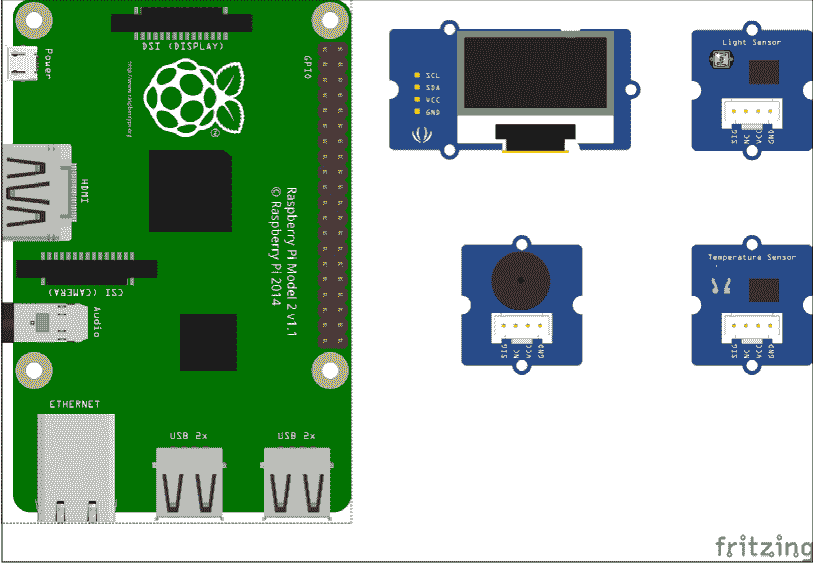

将唯一的显示模块连接到 GrovePi 上的任意三个 I2C 端口之一，并将湿度和温度传感器连接到端口 D7。现在我们来看一下以下代码，然后学习每条语句的作用：

```
```python
from grovepi import *
from grove_oled import *
dht_sensor_port = 7
oled_init()
oled_clearDisplay()
oled_setNormalDisplay()
```
```

```
```python
oled_setVerticalMode()
time.sleep(.1)
while True:
    try:
        [ temp,hum ] = dht(dht_sensor_port,1)
        print "temp =", temp, "C\thumidity =", hum,"%"
        t = str(temp)
        h = str(hum)
        oled_setTextXY(0,1)
        oled_putString("WEATHER")
        oled_setTextXY(2,0)
        oled_putString("Temp:")
        oled_putString(t+'C')
        oled_setTextXY(3,0)
        oled_putString("Hum :")
        oled_putString(h+"%")
    except (IOError,TypeError) as e:
        print "Error"
```
```

将上述代码保存为 prog1.py 并运行它。你应该会在终端以及 OLED 屏幕上看到温度和湿度值被报告：

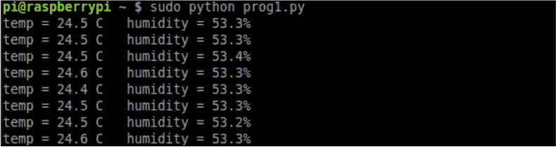

前两条语句负责导入 GrovePi Shield 和 OLED 模块工作所需的依赖项。星号告诉 Python 从给定模块导入所有类和函数。第二条语句创建一个变量来保存 DHT 模块的端口号。接下来的语句将 OLED 模块设置为写入数据。函数初始化模块、清除显示屏，并设置垂直模式，以便随后写入的内容看起来自然。建议在任何使用 OLED 模块的 Python 程序开始时执行这四条语句。

接下来，我们添加一个无限 while 循环，以便程序在用户终止之前一直运行。在 while 循环内部，我们运行负责从传感器获取数据并在 OLED 模块上显示的代码。从任何来源获取数据时常见的错误之一是数据可能不可用。因此，我们在执行任何操作或使用数据的代码之前，始终检查数据的有效性和可用性。这就是为什么我们必须添加 try catch 语句，以便如果数据不可用，程序不会崩溃，而是给出错误语句。

在 try 块内部，我们的第一条语句是使用 dht() 函数从 DHT 模块获取数据。此函数接受两个参数：传感器端口号和连接的板类型。如果板是 DHT Pro，则输入 1，如果板是 DHT，则输入 0。它还以包含两个元素的列表形式给出输出：温度和湿度水平。

在下一条语句中，我们将湿度水平和温度打印到终端，以便用户可以查看。从 dht() 命令获得的值是整数，但要在 OLED 屏幕上显示它们，我们需要将它们转换为字符串。这就是 str() 方法的作用。它接受整数、浮点数、列表等输入并给出字符串输出。

随后以 oled_ 开头的命令都是为了操纵 OLED 屏幕上数据的显示。使用 oled_setTextXY() 方法，我们可以设置光标以显示数据。它接受 X 和 Y 坐标作为参数并将光标设置在那里。接下来，使用 oled_putString() 方法，我们实际将字符串数据推送到刚刚设置的光标上进行显示。我们这样做三次：首先将标题设置为 'WEATHER'，其次设置温度及其单位，最后设置湿度和其百分比。由于此方法仅接受字符串作为输入，因此有必要在在此处使用之前将温度和湿度的整数值转换为字符串。

最后，我们读取最后一条语句，它什么也不做，只是处理 try 块中可能遇到的任何错误。如果它遇到任何类型的错误，它会打印 Error 而不是崩溃。

我们现在将继续进行下一个项目，该项目使用超声波传感器和 Pi Camera（或如果你选择的话，使用普通网络摄像头）。你对我们将要制作的东西有什么想法吗？

## 入侵检测系统

你有任何数据如果落入错误的人手中会造成损害吗？
或者你想知道当你不在场时谁进入了特定地点？
好吧，你现在可以通过构建自己的入侵检测系统轻松回答这些问题！

如前所述，此项目使用 GrovePi 的超声波测距传感器和 PiCam，如果超声波测距仪检测到任何移动则拍照。将超声波测距仪连接到 Grove Pi 的端口 D4，将蜂鸣器连接到 D5，将状态 LED 连接到 D3，并将 Pi Camera 连接到 Raspberry Pi 上提供的端口，如第 4 章《使用网络摄像头和 Pi Camera》中所述。遵循本书的主题，我们将首先查看整个代码，然后逐行学习每条语句的作用：

```
import picamera
import grovepi
from time import sleep

camera = picamera.PiCamera()
counter = 0
led = 3
buzzer = 5
ultrasonic = 4

while True:
    try:
        if grovepi.ultrasonicRead(ultrasonic) < 100:
            print 'Intruder Detected'
            grovepi.analogWrite(buzzer, 100)
            grovepi.digitalWrite(led, 1)
            sleep(.5)
            grovepi.analogWrite(buzzer, 0)
            grovepi.digitalWrite(led, 0)
            camera.capture('image' + counter + '.jpg')
            print 'Image Captured'
        sleep(2)
    except IOError:
        print "Error"
```


## Grove传感器与树莓派

将前面的代码保存为 prog2.py 并运行。现在，尝试走到超声波传感器前面，你会看到终端上的输出，并作为入侵者被拍照！

代码本身很容易理解，因为它只是*第4章：使用网络摄像头和Pi摄像头*中我们已经学过的内容与前面示例的合并。我们首先导入Pi摄像头和GrovePi传感器的依赖项。

作为设置步骤，我们将摄像头变量设置为Pi摄像头的一个对象，用于拍照。我们设置一个照片计数器，并设置LED和蜂鸣器分别使用D3和D5端口。我们还从'time'模块导入sleep方法以添加延迟。像之前一样，在无限while循环中包含一个'try, except'块，这样遇到错误时不会崩溃。

入侵检测的基本算法可以描述为：每当有物体出现在超声波测距仪前方且距离小于100厘米时，就表示有入侵者。如果上述条件成立，则鸣响蜂鸣器、点亮LED并拍照。GrovePi模块中的ultrasonicRead()方法读取连接到GrovePi D7端口的超声波测距仪的输出。如果距离小于100厘米，则继续执行入侵检测报警程序。首先，我们在终端输出“检测到入侵者”，然后通过analogWrite()方法打开蜂鸣器，并通过digitalWrite()方法点亮LED。模拟写入方法接收外设的端口号和0到255之间的值。值越高，发送到外设的信号强度越高。digitalWrite()方法同样接收端口号和一个二进制数作为输入，以将端口设置为高电平或低电平。我们等待半秒钟，然后关闭蜂鸣器和LED。最后，我们让摄像头对准超声波测距仪的方向拍一张照片。恭喜！我们现在有了入侵者的照片。现在，如果拍照后不添加延迟，代码将重复执行，由于入侵者很可能还在那里，树莓派可能会拍摄大量不必要的照片。这可能会给CPU带来负担，并占用可能正在运行的其他线程的资源。因此我们添加两秒的延迟。

我们还可以通过改变延迟值进行实验，看看哪种效果最好。我给读者留下一个有趣的练习：添加更多外设来扩展系统功能，例如添加键盘或开关，在不需要时关闭系统。

## 总结

在本章中，我们学习了如何将GrovePi扩展板与树莓派连接和接口，如何将各种传感器连接到它，并使用它们的数据在外部外设上显示。我们还查看并理解了两个示例，它们可以在现实生活中轻松用于有用的任务。

在下一章中，我们将学习物联网，以及如何连接传感器以在线获取数据并有效使用它。例如，我们可以扩展入侵检测示例，使其通过电子邮件将刚刚拍摄的入侵者照片发送给我们。这样，我们就可以从选定的监控位置接收实时更新。物联网是一个非常实用的概念，由于构建一个可用系统所需的组件成本低廉，它正变得越来越流行，让'笨'设备变得'智能'。

## 树莓派物联网

在上一章中，我们学习了如何将不同种类的传感器连接到树莓派，以从现实世界获取数据并输出一些文本，以便用户推断周围环境的状态，例如温度、湿度等。我们还构建了一个监控系统，可以对任何入侵者拍照。现在，这些都是独立系统，无法与其他系统通信。

在本章中，我们将重点讨论*物联网*的概念。这意味着我们可以将独立系统（就像我们在前几章中构建的那些系统）连接到互联网。我们将设备连接到互联网，并学习如何与不同的*网络服务*交互。本章将涵盖以下主题：

- 为Python安装Twitter API
- 使用Tweepy
- 设置SQLite数据库
- 构建一个发推文的天气站

### 物联网简介

物联网就是将以前未连接到互联网的设备连接起来，使它们更智能、更可控。由于电子设备的尺寸和成本呈指数级下降，我们现在可以负担得起将它们融入日常使用，例如花园浇水系统、家庭自动化/监控系统等。物联网以这种方式开辟了大量的机会，业余爱好者、初创公司和大型公司都在利用这些优势。物联网革命的核心是小型微型计算机和传感器，它们使这些设备能够连接到互联网并在它们之间交换数据。

如前所述，在本章中，我们将通过将树莓派连接到互联网来扩展之前的项目，并制作额外的项目来展示物联网的能力。

我们现在将学习从Twitter API交换数据，并将传感器读数发布到Twitter。

### 为Python安装Twitter API

**API**（应用程序编程接口）允许开发人员与各种网络服务进行通信。由于Python默认安装在树莓派上，我们将使用Python脚本通过网络与Twitter API通信。为此，我们将使用一个名为**Tweepy**的开源库。它适用于像2.6这样旧的Python版本，并且仍在积极开发中。因此bug可能更少，如果发现任何bug，也很可能会很快修复。

> Tweepy的GitHub仓库可以在以下链接找到，以便提交新问题并更清晰地理解代码：
> 
> https://github.com/tweepy/tweepy

我们现在将继续安装它，并学习如何使用它来做诸如发送推文之类的事情。

可以使用pip通过以下命令安装此库：

```
sudo pip install python-twitter
```

我们也可以通过从GitHub克隆来安装该库的最新开发版本。运行以下命令：

```
git clone https://github.com/tweepy/tweepy.git
cd tweepy
sudo python setup.py install
```

> 你也可以在其官方文档网站上找到有关使用Tweepy及其全部功能的更多信息：http://tweepy.readthedocs.org/en/v3.5.0/。

### 使用Tweepy

Tweepy的设计目标是易于设置和使用，在这方面，它是与Twitter API通信最易用的库之一。只需四行代码即可设置使用。然而，在我们可以使用它与我们的Twitter账户通信之前，我们需要在Twitter上设置一个开发者应用。为此，我们登录https://apps.twitter.com，登录我们的Twitter账户并点击“创建新应用”，之后会出现一个允许我们创建新应用的窗口，如下所示：

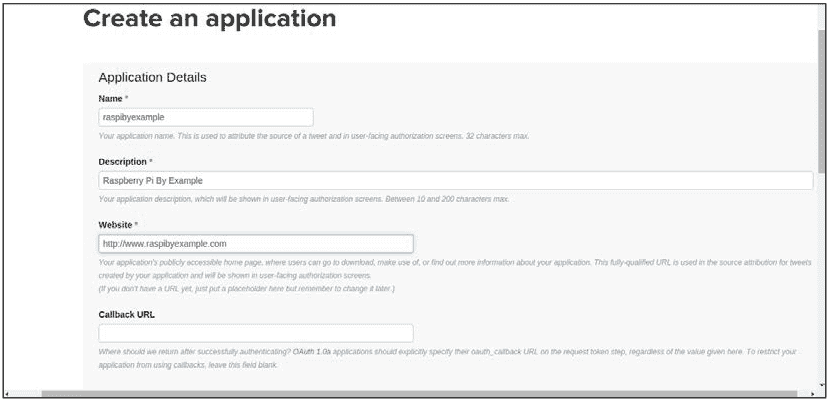

填写所有必需的详细信息，如**名称、描述**和**网站**。请记住，如果你不打算在网站上使用此应用，你也可以输入占位符而不是实际网站。最后，签署开发者协议，你就成功创建了一个可与你的Python脚本一起使用的Twitter应用。从这个应用中，我们需要一个Consumer Secret（API Secret）和一个Consumer Key（API Key）来使用Tweepy库，这是从Twitter应用获取oauth认证所必需的。接下来，我们需要为我们的应用创建一个访问代码，这是与Twitter API通信所必需的。

### 应用程序设置

你的应用程序的Consumer Key和Secret用于验证对Twitter平台的请求。

| 访问级别 | 读取和写入（修改应用权限） |
| Consumer Key（API Key） | [已编辑]（管理密钥和访问令牌） |
| 回调URL | 无 |
| 回调URL锁定 | 否 |
| 使用Twitter登录 | 是 |
| 仅应用认证 | https://api.twitter.com/oauth2/token |
| 请求令牌URL | https://api.twitter.com/oauth/request_token |
| 授权URL | https://api.twitter.com/oauth/authorize |
| 访问令牌URL | https://api.twitter.com/oauth/access_token |


从前一页，点击管理密钥和访问令牌以进入可以获取消费者代码和访问令牌的页面。以下菜单会给出消费者密钥：

## Application Settings

请将“Consumer Secret”保密。此密钥在你的应用程序中绝不应以人类可读的形式出现。

Consumer Key (API Key)
Consumer Secret (API Secret)
Access Level	Read and write (modify app permissions)
Owner	ArushKakkar
Owner ID	590129870

而以下屏幕将向我们展示应用程序代码，并提供为我们的应用程序生成新的访问代码的选项：

## Your Access Token

此访问令牌可用于代表你自己的账户进行 API 请求。请勿与任何人分享你的访问令牌密钥。

Access Token
Access Token Secret	9DmPn2KX3RgiC
Access Level	Read and write
Owner	ArushKakkar
Owner ID	590129870

## Token Actions

Regenerate My Access Token and Token Secret
Revoke Token Access

我们现在可以继续学习如何使用 Tweepy 获取关注者列表。代码如下，解释随后给出：

```
import tweepy

auth = tweepy.OAuthHandler(consumer_key, consumer_secret)
auth.set_access_token(access_token, access_token_secret)

api = tweepy.API(auth)

user = api.get_user('twitter')

print user.screen_name
print user.followers_count
for friend in user.friends():
    print friend.screen_name

api.update_status(' Tweepy says : Hello, world!')
```

在此示例中，我们首先将 Tweepy 库导入 Python 以使用其功能。我们首先需要注册我们的 Python 脚本（客户端）以便能够与 Twitter API 通信。为此，我们将在 Tweepy API 的 OAuthHandler 方法的参数中输入 Consumer Key 和 Consumer Secret。接下来，我们设置访问代码以打开 Twitter API 以供我们的客户端使用。这很重要，因为我们需要应用程序的访问令牌才能执行发送推文、读取推文或查看关注者等操作。Twitter 应用程序的访问代码可以在其设置中找到，就在 Consumer Codes 下面。

我们迄今已设置了身份验证详细信息，但仍需要进行身份验证以发送推文。这是通过 Tweepy 模块中的 API() 函数完成的。我们首先创建一个包含与 Twitter API 交互的所有方法的 api 变量。

下一个语句获取与我们的唯一 Consumer Key 关联的用户。每个注册用户都将拥有此密钥，并且每个用户都是唯一的，以便他们能够正确识别自己。get_user() 方法以服务名称（本例中为 Twitter）作为参数，并传递我们从上一个语句中获得的身份验证代码以获取用户详细信息。这存储在 user 变量中。此变量将具有名称、关注者、正在关注等成员。

为了检查我们是否真的从此方法中获取了正确的用户，我们只需要打印 user 变量的正确成员。因此，我们首先将屏幕名称和关注者数量打印到命令行。下一个 while 循环遍历 user 变量的 friends() 方法，并将每个关注者详细信息存储在 friend 变量中。然后我们将每个朋友的名称打印到命令行。这样，我们就可以检查我们是否正确获取了用户详细信息。

最后，我们可以使用 Tweepy API 的 update_status() 方法发送推文。此方法将字符串作为输入并发送推文。但是，如果字符串长度超过 140 个字符，语句将静默失败，即失败时不会给出错误。

现在输入你的 Consumer 和 Access 代码！将此示例保存为 prog1.py 并使用以下命令运行它：

```
python prog1.py
```

你应该在终端上看到用户详细信息，以及来自你的用户的推文：

```
'Tweepy says : Hello, World!'
```

除了前述功能外，我们还可以使用 Tweepy 执行其他操作，例如读取状态。一些更重要的功能详细说明如下：

- api.home_timeline([since_id], [max_id], [count], [page]): 返回用户时间线上最近的 20 条推文。count 指定要检索的推文数量
- Api.user_timeline([id/user_id/screen_name], [since_id], [max_id], [count], [page]): 返回指定用户的最近 20 条推文，如果未给出，则返回进行身份验证的用户的推文
- Api.get_status(id): 返回按 ID 的状态
- Api.update_with_media(filename, [status], [in_reply_to_status_id], [lat], [long], [source], [place_id], [file]): 使用媒体更新经过身份验证的用户的状态

恭喜！我们已成功使用 Python 设置了 Twitter 应用程序并与 API 通信。我们现在将继续下一个示例，在其中学习如何在 Raspberry Pi 上设置 SQLite 数据库以存储一些数据。

## Setting up a SQLite database in Python

**SQLite**（发音为 **Sequel Lite**）是一种轻量级磁盘数据库，不需要单独的服务器进程，并使用 SQL 查询语言的修改版本来访问数据。整个数据库保存在单个文件中，可用于内部数据存储。还可以使用 SQLite 制作应用程序原型，然后以最少的修改将代码移植到更大的数据库。Python 标准库中包含一个名为 `sqlite3` 的模块，旨在与此数据库一起使用。该模块符合 DB-API 2.0 的 SQL 接口。

> 你可以在其官方网站上找到有关 SQLite3 模块的更多信息和完整的 API 参考：https://docs.python.org/2/library/sqlite3.html。

下面是一个如何使用 `sqlite3` 模块创建 SQLite 数据库以存储和检索一些数据的示例。我们将逐条语句浏览代码，分析每条语句的作用，并讨论可能存在的变体。

```
import sqlite3

conn = sqlite3.connect('raspi.db')
cursor = conn.cursor()

#Inserting Data
cursor.execute('''
    CREATE TABLE users(id INTEGER PRIMARY KEY, name TEXT,
                       email TEXT unique, password TEXT)
''')
cursor.execute(''' INSERT INTO users(name, email, password)
                   VALUES(?,?,?)''', ('luke',
                   'luke@skywalker.com', 'iamurfather'))

cursor.execute(''' INSERT INTO users(name, email, password)
                   VALUES(?,?,?)''', ('Darth Vader',
                   'darth@vader.com', 'darkside'))

conn.commit()
```

```
#Retrieving Data

user_id = 1
cursor.execute('''SELECT name, email, password FROM users WHERE id=?''', (user_id,))
user1 = cursor.fetchone()
print(user1[0])
allusers = cursor.fetchall()
for row in allusers:
    print('{0} : {1}, {2}'.format(row[0], row[1], row[2]))
```

```
#Deleting or Updating Data

new_email = 'vader@deathstar.com'
userid = 2
cursor.execute('''UPDATE users SET email = ? WHERE id = ?''', (new_email, userid))

del_userid = 1
cursor.execute('''DELETE FROM users WHERE id = ? ''', (del_userid,))

conn.commit()
conn.close()
```

我们现在将研究前述给出的 Python 脚本中发生的数据库数据交换。由于 `sqlite3` 是默认的 Python 模块，我们不需要安装任何额外的依赖项。因此，我们将模块导入到我们的 Python 程序中，并使用 `sqlite.connect()` 方法创建一个新文件来保存数据库。如果不存在，此方法将为数据库创建一个新文件，如果存在，则方法会连接到它并加载文件中的现有数据库。接下来，我们创建一个充当数据库内数据指针的光标。因此，我们只能操作光标指向的数据。我们使用 `cursor()` 方法来完成此操作，该方法作用于我们在上一个语句中创建的 connection 变量。

目前，我们的文件中没有数据库，因此我们使用下一行代码创建数据库并插入一些数据。execute() 方法将 SQL 命令作为其中一个参数来操作数据。因此，为了创建数据库，我们执行 CREATE TABLE 查询。在本例中，我们创建一个名为 users 的表，它将至少有一个数据列，即数据的键号。这确保数据具有唯一序列 ID，可通过该 ID 访问。我们为每个用户保存三个字段：姓名、电子邮件 ID 和密码。因此，此数据库可用于登录应用程序，其中不同用户可以登录。SQL 中的 TEXT 类型与 Python 中的 str 相同，INTEGER 为 int，REAL 为 float。为了确保没有两个用户输入相同的电子邮件 ID，我们在电子邮件列中添加了“unique”标记。现在我们已经创建了数据库，我们需要向其中添加一些数据。我们使用 INSERT INTO 命令来实现这一点。插入后，提及要插入数据的数据库名称以及参数名称。然后 values 函数将采用数据的实际值。? 表示数据作为元组中的值给出。我们使用不同的数据重复相同的过程以向数据库添加行。请注意，我们不需要为数据设置序列 ID 即可正确保存。这是在数据库中拥有光标的一个优点。它会自动将新数据放在数据库中的下一个可用行中。为了实际将数据写入数据库文件并保存它，我们需要提交更改。这是通过作用于 connection 变量的 commit() 函数完成的。你可以使用一个名为 SQLite Database Browser 的免费工具来可视化数据库。这是在我们进行刚刚指定的更改后数据库的样子：

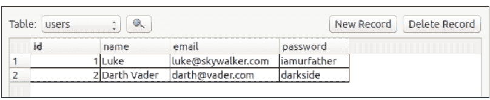

现在我们已经学习了如何将新数据插入数据库，我们将了解如何从数据库中读取现有数据。

首先，我们需要知道要检索的用户的序列 ID、姓名、电子邮件或密码。假设在本例中我们想通过序列 ID 检索用户详细信息。因此，我们执行 SELECT 命令，该命令根据给定的条件选择一行。如果没有给出条件，它将自动选择数据库中的第一行。整个语句接近英语，因此应该很容易理解。基本上，它根据 WHERE 之后给出的条件从给定的数据库名称中选择指定的列。


因此，在前述语句之后，我们的光标指向 ID 为 1 的行。`fetchone()` 方法会从光标指向的行中获取数据，并将其作为列表保存在 `user1` 变量中。然后，我们只需打印该列表的第一个元素，在本例中即为用户的姓名。但是，如果我们想要获取数据库中所有行的数据，则执行 `fetchall()` 方法。这会将光标指向数据库中的所有行，从第一行开始，并将结果保存在 `allusers` 变量中。然后，我们只需在 `for` 循环中打印数据。

我们现在已经学会了如何将数据保存到数据库并从数据库中检索数据。但如果我们想要更新用户详细信息或删除数据怎么办？下一段代码（在前述代码片段中）正是教我们如何做到这一点。

假设我们想要更新数据库中第二个用户的电子邮件 ID。我们首先将新的电子邮件 ID 设置在一个字符串变量中，然后将我们想要选择的 user 设置在一个整数变量中。然后，为了更新数据，我们使用 `UPDATE` SQL 查询。它除了我们想要更新的数据库之外，还需要两个或更多参数：我们想要更新的数据和一个条件，在本例中为行的序列 ID。我们都通过之前描述的 `?` 技术给出。条件运算符 `WHERE` 在 `UPDATE` 中的作用方式与在 `SELECT` 中完全相同，根据给定的条件指向光标。更新后，我们的表如下所示：


由于我们更改了数据库中的数据，为了将更改写入文件，我们使用 `commit()` 方法，最后使用 `close()` 方法将文件从 Python 脚本中释放。这确保除非再次连接，否则无法对文件进行新的更改。如果我们在不提交更改的情况下关闭文件，则不会在数据库中反映任何更改，我们之前所做的任何更改都将丢失。这是在我们删除第一行后表的样子：

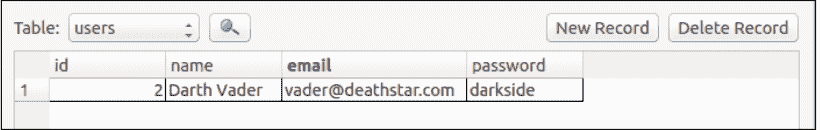

最后，我们已经学会了如何将数据保存并更新到数据库中，并在需要时检索它供我们使用。我们还从之前的 Twitter 教程中知道如何向 Twitter 发送更新。因此，对于我们的下一个项目，我们将构建一个推文天气站，它也会将数据保存到数据库中。有趣吗？让我们开始吧。

## 构建一个推文天气站

这是我们在上一章中构建的项目的延续，该项目使用温度和湿度 Grove 传感器与树莓派一起显示天气状况。我们将使用相同的硬件。

唯一的区别是，现在我们不是在终端上显示天气，而是实时将其推文发布，并将信息保存到数据库中以便以后检索。

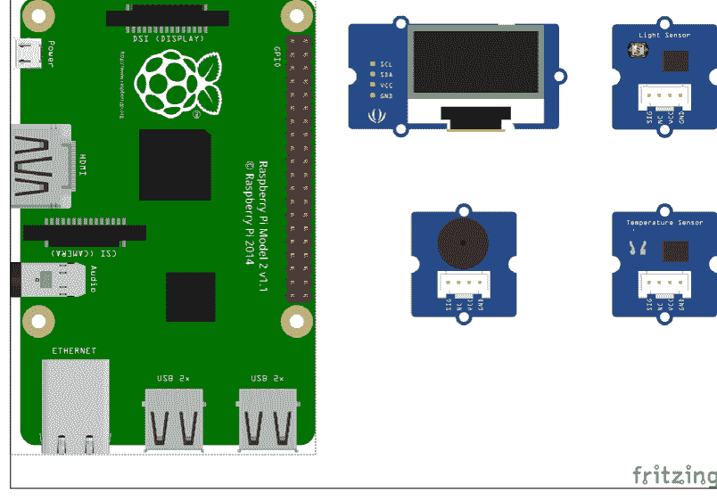

### 使用树莓派的物联网

为了重温该项目，我们应该再次浏览它，转向 *第 9 章，Grove 传感器和树莓派*。之前使用的许多代码将被再次使用，并增加了我们推文信息并将其保存到数据库的块。对于此项目，建议您创建一个新的 Twitter 账户并在上面创建一个新应用以获取 Consumer 和 Access 代码。

完整的 Python 脚本如下所示。我们知道大部分代码的作用，因为我们之前构建了包括天气站、Twitter 机器人和 SQLite 数据库在内的项目，但在代码末尾有一个简要总结。

```python
from grovepi import *
from grove_oled import *
import tweepy
import sqlite3
import datetime

dht_sensor_port = 7

oled_init()
oled_clearDisplay()
oled_setNormalDisplay()
oled_setVerticalMode()
time.sleep(.1)

auth = tweepy.OAuthHandler(consumer_key, consumer_secret)
auth.set_access_token(access_token, access_token_secret)
api = tweepy.API(auth)

conn = sqlite3.connect('raspi_weather.db')
cursor = conn.cursor()

cursor.execute('''
    CREATE TABLE weather(id INTEGER PRIMARY KEY, time TEXT,
                         temp INTEGER, hum INTEGER)
''')

while True:
    try:
        [ temp,hum ] = dht(dht_sensor_port,1)
        print "temp =", temp, "C\thumidity =", hum,"%"
        t = str(temp)
        h = str(hum)
        time = str(datetime.datetime.time(datetime.datetime.now()))

        oled_setTextXY(0,1)
        oled_putString("WEATHER")

        oled_setTextXY(2,0)
        oled_putString("Temp:")
        oled_putString(t+'C')

        oled_setTextXY(3,0)
        oled_putString("Hum :")
        oled_putString(h+"%")
        api.update_status("Temperature : " + t + " C, " +
        "Humidity : " + h + "% ")
        cursor.execute('''INSERT INTO weather(time, temp,
        hum)
                    VALUES(?,?,?)''', (time, t, h))

    except (IOError,TypeError) as e:
        print "Error"
```

从前述代码可以看出，它是我们在上一章中构建的天气站的更新版本。我们添加了 Twitter 应用的 consumer 和 access 代码，以便可以直接从此脚本推文天气信息。我们导入 Tweepy 库并设置访问。我们还导入 sqlite3 模块并创建一个名为 weather 的新数据库，它除了序列号列外，还有三个数据列：time、temperature 和 humidity。最后，除了在 OLED 屏幕上显示温度和湿度外，我们还将其更新到我们的推文中并将其连同时间信息一起保存在我们刚刚创建的数据库中。时间信息由随默认 Python 安装一起提供的 datetime 模块给出。datetime.datetime.now() 给出当前日期和时间。datetime.datetime.time() 给出当前时间，前提是我们仅将 datetime.datetime.now() 作为参数提供。

我们脚本的推文将如下所示：

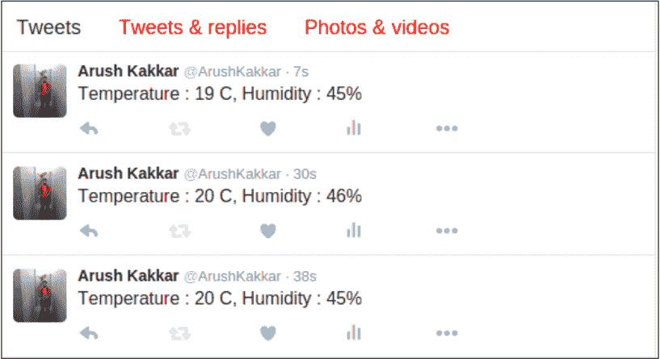

如果我们浏览我们刚刚创建的数据库，它看起来像这样：

| id | time | temp | hum |
|---:|---|---:|---:|
| 1 | 13:21:50.708220 | 20 | 45 |
| 2 | 13:22:13.751878 | 20 | 46 |
| 3 | 13:22:19.105107 | 20 | 45 |
| 4 | 13:22:25.720685 | 20 | 45 |
| 5 | 13:22:30.287131 | 20 | 45 |
| 6 | 13:22:34.645357 | 19 | 47 |
| 7 | 13:22:38.839593 | 20 | 46 |
| 8 | 13:22:42.652832 | 20 | 45 |
| 9 | 13:22:46.989553 | 20 | 45 |

我们现在已经构建了一个天气站，它不仅可以监控和保存您的天气信息，还可以向世界广播！对此的一个有趣扩展是添加语音功能，以便树莓派可以通过扬声器说出天气信息。espeak 库是一个易于使用的库，可以轻松有效地实现这一点。此外，您还可以连接到具有 Web API 的天气服务，让您的 Pi 说出天气预报！

## 为我们的天气站添加语音功能

语音是人类交流的众多方式之一。让机器做人类轻松完成的事情是令人着迷的。正因如此，我们将为我们的推文天气站添加语音功能，以便它可以说出天气，我们不再需要盯着 OLED 屏幕或滚动 Twitter 动态来了解天气。对于此任务，我们将使用一个名为 espeak 的开源工具，它是一个文本转语音引擎，并且还为 Python 提供了 API。

首先，使用以下命令安装 espeak 库：

```
sudo apt-get install espeak
sudo apt-get install python-espeak
```

这个库的好处是我们可以在终端或 Python 控制台中使用它。要试用它，请确保您已将扬声器连接到 Pi 并从 Linux 终端执行以下命令：

```
espeak 'I will tell you the weather'
```

这将产生语音输出，我们将能够从扬声器听到它。很酷，对吧？

接下来，我们将学习如何用 Python 使用它，然后将其添加到我们的天气站项目中。通过在 Linux 终端中输入 python 打开 Python 控制台。要导入依赖项，请执行以下语句：

```
>>> from espeak import espeak
```


这导入了语音输出所需的依赖项。使用 Python 调用 espeak 也同样简单，如下所示：

```
>>> espeak.synth("I am the weatherman")
```

espeak 模块中的 synth 方法接受一个字符串并基于该字符串生成语音。它的声音不是最好的，但它能工作！

要将此添加到气象站，我们可以在 while 循环内部添加以下语句：

```
espeak.synth("The current temperature is : " + str(temp))
```

```
espeak.synth("Humidity level is : " + str(hum) + "percent")
```

这之所以可行，是因为 Python 支持字符串拼接。这意味着我们只需在两个字符串之间加上 + 号即可将它们组合在一起。然而，temp 和 hum 变量并不是字符串变量。因此我们需要通过 str() 方法将它们转换为字符串。str() 方法接受任何类型的变量并将其转换为字符串。

我们还可以使用 espeak 库通过获取 Grove 传感器的状态来告诉我们有关我们环境中的许多不同信息。

## Summary

在本章中，我们学习了如何使用 Python 通过开源库 Tweepy 与 Twitter 通信。我们学习了如何使用 Tweepy 发送推文。我们还学习了如何创建数据库、在其中保存和更新数据，以及从现有数据库中获取一些数据。在本章末尾，我们扩展了我们在第 9 章《Grove 传感器和 Raspberry Pi》中构建的气象站的功能，并为其添加了推文和数据保存功能。我们还为其添加了语音功能以使其更易于使用。

在下一章中，我们将探索并行计算这一有趣的话题。我们将使用多个 Raspberry Pi 创建一台计算机集群，通过协同工作更快地执行计算。主 Pi 将控制其他从 Pi 并将计算外包给它们，以便更快地完成任务。我们将使用此设置执行 n-body 模拟，这本身就是一项非常具有计算挑战性的任务。
