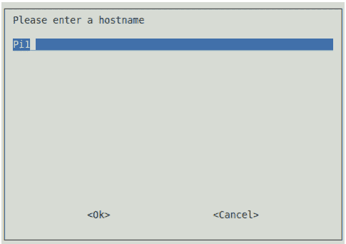
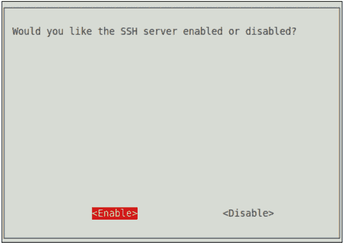
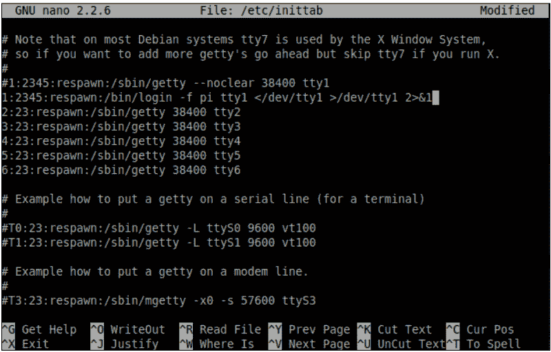
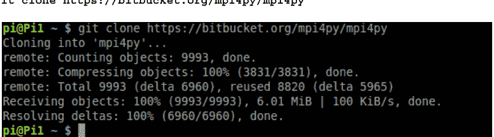
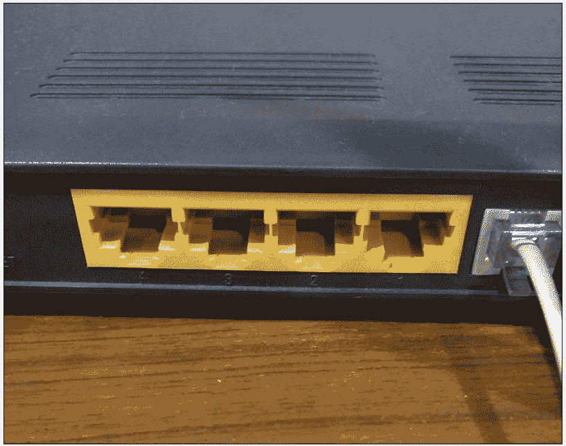
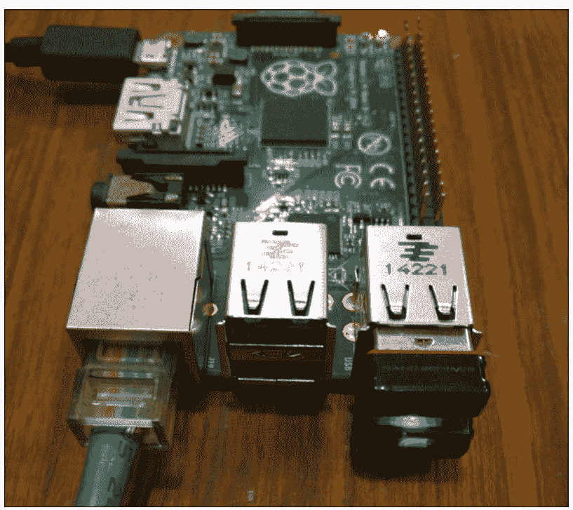
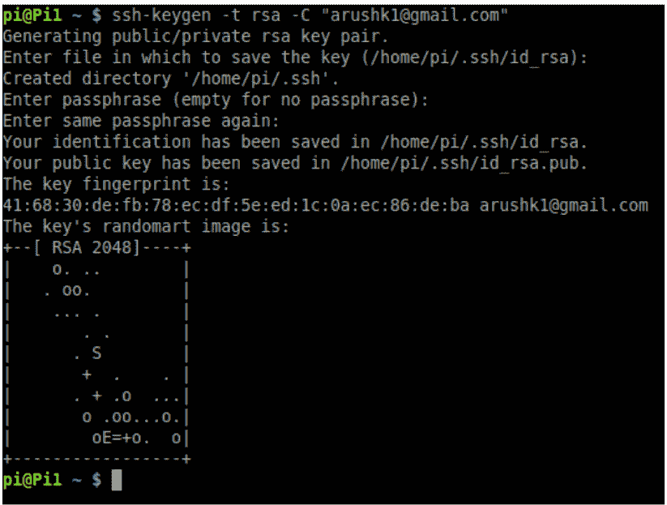
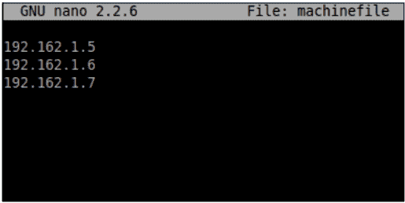
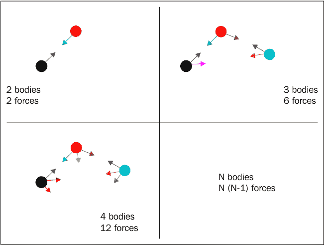

## 11
### Build Your Own
### Supercomputer with
### Raspberry Pi

在上一章中，我们学习了如何让 Raspberry Pi 与互联网通信，以及一些其他主题。我们学习了如何设置 Twitter API 以及如何使用它发送推文。我们还学习了如何将数据保存到数据库中并稍后检索。最后，我们将这两个概念结合起来，并将我们在第 9 章《Grove 传感器和 Raspberry Pi》中构建的气象站创建为一个既推文又将温度和湿度数据保存到数据库中的推文气象站。

在本章之前的所有章节中，我们都探索了 Raspberry Pi 的功能。但本章将有所不同，因为我们将学习如何将两个或多个 Raspberry Pi 设备组合起来创建一个更强大的计算机。事实上，如果你组合足够多的 Raspberry Pi 设备，你就可以拥有自己的超级计算机！听起来很有趣吗？本章将涵盖以下内容：

- 使用网络交换机为 Pi 设备创建静态网络
- 在单节点上安装和设置 MPICH2 和 MPI4PY 并运行
- 使用多个 Pi 设备的静态网络来创建 MPI（Message Passing Interface 的缩写）集群
- 集群性能基准测试
- 运行 GalaxSee（N 体模拟）

## Introducing a Pi-based supercomputer

构建超级计算机的基本要求如下：

- 多个处理器
- 将它们互连的机制

我们已经拥有以多个 Raspberry Pi 设备的形式存在的多个处理器。我们通过网络集线器将它们连接起来，该集线器通过以太网电缆连接到每个 Pi。网络集线器只不过是一个可以接受以太网电缆的路由器。有专门的网络集线器可以支持许多连接，但就本章而言，我们可以使用一个可接受四个 LAN 连接外加无线连接的普通 Wi-Fi 路由器。这是因为我们不会构建超过四个 Pi 设备的集群。你可以随意向此集群添加更多设备以增加你的计算能力。因此，本章的硬件要求如下：

- 三个 Raspberry Pi 设备
- 三个已安装 Raspbian 的 SD 卡
- 一个网络集线器
- 三根以太网电缆
- 每个设备的电源

## Installing and configuring MPICH2 and MPI4PY

在开始向多个 Pi 设备的网络安装库之前，我们需要配置 Raspbian 安装以使事情变得更简单一些。

启动一个 Raspberry Pi 并在终端中输入以下命令：

```
sudo raspi-config
```

3. 现在，通过选择 **Advanced Options** 进入高级菜单。我们需要配置以下内容：

- 1. 将主机名设置为 `Pi1`。



- 2. 启用 SSH。



我们需要启用自动登录，这样我们启动每个 Pi 后就无需手动登录。自动登录在最新版本的 Raspbian 操作系统中默认启用，因此在最新版本上我们无需执行以下操作。要启用自动登录，请退出配置菜单，但不要立即重启。要设置自动登录，请使用以下命令打开 inittab 文件：

```
sudo nano /etc/inittab
```

注释掉以下行：

```
1:2345:respawn:/sbin/getty --noclear 38400 tty1
```

这样做是为了使其看起来像这样：

```
#1:2345:respawn:/sbin/getty --noclear 38400 tty1
```

然后，添加以下行：

```
1:2345:respawn:/bin/login -f pi tty1 </dev/tty1 >/dev/tty1 2>&1
```



保存文件并使用 sudo reboot 重启 Pi。启动后，你应该会自动登录。

我们现在准备继续并开始安装运行计算机集群所需的软件。

## Installing the MPICH library

MPICH 是 MPI 标准的自由可用、易于移植且广泛使用的实现，MPI 是一种用于并行计算中分布式内存应用程序的消息传递协议。MPICH 的第一个版本的工作始于 1992 年左右，目前已进入第三个版本。MPICH 是 MPI 标准最受欢迎的实现之一，因为它被用作绝大多数 MPI 实现的基础，包括 IBM、Cray、Microsoft 等公司的实现。

> 要了解有关 MPICH 库的更多信息，请访问 http://www.mpich.org/。

截至撰写本文时，MPICH 的最新版本是 3.2。以下是此版本的安装说明。然而，这些说明应适用于 MPICH3 的所有子版本以及 MPICH2 的大多数后期版本。

开始安装时，请确保 Raspberry Pi 具有有效的互联网连接。按顺序运行以下命令以获得可用的 MPICH 安装：

- 1. 更新你的 Raspbian 发行版：
  sudo apt-get update
- 2. 创建一个目录来存储 MPICH 文件：
  mkdir mpich
  cd ~/mpich
- 3. 获取 MPICH tar 文件：
  wget http://www.mpich.org/static/downloads/3.2/mpich-3.2.tar.gz
- 4. 解压 tar 归档：
  tar xfz mpich-3.2.tar.gz

5. 这将包含 MPICH 安装并构建以下内容：

```
sudo mkdir /home/rpimpi/
sudo mkdir /home/rpimpi/mpi-install
mkdir /home/pi/mpi-build
cd /home/pi/mpi-build
```

6. Fortran 是 MPI 的依赖项：

```
sudo apt-get install gfortran
```

现在，由于我们之前为 MPICH 安装创建了一个构建文件夹，我们需要配置安装脚本并将其指向我们希望接口安装到的文件夹。我们通过运行 configure 脚本并将构建前缀设置为安装目录来实现这一点：

```
sudo /home/pi/mpich/mpich-3.2/configure -prefix=/home/rpimpi/mpi-install
```

最后，我们进行实际安装。

```
sudo make
```

```
sudo make install
```

> 请记住，此构建可能需要大约一个小时才能完成。确保在整个构建期间 Raspberry Pi 保持开启状态。

编辑 bashrc 文件，以便每次打开新终端窗口时，MPICH 安装的路径都会加载到 PATH 变量中。为此，使用以下命令在终端中打开文件：

```
nano ~/.bashrc
```

然后，在末尾添加以下行：

```
PATH=$PATH:/home/rpimpi/mpi-install/bin
```

通过按 Ctrl + X 然后按 Return 保存并退出 bashrc 文件。我们现在将测试安装。为此，重启 Pi：

```
sudo reboot
```


然后，运行以下命令：

```
mpiexec -n 1 hostname
```

如果前面的命令返回 Pi1，或你设置的主机名为其他名称，则我们的 MPICH 安装成功，我们可以继续下一步。

我们现在来看一个使用 MPICH 的简短 C 程序。如下所示：

```
#include "mpi.h"
#include <stdio.h>

void main(int argc, char *argv[]) {
    int rank, size;
    MPI_Init(&argc, &argv);
    MPI_Comm_rank( MPI_COMM_WORLD, &rank);
    MPI_Comm_size( MPI_COMM_WORLD, &size);
    printf("I have %d rank and %d size \n", rank, size);
    MPI_Finalize();
}
```

该程序在单个节点上运行并发现网络中的节点总数。然后它与网络中其他节点上的 MPI 进程通信并找出自己的 rank。

MPI_Init() 函数根据网络中 IP 地址的给定信息在我们的计算机上启动 MPICH 进程。MPI_Comm_rank() 函数和 MPI_Comm_size() 函数获取当前进程的 rank 和网络的总大小，并分别将它们保存在 rank 和 size 变量中。MPI_Finalize() 函数只是一个退出例程，用于干净地结束 MPI 进程。

单独使用时，MPICH 可以使用 C 和 Fortran 语言运行。但这可能会给很多用户带来阻碍。但不用担心！我们可以通过安装名为 mpi4py 的 Python API 在 Python 中使用 MPICH。

## 安装 mpi4py

使用 apt-get 或 aptitude 等包管理器以常规方式从包管理器安装 mpi4py 模块不起作用，因为它会尝试连同 openMPI 库一起安装，这与现有的 MPICH 安装冲突。因此，我们必须手动安装。我们首先从 BitBucket 克隆存储库：

```
git clone https://bitbucket.org/mpi4py/mpi4py
```



确保满足该库的所有依赖项。如下所示：

- Python 2.6 或更高版本
- 一个功能正常的 MPICH 安装
- Cython

前两个依赖项已经满足。我们可以使用以下命令安装 Cython：

```
sudo apt-get install cython
```

以下命令将使用 setup.py 安装脚本安装 mpi4py：

```
cd mpi4py
python setup.py build
python setup.py install
```

将 mpi4py 安装的路径添加到 PYTHONPATH，以便 Python 环境知道安装文件的位置。这确保我们能够轻松地将 mpi4py 导入到我们的 Python 应用程序中：

```
export PYTHONPATH=/home/pi/mpi4py
```

最后，运行一个测试脚本来测试安装：

```
python demo/helloworld.py
```

现在我们已经完全设置好系统以使用 MPICH，我们需要为我们希望使用的每台 Pi 都这样做。我们可以在全新安装的 SD 卡中运行所有之前的命令，但更好的选择是将我们之前准备好的卡复制到空白 SD 卡中。这可以节省我们从头开始完全设置系统的麻烦。但请记住，在新的 Raspberry Pi 中设置好新的 SD 卡后，将主机名更改为我们的标准方案（例如 Pi01 和 Pi02）。对于 Windows，有一个易于使用的工具称为 Win32 Disk Imager，我们可以用它将卡克隆成 .img 文件，然后再复制到另一张空白 SD 卡中。如果你使用的是 OS X 或 Linux，则应遵循以下步骤：

- 1. 复制现有卡上的操作系统：

```
sudo dd bs=4M if=/dev/disk2 of=~/Desktop/raspi.img
```

- 2. 移除卡并插入新卡。
- 3. 卸载卡。
- 4. 格式化 SD 卡。
- 5. 将操作系统复制到 SD 卡：

```
sudo dd bs=4M if=~/Desktop/raspi.img of=/dev/disk2
```

> 将 disk2 替换为你自己的 SD 卡

> 要了解更多关于 mpi4py 库的信息并查看各种演示，你可以访问 BitBucket 上的官方 Git 仓库 https://bitbucket.org/mpi4py/mpi4py。

## 设置 Raspberry Pi 集群

现在我们在我们希望使用的所有 Raspberry Pi 设备上都运行着 Raspbian 发行版，我们现在将它们连接起来创建一个集群。我们需要一个网络集线器，其 LAN 端口数量至少与集群的大小相同。本章的目的，我们将使用三台 Raspberry Pi，因此我们需要一个至少有三个 LAN 端口的集线器。

如果你有一个 Wi-Fi 路由器，那么它后面应该已经有一些端口，如下图所示：



我们还需要三根网络电缆，例如带有以太网连接器的电缆，其中一端插入 Raspberry Pi，另一端插入网络集线器。它们看起来像以下图片中所示：



将以太网电缆的一端连接到 Raspberry Pi，另一端连接到所有设备的路由器。一旦我们完成此网络设置，我们就可以继续使用软件连接 Raspberry Pi 设备。

## 从主机设置到客户端的 SSH 访问

在此描述的设置中，一个主节点将控制其他从节点。主节点称为主机，从节点称为客户端。要从主机访问客户端，我们使用一种称为 SSH 的方法。它用于从主机获取对客户端的终端访问权限，使用命令如下：

```
ssh pi@192.168.1.5
```

这里，前面的 IP 地址可以用我们 Raspberry Pi 的 IP 地址替换。Pi 的 IP 地址可以通过简单地打开一个新终端并输入以下命令找到：

```
ifconfig
```

这将为你提供与连接网络和接口关联的 IP 地址，在我们的例子中是 eth0。使用此方法的一个小问题是，每次我们尝试 SSH 到客户端时都需要密码。为了移除此限制，我们需要授权主节点登录到客户端。我们如何做到这一点是通过从主节点生成 RSA 密钥然后将其传输到客户端。每台设备都有一个唯一的 RSA 密钥，因此每当客户端从授权的 RSA 设备收到 SSH 请求时，它就不会要求密码。为此，我们必须首先从主节点生成一个公钥私钥对，使用以下格式的命令完成：

```
ssh-keygen -t rsa -C "your_email@youremail.com"
```

它看起来像这样：



要将此密钥传输到从属 Raspberry Pi，我们需要知道它们的每个 IP 地址。这很容易通过登录他们的 Pi 并输入 ifconfig 来完成。

接下来，我们需要将我们的密钥复制到从属 Raspberry Pi。这是通过以下命令完成的，将给定的 IP 地址替换为你自己的 Raspberry Pi 的 IP 地址：

```
cat ~/.ssh/id_rsa.pub | ssh pi@192.168.1.5 "mkdir .ssh;cat >> .ssh/authorized_keys"
```

现在我们已经将我们的密钥复制到从属 Raspberry Pi，我们应该能够使用标准的 SSH 命令无需密码登录：

```
ssh pi@192.168.1.5
```

## 并行运行代码

我们现在已经成功完成了在多台机器上运行代码的先决条件。我们现在将学习如何使用 MPICH 库在 Raspberry Pi 集群上运行我们的代码。我们将首先运行随 `mpi4py` 模块包含的演示，然后在我们的集群上运行 N-Body 模拟。听起来很有趣？让我们开始吧。

首先，我们需要告诉 MPICH 库我们网络中每台 Pi 的 IP 地址。这是通过简单地在主文件夹中创建一个名为 `machinefile` 的新文件来完成的，该文件包含连接到我们网络的所有 Raspberry Pi 的 IP 地址列表。执行以下命令创建文件：

```
nano machinefile
```

然后，在新行中添加每个 Raspberry Pi 的 IP 地址，以便最终结果如下所示：



请注意，我们添加了三个 IP 地址，因为有两个 Raspberry Pi 是从节点，一个是主节点。因此，MPICH 库知道它需要在这三台设备上运行代码。另外请注意，MPICH 不区分设备。它只需要一个有效的库安装即可正常运行。这意味着我们可以将不同版本的 Raspberry Pi 添加到我们的集群中，甚至是其他计算机，如 BeagleBone，只要它有有效的 MPICH 安装。

为了测试我们的设置，我们使用以下命令导航到 `mpi4py/demo` 目录：

```
cd ~/mpi4py/demo
```


然后，我们运行以下命令：

```
```bash
mpiexec -f ~/machinefile -n 3 python helloworld.py
```
```

它会给出类似这样的输出：


## 集群性能基准测试

既然我们已经成功创建了一个树莓派集群，现在需要测试其性能。一种方法是测量不同节点之间的延迟。为此，俄亥俄州立大学创建了一些基准测试，这些测试包含在 mpi4py 库中。我们将运行其中几个来衡量集群的性能。简单来说，延迟是指数据包到达目的地并获得响应的时间。延迟越低，集群的性能越好。这些测试位于 mpi4py 目录的 demo 文件夹中。它们以以下方式运行：osu_bcast 基准测试测量跨 N 个进程的 MPI_Bcast 集合操作的延迟。它针对各种消息长度并在大量迭代中测量最小、最大和平均延迟。

要运行 osu_allgather.py 测试，我们执行以下命令：

```
```bash
mpiexec -f machinefile -n 3 python osu_allgather.py
```
```

作为一个有趣的实验，尝试收集不同数据大小的延迟变化。这将让你对网络的运行有独特的见解。

## 介绍 N 体模拟

N 体模拟是对受物理力影响的粒子动态系统的模拟，例如重力或磁力。它主要用于天体物理学，研究涉及非线性结构形成的进程，例如星系、行星和太阳的形成。它们还用于研究宇宙大尺度结构演化，包括估计地球、月球和太阳等少数天体系统的动力学。

现在，N 体模拟需要大量的计算资源。例如，10 体系统有 10*9 个力需要在同一时间计算。你可以看到，如果我们增加粒子数量，力的数量呈指数增长。因此，100 体系统将需要同时计算 9,900 个力。这就是为什么 N 体模拟通常在强大的计算机上运行的原因。然而，我们将使用我们的树莓派集群来完成此任务，因为它具有单个树莓派三倍的计算能力。对于此任务，我们将使用一个名为 **GalaxSee** 的开源库。

GalaxSee 被建模为通过重力相互作用的离散体。物体的加速度由作用在该物体上的力的总和除以其质量给出。如果你知道物体的加速度，你可以计算速度的变化，如果你知道速度，你可以计算位置的变化。因此，你将在每个时间点都有每个物体的位置。物体越多，需要计算的力就越多，每个物体必须知道每个其他物体。为了减少单个处理器上的计算负载，Galaxy 代码是简单并行化的实现。计算最繁重的计算涉及计算单个物体上的力，因此，每个客户端都参与该计算，给定物体的信息和对它施加力的每个物体的信息。然后主节点收集客户端计算的力。



以这种方式，我们可以用并行运行的代码模拟 N 体模拟。接下来，我们将了解如何安装并运行 GalaxSee。

> 要了解有关 GalaxSee 库的更多信息，请访问 https://www.shodor.org/master/galaxsee/。

## 安装和运行 GalaxSee

现在我们对 N 体模拟是什么以及不同物体如何相互作用有了基本了解，我们将继续进行 GalaxSee 库的安装。

首先，我们需要下载源代码的归档文件。我们可以用 wget 命令来完成：

```
wget http://www.shodor.org/refdesk/Resources/Tutorials/MPIExamples/Gal.tgz
```

接下来，我们解压 .tgz 归档文件，假设它已下载到主文件夹。如果路径不同，我们需要输入正确的路径：

```
tar -xzvf ~/Gal.tgz
```

导航到文件夹：

```
cd Gal
```

我们需要使用 Makefile 在树莓派上成功构建 GalaxSee。为此，在终端中打开文件：

```
nano Makefile
```

然后，将行：

```
cc = mpicc
```

改为：

```
cc = mpic++
```

## 使用树莓派构建自己的超级计算机

这将执行程序并打开一个新窗口，看起来如下：


这里，白点是相互作用的物体，受重力作用。GalaxSee 中有一些你可以配置的选项来改变物体的数量或它们的相互作用。例如，运行以下命令：

```
`./GalaxSee 200 400 10000`
```

这里，程序的第一个参数 200 给出要模拟的物体的数量。第二个参数给出模拟的速度。数字越高，速度越快。第三个参数给出模拟运行的时间，单位为毫秒。因此，在前面的命令中，我们将模拟 200 个物体 10 秒。显然，我们可以尝试不同的变量，看看这些变量如何影响模拟。

前面的示例是在单个树莓派上运行的。但正如所承诺的，我们现在将了解如何在集群上运行它。如果我们了解到该程序可以用单个命令在树莓派集群上运行，而且我们之前见过该命令，可能会令人惊讶。以下命令可以实现：

```
`mpiexec -f ~/machinefile -n 3 ./GalaxSee`
```

在前面的命令中，mpiexec 在我们的主机计算机上启动 MPI 进程。这里，我们将为其提供三个数据点来执行 GalaxSee 程序。它们如下：

- 包含网络中每个设备的 IP 地址的文件的路径
- 要使用的设备数量
- 可执行文件的路径

-f 选项指定 machinefile。-n 选项指定要使用的设备数量，最后，我们向其提供 GalaxSee 可执行文件。

自己试试！如果你尝试在单个树莓派上增加模拟中的物体数量，它可能会运行得更慢。但如果你在集群上尝试同样操作，它肯定会运行得更快，因为现在我们有更多可用的计算资源。

## 总结

本章的独特之处在于，我们学习了如何不仅在单个树莓派上执行软件，而且在多个树莓派上执行。我们学习了使用并行计算的优势，并学习了如何构建我们自己的树莓派集群网络。我们还学习了如何安装并行计算所需的库，以便在集群中运行自己的软件。我们学习了如何配置网络中的树莓派，使它们能够相互通信并使通信无忧。一旦我们设置了系统，我们就对其进行了测试以测量响应形式为延迟。

最后，我们了解了 N 体模拟的概念，并配置了一个开源程序来模拟它。我们还看到了增加模拟中物体的数量如何影响程序执行的速度。

在下一章中，我们将扩展关于集群的知识，并学习高级网络概念，例如 DNS 和 DHCP。我们将学习如何添加诸如域名服务和节点自动检测等功能，以及如何启动集群节点的远程关闭。
