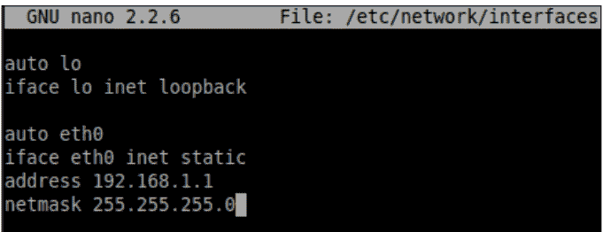
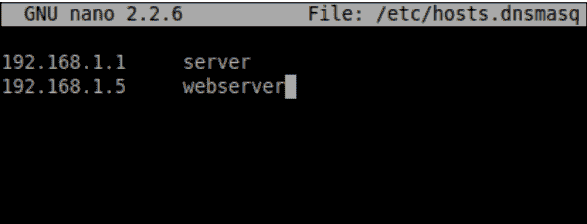
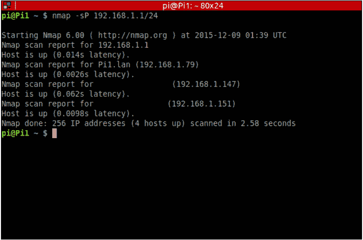

## 12

## 使用树莓派进行高级网络

在上一章中，我们构建了一个树莓派集群，它们在公共网络上相互交互，以比单个树莓派快得多的速度完成单一任务。事实上，MPI 库基本上是一个网络库，它将一些计算委托给网络中连接的其他处理器，以便主节点不必处理它们。现在，在本章中，我们将学习为这类集群计算机提供支持的特殊网络概念，事实上，整个互联网也是如此。在本章中，我们将学习关于：

- 为我们的集群添加 DHCP 功能
- 为我们的集群添加域名系统功能
- 编写节点自动检测脚本
- 编写集群节点远程关闭脚本

## 介绍 DHCP

DHCP（动态主机配置协议）：主机只是一个服务器，这意味着主机计算机负责提供服务。服务可以是任何种类。例如，Web 服务器负责托管查看网站所需的文件。同样，服务器实现必要的通信协议以允许许多玩家相互对战。使用服务器提供的服务的计算机或应用程序称为客户端。现在你可能知道，互联网上的每台计算机都由一个唯一的地址标识，称为 IP 地址。


DHCP 服务器负责为网络中的所有节点分配此类 IP 地址，并跟踪已分配的地址。在 DHCP 中，dynamic 表示不断变化，host 表示服务器，configuration 指配置你的网络设置，而 protocol 表示做事的一套规则。接下来描述的是 DHCP 服务器分配 IP 地址的流程。

假设一个节点想要加入网络。它首先向服务器发送一条消息请求分配 IP 地址。服务器发送一条消息，其中包含一个 IP 地址和节点可以保留该 IP 地址的时间段。然后服务器在表中记录下分配给节点的 IP 地址，以及分配时间和有效时长。

现在，当节点加入网络时，它无法知道是否存在 DHCP 服务器。因此它向整个网络发送广播信号，仅 intended for DHCP 服务器。如果存在服务器，它会发送回复提供一个地址。

现在，考虑节点正在关机或干净地离开网络的情况。它向服务器发送信号识别自身并将 IP 地址归还给 DHCP 服务器。然后服务器修改表，从 IP 地址中删除主机名，然后将其标记为可分配给网络中其他节点的地址。但如果节点没有干净地退出怎么办？例如，当机器断电或网络电缆被直接拔出时。这时分配的时间段就派上用场了。一旦该 IP 地址的分配时长已过，节点就会自动从表中删除，该地址再次变得可用。每当服务器从主机接收到数据包时，其分配时长会自动刷新。

## 一些网络概念

既然我们已经了解了 DHCP 服务器的工作原理，我们现在将介绍一些与网络相关的重要概念，这些概念有助于理解网络的运行以及调试我们可能遇到的任何错误。

乍一看可能不像，但 IP 地址遵循预定义的一套约定，并不是随机分配的。可见的 IP 地址，例如 192.168.1.10，实际上是由二进制数字组成的。每个用小数点分隔的数字实际上是一个二进制八位组。所以前面的 IP 地址实际上看起来如下：

```
11000000 10101000 00000001 00001010
```

现在，我们继续介绍子网掩码的概念。子网掩码基本上是一个 32 位地址，用于将 IP 地址划分为网络地址和主机地址。子网掩码将网络的全部位设为 1，将主机的全部位设为 0。因此，不同类别网络的子网掩码如下所示：

- Class A: 255.0.0.0
- Class B: 255.255.0.0
- Class C: 255.255.255.0

Class D 和 Class E 没有子网地址，因为 Class D 有多播地址，而 Class E 仅由保留地址组成。

## 配置 Raspberry Pi 作为 DHCP 服务器

现在，我们将通过设置集群中的一台 Raspberry Pi 作为 DHCP 服务器，对前述概念进行动手实现。用于此目的的 Raspberry Pi 应该正确标记以便识别，因为网络中只能有一个 DHCP 服务器。多个服务器会引起很多问题！如果我们在同一个网络中有多个 DHCP 服务器，客户端节点会困惑该向哪个服务器发送 IP 分配请求。我们首先需要安装一个名为 dnsmasq 的程序，可以使用以下命令完成：

```
sudo apt-get update
sudo apt-get install dnsmasq
```

安装完成后，我们可以继续断开 LAN 的互联网连接并将网络连接到非 DHCP 集线器。为什么，你可能会问？因为我们使用的常规路由器内置了 DHCP 服务器。因此将 Raspberry Pi 配置为服务器并将其连接到路由器可能会引起一些问题。所以我们只需将其连接到互连所有节点的网络集线器。我们现在准备修改 Raspberry Pi 使其作为服务器运行。

按照惯例，DHCP 服务器将在网络的 IP 地址范围内具有最低的 IP 地址。对于许多私有网络，这个 IP 地址空间如下所示：192.168.0.x。这意味着 DHCP 服务器通常将 192.168.0.1 作为 IP 地址，而其他节点将具有 192.168.0.2、3、4 等，直到 254 个 IP 地址。因此，逻辑上我们需要我们的 Raspberry Pi 具有此地址并保留它，以便每次网络启动时都默认为 DHCP 服务器。因此，编辑网络接口文件：

```
sudo nano /etc/network/interfaces
```

在接口文件中，eth0 指的是以太网端口的连接。如果你连接了一个 Wi-Fi 适配器，你还会看到一个 wlan0 接口。这相当于无线局域网 0。现在，由于我们的 Pi 通过以太网端口连接，我们找到以下语句：

```
iface eth0 inet dhcp
```

基本上，这一行负责 Raspberry Pi 充当 DHCP 客户端，因为它告诉 Pi 从接口 eth0 尝试从 DHCP 服务器获取 IP 地址。但由于我们希望我们的 Raspberry Pi 在网络中充当 DHCP 服务器，我们注释掉这一行。然后，为了为服务器设置静态 IP 地址，我们添加以下行：

```
# iface eth0 inet dhcp
auto eth0
iface eth0 inet static
address 192.168.1.1
netmask 255.255.255.0
```

接口文件可能看起来像这样：



static 选项告诉 Raspberry Pi 配置静态 IP 地址和子网掩码，如下面的语句所示。现在，通过按 Ctrl + X 并按 Enter 保存此文件。要重新启动网络服务，输入以下命令：

```
sudo service networking restart
```

最后，确保其他 Raspberry Pi 没有与我们的 DHCP 服务器冲突的静态 IP 地址。最好不要有任何 Pi 配置了静态 IP。`/etc/network/interfaces` 文件应如下所示：

```
iface eth0 inet dhcp
# auto eth0
# iface eth0 inet static
# address 192.168.1.1
# netmask 255.255.255.0
```

退出 nano 并使用以下命令重新启动网络服务：

```
sudo service networking restart
```

现在，我们可以将所有客户端 Raspberry Pi 连接到网络集线器。一旦全部开机，它们应该能够立即从 DHCP 服务器获取各自的 IP 地址。我们也可以通过在客户端上运行 `ifconfig` 命令来检查已分配的 IP 地址。IP 地址是从分配给 DHCP 服务器的范围内随机分配的。

一旦获取 IP 地址，一切应该按预期工作。我们可以通过从另一个节点 ping 不同节点来检查连接。使用以下命令执行此操作：

```
ping 192.168.1.x
```

其中 x 是另一个节点的 IP 地址。我们也可以通过以下方式检查与 DHCP 服务器的连接：

```
ping 192.168.1.1
```

使用此设置可以进行另一个有趣的实验，即观察连接的上下变化。首先，我们可以关闭一个客户端并观察它将 IP 地址归还给服务器。在你选择的客户端上运行以下命令：

```
sudo ifdown eth0
```

这样做后，我们会看到类似以下的输出：

```
Listening on LPF/eth0/b8:27:eb:a8:6b:cc
Sending on   LPF/eth0/b8:27:eb:a8:6b:cc
Sending on   Socket/fallback
DHCPRELEASE on eth0 to 192.168.1.1 port 67
```

DHCPRELEASE 是客户端将 IP 地址交还给服务器的实际语句。同样，我们重新启动 eth0 并观察 DHCP 地址被获取。运行以下命令：

```
sudo ifup eth0
```

我们会看到类似以下的输出：

```
Listening on LPF/eth0/b8:27:eb:a8:6b:cc
Sending on   LPF/eth0/b8:27:eb:a8:6b:cc
Sending on   Socket/fallback
DHCPDISCOVER on eth0 to 255.255.255.255 port 67 interval 7
DHCPREQUEST on eth0 to 255.255.255.255 port 67
DHCPOFFER from 192.168.1.1
DHCPACK from 192.168.1.1
bound to 192.168.1.X -- renewal in 40000 seconds
```

在此交换中，DHCPDISCOVER、DHCPREQUEST、DHCPOFFER 和 DHCPACK 很重要。它们与通过 DHCP 服务器获取 IP 地址的获取流程相对应，如前所述。读者可自行研究它们各自的功能。

## 介绍域名系统 DNS

在上一节中，我们学习了如何将 DHCP 服务器添加到我们的 Raspberry Pi 集群中。这主要是为了让集群中的每个 Raspberry Pi 都能通过唯一的 IP 地址被识别。现在，正如你所能想象的，我们的集群越大，记住每个 Raspberry Pi 的 IP 地址就越困难。人类很难记住长串数字，而 IP 地址就是这样。但有一种方法可以让我们在不必记住 IP 地址的情况下轻松连接到不同节点。

这种方法称为域名系统 DNS。其基本功能是将 IP 地址翻译成单词，以便我们更容易记住。例如，DNS 服务器会将 IP 地址 192.168.5.43 翻译成 raspberrypi.org，反之亦然，以便更轻松地连接。事实上，互联网上就是这样发生的。每个网站背后都有一个 IP 地址。


当你在浏览器中输入一个 URL 时，你的计算机首先会联系 DNS 服务器，并询问与之关联的 IP 地址。DNS 服务器随后会在其数据库中搜索该名称，并将 IP 地址返回给你的计算机。整个过程被称为 DNS 查询。

现在，我们可以在单个网络中拥有多个 DNS 服务器。这样，当一个 DNS 服务器在其数据库中没有保存地址时，它可以将查询传递给第二个 DNS 服务器，以此类推。这被称为迭代 DNS 查询。这就是互联网上实际发生的情况。互联网上有数百万个网站，拥有一个保存大型数据库的单一 DNS 服务器不仅不可行，而且也不可靠。因此，有数百万个 DNS 服务器分布在世界各地，共同协作以解析来自数百万客户端的数十亿次转换请求。

> 但这里有一个有趣的问题。在 DHCP 网络中，IP地址是动态的，这意味着节点的 IP 地址可能会发生变化。想想 DNS 服务器可能会如何处理这种情况。你可以把它作为练习来做。

## 在 Pi 上设置 DNS 服务器

现在，我们将学习在我们自己的 Raspberry Pi 集群上设置域名系统服务器的实际操作，以便学习系统的复杂性。我们将在之前设置 DHCP 服务器的同一台 Pi 上设置 DNS 服务器。由于我们已确保它可以从其他客户端 Raspberry Pi 中轻松识别，因此我们可以开始设置过程。

我们使用的是与 DHCP 服务器相同的软件 dnsmasq，因为它也具有运行 DNS 服务器的能力。除此之外，我们不需要安装任何额外内容。作为健全性检查，在开始以下教程之前，请尝试从其中一个客户端 ping 服务器。虽然可以配置多个 DNS 服务器，但为了本教程的目的，我们将只使用一台 Raspberry Pi 作为服务器。

由于 DNS 服务器不像 DHCP 那样具有广播系统，客户端无法轻松找到它。因此它们需要被告知 DNS 服务器的 IP 地址，而一种方法是让 DHCP 服务器将 IP 地址传递给客户端。这可以在 DHCP 服务器分配其自己的 IP 地址的同时完成。在这种情况下，DHCP 服务器和 DNS 服务器的 IP 地址是相同的。使用以下命令打开 dnsmasq 配置文件（dnsmasq.conf）进行编辑：

```
sudo nano /etc/dnsmasq.conf
```

我们要做的第一件事是指定 DNS 服务器和 DHCP 服务器的 IP 地址是相同的。为此，在文件末尾添加以下行：

```
dhcp-option=6,192.168.1.1
```

现在客户端知道 DNS 服务器位于何处，我们需要创建一个包含 IP 地址与其对应名称的查找数据库。虽然在实际的 DNS 服务器中使用更复杂的数据库平台，例如 SQL，但在这里我们将使用一个简单的文本文件作为演示。将以下两行添加到配置文件中：

```
no-hosts
addn-hosts=/etc/hosts.dnsmasq
```

这里，no-hosts 行告诉 dnsmasq 忽略默认的 /etc/hosts 文件用于 DNS 查询。而下一行指定应使用我们自己的文件 /etc/hosts.dnsmasq 进行 DNS 查询。

下一步是创建我们的 hosts 文件。为此，输入以下命令：

```
sudo nano /etc/hosts.dnsmasq
```

由于该文件之前不存在，我们现在应该正在编辑一个空白文件。可以在特定格式下添加新条目，即 IP 地址，后跟一个制表符，后跟名称。例如：

```
192.168.1.1    server
```

这里，第一部分是 IP 地址，第二部分是制表符间距，第三部分是与该 IP 地址关联的名称。

> 我们必须添加制表符而不是多个空格才能使其工作。

现在，保存并退出此文件。确保服务器是连接到网络交换机的唯一设备。在重新启动 dnsmasq 服务之前，先拔掉所有其他设备。使用以下命令重新启动服务：

```
sudo service dnsmasq restart
```

但还有一件事。由于我们的服务器使用静态 IP 地址设置，我们还需要告诉 DHCP 服务器使用其自己的 DNS 服务器。我们通过名为 /etc/resolv.conf 的文件来完成此操作。通过以下方式打开它进行编辑：

```
sudo nano /etc/resolv.conf
```

将文件内容更改为：

```
nameserver 127.0.0.1
```

现在，127.0.0.1 是一个保留的 IP 地址，用于指代自己的系统。因此，如果我们将 192.168.1.1 作为 IP 地址，效果也是一样的。但是，如果服务器的 IP 地址发生变化，我们就需要手动更改此文件。因此，我们将 127.0.0.1 作为 nameserver 的 IP 地址。退出文件并重新启动网络服务：

```
sudo service networking restart
```

最后，将所有客户端 Raspberry Pi 连接到网络集线器。它们应该开始接收分配的 IP 地址。一旦所有 Pi 都连接到网络，你可以运行：

```
ping server
```

你将开始收到响应。如果成功，则意味着 ping 请求首先被传递到服务器 Pi 内部的 DNS 服务器，并在主机名解析后，从服务器的 IP 地址获得了响应。

## 为 Web 服务器配置设置

假设，例如，其中一台 Raspberry Pi 配置为 Web 服务器。因此，现在的任务将是设置集群，以便你可以在浏览器中输入一个名称并加载 Web 服务器的主页！

按照惯例，Web 服务器应该具有静态 IP 地址。这样 DNS 服务器就可以存储其主机名，而不必担心 IP 地址发生变化。由于我们之前将可能的整个 IP 地址范围设为 DHCP 服务器的范围，我们将修改该范围，以便我们可以为我们的 Web 服务器保留一些静态 IP 地址。为此，再次编辑 `/etc/dnsmasq.conf` 文件并将 `dhcp-range` 变量修改为以下内容：

```
dhcp-range=192.168.1.40,192.168.1.254,255.255.255.0,12h
```

这样，我们现在就有从 192.168.1.2 到 192.168.1.39 的非 DHCP IP 地址，可以分配给 Web 服务器。实现此目的的一种方法是修改 Web 服务器本身上的 `/etc/network/interfaces` 和 `/etc/resolv.conf`，并设置 Web 服务器始终获取静态 IP 地址。但我们也可以通过其 MAC 地址来识别 Web 服务器，这是网络接口的唯一硬件地址，并每次都为其分配相同的 IP 地址。

这需要修改 dnsmasq.conf 文件。我们需要知道我们的 Web 服务器 Pi 的 MAC 地址。为此，可以在新终端中执行 ifconfig 并查找 hwaddr 字段；它将采用 b8:27:eb:a8:6b:cc 的形式。请记住此地址对每个设备都是唯一的。一旦我们有了此地址，我们将在服务器 Pi 上的 dnsmasq.conf 文件中添加以下行，为此 MAC 地址分配特定的 IP 地址：

```
dhcp-host=b8:27:eb:a8:6b:cc,192.168.1.5
```

这将配置 DHCP 服务器始终为此 MAC 地址分配 192.168.1.5 IP 地址。现在，我们只需要在 hosts.dnsmasq 文件中为我们的 Web 服务器添加一个名称。使用 nano 打开它进行编辑，并在文件末尾添加以下行：

```
192.168.1.5  webserver
```

这样，最终看起来像这样：



通过以下方式重新启动 dnsmasq 服务以使更改生效：

```
sudo service dnsmasq restart
```

最后，我们必须让 Web 服务器 Pi 采用新的 IP 地址，以便它可以在 DNS 服务器中通过名称寻址。为此，执行以下命令：

```
sudo ifdown eth0
sudo ifup eth0
```

这将使 Raspberry Pi 与 DHCP 服务器断开连接；当它尝试重新获取 IP 地址时，DHCP 服务器将分配我们在配置文件中定义的静态 IP 地址。


要测试 DNS 服务器是否与 Web 服务器配合工作，可以从其他客户端 Pi 中的任意一个运行以下命令：

```bash
ping webserver
```

如果得到响应，则表示 DNS 服务器已正确设置。如果没有，则需要检查是否正确遵循了所有步骤。

### 在网络中自动发现节点

目前，我们的网络中设备很少。但，将会出现网络中有大量节点的情况，而手动管理它们将是一项困难的任务。在大型集群中，会有许多处于非活动或无法服务的节点。如果我们尝试使用脚本连接到它们，而该脚本中硬编码了客户端的 IP 地址，我们将遇到大量错误。这就是为什么需要自动节点检测的原因，它可以自动检测网络中的活动节点并保存该信息，以便其他程序可以使用它。其中一个这样的程序是 MPICH，我们在上一章中学习过它。正如你可能已经学到的，每当我们使用 MPICH 执行程序时，我们都会指定一个包含可用于计算的活动节点列表的文件名。然而，如果其中一个节点处于非活动或无响应状态，脚本将无法正常工作，并浪费宝贵的计算资源。

为了在网络中进行节点发现，我们将使用一个名为 Nmap 的程序，意为 network map。Nmap 是一个免费的安全扫描器、端口发现和网络探索工具。使用以下命令安装它：

```bash
sudo apt-get install nmap
```

在这里了解更多关于 Nmap 的信息：
https://nmap.org/.

正如我们在第二部分中关于 IP 地址所学到的，以下 IP 地址：

```
192.168.1.1
```

实际上看起来像这样：

```
11000000 10101000 00000001 00000001
```

现在我们有了这些信息，我们可以继续学习如何使用 Nmap 工具。扫描活动 IP 地址的命令为：

```bash
nmap -sP 192.168.1.0/24
nmap -sP 192.168.1.5-100
```

输出如下所示：



前面的是两个独立的命令，我们将学习它们各自的作用。第一个命令扫描网络中 `192.168.1.0` – `192.168.1.255` 的整个 IP 地址范围。在此命令中，我们指定了 24 位的掩码，这基本上告诉 Nmap 不要更改 IP 地址的前 24 位，根据我们之前学到的信息，这意味着 IP 地址的前三个数字将保持不变，只有最后一个数字会被变化并检查响应。由于我们的网络将只包含以 `192.168.1` 开头的 IP 地址，这是由于我们的 DHCP 服务器的设置方式，这种方法很好。

第二个命令明确指定要扫描的 IP 地址范围。当你想在特定范围内查找活动节点时，这很有用。这种用例之一是查找网络中的所有客户端节点。

### 摘要

在本章中，我们在上一章奠定的基础上，深入了解了网络概念以及它们如何应用于树莓派集群。

具体来说，我们学习了如何在树莓派上设置 DHCP 服务器，并了解了 IP 地址如何分配给不同客户端的机制。我们还观察了分配发生的确切过程。

作为下一步，我们还设置了一个 DNS 服务器，它与 DHCP 服务器配合工作，并为 IP 地址分配名称，以便节点易于访问。使用相同的方法，我们学习了如何为基于树莓派的 Web 服务器分配名称，以便我们可以在自己的网络上打开网站。

最后，我们学习了可以帮助我们发现网络上活动节点的工具，这样我们就不必面对将计算分配给非活动节点的麻烦，该节点可能会导致程序崩溃或产生错误的计算。
