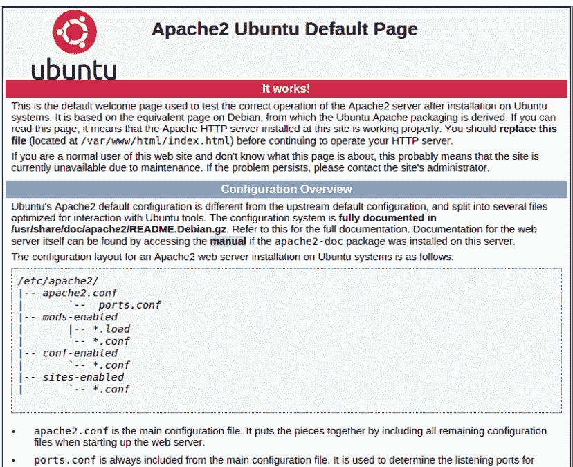
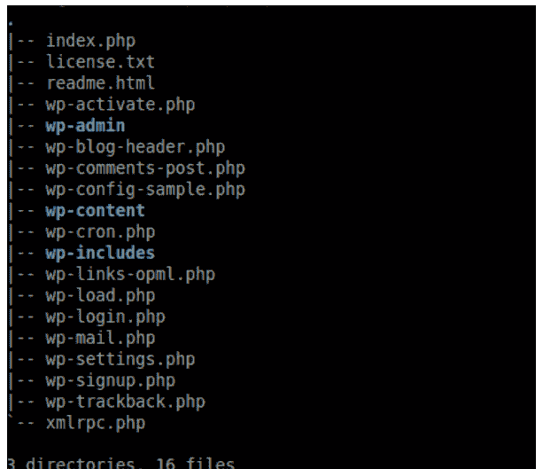
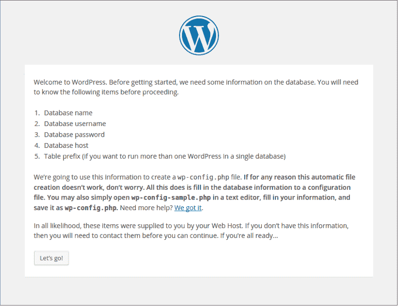
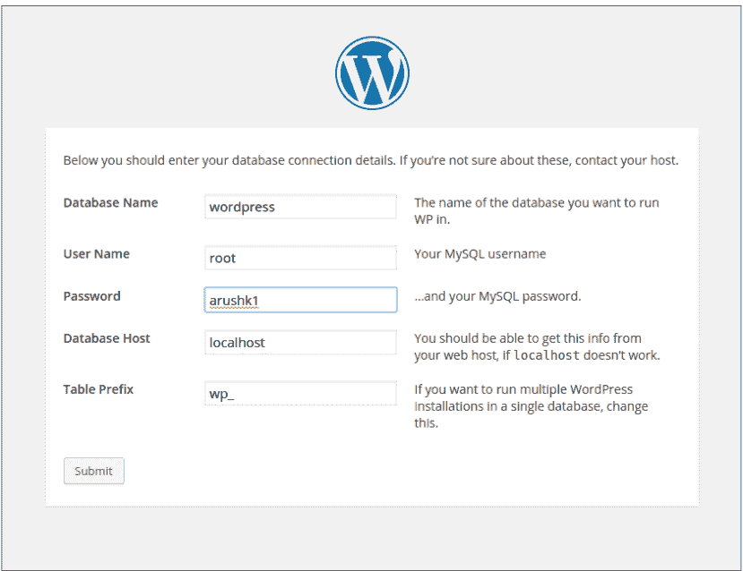
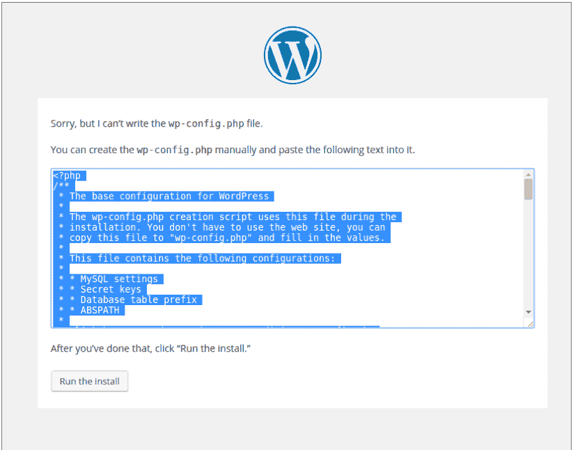
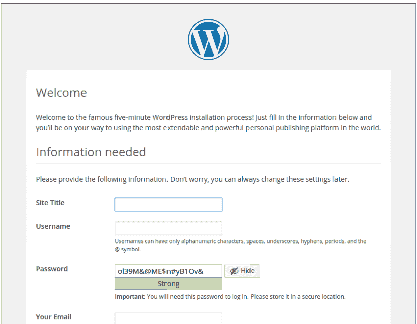

## 13 在树莓派上设置 Web 服务器

在前两章中，我们讨论了树莓派的网络功能。在第 11 章《使用树莓派构建自己的超级计算机》中，我们构建了一个树莓派设备网络，它们能够相互通信并分担计算负担，从而显著减少任务完成所需的时间。在上一章第 12 章《树莓派高级网络》中，我们学习了更高级的网络概念，如 DHCP 服务器、DNS 系统等。此外，我们还用几台 Pi 设备建立了自己的内联网。

延续同样的主题，我们现在将在一台树莓派上设置 Web 服务器，并在其上设置 WordPress 安装。我们将使用的 Web 服务器是 Apache，因为它是目前最流行的服务器之一，并在开源社区中有着很高的使用率。在本章中，我们将涵盖以下主题：

- 介绍和安装 Apache
- 学习提供 HTML 网站
- 安装 PHP 和 MySQL
- 安装 WordPress
- 配置 WordPress

### 在 Raspbian 上介绍和安装 Apache

Apache HTTP 服务器非常流行，目前是世界上使用最广泛的 Web 服务器软件。它因由 Apache 软件基金会旗下的一群开源开发者开发和维护而受到开源社区的支持。虽然最常用于类 Unix 系统，但它也适用于包括 Microsoft Windows 在内的多种其他操作系统。2009 年，它成为使用量超过一亿个网站的第一个 Web 服务器，目前估计它为超过 50% 的所有网站和 37% 的顶级域名服务器提供服务。

它如此流行的一个原因是它支持各种功能，并且可以通过可编译的模块实现更多功能，从而扩展核心功能。例如，Apache 本身可以提供 HTML 文件通过 HTTP，但安装了额外的模块后，它也可以使用 Python 等语言提供网页。它还具有多种语言接口，包括 Python、PHP 和 Perl。

现在，在 Raspbian 发行版上安装 Web 服务器非常容易。我们需要使用以下命令安装 apache2 包：

```bash
$ sudo apt-get install apache2
```

在安装过程中，包会自动创建我们的演示 HTML 文件，你可以在 URL 栏中输入 127.0.0.1 或 http://localhost/ 时看到它。我们也可以从连接到同一网络的另一台机器上通过 Pi 的 IP 地址看到它，例如 192.168.1.5。用网络中你自己的 Pi 的 IP 地址替换此 IP 地址。你可以通过在树莓派终端中输入以下命令找到 IP 地址：

```bash
$ hostname -I
```

默认页面如下所示：



如果我们看到此页面，则表示我们的安装已成功。这只是一个单一的 HTML 文件，可以在 `/var/www/html/index.html` 找到。让我们查看此文件夹的详细信息。通过以下方式导航到文件夹：

```bash
$ cd /var/www/html/
```

然后执行以下命令查看文件夹中文件的属性：

```bash
$ ls -al
```

此命令列出文件及其一些属性。你将看到以下输出：

```
total 20
drwxr-xr-x 2 root root 4096 Dec 11 12:13 .
drwxr-xr-x 4 root root 4096 Dec 11 12:21 ..
-rw-r--r-- 1 root root 11510 Dec 11 12:13 index.html
```

各列的含义分别为：

- 文件的权限
- 目录中的文件数
- 拥有文件/目录的用户
- 拥有文件/目录的组
- 文件大小
- 最后修改日期

由于 index.html 文件的所有者是 root，我们需要在编辑它之前获取该文件的所有权。为此，输入以下命令：

```bash
$ sudo chown pi: index.html
```

我们也可以用自己的 HTML 文件替换 index.html 文件，并提供一个功能齐全的 HTML 网站，包含 CSS 类。

然而，一个简单的 HTML 网站听起来太基础了，对吧？由于我们已接近本书的最后阶段，我们应该做一些更高级的事情。对了，在以下章节中我们将学习如何设置 WordPress 网站。为此，我们首先需要安装 WordPress 使用的一些工具。

### 安装 PHP 和 MySQL

PHP 是当今 Web 上使用最广泛的编程语言之一。它是在服务器接收到网站请求时运行的代码。与 HTML 不同，PHP 可以生成动态网页，可以即时更改外观和内容。我们选择使用 PHP 是因为 WordPress 使用 PHP。现在，使用以下命令安装 PHP 和随附的 Apache 包：

```bash
$ sudo apt-get install php5 libapache2-mod-php5
```

我们现在已安装 PHP 及其随附的 Apache 包，并将继续测试它。


## 在树莓派上搭建网页服务器

导航到 HTML 文件夹并创建一个新的 index.php 文件：

```
$ cd /var/www/html/
$ sudo nano index.php
```

在其中添加一行测试代码：

```
<?php echo "hello world"; ?>
```

按 Ctrl + X，然后按 Y 保存文件并退出。我们还需要删除 index.html 文件，因为 HTML 优先于 PHP。使用以下命令执行此操作：

```
sudo rm index.html
```

在浏览器中导航到 127.0.0.1 或 localhost，你将会看到 hello world 消息。现在让我们设置一些静态内容。

将 hello world 行替换为以下内容：

```
<?php echo date('Y-m-d H:i:s'); ?>
```

既然我们已经安装了 PHP 来处理所需的网页，下一步是安装数据库来存储一些数据。我们选择的数据库将是 MySQL，因为 WordPress 使用它来存储诸如文章、页面、评论、用户等内容的 ID。

要安装 MySQL 及其 PHP 包，请运行以下命令：

```
sudo apt-get install mysql-server php5-mysql
```

安装继续进行时，系统会要求你设置 root 密码以创建数据库。输入密码并记住以备将来使用。

### 安装 WordPress

现在我们已经完成了依赖项的安装，下一步是将 WordPress 文件放入 HTML 文件夹。幸运的是，WordPress 在此链接上提供了最新版本的 tar 归档文件：http://wordpress.org/latest.tar.gz。我们现在需要将此文件夹中包含的文件放到我们的 Web 服务器文件夹中。为此，我们首先需要取得该文件夹的所有权。要执行整个过程，我们运行以下命令：

```
$ cd /var/www/html/
$ sudo chown pi: .
$ sudo rm *
$ wget http://wordpress.org/latest.tar.gz
```

简而言之，我们首先导航到 HTML 文件夹，取得文件夹所有权，删除所有预先存在的文件，然后获取 WordPress 归档文件。接下来，我们解压归档文件的内容并将它们放入 HTML 文件夹。我们使用以下命令执行此操作：

```
$ tar xzf latest.tar.gz
$ mv wordpress/* .
$ rm -rf wordpress latest.tar.gz
```

现在，如果你运行 ls 命令，将看到以下输出：



### 配置 WordPress 安装

一旦文件正确放置在适当的位置，要激活安装并开始使用 WordPress 网站，我们首先需要设置一个 WordPress 可以使用的 MySQL 数据库。要设置数据库，请执行以下命令：

```
$ mysql -uroot -p
```

为了完成安装，我们需要访问位于本地主机上的 WordPress 安装页面。所以请在浏览器中输入 127.0.0.1，你将看到以下页面：



欢迎使用 WordPress。在开始之前，我们需要一些关于数据库的信息。在继续之前，你需要了解以下项目。

- 1. 数据库名称
- 2. 数据库用户名
- 3. 数据库密码
- 4. 数据库主机
- 5. 表前缀（如果要在单个数据库中运行多个 WordPress）

我们将使用这些信息来创建 wp-config.php 文件。如果由于任何原因这个自动文件创建不起作用，不用担心。这只是在填充配置文件中的数据库信息。你也可以直接在文本编辑器中打开 wp-config-sample.php，填写你的信息，并将其保存为 wp-config.php。需要更多帮助？我们得到它了。

在大多数情况下，这些项目是由你的虚拟主机提供商提供的。如果你没有这些信息，那么你需要先联系他们才能继续。如果你都准备好了……

这意味着 WordPress 已正确配置。我们现在点击**开始吧！** 继续下一步。这将带我们进入以下页面：



输入数据库的所有详细信息，包括你之前设置的密码。按照前面的截图在页面上输入详细信息，然后按提交。安装向导将显示一条错误消息，提示无法将 wp-config.php 文件写入文件系统。这里没有必要惊慌，因为它还为我们提供了 wp-config.php 文件的内容，我们可以使用这些内容手动创建该文件。错误如下所示：



所以，现在复制对话框中给出的文本，并打开一个新终端。使用以下命令在 HTML 文件夹中创建一个新的 wp-config.php 文件：

```
$ cd /var/www/html
$ sudo nano wp-config.php
```

继续粘贴已复制的内容。我们可以右键单击粘贴，或直接按 Ctrl + Shift + V。按 Ctrl + X 然后按 Y 保存并退出文件。创建文件后，返回浏览器并点击“运行安装”按钮。经过几秒钟的处理，页面返回以下屏幕：



现在，我们准备输入详细信息来创建用户并开始使用 WordPress 网站。输入详细信息，你就成功创建了它。

对你来说，继续这个过程并尝试在树莓派上运行一个功能齐全的网站，看看它如何处理运行一个包含自定义主题、图片等的重量级网站时的负载，将是一个有趣的练习。

### 总结

本章是前两章的总体延伸，扩展了之前构建的网络概念，并使用它们在我们的内网上设置了一个 Web 服务器。

在本章中，我们在树莓派上安装了 Apache Web 服务器。为了设置 WordPress 网站，我们安装了所有依赖项，包括 PHP 和 MySQL。然后我们下载了 WordPress 文件并设置了一个 MySQL 数据库来与其配合使用。

最后，我们配置了安装并解决了我们产生的错误，最终完成了完整安装。

在下一章中，我们将学习使用 Python 中的套接字在树莓派上进行网络编程。
