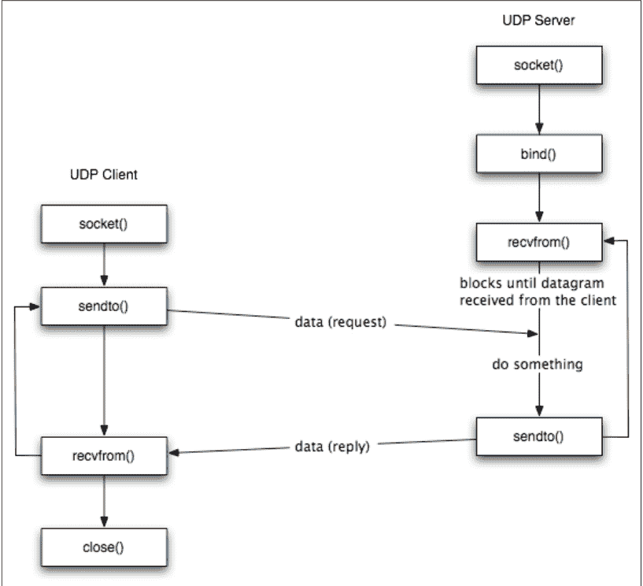
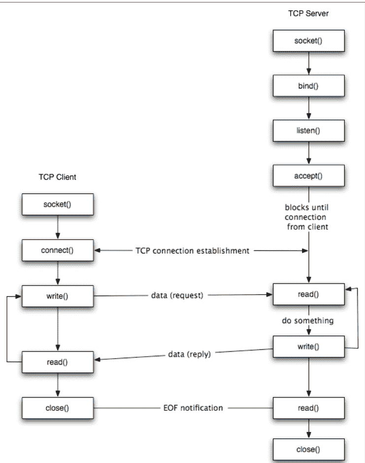

## 14 使用树莓派进行 Python 网络编程

网络套接字是跨计算机网络连接的一个端点。如今，计算机和不同网络之间的几乎所有通信都基于 Internet 协议，该协议使用套接字作为通信的基础。套接字是本地程序可以传递给网络 API 以使用连接的抽象引用。在内部，套接字在网络编程 API 中通常简单地表示为整数，用于标识使用哪个连接。简而言之，我们将在本章中涵盖以下主题：

- 套接字基础
- TCP 和 UDP 套接字之间的区别
- UDP 套接字
- TCP 套接字
- Telnet 程序
- 聊天应用程序

### 套接字基础

套接字 API 是操作系统（OS）提供的应用程序编程接口，允许应用程序以编程方式启动、控制和使用网络套接字进行通信。Internet 套接字 API 通常基于 Berkeley 套接字标准。在 Berkeley 套接字标准中，套接字是文件描述符的一种形式，遵循 Unix 的“一切皆文件”哲学。因此，我们可以像处理文件一样读取、写入、打开和关闭套接字。在进程间通信中，每一端都有自己独立的套接字，但这些套接字可能使用不同的套接字编程 API。然而，它们通过网络协议进行抽象。

套接字地址是**互联网协议（IP）**地址和端口号的组合。Internet 套接字向适当的应用程序进程或线程发送和接收数据包。在具有 IP 地址的计算机上，每个与网络相关的程序或实用程序都将拥有自己独特的套接字或套接字集。这确保了传入的数据被重定向到正确的应用程序。

### TCP 和 UDP 之间的区别

IP 协议套件中有两种类型的协议。它们是**传输控制协议（TCP）**和**用户数据报协议（UDP）**。TCP 是一种面向连接的协议，这意味着一旦建立连接，数据就可以以双向方式发送。UDP 是一种更简单、无连接的 Internet 协议。使用 UDP 时，多条消息作为数据包分块发送。让我们通过明确的要点来区分两者，如下所示：

| TCP | UDP |
|---|---|
| TCP 是一种面向连接的协议。 | UDP 是一种无连接协议。 |
| 使用此模式，消息可以从一台计算机和网络通过互联网传播到另一台计算机和网络。这是基于连接的。 | UDP 也是用于消息传输或传递的协议。它不是基于连接的协议。使用 UDP 的程序可以向另一个程序发送大量数据包，然后连接关系就结束了。 |
| TCP 适用于需要高可靠性、传输时间相对不那么关键的应用。 | UDP 适用于需要快速、高效传输的应用，例如游戏和直播视频。 |
| 使用 TCP 的协议包括 HTTP、HTTPS、FTP、SMTP 和 Telnet。 | 使用 UDP 的协议包括 DNS、DHCP、TFTP、SNMP、RIP 和 VoIP。 |
| 数据以字节流形式读取；不传输区分指示来标记消息段的边界。 | 数据包被单独发送，并且仅在到达时检查完整性。数据包具有头部和端点。 |
| TCP 执行错误检查。 | UDP 执行错误检查。但是，对于丢失或损坏的数据包，它没有恢复选项。 |
| 传输的数据保持完整，并按照发送时的相同顺序到达（称为有序）。 | 无法保证发送的消息或数据包能够到达，也无法保证它们按照发送时的相同顺序到达。 |


## UDP 套接字架构和编程

下面是一个 UDP 客户端-服务器系统的架构：



UDP 是一种互联网协议。与其对应协议 TCP 相同，我们稍后会讨论，UDP 是一种在主机之间传输数据包的协议。然而，如图所示，它与 TCP 有一些重要的不同。与 TCP 不同，UDP 是无连接的，并且不是面向流的协议。这意味着 UDP 服务器只需捕获来自任何主机和多个主机的传入数据包，而无需为进程之间的数据传输建立可靠且专用的连接。

在 Python 中，UDP 套接字创建如下：

```python
s = socket.socket(socket.AF_INET, socket.SOCK_DGRAM)
```

SOCK_DGRAM 指定一个 UDP 套接字。

### 使用 UDP 发送和接收数据

由于 UDP 套接字是无连接套接字，因此通信是通过套接字函数 sendto() 和 recvfrom() 完成的。这些函数不需要套接字显式连接到另一个对等方。它们只是直接向给定 IP 地址发送和接收。

### UDP 服务器和 NCAT

Python 中最简单的 UDP 服务器形式如下：

```python
import socket
port = 5000
s = socket.socket(socket.AF_INET, socket.SOCK_DGRAM)
s.bind(("", port))
print "waiting on port:", port
while 1:
    data, addr = s.recvfrom(1024)
    print data
```

与 listen() 函数不同，UDP 服务器必须打开一个套接字并等待接收传入数据包。从代码片段可以明显看出，没有 listen() 或 accept() 函数。保存上述代码并从终端执行它，然后使用 NCAT 实用程序连接到它。NCAT 是 Telnet 的替代品，比 Telnet 更强大，功能更多。运行程序，并在另一个终端窗口中使用 NCAT。以下是程序和 NCAT 执行的输出：

```text
pi@raspberrypi ~/book/chapter14 $ nc localhost 5000 -u -v
Connection to localhost 5000 port [udp/*] succeeded!

Hello
Ok
```

命令中的 -u 标志表示 UDP 协议。我们发送的消息应显示在服务器终端上。

### 使用 Python UDP 套接字实现回显服务器

以下是 Python 中回显服务器的代码：

```python
import socket
import sys

HOST = ''   # Symbolic name meaning all available interfaces
PORT = 8888 # Arbitrary non-privileged port

# Datagram (udp) socket
try:
    s = socket.socket(socket.AF_INET, socket.SOCK_DGRAM)
    print 'Socket created'
except socket.error, msg :
    print 'Failed to create socket. Error Code : ' + str(msg[0]) + ' Message ' + msg[1]
    sys.exit()

# Bind socket to local host and port
try:
    s.bind((HOST, PORT))
except socket.error , msg:
    print 'Bind failed. Error Code : ' + str(msg[0]) + ' Message ' + msg[1]
    sys.exit()

print 'Socket bind complete'

# now keep talking with the client
while 1:
    # receive data from client (data, addr)
    d = s.recvfrom(1024)
    data = d[0]
    addr = d[1]

    if not data:
        break

    reply = 'OK...' + data
    s.sendto(reply , addr)
    print 'Message[' + addr[0] + ':' + str(addr[1]) + '] - ' + data.strip()

s.close()
```

该程序将在提到的端口上启动一个 UDP 服务器进程，在我们的例子中是 8888。保存程序并在终端中运行它。要测试程序，请打开另一个终端并使用 NCAT 实用程序按如下方式连接到此服务器：

```text
pi@raspberrypi ~/book/chapter14 $ nc -vv localhost 8888 -u
Connection to localhost 8888 port [udp/*] succeeded!
OK...XOK...XOK...XOK...XOK...X
OK...
Hello
OK...Hello
How are you?
OK...How are you?
```

再次使用 NCAT 向 UDP 服务器发送消息，UDP 服务器将回复以 OK... 为前缀的消息。

服务器进程终端还显示有关已连接客户端的详细信息，如下所示：

```text
$ python prog2.py
Socket created
Socket bind complete
Message[127.0.0.1:46622] - Hello
Message[127.0.0.1:46622] - How are you?
```

需要注意的是，与 TCP 服务器不同，UDP 服务器可以直接处理多个客户端，因为与客户端之间没有显式连接，因此是无连接的。它可以从任何客户端接收并向其发送回复。与 TCP 服务器中那样不需要线程。

### 一个 UDP 客户端

UDP 客户端的代码如下：

```python
import socket  # for sockets
import sys  # for exit

# create dgram udp socket
try:
    s = socket.socket(socket.AF_INET, socket.SOCK_DGRAM)
except socket.error:
    print 'Failed to create socket'
    sys.exit()

host = 'localhost';
port = 8888;

while(1) :
    msg = raw_input('Enter message to send : ')

    try :
        # Set the whole string
        s.sendto(msg, (host, port))

        # receive data from client (data, addr)
        d = s.recvfrom(1024)
        reply = d[0]
        addr = d[1]

        print 'Server reply : ' + reply

    except socket.error, msg:
        print 'Error Code : ' + str(msg[0]) + ' Message ' + msg[1]
        sys.exit()
```

客户端将连接到 UDP 服务器并按如下方式交换消息：

```text
pi@raspberrypi ~/book/chapter14 $ python prog3.py
Enter message to send : Hello
Server reply : OK...Hello
Enter message to send : How are you
Server reply : OK...How are you
Enter message to send : Ok
Server reply : OK...Ok
Enter message to send :
```

UDP 协议的程序编码很简单，因为 UDP 客户端到 UDP 服务器之间没有显式的连接。

在下一小节中，我们将学习 TCP 套接字。

## TCP 套接字的架构

下面是 TCP 客户端-服务器架构的图表：



### 创建 TCP 套接字

以下是创建 TCP 套接字的示例：

```python
import socket    #for sockets

# create an AF_INET, STREAM socket (TCP)
s = socket.socket(socket.AF_INET, socket.SOCK_STREAM)

print 'Socket Created'
```

socket.socket() 函数创建一个套接字并返回一个套接字描述符，可用于其他套接字相关函数。

此代码将创建具有以下属性的套接字：

- 地址族：AF_INET（这是 IPv4 的 IP 版本）
- 类型：SOCK_STREAM（这指定了面向连接的协议，即 TCP）

如果任何套接字函数失败，则 Python 会抛出名为 socket.error 的异常，必须按如下方式捕获：

```python
import socket    #for sockets
import sys    #for exit

try:
    # create an AF_INET, STREAM socket (TCP)
    s = socket.socket(socket.AF_INET, socket.SOCK_STREAM)
except socket.error, msg:
    print 'Failed to create socket. Error code: ' + str(msg[0]) + ' , Error message : ' + msg[1]
    sys.exit();

print 'Socket Created'
```

以这种方式，我们已成功创建了一个 TCP 套接字。我们可以使用此套接字连接到服务器，例如 https://www.google.com。

### 使用 TCP 套接字连接到服务器

我们可以连接到远程服务器上的某个端口号。为此，我们需要两件事：我们要连接到的远程服务器的 IP 地址和要连接到的端口号。我们将在以下代码中使用 https://www.google.com 的 IP 地址作为示例。

```python
host = 'www.google.com'
port = 80

try:
    remote_ip = socket.gethostbyname( host )

except socket.gaierror:
    # could not resolve
    print 'Hostname could not be resolved. Exiting'
    sys.exit()

print 'Ip address of ' + host + ' is ' + remote_ip

# Connect to remote server
s.connect((remote_ip , port))

print 'Socket Connected to ' + host + ' on ip ' + remote_ip
```

运行程序并注意其在终端中的输出如下：

```text
pi@raspberrypi ~/book/chapter14 $ python prog4.py
Socket Created
Ip address of www.google.com is 74.125.236.83
Socket Connected to www.google.com on ip 74.125.236.83
```

它创建一个 TCP 套接字，然后连接到远程主机。如果我们尝试连接到不同于 80 端口的端口，则我们应该无法连接，这表明该端口未对任何连接开放。此逻辑可用于构建端口扫描器。

> *连接* 的概念适用于 SOCK_STREAM/TCP 类型的套接字。连接意味着显式或可靠的数据流或管道，使得可以有多个这样的流，每个流都可以进行自己的通信。将其想象成一条管道，不受其他管道数据干扰。流连接的另一个重要属性是数据包具有顺序或序列；因此，它们始终按顺序发送、到达和处理。

> 其他套接字，如 UDP、ICMP 和 ARP，没有显式 *连接* 或管道的概念。这些是无连接通信，正如我们在 UDP 的例子中看到的那样。这意味着我们不断地从任何人和每个人那里发送或接收数据包。


## 使用树莓派进行 Python 网络编程

`sendall()` 函数会发送所有数据。让我们向 `https://www.google.com` 发送一些数据。代码如下：

```python
import socket    #for sockets
import sys #for exit

try:
    #create an AF_INET, STREAM socket (TCP)
    s = socket.socket(socket.AF_INET, socket.SOCK_STREAM)
except socket.error, msg:
    print 'Failed to create socket. Error code: ' + str(msg[0]) + ', Error message : ' + msg[1]
    sys.exit();

print 'Socket Created'

host = 'www.google.com'
port = 80

try:
    remote_ip = socket.gethostbyname( host )

except socket.gaierror:
    #could not resolve
    print 'Hostname could not be resolved. Exiting'
    sys.exit()

print 'Ip address of ' + host + ' is ' + remote_ip

#Connect to remote server
s.connect((remote_ip , port))

print 'Socket Connected to ' + host + ' on ip ' + remote_ip

#Send some data to remote server
message = "GET / HTTP/1.1\r\n\r\n"

try:
    #Set the whole string
    s.sendall(message)
except socket.error:
    #Send failed
    print 'Send failed'
    sys.exit()

print 'Message send successfully'
```

在这个示例中，我们首先连接到一个 IP 地址，然后向其发送字符串消息 GET / HTTP/1.1\r\n\r\n。该消息实际上是一个 HTTP 命令，用于获取网站的主页。

既然我们已经发送了一些数据，现在是时候从服务器接收回复了。所以让我们来做。

### 从服务器接收数据

`recv()` 函数用于在套接字上接收数据。在下面的示例中，我们将发送一条消息并使用 Python 从服务器接收回复：

```python
import socket    #for sockets
import sys  #for exit

#create an INET, STREAMing socket
try:
    s = socket.socket(socket.AF_INET, socket.SOCK_STREAM)
except socket.error:
    print 'Failed to create socket'
    sys.exit()

print 'Socket Created'

host = 'www.google.com';
port = 80;

try:
    remote_ip = socket.gethostbyname( host )

except socket.gaierror:
    #could not resolve
    print 'Hostname could not be resolved. Exiting'
    sys.exit()

#Connect to remote server
s.connect((remote_ip , port))

print 'Socket Connected to ' + host + ' on ip ' + remote_ip

#Send some data to remote server
message = "GET / HTTP/1.1\r\n\r\n"

try:
    #Set the whole string
    s.sendall(message)
except socket.error:
    #Send failed
    print 'Send failed'
    sys.exit()

print 'Message send successfully'

#Now receive data
reply = s.recv(4096)

print reply
```

当你使用它打开 www.google.com 时，你的网络浏览器也会做同样的事情。

这种套接字活动代表了一个客户端套接字。客户端是一个连接到远程主机以获取所需数据的系统。

另一种套接字活动称为服务器系统。服务器是一个使用套接字接收传入连接并为其提供所需数据的系统。它与客户端系统正好相反。因此，https://www.google.com 是一个服务器系统，而网络浏览器是一个客户端系统。更具体地说，https://www.google.com 是一个 HTTP 服务器，而网络浏览器是一个 HTTP 客户端。

### 编程套接字服务器

现在，我们继续学习如何编程套接字服务器。服务器基本上执行以下一系列任务：

- 1. 打开一个套接字
- 2. 绑定到地址（和端口）
- 3. 监听传入的客户端连接请求
- 4. 接受连接
- 5. 从/向客户端接收/发送数据

我们已经知道如何打开一个套接字。所以，下一个要学习的就是如何绑定它。以下是执行此操作的的代码：

```python
import socket
import sys

HOST = ''  # Symbolic name meaning all available interfaces
PORT = 8888 # Arbitrary non-privileged port

s = socket.socket(socket.AF_INET, socket.SOCK_STREAM)
print 'Socket created'

try:
    s.bind((HOST, PORT))
except socket.error , msg:
    print 'Bind failed. Error Code : ' + str(msg[0]) + ' Message ' + msg[1]
    sys.exit()

print 'Socket bind complete'

s.listen(10)
print 'Socket now listening'

#wait to accept a connection - blocking call
conn, addr = s.accept()

#display client information
print 'Connected with ' + addr[0] + ':' + str(addr[1])
```

运行程序。它应该显示以下内容：

```text
pi@raspberrypi ~/book/chapter14 $ python prog7.py
Socket created
Socket bind complete
Socket now listening
```

所以现在，这个程序正在端口 8888 上等待传入的客户端连接。不要关闭此程序；确保使其保持运行。

现在，客户端可以连接到此端口上的服务器。我们将使用 Telnet 客户端来测试此操作。打开一个终端并输入以下内容：

```text
$ telnet localhost 8888
```

它会立即显示以下内容：

```text
pi@raspberrypi ~/book/chapter14 $ telnet localhost 8888
Trying 127.0.0.1...
Connected to localhost.
Escape character is '^]'.
Connection closed by foreign host.
pi@raspberrypi ~/book/chapter14 $
```

而服务器将显示以下内容：

```text
pi@raspberrypi ~/book/chapter14 $ python prog7.py
Socket created
Socket bind complete
Socket now listening
Connected with 127.0.0.1:59954
```

所以现在，我们可以看到客户端已连接到服务器。我们接受了一个传入连接但立即关闭了它。在建立传入连接后可以完成许多任务。连接是在两个主机之间建立的，目的是为了通信。所以让我们回复客户端。

`sendall()` 函数可用于向传入连接的套接字发送内容，客户端应该能够接收到它。以下是该代码：

```python
import socket
import sys

HOST = ''  # Symbolic name meaning all available interfaces
PORT = 8888 # Arbitrary non-privileged port

s = socket.socket(socket.AF_INET, socket.SOCK_STREAM)
print 'Socket created'

try:
    s.bind((HOST, PORT))
except socket.error , msg:
    print 'Bind failed. Error Code : ' + str(msg[0]) + ' Message ' + msg[1]
    sys.exit()

print 'Socket bind complete'

s.listen(10)
print 'Socket now listening'

#wait to accept a connection - blocking call
conn, addr = s.accept()

print 'Connected with ' + addr[0] + ':' + str(addr[1])

#now keep talking with the client
data = conn.recv(1024)
conn.sendall(data)

conn.close()
s.close()
```

在一个终端窗口中运行此代码，并从另一个终端使用 Telnet 连接到此服务器；你应该能够看到以下内容：

```text
pi@raspberrypi ~/book/chapter14 $ telnet localhost 8888
Trying 127.0.0.1...
Connected to localhost.
Escape character is '^]'.
happy
happy
Connection closed by foreign host.
```

因此，客户端（Telnet）从服务器收到了回复。

我们可以看到连接在此之后立即关闭，仅仅是因为服务器程序在接受请求并回复后立即终止。一个服务器进程应该一直运行；实现此目的的最简单方法是使 accept 方法在循环中迭代，以便它可以一直接收传入连接。

因此，一个活跃的服务器将始终处于运行状态。代码如下：

```python
import socket
import sys

HOST = ''  # Symbolic name meaning all available interfaces
PORT = 5000 # Arbitrary non-privileged port

s = socket.socket(socket.AF_INET, socket.SOCK_STREAM)

print 'Socket created'

try:
    s.bind((HOST, PORT))
except socket.error , msg:
    print 'Bind failed. Error Code : ' + str(msg[0]) + ' Message ' \
    + msg[1]
    sys.exit()

print 'Socket bind complete'

s.listen(10)
print 'Socket now listening'

#now keep talking with the client
while 1:
    #wait to accept a connection - blocking call
    conn, addr = s.accept()
    print 'Connected with ' + addr[0] + ':' + str(addr[1])

    data = conn.recv(1024)
    reply = 'OK...' + data
    if not data:
        break

    conn.sendall(reply)

conn.close()
s.close()
```

现在在一个终端中运行此服务器程序，并打开另外三个终端。

从每个终端执行到服务器端口的 Telnet。

每个 Telnet 终端将显示如下输出：

```text
pi@raspberrypi ~/book/chapter14 $ telnet localhost 5000
Trying 127.0.0.1...
Connected to localhost.
Escape character is '^]'.
happy
OK...happy
Connection closed by foreign host.
```


服务器终端将显示以下内容：

```
pi@raspberrypi ~/book/chapter14 $ python prog9.py
Socket created
Socket bind complete
Socket now listening
Connected with 127.0.0.1:60225
Connected with 127.0.0.1:60237
Connected with 127.0.0.1:60239
```

因此现在，服务器已启动并且 Telnet 终端也已连接到它。现在，终止服务器程序。所有 Telnet 终端都将显示 Connection closed by foreign host。

## 处理多个连接

要处理每个连接，我们需要单独的处理代码与接受传入连接请求的 main 服务器线程一起运行。实现此目的的一种方法是使用线程。主服务器程序接受传入的连接请求并为该连接的通信分配一个新线程，然后服务器返回以接受更多传入连接请求。

这是所需的代码：

```
import socket
import sys
from thread import *

HOST = ''  # Symbolic name meaning all available interfaces
PORT = 8888 # Arbitrary non-privileged port

s = socket.socket(socket.AF_INET, socket.SOCK_STREAM)
print 'Socket created'

#Bind socket to local host and port
try:
    s.bind((HOST, PORT))
except socket.error , msg:
    print 'Bind failed. Error Code : ' + str(msg[0]) + ' Message '
    + msg[1]
    sys.exit()

print 'Socket bind complete'
```

```
#Start listening on socket
s.listen(10)
print 'Socket now listening'

#Function for handling connections. This will be used to create
threads
def clientthread(conn):
    #Sending message to connected client
    conn.send('Welcome to the server. Type something and hit\nenter\n') #send only takes string

    #infinite loop so that function do not terminate and thread do
    not end.
    while True:

        #Receiving from client
        data = conn.recv(1024)
        reply = 'OK...' + data
        if not data:
            break

        conn.sendall(reply)

    #came out of loop
    conn.close()

#now keep talking with the client
while 1:
    #wait to accept a connection - blocking call
    conn, addr = s.accept()
    print 'Connected with ' + addr[0] + ':' + str(addr[1])

    #start new thread takes 1st argument as a function name to be
    #run, second is the tuple of arguments to the function.
    start_new_thread(clientthread ,(conn,))

s.close()
```

运行此服务器代码并像之前一样打开三个终端。现在，服务器将为每个连接到它的客户端创建一个线程。

Telnet 终端将显示如下输出：

```
pi@raspberrypi ~/book/chapter14 $ telnet localhost 8888
Trying 127.0.0.1...
Connected to localhost.
Escape character is '^]'.
Welcome to the server. Type something and hit enter
hi
OK...hi
asd
OK...asd
cv
OK...cv
```

服务器终端将如下所示：

```
pi@raspberrypi ~/book/chapter14 $ python prog10.py
Socket created
Socket bind complete
Socket now listening
Connected with 127.0.0.1:60730
Connected with 127.0.0.1:60731
```

此连接处理程序接收来自客户端的输入并以相同内容回复。

## 回顾

到目前为止，我们已经学习了 Python 中 socket 编程的基础知识。在测试这些程序时，如果你遇到以下错误，只需更改端口号，服务器即可正常运行：

```
Bind failed. Error Code : 98 Message Address already in use
```

## Python 中的 Telnet 客户端

Telnet 客户端是一个简单的命令行程序，用于连接到 socket 服务器并交换消息。以下是如何使用 Telnet 连接到 https://www.google.com 并获取主页的示例：

```
$ telnet www.google.com 80
```

此命令将连接到 www.google.com 的 80 端口。

```
$ telnet www.google.com 80
Trying 74.125.236.69...
Connected to www.google.com.
Escape character is '^]'
```

现在它已连接，Telnet 命令可以接收用户输入并将其发送到相应的服务器，并且服务器的任何回复都将显示在终端中。例如，以以下格式发送 HTTP GET 命令并按两次 Enter：

```
GET / HTTP/1.1
```

发送此命令将从服务器生成响应。现在我们将制作一个类似的 Telnet 程序。该程序很简单：我们将实现一个程序，该程序接收用户输入并使用线程并行从远程服务器获取结果。一个线程将不断接收来自服务器的消息，另一个线程将不断接收用户输入。但除了线程之外，还有另一种方法可以做到这一点：select() 函数。此函数允许你监视多个套接字或流的可读性，并在任何套接字准备就绪时生成事件。

其代码如下：

```
import socket, select, string, sys

#main function
if __name__ == "__main__":
    if(len(sys.argv) < 3) :
        sys.exit()
    host = sys.argv[1]
    port = int(sys.argv[2])
    s = socket.socket(socket.AF_INET, socket.SOCK_STREAM)
    s.settimeout(2)
    # connect to remote host
    try :
        s.connect((host, port))
    except :
        print 'Unable to connect'
        sys.exit()
```

## 聊天服务器

聊天服务器执行以下任务：

- 它接受客户端的多个传入连接。
- 它从每个客户端读取传入消息并将其广播给所有其他已连接客户端。

以下是聊天服务器的代码：

```
import socket, select

#Function to broadcast chat messages to all connected clients
def broadcast_data (sock, message):
    #Do not send the message to master socket and the client who
    has send us the message
    for socket in CONNECTION_LIST:
        if socket != server_socket and socket != sock :
            try :
                socket.send(message)
            except :
                # broken socket connection may be, chat client
                pressed ctrl+c for example
                socket.close()
                CONNECTION_LIST.remove(socket)

if __name__ == "__main__":

    # List to keep track of socket descriptors
    CONNECTION_LIST = []
    RECV_BUFFER = 4096 # Advisable to keep it as an exponent of 2
    PORT = 5000

    server_socket = socket.socket(socket.AF_INET,
    socket.SOCK_STREAM)
    # this has no effect, why ?
    server_socket.setsockopt(socket.SOL_SOCKET,
    socket.SO_REUSEADDR, 1)
    server_socket.bind(("0.0.0.0", PORT))
    server_socket.listen(10)

    # Add server socket to the list of readable connections
    CONNECTION_LIST.append(server_socket)

    print "Chat server started on port " + str(PORT)
```

```
while 1:
    # Get the list sockets which are ready to be read through
select
    read_sockets,write_sockets,error_sockets =
    select.select(CONNECTION_LIST,[],[])

    for sock in read_sockets:
        #New connection
        if sock == server_socket:
            # Handle the case in which there is a new
            connection recieved through server_socket
            sockfd, addr = server_socket.accept()
            CONNECTION_LIST.append(sockfd)
            print "Client (%s, %s) connected" % addr

            broadcast_data(sockfd, "[%s:%s] entered room\n" %
            addr)

        #Some incoming message from a client
        else:
            # Data received from client, process it
            try:
                #In Windows, sometimes when a TCP program
                closes abruptly,
                # a "Connection reset by peer" exception will
                be thrown
                data = sock.recv(RECV_BUFFER)
                if data:
                    broadcast_data(sock, "\r" + '<' +
                    str(sock.getpeername()) + '> ' + data)

            except:
                broadcast_data(sock, "Client (%s, %s) is
                offline" % addr)
                print "Client (%s, %s) is offline" % addr
                sock.close()
                CONNECTION_LIST.remove(sock)
                continue

server_socket.close()
```

在此代码中，服务器程序打开端口 5000 以侦听来自客户端的传入连接。聊天客户端必须连接到同一端口。我们可以通过指定未被任何其他程序或进程使用的另一个号码来更改端口号。


服务器基于 `select()` 函数使用多路复用处理多个聊天客户端。`select()` 函数监视所有客户端套接字和主套接字是否有可读活动。如果任何客户端套接字可读，则意味着其中一个聊天客户端已向服务器发送消息。

当 `select()` 函数返回时，`read_sockets` 将是一个包含所有可读套接字描述符的数组。当主套接字可读时，服务器将接受新的连接。如果任何客户端套接字可读，服务器将读取消息并将其广播回除发送消息的客户端之外的所有其他客户端。如果广播函数无法向任何客户端发送消息，则该客户端被视为已断开连接，连接将被关闭，并且相应的套接字将从连接列表中移除。

## 聊天客户端

现在，让我们编写将连接到聊天服务器并交换消息的聊天客户端。聊天客户端基于我们在 Python 中已经做过的 Telnet 程序。它连接到远程服务器并交换消息。

聊天客户端执行以下任务：

- 它监听来自服务器的传入消息。
- 它检查用户输入，以防用户输入消息然后将其发送到其连接的聊天服务器。

客户端必须同时实际监听服务器消息和用户输入。为此，我们可以使用 `select()` 函数。`select()` 函数可以同时监视多个套接字或文件描述符的活动。当消息从服务器到达已连接的套接字时，它是可读的，而当用户从键盘输入消息并按 Enter 时，stdin 流是可读的。

因此，`select()` 函数必须监视两个流：第一个是连接到远程 Web 服务器的套接字，第二个是来自键盘的 stdin 或终端输入流。`select()` 函数等待直到发生某些活动。因此，在调用 `select()` 函数后，该函数本身只有在服务器套接字接收到消息或用户使用键盘输入消息时才会返回。如果什么都没有发生，它会一直等待。

我们可以创建一个包含来自 sys 模块的 stdin 文件描述符和服务器套接字的数组。然后，我们调用 `select()` 函数，将列表传递给它。`select()` 函数返回一个可读、可写或有错误的数组列表。

以下是使用 `select()` 函数实现上述逻辑的 Python 代码如下：

```
import socket, select, string, sys

def prompt():
    sys.stdout.write('<You> ')
    sys.stdout.flush()

#main function
if __name__ == "__main__":

    if(len(sys.argv) < 3) :
        print 'Usage : python telnet.py hostname port'
        sys.exit()

    host = sys.argv[1]
    port = int(sys.argv[2])

    s = socket.socket(socket.AF_INET, socket.SOCK_STREAM)
    s.settimeout(2)

    # connect to remote host
    try :
        s.connect((host, port))
    except :
        print 'Unable to connect'
        sys.exit()

    print 'Connected to remote host. Start sending messages'
    prompt()

    while 1:
        socket_list = [sys.stdin, s]

        # Get the list sockets which are readable
        read_sockets, write_sockets, error_sockets = select.select(socket_list, [], [])

        for sock in read_sockets:
            #incoming message from remote server
            if sock == s:
                data = sock.recv(4096)

                if not data :
                    print '\nDisconnected from chat server'
                    sys.exit()
                else :
                    #print data
                    sys.stdout.write(data)
```

## 练习

此外，您可以从以下链接了解更多关于 Python 中原始套接字的信息：

- http://www.binarytides.com/raw-socket-programming-in-python-linux
- http://www.binarytides.com/python-syn-flood-program-raw-sockets-linux

## 总结

在本章中，我们学习了理解两个或多个机器之间数据传输所需概念，其中发送方称为服务器，接收方称为客户端。我们还学习了在服务器和客户端之间建立连接的基础知识。

我们使用 Python 构建了 UDP 和 TCP 套接字程序，并学习了如何执行诸如连接到服务器、发送消息、接收消息等任务。最后，我们将所学的一切结合起来，创建了一个简单的聊天程序，允许两个用户相互通信。我们现在可以构建自己的即时消息服务！

现在我们已经到了本书的结尾，花点时间回顾一下你成功构建的项目。我们完成了从初级到高级的各个项目，并亲身学到了很多关于使用 Raspberry Pi 及其所有并行概念的复杂性。从 Raspberry Pi 的介绍到使用图像进行运动检测和利用物联网概念进行入侵检测的项目，我们几乎涵盖了你构建自己有趣项目所需的一切。

我们希望这能激励你继续构建有趣的项目，这些项目不仅有趣、很酷，而且对世界总体有用。继续黑客攻击吧！
