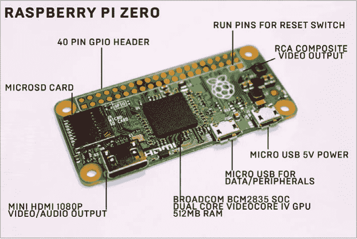
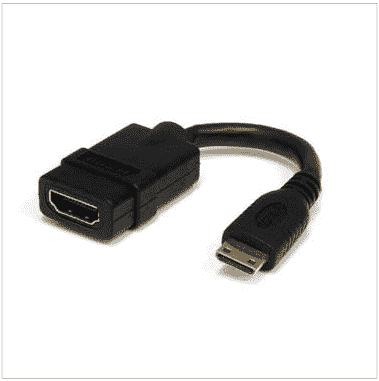
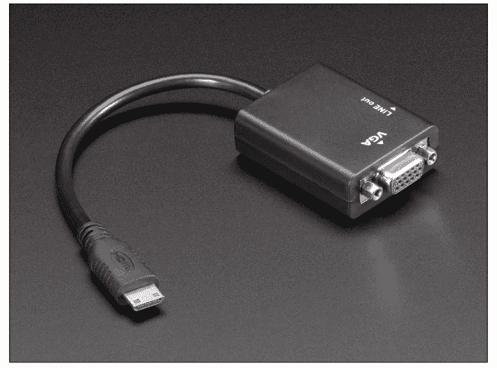
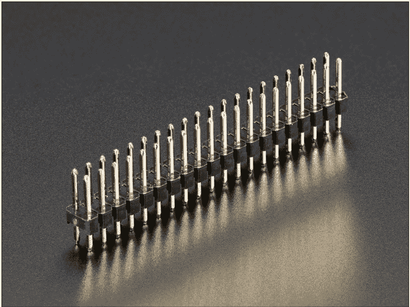
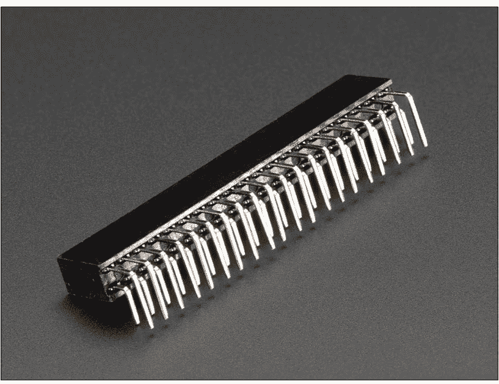
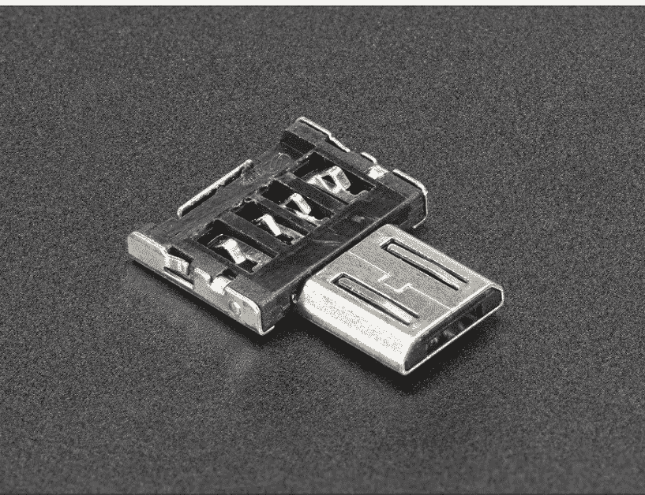

## 15 新款 Raspberry Pi 型号

Raspberry Pi 家族的最新成员是 Raspberry Pi Zero 和 Raspberry Pi 3。我们在前几章中没有讨论这些新成员。因此，让我们关注一下这两个 Raspberry Pi 家族新成员的一些细节。

### Raspberry Pi Zero

Raspberry Pi Zero 的尺寸是 Model A+ 的一半。这对于尺寸和功耗要求严格的嵌入式项目来说是理想的。以下是 Raspberry Pi Zero 的规格：

- 1 GHz 单核 CPU
- 512 MB RAM
- Mini HDMI 和 USB on-the-go 端口
- Micro USB 电源
- HAT 兼容 40 针排针
- 复合视频和复位排针

以下是从 www.wired.co.uk 获得的 Pi Zero 图像：

我们可以通过两种方式将 Pi Zero 连接到显示器：

- 使用 mini-HDMI 到 HDMI 转换器，如下所示：

  

  > 你可以从 Adafruit 购买，使用以下链接：
  > https://www.adafruit.com/products/2775
  > https://www.adafruit.com/products/2819

- 另外，我们也可以使用 VGA 显示。为此，我们需要使用 mini-HDMI 到 VGA 适配器。

  

  > 这可以在 https://www.adafruit.com/products/3048 购买。

为了方便使用 Pi Zero 的 GPIO 引脚，你可以使用以下 2x20 针条形 GPIO 排针中的任意一个：

- https://www.adafruit.com/products/2822

  

- https://www.adafruit.com/products/2823

  

另外，为了连接各种设备，可以使用 mini-USB 到 USB 转换器。这可以从 https://www.adafruit.com/products/2910 获得。

### Raspberry Pi 3

Raspberry Pi 3 是 Raspberry Pi 家族的最新成员。它是第三代 Raspberry Pi。它于 2016 年 2 月取代了 Raspberry Pi 2 Model B。与 Pi 2 相比，它具有以下功能：

- 1.2 GHz 64 位四核 ARMv8 CPU
- 802.11n 板载无线局域网
- Bluetooth 4.1
- Bluetooth 低功耗蓝牙 BLE

此外，与 Raspberry Pi 2 一样，它还具有以下功能：

- 四个 USB 端口
- 40 个 GPIO 引脚
- 全高清 HDMI 端口
- 以太网端口
- 组合 3.5mm 音频插孔和复合视频
- 相机接口 CSI
- 显示接口 DSI
- micro-SD 卡槽 现为推拉式而非推推式
- VideoCore IV 3D 图形核心

Pi 3 的外形尺寸与 Pi 2 和 Pi 1 Model B+ 相同。Pi 3 与 Pi 1 和 2 完全向后兼容。

> Pi Zero 和 Pi 3 的产品描述可以在 Raspberry Pi 的官方产品页面上找到：
> https://www.raspberrypi.org/products/pi-zero/
> https://www.raspberrypi.org/products/raspberry-pi-3-model-b/

