## 1

## 设置您的 Raspberry Pi

在我们开始构建家庭安防系统的领域之前，需要做一些准备工作来让我们的 Raspberry Pi 正常运行。因此，我们将逐步介绍让 Pi 准备好进行工作的初始步骤。

在本章中，我们将涵盖以下主题：

- 探索可用的不同版本的 Raspberry Pi
- 为您的系统选择合适的 Raspberry Pi 版本
- 使用 Raspbian 操作系统准备 SD 卡
- 学习如何通过家庭网络远程访问 Raspberry Pi
- 使用最新软件包更新我们的操作系统
- 探索 Raspberry Pi 上的时间保持选项
- 设置用户和 root 密码以保护我们的 Raspberry Pi

## 哪种口味的 Pi？

自 2012 年 Raspberry Pi 发布以来，已经发布了多个迷你 PC 板版本。我将介绍每个已发布的版本及其各自的功能，以便您可以选择适合您特定项目的版本。

## 设置您的 Raspberry Pi

好消息是，就功率而言，使用哪个版本其实并不重要，因为我们的家庭安防系统并不一定需要大量的处理能力，当然这取决于您希望系统执行什么功能）。您可能有一块旧板子闲置着，可以为您使用。

另一个好消息是，所有版本的 GPIO 接口引脚布局都是相同的。较新的版本有更多引脚，但原始的 26 个引脚仍然保持在相同的位置。

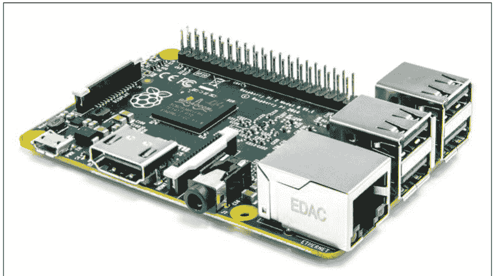

最新的 Raspberry Pi 版本 2

### Raspberry Pi Model A

家族中的小宝宝是 Model A；它作为 Model B 的低成本版本发布，见下一节。与 Model B 的主要区别是它仅配备 256Mb 内存并且没有以太网端口；因此，如果您想将此板连接到网络，您只能使用 USB Wi-Fi 适配器。

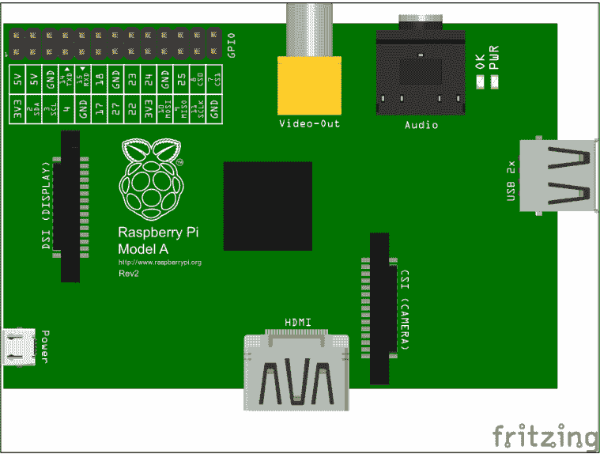

### Raspberry Pi Model B

这是首个发布的 Raspberry Pi 版本；后来发布了一个更新的修订版，改进了电源系统和 USB 端口保护。它配备 512Mb 内存并具有以太网端口用于连接到您的网络。这可能是使用最广泛的版本，并且拥有以太网端口非常有用，尤其是在快速启动和运行以在无需键盘和显示器的情况下设置和配置 Pi 时。

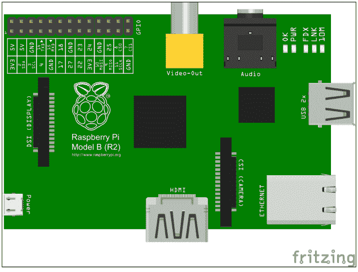

Raspberry Pi Model B 布局

### Raspberry Pi Model B+ 和 Model 2

在 2014 年，Raspberry Pi 基金会发布了与之前版本相比具有一些根本性变化的新板。最根本的变化是板布局、外形尺寸和安装点——这让众多外壳和配件制造商感到沮丧。

事实上，我们当时正在为基于 Raspberry Pi 开发的商业产品原型设计外壳——幸运的是我们在最后一刻得知了板材变更，并能够更改我们的外壳以支持即将推出的 Model B+。

该板的主要电子更改是增加了 2 个可以为外设提供更多功率的 USB 端口、扩展的 GPIO 接口，以及移除了现在整合到音频插孔中的复合视频端口。它现在还使用 micro SD 卡并具有更好的卡槽。

在 2015 年 2 月，一款更强大的 Raspberry Pi 发布了：Raspberry Pi Model 2。它在外形尺寸和接口方面与 Model B+ 相似，但据报道其升级的 ARM 处理器和 1Gb 内存使其比 Model B/B+ 快 6 倍。

以不到 £30 的低成本，它是一款很棒的小板，也是嵌入式系统的强大动力。

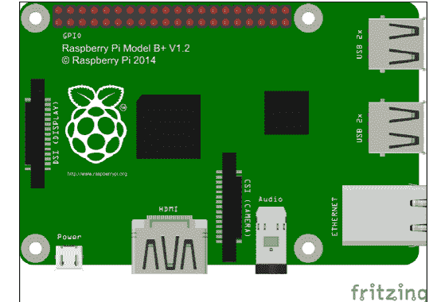

Raspberry Pi Model B+ 和 Model 2 布局

## 型号对比表

|  | Model A | Model B | Model B+ | Version 2 |
|---|---|---|---|---|
| Processor | ARM1176JZF-S 700 MHz processor, VideoCore IV GPU | ARM1176JZF-S 700 MHz processor, VideoCore IV GPU | ARM1176JZF-S 700 MHz processor, VideoCore IV GPU | Quad-core ARM Cortex-A7 CPU and a VideoCore IV dual-core GPU |
| Memory | 256Mb | 512Mb | 512Mb | 1Gb |
| USB Ports | 2 | 2 | 4 | 4 |

## 设置您的 Raspberry Pi

|  | Model A | Model B | Model B+ | Version 2 |
|---|---|---|---|---|
| Ethernet | No | Yes | Yes | Yes |
| No. GPIO Pins | 26 | 26 | 40 | 40 |
| Storage | SD Card | SD Card | Micro SD Card | Micro SD Card |

## 那么选择哪一个？

本质上，本书中介绍的任何模块都可以使用任何版本的 Raspberry Pi，但如果您想利用摄像头等功能，这可能需要更多的处理能力和内存，或想要以太网连接，您需要使用 Model B。

如果您想开始将更多东西插入 USB 端口，例如 GSM 调制解调器，那么我建议您使用 Model B+，因为它可以为这类设备提供更多功率，而无需额外的 USB 集线器。

如果您想对来自连接摄像头的视频和图像进行更多处理，或想连接很多东西，那么请选择最新的 **Model 2** 板。我将假设您为本项目选择的就是它，并且我将在整本书中使用它；如果您选择使用更早的型号，请注意任何限制。

> Raspberry Pi 基金会网站上有每个型号的更详细信息。您可以访问 `https://www.raspberrypi.org/products`。

## 准备 SD 卡

Raspberry Pi 只能从 SD 卡启动（B+ 和 v2 型号为 micro SD 卡），并且无法从外部驱动器或 USB 闪存盘启动（好吧，这并不完全正确，但超出了本书的范围）。

建议您使用 Class 10 SD 卡以获得性能，但 Class 4 或 6 卡对于本项目也足够了。您需要至少 4Gb 的卡容量。

现在我们手头有了 Raspberry Pi 板和 SD 卡，我们需要专门为我们的家庭安防系统准备 SD 卡。我们将使用标准的 Raspbian 操作系统，因为真的没有理由使用其他发行版；它是 Raspberry Pi 的事实标准选择。

### 下载 Raspbian 镜像

您需要从 Raspberry Pi 网站 `https://www.raspberrypi.org/downloads` 获取最新的 **Raspbian OS** 镜像。

将 Raspbian OS ZIP 文件包含镜像下载到您的 PC。

> 截至撰写时，最新版本为 Raspbian Jessie 版本 4.1（`2015-09-24-raspbian-jessie.zip`）。

下载后，解压文件，您将得到文件 `2015-09-24-raspbian-jessie.img`。

下一步是将此镜像烧录到您的 SD 卡……

#### 使用 Microsoft Windows

在 Windows PC 上，将镜像烧录到 SD 卡的最佳方式是使用 **Win32 Disk Imager** 实用程序。可以从 `http://sourceforge.net/projects/win32diskimager` 下载。

> 截至撰写时，当前版本为 0.9.5。

它没有安装程序，直接从 EXE 文件启动。

现在，是时候创建您的 SD 卡镜像了：

- 1. 将 SD 卡插入 PC 并启动 Win32 Disk Imager。
- 2. 选择 SD 卡设备驱动器号（确保正确！）。
- 3. 选择您刚刚下载的 Raspbian 镜像文件。

4. 单击写入按钮以创建 SD 卡镜像。

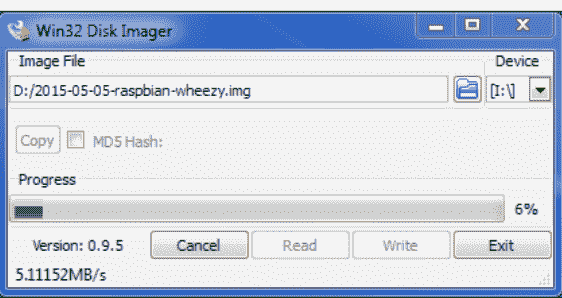

### 使用 Linux

在 Linux PC 上，您需要使用 gparted 和 dd 实用程序将镜像烧录到 SD 卡。

按照以下步骤创建您的 SD 卡镜像：

- 1. 将 2015-09-24-raspbian-jessie.img 解压到您的主文件夹。
- 2. 将 SD 卡插入 PC。
- 3. 如果您尚未在 shell 终端窗口中，请打开一个（您可以在大多数基于图形的桌面系统上使用 Ctrl + Alt + T）。
- 4. 在 shell 终端中输入以下命令：
  $ sudo fdisk -l
  在列表中检查您的 SD 卡是否作为驱动设备出现（例如，/dev/sdb）。至关重要的是您要确保在下一步中使用正确的设备。我们假设您的设备是 /sdb。
- 5. 要将镜像烧录到 SD 卡，请输入以下命令：
  $ sudo dd if=2015-09-24-raspbian-jessie.img of=/dev/sdb
- 6. 按 Enter 并去泡杯茶或咖啡，因为这需要一段时间。当命令（$）提示符重新出现时，您就知道它完成了。
- 7. 当命令提示符重新出现时，输入以下命令：
  $ sudo sync
- 8. 该命令完成后，您可以从 PC 中取出 SD 卡。


## 启动你的 Pi

你现在准备启动你的树莓派了。把你崭新的 SD 卡插入其中并接上电源。

假设你的 Pi 已连接显示器，你应该能看到系统正常启动。虽然你可以等待其启动完成后再通过终端会话连接（我们稍后会讨论），但我建议你至少在第一次时连接显示器，以确保一切正常工作。

在新的 **Jessie** 版本的 Raspbian 中，你会直接启动到桌面 GUI，这与之前的版本有很大不同，之前版本在系统首次运行时会进入 **raspi-config** 实用程序，在那里设置你的 Pi，并重要的是，扩展文件系统以使用 SD 卡上全部可用空间。

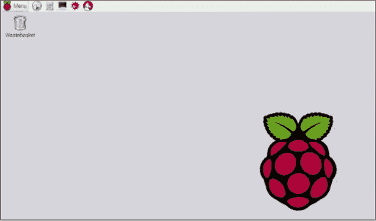

*Debian Jessie 默认启动到 GUI*

## 扩展文件系统

当你首次创建 Raspbian SD 卡时，无论 SD 卡大小如何，文件系统里只剩下大约 200Mb 的空间。这用处不大，所以我们需要扩展文件系统，使其使用卡上所有可用空间。

幸运的是，现在在树莓派上这非常容易，因为该功能已在桌面的树莓派配置工具中提供。

要访问新的配置工具，请前往 **菜单** 并选择 **首选项 | Raspberry Pi 配置。**

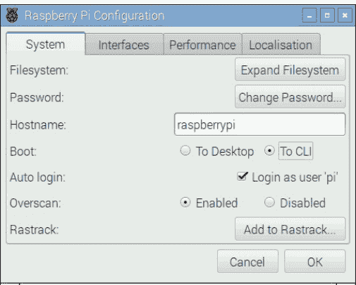

新的树莓派配置工具

### 再见 GUI

> 我们的大部分工作都将在命令行界面（CLI）中完成。因此，在一分钟后重启系统之前，让我们先更改 **启动** 选项，选择 **To CLI**，如上一个截图所示，这样今后将启动到命令行。

无论如何，现在我们点击 **Expand Filesystem** 按钮，几秒钟后你会看到确认消息。文件系统将在系统下次重启时扩展。

## 使用 raspi-config 实用程序

如果你使用的是旧版本的 Raspbian，或不使用桌面 GUI，那么你需要使用 raspi-config 实用程序（这比过去在 shell 中手动操作要好得多）。首次启动时，你会直接进入 raspi-config 实用程序。

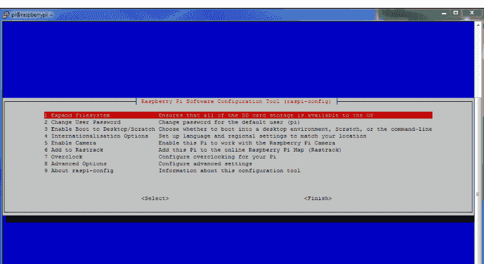

第一个选项是扩展文件系统选项；选择它，你会看到各种命令在屏幕上滚动。一旦完成，你会看到以下消息：

Root partition has been resized.

The filesystem will be enlarged upon the next reboot

点击确定。

在配置屏幕上选择完成，并在提示时重启你的 Pi。

在文件系统更充裕后重启 Pi 后，你会直接进入 shell 提示符，可以使用默认用户和密码登录。

Login: pi

Password: raspberry

## 设置你的 Pi

当你启动到 shell 且以太网已连接时，希望 Pi 已连接到你的家庭网络并从路由器获取了 IP 地址。如果是这种情况，你应该在登录提示之前看到已分配的 **IP 地址**，如下图所示：

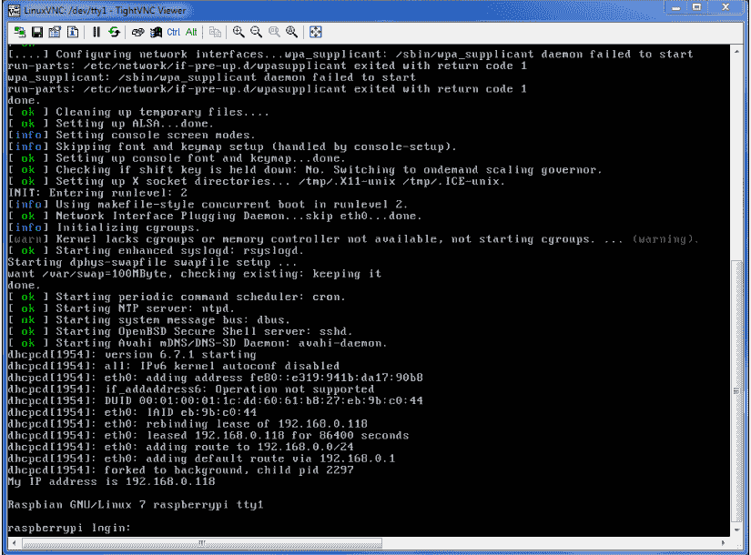

正如我截图中所见，它给了我 IP 地址 `192.168.0.118`。这很好，因为我现在可以使用安全 shell（SSH）客户端从我的笔记本电脑舒适地远程访问 Pi。这在我的 Pi 在办公室而我想坐在沙发上看电视时仍想操作它时特别有用，我经常在懒惰时这样做。

要做到这一点，请下载 PuTTY：一个允许你通过网络远程连接到 shell 终端的实用程序。你可以从 http://www.putty.org 下载它。

安装并启动 PuTTY，你就可以从沙发的舒适位置远程连接到你的 Pi 了。

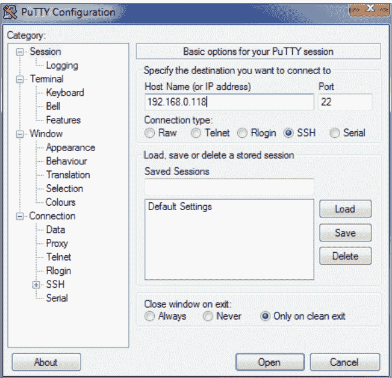

## 设置你的树莓派

在主机名框中输入树莓派的 IP 地址，然后点击打开。你将在远程终端窗口中连接到你的 Pi。登录后，你几乎可以在 Pi 上做任何事情，就像坐在它面前一样。

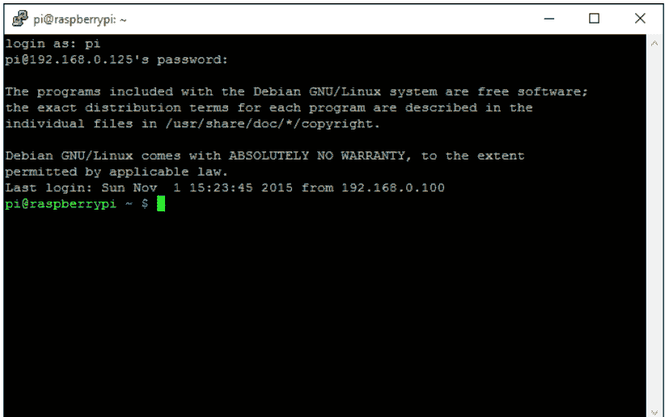

我们从现在起假设我们的大部分工作都将通过远程 shell 会话进行，除非另有说明。

如果你想使用命令行启动树莓派远程 shell——例如从另一台 Linux 系统——请从你的终端窗口使用以下命令：

```
# ssh pi@192.168.0.125
```

然后你将被提示输入 Pi 的密码并进入 shell 会话。

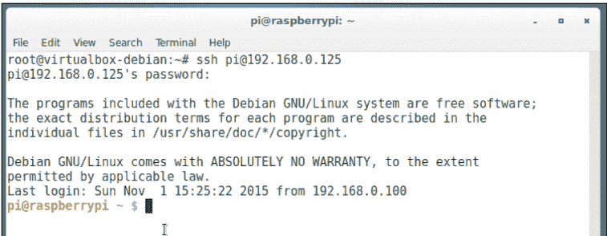

从 Debian 桌面终端窗口启动的 Pi shell 会话

## 保持最新

你应该养成定期更新操作系统的习惯；即使你安装了最新的镜像，也很可能有更新的软件包可用。要更新你的操作系统，输入以下命令：

```
$ sudo apt-get update
```

之后，输入以下命令：

```
$ sudo apt-get dist-upgrade
```

这可能需要一段时间，具体取决于需要更新的数量。

## 获取正确的时间

树莓派没有板载实时时钟硬件。这是为保持板成本低而故意省略的。相反，Pi 在启动时通过网络时间协议（NTP）从互联网上的时间服务器获取时间。但是，如果在启动时没有互联网连接，则时间会错误。

> 在我们的安全系统中，保持时间准确非常重要，以便日志文件和图像上的时间戳正确。

## fake-hwclock

fake-hwclock 软件包包含在最新的 Raspbian 发行版中，但在过去的其他版本中没有。如果需要安装它，请使用以下命令：

```bash
$ sudo apt-get install fake-hwclock
```

fake-hwclock 用于在没有网络连接时让树莓派尽量保持时间。它会定期保存当前时间并在启动时恢复。明显的问题是，如果 Pi 已关闭几天，则时间将被设置为上次开机时的 fake-hwclock 时间。

如果你想查看它上次记录的时间，输入以下命令：

```bash
$ cat /etc/fake-hwclock.data
```

## ntp

**网络时间协议（NTP）** 在有互联网连接时使用，它可以从互联网上的一个或多个时间服务器请求最新最准确的时间。

默认情况下，**ntp 服务** 在最新的 Raspbian 发行版上是启用的，但在没有互联网连接时，它最初会在启动时从 fake-hwclock 获取时间。可能有时候有必要强制 ntp 服务从互联网更新——例如，如果在启动后一段时间互联网连接恢复。

要强制 ntp 服务从互联网更新，请使用以下命令：

```bash
$ service ntp stop
$ ntpd -gq
$ service ntp start
```

## 说到安全……

如果系统本身不安全，建立安全系统就毫无意义。所以，现在我们将更改 pi 用户的默认密码。

从提示符输入以下命令：

```text
$ sudo passwd pi
pi@raspberrypi ~ $ sudo passwd pi
Enter new UNIX password:
Retype new UNIX password:
passwd: password updated successfully
```

## 这个 sudo 到底是什么？

你会注意到我们在终端窗口中运行的每个命令前都加上了 `sudo`。这是为了让命令以 **root 用户**——最高安全级别——运行。执行许多操作需要这种提升的权限。`sudo` 实际上意思是 *super do.*

如果你不想每次都输入 `sudo`，那么你可以通过输入以下命令切换到超级用户：

```
$ sudo su
```

你会看到提示符从 $ 变为 #，这表示你现在以 root 用户运行。

所以，这可能也是更改 root 用户密码的好时机！要做到这一点，输入以下内容：

```
# passwd
root@raspberrypi:/home/pi# passwd
Enter new UNIX password:
Retype new UNIX password:
passwd: password updated successfully
root@raspberrypi:/home/pi#
```

## 通过 Wi-Fi 连接

你也可以通过插入 USB  dongle 将树莓派连接到网络使用 Wi-Fi。使其工作需要额外的配置步骤，这超出了本章的范围，但有许多资源涵盖此主题。

> 你可以在 Rick Golden 所著的 **Raspberry Pi Networking Cookbook** 中找到使用 Wi-Fi 连接树莓派的配方，由 Packt Publishing 出版（https://www.packtpub.com/hardware-and-creative/raspberry-pi-networking-cookbook）。


# 总结

在本章中，我们将 Raspberry Pi 从包装盒中取出，并将其准备好作为家庭安防系统的核心设备。在此过程中，我们安装并设置了操作系统，将 Pi 连接到网络，并对其进行远程访问。我们还对 Pi 进行了安全设置，并确保它能够保持正确的时间。

在下一章中，我们将探索 GPIO 端口及其提供的各种接口。我们会了解如何使用 GPIO 端口将各种设备连接到 Raspberry Pi，包括开关和传感器，同时开始构建我们的家庭安防系统。
