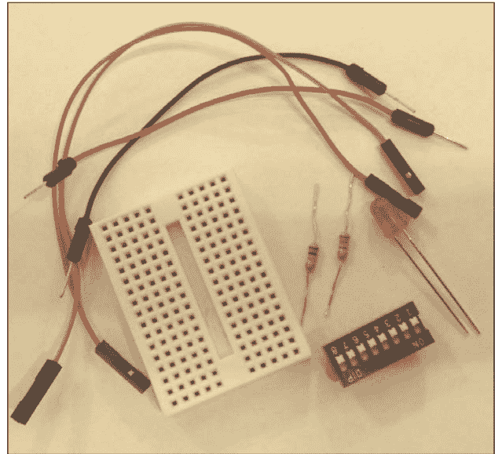
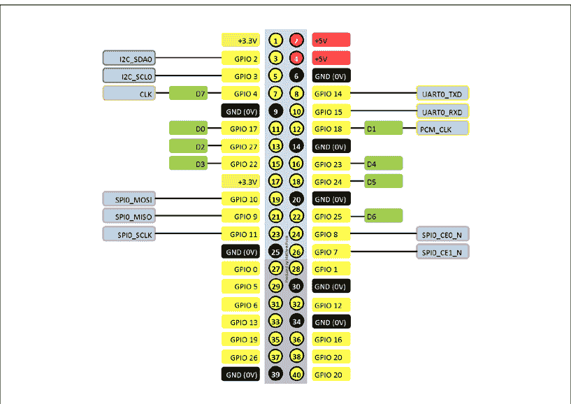
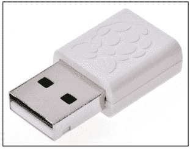
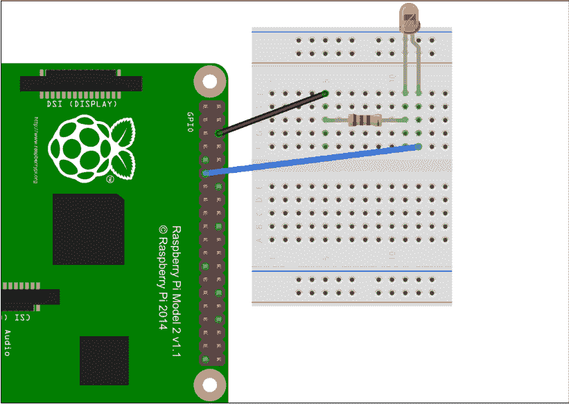
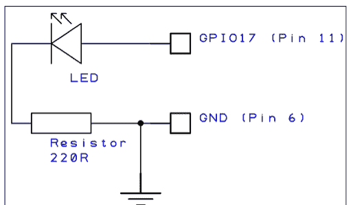
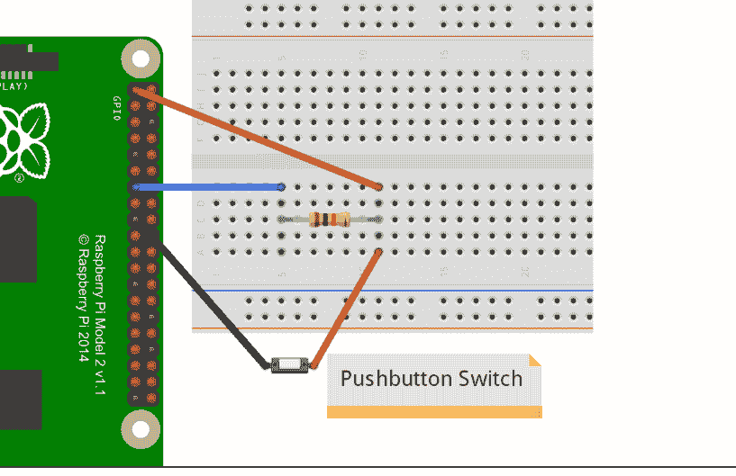
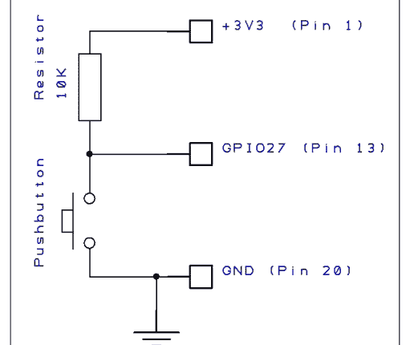
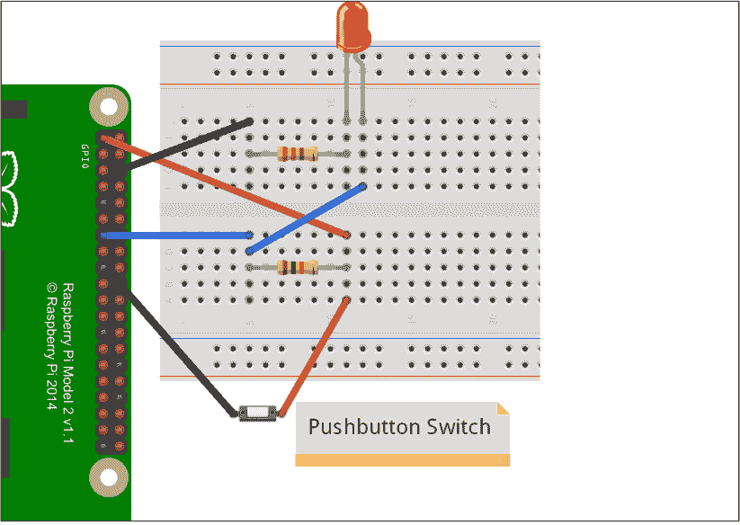
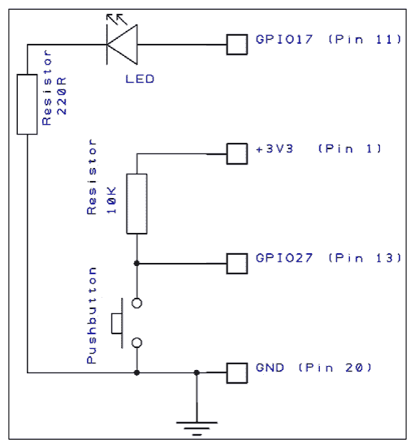

## 2
使用 GPIO 将设备连接到 Pi

Raspberry Pi 提供了许多连接设备的方式，例如将设备插入 USB 端口、将设备连接到板载摄像头和显示器端口，以及将设备连接到组成 GPIO 连接器的各种接口。作为家庭安防项目的一部分，我们将主要关注如何将设备连接到 GPIO 连接器。

在本章中，我们将介绍以下主题：

- 检查 GPIO 连接器以及各个引脚的功能
- 了解后续章节中将使用的 I2C 和 SPI 总线
- 安全地将 LED 和开关连接到数据引脚，并使用简单脚本访问这些数据引脚
- 了解 USB 端口及其限制

### 前提条件

除了 Raspberry Pi 之外，你还需要以下部件来完成本章中的项目：

- 一个面包板
- 一个 LED
- 一个 220 欧姆电阻（红、红、黑）
- 一个 10K 欧姆电阻（棕、黑、橙）
- 一个按钮或拨动开关
- 一根连接线：



### 认识 GPIO

GPIO 连接器是 Raspberry Pi 板边缘的一大组引脚。在较早的型号中，该连接器由 26 个引脚组成。但从 Model B+ 开始，一直配备 40 个引脚，尽管前 26 个引脚与之前的型号完全相同，而我们将使用的正是这 26 个引脚。其余引脚无需担心。

GPIO 连接器主要提供以下功能：

- 电源
- 数字 I/O 引脚
- I2C 总线
- SPI 总线
- UART 串行总线

GPIO 上的某些引脚具有多种用途，具体取决于它们的编程方式。下图是 GPIO 所有引脚的参考指南。黄色标签上的 GPIO 编号直接对应 Broadcom 芯片上的编号，也是脚本中通常使用的编号。



### 数字 I/O 引脚

GPIO 提供 8 个可用的数字输入/输出引脚。这些引脚既可以用于打开和关闭设备（输出模式），也可以用于检测外部设备何时打开和关闭（输入模式）。每个引脚都可以独立配置为输入或输出模式，我在前面的图中将它们标记为 D0 至 D7。

显然，如果我们使用这些引脚分别驱动或检测单个设备，那么家庭安防系统最多只能连接 8 个设备。在许多情况下，这可能不够，因此在下一章中，我们将学习如何使用 GPIO 将更多设备连接到 Raspberry Pi。

### I2C 总线

集成电路间总线（Inter-Integrated Circuit，I2C）是一种低速接口，可以通过两线接口连接多个设备和简单传感器，而无需单独的时钟线或设备选择线。通常，该总线的运行速度最高可达 100kbit/s。下一章将介绍这一总线，帮助我们扩展数字 I/O 并连接更多设备。

### SPI 总线

串行外设接口（Serial Peripheral Interface，SPI）总线是主设备与从设备之间的同步双向串行连接。它可用于访问更复杂的传感器或驱动显示器。

主设备负责提供同步信号，每次传输都通过 SCLK（GPIO11/引脚 23）上的时钟脉冲进行同步。数据通过 MOSI（主出从入）和 MISO（主入从出）传输，分别使用引脚 19 和 21。

### UART 串行总线

通用异步收发器（Universal Asynchronous Receiver and Transmitter，UART）总线是一种通过串行数据连接与外部设备通信的方式，也是 Raspberry Pi 访问设备数据的一种常见方法，例如 GPS 模块通常就带有串行连接。让 Pi 设置为与通过 UART 连接的设备通信可能会有些繁琐，因为 UART 还与操作系统的串行控制台有关联。

### USB 端口

我们可能都很熟悉通用串行总线（Universal Serial Bus，USB）端口，因为我们会使用它们将各种设备连接到 PC，例如键盘、鼠标和硬盘。在 Raspberry Pi 上也是如此；我们可以连接键盘、鼠标和网卡适配器，以获得 Wi-Fi 和蓝牙连接能力。



官方 Raspberry Pi USB Wi-Fi 适配器

在较早的 Raspberry Pi 型号中，USB 端口能够提供的电流相当小，如果连接的设备消耗过多电流，就会引发各种问题。从 Model B+ 开始，这一情况得到了显著改善，现在已经可以连接 GSM/LTE 适配器而不会出现问题。

不过，如果你想连接硬盘驱动器之类的设备，仍然存在一些限制；这些设备消耗的电流可能超过 Raspberry Pi USB 端口所能提供的电流。因此，连接此类设备时，建议使用带供电功能的 USB 集线器或 USB 电源注入器。

### 电源连接

GPIO 连接器还可以访问板载电源。+5V 连接（引脚 2 和 4）本质上是外部电源通过 micro-USB 电源端口输入的 +5V 电压。如果需要，可以使用它为小型外部电路供电，但如果需要较大的电流，建议使用额外的外部 +5V 电源。

+3.3V 电源（引脚 1 和 17）来自板载 3.3V 稳压器，可提供最高 50mA 的小电流。如果外部电路需要消耗超过 50mA 的电流，就应使用外部电源。本书后面会介绍如何制作一个外部电源。

> Raspberry Pi 上的 I/O 引脚工作在 3.3V 电平。将高于此电压的电压连接到这些引脚，可能会对 Pi 造成不可逆的损坏。如果你按照本书中的说明操作，一切都应该没有问题；但如果随意将高功率设备连接到 Pi，就会损坏它！

### 熟悉 GPIO

在开始将大量设备连接到 Pi 开发板之前，最好先通过几个简单项目熟悉 GPIO。这些项目将帮助我们了解如何使用 shell 脚本与数字 I/O 引脚进行交互。

### 让灯亮起来

这个简单的小项目展示了如何将 GPIO 输出连接到 LED，并使用 shell 命令打开和关闭 LED。

下图展示了如何使用面包板连接电路：



> 你刚才看到的漂亮电路图是使用 fritzing 提供的免费软件工具制作的。fritzing 是一个开源硬件项目，旨在让任何人都能将电子产品作为创作材料。请从 `fritzing.org` 下载该软件。

LED 的阳极（正极）连接到 D0 数字 I/O（连接器的引脚 11，即 GPIO17）。当该引脚打开时，它会向 LED 提供 3.3V 电源。

LED 的阴极（负极）通过一个 220R 电阻连接到接地引脚。该电阻用于限制 LED 两端的电压以及流经 LED 的电流，否则 LED 会烧坏，因为 LED 两端最多只能施加约 2V 的电压。在 3.3V 电源下，LED 消耗的电流约为 10mA，使用 220R 电阻可以很好地保护 LED 和 GPIO。

这是该电路的电路图：



### 计算 LED 电阻值……

虽然本书并不是电子学理论课程，但我觉得介绍如何使用欧姆定律计算 LED 的电阻值会很有帮助，因为稍后我们还会再次涉及这一内容。

正如我提到的，典型 LED 两端的压降约为 2V，不过具体数值会因颜色和类型而有所不同。这称为器件的正向电压，记作 VLED。

LED 所需的电流约为 10mA，同样取决于其规格。我们将这个流经 LED 的电流记作 ILED。

基本上，电阻两端的电压等于电源电压减去 LED 两端的压降（例如 2V）。因此，如果我们有一个 12V 电源（VS），电阻两端的电压就是 10V（VS - VLED）。

根据欧姆定律，电阻 R 等于其两端的电压除以流经它的电流：R = V / I。由于我们要求有 10mA 的电流流过电阻，而电阻两端的电压为 10V，因此所需电阻值为 10V 除以 0.01A，即 1,000 欧姆或 1K。

总结如下：R = (VS-VLED) / ILED。


## 使用 GPIO 将外设连接到你的树莓派

现在，要让 LED 亮起和熄灭：GPIO 引脚实际上在 Linux 文件系统中被映射为设备，因此使用 shell 命令很容易，尽管市面上也有很多库，例如允许你用 Python 控制 GPIO 的库。不过，为了不必学习一门新语言，我们将全部使用 shell 命令来完成。

我们连接的 D0 引脚，对于树莓派来说实际上就是 GPIO17（参考前面的示意图）。我们要做的第一件事是为这个 GPIO 引脚创建文件访问。我们使用以下命令：

```bash
sudo echo 17 > /sys/class/gpio/export
```

然后，我们必须将引脚的方向设置为输出（out）：

```bash
sudo echo out > /sys/class/gpio/gpio17/direction
```

接下来，我们可以打开引脚来点亮 LED：

```bash
sudo echo 1 > /sys/class/gpio/gpio17/value
```

要熄灭 LED，我们使用以下命令：

```bash
sudo echo 0 > /sys/class/gpio/gpio17/value
```

当我们用完某个 GPIO 端口后，可以移除其文件访问：

```bash
sudo echo 17 > /sys/class/gpio/unexport
```

### 闪烁起来…

我们可以将这些命令组合到一个 Bash 脚本中，制作一个闪烁的 LED。要创建这个闪烁脚本，请在 `nano` 或其他文本编辑器中新建一个文本文件。或者，像我通常做的那样（别忘了我很懒），在笔记本电脑上创建文本文件，然后使用 **WinSCP** 将其复制到远程树莓派上（不过，如果你想避免一些心痛，请阅读下面框中的注释）。

以下是 led-flash.sh 的代码：

```bash
#!/bin/bash
sudo echo 17 > /sys/class/gpio/export
sudo echo out > /sys/class/gpio/gpio17/direction
# loop forever
while true
do
    sudo echo 1 > /sys/class/gpio/gpio17/value
    sleep 0.5
    sudo echo 0 > /sys/class/gpio/gpio17/value
    sleep 0.5
done
```


> 如果你使用 Windows 创建文件，请记得将文件的行尾格式保存为 Linux 格式（单个 0x0a 或换行符），而不是 Windows 格式（0x0a + 0x0d 或换行符 + 回车符），否则你可能会发现 Bash 脚本在树莓派上无法正常运行。Windows 上的文本编辑器，例如优秀的 Notepad++，会为你转换脚本的行尾格式。

通过调用 led-flash.sh（假设你就是这样命名的）来运行脚本。如果你和脚本在同一目录下，可以输入以下命令：

```bash
$ sudo bash ./led-flash.sh
```

由于这是一个无限循环，LED 以半秒为间隔闪烁，你需要使用 CTRL + C 来跳出循环并停止脚本。

别忘了使用以下命令将 GPIO 引脚从文件访问中移除：

```bash
$ sudo echo 17 > /sys/class/gpio/unexport
```

否则，如果你重新运行脚本，因为第一行试图再次为 GPIO17 创建文件访问，你会看到错误：echo: write error: Device or resource busy。

### 添加开关

在这个项目中，我们将了解如何将开关连接到 GPIO 输入，并编写一个 shell 脚本来读取开关状态——即它是打开还是关闭。

将开关连接到树莓派的 GPIO27 引脚，如下图所示：



### 上拉与稳定

关于 GPIO 输入，有一件非常重要的事情需要认识到：它们处于所谓的“悬空状态”。这意味着，就操作系统而言，除非给它一个已知电压，否则它不知道其参考状态是什么。

这时我们的电阻就派上了用场——它将 GPIO 引脚上拉到已知的 3.3V 电压，使其默认状态为高电平（HIGH，或二进制 1）。

当按下按钮开关时，这会使 GPIO 引脚变为 0V，即低电平状态（LOW，或二进制 0）。

以下是我们 GPIO 开关的电路图：



### 检测脚本

现在我们已经将开关连接到树莓派，我们需要编写一个小脚本来检测开关何时被按下。

它与前面显示的 LED 脚本类似，但这次我们将 GPIO 引脚设置为输入并读取其逻辑电平。

在这个项目中，我们将开关连接到 D2，即 GPIO27（同样，请参考前面的 GPIO 引脚分布图）。和之前一样，我们需要通过输入以下命令为该引脚创建文件访问：

```bash
$ sudo echo 27 > /sys/class/gpio/export
```

现在，将其方向设置为输入（in）：

```bash
$ sudo echo in > /sys/class/gpio/gpio27/direction
```

我们现在可以读取它的值了，使用以下命令即可：

```bash
$ sudo cat /sys/class/gpio/gpio27/value
```

你会注意到它返回了 1，即高电平状态。这是因为我们之前提到的上拉电阻。这意味着当开关未被按下时，其默认状态为高电平。

当开关被按下时，该值应读为 0 或低电平。如果你有超过两只手，你可以尝试按下按钮并重新运行命令。或者，我们也可以创建一个脚本轮询开关状态。

poll-switch.sh 的代码如下：

```bash
#!/bin/bash
sudo echo 27 > /sys/class/gpio/export
sudo echo in > /sys/class/gpio/gpio27/direction

# loop forever
while true
do
    # read the switch state
    SWITCH=$(sudo cat /sys/class/gpio/gpio27/value)

    if [ $SWITCH == 1 ]; then
        #switch not pushed so wait for a second
        sleep 1
    else
        #switch was pushed
        echo "You've pushed my button"
    fi
done
```

当你运行脚本然后按下按钮时，你应该会看到“You've pushed my button”在控制台上持续滚动，直到你停止按压。

别忘了，一旦我们用完 GPIO 端口，我们可以移除其文件访问：

```bash
$ sudo echo 27 > /sys/class/gpio/unexport
```

我们现在已经了解了如何轻松读取开关输入，同样的电路和脚本也可用于读取其他传感器，例如门磁开关、干簧管开关，或任何其他有开和关状态的设备。

### 世界上最精致的电灯开关

通过结合前面两个小项目，我们现在可以创建一个系统，在按下按钮开关时做一些有用的事情——例如，打开我们同时连接着的 LED。诚然，我们可以直接将 LED 连接到开关和电池，但那不仅无聊，而且会违背我们正在努力实现的目标，即通过编程方式感知和控制事物。

这是我们精致电灯开关的面包板布局：



这是电路图：



### 点亮脚本

接下来演示我们精致电灯开关的完整 Bash 脚本。它将无限循环，检测开关 GPIO 引脚的状态，并在开关被按下时打开 LED GPIO 引脚。

light-switch.sh 的代码如下：

```bash
#!/bin/bash

#set up the LED GPIO pin
sudo echo 17 > /sys/class/gpio/export
sudo echo out > /sys/class/gpio/gpio17/direction

#set up the switch GPIO pin
sudo echo 27 > /sys/class/gpio/export
sudo echo in > /sys/class/gpio/gpio27/direction

# loop forever
while true
do
  # read the switch state
  SWITCH=$(sudo cat /sys/class/gpio/gpio27/value)

  #0=Pushed 1=Not Pushed
  if [ $SWITCH = "1" ]
  then
    #switch not pushed so turn off LED pin
    sudo echo 0 > /sys/class/gpio/gpio17/value
  else
    #switch was pushed so turn on LED pin
    sudo echo 1 > /sys/class/gpio/gpio17/value
  fi
  #short delay
  sleep 0.5
done
```

就这样——我们有了一个可以检测输入状态并做出响应的脚本；在本例中，它将点亮 LED。我们现在正在为组建家庭安防系统奠定基础。

> 记住，不要将任何设备连接到树莓派上以取代 LED，例如蜂鸣器或其他消耗大量电流的设备。这很可能会永久性地损坏你的树莓派。我们将在本书后面介绍控制更高功率设备的方法。

### 小结

在本章中，我们通过查看 GPIO 上可用的各种接口，介绍了将树莓派连接到外部世界的多种方式。我们了解了如何将外设连接到树莓派 GPIO 连接器上的数字引脚，并使用简单的 Bash 脚本进行控制和读取。具体来说，我们已经安全且正确地将一个开关连接到数字输入引脚，这将为我们家庭安防检测电路奠定基础。

在下一章中，我们将探讨如何扩展可连接到树莓派的外设数量，克服 GPIO 上只有 8 个数字引脚可用的限制，方法是通过利用 GPIO 上的其他接口并构建我们自己的输入/输出扩展板。


