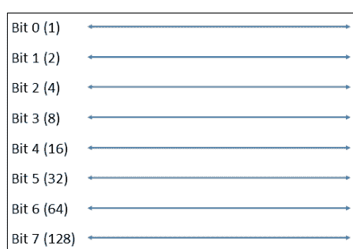
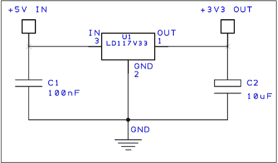
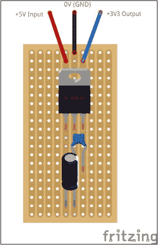
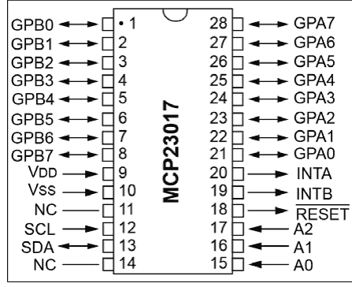
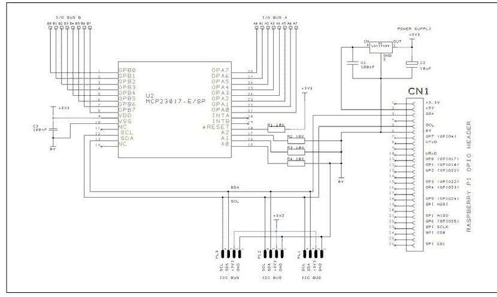
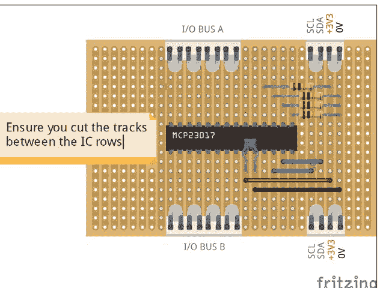
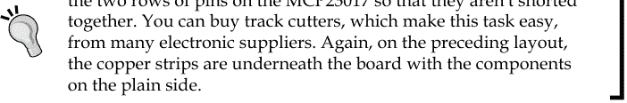
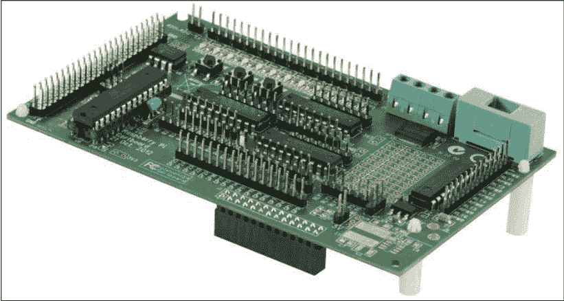

## 3 扩展树莓派以连接更多设备

现在，我们要探讨如何扩展树莓派可连接的设备数量，摆脱仅有8个数字引脚的局限。为此，我们将构建自己的扩展板，从而在理论上获得无限数量的数字输入和输出。

我们还将通过构建自己的+3.3V电源来克服可用+3.3V电源的限制，该电源从树莓派的+5V电源中分接。

本章将涵盖以下内容：

- 详细了解I²C总线
- 学习串行到并行以及并行到串行的转换
- 构建+3.3V电源
- 构建基于I²C的端口扩展器，以提供更多输入和输出
- 了解其他现成的扩展板

### 前提条件

除了你的树莓派之外，本章项目还需要以下部件：

- 一块铜条板（或Veroboard®）
- 一个LD1117V33电压稳压器
- 2个100nF、16V陶瓷电容
- 1个10µF、16V电解电容
- 1个MCP23017 16位端口扩展器IC
- 4个10K欧姆电阻
- 一根连接导线

### I²C总线

在上一章中，我们简要提到了I²C总线（即Inter-Integrated Circuit总线，集成电路间总线），这是一种仅用两根导线即可连接多个设备的方式。I²C由飞利浦公司于20世纪80年代初发明，旨在通过通用协议将计算机外设连接起来。你可以将I²C视为一种早期形式的USB。

与以太网（通常高达1Gbit/s）或USB（最高可达480Mbit/s）等更快接口相比，I²C通常以相对较低的速度运行，最高可达100kbit/s。然而，这对于连接基本传感器、显示设备或其他外设（如实时时钟）来说已经足够快了——事实上，某些设备支持更快版本的协议。

### 仅需两根导线

I²C是一种双向串行通信协议，通过两根导线工作：

- 串行数据线（SDA）负责在主设备和其他设备之间传输数据。回顾第2章“使用GPIO将设备连接到你的树莓派”中的GPIO参考，这是GPIO连接器的第3脚。
- 串行时钟线（SCL）负责总线上所有数据的时序和流控制。这是GPIO连接器的第5脚。

你还会记得，我们在上一章中谈到过上拉电阻，它确保GPIO数字输入被拉至已知状态。I²C总线上的两条线也需要这样做，默认情况下，这些线应通过电阻上拉至高电平。不过，在树莓派上，这已经为我们做好了，因此我们无需为此担心。

### 你的地址是什么？

那么，如果我们仅用两根导线就能与多个设备通信，树莓派如何知道要与哪个设备通话呢？这正是I²C协议发挥作用的地方。连接到总线的每个设备都有自己唯一的ID或地址，由7位或10位组成。有些设备允许你设置地址以确保其在系统内唯一，但其他设备的地址则由制造商硬编码。

这两种寻址方式（7位和10位）可以互操作，而且同一总线上可以同时存在使用任一种方式的设备，因为树莓派本身支持这两种方式。因此，与GPIO上数量有限的数字引脚相比，使用10位寻址方案，你可以看到我们能够通过I²C总线将大量设备连接到树莓派！

### 存在一个并行世界

数据通常以串行模式或并行模式传输，具体取决于所需的数据速度、电缆距离和功能等因素。系统之间的大多数数据通信通过几根导线以串行模式传输，例如前面提到的I²C总线，但也包括以太网、RS232/422和USB等。

在计算机系统内部，数据以并行模式传输，所使用的总线宽度与芯片之间通信的数字系统的字长相匹配。在并行模式下，数据字的所有位同时通过总线中各自的数据线传输，而不是沿单条线按顺序逐位传输。

我们一直在讨论的数字I/O引脚（包括树莓派GPIO连接器上的引脚）通常组合在一起形成并行总线。在我们的系统中，我们将使用8位宽的并行总线（即数字I/O引脚组）。也就是说，这条总线有8根导线，可以使用8位二进制值（即我们的字长）进行设置或读取。

8位数据总线的表示图

因此，在上图中，我们的总线有8根数字I/O导线。如果我们想让位（或导线）0、1和4变为**高电平**或**开启**，其余为低电平或关闭，那么我们需要对总线进行寻址并设置如下值：

- 二进制为 `00010011`
- 十六进制为 `0x13`
- 十进制为19（表示为 `16+2+1`）

换句话说，要打开数据线0、1和4，我们需要将字节值19发送到总线的地址。

### 串行到并行转换

那么，既然我们知道要向总线发送什么数字来开启或关闭某些数字输出，或读取某些数字输入，我们如何使用串行接口I²C总线来实现这一点呢？

幸运的是，有许多**集成电路（ICs）**可以让我们简单轻松地实现这一点。这些IC称为**移位寄存器**，执行**串行到并行转换**，即从串行I²C总线获取数据，并通过设置每个并行总线输出来将传入的位转换为并行表示。

当读取并行总线数据线作为输入时，会发生相反的过程，将位转换为I²C总线上的串行形式；这称为**并行到串行转换**。

这只是一个非常简化的概述，有很多资源可以解释这些操作；我们将在本章后面的部分看到实际应用，但首先……

### 给我电源

你还会记得，在上一章中，大多数与GPIO相关的东西都在+3.3V电平下工作，而不是通常与数字电路相关的+5V电平。我们基于I²C的移位寄存器也是如此——它们也需要在+3.3V电平下工作，才能与树莓派兼容。

不过，你还会记得，树莓派直接提供的+3.3V电流并不多——实际上只有50mA。这远不足以满足我们的接口需求。因此，在进一步操作之前，我们将构建自己的+3.3V电源，以满足我们系统的需求。

对于我们的电源，我们将使用一个基本的3.3V **电压稳压器**（型号**LD1117V33**），它将从树莓派获取更充足的+5V电源，并将其调节为平滑稳定的+3.3V电源。我们应该能够从这个电源中获取几百毫安的电流——足以满足安全系统上的I/O电路。

我们的电源所需部件如下：

- 一个LD1117V33电压稳压器
- 一个100nF、16V陶瓷电容
- 一个10µF、16V电解电容

这是我们的+3.3V电源的电路图：

与我们的所有元件一样，LD1117V33稳压器在很多电子元件供应商处都很容易买到。

我们的电源可以轻松地搭建在一小块铜条板上，如下所示：

> 上述布局是从顶部俯视铜条板。也就是说，铜条位于板的底面，元件从光秃的顶面插入，并焊接到底部的铜条上。在这种布局中，无需切割铜条板上的任何铜条。

### 构建I²C扩展器

好了，既然我们已经确定了如何获得更多数字I/O引脚，并为其构建了电源，现在我们可以构建扩展端口了。

为此，我们将使用一款专门为此设计的芯片：MCP23017，由Microchip制造，在电子元件供应商处广泛有售。

MCP23017 是一款集成电路，可直接连接到 I2C 总线（我们之前提到的 SDA 和 SCL 引脚），并为我们提供 16 个双向输入和输出引脚。如果需要，我们可以将多达 8 个这样的芯片连接到同一总线上，从而获得多达 128 个输入和输出（是的，我知道我之前说过“几乎无限”，但我稍后会解释）。

MCP23017 集成电路引脚图

> MCP23017 的完整数据手册可在 Microchip 的网站上获取，网址为 www.microchip.com/MCP23017。

## I2C 端口扩展器电路

构建端口扩展器所需的基本部件如下：

- 1 x MCP23017 16 位端口扩展器 IC
- 4 x 10K 欧姆电阻
- 1 x 100nF、16V 陶瓷电容
- 一块铜条板（或 Veroboard®）
- 一根连接线

以下是我们 I2C 端口扩展器电路的电路图。看起来复杂，但实际上大多数线路都是用于与外部世界连接的：

## 让我们仔细看看电路

在右侧，连接器 CN1 是我们的 Raspberry Pi GPIO 连接器——请注意，我们只使用了其中的四个引脚：

- +5V 输出（引脚 2）
- I2C SDA（引脚 3）
- I2C SCL（引脚 5）
- 0V/GND（引脚 6）

你将会看到我们之前讨论过的老朋友——+3.3V 稳压器（U1、C1 和 C2）。它从 Raspberry Pi 获取 +5V 输出，并提供 +3.3V 供电路其余部分使用。

主要组件是 U2——我们的 MCP23017 端口扩展器芯片。芯片的引脚 9 和引脚 10 分别连接到 +3.3V 电源和 GND，C3 用作靠近芯片的去耦电容，以减少电源上的噪声。

MCP23017 可以用作 16 位扩展器，或者用作 2 个 8 位扩展器。在我们的电路中，我们将设备分成两部分，得到 2 个 8 位总线：I/O 总线 A 和 I/O 总线 B。总线上的每个引脚都可以编程为输入或输出。

## 将设备连接到输入/输出引脚

我们总线上的输入和输出引脚通常不能直接连接到设备——它们提供的电流有限，需要正确接口到蜂鸣器、灯光等设备；还必须保护它们免受破坏性输入信号的影响。在下一章中，我们将学习如何安全地连接到我们的 I/O 端口。

来自 Raspberry Pi 的 I2C SDA/SCL 线连接到芯片的引脚 12 和 13。你会看到还有额外的 I2C 输出（PL1 至 PL3），以说明我们可以将其他设备连接到 I2C 总线，例如另一个 MCP23017 芯片，以便再获得 16 个数字 I/O。

电阻 R1 用于将 RESET 引脚（18）保持为高电平。通过将该引脚拉低，你可以重置芯片。

电阻 R2 至 R4 用于将地址引脚 A0 至 A2（引脚 15-17）保持为低电平。

## 高电平和低电平

当我们相对于数字引脚或输入使用术语“高”和“低”时，我们仅仅是在描述该引脚的逻辑电平分别是二进制 1 还是 0。数字引脚不喜欢处于悬空状态——即既不高也不低——因为这可能导致不可预测的操作。因此，我们始终确保它们保持在确定的逻辑电平。通常，将引脚连接到 0V（或地）可确保其保持逻辑电平 0，连接到正电源（例如 3.3V）可确保其保持逻辑电平 1。

还记得我之前提到过，你可以将大量设备连接到 I2C 总线，从而获得几乎无限的 I/O 引脚吗？嗯，实际上在很多情况下，这并不完全准确。这是因为 I2C 设备的寻址方案，该方案使得所有设备在连接到同一对导线（其唯一地址）时都能被识别。每个设备的地址由制造商预先商定，以确保每个人的设备都能在同一总线上和谐工作而不会产生冲突。因此，地址是预先编程到设备中的。

MCP23017 有自己唯一的基地址，但可以通过将地址引脚 A0-A2 拉高或拉低来修改；因此，实际上，它可以配置为 8 个地址之一。这就是为什么同一 I2C 总线上最多只能有 8 个这样的芯片，从而在理论上提供最多 128 个 I/O 引脚（即 16 个 I/O × 8 个芯片）。

## 构建你的扩展板

这个电路很容易构建在一块小条板上。下图显示了一个布局示例，看起来比电路图简单一些。在下一章中，我们将学习如何连接我们的板子并对其进行编程，以便我们检查它是否工作。

> 使用条板时，请确保切断 MCP23017 两排引脚之间的铜条，以免它们短路在一起。你可以从许多电子供应商那里购买轨道切割器，这会让这项任务变得容易。同样，在上述布局中，铜条位于板的下方，而元件位于无铜箔的一面。

你可能还想将 +3.3V 电源电路添加到同一块条板上，以便将所有组件保持在一起。

> 在下一章中，我们将学习如何对该设备进行编程，以便我们可以在家庭安全系统中使用它。

## 使用现成的扩展板

虽然自己动手制作东西更有成就感，但如果你对自己的烙铁操作还不够自信，或者只是没有时间，你可能想考虑购买一些现成的扩展板用于你的家庭安全系统。

下面是一些你可以获得的现成扩展板；它们应该可以作为我们家庭安全系统的一部分工作，只需对我们的脚本稍作修改，以支持硬件所需的库。

## Hobbytronics MCP23017 扩展器端口套件

这款套件与我们本章前一节中的电路几乎相同。该套件包含一个 MCP23017、一个 PCB 和各种连接器。这些板设计为可菊花链连接在一起，这样你就可以拥有多个扩展器，以获得更多输入/输出端口。请注意，该套件不是预先组装好的，需要焊接，但我认为我还是应该把它包含进来，因为这是我在制作原型时用来构建此类系统的板子。你可以直接从 Hobbytronics 获取，网址为 `http://bit.ly/mcp23017`。

同样，本书中针对我们系统的代码需要修改才能与此板配合使用。

Gertboard 可从 Farnell element14 获取，网址为 `http://bit.ly/2250034`。

组装好的 Gertboard

## 总结

我们现在已经详细了解了 I2C 总线，并学习了如何使用该接口构建扩展端口，以便我们可以将更多设备连接到 Raspberry Pi，而不是局限于 Raspberry Pi 的 GPIO 端口仅提供的 8 个数字 I/O 引脚。除此之外，我们还探索了其他现成的板，可用于将很多东西连接到我们的 Raspberry Pi。我们还构建了一个电源，为我们提供比直接从 Raspberry Pi 获得的更多 +3.3V 电源。

在下一章中，我们将开始实际将设备连接到我们的家庭安全系统，例如磁性传感器和其他类型的接触设备，并学习如何使用 Bash 脚本对我们的 I2C 扩展端口进行编程，以便我们可以读取传感器的状态并打开警告 LED。我们还将开始为系统开发控制脚本，这些脚本将允许我们布防和撤防系统，并添加延迟定时器。
