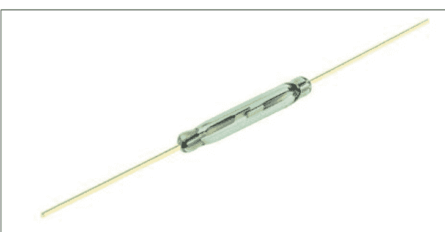
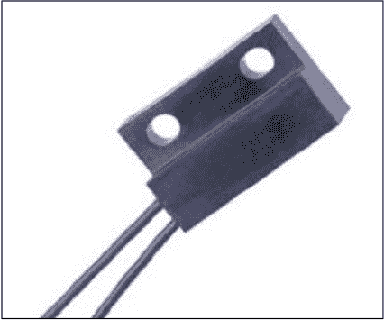
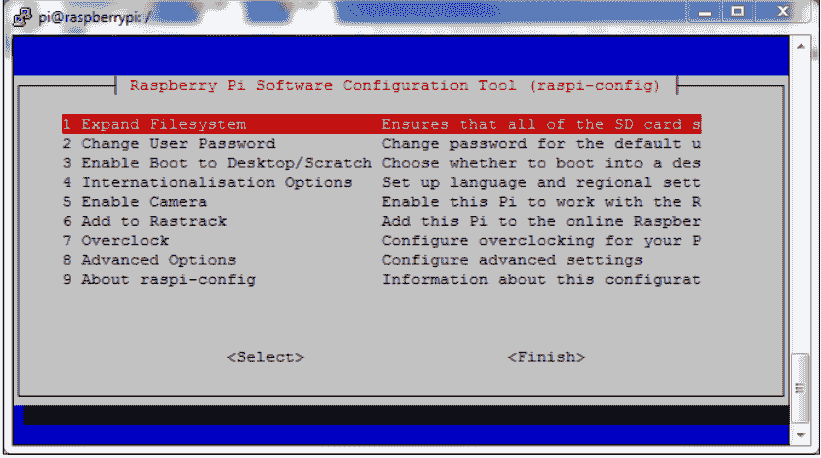
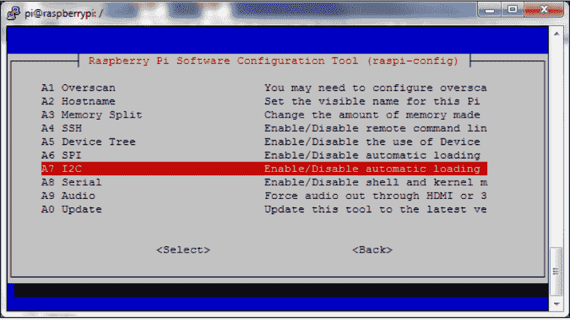
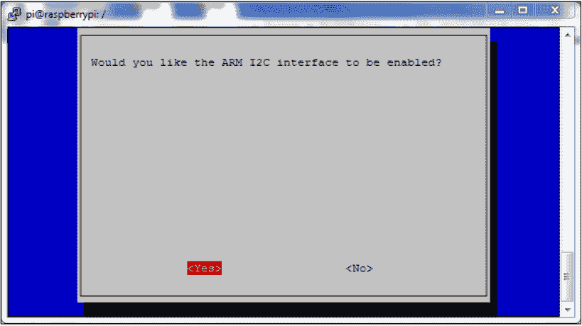
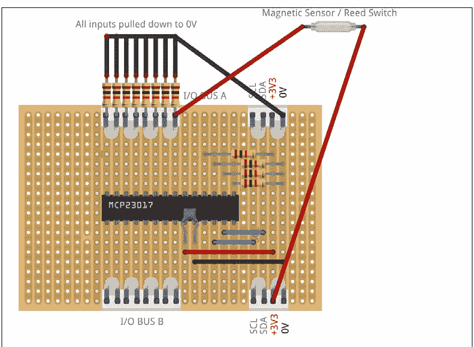
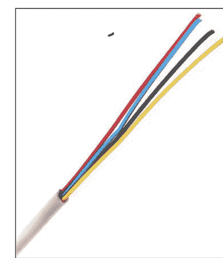
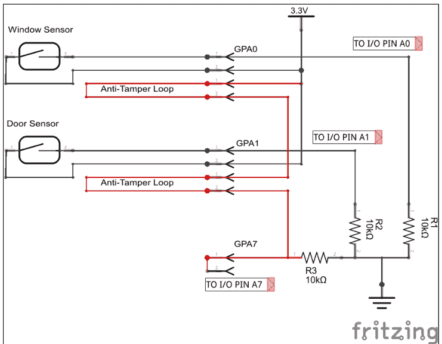
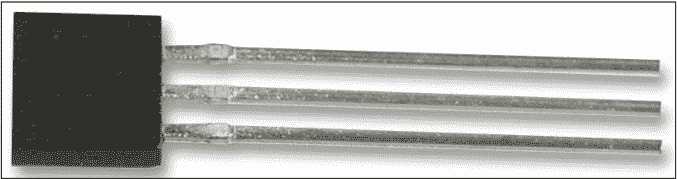

## 4

## 添加磁接触传感器

现在我们已经构建了端口扩展器硬件，我们需要学习如何对其进行编程，以便我们的 Raspberry Pi 能够检测到我们作为家庭安全系统一部分连接到它的设备。我们将从以磁性传感器的形式将开关连接到我们的系统开始——这是家庭安全系统中用于检测通过门窗入侵的最常见组件。

在本章中，我们将涵盖以下主题：

- 了解干簧管及其作为门传感器的工作原理
- 在 Raspberry Pi 上启用和设置 I2C 总线
- 将我们的传感器连接到端口扩展器上的一个输入
- 学习如何从 Bash 脚本访问我们的 I2C 端口扩展器
- 编写一个脚本，检测我们门传感器的状态
- 了解其他类型的接触传感器，它们可以以相同方式连接和编程

## 先决条件

本章的练习需要以下部件：

- 我们的 Raspberry Pi 和端口扩展板
- 8 x 10K 欧姆电阻
- 一个磁性门传感器和磁铁
- 一根连接线
- 一根 4 芯报警线


# 磁性接触传感器的工作原理

**磁簧开关**本质上就是构成我们**磁性接触传感器**的元件。磁簧开关包含两个由磁性材料制成的金属触点（称为簧片），它们被封装在玻璃管壳内。当触点接触时，开关接通；当它们弹开时，开关断开，电路中断。控制这些触点的方式是借助**磁场**，当磁场靠近开关时，就会接通或断开电路。

常开（NO）型磁簧开关在正常情况下处于断开状态，直到磁铁靠近开关，将触点吸合在一起。

常闭（NC）型则相反，开关在正常情况下保持接通，直到磁铁靠近开关，将两个触点拉开。



一种典型的磁簧开关

现在你可以看到，磁簧开关如何作为一种有用的传感器用于安防应用，特别是用于我们的家庭安防系统，以检测**门**和**窗**的打开和关闭。我们只需将一个磁簧开关安装在门框上，并将其连接到安防系统，磁铁则放置在门上与开关相对的位置。当门打开和关闭时，就会使磁簧开关中的触点接通或断开。

专为安防系统设计的磁簧开关及其磁铁通常封装在小塑料外壳中，因此可以方便地用螺丝固定到门和门框上。



一个安装在门框上的磁性传感器，内含磁簧开关（型号：Cherry MP201801）

磁性传感器安装在门框上（显然，这样它可以连接到报警电路导线），而相应的磁铁将安装在门上，靠近边缘，使得当磁铁正对传感器时，传感器触点接通（或断开，取决于类型）。


相应的门装磁性致动器（型号：Cherry AS201801）

# 添加磁性接触传感器

## 设置 I2C 端口扩展器

既然我们已经构建了端口扩展器，现在需要做好连接传感器的准备。首先，我们需要在树莓派上安装工具，以便使用 I2C 总线并对连接到该总线的设备进行编程，包括构成端口扩展器的 MCP23017 芯片。

> 在系统上设置好 I2C 总线之前，请勿将端口扩展器连接到树莓派。

### 启用 I2C 总线

很可能默认情况下并未加载用于 I2C 总线的模块。幸运的是，这一过程相当简单，可以使用树莓派配置工具完成。请执行以下步骤：

1. 使用以下命令启动树莓派配置工具：

   ```bash
   sudo raspi-config
   ```

   

2. 选择选项 8：高级选项。

   

3. 选择选项 A7：I2C。

   

4. 选择 `<yes>`。

5. 重新启动树莓派，使设置生效。

现在 I2C 总线已启用，我们需要配置操作系统，使所需模块在每次系统启动时加载。为此，请执行以下步骤：

1. 使用以下命令编辑**模块文件**：

   ```bash
   $ sudo nano /etc/modules
   ```

2. 将以下行添加到文件中：

   ```text
   i2c-bcm2708
   i2c-dev
   ```

3. 保存文件并退出 Nano。

### 安装 I2C 工具包

为了使用 Bash 脚本轻松访问 I2C 总线，我们需要安装 `i2c-tools` 包：

```bash
$ sudo apt-get install i2c-tools
```

安装完成后，我们应该关闭系统：

```bash
sudo shutdown -h now
```

操作停止后，关闭树莓派电源，将端口扩展器连接到 GPIO 端口，然后重新上电，以便开始使用它。

作为快速检查，你可以通过输入以下命令来确认 I2C 支持是否已加载：

```bash
$ ls /dev/i2c-*
```

如果模块已加载，你应该会得到至少一条总线的列表——例如 `/dev/i2c-1`。如果没有加载，你很可能会看到以下响应：

```text
ls: cannot access /dev/i2c-*: No such file or directory
```

> 在这种情况下，你需要返回检查之前的步骤，因为某些操作没有正确执行。

### 查找我们的设备

`i2c-tools` 包会安装几个不同的工具，帮助我们使用连接到总线上的端口扩展器。`i2cdetect` 工具允许我们查找 I2C 总线以及连接到总线的设备。

要获取系统上 I2C 总线的列表，请输入以下命令：

```bash
$ sudo i2cdetect -l
```

你应该会得到以下响应：

```text
pi@raspberrypi ~ $ sudo i2cdetect -l
i2c-1   i2c     20804000.i2c         I2C adapter
```

上述输出显示我们有一个 I2C 总线，这个总线将连接到我们的 GPIO。请注意，早期型号的树莓派可能会将设备 ID 返回为 i2c-0。

我们现在可以使用该工具扫描连接到我们总线上的所有设备。我们通过指定总线 ID 来做到这一点，如下命令所示：

```bash
$ sudo i2cdetect 1
```

当 I2C 总线上没有任何设备（也就是未连接我们的端口扩展器）时，我们预计会看到以下输出：

```text
pi@raspberrypi ~ $ sudo i2cdetect 1
WARNING! This program can confuse your I2C bus, cause data loss and worse!
I will probe file /dev/i2c-1.
I will probe address range 0x03-0x77.
Continue? [Y/n] Y
      0  1  2  3  4  5  6  7  8  9  a  b  c  d  e  f
00:          -- -- -- -- -- -- -- -- -- -- -- -- -- -- -- --
10: -- -- -- -- -- -- -- -- -- -- -- -- -- -- -- --
20: -- -- -- -- -- -- -- -- -- -- -- -- -- -- -- --
30: -- -- -- -- -- -- -- -- -- -- -- -- -- -- -- --
40: -- -- -- -- -- -- -- -- -- -- -- -- -- -- -- --
50: -- -- -- -- -- -- -- -- -- -- -- -- -- -- -- --
60: -- -- -- -- -- -- -- -- -- -- -- -- -- -- -- --
70: -- -- -- -- -- -- -- --
pi@raspberrypi ~ $
```

*在 I2C 总线上未找到任何设备*

在我们的家庭安防系统中，我们将把 BUS A 上的所有引脚分配为输入，以便连接我们的传感器。为此，我们使用以下命令：

```bash
$ sudo i2cset -y 1 0x20 0x00 0xFF
```

> 这个命令是什么意思？
> 
> - `-y`：该命令以无需用户交互的方式运行。
> - `1`：这是总线的 ID（例如 `i2c-1`）。
> - `0x20`：这是芯片的地址。
> - `0x00`：这是芯片上的数据寄存器（此处为 PORT A 引脚分配）。
> - `0xFF`：这是加载到数据寄存器中的值（此处为所有引脚均为输入——二进制 `%11111111`）。

你可以使用以下命令读取数据寄存器，以检查其是否已正确设置：

```bash
$ sudo i2cget -y 1 0x20 0x00
```

这应该返回 `0xFF` 值，即我们之前设置的值。

## 连接磁性接触传感器

既然我们已经让端口扩展器与树莓派协同工作，就可以开始连接设备，并创建用于监控输入引脚上传感器的脚本。

让我们回到上一章构建的端口扩展器洞洞板，连接我们的磁性传感器。但首先，我们需要确保所有输入默认通过 10K 欧姆电阻下拉到低电平。这样可以防止它们在读取端口数据时处于悬空状态并产生虚假数据。

> 在下图中，我将下拉电阻连接在外部，但你可能希望将它们直接设计在洞洞板上。在本书即将结束时，我们将提供一个新的电路板布局，将我们迄今原型设计的所有内容整合到一个单一解决方案中。

要检查端口的输入值，我们使用 `i2cget` 命令：

```bash
$ sudo i2cget -y 1 0x20 0x12
```

这应该返回 `0x00`，表示所有输入均关闭（二进制 `%00000000`）。


这个命令是什么意思？

- -y：此选项在不进行用户交互的情况下运行命令。
- 1：这是总线的 ID（例如 i2c-1）。
- 0x20：这是芯片的地址。
- 0x12：这是芯片上的数据寄存器（在本例中，为 PORT A 的读取值）。

现在让我们将磁传感器的簧片开关一侧连接到 BUS A 的数据引脚 0（我们将其称为 GPA0 以便参考），另一侧连接到我们的 +3.3V 线。默认情况下，开关为常开（NO），这意味着输入仍会被电阻拉低。

但是当你将随附的磁铁移近传感器开关时（例如，如果门已关闭），开关会闭合，将输入拉高至 +3.3V 线。如果现在读取端口的输入值，通过运行相同的命令，你应该会看到它返回 0x01，表示第一个位为高（二进制 %00000001）。



## 监控传感器

现在我们已经万事俱备，并且我们的磁传感器可以检测门是否关闭，我们可以使用一个简单的 Bash 脚本来监控该传感器，该脚本使用我们之前安装的 I2C 工具命令。

poll-magnetic-switch.sh 的代码清单如下：

```
#!/bin/bash
sudo i2cset -y 1 0x20 0x00 0xFF

# loop forever
while true
do
  # read the sensor state
  SWITCH=$(sudo i2cget -y 1 0x20 0x12)

  if [ $SWITCH == "0x01" ]
  then
    #contact closed so wait for a second
    echo "The door is closed!"
    sleep 1
  else
    #contact was opened
    echo "The door is open!"
  fi
done
```

当你运行脚本然后按下按钮时，你应该会看到 "The door is open!" 不断滚动到控制台屏幕，直到你停止按下它。

通过将其与第 2 章中我们复杂的灯开关项目相结合，我们可以在门打开时打开连接到 GPIO17 的 LED：

```
#!/bin/bash

#set up the LED GPIO pin
sudo echo 17 > /sys/class/gpio/export
sudo echo out > /sys/class/gpio/gpio17/direction

#set up port expander
sudo i2cset -y 1 0x20 0x00 0xFF
```

```
# loop forever
while true
do
    # read the sensor state
    SWITCH=$(sudo i2cget -y 1 0x20 0x12)

    if [ $SWITCH == "0x01" ]
    then
        #switch not pushed so turn off LED pin
        sudo echo 0 > /sys/class/gpio/gpio17/value
    else
        #switch was pushed so turn on LED pin
        sudo echo 1 > /sys/class/gpio/gpio17/value
    fi
    #short delay
    sleep 0.5
done
```

> 之后，当我们向不同的输入引脚添加更多传感器时，我们将需要能够检测到哪个传感器被触发。我们将在本书后面介绍如何编写一个 Bash 函数，该函数将解析 i2cget 命令返回的十六进制值，并告诉我们哪一个 8 个输入为高。

## 防篡改电路

如果你仔细观察我们的系统，你可能会意识到，根据你检测的是常开还是常闭传感器开关，仅仅剪断电线就有可能篡改传感器通道。因此，在常开开关的情况下，如果电线被剪断，监控系统将不会被激活，因为它始终看起来是打开的，即使开关已闭合。

为了缓解这个问题，大多数报警系统都采用 4 芯布线系统来连接传感器设备和主控板——两芯用于连接传感器，另外两芯用于创建防篡改回路，该回路本身也形成一个用于监控的传感器输入。



4 芯报警电缆

请看下面的电路图，以便你明白我的意思：



在这个电路中，我们有两个传感器：一个用于监控窗户，一个用于监控门。它们连接到 I/O BUS A 输入 0 和 1（或我们喜欢称之为 GPA0 和 GPA1）。与之前一样，它们通过电阻下拉至 0V，但当开关闭合时，正电压轨会使输入升高。

然而，我们还添加了一个贯穿整个系统的防篡改回路，该回路连接到 GPA7 以进行监控。回路通过连接传感器到控制器板的每根电缆串联连接。只要回路完好，输入 GPA7 就会保持高电平，但如果电缆在任何地方被剪断，电流将停止流经它，电阻 R3 将把输入拉低。这随后将被监控脚本检测到。

许多安全传感器产品都提供在其中终止防篡改回路线的功能。

因此，在我们的家庭安防系统中，我们将 GPA7 指定为我们的防篡改回路。

## 进入区域

到目前为止，你可能已经意识到，即使是中等规模的房产也可能需要大量的门窗传感器；因此，如果我们为每个传感器使用一个输入，我们很快就会用完，除非我们不断向系统添加更多的端口扩展器。商业上可用的安防系统也是如此。

因此，解决这个问题的方法是创建区域，每个区域包含一组传感器。例如，一个卧室可以被定义为一个区域，其中包含一个窗户传感器、一个门传感器和一个运动探测器构成该区域。在这种情况下，每个传感器都连接到下一个传感器形成串联（或菊花链）；如果其中一个被触发，它会提醒监控系统该区域内发生了触发。显然，这可能不一定是实际的探测器，但在大多数应用中这并不是真正的问题。

然而，当我们考虑在一个区域内混合使用常开和常闭类型的传感器时，这可能会带来一些挑战，但我们将在本书后面探讨这个问题。

你可以使用其他传感器列出如下：

- **霍尔效应传感器：**霍尔效应传感器是简单的电子芯片，用于检测放置在其附近的磁场。它们与我们一直使用的簧片开关没有太大区别；然而，由于它们是电子设备，它们能够测量相对于磁铁的接近程度（或磁性的强度），而不是像簧片开关那样只是开或关。此外，由于它们是固态的，它们可以被视为比机械开关更可靠。



一种低成本的霍尔效应传感器——Allegro Microsystems A1302KUA-T

- **压力垫传感器：**压力垫用于检测人站在或走在上面，可以放置在地板垫下以隐藏它们。它们甚至可以用于椅子中以检测有人坐在上面。从本质上讲，它们就像簧片开关一样，只是它们是通过走在上面产生的压力被激活的，因此可以像我们的磁传感器电路一样以完全相同的方式布线和使用。


压力开关可用于前门垫下
