## 5
添加被动红外运动传感器

在上一章中，我们开始向家庭安防系统添加基本但常用的磁性开关传感器，并读取其状态以防止门窗被入侵。我们还研究了如何将房屋划分为区域，例如按单个房间划分，以便我们可以将传感器分组为逻辑电路，然后将其识别为这些区域的一部分，而不是作为单个传感器输入。

我们现在将以**被动红外（PIR）**探测器的形式向我们的系统添加**运动传感器**。这些探测器有多种类型，你可能在房间的角落里见过它们。它们从根本上都以相同的方式工作，即检测一定范围内人体热量的存在；因此，它们通常用于在有人（或某物，例如宠物猫）进入房间时触发报警系统。

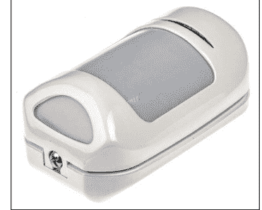

一种典型的 PIR 运动传感器（型号 GardScan QX-PIR）


在本章中，我们将：

- 学习 PIR 探测器的工作原理以及如何设置它们
- 将有线 PIR 探测器连接到端口扩展器的一个输入上
- 在我们的区域电路中使用 12V 电源代替 3.3V
- 学习如何安全地将 12V 电路与我们的 GPIO 端口接口
- 学习如何将 433 MHz 无线接收器连接到我们的 Raspberry Pi
- 使用 433 MHz 无线电信号将遥控开关连接到我们的系统
- 编写一个脚本，当状态改变时检测并记录我们的探测器输入状态

## 先决条件

本章（除上一章使用的组件外）您需要以下零件：

- 一个被动红外探测器，有线类型（可在任何 DIY 商店获得）
- 一个 4N25/4N35 光耦
- 一个 1N4148 二极管
- 一个 1-Kohm 电阻
- 一个 10-Kohm 电阻
- 一个 433 MHz 接收模块和遥控发射器（可选）
- 一个 12V 电源
- 一根接线
- 一根 6 芯报警线

## 被动红外传感器解析

你可能没有意识到，但所有物体都会辐射热能（包括你的咖啡桌）；只是你看不到，因为热量本质上由红外波组成，人眼不可见（与你的电视遥控器完全相同）。这些波 however 可以被为此目的设计的电子设备检测到，例如电视中检测遥控器按下时发出的能量的红外接收器。

你可能已经意识到，生活中的物体如我们、我们的猫和地板下的老鼠会产生相当多的热量。用于安防系统和自动灯具的被动红外运动传感器旨在检测这种热量水平。术语“被动”是指传感器本身不会辐射任何用于检测目的的能量——相反，它们只是检测物体发出的红外辐射。这与超声波传感器和雷达等设备明显不同，后者依赖于检测传感器发出的能量脉冲从物体反射回来的情况。

PIR 传感器需要有点智能，因为它们实际上必须应对房间中不断变化的温度。它们会稳定在所在房间的背景温度，例如它们指向的墙壁或地板的温度。当物体，例如我们或我们的猫，在探测器单元和背景物体之间移动时，传感器前方的温度会迅速升至体温，这进而触发系统。

## 设置你的 PIR 传感器

PIR 传感器设备有多种格式，包括传感器芯片的不同材料以及传感器视窗前透镜的不同类型，这些因素会极大地影响设备的范围、视场和灵敏度。因此，设置传感器的最佳指南通常是随附的那张小说明书。

然而，无论你拥有什么类型的 PIR 传感器，在考虑安装位置以避免误触发时，这里有一些通用指导原则：

- 确保设备安装在坚实的基础之上，并且不受振动影响
- 切勿将其安装在直射或反射阳光可能被透镜接收到的位置
- 同样，切勿将设备面向或安装在热源上方
- 不要将单元安装在通风不良的位置，因为这会影响其背景温度校准

单元的位置还取决于你想要保护的区域。你可能希望检测有人从走廊进入客厅，因此你的覆盖区域可以定义为从设备安装的房间角落到客厅门。

PIR 传感器通常提供固定的视场（例如 90 或 110 度），但范围会根据其指向的角度和安装高度而变化。

## 图像到3D生成

传统方法

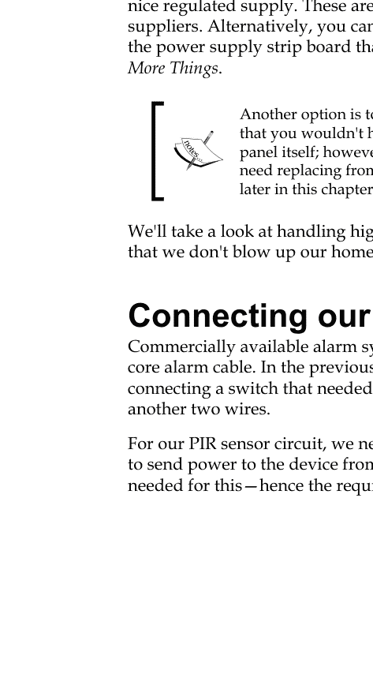

图像到3D方法

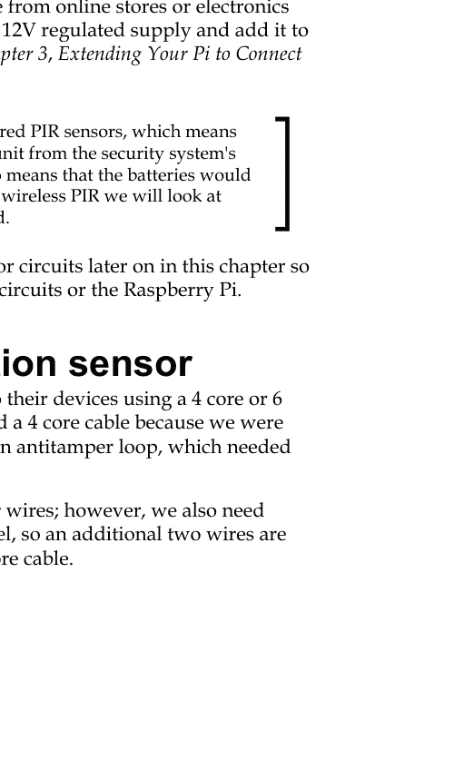

以下图表显示了我 GardScan PIR 传感器的接线连接，但这实际上是大多数现成安防系统设备的典型情况：

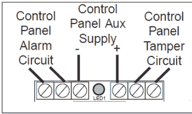

与上一章中我们查看的磁性触点传感器类似，设备可能带有常闭（NC）或常开（NO）报警。此特定设备具有常闭输出，这意味着当探测器被触发时，报警电路将被切断。这是我们传感器设备的首选配置，因为这意味着它们可以在我们的每个区域内串联布线。

我们现在可以将此传感器设备添加到上一章开始组装的报警电路中。以下图表显示了迄今为止我们所有传感器连入单个区域的电路：

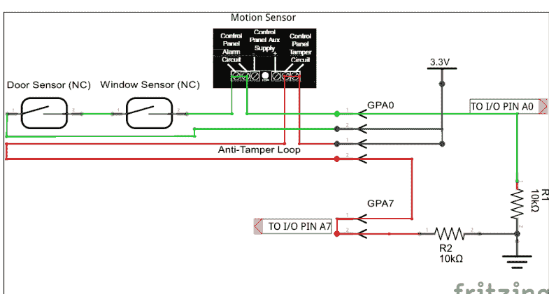

到目前为止，我们一直使用 +3.3V 电源通过传感器开关和报警电路。事实上，这不是一个好主意，我们只是为了方便测试我们的 GPIO 输入才这样做。

实际上，在我们的最终系统中，我们确实应该使用 12V 电源通过传感器和防拆电路。这是因为较高电压在系统中传输更好，并且不易受噪声影响，这可能会阻止触发或导致误触发。这也使其与市售系统和配件兼容。

## 12V 报警区域电路

让我们的区域电路使用 12V 而不是 3.3V 只需更换电源，而且事实上我们迄今为止使用的所有传感器都可以处理通过其开关的 12V 电源。

然而，如果我们将 12V 电路呈现给 Raspberry Pi 或我们的端口扩展器上的 GPIO 端口输入，我们预计会看到一些魔烟并闻到烧焦的气味。因此，我们需要添加一些电路，使我们能够使用 12V 报警电路，同时保护我们的控制板输入。

## 报警电路保护

保护我们的区域输入免受 12V 报警输入的有效方法是使用一种名为光耦的小型低成本设备。正如名称所示，它使用光将报警电路与控制板的数字输入隔离。

光耦内部（也称为光耦合器）有一个红外 LED，当电流通过它时，它会将光传输到光晶体管，从而将其打开。电路在电气上是隔离的，因为它们仅由光控制。

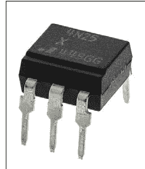

4N25（上图所示）和 4N35 是低成本的 6 引脚光耦合器设备，大多数制造商倾向于使用下图所示的引脚布局：

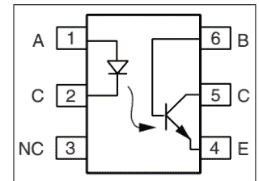

现在我们知道了如何将我们的 12V 报警电路与控制面板上的输入耦合，让我们构建整个电路，我们将为添加到系统中的每个区域使用该电路。

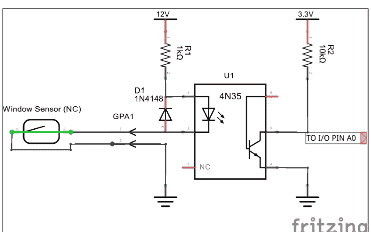

从 GPIO 输入光学隔离的 12V 区域电路

## 工作原理

此时，我们假设我们的区域电路是常闭的——也就是说，当电路断开时报警触发。

12V 电源通过光耦的 LED 传输，电流由 1-Kohm 电阻限制。1N4148 二极管反向放置，是为了保护光耦免受反向极性电压的影响。

> 1-Kohm 电阻是根据我们有 12V 电源以及 LED 上正向压降（Vf）为 1.2V、电流（If）约为 10 mA 的事实计算得出的。

当报警电路闭合时，电流流动，LED 亮起。这保持晶体管导通，GPIO 端口的输入被拉低。如果报警电路断开，光耦 LED 关闭，这进而关闭晶体管。GPIO 输入随后由 10-Kohm 电阻拉高。

这很简单但有效，对吧？

该电路的另一个优点是它应该失效为正——也就是说，如果光耦因任何原因失效，GPIO 端口上的报警输入应被拉高，从而触发它，而不是静默失效。

## 无线 PIR 运动传感器

无线运动传感器现在以低成本广泛可用，允许它们在没有来自报警控制面板的任何布线的情况下几乎安装在任何地方。其中一些仍需要外部电源，但许多使用电池。报警系统必须包含与无线传感器兼容的无线接收器。

在本节中，我们将看看如何使用基于 Raspberry Pi 的安防系统与无线接收器设备。

## 433-MHz 无线报警系统

无线系统使用未授权的无线电频率在报警系统的各个组件之间通信。在英国，使用最广泛的两个频率是 433 MHz 和 868 MHz。虽然较新的系统现在使用 868 MHz 频率，但 433 MHz 仍被广泛使用，因为其范围略长于 868 MHz 系统。然而，433 MHz 波段也被许多其他设备使用，这使其拥挤，而 868 MHz 通常仅用于报警系统。

虽然无线安防系统可能很方便，但了解使用无线系统而非有线系统的优点和缺点很重要。


优点如下：

- 安装简便快捷
- 拆卸方便，这意味着你可以随身携带它们
- 未来扩展系统会更容易，大多数系统会自动检测新单元

缺点如下：

- 比有线系统更昂贵，有时成本是三到四倍
- 安全性不如有线系统，并且根据欧洲标准 BSEN 50131 无法达到高于二级的安全等级（尽管，该等级适用于家庭住宅）
- 无线设备需要定期更换电池
- 无线系统可靠性较低，容易受干扰甚至无线电干扰

### 连接 433-MHz 接收器

过去，你可以使用价格低廉的接收器，例如 XY-MV-5V 模块，以及由 GitHub 贡献者 Mark Wolfe 编写的 433-Util 库，为 Raspberry Pi 搭建自己的 433-MHz 接收器。基本上，他收集了与 433-MHz 通信相关的代码并将其全部放入此库中。最初为 Arduino 开发，现已移植到 Raspberry Pi。

然后你可以使用 readily available 的发射器，例如钥匙扣或任何其他 433-MHz 发射器，并在按下发射器上的每个按钮时查看传入的代码。

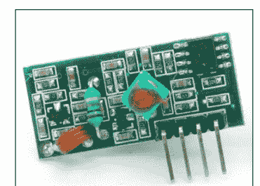

A XY-MK-5V Generic 433-MHz receiver module

找到合适的 433-MHz 接收器应该很容易，因为像 Amazon 和 eBay 这样的网站上充斥着它们，而且价格低至几英镑。

请注意，433-MHz 频段可供许多类型的设备免费使用。因此，有各种不同类型的接收器，虽然它们都可能声称是 433-MHz 接收器，但它们可以使用 AM 或 FM 工作，有些只能检测特定类型的数据。有些，例如 Quasar QAM 系列，可能还需要特殊的解码芯片来读取传输数据，并且可能仅与配对的发射器一起工作。

接收器模块可以接收来自钥匙扣遥控器的信号，例如以下图像中所示的那种（可以在任何当地 DIY 店的家庭安防区买到），其输出为一系列方波。这些方波随后由 433-Util 软件解码。

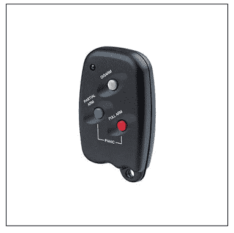

A Novar/Blyss 433MHz wireless remote control

我喜欢这个特定的遥控器，因为我认为它作为我们家庭安防系统的 **arm** 和 **disarm** 设备会很好。我将在 *Chapter 8, A Miscellany of Things* 中谈论布防和撤防，在那里我们将研究实现此目的的方法。

它只是开关继电器开和关的事实意味着我们可以轻松地将其实现在我们的家庭安防系统中，因为它只是一个开关。当你按下发射器上的按钮时，继电器会接通触点；再次按下，继电器就会断开。板上的螺钉端子为我们提供了访问继电器端子的途径。

### 接收器接线图

由于我们只处理开关输入，因此我们可以使用与前面区域电路相同的电路，但连接到我们的布防/撤防 GPIO 输入，该输入将在第 9 章 Putting It All Together 中确定。

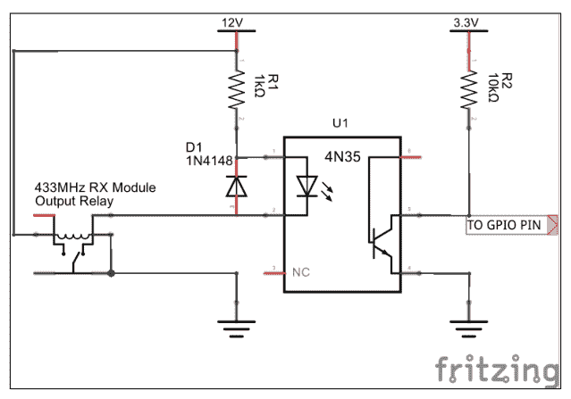

Circuit to interface the receiver module with a GPIO input

当接收器模块接通继电器时，这将通过打开光耦的 LED 完成 12V 电路。这将使晶体管将 GPIO 引脚拉低到地，使其输入为低电平。

你可以使用这种类型的电路用于任何配对接收器，用于你想在系统中使用的无线安防设备。

### 记录检测数据

对于任何系统，能够在发生某些事情时记录数据都是很有用的。我们也可以通过在区域中的探测器被触发时每次都写入日志文件来实现这一点。这样，你可以记录有人进入房间的每次情况，即使系统未布防也可以稍后查看。你也可以记录系统何时布防和撤防。

下面是一个简单的脚本，展示了当我们的 GPIO 输入连接的区域发生事件时如何做到这一点：

```
#!/bin/bash

#set up the I2C expansion port
sudo i2cset -y 1 0x20 0x00 0xFF

#reset status
CURR_STATE="0x00"
LAST_STATE="0x00"

#path to the log file
LOG_FILE="/etc/pi-alarm/zones.log"

# loop forever
while true
do
  # read the gpio inputs
  CURR_STATE=$(sudo i2cget -y 1 0x20 0x12)

  #check if state has changed
  if [ "$CURR_STATE" != "$LAST_STATE" ]
  then
    #write change to log file
    TIMESTAMP=`date "+%Y-%m-%d %H:%M:%S"`
    echo "$TIMESTAMP Zone Status Changed from $LAST_STATE to $CURR_STATE" > $LOG_FILE
  fi
  $LAST_STATE = $CURR_STATE
  sleep 1
done
```

前面的示例相当简单，但可以通过实际写出发生变化的区域或区域，使其更有用，即通过解码 i2cget 命令返回的十六进制值中的构成区域。

在 *Chapter 9, Putting It All Together* 中，你将学习如何做到这一点，以便在网页上显示每个区域的单独状态。你可以使用完全相同的技术来为你的日志文件执行此操作，事实上，通过扩展相同的脚本输出到日志文件。

### 摘要

在本章中，我们首先学习了被动红外传感器如何用于检测运动，以保护预定义的覆盖区域免受入侵。然后我们研究了如何通过光耦将它们连接到端口扩展器的输入，因为我们现在将使用 12V 为报警区域电路供电。

然后我们研究了在开放的 433-MHz 频段上运行的无线报警系统，该频段通常用于安防设备。在探索了在 Raspberry Pi 上使用旧版 433-Util 位操作软件解码使用简单接收器传输的信号的可能性后，我们选择使用配对接收器设备，该设备可以轻松地与我们的报警电路输入接口。

最后，我们创建了一个简单的脚本，该脚本将记录报警输入的变化到文本文件，后续可以扩展以详细记录系统正在发生的情况。
