## 6 向我们的安防系统添加摄像头

到目前为止，我们一直在组装将允许我们将传感器连接到报警系统以使用开关或被动红外运动探测器检测入侵的元素，这些元素反过来会告诉我们的 Raspberry Pi 特定区域发生了什么。这些元素将在本书后面作为一个整体系统汇集在一起。

随着添加摄像头来拍摄照片和视频片段，并在检测到某些情况时立即通过电子邮件发送给我们，我们的系统现在将变得更加复杂。

我们还将使用电子邮件在外出时在智能手机上向我们发送警报，当系统中的任何传感器被触发时。

在本章中我们将涵盖以下主题：

- 设置 Raspberry Pi 摄像头模块并学习如何捕获静态图像和视频图像
- 学习如何将捕获的图像叠加文本和时间戳
- 使用运动探测器触发图像捕获
- 实时通过电子邮件发送图像和视频文件给我们
- 了解白天和夜间捕获图像之间的差异
- 根据需要打开和关闭安防照明和其他大电流设备
- 连接 USB 网络摄像头而不是原生摄像头模块

### 先决条件

除了上一章中使用的组件外，本章你还需要以下部件：

- 一个 Raspberry Pi 标准摄像头模块
- 一个 Raspberry Pi NoIR 摄像头模块
- 一个红外 LED 阵列和/或可见光 LED 阵列
- 一个 USB 网络摄像头

### Raspberry Pi 摄像头模块

Raspberry Pi Camera Module 是官方的 Raspberry Pi 配件，可与所有型号的 Pi 一起使用，可用于拍摄高清静态照片和视频图像。它直接连接到 Pi 板的摄像头串行接口（CSI）端口，该端口专用于这些模块以实现高速操作。

摄像头本身是一个 500 万像素的定焦传感器，支持 1080p、720p 和 VGA 视频模式以及静态捕获。

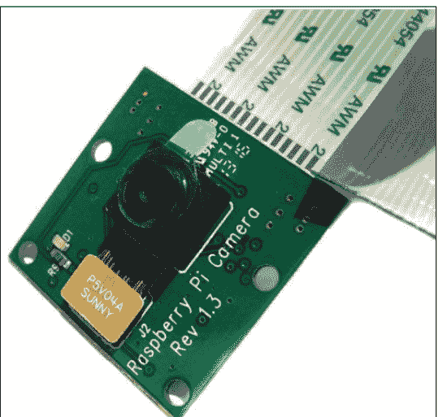

The official Raspberry Pi Camera Module


## 为我们的安全系统添加摄像头

如以下图像所示，排线连接器并不算长，因此摄像头需要靠近 Raspberry Pi 放置。通过使用摄像头外壳，你实际上可以将摄像头直接安装在 Raspberry Pi 外壳顶部，如果这样对你有用。

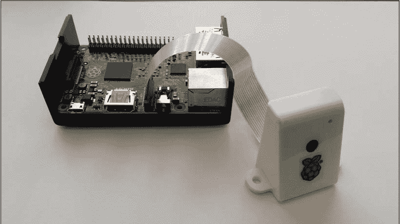

装在外壳内的摄像头模块

## 设置摄像头模块

在我们使用摄像头模块之前，需要在 Raspberry Pi 上启用摄像头支持。为此，我们使用 `raspi-config` 工具，就像我们在旅程早期对 I2C 总线所做的那样。

- 1. 使用 SSH 从沙发上以懒人方式连接到你的 Raspberry Pi，或直接使用键盘和显示器连接。
- 2. 登录后，使用以下命令启动配置工具：

```bash
$ sudo raspi-config
```

3. 然后，选择 5 Enable Camera。

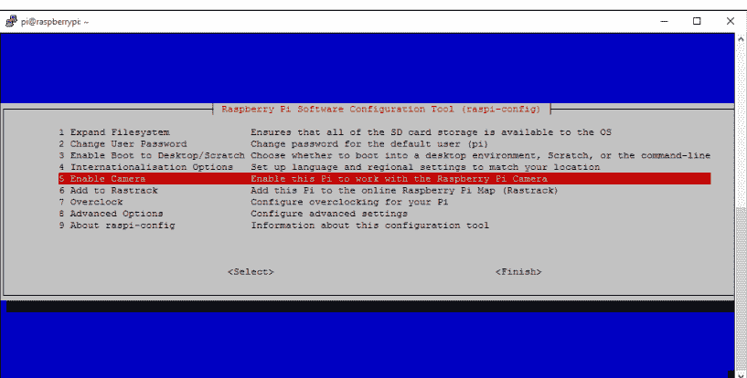

4. 然后会要求你确认是否要启用摄像头支持。

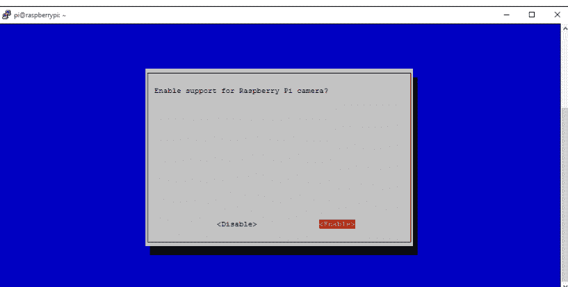

5. 选择 <Enable>。

6. 然后，选择 Finish 并重新启动 Pi 以启用摄像头设置。

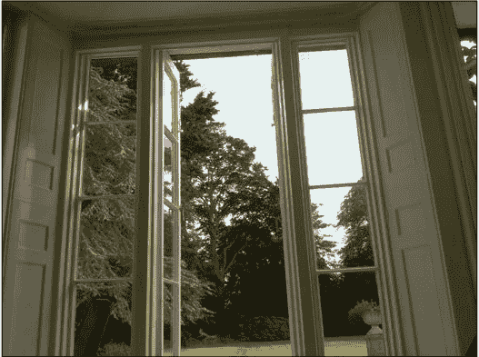

Raspberry Pi 摄像头模块拍摄的测试照片

> 如果你运行 raspistill 时发现输出错误，请确保排线两端都已正确连接。另一个需要注意的地方是，有时将实际摄像头镜头组件连接到摄像头板上微小连接器的排线会松动。请确保此连接也牢固。我在将摄像头模块从我的随机测试零件盒中取出使用时，有几次遇到过这个问题。

raspistill 实用程序具有大量用于操纵其捕获图像的选项，我们稍后在捕获脚本中会使用其中的一些选项。在此期间，要查看可用选项，请在不带任何选项的情况下运行 `raspistill`，它们将被列出：

```bash
$ raspistill
```

## 做个视频明星

现在我们知道摄像头模块正在工作，我们可以尝试捕获一些视频。为此，我们将使用 `raspivid` 实用程序。以下命令将拍摄 5 秒的高清视频并将文件保存到你的 Raspberry Pi：

```bash
$ raspivid -o test.h264 -t 5000
```

你会注意到该文件名为 `test.h264`——这是因为视频以原始 **H.264** 视频流的形式捕获。不幸的是，并不是很多媒体播放器都能处理这些文件（尽管 VLC 播放器可以——它很棒，可以处理你扔给它的几乎任何东西——在你的 PC 上获取它，网址为 `www.videolan.org`）。

## 为我们的安全系统添加摄像头

如果你想在智能手机和常规媒体播放器上播放该文件，那么我们需要将其包装在容器格式中，例如 MPEG-4，并为文件添加 .mp4 扩展名。

为此，我们将使用 GPAC 软件包，它是一个开源多媒体框架。它附带一个名为 MP4Box 的实用程序，我们将使用它为我们的视频文件创建 MP4 容器：

- 1. 首先，安装 GPAC 软件包：
  
  ```bash
  $ sudo apt-get install gpac
  ```
  
- 2. 安装后，运行命令转换我们创建的测试视频：
  
  ```bash
  $ MP4Box -fps 30 -add test.h264 test.mp4
  ```

你现在应该拥有文件 test.mp4，可以将其下载并在你的 PC 或智能手机上播放。

> 另一个流行的转换工具是 ffmpeg，我在 Windows 上经常用它来转换视频文件；然而，它可能相当复杂，虽然 Raspberry Pi 有该软件包，但我实际上无法在 Pi 上正确转换。MP4Box 更加简单直接，更适合我们的需求。

## 被摄像头捕捉

因此，我们现在有了一种捕获静态图像和视频的方法，可以将其用于我们的安全系统。如果我们想让它不断运行，我们可以编写一个脚本来不断拍摄视频，但这很快就会填满我们的存储卡，而且效率也不高。因此，我们将把摄像头系统与我们之前连接的运动探测器结合起来。

在上一章中，我们创建了一个报警区域，该区域连接了几个传感器和一个连接到我们系统输入 GPA0 的运动探测器。因此，让我们编写一个脚本，以便在运动探测器被触发时拍摄视频片段：

```bash
#!/bin/bash

# set up port expander
sudo i2cset -y 1 0x20 0x00 0xFF

# loop forever
while true
```

```sh
do
    # read the GPA inputs
    GPA=$(sudo i2cget -y 1 0x20 0x12)

    # detect the zone on input 0
    if [ $GPA == "0x01" ]
    then
        #circuit normally closed so zone is OK
        #short delay
        sleep 0.5

    else
        #zone is activated so take a 20 sec video clip

        #filename will be based on current timestamp
        sDate='date +%d%m%y'
        sTime='date +%T'
        echo "Zone 1 Activate at $sDate $sTime"

        #take video clip
        raspivid -o $sDate$sTime.h264 -t 20000

        #convert to MP4
        MP4Box -fps 30 -add $sDate$sTime.h264 $sDate$sTime.mp4
    fi
done
```

## 你有新邮件

将图像存储在你的 Raspberry Pi 上其实没什么用——理想情况下，你希望图像在被捕获后立即发送给你，以便你可以在智能手机上查看它们。

一种简单、快速且可靠的方法就是直接通过电子邮件发送给自己。因此我们将为家庭安全系统添加电子邮件功能，以便图像捕获会作为消息附件立即发送到你的电子邮件地址，你可以从智能手机访问。图像随后可以从 Raspberry Pi 上删除，以防止 SD 卡空间被这些相当大的文件占用。

## 发送附件

现在我们可以在家庭安全系统上发送基本电子邮件，让我们尝试发送我们之前从摄像头拍摄的静态图像。但首先，我们需要安装另一个软件包来帮助我们完成此操作：

```
$ sudo apt-get install mpack
```

安装后，你可以使用以下命令发送我们之前拍摄的测试图像文件：

```
$ sudo mpack -s "Security Photo" test.jpg me@mydomain.com
```

我们现在拥有了所有必要元素，可以直接通过电子邮件将警报和图像从家庭安全系统发送到我们的智能手机。

## 那是在哪里拍摄的？

通常，你只需在电子邮件消息中注释说明所附图像的拍摄地点和时间，但那样就不如直接在图像上叠加一些文字那么酷了，对吧？所以让我们借助 imagemagick 来施展魔法，它是一个流行的命令行图像处理工具。使用以下行安装它：

```
$ sudo apt-get install imagemagick
```

我们现在将使用命令行拍摄我们之前拍摄的测试照片，使用 imagemagick 实用程序之一叠加一些文字，并将其保存到另一个文件：

```
$ convert test.jpg -fill red -pointsize 48 annotate +20+60 'Camera 1' annotated.jpg
```

## 为我们的安全系统添加摄像头

几秒钟后，这将生成一个名为 `annotated.jpg` 的文件，其中包含我们的图像，并在顶部角落用红色写着 **Camera 1**。当我们将所有这些内容整合到最终系统中时，我们还将把图像叠加时间戳。

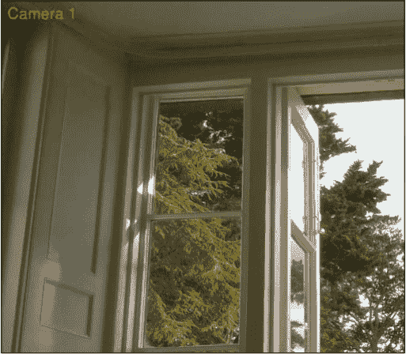

> 目前，`raspistill` 工具生成的图像相当大，因为它们是高分辨率照片。这使得处理和发送它们在处理时间方面有点耗时，因此当我们构建最终系统时，我们将使用 `raspistill` 选项 `-w`、`-h` 和 `-q` 来减小图像的大小和质量，使系统更高效。

要捕获更小的图像文件，请尝试使用以下命令：

```bash
$ raspistill -o test.img -h 768 -w 1024 -q 25
```

## 夜视功能

标准 Raspberry Pi 摄像头非常适合在白天拍摄人们走上花园小径的快照，但在夜间拍摄时，它并不太合适。解决这个问题有两种方法：第一种是在 PIR 探测器被触发时用明亮的灯光照亮捕获区域，第二种是使用 Raspberry Pi **NoIR 摄像头模块**和红外 LED 阵列，让摄像头在黑暗中看到。稍后会详细介绍。


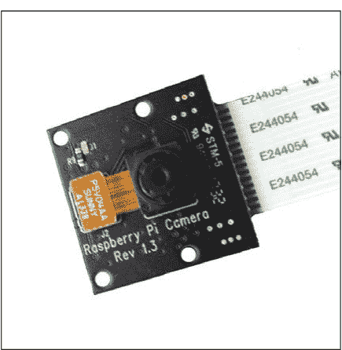

Raspberry Pi NoIR 摄像头模块；它看起来与标准型号相似。

## 一次照明体验

为了通过 Raspberry Pi GPIO 或我们的端口扩展器电路点亮灯泡或 LED 阵列，我们需要某种器件，能够驱动比 GPIO 端口单独提供的更高的电流和电压。

TIP120 达林顿晶体管是一个很好的选择，它允许我们从 GPIO 引脚开关高达 80V 和 5A 的负载。在后续的完整系统中，我们将使用 MCP23017 端口扩展器的 B 端口来控制输出，但该原理适用于我们可用的任何 GPIO 输出。

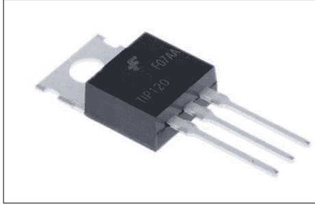

TIP120 晶体管可以廉价购买，但能够驱动大负载。

下面的电路展示了如何从 GPIO 端口输出驱动大负载。

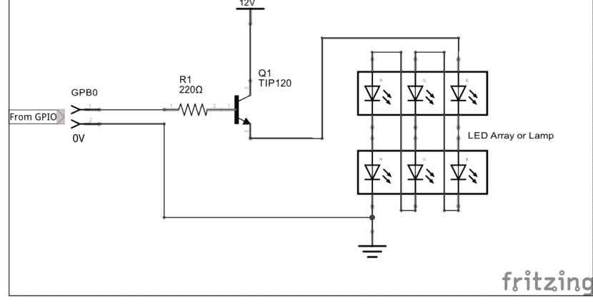

在示例电路中，我们使用一个 GPIO 输出引脚通过 220 欧姆电阻控制晶体管的基极。当 GPIO 引脚变为高电平时，晶体管导通，使 12V 电路通过 LED 阵列流动。

在上述电路中，没有为 LED 设置限流电阻，因为它们是串联的，九个 LED 每个压降约 1.5V，对于 12V 电源来说大致合适（是的，我知道这里只画了六个 LED，但仅为示意）。请记得根据您的具体需求进行调整。该电路可以轻松驱动其他负载，例如灯泡或蜂鸣器。

> 如果您打算驱动高功率负载，可能需要将 TIP120 安装到散热器上，以消散热量并防止过热烧毁。不过，在我们之前演示的电路中，可能不需要散热器，因为我们最多只驱动几百毫瓦的功率。

## 再访精致的电灯开关

再次扩展前几章中的精致电灯开关，我们可以再次编写一个 Bash 脚本，当 PIR 检测器被触发时，该脚本将打开摄像头灯，用摄像头拍照，并通过电子邮件发送给我们。

对于以下脚本，我们假设控制 TIP120 晶体管的输出是树莓派的 GPIO17 引脚（即连接器的 D0 或引脚 11），它取代了之前设置中的 LED。来自 PIR 触发器的输入同样连接到 MCP23017 端口扩展器的 GPA0（A 端口数据引脚 0）。所有其他输入如前所述，使用 10K 电阻拉低：

```bash
#!/bin/bash

#set up the High Load GPIO pin
sudo echo 17 > /sys/class/gpio/export
sudo echo out > /sys/class/gpio/gpio17/direction

#set up port expander Port A for inputs
sudo i2cset -y 1 0x20 0x00 0xFF

#clear the output by default to switch light off
sudo echo 0 > /sys/class/gpio/gpio17/value

# loop forever
while true
do
  # read the sensor state
  SWITCH=$(sudo i2cget -y 1 0x20 0x12)

  #PIR is normally closed so pin is held high
  if [ $SWITCH != "0x01" ]
  then
    #PIR was triggered - pin taken low

    #switch on lamp driver
    sudo echo 1 > /sys/class/gpio/gpio17/value
    sleep 0.5

    #take a still image
    sudo raspistill -o -image.jpg -h 768 -w 1024 -q 25

    #email the image
    mpack -s "Security Alert Photo" test.jpg me@mydomain.com

    #switch off the lamp driver
    sudo echo 0 > /sys/class/gpio/gpio17/value
fi
#short delay
sleep 0.5
done
```

pir-camera-trigger.sh

您现在会看到，我们已经开始开发将控制家用安防系统的软件基础。

## 那是獾吗？

如果您不想在拍摄图像前照亮某个区域，可以使用**红外照明**配合兼容的摄像头。标准的树莓派摄像头模块无法与红外照明配合使用，因为它包含红外滤光片，但我们可以改用 NoIR 版摄像头模块。

树莓派 NoIR 摄像头模块与标准模块完全相同，只是没有内置红外滤光片，这意味着在红外照明的帮助下，它可以在黑暗中看到东西。这使得它既适合夜间观察獾，也适用于我们的家用安防系统。

您需要一个红外 LED 阵列或灯组，以不可见光的方式照亮您想用摄像头拍摄的区域。这些产品有多种外形和强度可供选择，您也可以使用从电子商店购买的单颗红外 LED 自行制作。

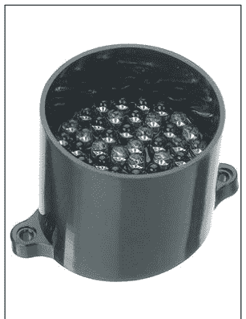

连接和驱动 LED 灯组模块的方式与上述照明灯完全相同，使用 TIP120 驱动电路。唯一不同的是，我们人眼无法看到 LED 是否点亮。

## 使用 USB 摄像头

除了使用树莓派摄像头模块，也可以使用标准的 USB 网络摄像头拍摄静态图像。但您应该知道，专用摄像头模块在图像质量方面远优于 USB 网络摄像头。不过，您可能已经在零件箱里有一个闲置的网络摄像头，为什么不试试呢？

## 安装网络摄像头

将网络摄像头连接到树莓派的 USB 端口后，您可以使用 `lsusb` 命令检查它是否已被识别：

```
```bash
$ lsusb
```
```

我使用的罗技网络摄像头在 `lsusb` 下报告如下（设备 006）：

```text
pi@raspberrypi ~ $ lsusb
Bus 001 Device 002: ID 0424:9514 Standard Microsystems Corp.
Bus 001 Device 001: ID 1d6b:0002 Linux Foundation 2.0 root hub
Bus 001 Device 003: ID 0424:ec00 Standard Microsystems Corp.
Bus 001 Device 006: ID 046d:08d8 Logitech, Inc. QuickCam for Notebook Deluxe
```

> > 并非所有网络摄像头都能在树莓派上工作。即使它可能被识别为 USB 设备，也可能无法与操作系统正常工作并创建视频设备（例如 `/dev/video0`）。例如，我有一款旧的廉价 Trust 网络摄像头，它显示为 USB 设备，但无法捕捉任何图像。您可以在 http://elinux.org/RPi_USB_Webcams 查看您的网络摄像头型号，以确认其是否可能与树莓派兼容。

所以，现在树莓派知道我们连接了网络摄像头设备，我们可以使用 `fswebcam` 工具来捕获图像帧。您可以在开发者网站 http://www.sanslogic.co.uk/fswebcam 上了解更多关于 fswebcam 的信息。

使用以下命令安装 `fswebcam`：

```
```bash
$ sudo apt-get install fswebcam
```
```


## 拍摄快照

您现在可以通过捕获静态图像来测试网络摄像头，运行以下命令即可：

```
$ fswebcam test.jpg
```

您应该会看到类似以下的输出：

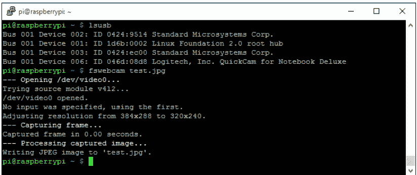

> `fswebcam` 有许多选项，例如图像的分辨率和质量。使用命令 `fswebcam -?` 获取所有选项列表。

## 连续快照

`fswebcam` 不能拍摄视频流，但您可以将其设置为按固定间隔拍摄一系列帧。例如，要每 10 秒拍摄一张快照，可以使用以下命令：

```
$ fswebcam frame.jpg -l 10
```

一个有用的示例是，将网络摄像头设置为在后台每隔几秒拍摄一张快照（`-q` 开关让 `fswebcam` 在后台运行）。当安防系统被触发时，我们可以获取网络摄像头拍摄的最新图像，该摄像头可能正对着您的通道。

为了在本书后面构建完整系统，我们将重点使用树莓派摄像头模块，但如果您想改用 USB 网络摄像头，也可以随时用之前的示例替换代码。

您会注意到，与 `raspistill` 不同，`fswebcam` 能够在图像上叠加时间戳信息，因此您无需像之前那样担心叠加文本。请查看 `fswebcam` 命令行选项以了解更多信息。

## 多摄像头设置

您可能已经想到，树莓派只有一个摄像头模块输入。如果您想在房屋周围安装多个由运动检测器触发的摄像头，这显然会受限。

然而，我们完全可以构建独立单元，每个单元配备单独的树莓派板、PIR 探测器、摄像头模块和网络连接（使用 Wi-Fi 适配器或以太网）。

由于只需一个输入到树莓派的 GPIO 端口即可检测 PIR 运动传感器何时触发，您可以使用板载 GPIO 端口连接传感器，而非端口扩展器。树莓派将通过电子邮件发送警报，并在需要时提醒主控制器树莓派——使其成为从属传感器设备。

您可以轻松获得小型 PIR 探测器，例如下面显示的 Parallax 产品，您可以将其与摄像头模块一起安装到树莓派外壳上，构成一个独立的单元。

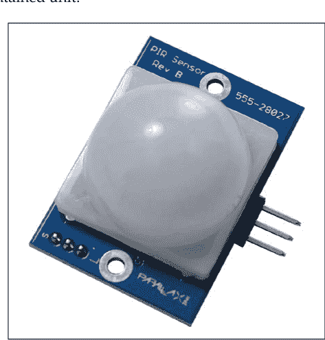


### 从设备驱动器

虽然为每个摄像头配备一台 Raspberry Pi 看起来相当复杂——但请想一想——实际上，你可以用大约 50 英镑的价格构建每个摄像头单元及其所有组件，这比购买无线智能摄像头要便宜得多。如果你真的想做得巧妙一些，还可以将它用作从设备，以接受该单元本地的更多传感器输入。

你完全可以做到：将从单元上的一个 GPIO 输出引脚连接到主控制器的一个输入，并根据其本地传感器的状态来控制该引脚。只要在两个单元之间铺设一根 6 芯电缆，如果你的电源功率足够强大，你甚至可以为从单元供电（你需要沿电缆为从 Pi 提供 5V @ 1A 的电源）。

目前我不打算对这种配置进行更多细节说明，但你可以给自己设定一个挑战：利用多块 Raspberry Pi，以及本书中学到的构建模块和概念，创建一个完全分布式的家庭安防系统。

### 总结

在本章中，我们学习了如何将 Raspberry Pi 摄像头模块和 USB 摄像头连接到我们的 Pi 板，以便在家庭安防系统需要时进行图像和视频采集。我们还学习了如何在图像上叠加信息文本，并立即将文件通过电子邮件发送给我们。

为了在夜间从摄像头采集图像，我们还研究了使用可见光和红外光照明拍摄区域的方法，并能够通过使用大电流达林顿晶体管驱动器，根据需要开启或关闭照明。

在下一章中，我们将着手进行模块整合，为我们的家庭安防系统构建一个针对移动设备优化的基于 Web 的控制面板。我们将学习如何在 Raspberry Pi 上设置 Web 服务器，并使用 Web 控制面板操作文件，这意味着我们将开始探索迄今遇到的所有元素如何组合到最终系统中。
