## 7 构建基于 Web 的控制面板

现在我们已经拥有了所有硬件元件，可以打造一个完整的家庭安防系统，包括用于门窗的接触开关，以及用于给潜在的闯入者拍快照的运动探测器和摄像头！我特意以模块化的方式引导你完成这一切，以便你可以根据自己的需求挑选和扩展硬件传感器元件。在第 9 章“整合所有部分”中，我们将把所有这一切连接在一起，形成基于我们之前讨论的防区的完整系统。

所有家庭安防系统都需要一个**控制面板**，让我们能够**布防**和**撤防**系统，并监控系统内各防区的状态。我们还可能希望只对某些防区进行布防，或者让系统在一天中的特定时间自动布防和撤防。

实现这些功能所需的硬件，如开关、LED 和 LCD 显示屏，可能相当昂贵且组装费时；它们也会使系统的可配置性和灵活性降低。因此，在我们的系统中，我们将构建一个可以从手机浏览器访问的基于 Web 的控制面板。这也意味着当我们离家外出时，可以远程控制系统。

在本章中，我们将介绍以下内容：

- 根据我们将监控的防区数量和将使用的 I/O 端口，定义家庭安防系统的范围
- 学习如何在 Raspberry Pi 上安装和配置 Web 服务器
- 为报警控制面板开发一个基本的 HTML5 网页
- 学习如何使用 PHP 脚本从网页动态配置系统

### 安装 Web 服务器

有多个现成的 **Web 服务器**可以安装到我们的 Raspberry Pi 上，它们都适合我们的系统。但我喜欢 **lighttpd** Web 服务器，因为它易于使用且轻量。lighttpd 通常也被亲切地称为 “Lighty”——说实话，这比 lighttpd 说起来容易得多。

除了 Web 服务器本身，我们还将安装 **PHP** 支持，这将允许我们编写动态网页来与 Linux 系统交互。说实话，出于多种原因，我并不热衷于在商业 Web 部署中使用 PHP，但对于像我们家庭安防系统这样的小型嵌入式 Linux 系统，它非常完美且运行良好。如果你从未接触过服务器端 Web 脚本编程，上手也相当简单。

要执行以下步骤，你需要通过终端控制台（例如 PuTTY）登录到你的 Raspberry Pi：

- 1. 更新软件包安装程序：

  ```bash
  $ sudo apt-get update
  ```

- 2. 安装 `lighttpd` Web 服务器：

  ```bash
  $ sudo apt-get install lighttpd
  ```

  安装完成后，它将自动作为后台服务启动，并且在你的每次 Raspberry Pi 启动时都会如此。

- 3. 安装 PHP5 支持：

  ```bash
  $ sudo apt-get install php5-cgi
  ```

- 4. 现在，我们需要在 Web 服务器中启用 PHP FastCGI 模块：

  ```bash
  $ sudo lighty-enable-mod fastcgi-php
  ```

- 5. 最后，我们需要重启 Web 服务器：

  ```bash
  $ sudo /etc/init.d/lighttpd
  ```

就这样！现在你应该已经安装好 PHP Web 服务器。默认情况下，Web 内容文件安装在 `/var/www` 目录下，Lighty 会在此位置安装一个测试占位页面，你只需在浏览器中输入 Raspberry Pi 的 IP 地址即可访问，如下面的屏幕截图所示：

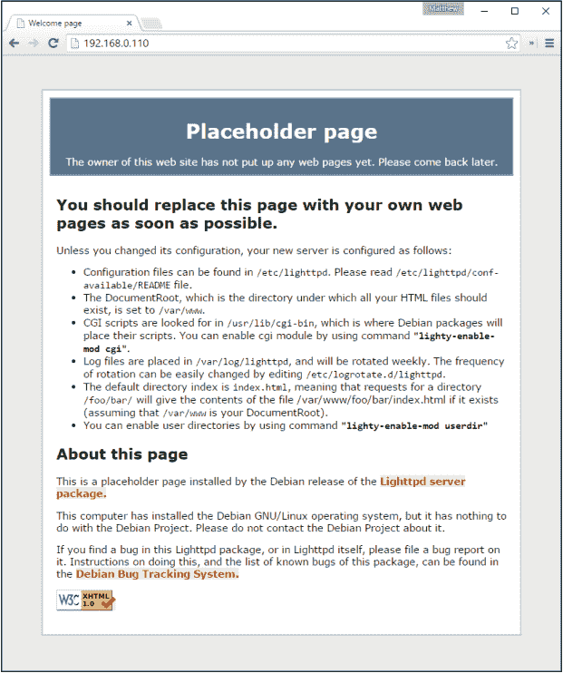

Lighttpd 占位页面

### 测试 PHP5 安装

既然我们在做这件事，还应该测试 PHP 安装，因为这对于构建我们的控制面板至关重要。这可以通过编写一个简单的 PHP 脚本页面来完成；如果 PHP 安装正确，该页面将返回有关其环境和配置的信息：

- 1. 首先，进入 Web 内容文件夹：

  ```bash
  $ cd /var/www
  ```

- 2. 在 Nano 中，创建一个名为 `phpinfo.php` 的文件：

  ```bash
  $ sudo nano phpinfo.php
  ```

- 3. 在编辑器中，只需输入以下这一行，然后保存并退出 Nano：

  ```php
  <?php phpinfo(); ?>
  ```

现在，在浏览器中输入你的 Raspberry Pi 的 IP 地址，后面跟上 `/phpinfo.php`，例如 `http://192.168.0.110/phpinfo.php`，你应该会看到以下页面：

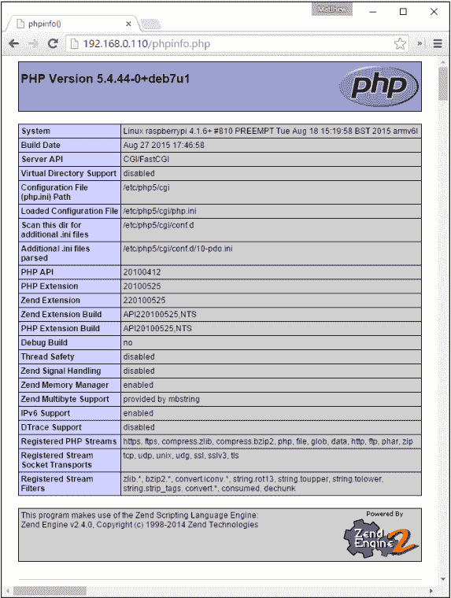

Web 服务器生成的 PHP 信息页面

既然我们知道 Web 服务器工作正常，就可以开始创建我们的控制面板网页了。

### 实现控制

为了确定我们希望在报警控制面板上放置哪些控件，我们需要规划出系统的防区输入数量以及控制输入和输出。你会记得，在第 3 章“扩展你的 Pi 以连接更多设备”中，通过端口扩展器上的两个 I/O 端口，我们的系统基本上可以有 16 个防区。我们还可以使用 Raspberry Pi 板上的 8 个 GPIO 引脚。那么，现在让我们分配这些输出，并在下表中记录。

我将使用 I/O 扩展板上的端口 A 为报警输入设置一个 8 防区系统，并使用原生 GPIO 引脚来处理按钮和警报输出等功能。采用这种配置的一个原因是系统始终可以故障安全——因此，如果扩展板发生故障，Raspberry Pi 仍然可以驱动与之相连的警报器和蜂鸣器。

| 端口 | I/O 引脚 | 标签/用途 |
|---|---|---|
| 扩展器 A | 0 (A0) | 防区 1 输入（入口/出口通道） |
|  | 1 (A1) | 防区 2 输入 |
|  | 2 (A2) | 防区 3 输入 |
|  | 3 (A3) | 防区 4 输入 |
|  | 4 (A4) | 防区 5 输入 |
|  | 5 (A5) | 防区 6 输入 |
|  | 6 (A6) | 防区 7 输入 |
|  | 7 (A7) | 防区 8 - 防篡改回路输入 |
| 扩展器 B | 0 (B0) |  |
|  | 1 (B1) |  |
|  | 2 (B2) |  |
|  | 3 (B3) |  |
|  | 4 (B4) |  |
|  | 5 (B5) |  |
|  | 6 (B6) |  |
|  | 7 (B7) |  |
| R-Pi GPIO | 0 (GP0) | 布防/撤防开关（输入） |
|  | 1 (GP1) |  |
|  | 2 (GP2) |  |
|  | 3 (GP3) |  |
|  | 4 (GP4) | 布防 LED（输出） |


| 端口 | I/O 引脚 | 标签/用途 |
|------|----------|-----------|
|      | 5 (GP5) | 撤防/布防蜂鸣器 (输出) |
|      | 6 (GP6) | 警报 LED (输出) |
|      | 7 (GP7) | 警报铃 (输出) |

## 为自己布防

术语布防和撤防是报警系统用语，分别指开启报警监控（布防系统）和关闭报警监控（撤防系统）。我们系统的区域 1 将与布防和撤防部分相连，因为它将连接到我们进出时使用的门上的传感器；这将是一个用于进出目的的特殊区域。

当我们设置报警时，我们需要一点时间离开房子。系统知道我们已离开物业的方式是通过监控出口区域，查看我们在允许的时间内是否打开了前门然后在我们身后关闭了前门。

同样，当我们返回时，我们会打开前门，但我们不希望报警立即响起——我们需要在给定时间内有机会撤防。我们将通过基于网络的控制面板或使用输入 GP0 上的某种开关来布防和撤防系统。

## 主配置文件

我们的系统将使用一个主配置文件来告诉它所有设置和连接方式。此配置文件将同时被 Web 控制面板和主报警控制脚本使用，以便两个子系统可以“相互通信”。让我们使用初始设置创建该文件。

设置文件将存储在我们将在第 9 章《整合一切》中创建控制脚本的同一位置，即在文件夹 /etc/pi-alarm 中。因此，让我们创建此文件夹，并赋予其执行权限，以便我们的脚本可以运行：

```text
$ cd /etc
$ sudo mkdir pi-alarm
$ sudo chmod 777 pi-alarm
```

我们现在将在此文件夹中创建供系统使用的主配置文件：

```text
$ cd pi-alarm
$ sudo nano alarm.cfg
```

如前所述，您不必在树莓派上使用 Nano 创建文件——您可以在桌面计算机上创建它们，然后使用 SCP 将它们传输到您的 Pi。

```text
# ALARM MASTER CONFIG FILE #

#Number of zones in the system
NUM_ZONES=8

#Display labels for each zone
ZONE_LABEL_1="Zone 1 - Entry/Exit"
ZONE_LABEL_2="Zone 2"
ZONE_LABEL_3="Zone 3"
ZONE_LABEL_4="Zone 4"
ZONE_LABEL_5="Zone 5"
ZONE_LABEL_6="Zone 6"
ZONE_LABEL_7="Zone 7"
ZONE_LABEL_8="Zone 8"

#Zones that are enabled
#Set to 0 to Disable or 1 to Enable
ZONE_ENABLE_1=1
ZONE_ENABLE_2=1
ZONE_ENABLE_3=1
ZONE_ENABLE_4=1
ZONE_ENABLE_5=1
ZONE_ENABLE_6=1
ZONE_ENABLE_7=1
ZONE_ENABLE_8=1

SYSTEM_ARMED=0

#Zone status
#Set to 1 if zone is triggered
ZONE_STATUS_1=0
ZONE_STATUS_2=0
ZONE_STATUS_3=0
ZONE_STATUS_4=0
ZONE_STATUS_5=0
ZONE_STATUS_6=0
ZONE_STATUS_7=0
ZONE_STATUS_8=0
```

alarm.cfg 文件

## 创建网页

我们的基于 Web 的控制面板将是一个由 **移动优化** 的单个 PHP 驱动的 HTML5 网页。HTML5 是网页的最新标记标准，受大多数现代智能手机和浏览器支持。我们还将创建一个 **级联样式表 (CSS)**，使我们的页面在移动设备上看起来还算过得去。

要创建 Web 文件，我建议您在桌面计算机上使用类似出色的 Notepad++ 之类的工具，而不是直接在树莓派上操作。或者，如果您是一位经验丰富的 Web 开发人员，您可能已经有了您选择的 IDE。

### 控制面板 HTML 模板

我们要做的第一件事是创建一个 HTML 文件，我们可以在将其放入 PHP 文件以使其与系统交互之前用来测试布局。这样在 PHP 脚本干扰之前，我们就可以更轻松地调整我们想要的外观。

> 这不是 Web 开发教程——关于该主题有很多书籍——但我希望代码足够清晰，让您弄清楚发生了什么。我要向您展示的代码是完全可用的，因此您可以直接使用我提供的内容而无需做更多。希望它也能让您的控制面板看起来不错！

以下标记为您提供了一个基本控制面板，其中包含我们 8 个区域的状态、主布防和撤防开关，以及启用或禁用任何区域的开关。

代码的 `<head>` 部分包含一些 `<meta>` 标签，帮助移动设备知道这是一个移动友好的网站。在主要的 `<body>` 标记中，我们为每个区域都有一个部分，其中包含区域名称和开/关开关。每个区域都在其容器中，以便我们也可以突出显示需要我们注意的特定区域，例如它被触发时。

您可以在 `chapter 7` 的代码文件夹中 `alarm-panel.html` 文件中找到我们控制面板的完整 HTML5 标记。

### 赋予它一些样式

目前，这个页面看起来并不太好（事实上，它看起来很糟糕，像是 1990 年代的东西）；它不特别适合移动设备，并且肯定会失败 *香肠测试*。因此，我们将应用一些样式使其看起来不算太差。尽管前面的标记包含对 CSS 文件的引用——我们还没有创建该文件——所以这就是我们页面目前的样子（正如我所说：它看起来很糟糕）：

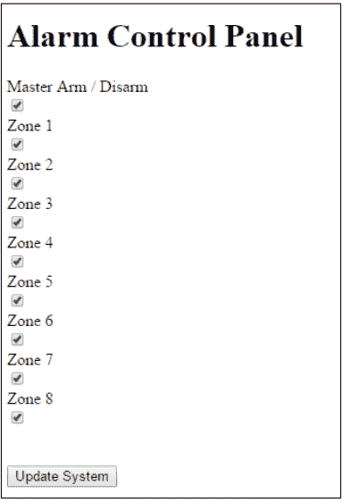

没有样式的 Web 控制面板

以下 CSS3 标记专门为我们的控制面板设计，它使它看起来相当不错，同时也使其在 **触摸屏** 移动设备上可用。CSS 非常长，看起来很 overwhelming，但您无需对其做任何事情，也无需理解它（如果您不想的话）——您唯一需要知道的是它为现代浏览器和智能手机设计，因此不要期望它在 Internet Explorer 7 上工作，甚至可能 IE9 也不行！

本质上，它包含以下内容的样式：

- 为我们的移动布局准备浏览器
- 我们的文本和区域区域
- 创建很酷的开关而不是无聊的复选框
- 当我们需要时使某个区域闪烁

```css
/* Clear browser margin and padding defaults */
body, div, dl, dt, dd, ul, ol, li, h1, h2, h3, h4, h5, h6, pre, form,
fieldset, input, textarea, p {
margin:0;padding:0;-webkit-text-size-adjust:none;
}

body {
    background: #ffffff;
    color: #4A5651;
    font-family: "Trebuchet MS", Helvetica, sans-serif;
    font-size:10px;
    height: 100%;
    padding:0;
    margin:0 auto;
    max-width:320px;
    min-width:240px;
    text-align: left;
    width:100%;
    -webkit-box-shadow: 0px 20px 40px 0px rgba(0,0,0,0.50);
    -moz-box-shadow: 0px 20px 40px 0px rgba(0,0,0,0.50);
    box-shadow: 0px 20px 40px 0px rgba(0,0,0,0.50);
}

p, .zoneLabel {
    font-size:16px;
    margin:5px;
    line-height:1.4;
    color:#4A5651;
}

#header h1 {
    font-size:20px;
    line-height:40px;
    margin:0;
    padding:0 0 0 15px;
    text-align:center;
    text-overflow: ellipsis;
    font-weight:bold;
}

.zoneControl, .masterControl{
  border-bottom:1px solid #dddddd;
  margin-top:5px;
  margin-bottom:0px;
  padding:5px;
  display:block;
  width:100%;
}

.zoneLabel {
  font-weight:bold;
  text-overflow:ellipsis;
}

input[type="submit"] {
  border: none;
  background-color: #0b70cc;
  color: white;
  height: 32px;
  display: block;
  padding: 4px 7px;
  float: left;
  border-radius: 8px;
  position: relative;
  bottom: 1px;
  margin-left: 4px;
  text-align: center;
}
input[type="submit"]:hover {background-color: #b2ceec;color: #0b70cc;border: none;border: 1px solid #b2ceec;}

/* Flashing animation */
@-webkit-keyframes flash{0%, 50%, 100% {opacity: 1;} 25%, 75% {opacity: 0;}}
@keyframes flash {0%, 50%, 100% {opacity: 1;} 25%, 75% {opacity: 0;}}
.flash {
  -webkit-animation-name:
  flash;animation-name:
  flash;color:#f00000;
}

.animated {
  -webkit-animation-duration: 1s;
  animation-duration: 1s;
  -webkit-animation-fill-mode: both;
  animation-fill-mode: both;
  animation-iteration-count: infinite;
  -webkit-animation-iteration-count:infinite;
}

/*
  ON/OFF SWITCH STYLES
  The rather cool On/Off switch styling was generated on
  https://proto.io/freebies/onoff/
*/
.onoffswitch {
  position: relative;
  width: 90px;
  -webkit-user-select: none;
  -moz-user-select: none;
  -ms-user-select: none;
}

.onoffswitch-checkbox {
  display: none;
}

.onoffswitch-label {
  display: block;
  overflow: hidden;
  cursor: pointer;
  border: 2px solid #FFFFFF;
  border-radius: 20px;
}

.onoffswitch-inner {
  display: block;
  width: 200%;
  margin-left: -100%;
  transition: margin 0.3s ease-in 0s;
}

.onoffswitch-inner:before, .onoffswitch-inner:after {
  display: block;
  float: left;
}
```


width: 50%;
height: 30px;
padding: 0;
line-height: 30px;
font-size: 14px;
color: white;
font-family: Trebuchet, Arial, sans-serif;
font-weight: bold;
box-sizing: border-box;
}

.onoffswitch-inner:before {
    content: "ON";
    padding-left: 10px;
    background-color: #34C290;
    color: #FFFFFF;
}

.onoffswitch-inner:after {
    content: "OFF";
    padding-right: 10px;
    background-color: #EEEEEE;
    color: #999999;
    text-align: right;
}

.onoffswitch-switch {
    display: block;
    width: 18px;
    margin: 6px;
    background: #FFFFFF;
    position: absolute;
    top: 0;
    bottom: 0;
    right: 56px;
    border: 2px solid #FFFFFF;
    border-radius: 20px;
    transition: all 0.3s ease-in 0s;
}

.onoffswitch-checkbox:checked + .onoffswitch-label .onoffswitch-inner {
    margin-left: 0;
}

.onoffswitch-checkbox:checked + .onoffswitch-label .onoffswitch-switch {
  right: 0px;
}

.masterswitch {
  position: relative;
  width: 90px;
  -webkit-user-select: none;
  -moz-user-select: none;
  -ms-user-select: none;
}

.masterswitch-checkbox {
  display: none;
}

.masterswitch-label {
  display: block;
  overflow: hidden;
  cursor: pointer;
  border: 2px solid #FFFFFF;
  border-radius: 20px;
}

.masterswitch-inner {
  display: block;
  width: 200%;
  margin-left: -100%;
  transition: margin 0.3s ease-in 0s;
}

.masterswitch-inner:before, .masterswitch-inner:after {
  display: block;
  float: left;
  width: 50%;
  height: 30px;
  padding: 0;
  line-height: 30px;
  font-size: 12px;
  color: white;
  font-family: Trebuchet, Arial, sans-serif;
  font-weight: bold;
  box-sizing: border-box;
}

```css
}

.masterswitch-inner:before {
  content: "ARMED";
  padding-left: 10px;
  background-color: #F00000;
  color: #FFFFFF;
}

.masterswitch-inner:after {
  content: "OFF";
  padding-right: 10px;
  background-color: #EEEEEE;
  color: #999999;
  text-align: right;
}

.masterswitch-switch {
  display: block;
  width: 18px;
  margin: 6px;
  background: #FFFFFF;
  position: absolute;
  top: 0;
  bottom: 0;
  right: 56px;
  border: 2px solid #FFFFFF;
  border-radius: 20px;
  transition: all 0.3s ease-in 0s;
}

.masterswitch-checkbox:checked + .masterswitch-label .masterswitch-inner {
  margin-left: 0;
}

.masterswitch-checkbox:checked + .masterswitch-label .masterswitch-switch {
  right: 0px;
}
/* END OF SWITCH STYLES */
```

# 构建基于 Web 的控制面板

Web 控制面板样式表 - `alarm-panel.css`

应用样式表后，你得到的就是这个样子，我想你会同意它看起来更好一点：

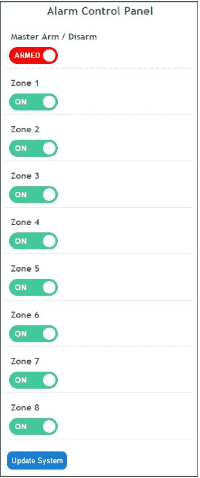

带样式的 Web 控制面板

# 使其动态化

现在我们已经为控制面板页面定义了布局代码，我们可以将其插入到我们的 PHP 页面中，以便 Web 服务器上的 PHP 脚本可以根据家庭安防系统的状态动态修改它。

PHP 脚本将帮助我们实现以下基本功能：

- 使用区域开关的位置更新配置文件
- 布防和撤防系统
- 在检测到入侵时告诉我们哪个区域被触发

同样，我不会详细介绍 PHP 代码的工作原理，但希望代码中的注释能帮助你了解正在发生的事情，并且如果想改变其行为，也能帮助你进行修改。

# 先做一点准备

除非你更改了某些 PHP 配置，否则如果代码中有小错误，排查问题会是一场噩梦，因为基本上你看到的就是...什么都没有！

因此，在创建和构建我们的 PHP 页面之前，我们将更改 PHP 配置文件中的几个设置，以确保出现任何问题时我们能够知道：

- 1. 使用 Nano 打开配置文件：
  `$ sudo nano /etc/php5/cgi/php.ini`
- 2. 文件有点大且难以处理，但努力找到以下设置并按如下方式更改它们：
  `error_reporting = E_ALL`
  `display_errors = On`
- 3. 保存文件并退出 Nano。
- 4. 最后，重启 Lighty：
  `$ sudo /etc/init.d/lighttpd restart`

# 主 PHP 代码

就是它了... 但不要现在就运行它——还有一点要做...

你可以在 `chapter 7` 的代码文件夹中 `index.php` 文件里找到完整的核心 PHP 代码。在我们的 Web 服务器内容文件夹中，现在应该有以下文件：

```
pi@raspberrypi ~ $ ls -l /var/www
alarm-panel.css
alarm-panel.html
index.lighttpd.html
index.php
phpinfo.php
```

# 我是别人

现在，在我们成功打开这个 PHP 网页之前，我们需要意识到一个事实：Web 服务器默认实际上是以另一个名为 `www-data` 的用户运行的。这意味着它通常没有执行某些操作的权限；特别是与文件系统交互的操作。

如果你完成了之前的 PHP 脚本，你会看到它实际上执行了一些 Linux 命令来读取和更新我们的 `alarm.cfg` 文件。

正如我们因为不是 root 用户而需要在许多命令前加上 `sudo` 一样，这对其他用户也同样适用，包括 `www-data`。因此，为了让 Web 服务器有权执行某些命令，我们需要使用 **visudo** 实用工具将其添加为 **sudoer**。

运行该实用工具以打开 sudoer 配置文件：

```
$ sudo visudo
```

在文件底部，添加以下行：

```
www-data ALL=(ALL) NOPASSWD:/bin/cat,/etc/pi-alarm/update-alarm-setting.sh
```

然后保存文件并退出。

我们要做的最后一件事是创建一个小的 **Bash 脚本**，它将处理在我们的 `alarm.cfg` 文件中更新设置的工作。我们需要这样做的原因是我们将使用 Linux sed 命令来更新文件。我们调用 sed 命令的方式意味着它需要创建一个临时文件。除非我们对 Web 服务器进行一些与文件位置上下文相关的配置工作，否则它将无法工作。因此，更容易创建一个由 PHP 脚本调用的 stub Bash 脚本。这样，Bash 环境就能处理临时文件上下文。

因此，我们将创建以下 Bash 脚本并将其保存在我们的 `/etc/pi-alarm` 文件夹中：

```
```bash
#!/bin/bash
#/etc/pi-alarm/update-alarm-setting.sh
###############################################
# Provides access to the sed command from  #
# PHP as it needs write access to a temp  #
# folder.                                  #
# $1 - Setting Name                        #
# $2 - Setting Value                       #
###############################################

sed -i "s/^ ($1\s*= *).*/\1$2/" /etc/pi-alarm/alarm.cfg
```
```

`update-alarm-setting.sh`

然后我们需要给脚本执行权限：

```
```bash
$ sudo chmod 777 /etc/pi-alarm/update-alarm-setting.sh
```
```

此时，我们的 `/etc/pi-alarm` 文件夹中应该有以下内容：

```
```text
pi@raspberrypi ~ $ ls -l /etc/pi-alarm
alarm.cfg
update-alarm-setting.sh
```
```

好吧，经过这一切，我想我们现在可以在浏览器中启动控制面板页面，地址为

```
```text
http://<my-pi-ip>.
```
```

`index.php` 已配置为 Lighty 中的默认页面，因此你无需在 URL 末尾添加它；只需 IP 地址即可。

通过更改开关位置然后点击 **Update System** 按钮，你会发现 `alarm.cfg` 中的设置值会相应更新。你现在可以看到，这个文件将成为我们 Web 控制台与我们在 *第 9 章，把所有东西整合在一起* 中开发的安全系统脚本之间交换状态的方式。

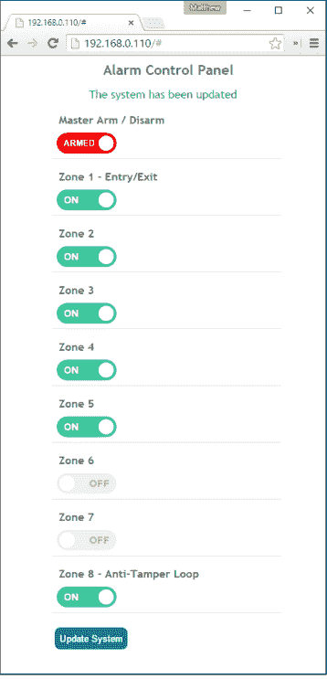

最终的运行控制面板

# 远程访问我们的控制面板

虽然我们可以设置系统在检测到入侵时接收电子邮件警报，但能够在任何地方访问我们的基于 Web 的控制面板以便在我们不在场时布防、撤防系统或关闭某些区域将会非常有用。


然而，要实现这一点，我们需要做几件事：

## 设置动态 DNS 账户

我们大多数人家里用于互联网连接的**固定 IP 地址**；它可能会不时发生变化，尤其是在我们重启或拔掉路由器时，我们的互联网服务提供商在我们下次连接时会为我们分配一个新的地址。正因为如此，我们不能依赖使用 IP 地址在外出时访问我们的家庭网络。为了解决这个问题，我们需要设置一个**动态 DNS 账户**，它将允许我们为家庭网络设置一个域名（例如，*myhomenetwork.com*）。

其工作原理是有一个在你的网络内部运行的服务，例如在你的路由器或笔记本电脑上，它会将托管你域名的动态 DNS 服务更新为你互联网连接的当前 IP 地址。然后，当你在浏览器中使用你的域名时，它会带你到家庭网络上的 Web 服务器。

流行的动态 DNS 提供商包括 No-IP (www.noip.com) 和 DynDNS (www.dyn.com)。你也可以使用 OpenDNS 获取免费的 DnsOMatic 账户来管理你的服务 (www.dnsomatic.com)。

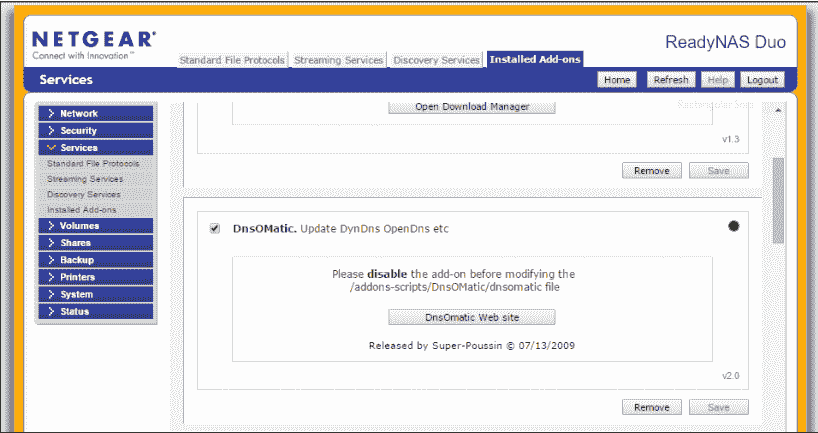

我的 Netgear NAS 设备有一个 DnsOMatic 更新器服务插件

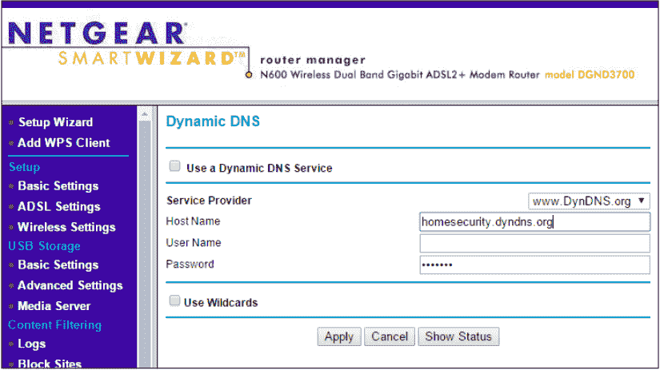

我的 Netgear 路由器具有更新动态 DNS 服务的选项

## Raspberry Pi 动态 DNS 客户端

由于基于 Raspberry Pi 的家庭安防系统很可能一直处于开启状态，你可能希望在上面安装 **ddclient** 更新器服务：

```
sudo apt-get install ddclient
```

安装后，你可以使用以下配置文件为你的特定服务和账户详细信息进行设置：

```
sudo nano /etc/ddclient.conf
```

## 在 Raspberry Pi 上设置静态 IP

为了让我们的家庭网络始终知道如何找到你的 Raspberry Pi，我们需要在其上设置一个**静态 IP 地址**，假设它目前每次启动时都从路由器的 DHCP 服务器获取 IP 地址。

1. 为此，我们需要编辑 Raspberry Pi 上的网络设置。在 Nano 中打开以下配置文件：

```bash
sudo nano /etc/network/interfaces
```

2. 你可能会发现以太网端口配置设置为如下：

```
auto eth0
allow-hotplug eth0
iface eth0 inet manual
```

3. 将此配置更改为你网络上未使用的静态 IP 地址。在我的例子中，我将其设置为 192.168.0.99。网关设置是我互联网路由器的 IP 地址：

```
auto eth0
allow-hotplug eth0
iface eth0 inet static
    address 192.168.0.99
    netmask 255.255.255.0
    gateway 192.168.0.1
```

4. 现在，我们需要重启网络服务——注意你将与终端会话断开连接。你需要使用新的 IP 地址重新连接：

```
$ sudo /etc/init.d/networking restart
```

如果出现任何问题，只需使用 sudo reboot 重启 Pi，恢复后一切应该正常。

## 端口转发

这个难题的最后一部分是确保我们的互联网路由器会将特定端口上的传入流量定向到 Raspberry Pi 的 Web 服务器。为本示例的目的，我将假设我们将坚持使用 Web 服务器上的默认端口 80。

> 关于安全性的说明
> 鉴于我们的 Web 服务器现在可以从外部世界访问，我们需要注意妥善保护系统。实现此目的的两种主要方法是更改 Web 服务器端口为 80 以外的随机数字（例如，8799）并通过应用基本身份验证为你的站点添加密码保护。这两者都可以在 lighttpd 配置文件中完成。

大多数路由器允许你在其**防火墙**配置的一部分中设置**端口转发**。本质上，设置此项意味着来自互联网的特定 TCP 端口上的任何传入流量都将被允许通过路由器并被定向到具有指定 IP 地址的设备。在我的 Netgear 路由器上，它设置如下图所示：

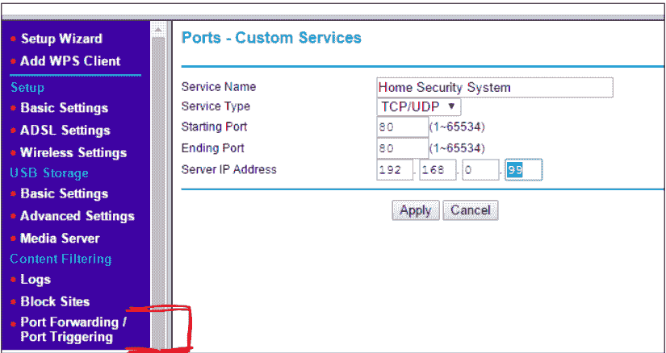

现在，当你在浏览器中输入你的个人域名时，当你不在家时，你应该会被带到你的报警控制面板。

> 你可能还想打开端口 22，以便你可以使用 PuTTY 和 SSH 从网络外部直接访问 Raspberry Pi。

## 总结

我们现在已经开始构建将控制我们的家庭安防系统的软件，通过确定主配置文件格式。我们还安装了一个 Web 服务器并使用 PHP、HTML5 和 CSS3 构建了一个基本的单页控制面板，可以很好地在我们的手机上访问，让我们能够配置系统并查看状态。

此外，我们还学习了如何配置我们的家庭网络和 Raspberry Pi，以便在我们不在家时访问我们的控制面板。

在第 9 章《把所有东西整合起来》中，我们将把所有电子元件组合在一起并编写将运行家庭安防系统的主脚本。但在此之前，在下一章中，我们将研究一些其他零碎的东西，例如向我们的家庭安防系统添加其他传感器，不一定与入侵检测相关。我们还将研究如何使用 Web 浏览器远程管理整个 Raspberry Pi 系统，除了访问我们的家庭安防控制面板之外。

在上一章的区域列表表中，你会注意到我将 Raspberry Pi GPIO 上的输入 GP0 分配为我们的布防/撤防开关输入。该输入将与我们的控制面板开关协同工作。

该输入可以简单到一个拨动开关，也可以更安全一些，例如**钥匙开关**或**电子键盘**。无论哪种方式，它都将在系统布防时连接到我们 Raspberry Pi 上的接地 GP0 (GPIO17)。

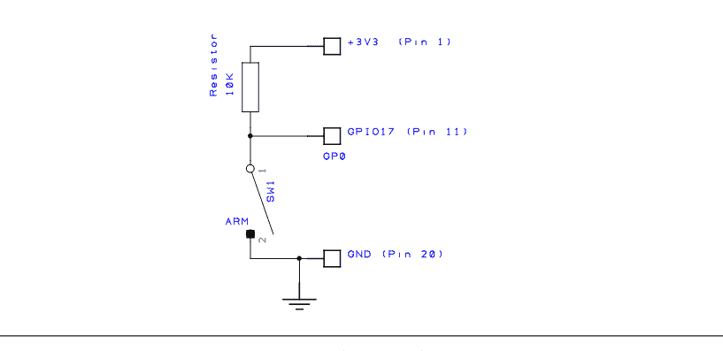

我们的布防/撤防开关的电路图

如果你有开关或其他将暴露在室外环境中的设备，你需要确保它们适合户外使用，以免损坏并损害系统的完整性。

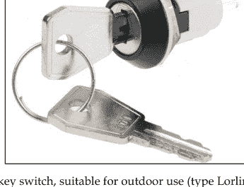

适用于户外使用的 IP67 额定钥匙开关（型号 Lorlin WRL-5-E-S-2-B）

以下是我们带有一个 1N4007 **整流二极管**用于保护的数字负载驱动器的修改电路：

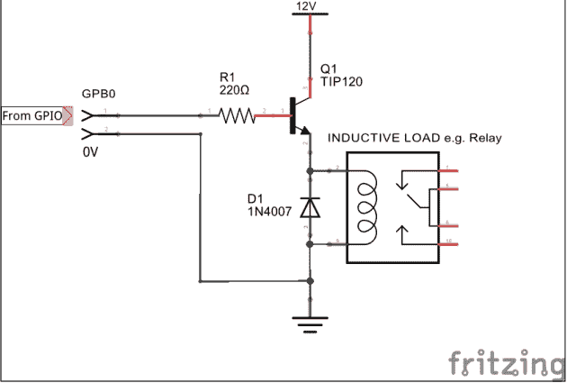

带二极管保护的数字负载驱动器

## 超越入侵

家庭安全不仅仅是保护我们的财产免受入侵，还包括保护免受其他风险，例如洪水、火灾、一氧化碳泄漏等等。因此，将我们的家庭安防系统扩展以检测这些其他风险是有意义的。

你可以选择设置系统，使某些类型的警报仅作为电子邮件发送到你的手机，而不是触发所有外部铃声、灯光和哨声。这可以通过调整下一章中的脚本以按你想要的方式运行来实现。

## 一个简单的水探测器

没有什么比外出几天回家发现厨房因水槽下漏水而被淹更糟的了。我们的简单电路将检测水的存在并触发我们家庭安防系统上的一个输入，然后可以提醒你。你也可以购买套件和现成的模块来实现这一点，但以下电路便宜且采用了我们的光耦，因为我们将为实际探测器使用不同的电压。

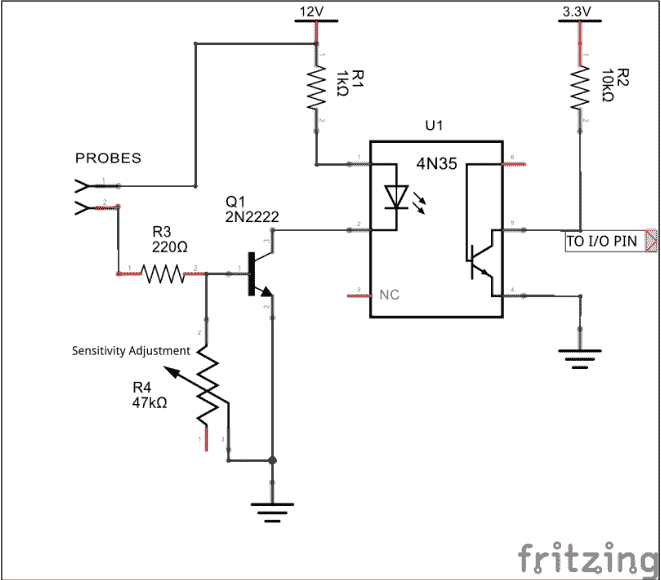

## 工作原理

当水放置在探针之间时，电流会通过水流过，从而通过晶体管 Q1 基极上的 R3/R4 分压器。当基极电流足够高以使其饱和时，晶体管将完全导通，允许光耦内部的 LED 亮起。这反过来会通过光耦内部的光电晶体管将系统输入引脚拉低到地。

你可以使用微调电阻 R4 来校准传感器，通过调整其灵敏度。任何通用的 NPN 双极晶体管都可以在这里工作，但显然它们都有不同的工作参数，因此请选择合适的型号。


SparkFun 提供的 Winsen MQ-7 一氧化碳气体探测器。

> 根据 ASHRAE（www.ashrae.org）的标准，人体长时间连续接触一氧化碳（CO）的安全上限为 9ppm（百万分比浓度），你不应长时间暴露在高于此浓度的 CO 环境中，而 35ppm 则是正常 8 小时工作日的绝对上限。

MQ-7 探测器的灵敏度范围为 10 至 500ppm，因此在我看来，我希望它一旦检测到任何浓度就立即发出警报。所以，我们应该根据数据手册中的灵敏度曲线，将比较器的参考电压设定在量程的低端，如下图所示：


取自 Winsen MQ-7 制造商数据手册的灵敏度曲线。

警告
我加入这段关于一氧化碳检测的内容，更多是出于兴趣而非其他目的。一氧化碳是很危险的东西，虽然自己动手制作探测器对兴趣而言无妨，但请仅将其用于兴趣探索。将其加入我们的家庭安防系统，作为出门在外时提醒我们的附加功能是有用的，但它*绝不应*替代市售的商用探测器——那种安装在锅炉旁、具备各种认证和标准、且在家中时能发出极响亮警报的合格产品。

## 远程管理我们的树莓派

在上一章中，我们学习了如何设置系统和家庭网络，以便无论身在何处都能远程访问报警控制面板。现在，我将向您展示如何扩展这一能力，从而管理和监控我们整个树莓派系统。

## 获取 Webmin

**Webmin** 是一个相当出色且成熟的基于 Web 的 Unix/Linux 系统管理界面。你可以在其网站 www.webmin.com 上找到关于 Webmin 的所有信息。和本书贯穿始终的假设一样，我假定你在树莓派上使用的是 Raspbian 发行版来安装 Webmin。

安装 Webmin 有两种方式：一种是手动下载并解压，另一种是更新我们的软件源，以便使用 `apt-get`。我选择后者，这样所有依赖项都会自动安装，将来更新也更容易管理。虽然需要几个步骤，但相当简单直接：

## 更新软件源

- 1. 首先，我们需要更新软件源，以加入 Webmin 的仓库：
  ```
  $ sudo nano /etc/apt/sources.list
  ```
- 2. 在文件末尾添加以下两行：
  ```
  deb http://download.webmin.com/download/repository sarge
  contrib
  ```

```
deb
http://webmin.mirror.somersettechsolutions.co.uk/repository
sarge contrib
```

3. 保存并退出 Nano。

## 导入签名密钥

1. 接下来，我们需要下载并导入仓库的签名密钥：

```
$ cd ~
$ sudo wget http://www.webmin.com/jcameron-key.asc
$ sudo apt-key add jcameron-key.asc
```

2. 现在我们已经具备所需的一切，可以更新软件包安装器并安装 Webmin。这个过程可能需要一些时间，你不妨去给自己泡杯茶或咖啡：

```
$ sudo apt-get update
$ sudo apt-get install webmin
```

3. 安装完成后，你应在 shell 窗口中看到以下信息：

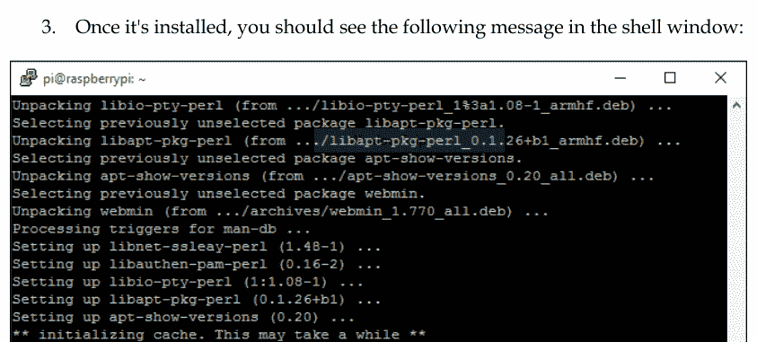

## 本地访问 Webmin

Webmin 默认运行在 10000 端口，并采用安全的 HTTPS 协议。因此，要访问它，你需要在浏览器中输入以下 URL：

```
https://<my-ip>:10000
```

其中 <my-ip> 是你的树莓派的 IP 地址。

在上一章中，我们为系统设置了静态 IP 地址；以我为例，我将地址设置为 192.168.0.99。所以，要在我的系统上访问 Webmin，我会使用：

```
https://192.168.0.99:10000
```

> **HTTPS 隐私错误**
> 
> 在某些浏览器（如 Google Chrome）中，当你尝试访问 Webmin 网页时，可能会看到隐私错误。这是因为 HTTPS 连接背后的 SSL 证书未经公认机构签名。这没问题——只需告诉浏览器你接受该证书并继续即可（在 Chrome 中，你需要先点击**高级**链接才能看到该选项）。


Webmin 带有大量模块，但并非全部默认安装。因此，你可能想浏览面板中的**未使用模块**部分，看看是否有想要添加到 Webmin 的内容。

## 远程访问 Webmin

与上一章中为报警控制面板设置远程访问的方式相同，你也可以对 Webmin 做同样的事情——只需在路由器上为 10000 端口设置端口转发即可。然后，你就可以使用 https://<my-public-ip>:10000 从任何地方访问 Webmin。

## 小结

好吧，在我们构建家庭安防系统框架之前，这一章的内容有点杂烩式的收尾。我希望你喜欢这些对前面章节的补充说明，也希望它们能给你一些启发，让你知道家庭安防系统能走多远。

我们首先探讨了如何在不访问 Web 控制面板的情况下对系统进行布防和撤防，方法是在布防/撤防输入端添加机械或数字开关。

然后，我们探讨了如何为系统添加模拟类传感器。通过将运算放大器设置为电压比较器，当达到某个阈值时系统便能发出警报。这些比较器电路的设计思路可以应用于不同类型的传感器，只要你想知道模拟传感器输出何时达到特定电压阈值即可。

最后，我们学习了如何在树莓派上安装 Webmin，以便监控和配置 Linux 操作系统的许多方面。

下一章是我们期待已久的时刻；我们将把前面章节中的所有元素和概念整合起来，构建一个包含我们所需功能的完整系统。其中最耀眼的将是我们的 Bash 脚本，它将把所有元素粘合在一起，并为整个系统提供控制逻辑。

## 整合所有部分

在过去的八章中，我们探讨了一个功能完备的家庭安防系统的各个元素和概念，这样的系统你也会希望安装在你的住宅中。我们以模块化的方式呈现内容，以便你可以为系统选择所需的功能，从而让它既可以是紧凑而基础的，也可以是庞大而复杂的。

从根本上说，家庭安防系统的核心理念是检测特定分区输入是否被外部传感器触发为高电平或低电平，无论该传感器是开关、运动探测器还是水浸探测器。归根结底，就控制软件而言，传感器的类型并不重要；系统软件的工作就是简单地检查其输入状态并相应发出警报。

在最后一章中，我们将把所有的概念整合在一起，设计出一个安防系统框架，并围绕它编写控制脚本。本章将涵盖以下内容：

- 定义系统的高层概览，详细说明所连接的各个元素
- 构建完整的模块化安防系统框架控制脚本，并详细探索代码
- 深入研究一些用于执行特定任务的详细 shell 脚本技巧
- 学习如何让系统在启动时自动运行
- 通过创建基于 RAM 的文件系统来防止 SD 卡烧毁

### 警报系统图解

为了避免在这个过程中迷失方向，我首先推荐的做法是绘制一张完整的系统图解作为参考。我为自己设计和组装的任何系统都会这样做，以便能够以结构化的方式构建，并便于记录和修改。


对于本章的家庭安全系统，我设计了下面的系统图作为框架。整个概念采用模块化设计，因此你可以根据自己的需求设计自己的系统，并使用本章给出的脚本相应地实现它。

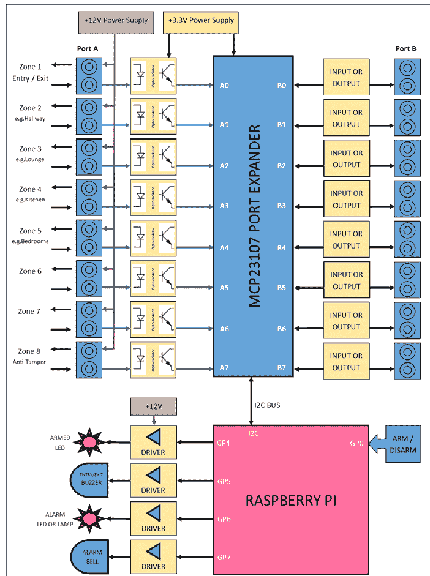

最终的家庭安全系统图

## 系统组件概览

前面的系统图包含了我们在前几章中讨论过的元件和模块。下面快速回顾一下：

### +12V电源

这是系统的主电源，我们将从外部市电适配器获得，该适配器可以带有**电池后备**。该电源需要平滑且经过稳压，以确保在当前负载下系统能保持稳定。

所有报警布线和传感器都将由该电源供电，诸如发声器和警铃等外设通常也使用12V电源供电。*第5章，添加被动红外运动传感器*讨论了在报警电路中使用12V电源的优点。

### +3.3V电源

该电源是为数字端口扩展器电路提供的稳压+3.3V电源；它还通过光耦合器提供逻辑报警防区输入。+3.3V电源既可以来自+12V电源（推荐），也可以来自树莓派GPIO连接器的+5V电源，只需根据你需要的电流选择相应的稳压器即可。

*第3章，扩展你的树莓派以连接更多设备，*向你展示了如何构建+3.3V稳压电源。

### 光隔离器输入模块

该模块将+12V防区输入电源线与端口扩展器和GPIO数字输入隔离，后者在被触发为高电平时，只能承受最大+3.3V的电压。

这些光隔离输入模块的电路已在*第5章，添加被动红外运动传感器*中讨论并展示。

### 端口扩展器

端口扩展器是我们的主要数字输入/输出系统，它将接收报警防区输入，并通过I2C总线传输到树莓派，或者允许树莓派开关输出。

我们在*第3章，扩展你的树莓派以连接更多设备*中构建了基于MCP23017的端口扩展器电路，并在*第4章，添加磁力接触传感器*中为其配置了软件。

### 布防/撤防开关

布防/撤防输入会覆盖我们基于Web的控制面板上的布防/撤防**软开关**功能，它是一个直接连接到树莓派GPIO连接器上的开关（钥匙开关、数字键盘或其他类型）。

请记住，任何开关电路都要正确连接到GPIO引脚，以免损坏树莓派。这一点已在*第2章，用GPIO将设备连接到你的树莓派*中讨论过。

### 报警输出

在我们的系统中，有几个由树莓派通过输出驱动电路控制的输出设备。我们有一个用于进入/离开蜂鸣器的输出、一个布防状态LED、一个报警警铃，以及一个报警LED指示灯。

这些设备由树莓派GPIO连接器通过驱动电路进行开关控制，这些驱动电路允许我们使用GPIO引脚驱动大电流和感性负载。这些以TIP120达林顿晶体管为核心的驱动电路已在*第6章，为安全系统添加摄像头*和*第8章，其他杂项*中讨论过。

## 设计控制脚本

在开始编写控制报警系统的脚本之前，最好先勾勒出系统的**高层**流程。下面的**流程图**有助于我们了解系统应如何工作，以及脚本需要做出的各种逻辑判断。

这个流程图可能看起来有点复杂，线条朝不同方向延伸，但实际上它是相当线性的，并且总体向下。参考流程图，它展示了控制脚本将要执行的以下任务：

- 保持静默，直到系统通过硬件钥匙开关或基于Web的面板上的软开关完成布防。
- 当系统首次布防时，在实际布防之前，它会先让退出蜂鸣器响一段预设的时间。这样你就有机会离开房屋，或者在系统开始监控输入之前再次撤防。
- 系统一旦布防，布防LED将点亮，系统会等待查看是否有任何报警防区输入被触发。它还会等待你返回房屋时撤防报警。我们可以选择在进入防区设置一个进入延时，以延迟触发报警。
- 如果报警最终被触发，那么主报警警铃和退出蜂鸣器都会被打开。根据所在社区的环境限制，主警铃只应响一段时间，因此它会在预定的时间后关闭，但内部蜂鸣器会保持开启。
- 触发后，系统会等待你撤防，然后进行复位。

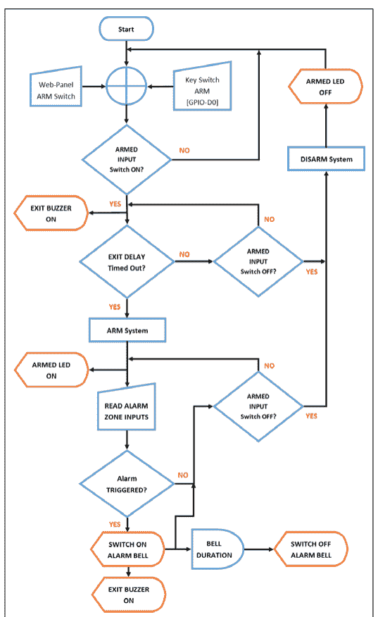

控制脚本流程图

## 构建控制脚本

现在我们已经按照预期的工作方式设计好了系统，可以开始编写Bash控制脚本了。和之前一样，我们会把脚本放在/etc/pi-alarm文件夹中，你还会记得，在第7章，构建基于Web的控制面板中，我们的基于Web的控制面板也会将配置状态文件alarm.cfg写入该文件夹。我们的脚本中也会引用这个文件。

在这个脚本中，我们将使用bc工具（Bash命令行计算器）将十六进制值转换为二进制值。默认情况下它没有安装，因此你需要获取该软件包：

```
$ sudo apt-get update
$ sudo apt-get install bc
```


> 我们的脚本文件相当长，所以和之前一样，你可能想坐在沙发上，用Notepad++之类的工具在笔记本电脑上编写。但要记住，如果你使用PC，请确保行尾（EOL）格式转换为Unix格式，否则当你将其复制到树莓派时，Bash脚本将无法运行。Notepad++可以为你完成此操作。

## 探索脚本代码

现在我将带你逐段了解我编写的控制脚本代码，这些代码将作为我们系统的框架。我之所以说是“框架”，是因为尽管它会为你提供一个功能完整的系统控制脚本，但你仍然可以根据自己的特定需求对其进行修改和扩展。

以下代码清单全部来自同一个Bash脚本alarm-control.sh，该脚本的完整带注释版本可以从Packt Publishing网站下载。

### 声明

我们首先设置跟踪系统状态所需的各种控制变量：

```
#!/bin/bash
#/etc/pi-alarm/alarm-control.sh

ALM_BELL_DURATION=600    #duration in seconds the alarm bell
should sound for
ALM_EXIT_DELAY=30    #entry/exit zone delay in seconds
```

```
ALM_KEY_ARMED=0      #status of the arm/disarm key switch
ALM_SYS_ARMED=0      #armed status of the system

ALM_ZONE_INPUT_READ=""      #this will store the value of the zone
inputs read
ALM_ZONE_INPUT_STAT="00000000"      #binary representation of the inputs
(b7-b0)
ALM_ZONE_INPUT_PREV=""      #previous zone input status
ALM_ZONE_TRIGGER=0      #this will be set to 1 if one or more zones is
triggered
ALM_ZONES_STAT=(0 0 0 0 0 0 0 0)      #dynamic array of normalised zone
status (z1 to z8 order) - 1 is triggered

STAT_RET_VAL=""      #return value from functions
```

由于根据配置和接线的不同，HIGH或LOW输入都可能表示某个防区被触发，因此我在变量ALM_ZONES_STAT中引入了一个归一化状态标志数组，就脚本而言，这将作为确定性的状态。我们稍后将研究处理此问题的函数。

### 更新配置设置

在第7章，构建基于Web的控制面板中，我们引入了配置文件alarm.cfg，它存储系统状态和配置，供基于Web的控制面板使用。主控制脚本不仅需要读取该文件以获取通过控制面板所做的任何设置，还需要用主控制脚本中的状态值更新该文件，以便将这些值回传给控制面板，本质上是在两个子系统之间交换数据。

因此，我们将包含一个辅助函数，其中包含与Web页面PHP脚本调用相同的代码，用于从控制面板更新该文件：

```
#This helper function will update the alarm config
#file with the specified value (alarm.cfg) so that
#the Web panel can know the latest status
function almUpdateConfigSetting()
{
    #$1 - Setting Name
    #$2 - Setting Value
    sudo sed -i "s/^\($1\s*= *\).* /\1$2/" /etc/pi-alarm/alarm.cfg
}
```


## 设置 GPIO

我们需要按照前面的系统示意图来设置树莓派的 GPIO 引脚。以下命令最早在第 2 章“使用 GPIO 将设备连接到树莓派”中讨论过：

```
# GPIO SET UP ########################################
#Set up the Raspberry Pi GPIO pins
#Refer to Chapter 2 for info
#D0 (GPIO17) Arm/Disarm Key Input
sudo echo 17 > /sys/class/gpio/export
sudo echo in > /sys/class/gpio/gpio17/direction

#D4 (GPIO23) Armed LED Output
sudo echo 23 > /sys/class/gpio/export
sudo echo out > /sys/class/gpio/gpio23/direction
sudo echo 0 > /sys/class/gpio/gpio23/value

#D5 (GPIO24) Exit Buzzer Output
sudo echo 24 > /sys/class/gpio/export
sudo echo out > /sys/class/gpio/gpio24/direction
sudo echo 0 > /sys/class/gpio/gpio24/value

#D6 (GPIO25) Alarm LED Output
sudo echo 25 > /sys/class/gpio/export
sudo echo out > /sys/class/gpio/gpio25/direction
sudo echo 0 > /sys/class/gpio/gpio25/value

#D7 (GPIO4) Alarm Bell Output
sudo echo 4 > /sys/class/gpio/export
sudo echo out > /sys/class/gpio/gpio4/direction
sudo echo 0 > /sys/class/gpio/gpio4/value
```

> 请注意，一个 GPIO 引脚只能导出一次，除非之后被取消导出。因此，如果脚本在再次导出该引脚时重新运行，你可能会看到错误：echo: write error: Device or resource busy。你可以安全地忽略该错误。

我们还将加入几个辅助函数，以便轻松切换各种输出的开关状态，从而简化主代码。我非常喜欢实现函数，即使它们很简单，因为这能让代码保持模块化、可重用，并且在大多数情况下更易阅读：

```
#This helper function will switch a specified GPIO output on or off
function almSetGPIOValue()
```
```
```sh
{
    #$1 - GPIO pin number
    #$2 - Value
    sudo echo $2 > /sys/class/gpio/gpio$1/value
}
#Helper functions to switch on and off the outputs
function almSetArmedLED()
{
    #$1 - 0 or 1 (Off or On)
    almSetGPIOValue 23 $1
    echo "[ALM] Armed LED set to $1"
}
function almSetExitBuzzer()
{
    #$1 - 0 or 1 (Off or On)
    almSetGPIOValue 24 $1
    echo "[ALM] Exit Buzzer set to $1"
}
function almSetAlarmLED()
{
    #$1 - 0 or 1 (Off or On)
    almSetGPIOValue 25 $1
    echo "[ALM] Alarm Trigger LED set to $1"
}
function almSetAlarmBell()
{
    #$1 - 0 or 1 (Off or On)
    almSetGPIOValue 4 $1
    echo "[ALM] Alarm Bell set to $1"
}
```
```

此外，我们还会添加一个辅助函数，用于从树莓派的 D0（GPIO17）以及 Web 控制台读取布防开关状态，以判断布防软开关是否已设置：

```
```sh
#this function returns whether the system is armed via
#either the web console or key switch
function almGetArmedSwitchStatus()
{
    STAT_RET_VAL="0"
    #read arm key switch input from
    local L_VAL=$(sudo cat /sys/class/gpio/gpio17/value)
    if [ $L_VAL -eq 1 ]; then
        #system has been armed with key switch
```
```
## 整合所有部分

```
echo "[ALM] System ARMED with key switch"
ALM_KEY_ARMED=1
almUpdateConfigSetting "SYSTEM_ARMED" "1" #set system armed
    console flag
STAT_RET_VAL="1"
else
    #read system armed value from web console config file
    if [ $SYSTEM_ARMED == 1 ]; then
        echo "[ALM] System ARMED with web console"
        STAT_RET_VAL="1"
    fi
fi
}
```

## 设置 I2C 端口扩展器

接下来的几行代码将设置 I2C 端口扩展器，将 A 口和 B 口的所有引脚都配置为输入。在我们的系统中，目前只使用 A 口，但这样如果我们要扩展系统，还可额外获得 8 个输入。我们最初在*第 4 章“添加磁力门磁传感器”*中介绍过这一点：

```
# PORT EXPANDER SET UP ###########################
#Refer to Chapter 4 for more information about the I2C bus

#We will set up I/O BUS A as all inputs
sudo i2cset -y 1 0x20 0x00 0xFF

#Whilst we're not using BUS B in our system,
#we can set that up as all inputs too
sudo i2cset -y 1 0x20 0x01 0xFF
```

> 如果你的 I2C 端口扩展器没有连接，那么运行这些命令时会看到以下错误：*写入失败*

## 解码防区输入状态

下一个函数是一个大函数，也是我们系统最关键的部分。它将从 I2C 端口扩展器读取端口 A 的值。该值将以十六进制返回，因此我们需要将其转换为二进制值，其中每一位用 0 或 1 表示。我们将使用之前安装的 bc 工具来完成这一转换。

一旦获得了每个输入位的状态，我们还需要判断 0 或 1 是否为有效触发，从而对状态进行归一化。最终输出的数组 `ALM_ZONES_STAT` 包含每个防区的状态，其中 1 表示该防区已被有效触发：

```
```bash
#This function will read the port inputs and set the
#status of each zone
function almReadZoneInputs()
{
    #preserve previous zone status
    ALM_ZONE_INPUT_PREV=$ALM_ZONE_INPUT_STAT
    #read the 8-bit hex value of port a
    ALM_ZONE_INPUT_READ=$(sudo i2cget -y 1 0x20 0x12)

    if [[ $ALM_ZONE_INPUT_READ = *"Error"* ]]; then
        #An error occurred reading the I2C bus - set default value
        ALM_ZONE_INPUT_READ="0x00"
    fi

    #remove the 0x at the start of the value to get the hex value
    local L_HEX=${ALM_ZONE_INPUT_READ:2}
    #convert the hex value to binary
    local L_BIN=$(echo "obase=2; ibase=16; $L_HEX" | bc )
    #zero pad the binary to represent all 8 bits (b7-b0)
    ALM_ZONE_INPUT_STAT=$(printf "%08d" $L_BIN)

    echo "[ALM] Zone I/O Status: $ALM_ZONE_INPUT_STAT
        ($ALM_ZONE_INPUT_READ)"

    #check each zone input to see if it's in a triggered state
    #a triggered state may be either 1 or 0 depending on the input's
    #configuration
    #you'll need to set the logic here accordingly for each input
    #the ALM_ZONES_STAT array contains the definitive trigger value
    #for each input

    #zone 1 test (bit 0)
    local L_FLG=${ALM_ZONE_INPUT_STAT:7:1}
    if [ $L_FLG -eq 0 ]; then ALM_ZONES_STAT[0]=0; else
        ALM_ZONES_STAT[0]=1; fi

    #zone 2 test (bit 1)
    local L_FLG=${ALM_ZONE_INPUT_STAT:6:1}
    if [ $L_FLG -eq 0 ]; then ALM_ZONES_STAT[1]=0; else
        ALM_ZONES_STAT[1]=1; fi
}
```
```
## 整合所有部分

```
```sh
#zone 3 test (bit 2)
local L_FLG=${ALM_ZONE_INPUT_STAT:5:1}
if [ $L_FLG -eq 0 ]; then ALM_ZONES_STAT[2]=0; else
    ALM_ZONES_STAT[2]=1; fi

#zone 4 test (bit 3)
local L_FLG=${ALM_ZONE_INPUT_STAT:4:1}
if [ $L_FLG -eq 0 ]; then ALM_ZONES_STAT[3]=0; else
    ALM_ZONES_STAT[3]=1; fi

#zone 5 test (bit 4)
local L_FLG=${ALM_ZONE_INPUT_STAT:3:1}
if [ $L_FLG -eq 0 ]; then ALM_ZONES_STAT[4]=0; else
    ALM_ZONES_STAT[4]=1; fi

#zone 6 test (bit 5)
local L_FLG=${ALM_ZONE_INPUT_STAT:2:1}
if [ $L_FLG -eq 0 ]; then ALM_ZONES_STAT[5]=0; else
    ALM_ZONES_STAT[5]=1; fi

#zone 7 test (bit 6)
local L_FLG=${ALM_ZONE_INPUT_STAT:1:1}
if [ $L_FLG -eq 0 ]; then ALM_ZONES_STAT[6]=0; else
    ALM_ZONES_STAT[6]=1; fi

#zone 8 test (bit 7)
local L_FLG=${ALM_ZONE_INPUT_STAT:0:1}
if [ $L_FLG -eq 0 ]; then ALM_ZONES_STAT[7]=0; else
    ALM_ZONES_STAT[7]=1; fi

echo "[ALM] Zone Trigger Status: $ALM_ZONES_STAT[*]"
}
```
```

## 初始化

在声明了模块级变量和辅助函数之后，我们将开始主程序。首先，我们要初始化系统，清除 SYSTEM_ARMED 状态，并从配置文件中读取初始设置：

```
```sh
# initialise system ########
echo "[ALM] Initialising system..."
almUpdateConfigSetting "SYSTEM_ARMED" "0" #clear system armed
console flag
sleep 1
sudo cat /etc/pi-alarm/alarm.cfg
```
```
```
```sh
sleep 1
echo "[ALM] Initialising done"
##############################
```
```

## 系统监控循环

接着，脚本进入一个无限循环，这就是主控制系统：监控布防/撤防状态；当处于布防状态时，监控防区输入状态并做出相应响应：

```
```sh
# loop continuously############
while true
do

    # wait for system to be armed ###############
    echo "[ALM] Alarm now in STAND-BY state - waiting to be armed"
    almSetArmedLED 0 #switch off armed LED
    STAT_RET_VAL="0"
    while [[ $STAT_RET_VAL = "0" ]]; do
        sleep 1
        #read the control panel status file
        . /etc/pi-alarm/alarm.cfg
        almGetArmedSwitchStatus #result is returned in STAT_RET_VAL
        echo -n "*" # indicates standby mode
    done
###############################################
```
```

## 布防系统

当系统进入布防状态时，会先打开退出蜂鸣器，然后等待一段预设时间。这段等待时间让你有机会离开房屋或撤防系统：

```
```sh
# perform exit delay ########################
echo "[ALM] Alarm now in EXIT DELAY state"
almSetExitBuzzer 1 #switch on exit buzzer
COUNTER=$ALM_EXIT_DELAY
while [[ $STAT_RET_VAL = "1" && $COUNTER -gt 0 ]]; do
    sleep 1
    #read the control panel status file
    . /etc/pi-alarm/alarm.cfg
    almGetArmedSwitchStatus #result is returned in STAT_RET_VAL
    COUNTER-=1
    echo -n "$COUNTER " # indicate exit mode
```
```


done
almSetExitBuzzer 0 #switch off exit buzzer
###################################################

# system now armed - monitor inputs ########
ALM_SYS_ARMED=1
echo "[ALM] Alarm now in ARMED state"
almSetArmedLED 1 #switch on armed LED

#read the control panel status file
. /etc/pi-alarm/alarm.cfg
almReadZoneInputs  # > ALM_ZONES_STAT[x]

## Monitoring the zones

Once armed, the system will monitor the zone inputs in a continuous loop until either the system is disarmed, or a zone input is triggered. When a zone is triggered, it will check against the ZONE_ENABLE_n configuration to see if that zone has been disabled (this is done in the Web-based control panel). If the zone is not disabled, then the alarm system is deemed triggered.

The ZONE_STATUS_n setting is also updated here so that the web-based control panel indicates which zone or zones have been triggered:

```
#check each zone input to set if it's enable
#and has been triggered
#NUM_ZONES setting is stored in alarm.cfg

while [[ $ALM_SYS_ARMED -eq 1 ]]; do
    echo -n "A" #indicate armed mode

    ALM_ZONE_TRIGGER=0
    for (( i=$NUM_ZONES; i>0; i-- )); do
        if [[ $ALM_ZONES_STAT[$i-1] -eq 1 ]]; then
            #zone has been triggered
            echo "[ALM] Zone $i TRIGGERED"
            E_VAR="ZONE_ENABLE_$i"
            E_VAL=`echo "$E_VAR"` #get zone enabled status loaded from alarm.cfg

            if [[ $E_VAL -eq 1 ]]; then
                #zone is enabled
                ALM_ZONE_TRIGGER=1 #set alarm triggered flag
                echo "[ALM] Zone $i ENABLED - alarm will be triggered"
```

## Sounding the main alarm

If, at this point, the system hasn't been disarmed, then we need to sound the main bell. We have a duration limit for sounding the bell to cater to environmental noise restrictions; we wouldn't want the alarm sounding for hours, annoying the neighbors until we got home. At this point, you can also add code from Chapter 6, Adding Cameras to Our Security System, if you want to be sent an alert email to your mobile device:

```
##############################
# STAY in TRIGGERED mode until system has been disarmed
if [[ $STAT_RET_VAL = "1" ]]; then
    #alarm has not been disabled
    almSetAlarmBell 1 #switch on alarm bell
    echo "[ALM] Alarm now in TRIGGERED state"

    ## YOU CAN INSERT CODE HERE TO SEND YOU AN EMAIL IF YOU
        WANT##
    ## REFER BACK TO CHAPTER 6 ##

    COUNTER=0
    STAT_RET_VAL="0"
    while [[ $STAT_RET_VAL = "1" ]]; do
        echo -n "T$COUNTER " #indicate triggered mode
        sleep 1
        #read the control panel status file
        . /etc/pi-alarm/alarm.cfg
        almGetArmedSwitchStatus #result is returned in STAT_RET_VAL

        COUNTER+=1
        if [[ $COUNTER -gt $ALM_BELL_DURATION ]]; then
            almSetAlarmBell 0 #switch off alarm bell
            echo "[ALM] Bell has been switched OFF"
        fi
    done
fi
##############################
```

## Disarming and resetting the system

When we disarm the system, we need to reset its status and complete the monitoring loop so that we can start all over again and wait for it to be re-armed:

```
# alarm has been disarmed ########
echo "[ALM] Alarm has been DISARMED"
```

```
ALM_SYS_ARMED=0
almSetAlarmBell 0 #switch off alarm bell
almSetExitBuzzer 0 #switch off exit buzzer
almSetAlarmLED 0
almSetArmedLED 0 #switch off armed LED

########################################
fi

done
##################################################

done
########################################################
```

## We're done (almost)…

And there we have it: a framework for an entire alarm control script on our Raspberry Pi. Additional features that you may want to implement within your script could include the following:

- Sending a photo or video clip from a zone's camera when it's triggered
- Sending an email alert with status details when the alarm has been triggered
- Writing a regular log file recording historical status information
- Adding additional environmental sensors to port B

> Each of the script blocks is taken from the single script file, `alarm-control.sh`, so you should be able to put all of the described pieces together into one file to have a fully functional script.

As always, before we can run it we need to give the script execute rights:

```
$ sudo chmod 777 /etc/pi-alarm/alarm-control.sh
```

After we copy the script to our Raspberry Pi, this is what we should see in our `/etc/pi-alarm` folder:

```
pi@raspberrypi ~ $ ls -1 /etc/pi-alarm
alarm.cfg
alarm-control.sh
update-alarm-setting.sh
```

## Automatically starting the system

Now, obviously, we don't want to have to manually start the alarm control script each time the Raspberry Pi boots up, for example, after a power failure — for a start, we may not even be there. Therefore, we need to set up our operating system so that it will automatically start up the alarm-control.sh script at boot time.

To do this, we need to edit the rc.local file using Nano:

```
$ sudo nano /etc/rc.local
```

Before the line containing exit 0, insert the following line:

```
sudo /etc/pi-alarm/alarm-control.sh &
```

> The & symbol at the end of the line is important because it will then make the script run in a different process, otherwise the rc.local script would never exit.

Your rc.local file should now look something like this:

```
#!/bin/sh -e
#
# rc.local
#
# This script is executed at the end of each multiuser runlevel.
# Make sure that the script will "exit 0" on success or any other
# value on error.
#
# In order to enable or disable this script just change the execution
# bits.
#
# By default this script does nothing.

# Print the IP address
_IP=$(hostname -I) || true
if [ "$_IP" ]; then
    printf "My IP address is %s\n" "$_IP"
fi

sudo /etc/pi-alarm/alarm-control.sh &
exit 0
```

The operating system runs the rc.local script after the system boots up, so you can put anything in there that you want to happen automatically at this time.

## Preserving the SD card

One final topic I want to share with you is that of preserving your Raspberry Pi's SD card. SD cards have a finite write cycle, and continuous writing to the card will eventually burn it out. If we're going to be writing lots of log file entries and taking lots of camera images, we will want to protect our SD card in order to maintain the integrity and reliability of our system; using the system RAM instead can help us with this.

## Creating a RAM-based file system

Our Raspberry Pi has plenty of fast system RAM available to us (1Gb on the latest models) that isn't susceptible to this write burn-out issue. Therefore, I'm going to show you how to allocate some of it to create a temporary disk in memory, which we can write files to that we don't need kept on the SD card. Such files would include the, quite large, camera image files that will be emailed out of the system — which, therefore, don't need to be stored permanently. You should also consider any log files that are regularly written to, which would then be shipped off the system at regular intervals.

> Remember that this is a RAM-based file system, so content will be lost when the Raspberry Pi shuts down or reboots. So, don't store any data here that you want to persist after a restart.

Let's create a Bash script file called setup-ramfs.sh, and copy it to our /etc/pi-alarm folder:

```
#!/bin/bash
#/etc/pi-alarm/setup-ramfs.sh

RAM_DISK="/ramfs"
RAM_DISK_SIZE=64M

# Create RAM Disk #############################
if [ ! -z "$RAM_DISK" ]; then
    echo "[INIT] Creating RAM Disk... $RAM_DISK"
    mkdir -p $RAM_DISK
    chmod 777 $RAM_DISK
    mount -t tmpfs -o size=$RAM_DISK_SIZE tmpfs $RAM_DISK/
    echo "[INIT] RAM Disk created at $RAM_DISK"
fi
###############################################
```

## setup-ramfs.sh RAM disk creation script

Running the preceding script will create a RAM disk folder at /ramfs – you can treat it just like any other folder; it's just that it resides in the system memory rather than on the SD card:

```
$ cd /ramfs
$ ls
```

You can call this script from the alarm-control.sh script as part of the initialization process by including the line:

```
. /etc/pi-alarm/setup-ramfs.sh
```

## Conclusion

The Raspberry Pi is a powerful little beast and a great platform for building low-cost, but highly capable, embedded systems. The interfaces built into its GPIO connector make it easy to bolt on modules using simple low-cost electronics and a bit of configuration to create very functional and flexible systems. The inclusion of a dedicated camera interface and networking interfaces give you everything you could possible need for an Internet-connected home security system.

I've covered a lot of topics in this book, and I could have gone on and on, but I hope that what I have presented has been done in a structured and methodical way, and has given you the tools and techniques to carry on this journey so that you are able to create the perfect home security system for your needs.

## Tips for building systems

As a systems guy who has to work with many different technologies and disciplines on a day-to-day basis, I just want to leave you with the following thoughts to consider, if you choose to build upon the system we've put together in this book, which, of course, I hope you will:

- Create a high-level diagram of your proposed system first—a bit like the one I produced earlier in this chapter.
- Define everything in a modular way so that you can build and test your system in small chunks. This makes it much easier to spot issues early on.
- Building the system using smaller modules makes it easier to re-use and replace circuits and code, and don't be afraid to mix-and-match technologies using what's best for the individual module.


