### 1 配置和编程树莓派

机器人正开始渗透进我们的世界。它们形状各异、大小不一，能力也各不相同。而且，就像之前个人电脑的演变一样，机器人开发领域的许多成果正来自业余爱好者和自己动手的创客，他们利用新一代廉价硬件以及免费的开源软件，来制造具备各种惊人能力的机器。在本书中，你将通过亲自动手制作一台机器人——一台具有传感器和视觉能力的四足机器人——来学习如何构建机器人。不过，你学到的技能同样可以应用于各种行走、滚动、游泳或飞行机器人。

在本章中，你将学习：

-   如何为机器人的控制中心——树莓派——配置 Raspbian 操作系统
-   如何搭建远程开发环境，以便对机器人进行编程
-   Python 和 C 语言的基础编程技能，使你能够创建和编辑机器人完成各种惊人任务所需的程序

#### 配置树莓派——机器人的大脑

机器人最重要的部件之一，是你用来控制所有不同硬件的处理器系统。在本书中，你将学习如何使用树莓派——一个体积小、价格低、易于使用的处理器系统。树莓派有几个版本——最初的 A 和 B 型号，以及新型改进的 A+ 和 B+ 型号。B+ 型号最受欢迎，它拥有额外的输入/输出能力、四个 USB 接口和更大的内存，也将是本书重点介绍的型号。

以下是搭建初始树莓派开发环境所需的物品：

-   一个树莓派 2 型号 B。还有其他三种树莓派型号：B+、B 和 A。这些型号的处理能力较弱，硬件配置也有所不同。在本书中，我们将重点介绍树莓派 2 型号 B；它拥有最强的处理能力和最实用的输入/输出接口。不过，书中涉及的许多内容也同样适用于树莓派 B+ 和 A 版本，可能只需要额外补充一些硬件。
-   为板卡供电的 USB 数据线。
-   一张 microSD 卡——至少 4GB。
-   一个 microSD 卡读写器。
-   另一台连接到互联网的计算机。
-   为板卡准备的网络连接——在初始配置步骤中，你需要一根网线和有线局域网连接。
-   一个无线局域网设备。

以下是树莓派 2 型号 B 板卡的外观：

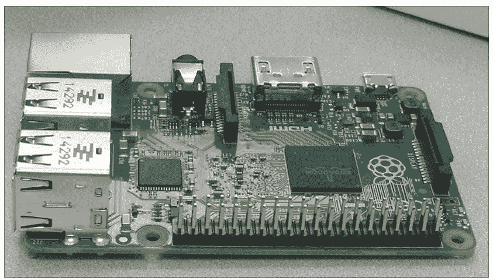

你还应该熟悉板卡上的各种连接接口。它们在下图中已为树莓派 2 型号 B 标注出来，供你参考：

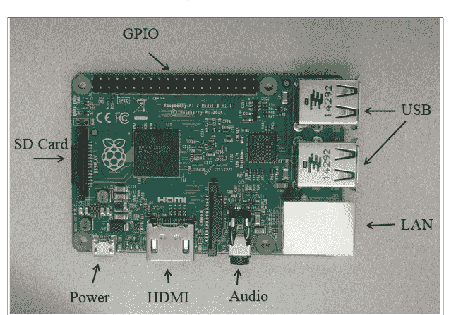

#### 安装操作系统

在开始之前，你需要下载并制作一张带有 Raspbian 操作系统的存储卡。你将把 Raspbian——Debian 版 Linux 的一个开源版本——安装到树莓派上。

让树莓派装上 Raspbian 有两种方式。树莓派板卡现在已经相当普及，你可以直接买到预装 Raspbian 的 SD 卡，也可以下载到个人电脑上，再安装到存储卡中。如果你打算下载发行版，则需要决定是用 Windows 电脑还是 Linux 机器来下载并制作 SD 卡。

无论使用哪台机器，你都需要下载一个镜像文件。打开浏览器窗口，进入树莓派官网 www.raspberrypi.org，从页面顶部选择“Downloads”。这里会给出多种下载选项。进入 Raspbian 部分，选择镜像标识符右侧的 .zip 文件。这将下载一个包含 Raspbian 操作系统镜像的压缩文件。请注意默认的用户名和密码，稍后你会用到。

如果你使用的是 Windows，则需要使用 7-Zip 之类的解压程序解压该文件。解压后会得到一个 .img 扩展名的文件，这个文件可以写入你的存储卡。接下来，你需要一个能将镜像写入存储卡的程序。如果你打算使用 Windows 机器制作存储卡，可以使用 Image Writer。你可以在 www.raspberrypi.org 网站下载部分的顶部找到该程序的链接。将存储卡插入电脑，运行该程序，你应当看到：

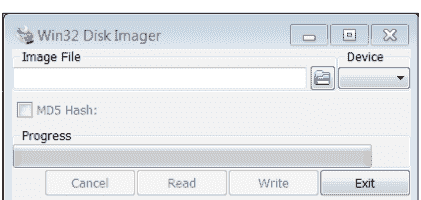

选择正确的存储卡和镜像文件，界面看起来应类似这样：

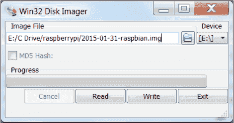

然后选择**写入**。这一步需要一些时间，完成后，从电脑中弹出存储卡。

如果你使用的是 Linux，则需要解压文件，然后将其写入存储卡。所有这些操作都可以用一条命令完成。不过，你需要找到存储卡的 `/dev` 设备标识。你可以使用 `ls -la /dev/sd*` 命令来查看。如果在插入存储卡之前运行该命令，你可能会看到类似下面的输出：

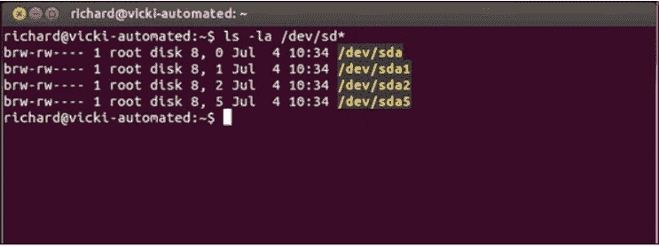

插入存储卡后，你可能会看到类似下面的输出：

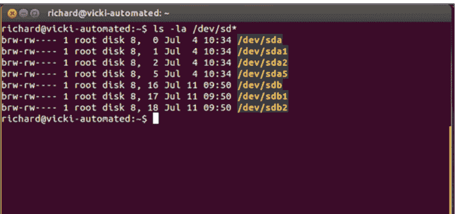

注意，你的存储卡是 sdb。现在，进入你下载的压缩镜像文件所在目录，执行以下命令：

```
sudo dd if=2015-01-31-raspbian.img of=/dev/sdX
```

将 2015-01-31-raspbian.img 替换为你下载的镜像文件名，将 /dev/sdX 替换为你的存储卡标识；在本例中为 /dev/sdb。

存储卡镜像制作完成后，将其安装到树莓派上。你还需要将树莓派接入网线，并将网线连接到有线局域网。

如果你没有有线连接，也可以通过直接将树莓派连接到显示器、键盘和鼠标来完成以下步骤。

给设备通电。POWER 指示灯应当亮起，设备应从存储卡启动。要配置系统，你需要远程访问它。为此，你需要通过 SSH 连接到设备。SSH 是一种安全协议，允许你从另一台计算机远程控制一台计算机。

远程访问系统的一个挑战是，你需要知道板卡的 IP 地址。有一种方法可以通过 IP 扫描器应用来发现地址。可免费使用的扫描器有很多；在 Windows 上，一个可选方案是 Advanced IP Scanner，可从 `http://www.advanced-ip-scanner.com/` 获取。下面是该程序运行时的界面：

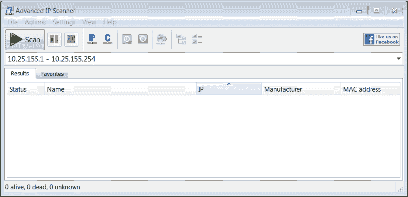

点击**扫描**按钮，将扫描网络中所有连接的设备。你也可以在 Linux 中执行此操作；Linux 中一个用于 IP 扫描的应用程序是 Nmap。要安装 Nmap，输入 `sudo apt-get install nmap`。要运行 Nmap，输入 `sudo nmap -sP 10.25.155.1-154`，扫描器将扫描从 10.25.155.1 到 10.25.155.154 的地址。

这些扫描器可以让你知道哪些地址正在使用，从而帮助你找到树莓派的 IP 地址。由于你将通过 SSH 访问设备，你还需要在远程电脑上运行一个 SSH 终端程序。如果你使用微软 Windows，可以下载这样的应用程序。一个简单易用的选择是 PuTTY。它是免费的，并且能很好地保存你的配置，这样你就不必每次重新输入。该程序可从 `www.putty.org` 获取。

在你的微软 Windows 机器上下载 PuTTY，然后运行 `putty.exe`。你应该会看到一个配置窗口，界面类似于以下截图：

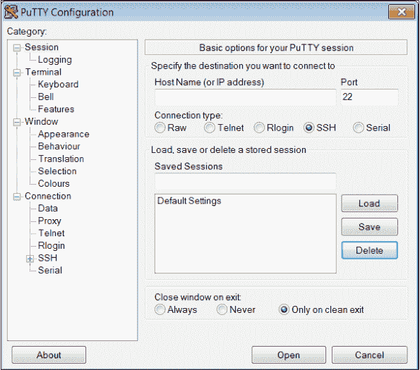

在**主机名**一栏中输入 IP 扫描器显示的 inet 地址，并确保选中 SSH。你也许想将此配置保存为 Raspberry Pi，以便每次可以重新加载。

当你点击**打开**时，系统将尝试通过局域网连接在树莓派上打开一个终端窗口。第一次这样做时，你会收到一个关于 RSA 密钥的警告，因为两台计算机互不认识；Windows 是在抱怨一台它不认识的计算机即将以相当私密的方式连接进来。只需点击 OK，你就会看到一个带有登录提示符的终端，如下图所示：


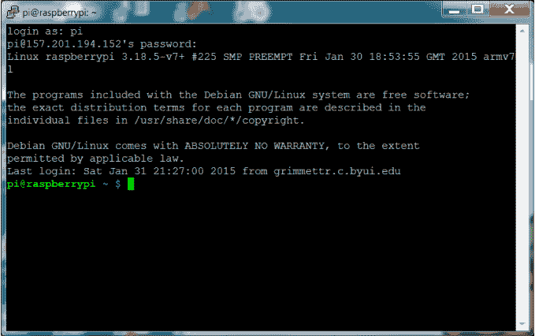

现在你可以通过登录并向你的树莓派发出命令了。如果你想从 Linux 机器上操作，过程甚至更简单。打开一个终端窗口，然后输入 `ssh pi@xxx.xxx.xxx.xxx -p 22`，其中 xxx.xxx.xxx.xxx 是你的设备的 inet 地址。这样就会进入你的树莓派的登录界面，应该与之前的截图类似。

登录后，你应该会看到如下屏幕：

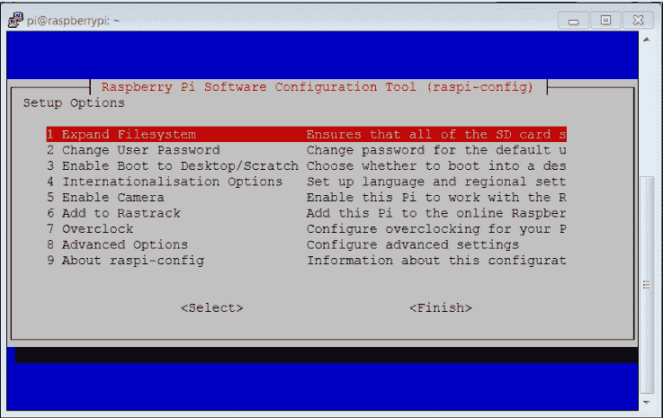

## 配置和编程树莓派

首先，你需要扩展文件系统以占用整张卡。所以，按下 *Enter* 键，你会看到以下屏幕：

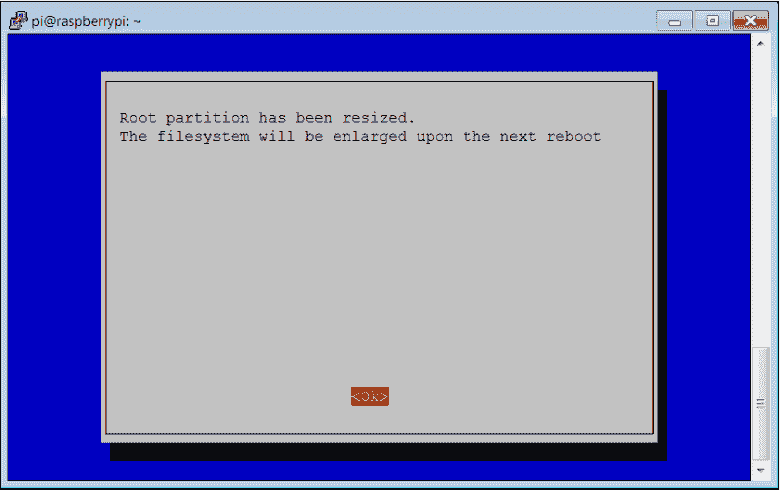

再次按 *Enter*，你就会返回主配置屏幕。现在，选择 **启用启动到桌面/Scratch** 选项。

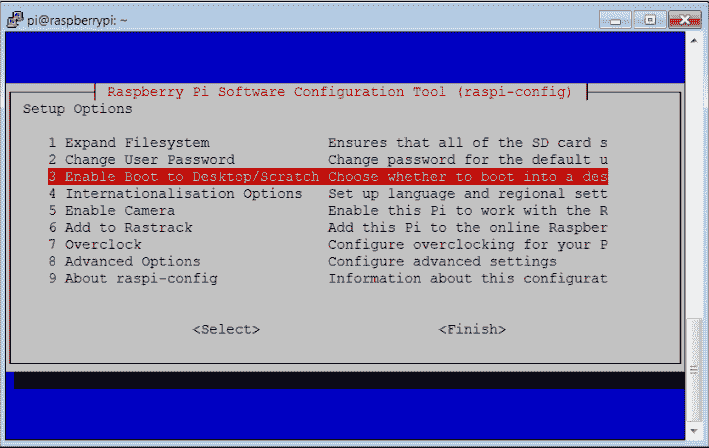

按下 Enter 后，你会看到以下屏幕：

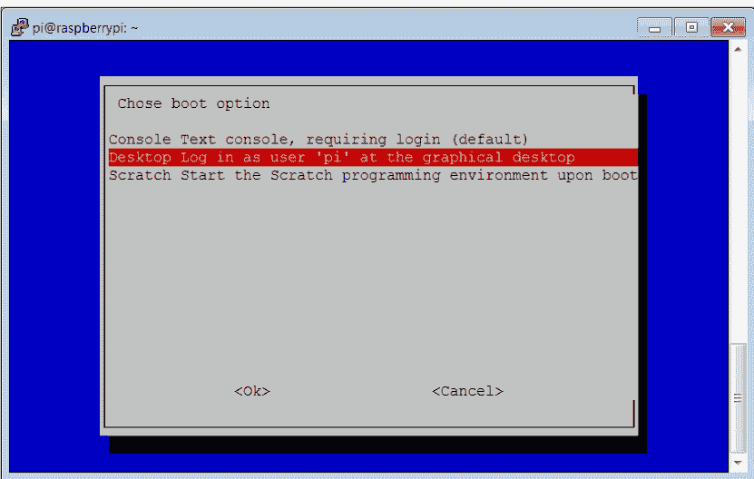

你也可以选择超频你的设备。这是一种让你获得更高系统性能的方法。然而，有风险可能会导致系统出现可靠性问题。

完成后回到主配置菜单，按 Tab 键直到光标定位到 <Finish> 选择上，然后按 Enter。然后，再按一次 Enter 以重启你的树莓派。这次登录时，你将看不到任何配置选项。但是，如果你以后想更改配置选择，可以在命令行中输入 raspi-config 运行配置工具。

### 添加远程图形用户界面

在你的机器人构建的某些步骤中，你需要对系统有一个图形化的查看。你可以在树莓派上使用一个名为 vncserver 的应用程序来实现。你需要在树莓派上安装一个版本，方法是：在树莓派的终端窗口中输入 sudo apt-get install tightvncserver。

Tightvncserver 是一个应用程序，允许你远程查看完整的图形桌面。安装完成后，你可以执行以下操作：

- 1. 你需要在树莓派的终端窗口中输入 `vncserver` 来启动服务器。
- 2. 然后系统会提示你输入密码，验证密码，然后询问是否想要一个只读密码。记住你输入的密码；你需要它通过 VNC 查看器远程登录。
- 3. 你需要为远程计算机准备一个 VNC 查看器应用程序；一个不错的选择是 Real VNC，可从 http://www.realvnc.com/download/viewer/ 获取。运行它时，你应该会看到如下内容：

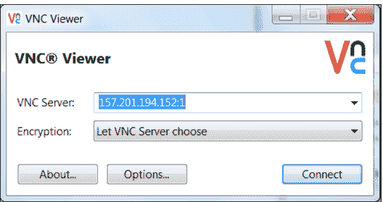

4. 输入 VNC 服务器地址，即你的树莓派的 IP 地址，然后点击 Connect。你会收到关于未加密连接的警告；选择 Continue，然后你会看到此弹出窗口：

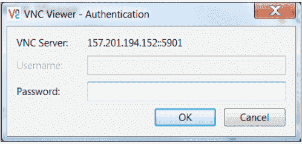

5. 输入你在启动 vncserver 时刚刚输入的密码，然后你应该会看到树莓派的图形视图，如下截图所示：

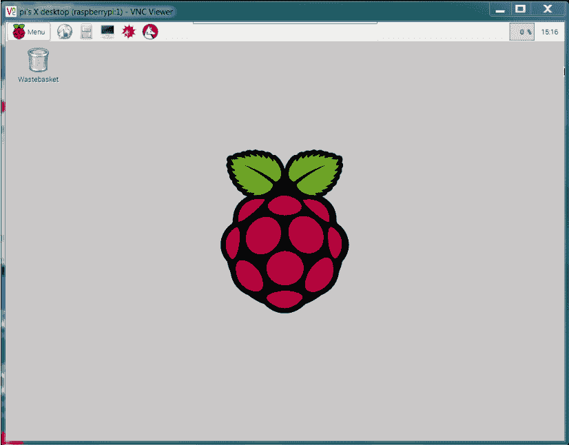

现在你可以访问系统的所有功能，尽管如果你进行图形密集型数据传输，可能会变慢。为了避免每次启动树莓派时都要输入 vncserver，请使用 http://www.haveteknowhow.com/Configure-the-server/run-VNC-on-boot.html 上的说明。

Vncserver 也可通过 Linux 使用。你可以使用一个名为 Remote Desktop Viewer 的应用程序来查看远程树莓派 Windows 系统。如果你尚未安装此应用程序，请根据你所使用的 Linux 系统类型，使用更新的软件应用程序进行安装。安装软件后，按以下步骤操作：

- 1. 运行该应用程序，你应该会看到以下截图：

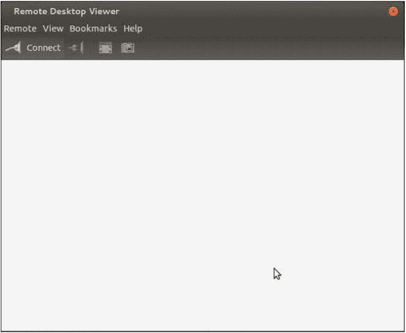

- 2. 确保 vncserver 在树莓派上运行；最简单的方法是使用 SSH 登录并在提示符下运行 vncserver。现在，点击 Remote Desktop Viewer 上的 Connect。按如下方式填写屏幕。在协议选择下，选择 VNC，你应该会看到以下截图：

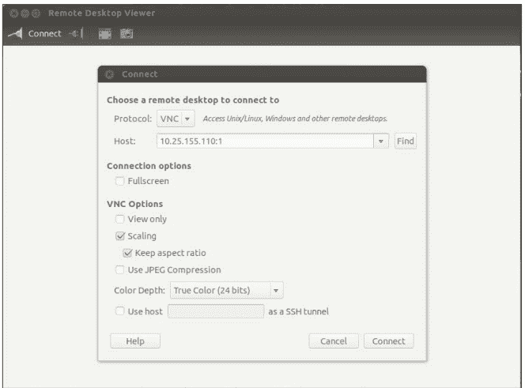

3. 现在，输入 Host inet 地址 — 确保在末尾加上 :1，然后点击 Connect。你需要输入设置的 vncserver 密码，如下截图所示：

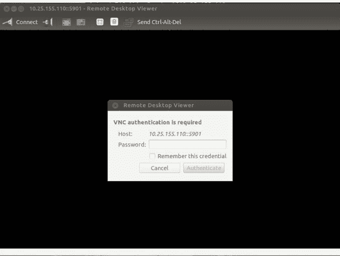

你现在应该能看到树莓派的图形屏幕。你已准备好开始与系统交互！

### 建立无线访问

系统配置完成后，下一步是使用无线方式将树莓派连接到你的远程计算机。为此，你需要添加一个无线 USB 设备并进行配置。参见 http://elinux.org/RPi_USB_Wi-Fi_Adapters 以识别已验证可与树莓派配合使用的无线设备。以下是许多在线电子商店可买到的一种：

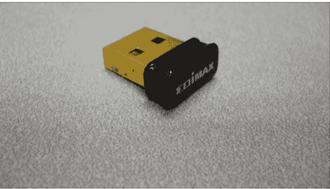

要连接到你的无线局域网，启动系统并通过输入 `sudo nano /etc/network/interfaces` 编辑网络文件。然后，将文件编辑成如下所示：

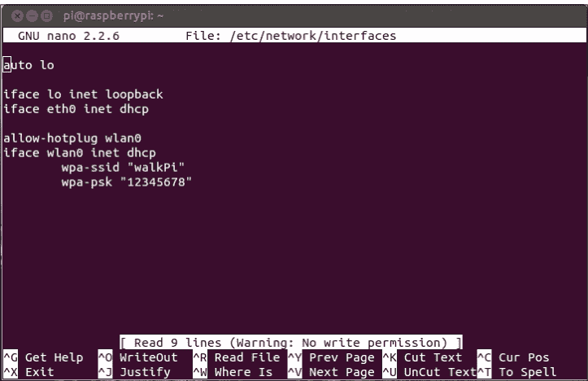

重启设备，它现在应该已连接到你的无线网络。

> 如果你使用的是美国键盘，你可能需要为键盘编辑键盘文件以便有效使用 nano。为此，输入 sudo nano /etc/default/keyboard 并将 XKBLAYOUT="gb" 改为 XKBLAYOUT="us"。

你的系统具有许多功能。随意尝试系统，这将帮助你了解已有的功能以及从软件角度需要添加的内容。

### 在树莓派上编程

最后一点介绍。你需要具备一些基础编程技能才能在项目上取得成功。本节将简要介绍树莓派上的 Python 和 C 编程。

### 在树莓派上创建和运行 Python 程序

你将使用 Python 有两个原因。首先，它是一种简单、直观且非常易用的语言。其次，机器人领域的大量开源功能都以 Python 提供。要运行本节中的示例，你需要安装一个 Python 版本。幸运的是，基础的 Raspbian 系统已预装了一个版本，所以你可以开始了。

> 如果你刚开始编程，有许多网站提供交互式教程。如果你想使用这些工具练习 Python 中的一些基础编程概念，请访问 www.codecademy.com 或 http://www.learnpython.org/ 并试试看。

不过，为了让你入门，我们先介绍如何创建和运行 Python 文件。事实证明 Python 是一种交互式语言，所以你可以运行 Python 然后逐条输入命令。然而，你希望使用 Python 创建程序，所以你将创建 Python 程序，然后从命令行通过调用 Python 来运行这些程序。

通过输入 emacs example.py 打开一个示例 Python 文件。现在，在文件中加入一些代码。从以下截图中所示的行开始：

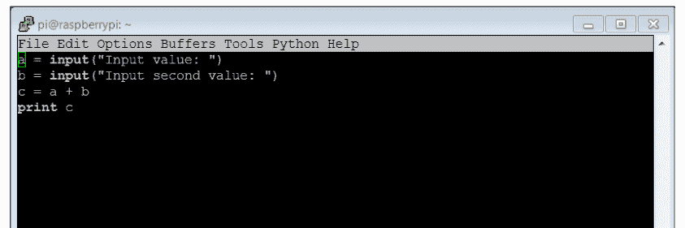

你也可以在不输入 python example.py 的情况下直接从命令行运行程序，只需在程序中添加一行。现在，程序应如下截图所示：

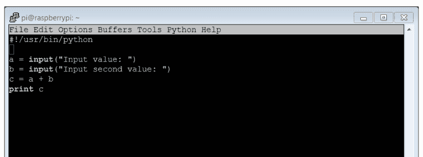

在第一行添加 #!/usr/bin/python 只是使该文件可在命令行执行。一旦保存文件并退出 emacs，输入 chmod +x example.py。这将更改文件的执行权限，这样计算机就会相信它并执行它。你应该只需输入 ./example.py 程序就会运行，如下截图所示：

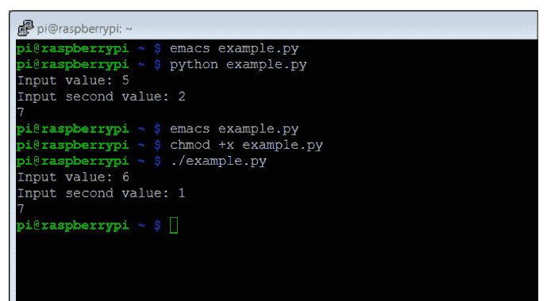

请注意，如果你只输入 example.py，系统将找不到可执行文件。在这种情况下，文件未在系统中注册，所以你必须给出文件的路径。在这里，./ 是当前目录。


## C/C++ 编程语言简介

现在你已经接触了 Python 这一简单编程语言，还需要了解一种更复杂但功能强大的语言——C。C 是 Linux 的原生语言，已经存在了几十年，但至今仍被开源开发者广泛使用。它与 Python 相似，但也有所不同，而且由于你可能需要理解并修改 C 代码，你应该熟悉它并了解其用法。

与 Python 一样，你需要能够使用语言功能。这些功能以编译器和构建系统的形式提供，它们将你的文本文件转换为包含机器码程序的文件，处理器才能实际执行。为此，输入 sudo apt-get install build-essential。这将安装你所需的程序，以便将代码转换为系统可执行文件。

现在工具已安装，让我们看一些简单示例。这是第一个 C/C++ 代码示例：

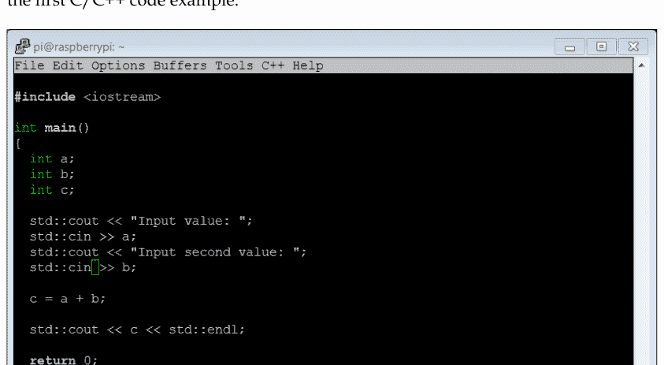

以下是对代码的说明：

- `#include <iostream>`：这是一个包含进来的库，使你的程序能够从键盘输入数据并向屏幕输出信息。
- `int main()`：与 Python 一样，我们可以将函数和类放入文件中，但你总希望从一个已知点开始执行；C 将这一点定义为主函数。
- `int a;`：这定义了一个名为 a、类型为 int 的变量。C 是我们所说的强类型语言，这意味着我们需要声明所定义变量的类型。常见类型包括 int（无小数点的数字）、float（需要小数点的数字）、char（文本字符）和 bool（真或假值）。还要注意，C 中的每一行都以 ; 字符结尾。
- `int b;`：这定义了一个名为 b、类型为 int 的变量。
- `int c;`：这定义了一个名为 c、类型为 int 的变量。
- `std::cout << "Input value: ";`：这将在屏幕上显示字符串 "Input value: "。
- `std::cin >> a;`：用户输入的内容将存入变量 a。
- `std::cout << "Input second value: ";`：这将在屏幕上显示字符串 "Input second value: "。
- `std::cin >> b;`：用户输入的内容将存入变量 b。
- `c = a + b`：该语句是两个值的简单相加。
- `std::cout << c << std::endl;`：cout 命令打印出 c 的值。末尾的 endl 命令打印一个回车符，使下一个字符出现在下一行。
- `return 0;`：主函数结束并返回 0。

要运行此程序，你需要执行编译过程，将其转换为可运行的可执行程序。为此，在创建程序后，输入 g++ example2.cpp -o example2。然后它将处理你的程序，将其转换为计算机可以执行的文件。可执行程序的名称将是 example2（由 -o 选项后面的名称指定）。

如果在编译后对目录执行 ls，你应该会在目录中看到 example2 文件，如以下截图所示：

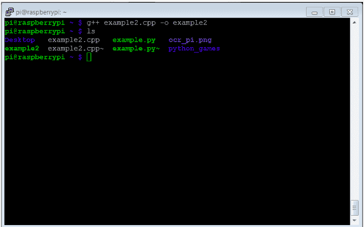

如果遇到问题，编译器会尝试帮助你找出问题。例如，如果在表达式 int a 中在 a 前忘记写 int，则编译时会收到以下错误：

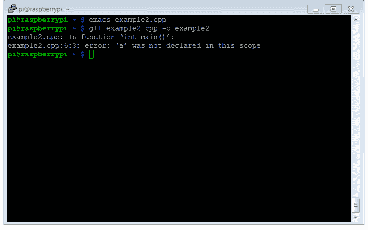

错误消息指示 int main() 函数中存在问题，并告诉你变量 a 未成功声明。编译文件后，要运行可执行文件，请输入 ./example2，你应该能够得到以下结果：

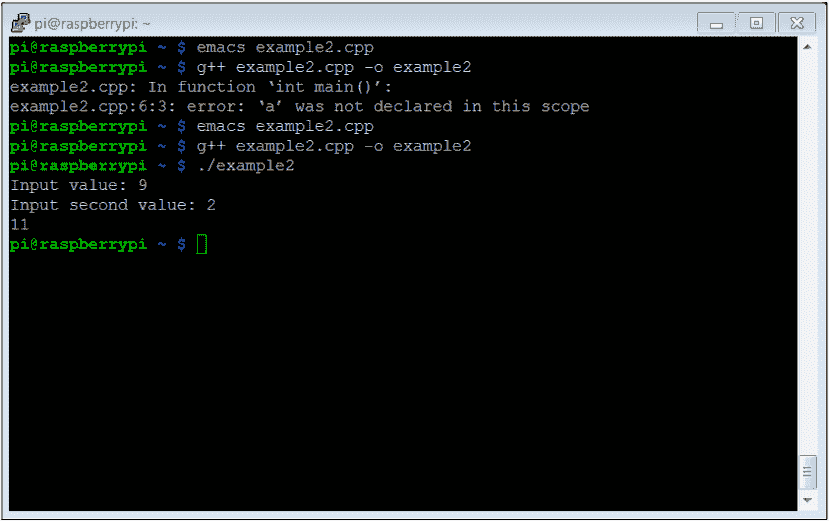

如果你有兴趣了解更多 C 编程知识，网上有几个不错的教程可以提供帮助——例如 http://www.cprogramming.com/tutorial/c-tutorial.html 和 http://thenewboston.org/list.php?cat=14。

关于 C，你还需要了解一个方面。刚才遇到的编译过程看起来相当直接。但是，如果你的功能分布在大量文件中，或者需要大量库，那么使用命令行方式执行编译可能会变得笨拙。

C 开发环境提供了一种自动化此过程的方法；它被称为 make 过程。使用时，你创建一个名为 makefile 的文本程序，定义要包含和编译的文件，然后，无需输入一长串命令或一系列命令，只需输入 make，系统就会根据 makefile 程序中的定义执行编译。有几个不错的教程会详细介绍该系统——例如 http://www.cs.colby.edu/maxwell/courses/tutorials/maketutor/ 或 http://mrbook.org/tutorials/make/。

现在你已经具备了编辑和创建自己的编程文件的能力。接下来的章节将为你提供大量练习机会，让你在将代码行转换为酷炫的机器人功能时磨练技能。

## 总结

恭喜！你的 Raspberry Pi 已经启动并正常工作。这块硬件不会在垃圾桶里积灰。现在，你已经准备好开始命令你的 Raspberry Pi 做一些事情了。

下一章将向你展示如何构建你的双足机器人。
