## 2

## 构建双足机器人

现在你的 Raspberry Pi 2 Model B 已全部配置好并准备就绪，你需要添加一些硬件来进行控制和交互。在本章中，你将学习：

- 如何构建一个基本的 10 自由度（DOF）双足机器人
- 如何使用连接到 Raspberry Pi USB 端口的舵机电机控制器来控制舵机，使你的机器人移动

### 构建能行走的机器人

在考虑如何创建移动机器人时，有几种选择。其中一个更有趣的选择是能行走的机器人。这通常有三种版本：两条腿的双足机器人、四条腿的四足机器人和六条腿的六足机器人。虽然每种版本都提供了一组有趣且不同的可能性，但在本章中，你将构建一个基本的 10 自由度双足机器人。

你将在项目中使用总共 10 个舵机，因为每条腿有 5 个可以移动的点，即 5 个自由度（DOF）。由于舵机是这个项目中最关键的组件，因此不妨先学习一下舵机教程，了解如何控制它们。

### 舵机电机的工作原理

舵机电机与直流电机有些相似。然而，有一个重要区别。直流电机通常设计为连续运动——以给定速度旋转 360 度——而舵机通常设计为移动到有限的角度集合。换句话说，在直流电机领域，你通常希望电机以可控的连续旋转速度旋转。在舵机领域，你希望电机移动到你可控的特定位置。

这是通过向舵机的控制连接器发送脉宽调制（PWM）信号来实现的。脉冲的长度将像这样控制舵机的角度：

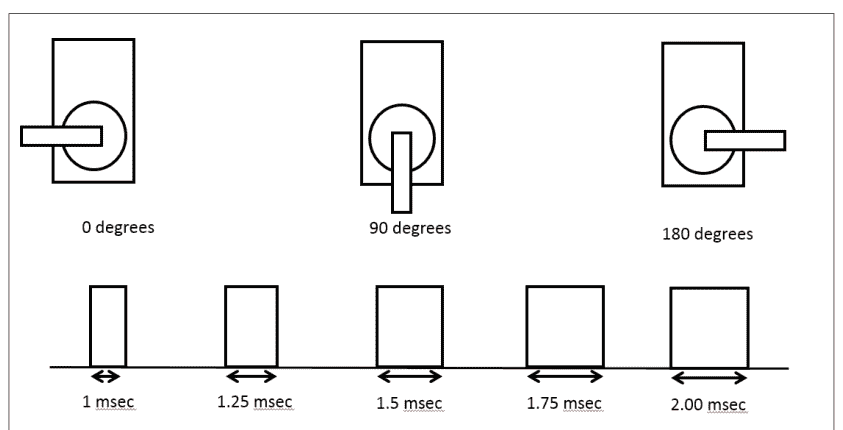

这些脉冲以 60 Hz 的重复率发送。你可以通过设置正确的控制脉冲，将舵机定位到任何角度。

### 构建双足平台

构建双足平台有几种方法。最简单的也许是购买一套基本零件；这是本章中你将看到的示例。市场上有几种套件可选，包括 http://www.robotshop.com/en/lynxmotion-biped-robot-scout-bps-ns-servos.html 的一种，像 http://www.ebay.com/itm/10-DOF-Biped-Robot-Mechanical-Leg-Robot-Servo-Motor-Bracket-NO-Servo-Motor-good-/131162548695?pt=LH_DefaultDomain_0&hash=item1e89e5a9d7 提供的套件，或者 http://www.amazon.com/gp/product/B00DR7GA4I/ref=oh_aui_detailpage_o04_s00?ie=UTF8&psc=1 的那种。这是我们在本章中使用的具体套件。

最终，你的双足机器人会更像霸王龙的腿，而不是人类的腿，但这将使其更容易编程，并且关机时会更加优雅。它也会更稳定一些。


你还需要10个标准尺寸的舵机。有几种可能的选择，但**Hitec**舵机相对便宜，而且大多数模型店和在线电子零售商都有售。此过程中重要的一步是选择舵机的型号。舵机有不同的型号编号，主要基于它们能产生的扭矩大小。

扭矩是舵机为移动与其连接的部件所能施加的力。在这种情况下，你的舵机需要抬起并移动双足机器人的重量，因此你需要一个具有足够扭矩的舵机来完成这一任务。然而，你的双足机器人对扭矩的需求有所不同。踝关节不会抬起整条腿，因此可以使用额定值较低的舵机，例如HS-422舵机。对于膝关节舵机，你需要一个更强力的舵机。在这种情况下，我建议你使用HS-645MGHB型号的舵机。负责抬起腿部的髋关节是所需扭矩最大的地方。同样，我建议你使用HS-645MG型号的舵机。你也可以全部使用10个HS-645MG舵机，但它们更贵，所以使用不同舵机会省钱。

最后需要的一个部件是金属舵机摇臂。这些舵机摇臂不是必需的，但它们会让你的双足机器人比使用舵机自带的塑料摇臂更坚固。下面是其中一个摇臂的图片：

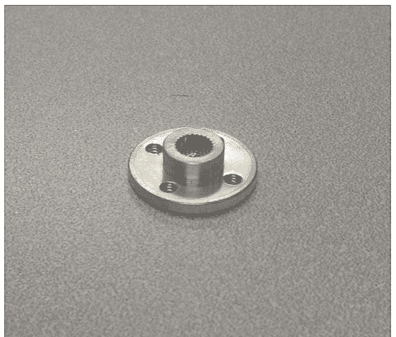

以下是组装双足机器人的步骤：

- 1. 将第一个踝关节舵机安装到脚上。为此，找到脚板，如下图所示：

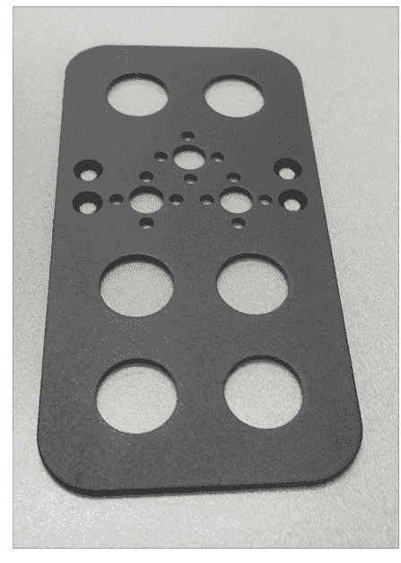

这是脚的底部。注意那些沉头孔——你将使用沉头螺栓将舵机支架连接到脚板上，如下图所示：

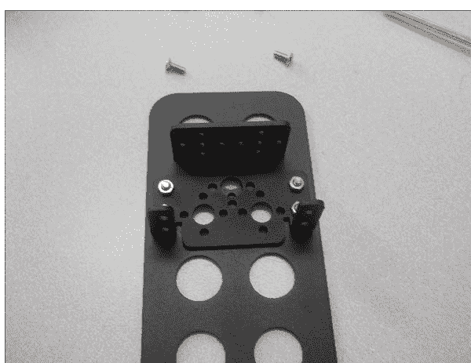

- 2. 确保脚底是平的。在将舵机安装到此支架之前，你需要先用套件中的一个轴承将一个U形支架连接到这个舵机支架上，像这样：

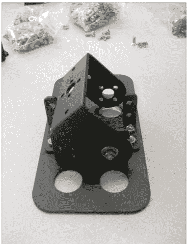

- 3. 最后，将其中一个舵机安装到支架中，并将U形支架连接到舵机摇臂上，如下图所示：

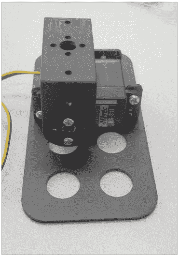

- 4. 第一个舵机应能让你的双足机器人移动脚部，使其左右倾斜。现在，将第二个踝关节舵机添加到脚上。这将使你的双足机器人能够让踝关节前后倾斜。为此，将一个舵机支架连接到刚刚组装好的组件上，然后在这个组件上加一个U形支架，像这样：

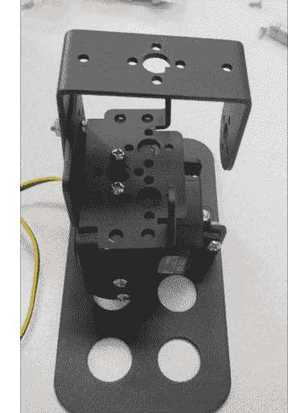

- 5. 现在，将这个支架添加到这个组件上，像这样：

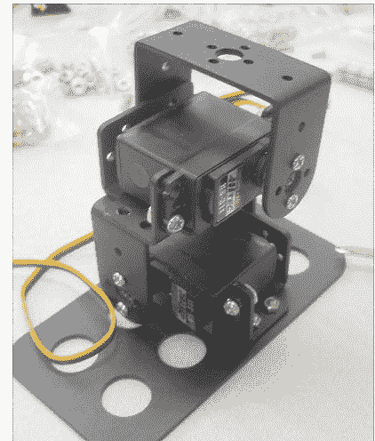

## 组装双足机器人

- 6. 现在，你可以将膝关节舵机添加到双足机器人上。不过，你首先要将大腿（最长的U形支架）连接到一个舵机支架上，像这样：

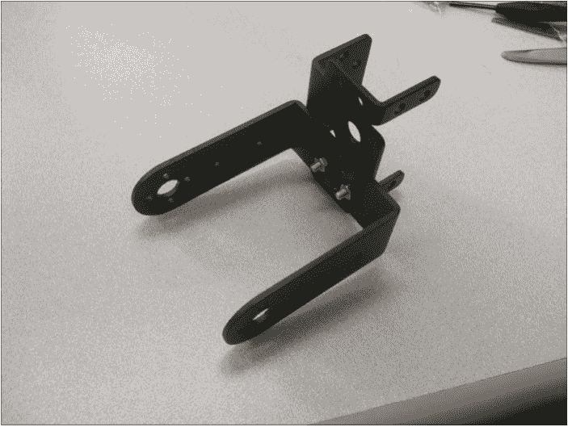

- 7. 现在，使用另一个轴承将这个组件连接到你已经组装好的小腿上，像这样：

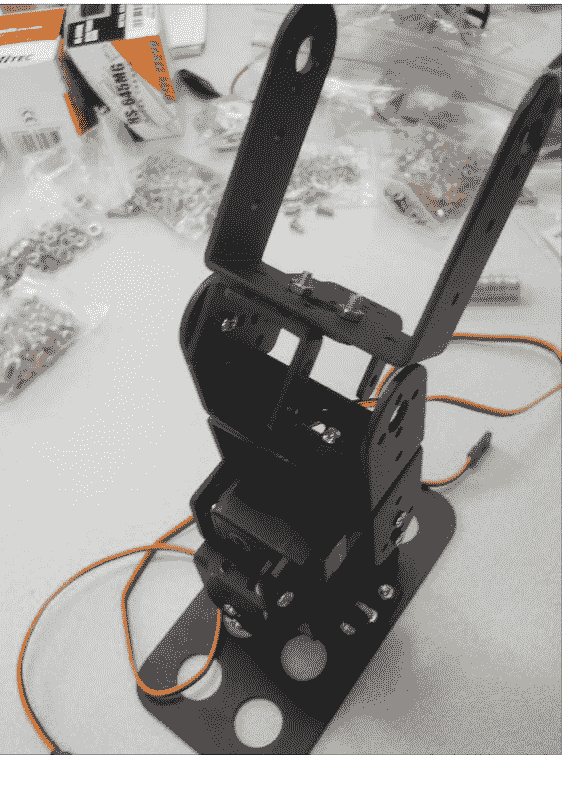

## 组装双足机器人

- 8. 现在，你可以在这个位置安装膝关节舵机。如果你有不同的舵机，请在膝关节使用更强力的舵机。下面是一张图片：

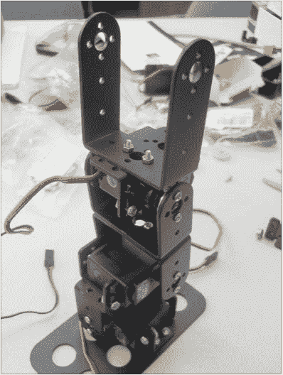

- 9. 最后一步是组装髋关节。首先，你将安装控制腿部转动的舵机，将其连接到一个舵机支架上，如下图所示：

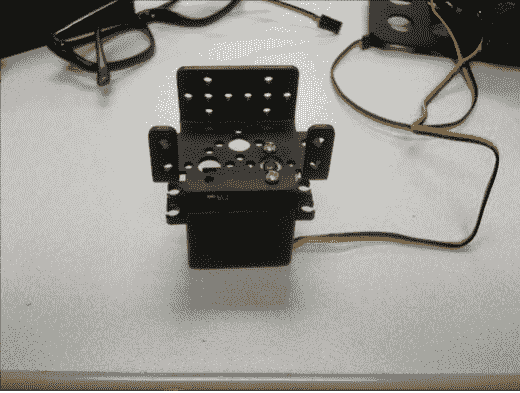

- 10. 现在，将这个舵机支架连接到长U形支架上，并安装用于抬起整条腿的舵机。这是另一个关键位置；如果你使用不同的舵机，需要选择一个扭矩较大的舵机。整个组件应该如下图所示：

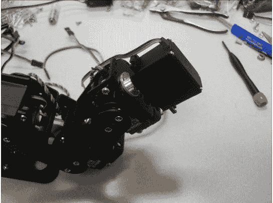

- 11. 组装另一条腿。它将是第一条腿的镜像。

- 12. 现在，你将两条腿连接到髋关节上，首先在髋关节部件的两个位置分别连接一个舵机支架连接器，像这样：

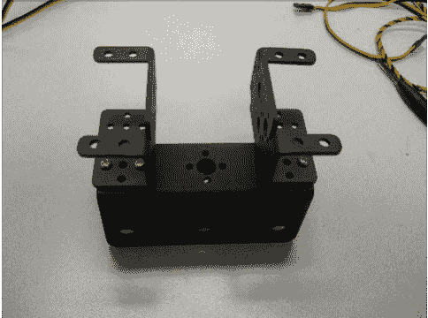

- 13. 最后，将腿部舵机的顶部安装到支架中，像这样：

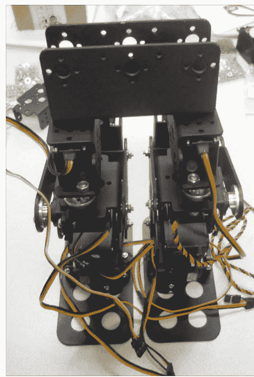

你的双足机器人现在可以行走了。既然基本硬件已经组装完成，你可以将注意力转向电子部分。

## 使用舵机控制器控制舵机

要让你的双足机器人行走，首先需要将舵机电机控制器连接到舵机。本项目中你将使用的舵机控制器是一款利用USB的简易舵机电机控制器，来自Pololu公司——Pololu产品编号1354可在pololu.com购买——它可以控制18个舵机电机。下面是该设备的图片：

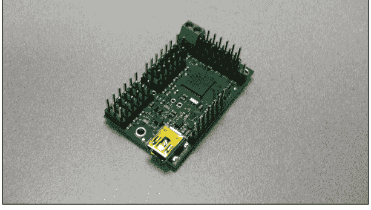

请确保你订购的是组装好的版本。这个硬件会将来自树莓派的USB命令转换为控制舵机电机的信号。Pololu制造了多款不同版本的控制器，每款都能控制一定数量的舵机。在这种情况下，你可能希望选择18舵机版本，这样你可以用一个控制器控制全部12个舵机，还可以额外添加一个舵机来控制摄像头或传感器的方向。你也可以选择12舵机版本。18舵机控制器的一个优点是可以通过螺丝型连接器轻松为该设备供电。

要开始使用，你需要为舵机控制器进行两种连接：第一种连接到舵机电机，第二种连接到电池。

首先，将舵机连接到控制器。为了保持一致，我们按照以下配置将你的12个舵机连接到控制器上标有0到11的连接端口：

| 舵机连接端口 | 舵机 |
|---|---|
| 0 | 右脚踝内/外 |
| 1 | 右脚踝前/后 |
| 2 | 右膝 |
| 3 | 右髋上/下 |
| 4 | 右髋转动 |
| 5 | 左脚踝内/外 |
| 6 | 左脚踝前/后 |
| 7 | 左膝 |
| 8 | 左髋上/下 |
| 9 | 左髋转动 |

这是控制器背面的图片；它告诉我们应该在哪里连接舵机：

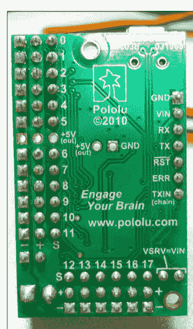

现在，你需要将舵机电机控制器连接到电池。对于本项目，你可以使用一块2S遥控锂聚合物电池；它能提供7.4伏电压以及舵机所需的电流，电流大约为2安培。下面是图片：

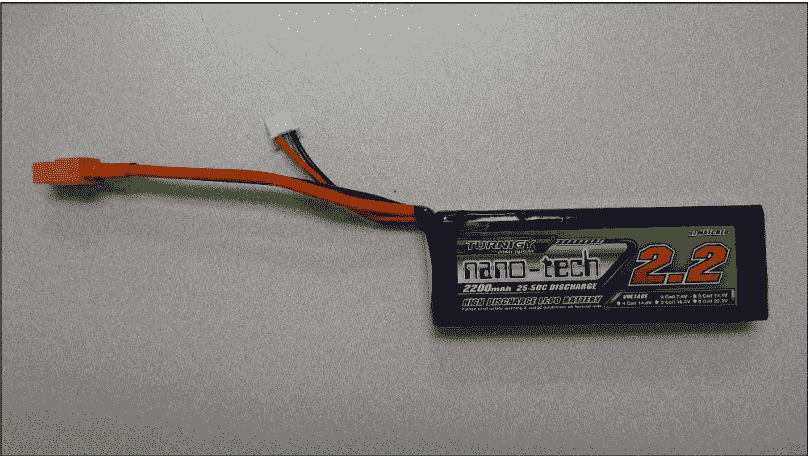

这块电池会附带两个连接器，一个使用较粗规格的导线用于正常使用，另一个较小的连接器用于连接到电池充电器。你可以使用XT60连接器对，将一些导线焊接到电池的配套连接器上，然后将导线的裸露端插入舵机控制器。

你的系统现在可以工作了。你可以将电机控制器连接到个人电脑，以检查是否能够与它通信。为此，请在舵机控制器和个人电脑之间连接一根迷你USB线。

## 通过电脑与舵机控制器通信

现在硬件已连接，你可以使用Polulu提供的一些软件来控制舵机。让我们用你的个人电脑来完成这一步。首先，从 www.pololu.com/docs/0J40/3.a 下载Polulu软件，并根据网站上的说明进行安装。安装完成后，运行该软件，你应该会看到这个界面：

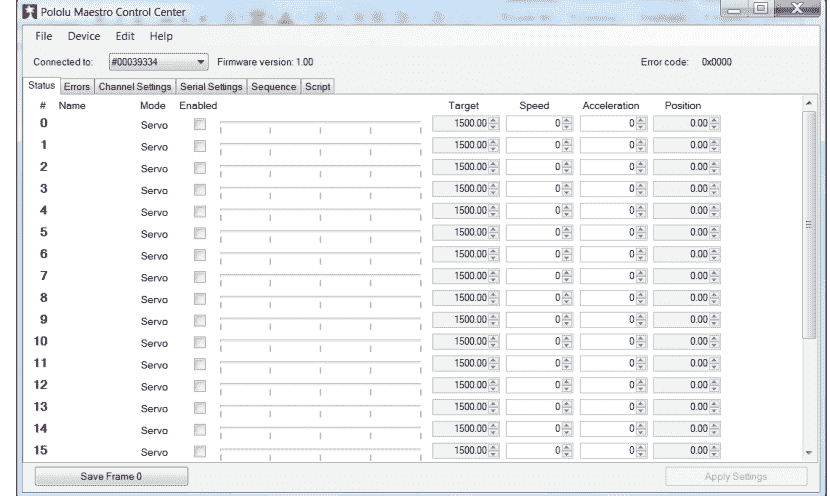

首先，你需要在“串口设置”中更改配置，因此选择“串口设置”选项卡，你应该会看到：

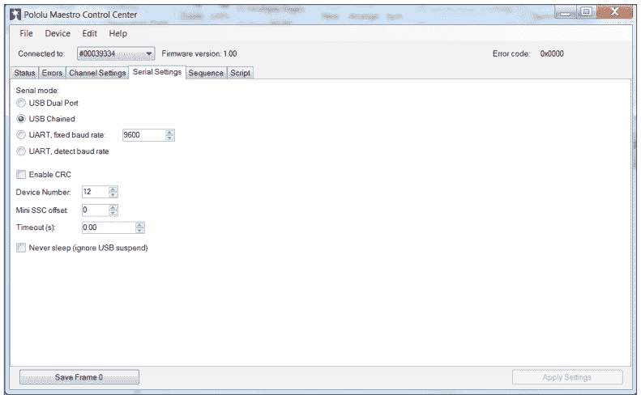

确保选中“USB Chained”选项；这将允许你通过USB连接和控制电机控制器。现在，选择“状态”选项卡返回主界面；此时，你实际上可以开启10个舵机。界面应该如下所示：

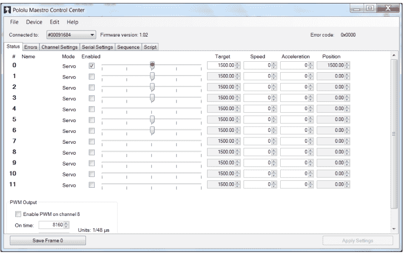


## 搭建双足机器人

现在你可以使用滑块来实际控制舵机了。打开舵机 0。确认舵机 0 控制的是右下脚踝处的舵机。你也可以用它来使舵机居中。将舵机 1 设为滑块位于中间的位置。然后，拧松舵机上的舵盘，直到舵机在这个位置处于居中状态。当所有舵机都位于零位时，你的双足机器人应该看起来像这样：

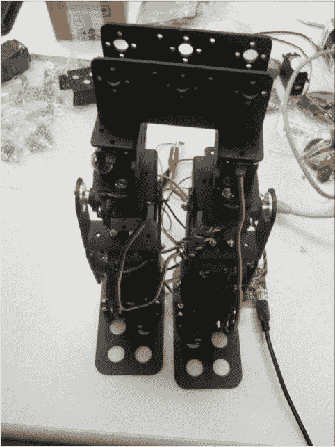

### 将舵机控制器连接到树莓派

你已经检查过舵机电机控制器和舵机。现在可以将电机控制器连接到树莓派，并确保你能从树莓派控制舵机。

接下来，让我们与电机控制器通信。步骤如下：

- 1. 使用 Mini USB 线将树莓派连接到电机控制器。将线缆连接到树莓派的 USB 主机接口上，就像这样：

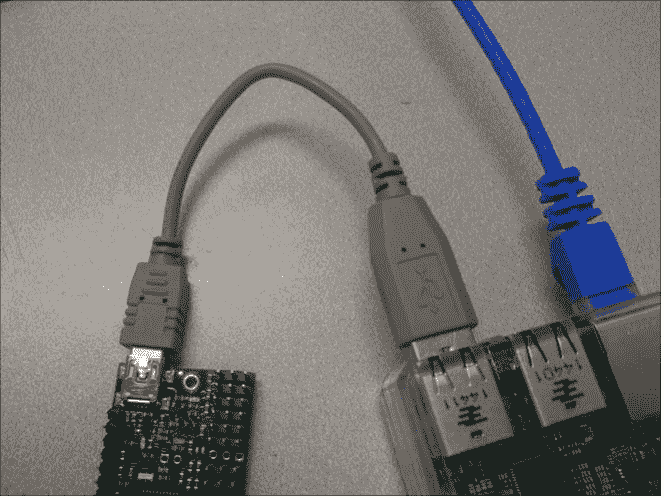

- 2. 从 Pololu 官网 www.pololu.com/docs/0J40/3.b 下载 Linux 代码。也许最好的办法是登录你的树莓派，然后输入 `wget http://www.pololu.com/file/download/maestro-linux-100507.tar.gz?file_id=0J315`。

- 3. 然后，使用 `mv maestro-linux-100507.tar.gz\?file_id\=0J315 maestro-linux-100507.tar.gz` 移动文件。

- 4. 输入 `tar -xvf maestro-linux-100507.tar.gz` 解压文件。这会创建一个名为 `maestro_linux` 的目录。输入 `cd maestro_linux` 进入该目录，然后输入 `ls`；你应该会看到类似这样的内容：

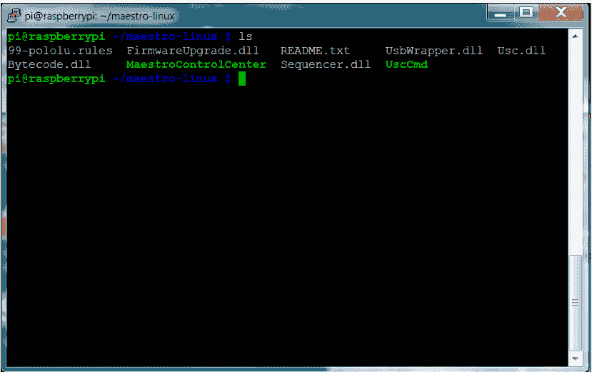

`README.txt` 文档中会给出关于如何安装软件的明确说明。遗憾的是，你不能在树莓派上运行 **MaestroControlCenter**；它使用的 Windows 版本不支持图形界面，但你可以通过 **UscCmd** 命令行应用程序来控制舵机。首先，输入 `./UscCmd --list`，你应该会看到以下内容：

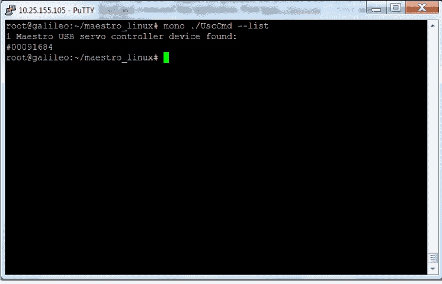

设备识别到了你的舵机控制器。如果你直接输入 `./UscCmd`，就可以看到所有可以发送给控制器的命令：

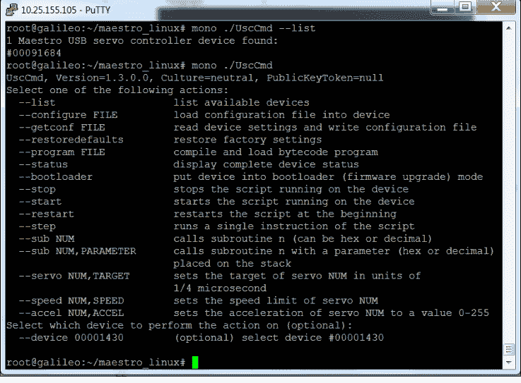

```python
#!/usr/bin/python
import serial
import time

def setAngle(ser, channel, angle):
    minAngle = 0.0
    maxAngle = 180.0
    minTarget = 256.0
    maxTarget = 13120.0
    scaledValue = int((angle / ((maxAngle - minAngle) / (maxTarget - minTarget))) + minTarget)
    commandByte = chr(0x84)
    channelByte = chr(channel)
    lowTargetByte = chr(scaledValue & 0x7F)
    highTargetByte = chr((scaledValue >> 7) & 0x7F)
    command = commandByte + channelByte + lowTargetByte + highTargetByte
    ser.write(command)
    ser.flush()

ser = serial.Serial("/dev/ttyACM0", 9600)

# Home position

for i in range(0, 9):
    setAngle(ser, i ,90)

ser.close()
```

以下是对代码的解释：

- `#!/usr/bin/python`：第一行用于让这个 Python 文件可以从命令行直接执行。
- `import serial`：这一行导入串行库。你需要串行库来通过 USB 与设备通信。
- `def setAngle(ser, channel, angle)`：这个函数将你期望的舵机和角度设置转换为舵机电机控制器所需的串行命令。要了解用于控制舵机的代码细节，请参阅 https://www.pololu.com/docs/0J40。
- `ser = serial.Serial("/dev/ttyACM0", 9600)`：这会打开与舵机控制器之间的串口连接。
- `for i in range(0, 9)`：使用 For 循环访问全部九个舵机。
- `setAngle(ser, i, 90)`：现在，你可以将每个舵机设置到中间（初始）位置。默认是将每个舵机设置为 90 度。如果你的腿部不在中间位置，你可以通过调整每个舵机上舵盘的位置来进行校正。

要访问串口，你需要确保已安装 Python 串行库。如果没有安装，请输入 `apt-get install python-serial`。安装串行库后，你可以通过输入 `python quad.py` 来运行程序。

一旦设置好基本的初始位置，你就可以让机器人做一些动作了。我们先让双足机器人活动一下脚部。下面是 Python 代码：

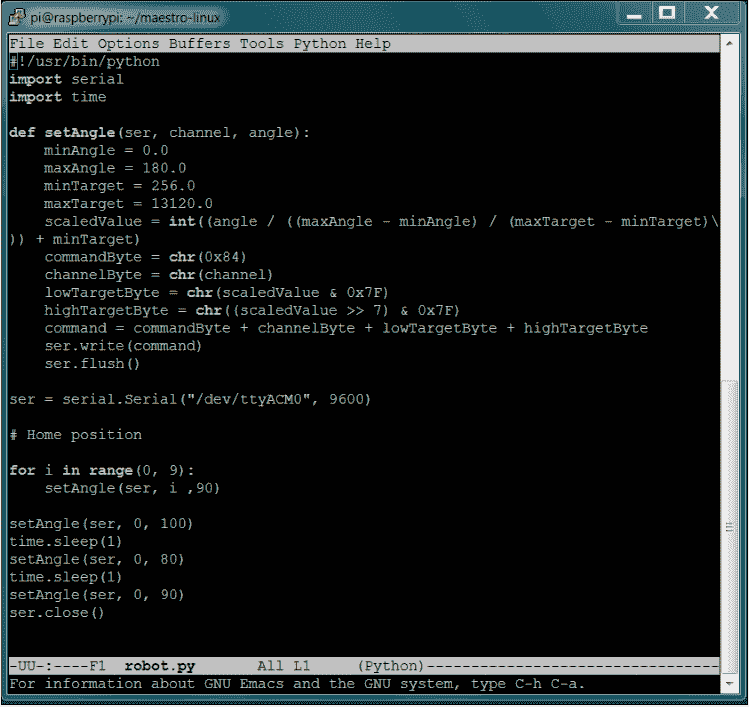

在这个例子中，你使用 `setAngle` 命令来设置舵机，从而操控机器人的右脚踝。

### 小结

现在你拥有一个可以移动的机器人了！在下一章中，你将学习如何让机器人做出许多令人惊叹的事情。你将学习如何让它向前和向后行走，以及如何让它跳舞和转弯。掌握一些基础知识后，你就可以实现各种各样的动作。
