## 3 双足机器人的运动

现在你的双足机器人已经能够正常运行了，你可以开始开发有趣的方式来让它移动。在本章中，你将学习：

- 如何调整舵机的位置以实现霸王龙姿态
- 机器人的基本步态
- 机器人的基本转弯

不过，在开始之前，最好先为你的双足机器人制作一个保护支架。你的机器人只有两条腿，本身就很不稳定，而在实验过程中你难免会犯错。只有两条腿的情况下，这些错误可能导致机器人摔倒，从而损坏机器人。

如果你有电子线路台钳或“辅助手”装置，它们会很有用。下面这张图展示了如何使用这种装置来制作保护支架：

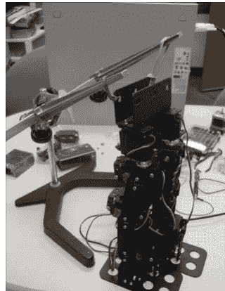

如果没有，你也可以轻松地用 PVC 管或木头制作这种顶部支撑装置。实际上，只要能防止双足机器人在实验中摔倒就行。

### 基本的稳定姿态

现在你的双足机器人已经搭好，你也知道如何用 Python 编程控制舵机，可以实验一些基本姿态了。你首先要创建一个允许你单独设置每个舵机的程序，以便进行实验。下面是这个程序：

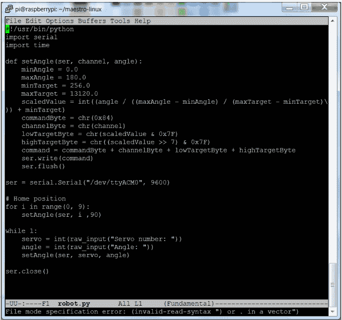

这段代码包含了第 2 章“搭建双足机器人”中的 Python `setAngle` 函数。具体细节来自 www.pololu.com 网站，它的作用就是让你可以将某个舵机设置到某个特定角度。

代码的下一部分将所有舵机设置到居中位置。最后一部分代码，即 `while 1:` 代码块，只是让用户输入舵机编号和角度，然后将命令发送到舵机控制器。

你可以使用这些角度来实现这种姿态。不过，这会限制你的活动范围，因为你的舵机将接近其单方向运动能力的极限。由于这将是机器人的起始姿态，为了获得最大的灵活性，你需要将舵机居中在这个位置。为此，请运行默认的 `robot.py`，将腿部设置到居中位置。然后，在舵机值处于 90 度角时调整舵盘，以实现这种姿态。

它应该看起来像这样：

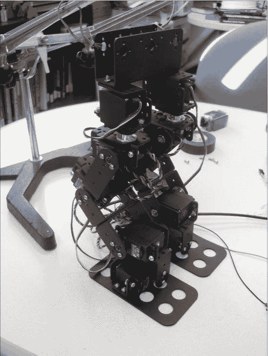

现在你有了一个稳定的基础，可以开始编写简单的行走动作了。

### 基本行走动作

你的机器人已经准备好行走了，但首先你得让一条腿离地。当然，这很简单；只需通过改变膝关节的角度来抬起腿，你的腿就能离地。你可能还想改变脚踝前后方向的角度；这样可以让你抬起腿时不必抬得那么高。

然而，如果只改变这两个舵机，你会遇到一个问题：当你抬起腿时，机器人会摔倒。这源于一个简单的原理，叫做重心。当你的机器人静止时，它的重心是这样的：

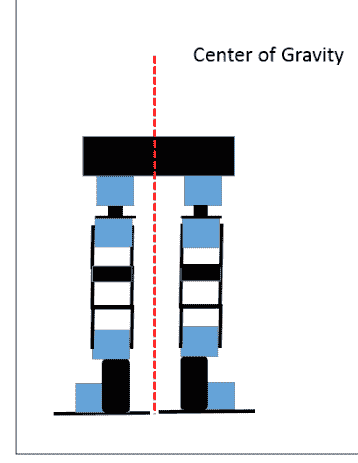


## 双足运动

很明显，如果你抬起一条腿，机器人会朝被抬起的腿的方向倒下。你需要做的是利用可以让机器人左右倾斜的脚踝舵机，将重心移到仍留在地面上的那条腿上方，最终达到下图所示的状态：

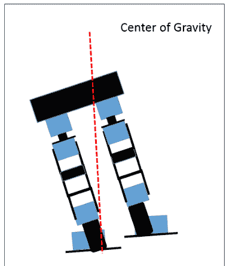

然后，你需要设置舵机来抬起左腿。以下是这些舵机设置的侧视图：

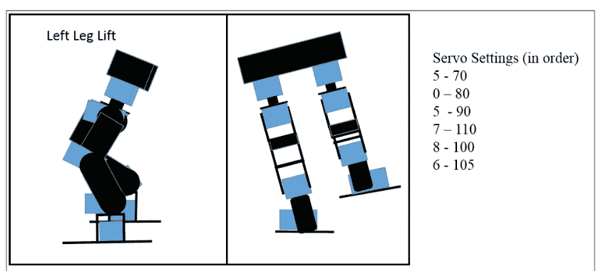

现在，是时候编写一些 Python 代码来实现这一操作了。你将从 `robot.py` 代码开始，并将以下行添加到名为 `liftLeftLeg` 的函数中：

```
# Home position
def setHome(ser):
    for i in range(0, 9):
        setAngle(ser, i, 90)

def liftLeftLeg(ser):
    setAngle(ser, 5, 70)
    setAngle(ser, 0, 80)
    time.sleep(.5)
    setAngle(ser, 5, 90)
    setAngle(ser, 7, 110)
    setAngle(ser, 8, 80)
    setAngle(ser, 6, 105)

ser = serial.Serial("/dev/ttyACM0", 9600)

setHome(ser)
time.sleep(2)
liftLeftLeg(ser)
time.sleep(.5)

while 1:
    servo = int(raw_input("Servo number: "))
    angle = int(raw_input("Angle: "))
    setAngle(ser, servo, angle)

ser.close()
```

这会让机器人向右腿倾斜，然后抬起左腿，如下所示：

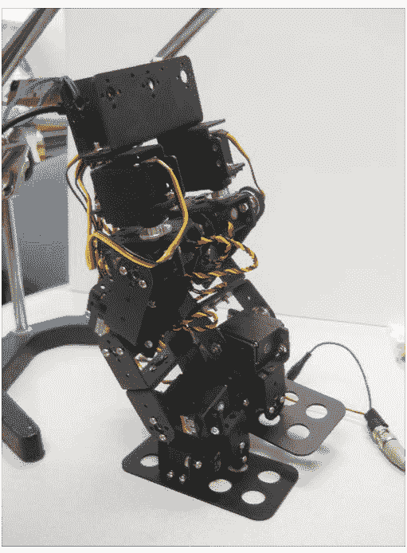

现在，向前迈步就相当容易了。只需将左腿的髋关节向前移动，然后移动右腿的脚踝关节，让整个机器人向前倾斜。以下是示意图和舵机设置：

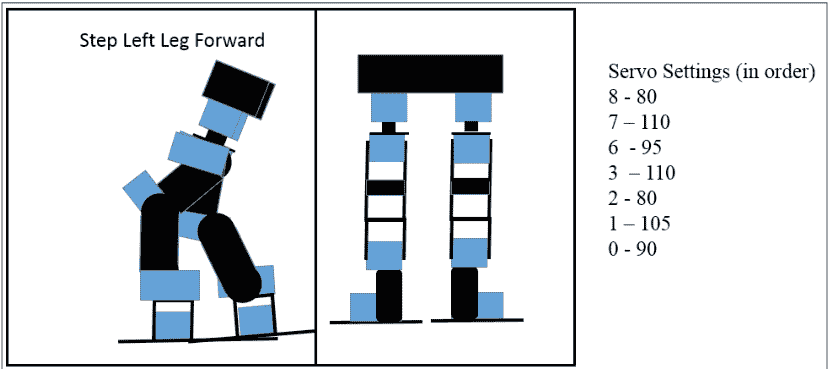

下面是 Python 代码：

```
def liftLeftLeg(ser):
    setAngle(ser, 5, 70)
    setAngle(ser, 0, 80)
    time.sleep(.5)
    setAngle(ser, 5, 90)
    setAngle(ser, 7, 110)
    setAngle(ser, 8, 80)
    setAngle(ser, 6, 105)

def stepLeftForward(ser):
    setAngle(ser, 8, 80)
    setAngle(ser, 7, 100)
    setAngle(ser, 6, 95)
    time.sleep(.5)
    setAngle(ser, 3, 110)
    time.sleep(.5)
    setAngle(ser, 2, 80)
    time.sleep(.5)
    setAngle(ser, 1, 105)
    setAngle(ser, 0, 90)
    time.sleep(.5)
```

这是机器人的一张照片：

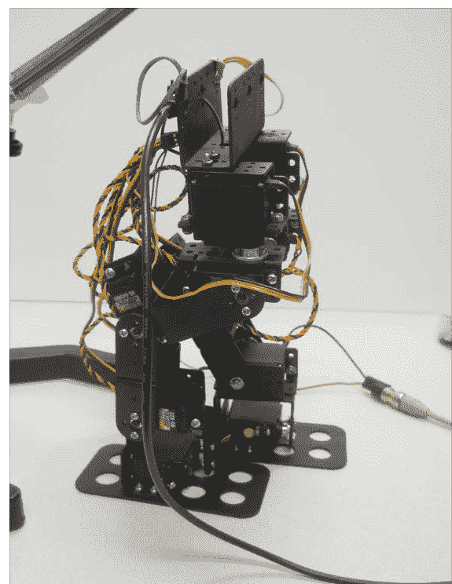

这是行走步态的第一阶段。接下来，让我们详细说明让机器人向前行走所需的全部动作。以下是不同状态的侧视图：

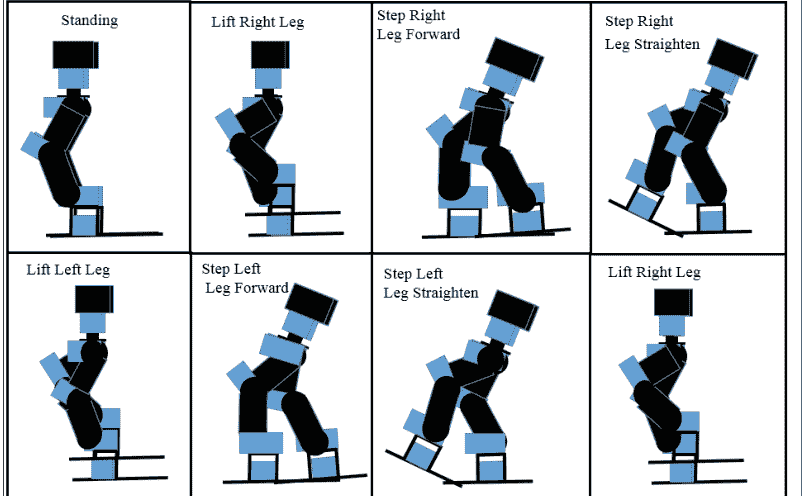

这些是机器人处于每种不同状态时的图片：

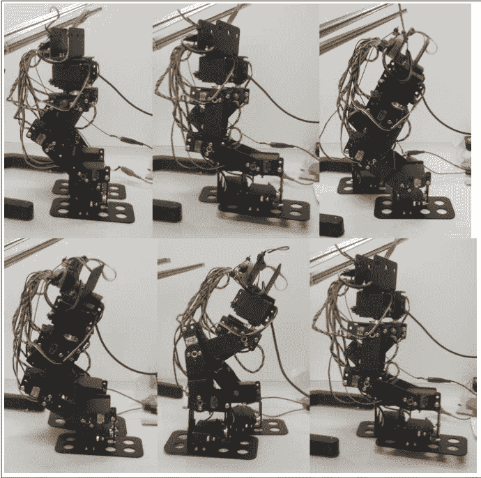

以下是不同状态对应各个函数的 Python 代码：

```
def liftLeftLeg(ser):
    setAngle(ser, 5, 70)
    setAngle(ser, 0, 80)
    time.sleep(.5)
    setAngle(ser, 5, 90)
    setAngle(ser, 7, 110)
    setAngle(ser, 8, 80)
    setAngle(ser, 6, 105)

def liftRightLeg(ser):
    setAngle(ser, 0, 110)
    setAngle(ser, 5, 100)
    time.sleep(.1)
    setAngle(ser, 0, 90)
    setAngle(ser, 2, 70)
    setAngle(ser, 3, 100)
    setAngle(ser, 1, 95)

def stepLeftForward(ser):
    setAngle(ser, 8, 80)
    setAngle(ser, 7, 100)
    setAngle(ser, 6, 95)
    time.sleep(.5)
    setAngle(ser, 3, 110)
    time.sleep(.5)
    setAngle(ser, 2, 80)
    time.sleep(.5)
    setAngle(ser, 1, 105)
    setAngle(ser, 0, 90)
    time.sleep(.5)

def stepRightForward(ser):
    setAngle(ser, 3, 80)
    setAngle(ser, 2, 70)
    setAngle(ser, 1, 70)
    time.sleep(.5)
    setAngle(ser, 8, 80)
    time.sleep(.5)
    setAngle(ser, 7, 90)
    time.sleep(.5)
    setAngle(ser, 6, 75)
    time.sleep(.5)
    setAngle(ser, 5, 90)

ser = serial.Serial("/dev/ttyACM0", 9600)
```

你会注意到每个函数都包含许多不同的舵机控制语句；必须按此顺序执行才能得到预期的结果。

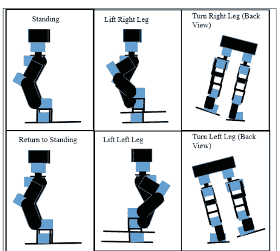

下面是一个基础转向操作的 Python 代码：

```
# Home position
def setHome(ser):
    for i in range(0, 9):
        setAngle(ser, i, 90)
        setAngle(ser, 4, 85)

def setHomeNoHips(ser):
    for i in range(0, 3):
        setAngle(ser, i, 90)
    for i in range(5, 8):
        setAngle(ser, i, 90)

def liftLeftLeg(ser):
    setAngle(ser, 5, 70)
    setAngle(ser, 0, 80)
    time.sleep(.5)
    setAngle(ser, 5, 90)
    setAngle(ser, 7, 110)
    setAngle(ser, 8, 80)
    setAngle(ser, 6, 105)

def liftRightLeg(ser):
    setAngle(ser, 0, 110)
    setAngle(ser, 5, 100)
    time.sleep(.1)
    setAngle(ser, 0, 90)
    setAngle(ser, 2, 70)
    setAngle(ser, 3, 100)
    setAngle(ser, 1, 90)

def turnLeftLegLeftCenter(ser):
    setAngle(ser, 9, 80)

def turnRightLegRightCenter(ser):
    setAngle(ser, 9, 100)

ser = serial.Serial("/dev/ttyACM0", 9600)
```

下面是将这些基础状态串联起来以执行转向步进操作的 Python 代码：

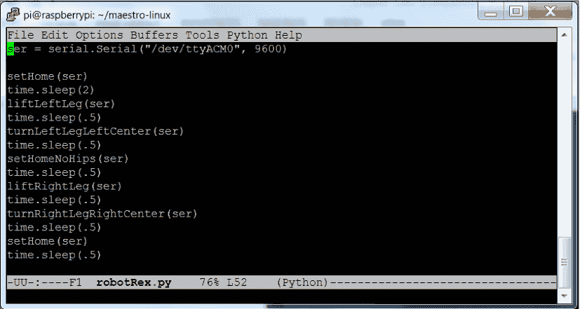

现在你的机器人可以行走和转向了！显然，通过反转每个函数中舵机控制语句的顺序，你的机器人还可以向后行走。按照本章概述的规划方法，你还可以为机器人编程实现更多类型的运动。

## 小结

现在，你的机器人已经可以移动了。下一步是添加一些传感器，让机器人能够避开或找到前进路径上的物体。
