## 使用传感器避开障碍

你已经构建了双足机器人。现在，你的机器人可以四处移动了。但如果你希望机器人感知外部世界，以免撞到东西，该怎么办？在本章中，你将了解如何添加一些传感器来帮助避开障碍物。

具体来说，你将学习：

- 如何将 Raspberry Pi 连接到 **IR（红外）** 传感器
- 如何将 Raspberry Pi 连接到 **USB 声呐传感器** 来感知世界
- 如何将 Raspberry Pi 及其 GPIO 连接到声呐传感器来感知世界

### 将 Raspberry Pi 连接到红外传感器

你的机器人现在可以四处移动，但你会希望它能够感知障碍物或目标。实现这一点的方法之一就是使用 IR 传感器。首先，需要了解一下 IR 传感器的知识。IR 传感器由一个发射器和一个传感器组成。发射器发出一束狭窄的光线，传感器接收这束光线。

传播过程中的差异最终体现为传感器中的角度测量值，如下图所示：

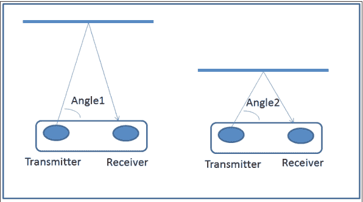

不同的角度可以指示物体与传感器之间的距离。传感器将这些角度测量值转换为电压，你可以通过检测该电压来确定距离。遗憾的是，传感器的输出与距离之间并非线性关系，因此你需要进行一些校准，才能预测实际距离及其与传感器输出之间的关系。

> IR 传感器相当精确，出错率很低；不过，如果环境光线很强，它们可能无法正常工作。精度还会受到被测物体反射特性的影响。在决定使用哪些传感器时，这可以作为一个考虑因素。

在开始之前，你需要先准备一个传感器。其中比较流行的一种是夏普（Sharp）公司生产的廉价 IR 传感器。许多在线电子商店都有出售，并且有检测不同距离的型号。你将使用 **Sharp 2Y0A02** 型号，该型号可检测最远 150 cm 的距离。以下是传感器的图片：

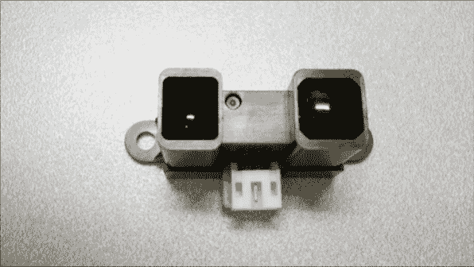

你还需要确保获得该设备的连接线；通常情况下它会随设备附带。以下是连接好线缆的传感器图片：

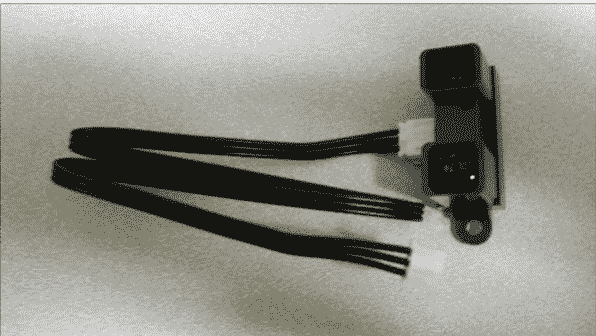

正如教程中所述，传感器输出的电压将指示距离。然而，这是一个模拟信号，而 Raspberry Pi 没有模数转换器，无法将这个模拟电压转换为可在程序中读取的数字。你需要为项目添加一个模数转换器。

There are two choices. If you want an analog-to-digital converter that plugs directly into the USB interface, there is one offered by www.phidgets.com. This board is really quite amazing; it takes the analog signals, turns them into digital numbers using an analog to digital converter, and then makes them available so that they can be read from the USB port. The model number of this part is **1011_0 - PhidgetInterfaceKit 2/2** and it is shown in the following:

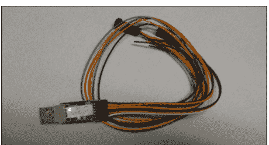

Unfortunately, it takes a bit of programming expertise to get it up and running. The other choice is to use an analog-to-digital converter that connects to the GPIO pins of the Raspberry Pi. There is a part, the **ADC pi+** from www.abelectronics.co.uk, that does this. It is pictured here:

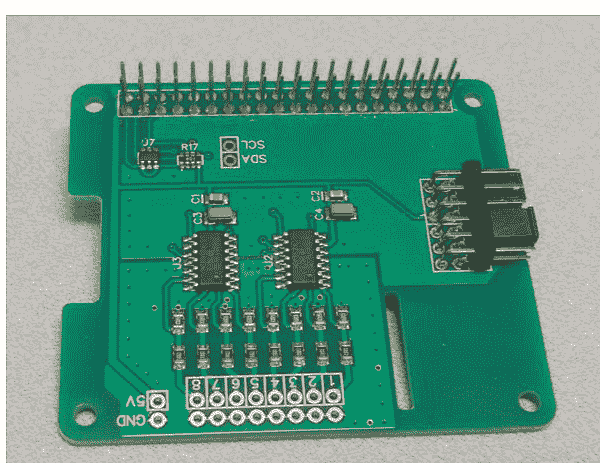

This device is easier to program, so this is what you'll use in this project. Now, let's connect the sensor:

- 1. Solder header pins to the ADC Pi+ board to connect it to the ADC, like this:
- 2. Now, plug the board into the Raspberry Pi B 2. Here is a picture of the combination:

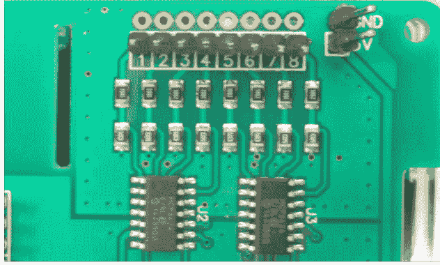

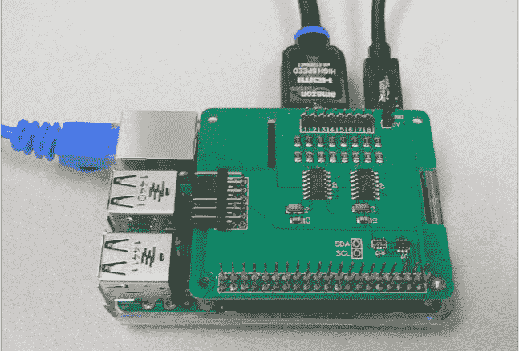

3. Now, you'll connect the IR sensor to the ADC. To connect this unit, you'll connect the three pins that are available at the bottom of the sensor. Here is the connection list:

| ADC-DAC Board | Sensor Pin |
| --- | --- |
| 5V | Vcc |
| GND | Gnd |
| In1 | Vo |

Unfortunately, there are no labels on the unit, but here are the pins you'll connect:

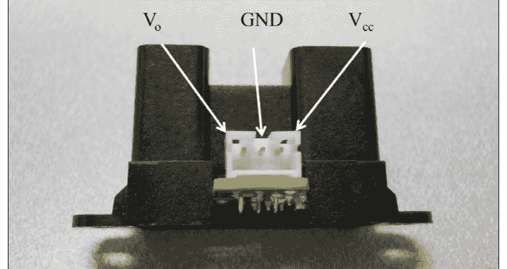

It's easiest to connect to the three-wire cable that normally comes with the sensor. Once the pins are connected, you are ready to access the data from the sensor via a Python program on the Raspberry Pi. The entire system looks like this:

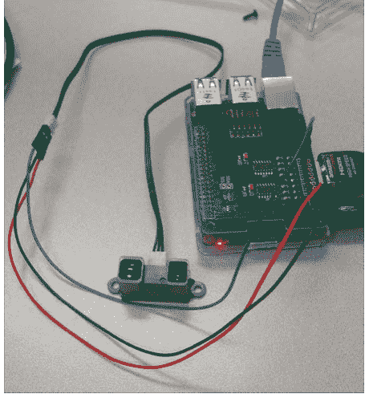

Now, you are ready to add some code to read the IR sensor. You'll need to follow these steps to talk to the ADC:

- 1. The first step in enabling the ADC is to enable the I2C interface. This is done by running raspi-config and selecting 8 Advanced Options like this:

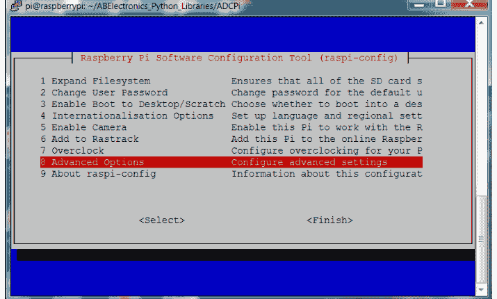

2. Once there, go to the A7 I2C selection to enable the I2C like this:

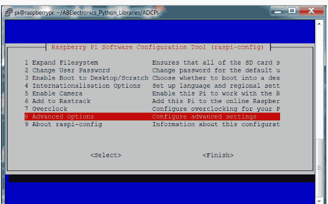

Perform all the selections to enable the I2C interface and load the library, and then reboot the Raspberry Pi.

You'll also need to edit the /etc/modules file and add the following two lines:

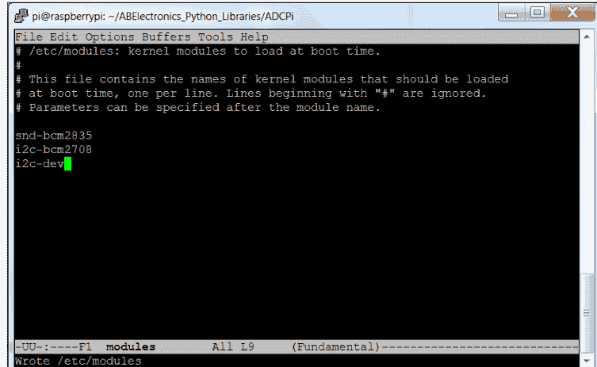

Reboot the Raspberry Pi. You can see whether the I2C is enabled by typing `sudo i2cdetect -y 1`, and you should see something like this:

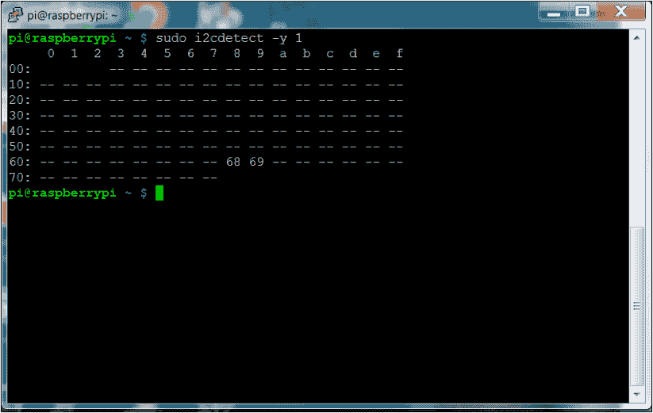

The I2C device, your ADC, is available at the **68** and **69** addresses.

- 3. Now, you can download the code. To do this, type `git clone https://github.com/abelectronicsuk/ABElectronics_Python_Libraries.git` from the home directory, and the Python libraries will be installed on your Raspberry Pi.
- 4. Go to the `./ABElectronics_Python_Libraries/ADCPI` directory; here are the programs for your specific hardware. Following the instructions in the `README.md` file, type `sudo apt-get update`, and then type `sudo apt-get install python-smbus`. This will install the smbus library, which are required for the ADC to work. Also, type `sudo adduser pi i2c` to add pi to the group that can access i2c.

5. You'll need to edit your .bashrc file in your home directory, adding the following lines:

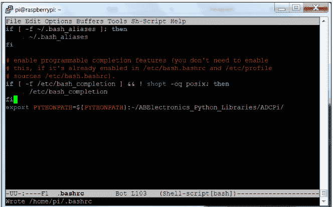

Adding this line will add this library to the path so that you can access the functionality. Reboot the Raspberry Pi.

6. Now, you can run one of the demo programs. Type python demo-readvoltage.py, and you should see something like this:

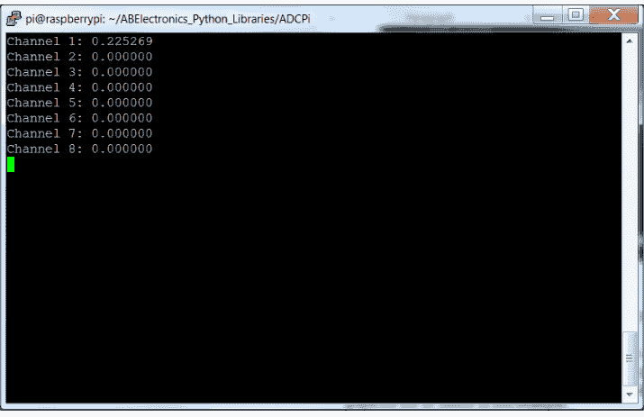

These raw readings are great, but now you'll want to build a program that takes the data from the first ADC and translates it to the distance. To do this, you'll need a graph of the voltage to distance readings for your sensor. Here is the graph for the IR sensor in this example:

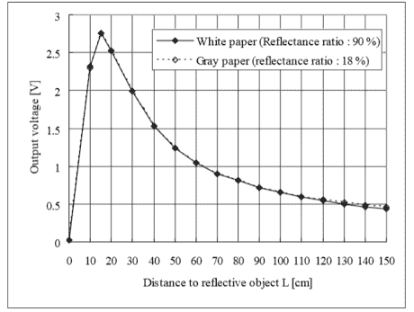

There are really two parts to the curve; the first is the distance up to about 15 centimeters, and the second is the distance from 15 centimeters to 150 centimeters. It is easiest to build a simple mathematical model that ignores distances closer than 15 centimeters and models the distance from 15 centimeters. For more information on how to build this model, refer to http://davstott.me.uk/index.php/2013/06/02/raspberry-pi-sharp-infrared/. Here is the Python program using this model:

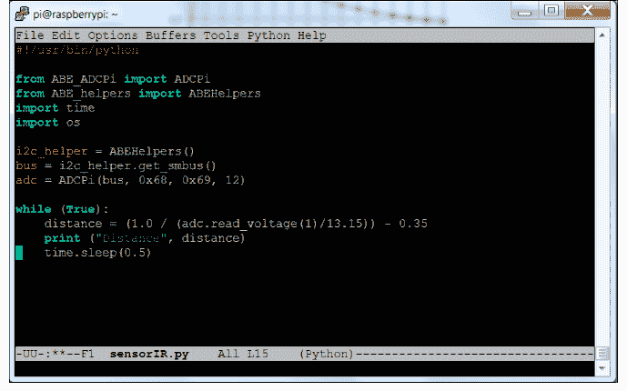

The only new line of code is the distance = (1.0 / (adc.read_adc_voltage(1) / 13.15)) - 0.35 line. It converts your voltage to distance. You can now run your program and you'll see the results in centimeters, like this:

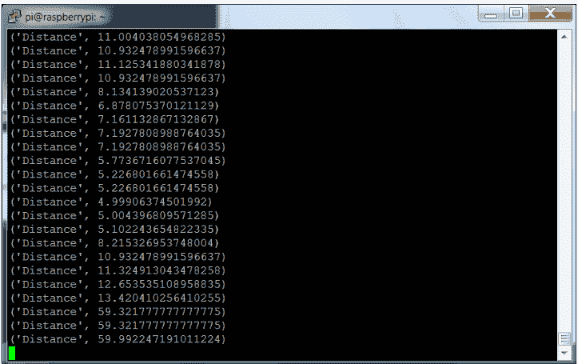

Now, you can measure the distance to objects using your IR sensor!

## Connecting Raspberry Pi to a USB sonar sensor

There is yet another way to sense the presence of objects: using a sonar sensor. But before you add this capability to your system, here's a little tutorial on sonar sensors. This type of sensor uses ultrasonic sound to calculate the distance from an object. The sound wave travels out from the sensor, as illustrated in the following figure:

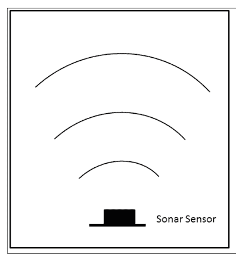

The device sends out a sound wave 10 times a second. If an object is in the path of these waves, then the waves reflect off the object, sending waves that return to the sensor, as shown in the following figure:

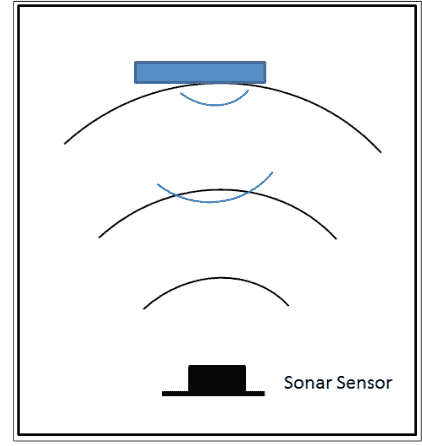

The sensor then measures any return. It uses the time difference between when the sound wave was sent out and when it returned to measure the distance from the object.

## Avoiding Obstacles Using Sensors

> Sonar sensors are also quite accurate, normally with low percentage errors, and are not affected by the lighting or color in the environment.

There are several choices if you want to use a sonar sensor to sense the distance. The first is to use a sonar sensor that connects to the USB port. The following is an image of a USB sonar sensor:

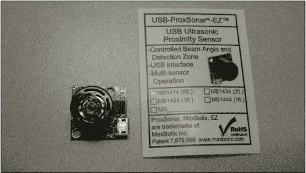

This is the **USB-ProxSonar-EZ** sensor, and can be purchased directly from MaxBotix or on Amazon. There are several models, each with a different distance specification; however, they all work in the same way.

You can also choose a sonar sensor that connects to the GPIO of the Raspberry Pi. Here is a picture of this sort of inexpensive sonar sensor:

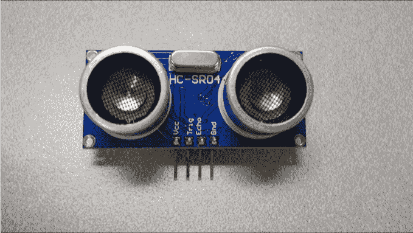

This sensor is less expensive and easy to use; it takes a bit of processing power to coordinate the efforts of timing the send and receive signals, but the Raspberry Pi B 2 has the processing power needed. Here are the steps to set up this sonar sensor to sense the distance:

- 1. The first step is to understand the GPIO pins of the Raspberry Pi B 2. Here is a diagram of the layout of the pins:

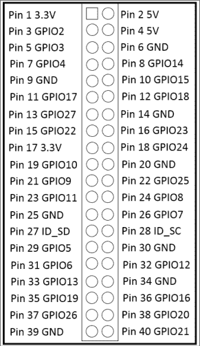

In this case, you'll need to connect to the 5 volt connection of the Raspberry Pi B2, which is pin 2. You'll also need to connect to the GND, which is pin 6. You'll use pin 16 as an output trigger pin and pin 18 (GPIO24) as an input to time the echo from the sonar sensor.

## Avoiding Obstacles Using Sensors

2. Now that you know the pins you'll connect to, you can connect the sonar sensor. There is a problem, as you can't connect the 5 volt return from the sonar sensor directly to the Raspberry Pi GPIO pins; they want 3.3 volts. You'll need to build a voltage divider that will reduce the 5 volts to 3.3 volts. This can be done with two resistors, which are connected as shown in this diagram:

If you'd like more information on how the voltage divider works in this configuration, refer to http://www.modmypi.com/blog/hc-sr04-ultrasonic-range-sensor-on-the-raspberry-pi. The combination of these two resistors will reduce the voltage to the desired levels. You may want to put all of this is in a small breadboard, as shown here:

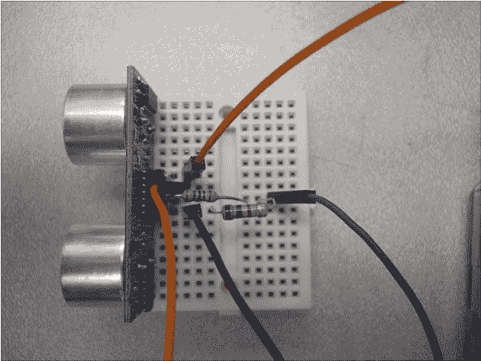

最后，将其连接到树莓派，如下图所示：

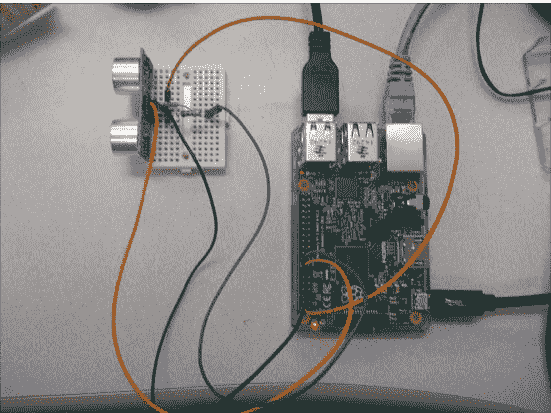

3. 设备连接好后，你需要用一点代码来读取数值，确保其稳定（即稳定的测量值），然后将其转换为距离。以下是该程序的 Python 代码：

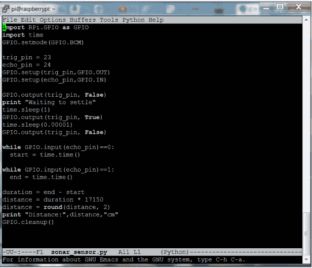

现在，你应该能够运行程序并看到类似下面的结果：

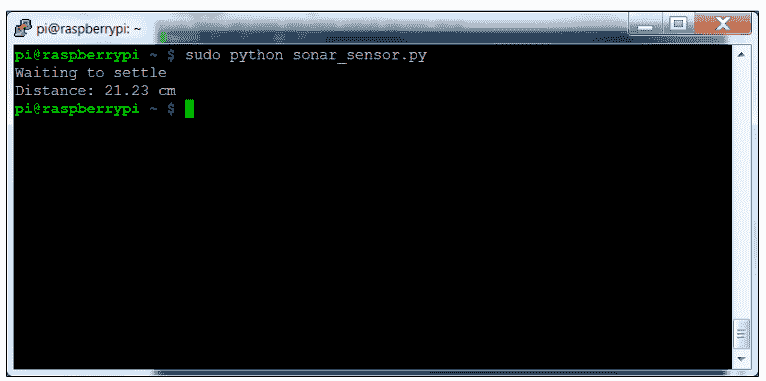

现在你的传感器已经正常工作，你可以用双足机器人来避障或寻找物体了。

## 小结

恭喜！你现在可以检测并避开墙壁和其他障碍物了。你也可以使用这些传感器来检测你想寻找的物体。在下一章中，你将学习如何执行路径规划，让你的机器人从 A 点移动到 B 点，甚至让机器人在遇到障碍物时具备相应的智能决策能力。
