# 5

# 路径规划
与你的双足机器人

现在你的双足机器人已经能够移动并探测障碍物，你可以让它开始自主移动了。不过，你希望机器人能规划自己的路径，也就是说，如果它知道自己的起点和期望的终点，它就可以从起点移动到终点。

在本章中，你将学习以下内容：

- 如何为你的双足机器人添加数字罗盘，从而获得方向感
- 学习一些基本的机器人路径规划技术

## 将数字罗盘连接到树莓派

如果机器人要规划自己的路径，一个可能有用的重要信息就是它的行进方向。那么，让我们来学习如何将数字罗盘连接到树莓派上。

## 路径规划与你的双足机器人

有几种芯片可以提供数字罗盘功能，其中最常见的是 **HMC5883L 三轴数字罗盘芯片**。该芯片由多家公司封装成模块，但几乎所有模块的接口都类似。下图是 **GY-271 HMC5883L 三轴罗盘磁力计传感器模块** 的实物图，该模块可从多家在线零售商处购买：

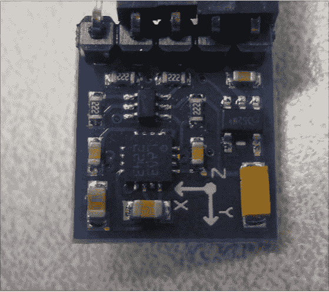

这种数字罗盘使用磁传感器来探测地球磁场。这些传感器的输出通过一组寄存器提供给外部世界，用户可以通过这些寄存器设置采样率、连续采样或单次采样等参数。*x*、*y*、*z* 三个方向的数据也通过寄存器输出。

该芯片的连接非常简单，设备通过 I2C 总线与树莓派通信，I2C 是一种标准的串行通信总线。I2C 接口是一种同步串行接口，性能优于异步 Rx/Tx 串行接口。SCL 数据线提供时钟，数据在 SDA 线上传输。该总线还提供寻址功能，因此多个设备可以同时连接到主设备。模块背面的连接引脚已标明，如下图所示：

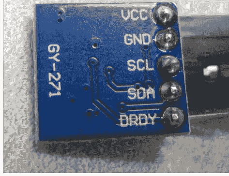

接下来，你需要将设备连接到树莓派的 GPIO 引脚上。以下是树莓派的引脚图：

| 引脚 1 3.3V |  | 引脚 2 5V |
| 引脚 3 GPIO2 |  | 引脚 4 5V |
| 引脚 5 GPIO3 |  | 引脚 6 GND |
| 引脚 7 GPIO4 |  | 引脚 8 GPIO14 |
| 引脚 9 GND |  | 引脚 10 GPIO15 |
| 引脚 11 GPIO17 |  | 引脚 12 GPIO18 |
| 引脚 13 GPIO27 |  | 引脚 14 GND |
| 引脚 15 GPIO22 |  | 引脚 16 GPIO23 |
| 引脚 17 3.3V |  | 引脚 18 GPIO24 |
| 引脚 19 GPIO10 |  | 引脚 20 GND |
| 引脚 21 GPIO9 |  | 引脚 22 GPIO25 |
| 引脚 23 GPIO11 |  | 引脚 24 GPIO8 |
| 引脚 25 GND |  | 引脚 26 GPIO7 |
| 引脚 27 ID_SD |  | 引脚 28 ID_SC |
| 引脚 29 GPIO5 |  | 引脚 30 GND |
| 引脚 31 GPIO6 |  | 引脚 32 GPIO12 |
| 引脚 33 GPIO13 |  | 引脚 34 GND |
| 引脚 35 GPIO19 |  | 引脚 36 GPIO16 |
| 引脚 37 GPIO26 |  | 引脚 38 GPIO20 |
| 引脚 39 GND |  | 引脚 40 GPIO21 |

## 通过编程访问罗盘

将设备上的 VCC 连接到树莓派的引脚 1（3.3V）。将 GND 连接到引脚 9（GND）。将设备上的 SCL 连接到引脚 5（GPIO 3），将 SDA 连接到设备上的引脚 3（GPIO 2）。注意，你不需要连接数据就绪（DRDY）线。现在，你就可以与设备通信了。

为了访问罗盘功能，你需要在树莓派上启用 I2C 库。如果你在第 4 章“使用传感器避开障碍物”中使用了红外传感器和 ADC 附加硬件，那么你已经完成了此操作。如果没有，请按照以下说明启用 I2C 接口：

- 1. 运行 `raspi-config`。选择“Configure advanced settings”（配置高级设置），如以下截图所示：

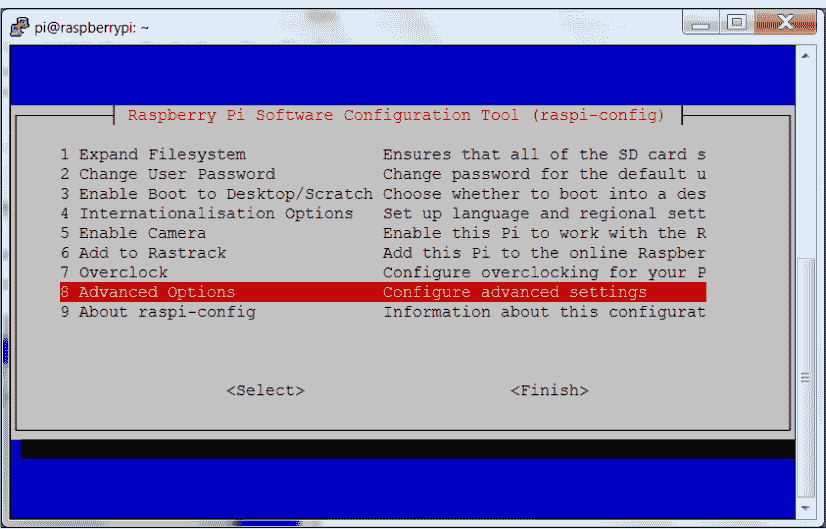

在下一个选择页面中，选择“Enable/disable automatic loading of the I2C interface”（启用/禁用 I2C 接口的自动加载），如以下截图所示：

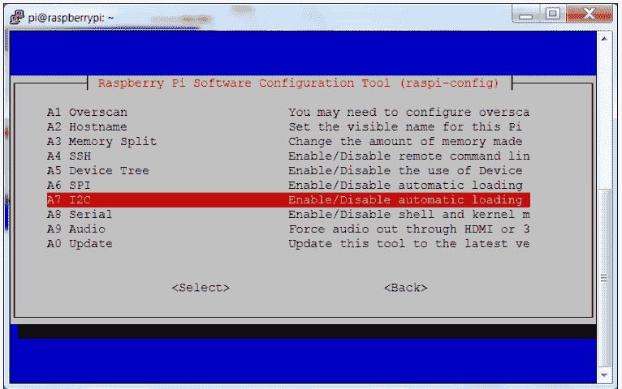

然后选择“是”，如以下截图所示：

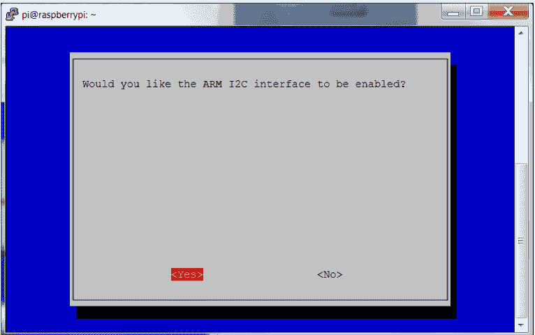

你还需要编辑 `/etc/modules` 文件，并添加 `i2c-bcm2708` 和 `i2c-dev` 两行，如以下截图所示：

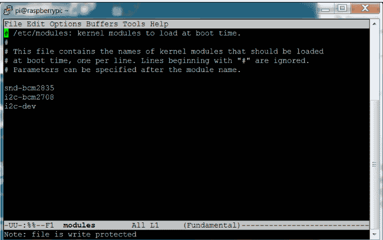

最后再进行一次编辑，修改 `/boot/config.txt` 中的最后一行，如以下截图所示：

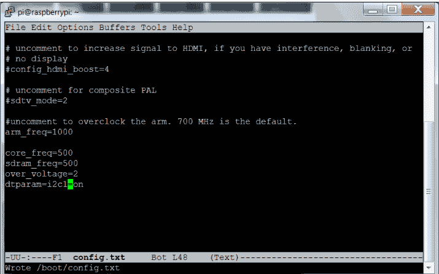

现在，重启树莓派。

- 2. 设备连接好后，你可以查看系统是否识别到你的设备。为此，请输入以下命令：

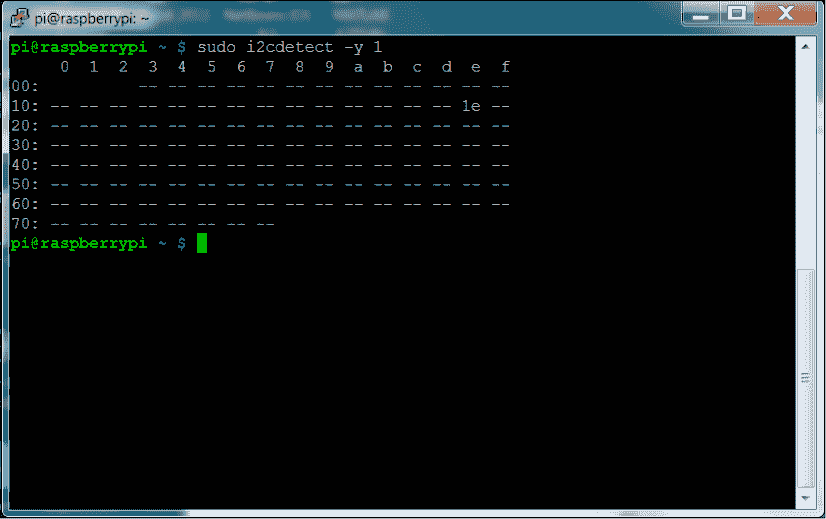

你可以在 **1e** 处看到该设备。

- 3. 现在，你可以与数字罗盘通信了。为此，你需要创建一个 Python 程序。但在编写 Python 代码之前，你最好先下载一个库，这样会让事情变得简单得多。为此，首先创建一个名为 `compass` 的目录，并进入该目录。然后，输入 `git clone https://github.com/quick2wire/quick2wire-python-api.git` 下载 quick2wire-python-api 库。最后，输入 `git clone https://bitbucket.org/thinkbowl/i2clibraries.git` 获取 i2clibraries。

你还需要设置一些环境变量。进入你的主目录，编辑 `.bashrc` 文件，在文件末尾添加以下两行：

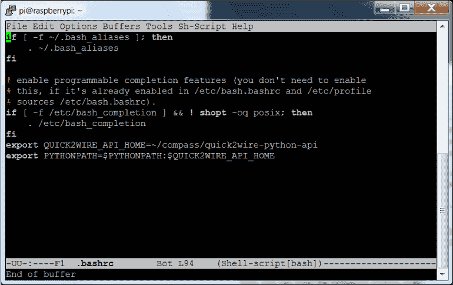

4. 现在，你可以创建以下 Python 代码：

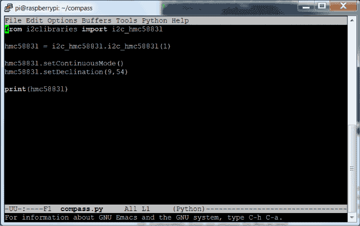

5. 现在，输入 `python3 compass.py` 命令运行代码，你应该会看到：

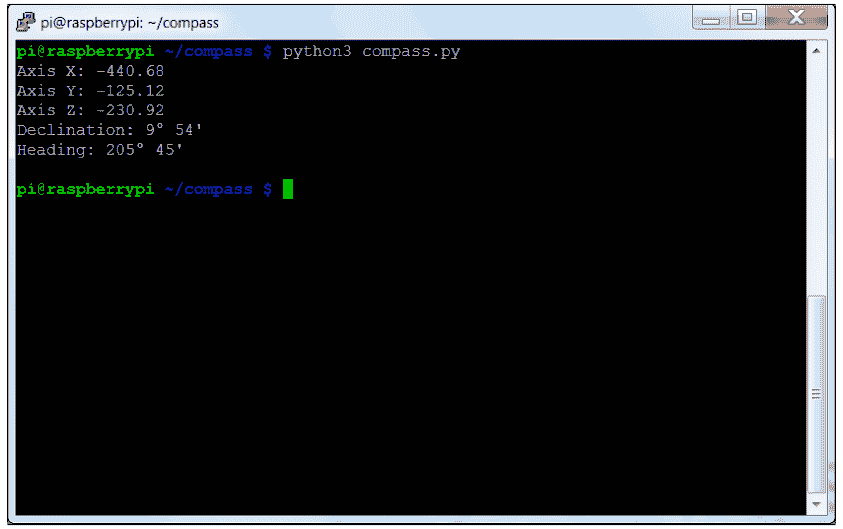

现在，你可以为项目添加方向功能了！当你移动设备时，你应该会看到 Heading（方向角）值发生变化。

> 这是一个基础程序；你可以在 http://think-bowl.com/raspberry-pi/i2c-python-library-3-axis-digital-compass-hmc5883l-with-the-raspberry-pi/ 了解更多该库提供的其他功能。

开发罗盘代码的最后一步是将其制作成一个文件，使其中函数可以被其他 Python 程序导入。为此，请编辑该文件，使所有代码都放在函数中，如下所示：

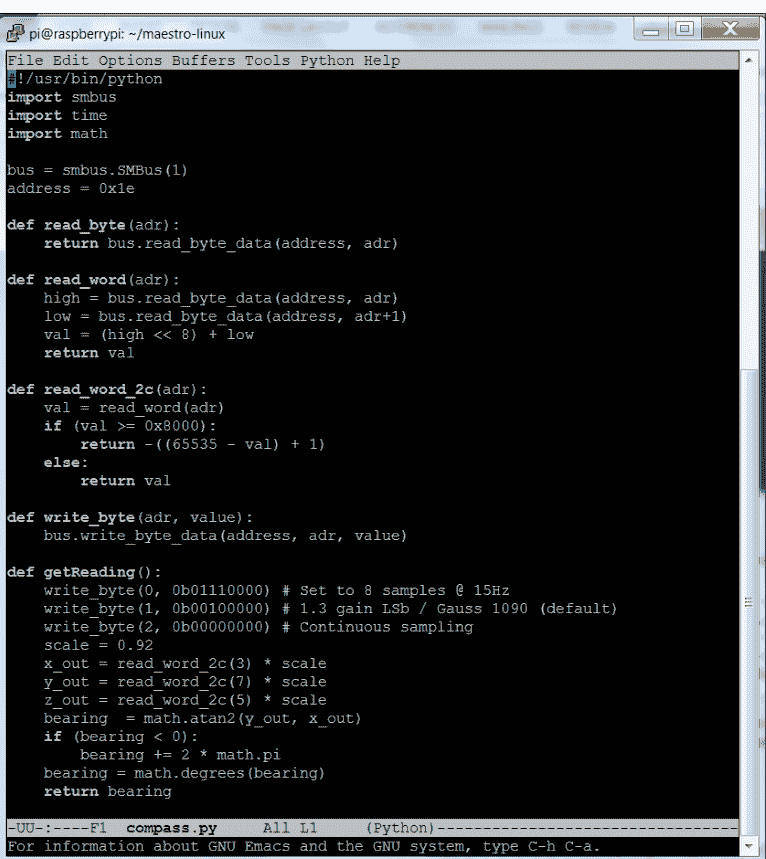

然后，你就可以使用 Python 的导入功能将此功能导入到另一个 Python 文件中。

## 你的机器人的动态路径规划

现在你已经能够看到障碍物并知道方向，接下来你需要进行动态路径规划。动态路径规划简单来说就是，你无法预先了解整个环境中所有可能的障碍物。你的机器人必须在实际移动过程中决定如何前进。这可能是一个复杂的主题，但你可以先了解并应用一些基础知识，让你的机器人在环境中移动。让我们先解决“知道要去哪里，并且需要在没有障碍物的情况下执行路径”的问题，然后再加入障碍物。

### 基本路径规划

为了讨论动态路径规划，即在不知道会遇到什么障碍物的情况下规划路径，你需要一个框架来了解机器人的位置以及确定目标的位置。一种常见的框架是 *x-y* 网格。以下是这种网格的示意图：

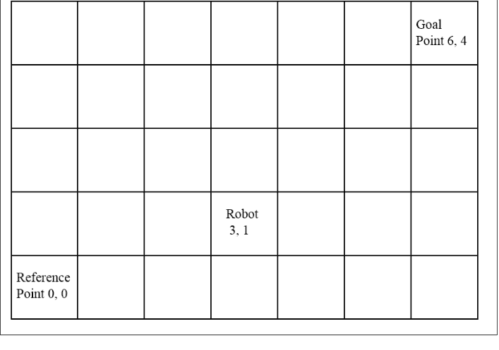


## 路径规划与你的双足机器人

有三个关键点：

- 左下角点是一个固定参考位置。*x* 和 *y* 方向也是固定的，所有其他位置都将相对于该位置和这些方向进行测量。
- 另一个关键点是机器人的起始位置。机器人将利用自己的 *x* 坐标（相对于某个固定参考位置在 *x* 方向上的位置）和 *y* 坐标（相对于某个固定参考位置在 *y* 方向上的位置）来持续跟踪自己的位置，直到到达目标。它将使用罗盘来跟踪这些方向。
- 第三个关键点是目标的位置，同样以相对于固定参考位置的 *x* 和 *y* 坐标给出。如果你知道机器人的起始位置和起始角度，就可以规划到该目标的最优（最短距离）路径。为此，你可以使用目标位置和机器人位置，通过一些相当简单的数学运算计算机器人到目标的距离和角度。

要计算距离，请使用以下方程：

$$d = \sqrt{(X_{goal}-X_{robot})^2 + (Y_{goal}-Y_{robot})^2}$$

使用以下方程告诉你的机器人需要行进多远才能到达目标。第二个方程将告诉你的机器人需要行进的角度：

$$\theta = \arctan\left(\frac{Y_{goal}-Y_{robot}}{X_{goal}-X_{robot}}\right)$$

下图是这两项信息的图形表示：

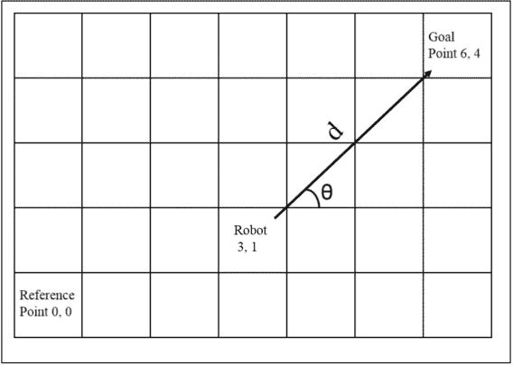

既然你已经有了目标角度和距离，就可以对机器人进行编程，让它移动。为此，你将编写一个执行路径规划的程序，并调用你在*第 3 章“双足运动”*中创建的运动函数。不过，你需要知道机器人每步行进的距离，这样才能以步数而不是距离单位来告诉机器人要行进多远。

你还需要能够换算机器人在转弯过程中可能走过的距离；不过，这个距离可能太小，无关紧要。如果你知道了角度和距离，就可以让机器人移动到目标。

下面是你将编程实现的步骤：

- 1. 以单位计算机器人到达目标所需行进的距离。将其转换为达到该距离所需的步数。
- 2. 计算机器人到达目标所需行进的角度。你将使用罗盘和机器人转弯函数来实现该角度。
- 3. 现在，以正确的次数调用步进函数，使机器人移动正确的距离。

就这么简单。现在，我们将使用一些非常简单的 Python 代码来执行此操作，这些代码使用函数让机器人前进和转弯。在这种情况下，创建一个名为 `robotLib.py` 的文件是合理的，其中包含所有实际舵机设置函数，用于让双足机器人向前迈步和转弯。然后，你可以使用 `from robotLib import *` 语句导入这些函数，你的 Python 程序就可以调用它们了。这使路径规划 Python 程序更小、更易于管理。对于罗盘程序，你也会这样做，即使用 `from compass import *` 命令。

> 有关如何将函数从一个 Python 文件导入另一个 Python 文件的更多信息，请参考 http://www.tutorialspoint.com/python/python_modules.htm 。

下面是该程序的清单：

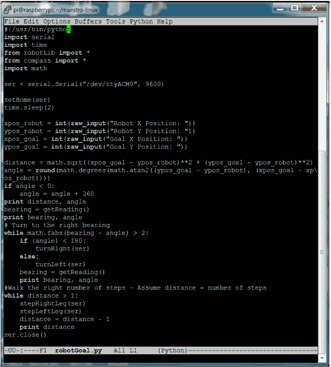

在此程序中，用户输入目标位置，机器人首先通过读取角度来决定到达期望角度的最短方向。为简单起见，机器人被放置在网格中，并朝向 0 度角方向。如果目标角度小于 180 度，机器人将向右转；如果大于 180 度，机器人将向左转。机器人会一直转弯，直到期望角度与测量角度相差几度以内。然后，机器人迈出相应的步数以到达目标。

### 避开障碍物

如你所见，在无障碍物的情况下规划路径相当容易。然而，当你的机器人需要绕过障碍物行走时，就会变得更具挑战性。让我们看一个例子：在你之前计算的路径上出现了一个障碍物。它可能如下图所示：

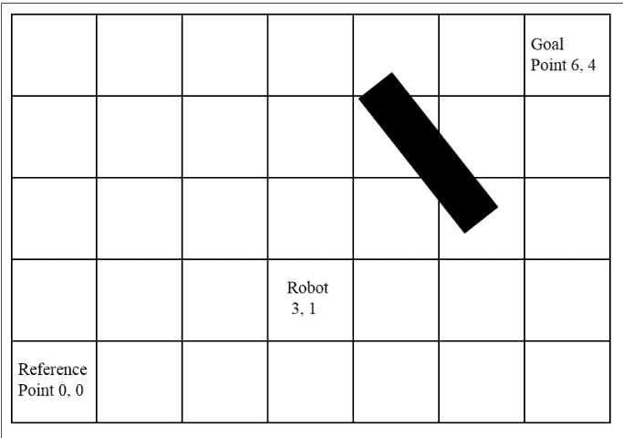

你仍然可以使用相同的路径规划算法来找到起始角度；不过，现在你需要使用声纳传感器来检测障碍物。当声纳传感器检测到障碍物时，你需要停下来，重新计算避开障碍物的路径，然后重新计算通往目标的最优路径。一个非常简单的做法是：当机器人感应到障碍物时，向右转 90 度，前进一段固定距离，然后重新计算最优路径。当你转回朝向目标时，如果没有感应到障碍物，就可以沿最优路径前进。

但是，如果机器人再次遇到障碍物，它将重复该过程，直到到达目标。在这种情况下，按照这些规则，机器人将沿以下路径行进：

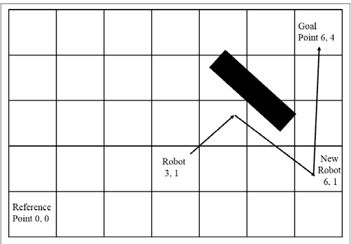

在为机器人添加声纳传感器功能之前，你还需要完成一步。你需要修改声纳传感器代码，使其可以作为库添加到 Python 代码中。代码如下：

```python
import RPi.GPIO as GPIO
import time
GPIO.setmode(GPIO.BCM)

def getDistance():
    trig_pin = 23
    echo_pin = 24
    GPIO.setup(trig_pin,GPIO.OUT)
    GPIO.setup(echo_pin,GPIO.IN)

    GPIO.output(trig_pin, False)
    time.sleep(1)
    GPIO.output(trig_pin, True)
    time.sleep(0.00001)
    GPIO.output(trig_pin, False)

    while GPIO.input(echo_pin)==0:
        start = time.time()

    while GPIO.input(echo_pin)==1:
        end = time.time()

    duration = end - start
    distance = duration * 17150
    distance = round(distance, 2)
    GPIO.cleanup()
    return distance

print "Distance: ", getDistance(), "cm"
```

你还需要使用 `from compass import *` 语句导入此代码。你还将使用 time 库和 `time.sleep` 命令，在代码中的不同语句之间添加延迟。下面是利用所有这些功能检测障碍物并向右转的代码的第一部分，也就是利用声纳传感器的 Python 代码的第一部分：

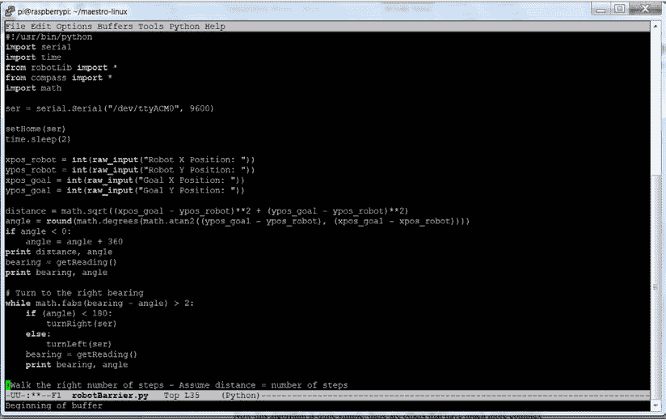

下面是代码的最后一部分：

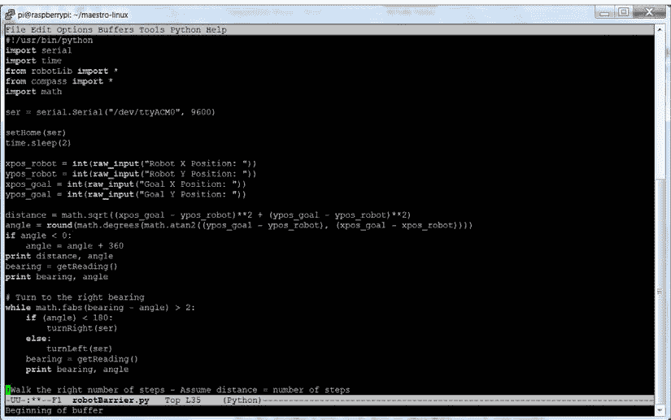

现在，这个算法相当简单；还有其他对障碍物的响应复杂得多的算法。你也会发现，通过在侧面添加声纳传感器，你的机器人实际上可以感知障碍物何时结束。你还可以提供更复杂的决策过程，来决定向哪个方向转弯以避开物体。此外，还有许多不同的寻路算法。参见 http://www.academia.edu/837604/A_Simple_Local_Path_Planning_Algorithm_for_Autonomous_Mobile_Robots 中的示例。你可以利用本章中构建的基本功能来探索这些更复杂的算法。

### 小结

你现在已经为机器人增加了路径规划的能力。你的机器人现在不仅可以从 A 点移动到 B 点，还可以避开可能挡路的障碍物。在下一章中，你将学习如何为双足机器人添加摄像头。这将为你的机器人感知周围世界带来一套全新的方式。
