## 第 6 章 为你的双足机器人添加视觉

既然你的双足机器人已经能够站起来并移动、能够发现障碍物，并且知道如何规划路径，你现在就可以让它自主移动了。不过，你可能希望机器人追踪颜色或运动。

在本章中，你将学习：

- 如何为双足机器人添加网络摄像头
- 如何为双足机器人添加 RaspiCam
- 如何安装和使用 OpenCV（一个开源视觉软件包）
- 如何让双足机器人追踪运动

### 在双足机器人上安装摄像头

具备视觉能力对双足机器人来说是一个真正的优势；你将在许多不同的应用中使用这一功能。幸运的是，添加视觉硬件和软件既容易又便宜。就视觉硬件而言，有两种选择。你可以为系统添加 USB 网络摄像头，也可以添加专为树莓派设计的 RaspiCam 摄像头。


## 在树莓派上安装 USB 摄像头

连接 USB 摄像头非常简单。只需将其插入 USB 插槽即可。为确保设备已连接，请输入 `lsusb`。您应该会看到以下内容：

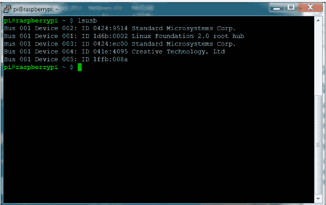

这里显示的是一个 Creative 摄像头，位于 Bus 001 Device 004: ID 041e:4095。为确保系统将其识别为视频设备，请输入 `ls /dev/v*` 命令，您应该会看到类似以下内容：

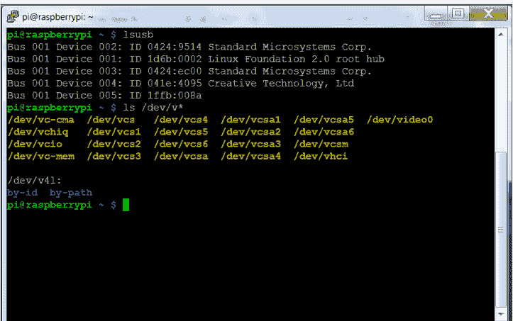

`/dev/video0` 就是摄像头设备。现在设备已连接，让我们实际看看能否捕获图像和视频。有多种工具可以访问摄像头，但其中一款带有视频控制功能的简单程序名为 `luvcview`。要安装它，请输入 `sudo apt-get install luvcview`。应用程序安装完成后，您需要运行它。为此，您需要直接连接显示器，或者能够通过远程 VNC 连接（如 `vncserver`）访问树莓派，因为显示图像需要图形界面。

通过这种方式连接后，请在树莓派上打开终端窗口并运行 `luvcview`。您应该会看到类似以下内容：

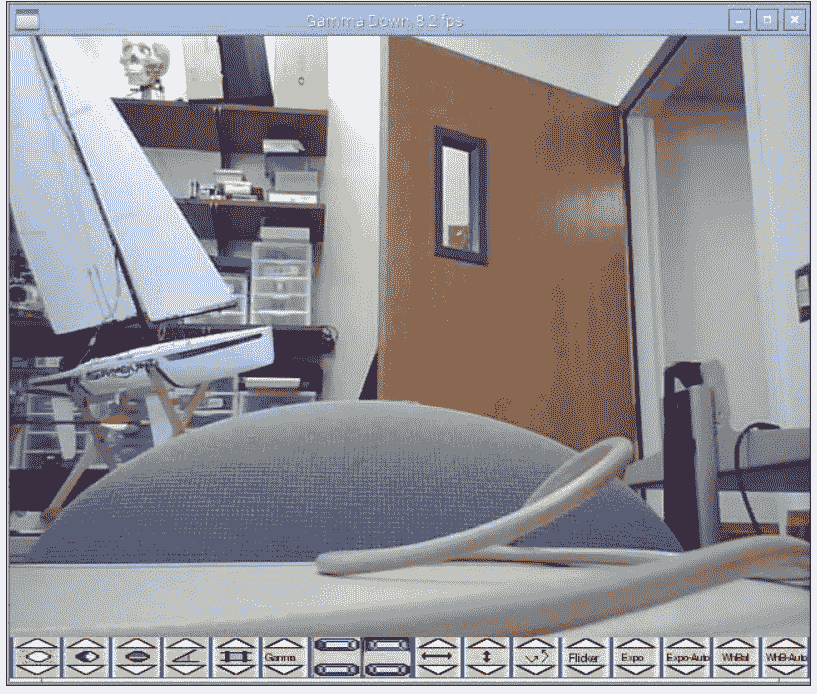

不用担心图像质量，您将在视觉框架 OpenCV 中捕获和处理图像。

## 在树莓派上安装 RaspiCam

在树莓派上感知外部世界的另一个选择是使用 RaspiCam。安装这款摄像头要稍微复杂一些；您需要将其连接到树莓派上的一个专用连接器。以下是摄像头及其专用连接器的图片：

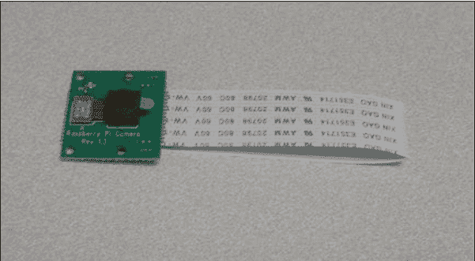

您可能还想为摄像头加装保护盖；组装后看起来如下：

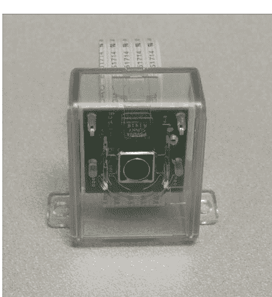

现在您可以着手将摄像头连接到树莓派了。摄像头需要安装到树莓派上标有 Camera 的连接器中。要了解具体操作方法，请观看 http://www.raspberrypi.org/help/camera-module-setup/ 上的视频。

摄像头连接好后，您需要使用 `raspi-config` 工具启用摄像头。输入 `sudo raspi-config`，然后选择 Enable Camera（启用摄像头），如下面的截图所示：

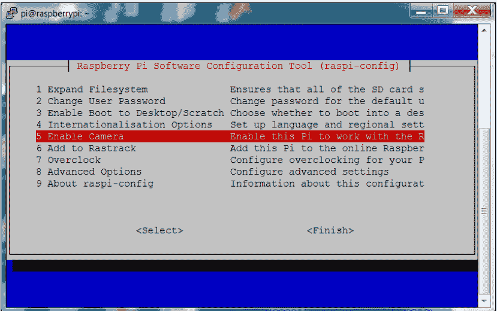

## 为您的双足机器人添加视觉

现在重新启动树莓派。如果您在远程计算机上开发并希望查看图像，则需要在计算机和树莓派之间打开 `vncserver` 连接。详情请参阅第 1 章“配置和编程树莓派”。要使用摄像头拍照，只需输入 `raspistill -o image.jpg`。这将使用摄像头拍摄一张照片，并将图像存储到 `image.jpg` 文件中。拍好照片后，您可以通过打开树莓派图像查看器来查看它：选择左下角的 Menu（菜单）图标，然后依次选择 Accessories（附件）和 Image Viewer（图像查看器），如下面的截图所示：

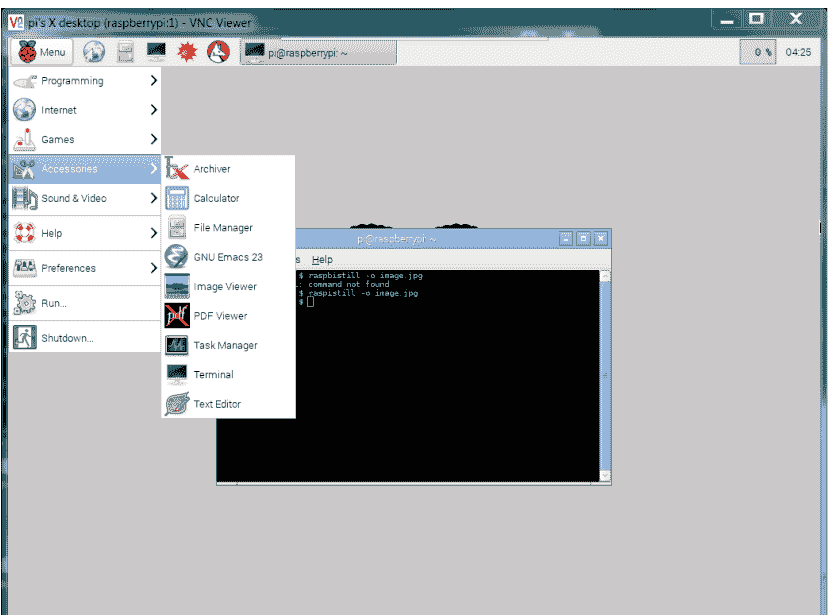

打开**image.jpg**文件，您应该会看到照片的效果：

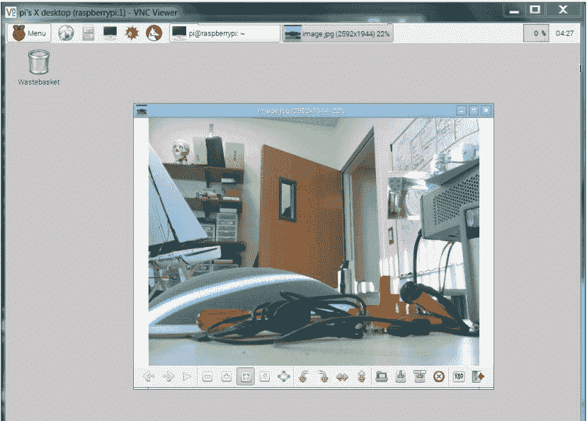

在通过树莓派摄像头使用 OpenCV 之前，您需要做两件事。首先，需要添加一个 Python 库，名为 `picamera`。要获取它以及所需的库，请输入 `sudo apt-get install python-picamera python3-picamera python-rpi.gpio`。其次，您需要输入 `sudo modprobe bcm2835-v4l2`。现在，树莓派摄像头就可以用于下一节中的 OpenCV 示例了。

## 下载并安装 OpenCV——一个功能完备的视觉库

现在摄像头已经连接好了，您可以开始体验开源社区提供的一些强大功能。打开一个终端窗口并输入以下命令：

- 1. `sudo apt-get update`：您将下载许多新的软件包，因此最好先确保所有内容都是最新的。
- 2. `sudo apt-get install build-essential`：尽管您之前可能已经执行过此操作，但此库对于构建 OpenCV 至关重要。
- 3. `sudo apt-get install libavformat-dev`：该库提供了一种对音频和视频流进行编码和解码的方法。
- 4. `sudo apt-get install ffmpeg`：该库提供了一种转码音频和视频流的方法。
- 5. `sudo apt-get install libcv2.4 libcvaux2.4 libhighgui2.4`：此命令会显示基本的 OpenCV 库。请注意命令中的数字。随着 OpenCV 新版本的出现，这个数字几乎肯定会变化。如果 2.4 不起作用，请尝试 3.0 或在 Google 上搜索 OpenCV 的最新版本。
- 6. `sudo apt-get install python-opencv`：这是 OpenCV 所需的 Python 开发套件，因为您将使用 Python。
- 7. `sudo apt-get install opencv-doc`：此命令将显示 OpenCV 的文档，以备您需要时查阅。
- 8. `sudo apt-get install libcv-dev`：此命令会显示编译 OpenCV 所需的头文件和静态库。
- 9. `sudo apt-get install libcvaux-dev`：此命令会显示更多用于编译 OpenCV 的开发工具。
- 10. `sudo apt-get install libhighgui-dev`：这是另一个提供编译 OpenCV 所需的头文件和静态库的软件包。
- 11. 现在输入 `cp -r /usr/share/doc/opencv-doc/examples /home/pi/`。这会将所有示例复制到您的主目录。

现在 OpenCV 已安装完成，您可以尝试其中一个示例。进入 `/home/pi/examples/python` 目录。执行 `ls`，您会看到一个名为 `camera.py` 的文件。这个文件包含了捕获和显示图像流的最基础代码。在运行代码之前，先用 `cp camera.py myCamera.py` 复制一份。然后，编辑文件使其看起来如下所示：

```
```python
import cv2.cv as cv
import time

cv.NamedWindow("camera", 1)

capture = cv.CaptureFromCAM(0)
cv.SetCaptureProperty(capture, 3, 360)
cv.SetCaptureProperty(capture, 4, 240)

while True:
    img = cv.QueryFrame(capture)
    cv.ShowImage("camera", img)
    if cv.WaitKey(10) == 27:
        break

cv.DestroyAllWindows()
```
```

您需要添加的两行代码就是带有 `cv.SetCaptureProperty` 的两行；它们会将图像分辨率设置为 360×240。要运行此程序，您需要在树莓派上连接显示器和键盘，或者使用 `vncviewer`。运行代码时，您应该会看到如下所示的窗口：

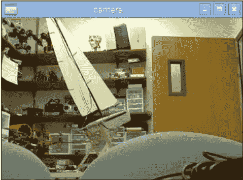

如果您使用的是 RaspCam 却看不到图像，则需要运行 `sudo modprobe bcm2835-v4l2` 命令。现在您可以看到外部世界了！

您可能需要调整分辨率，为您的应用找到最佳设置。更大的图像固然很好——它们能让您更细致地观察世界——但也会占用显著更多的处理能力。当您真正让系统执行实际的图像处理时，您会更深入地体验这一点。如果您打算使用 `vncserver`，请注意系统性能，因为它会显著降低更新速率。尺寸（宽度/高度）为两倍的图像将需要四倍的处理量。现在，您可以利用这一功能来完成许多令人印象深刻的任务。

## 边缘检测与 OpenCV

幸运的是，OpenCV Python 示例集中有一个名为 `edge.py` 的程序。以下是该文件的内容（已删除空行）：

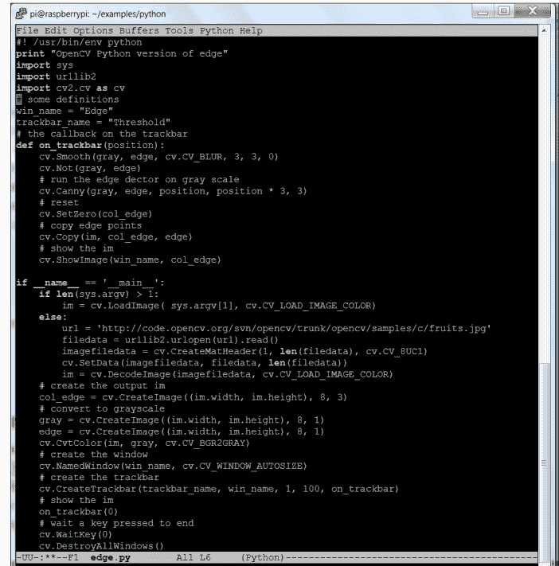

该程序使用 OpenCV 实现的 Canny 图像检测算法来查找任意图像中的边缘。有关 Canny 边缘算法的更多信息，请参阅 http://das1.mem.drexel.edu/alumni/bGreen/www.pages.drexel.edu/_weg22/can_tut.html 或 http://opencv-python-tutroals.readthedocs.org/en/latest/py_tutorials/py_imgproc/py_canny/py_canny.html 。您之前捕获过一张图像；可以使用此程序查看边缘，并了解设置不同阈值如何显示更多或更少的边缘。使用之前捕获的图像运行该程序，您将看到以下结果：

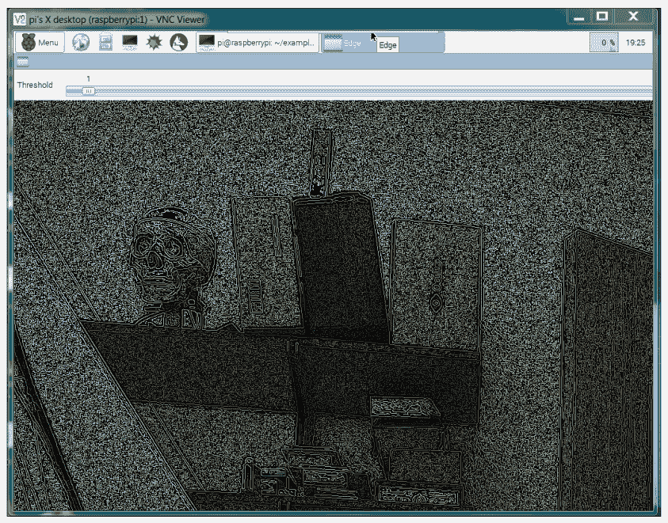


## 为你的双足机器人添加视觉

你会注意到顶部有一个阈值滑块设置。如果你将此阈值调高，它会找到更少的边缘——即具有更大阈值的边缘。设置为 30 的图片如下所示：

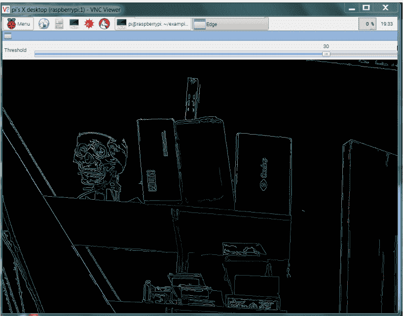

### 颜色和运动查找

OpenCV 和你的网络摄像头也可以追踪彩色物体。如果你想让你的双足机器人跟随一个彩色物体，这将非常有用。OpenCV 通过提供一些高级库使这变得异常简单，这些库可以帮助我们完成此任务。要实现这一点，你需要编辑一个文件，使其看起来像以下屏幕截图中所示：

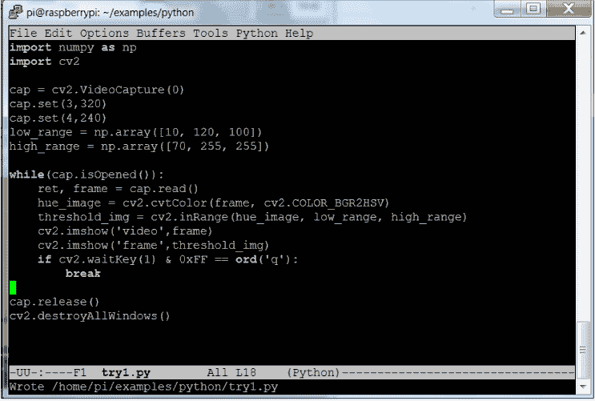

让我们具体看看使隔离彩色球成为可能的代码：

- `hue_img = cv.CvtColor(frame, cv.CV_BGR2HSV)`: 这一行创建了一个新图像，该图像根据 **色相**（颜色）、**饱和度** 和 **值（HSV）** 的值存储图像，而不是原始图像的 **红色**、**绿色** 和 **蓝色（RGB）** 像素值。转换为 HSV 更专注于颜色的处理，而非照射到其上的光量。
- `threshold_img = cv.InRangeS(hue_img, low_range, high_range)`: `low_range, high_range` 参数决定了颜色范围。在这种情况下，它是一个橙色球，因此你想检测橙色颜色。有关使用色相指定颜色的良好教程，请参阅 http://www.tomjewett.com/colors/hsb.html。另请参阅 http://www.shervinemami.info/colorConversion.html，其中包含一个程序，你可以通过选择特定颜色来确定你的值。

运行程序。如果看到一个纯黑图像，移动此窗口，你将同时看到原始图像窗口。现在，拿起你的目标（在本例中为一个橙色乒乓球）并将其移入画面。你应该会看到如下屏幕截图中所示的内容：

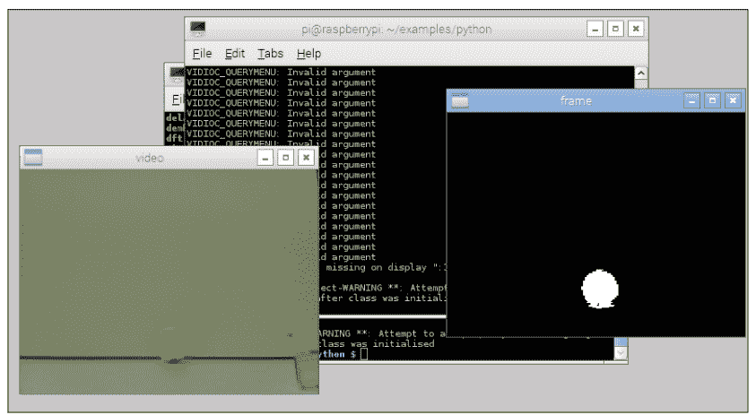

注意阈值图像中显示球所在位置的白色像素。你可以添加更多 OpenCV 代码来给出球的实际位置。在我们球位置的原始图像文件中，你实际上可以在球周围绘制一个矩形作为指示器。编辑文件使其如下所示：

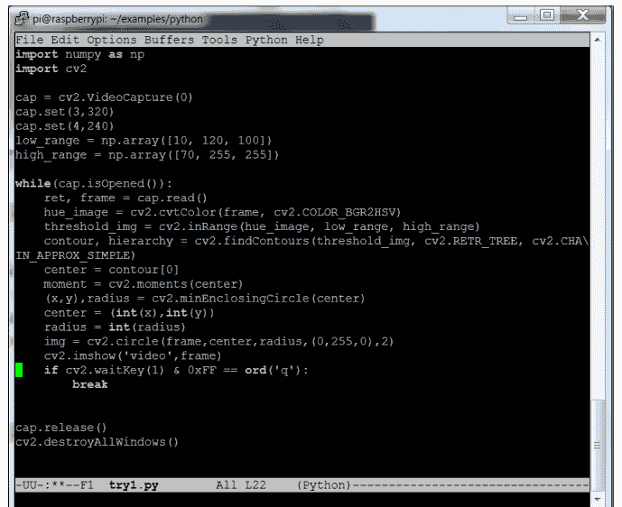

添加的行如下所示：

- `hue_image = cv2.cvtColor(frame, cv2.COLOR_BGR2HSV)`: 这一行从捕获的 RGB 图像创建了一个色相图像。当尝试捕获真实世界图像时，色相更容易处理；详情请参阅 http://www.bogotobogo.com/python/OpenCV_Python/python_opencv3_Changing_ColorSpaces_RGB_HSV_HLS.php。
- `threshold_img = cv2.inRange(hue_image, low_range, high_range)`: 这会创建一个新图像，其中仅包含在 low_range 和 high_range n 元组之间的像素。
- `contour, hierarchy = cv2.findContours(threshold_img, cv2.RETR_TREE, cv2.CHAIN_APPROX_SIMPLE)`: 这会在 threshold_img 图像中找到轮廓，即相似像素的组。
- `center = contour[0]`: 这标识了第一个轮廓。
- `moment = cv2.moments(center)`: 这找到了该像素组的矩。
- `(x,y),radius = cv2.minEnclosingCircle(center)`: 这给出了将包围该像素组的最小圆的 x 和 y 位置以及半径。
- `center = (int(x),int(y))`: 找到 x 和 y 位置的中心。
- `radius = int(radius)`: 圆的整数半径。
- `img = cv2.circle(frame,center,radius,(0,255,0),2)`: 在图像上绘制一个圆。

现在代码已准备就绪，你可以运行它。你应该会看到如下屏幕截图所示的内容：

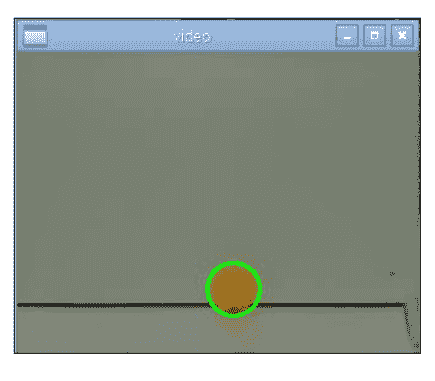

你现在可以追踪你的物体。你可以通过更改 low_range 和 high_range n 元组来修改颜色。你也有物体的位置，因此你可以使用该位置为你的机器人进行路径规划。

### 总结

你的双足机器人可以行走，使用传感器避障，规划路径，甚至可以看到障碍物或目标。在最后一章中，你将学习如何远程连接你的双足机器人，以便你可以控制它并监控它，而无需线缆。
