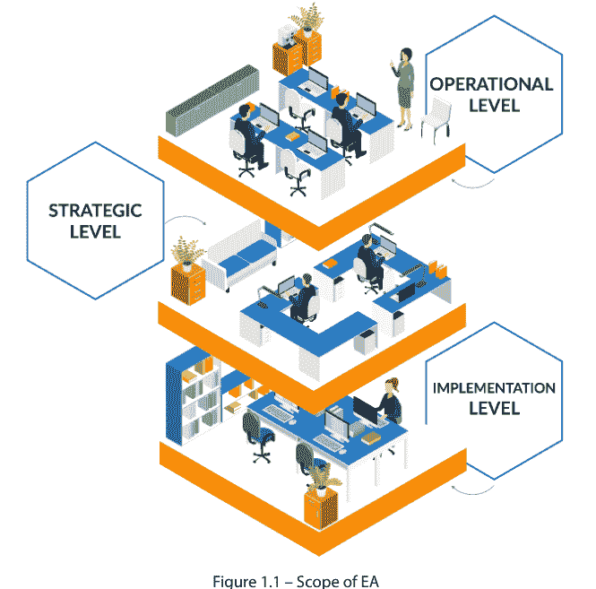

## 构建企业IT架构的核心基础

许多旨在创建和维护理想的数字工作环境并实现顺畅无缝工作流程的努力都付诸东流。即使利益相关者同样参与其中，各部门行动保持一致，财务得到高效管理，研究团队也在关注行业最新趋势，除非执行工作得到成熟的企业架构（EA）支持。成熟的IT EA通常基于坚实的基础，战略对齐，并根据业务需求量身定制。

本章将介绍有助于建立有效执行基础的领域。因此，我们将涵盖以下主题：

-   EA战略始于构建核心基础
-   执行战略的核心基础
-   构建业务特定的核心基础
-   EA域
-   业务动态与企业和IT系统中的IT复杂性

### EA战略始于构建核心基础

EA战略是将企业的愿景和战略转化为有效企业变革的过程，通过创建、传达和改进描述企业未来状态并使其能够演进的关键需求、原则和模型来实现。如果将EA与其战略进行比较，我们可以将EA识别为一种主动且整体地领导企业应对颠覆性力量的学科。它通过识别和分析向期望的业务愿景和成果推进的变革执行来实现这一点。

我们生活在一个数字化世界，一切都被自动化。拥有最新IT基础设施的需求比以往任何时候都更关键。现代生活的每个方面都以某种方式直接或间接地与技术的使用相关。为了让技术平稳运行，能够可靠地执行核心运营是首要任务。

业务架构从根本上讲是关于配置IT资源以支持公司的业务战略。它将某些方面结合起来，例如公司的战略目标、工作流程以及其创建的信息，以及支撑它的基础设施。作为其技术蓝图的一部分，EA不仅确定其当前拥有的技术，还确定未来技术升级如何用于补充或增强其当前技术。

EA帮助公司构建IT项目和政策以实现预期成果。它采用架构原则来跟上行业实践，通常称为EA规划。

然而，除了为系统提供战略和业务背景外，EA战略还提供了一种更整体地审视它们的方法。它被描述为一种管理流程，有助于企业进行组织、资源分配和实施。组织以多种方式受益于EA战略。它允许他们全面审查其IT状况和IT目标：

-   通过标准化流程和应用程序，稳定性得到改善。简化流程使企业更高效并降低问题风险。
-   正如组织期望EA所做的那样，它降低了系统的复杂性。合适的工具简化了系统管理和维护。
-   通过能够快速识别问题原因，组织得以防止更大问题。
-   组织得益于EA而更具敏捷性。这使他们能够分析行业变化并及时做出响应。
-   留意系统中的薄弱环节可以防止威胁进入系统。今天的网络安全漏洞正通过EA确定的系统化措施来解决。

在当今竞争激烈的市场中，创新主导着一切，尤其是在应用技术来现代化流程、产品和服务方面，创新机会几乎无穷无尽。戴尔、Capital One和沃尔玛等全球市场领导者已在巨大规模上主导了其行业。虽然这一发展对全球经济似乎令人鼓舞，但其他增长速度相对较慢的公司必须重新考虑其行动计划。

在对103家美国和欧洲公司的调查中，34%的公司拥有数字化的核心基础设施，并利用现代技术实现更高利润、更快的上市时间和更好的IT投资回报率。这样的核心基础设施最终带来25%的运营成本降低、更好的客户体验、系统故障和数据丢失风险降低，以及利益相关者对技术进步的更高满意度。

本章基于500家美国、欧洲和亚洲公司为有效执行基础而应用的统计数据、工具、战略和基本原则的见解。这些要素为大型、中型和小型企业提供了正确的基底，通过数字化使其运营走上正轨。我们将深入探讨他们的战略，并学习他们如何利用其执行基础来实现业务敏捷性，从而带来显著增长。

在未来几年中，从上到下自动化组织中的例行任务是前进的方式。这意味着最大程度地减少甚至消除人类在重复性手工工作中的参与，例如食品加工、供应和交付运营、发票生成和支付处理。构建有效的执行核心基础需要能够处理这种自动化和数字化的工作流程且不会出现任何错误的机会的基础设施。保持可靠网络和例行操作可预测性的组织使其与竞争对手区别开来。

我们喜欢信息触手可及，只需点击即可执行。鉴于此，食品加工行业需要在从客户订单到发货、维护库存以及交付产品和服务的整个过程中实现信息透明流动。

7-ELEVEN日本是全球第八大零售商。在攀登成功的阶梯过程中，该公司团队利用其1万家商店的执行基础来有效管理所有库存。该公司使用7万台计算机在销售点收集数据的数字化流程使用户能够在线下单并与制造商直接有效沟通。这种自动化和集中的经营方式使公司每年都能开发新产品。

关于核心业务运营数字化的一个常见误解是组织必须将精力集中在竞争能力上。然而，成功在于战略，在那里，日常的平凡流程与复杂任务相结合。这从招聘、投资和电信等常见服务开始数字化进程，然后转向更定制的组件。拥有员工每天使用的系统顺畅无缝的工作流程，管理层可以自由地放弃低价值任务，专注于收入、创新和增长。

### 核心基础的要素

无论目标是云计算、**机器人流程自动化（RPA）**还是**机器学习（ML）**，组织必须不断评估新技术以及它们可以或应该如何融入其业务战略。持续创新需要设计良好且有文档记录的EA，并有明确的流程来实现期望的业务成果。按定义，设计良好的EA是一种架构模型，以长期视角描绘整个组织的全局图景。该蓝图解释了业务流程、层级结构、信息系统和技术。它还允许采用现代创新。让我们来看看：

-   **架构管理**
  设置和实施单一模型是一回事，而确保全方位的生产力是另一回事。团队必须跟踪组织内的每一步，以确保业务目标与IT基础设施保持一致。
-   **架构框架**
  该框架为架构模型提供基础，同时提供基本指南和原则。这些实践在该框架下为所有利益相关者定义，以便他们能够将其工作伦理与系统保持一致。
-   **开发方法论的实施**
  有方法可以在全方位顺利实施方法论，同时确保关键业务运营不受干扰。然而，确保无缝且有效的实施可能需要比预期更长的时间。
-   **有效治理**
  这确保EA计划得到妥善管理，以产生真正代表组织目标和需求的工件和计划。EA治理还确保从启动到实施，业务和技术决策与EA保持一致。
-   **文档工件**
  业务模型的核心要素之一是为将来参考记录每一步。在EA中，计划、战略、实施和工作流程均有记录并持续维护。

- **架构库**
  该库在实施过程中定义并记录了组织的资源能力。它还包含实现框架所定义目标所必需的工具。

- **最佳实践**
  一套最佳实践和指南用于指导稳健的工作流程并审查现有架构。这些实践确保透明度和生产力。这可能产生涓滴效应，有助于更好地理解增长和创新的驱动因素。

## 执行战略的核心基础

敏捷业务模式的需求从未如此关键。尤其是 COVID-19 大流行期间，许多行业遭受了无法弥补的损失，只有通过更具适应性的业务战略和创新模式才能在未来恢复或避免。

> “在新数字产品和服务创新以及客户体验的巨大改善方面，需要快速的变革。”
> 
> 分析机构 Forrester

那些已经拥抱云基础设施和敏捷工作流程的公司比数字落后者更快地适应了疫情，后者在远程工作模式和保持客户满意度方面举步维艰。

EA 成熟度模型是评估功能域成熟度的一种方式。它们区分了组织依次推进的不同成熟度级别。因此，它们可作为功能域平衡增量改进的指导方针。

EA 的全部意义在于为 IT 提供投资方向——即如何做出正确的技术选择以实现业务价值。在预测对业务价值和成果的影响方面，EA 管理工具为该过程提供了关键的指导要素。

现在，让我们来看一些确保 EA 项目得到正确跟踪的典型举措。

## 领导力与愿景

公司的短期战术步骤和长期企业架构愿景必须保持一致。为了确保 EA 成功，领导层必须采取措施确保团队了解相关举措，专注于业务价值，并具备推动组织和流程朝着共同最终目标前进的能力。

## 早期认可

在决策过程中让组织中涉及的每个个人尽早达成一致，对于快速实现共同最终目标尤其有帮助。整个业务的认可使得更容易避免未言明的担忧，发现潜在问题，或管理可能破坏 EA 项目的其他因素。

## 治理

强有力的领导与全方位到位合适的利益相关者相结合，对于确保任务、里程碑和绩效朝着正确的方向发展至关重要。将所有利益相关者的愿景和利益与精心设计的网络保持一致是一项巨大的挑战，需要流程来确保团队和流程按设计和预期运行。

## 以未来为先的设计

朝着与领先技术进步保持同步的以未来为中心的方法发展是必不可少的。EA 应为组织准备好应对已知挑战，并具有足够的灵活性以利用新兴技术。在试图实现 EA 业务目标和价值时，沉溺于当前问题以及遗留系统与创新之间的斗争可能是毁灭性的。

## CIO 与业务领导者的和谐

利益相关者领导者必须共同努力，确保不同的观点能够得到和谐地听取和解决。当 EA 基础设施不够稳固时，多元的意见会使解决归结为技术与业务的问题变得棘手。

## 平衡业务与技术

有些人可能会让 EA 运营的技术方面占据整个业务环境。更平衡的方法更好，在这种方法中，业务和技术需求以及战略都会被考虑，并且信息会被共享以确保有效的运营流程。

## 平衡的团队

外面的商业机会世界很大，但找到一个具备技能且有动力把握这一机会的合适团队可能是一场斗争。组织应努力组建一个反映多元化人才融合的团队，他们共同拥有深厚的业务敏锐度、技术理解以及对愿景的热情。

## 以目标为导向的愿景

技术输入、业务流程和绩效衡量汇聚在一起，形成衡量 EA 效益的基础。领导者必须制定超越短期成就的关注目标，并为与 EA 愿景相关的每个关键绩效指标（KPI）争取持久的影响。

## 互操作性与集成

在我们不断发展的数字世界中，团队适应新变化的能力至关重要。为了确保这一点，可持续且可信的 EA 必须尽可能面向未来，具有易于集成和运营灵活性，并在全公司范围内得到支持和执行。

## 坚实的沟通

正确的沟通设计可以决定 EA 组织的成败，因此这项工作绝不能掉以轻心。每个利益相关者在战略上必须站在同一页面上，团队必须了解组织内部最新的 EA 进展。传达架构的布局、效益和范围很重要。

## 以客户为中心

内部流程很重要，但最重要的利益相关者是客户。最终的 EA 目标、业务计划和 KPI 应围绕客户需求展开。

## 韧性——EA 的关键

在大流行之前和期间，EA 专家需求旺盛，以协助业务应用程序向云的即时和未来迁移。他们还参与了转型的多个方面，具体取决于其业务路线图、风险评估、可行性、安全、预算、开发策略和其他因素。EA 团队推动了转型及其相关流程的加速。

EA 将公司战略转化为已识别的目标以实现业务能力。当执行良好时，EA 将业务目标转化为明确定义的转型举措，使分析师、投资组合负责人、IT 解决方案架构师以及业务各领域的其他人员能够在各自的重点领域推进。

在危机时期，EA 通过将资源集中在公司的关键能力上促进业务连续性，并在危机过去后加速恢复，充分利用新环境。EA 支持韧性，这可以帮助企业不仅在危机中生存，而且在危机后蓬勃发展。

下图显示了在企业中建立知识导向心态的过程，分析当前知识，并规划未来所需的知识。然而，战略层面描绘了识别现有知识以及如何在企业内有效高效地分配该知识。

运营层面是确保知识在日常实践中被需要访问正确知识的人所使用，在正确的时间、在正确的地点使用：

图 1.1 – EA 范围

下表对不同的 EA 价值进行了分类：

| EA 价值类别 | 价值描述 |
|---|---|
| 战略与政治 | 业务与 IT 对齐 |
| 战略与政治 | 治理与合规管理使能 |
| 战略与政治 | IT 与业务能力管理 |
| 战略与政治 | IT 投资决策以及新基础设施和能力的发展 |
| 转变型 | 从战略到交付项目和投资组合管理的导航 |
| 沟通 | 有意的、战略性的沟通 |
| 沟通 | 连接业务和 IT 专业人员的渠道 |
| 经济 | IT 成本降低 |
| 经济 | 运营效率，包括运营成本 |
| 灵活性与敏捷性 | IT 适应性 |
| 灵活性与敏捷性 | 响应能力和上市时间 |
| 集成与互操作性 | 供应链中的业务流程 |
| 集成与互操作性 | 企业范围内的 IT 资源 |
| 集成与互操作性 | IT 与人的维度 |
| 跨组织 | 收购管理改进 |
| 跨组织 | 外部关系管理 |
| 知识管理 | IT 与业务专业人员之间的知识共享 |
| 知识管理 | 知识来源 |
| 其他 | 端到端安全，具有完整概览 |
| 其他 | 客户满意度 |
| 其他 | 服务可用性分析 |
| 其他 | 创新支出增加 |
| 其他 | 有限的信息重复 |

表 1.1 – EA 价值的类别得到文献证据的支持

## 构建业务特定的核心基础

符合 EA 原则的组织必须拥有 EA 领导者，他们能够提前思考流程中的某些要素，以保持工作流程顺畅无缝。团队规模、基础设施模型和组织结构位列首位。共同为一个项目、一个共同目标而工作的个人或团队可能采用不同的方法，但工作伦理和 EA 模型必须保持一致，以维持有效的[content]
## 构建业务特定的核心基础

符合 EA 原则的组织必须拥有 EA 领导者，他们能够提前思考流程中的某些要素，以保持工作流程顺畅无缝。团队规模、基础设施模型和组织结构位列首位。共同为一个项目、一个共同目标而工作的个人或团队可能采用不同的方法，但工作伦理和 EA 模型必须保持一致，以维持有效的[content]
## 构建业务特定的核心基础

符合 EA 原则的组织必须拥有 EA 领导者，他们能够提前思考流程中的某些要素，以保持工作流程顺畅无缝。团队规模、基础设施模型和组织结构位列首位。共同为一个项目、一个共同目标而工作的个人或团队可能采用不同的方法，但工作伦理和 EA 模型必须保持一致，以维持有效的[content]
## 构建业务特定的核心基础

符合 EA 原则的组织必须拥有 EA 领导者，他们能够提前思考流程中的某些要素，以保持工作流程顺畅无缝。团队规模、基础设施模型和组织结构位列首位。共同为一个项目、一个共同目标而工作的个人或团队可能采用不同的方法，但工作伦理和 EA 模型必须保持一致，以维持有效的[content]
## 构建业务特定的核心基础

符合 EA 原则的组织必须拥有 EA 领导者，他们能够提前思考流程中的某些要素，以保持工作流程顺畅无缝。团队规模、基础设施模型和组织结构位列首位。共同为一个项目、一个共同目标而工作的个人或团队可能采用不同的方法，但工作伦理和 EA 模型必须保持一致，以维持有效的[content]
## 构建业务特定的核心基础

符合 EA 原则的组织必须拥有 EA 领导者，他们能够提前思考流程中的某些要素，以保持工作流程顺畅无缝。团队规模、基础设施模型和组织结构位列首位。共同为一个项目、一个共同目标而工作的个人或团队可能采用不同的方法，但工作伦理和 EA 模型必须保持一致，以维持有效的[content]
## 构建业务特定的核心基础

符合 EA 原则的组织必须拥有 EA 领导者，他们能够提前思考流程中的某些要素，以保持工作流程顺畅无缝。团队规模、基础设施模型和组织结构位列首位。共同为一个项目、一个共同目标而工作的个人或团队可能采用不同的方法，但工作伦理和 EA 模型必须保持一致，以维持有效的[content]
## 构建业务特定的核心基础

符合 EA 原则的组织必须拥有 EA 领导者，他们能够提前思考流程中的某些要素，以保持工作流程顺畅无缝。团队规模、基础设施模型和组织结构位列首位。共同为一个项目、一个共同目标而工作的个人或团队可能采用不同的方法，但工作伦理和 EA 模型必须保持一致，以维持有效的[content]
## 构建业务特定的核心基础

符合 EA 原则的组织必须拥有 EA 领导者，他们能够提前思考流程中的某些要素，以保持工作流程顺畅无缝。团队规模、基础设施模型和组织结构位列首位。共同为一个项目、一个共同目标而工作的个人或团队可能采用不同的方法，但工作伦理和 EA 模型必须保持一致，以维持有效的[content]
## 构建业务特定的核心基础

符合 EA 原则的组织必须拥有 EA 领导者，他们能够提前思考流程中的某些要素，以保持工作流程顺畅无缝。团队规模、基础设施模型和组织结构位列首位。共同为一个项目、一个共同目标而工作的个人或团队可能采用不同的方法，但工作伦理和 EA 模型必须保持一致，以维持有效的工作流程并确保运营的敏捷性：

### 了解 EA 利益相关者
吸引并识别符合特定标准的利益相关者群体，包括客户，是组织希望[content]
## 构建业务特定的核心基础

符合 EA 原则的组织必须拥有 EA 领导者，他们能够提前思考流程中的某些要素，以保持工作流程顺畅无缝。团队规模、基础设施模型和组织结构位列首位。共同为一个项目、一个共同目标而工作的个人或团队可能采用不同的方法，但工作伦理和 EA 模型必须保持一致，以维持有效的工作流程并确保运营的敏捷性：

### 了解 EA 利益相关者
吸引并识别符合特定标准的利益相关者群体，包括客户，是组织希望[content]
## 构建业务特定的核心基础

符合 EA 原则的组织必须拥有 EA 领导者，他们能提前思考流程要素以保持工作流顺畅无缝。团队规模、基础设施模型和组织结构位列首位。共同为项目和共同目标工作的个人或团队方法可能不同，但工作伦理和 EA 模型必须一致，以维持有效工作流并确保运营敏捷性：

### 了解 EA 利益相关者
吸引并识别符合特定标准的利益相关者群体，包括客户，是组织转型 EA 模型的首要任务。每个利益相关者都处于特定职位，有可由可信 EA 结构满足的具体需求。例如，在为技术奠定业务价值基础时，CIO 可能会对应用路线图、投资和成本结构提出一系列问题。参考应用生命周期图、财务矩阵和成本热力图可帮助找到答案。

### 参与 EA 利益相关者
获得合适团队并使其加入可能比保持所有人一致、提供持续支持和有效沟通更容易。利益相关者参与计划会根据组织结构和 EA 项目范围而变化，但通常涉及以下渐进层级：
- **制定策略**：规划方法，同时考虑到必须维持的持续流程，以保留关键利益相关者支持
- **了解组织**：对组织历史、文化和关键利益相关者有坚实把握，更易评估和识别最佳机构实践
- **评估当前能力**：利用分析、组织洞察和数据来规划实现预期成果的步骤
- **运营与演进**：根据组织指南建立 EA 运营，并在行业和组织发展中持续演进工作，以产生和维持利益相关者支持

### 选择运营模式
建立能够巩固组织并能高效应对内部或外部问题的模式很重要。这是 EA 执行基础的第一步。
每个模式都不同，基于组织的核心理念、目标和项目规模。以下是常见的 EA 运营模式：
- **协调运营模式**：自主业务单元控制业务流程设计并适应其运营。
- **统一运营模式**：采用矩阵方法整合全球业务流程集并进行集中管理。在此模式下，高层管理保持关注所有单元业务流程标准化。
- **多元化运营模式**：每个业务单元独特，拥有独立交易集。除最低限度业务流程标准化外，大多数 IT 决策和业务选择均由共享服务集独立做出。
- **复制运营模式**：业务单元采用联邦方法进行整合和标准化。工作流集中管理，但数据本地拥有，并与企业进行部分汇总和共享。

### 定义 EA 团队结构
如何构建 EA 团队有时是组织计划建立内部 EA 结构时不断回响的问题。开始时做出的任何决定都将产生长期影响，且在此阶段更容易获得组织认可。
尽管团队规模小、预算有限、决策权小，大多数企业架构师仍被期望实施强大的战略技术项目。EA 可以分布在组织各领导层中，以寻求更好的一致性和工作流。

### 构建 EA 生态系统
通过从主要利益相关者获得认可不断扩大网络，最终将实现最大利益。核心 EA 团队应不断探索其与更广泛团队合作的方式并在过程中改进。
核心 EA 团队拥有整体 EA 结构、定义标准并制定业务对齐战略。根据 Gartner 研究副总裁 Marcus Blosch 的说法，与其关注标准、结构和控制，组织必须将战略拓宽至推动业务成果，并灵活创造性地工作以定义未来及实现路径。通过采用这些特质，EA 团队可培养新人才以支持数字业务和数字化转型。他们将建立在制定业务战略、设计新服务和体验、推动创新、在组织内协调协作以及导航未来方面的能力。

> “任何 EA 成功的关键在于架构师的战略配置。
> 他们可以设在单一部门或分散在向不同经理汇报的各组中。
> 因此，没有两个 EA 团队看起来相同。”
>
> *Forrester*

相反，更广泛的 EA 团队由解决方案、技术和业务架构师组成，是核心团队的延伸。他们与利益相关者在不断演变、混乱的环境中工作。核心团队与更广泛团队之间顺畅一致的信息流确保更稳健的基础设施和更好成果。

### 准确配置团队规模
大型 EA 团队可能有 50+ 人专注于不同架构域或 EA 整体，中型团队由 15-50 人组成，小型团队少于 15 人。以下因素可帮助 EA 领导者确定团队适当规模：
- 组织内的产品和服务数量
- 收入和利润计算的时间
- 组织内业务流程的成熟度
- 账户和财务管理的效率
- 组织资源和用于进阶的 IT 预算
- 组织适应 EA 的速度

总体而言，EA 团队的合适规模没有固定标准，因为它基于组织内的某些因素。

## 构建核心基础的 EA 域

*Stephen Spewak's Enterprise Architecture Planning* 大大促进了当前将 EA 划分为四个域的流行。虽然其方法于 1993 年发表，但至今仍被大多数 EA 项目团队使用。

让我们看看 EA 工作的四个域。

### 业务架构
该域定义组织结构，同时解决谁参与以及他们在公司功能能力内做什么。让我们看看代表该域必须回答的一些示例问题。一般而言，业务架构包括业务流程、业务能力、服务、运营模式和价值流。业务愿景、战略和目标是什么？谁负责推动并实现预期目标？

### 应用架构
该域考虑特定应用与组织核心业务流程之间的关系，同时提出问题：当前业务能力是如何实现的？根据不断变化的需求定制软件解决方案的过程在此阶段得到解决。当组织使用的软件无法满足客户需求时，功能更新至关重要。重新设计软件是最后的手段，但在无法适应现代进步的情况下是必要的。

### 数据架构
该域涉及组织数据资产和资源的结构。业务分析的洞察使企业能够随着客户需求而演进。用户收集的数据存储在数据库中，以便将来参考时进行管理和维护。战略架构使处理复杂数据变得容易得多。

### 技术架构
实施应用服务需要软件和硬件等资源。现代技术对于构建功能网络至关重要。这包括设备、路由器、软件和存储。适应变化是成功的关键，而这些变化将以动态市场和不断变化的用户行为的形式出现。

将数据和应用域合并为单一信息系统组件的常见做法对许多 EA 框架有效。此外，客户收集的所有数据可能占用大量空间。将其放在云中是最安全、最先进的方式，以保持顺畅运行。

## 核心基础在业务中扮演什么角色？

每个企业都有内置的 EA 来帮助实现特定目标。在某些组织中，它经过深思熟虑设计，以支持高度专业团队，他们聚集在一起形成战略指南。基于这些指南，EA 得到实施。对于其他组织，EA 可能只是设计、改进和维护 IT 网络的底层流程，而没有适当的[content]
## 构建业务特定的核心基础

符合 EA 原则的组织必须拥有 EA 领导者，他们能提前思考流程要素以保持工作流顺畅无缝。团队规模、基础设施模型和组织结构位列首位。共同为项目和共同目标工作的个人或团队方法可能不同，但工作伦理和 EA 模型必须一致，以维持有效工作流并确保运营敏捷性：

### 了解 EA 利益相关者
吸引并识别符合特定标准的利益相关者群体，包括客户，是组织转型 EA 模型的首要任务。每个利益相关者都处于特定职位，有可由可信 EA 结构满足的具体需求。例如，在为技术奠定业务价值基础时，CIO 可能会对应用路线图、投资和成本结构提出一系列问题。参考应用生命周期图、财务矩阵和成本热力图可帮助找到答案。

### 参与 EA 利益相关者
获得合适团队并使其加入可能比保持所有人一致、提供持续支持和有效沟通更容易。利益相关者参与计划会根据组织结构和 EA 项目范围而变化，但通常涉及以下渐进层级：
- **制定策略**：规划方法，同时考虑到必须维持的持续流程，以保留关键利益相关者支持
- **了解组织**：对组织历史、文化和关键利益相关者有坚实把握，更易评估和识别最佳机构实践
- **评估当前能力**：利用分析、组织洞察和数据来规划实现预期成果的步骤
- **运营与演进**：根据组织指南建立 EA 运营，并在行业和组织发展中持续演进工作，以产生和维持利益相关者支持

### 选择运营模式
建立能够巩固组织并能高效应对内部或外部问题的模式很重要。这是 EA 执行基础的第一步。
每个模式都不同，基于组织的核心理念、目标和项目规模。以下是常见的 EA 运营模式：
- **协调运营模式**：自主业务单元控制业务流程设计并适应其运营。
- **统一运营模式**：采用矩阵方法整合全球业务流程集并进行集中管理。在此模式下，高层管理保持关注所有单元业务流程标准化。
- **多元化运营模式**：每个业务单元独特，拥有独立交易集。除最低限度业务流程标准化外，大多数 IT 决策和业务选择均由共享服务集独立做出。
- **复制运营模式**：业务单元采用联邦方法进行整合和标准化。工作流集中管理，但数据本地拥有，并与企业进行部分汇总和共享。

### 定义 EA 团队结构
如何构建 EA 团队有时是组织计划建立内部 EA 结构时不断回响的问题。开始时做出的任何决定都将产生长期影响，且在此阶段更容易获得组织认可。
尽管团队规模小、预算有限、决策权小，大多数企业架构师仍被期望实施强大的战略技术项目。EA 可以分布在组织各领导层中，以寻求更好的一致性和工作流。

### 构建 EA 生态系统
通过从主要利益相关者获得认可不断扩大网络，最终将实现最大利益。核心 EA 团队应不断探索其与更广泛团队合作的方式并在过程中改进。
核心 EA 团队拥有整体 EA 结构、定义标准并制定业务对齐战略。根据 Gartner 研究副总裁 Marcus Blosch 的说法，与其关注标准、结构和控制，组织必须将战略拓宽至推动业务成果，并灵活创造性地工作以定义未来及实现路径。通过采用这些特质，EA 团队可培养新人才以支持数字业务和数字化转型。他们将建立在制定业务战略、设计新服务和体验、推动创新、在组织内协调协作以及导航未来方面的能力。

> “任何 EA 成功的关键在于架构师的战略配置。
> 他们可以设在单一部门或分散在向不同经理汇报的各组中。
> 因此，没有两个 EA 团队看起来相同。”
>
> *Forrester*

相反，更广泛的 EA 团队由解决方案、技术和业务架构师组成，是核心团队的延伸。他们与利益相关者在不断演变、混乱的环境中工作。核心团队与更广泛团队之间顺畅一致的信息流确保更稳健的基础设施和更好成果。

### 准确配置团队规模
大型 EA 团队可能有 50+ 人专注于不同架构域或 EA 整体，中型团队由 15-50 人组成，小型团队少于 15 人。以下因素可帮助 EA 领导者确定团队适当规模：
- 组织内的产品和服务数量
- 收入和利润计算的时间
- 组织内业务流程的成熟度
- 账户和财务管理的效率
- 组织资源和用于进阶的 IT 预算
- 组织适应 EA 的速度

总体而言，EA 团队的合适规模没有固定标准，因为它基于组织内的某些因素。

## 构建核心基础的 EA 域

*Stephen Spewak's Enterprise Architecture Planning* 大大促进了当前将 EA 划分为四个域的流行。虽然其方法于 1993 年发表，但至今仍被大多数 EA 项目团队使用。

让我们看看 EA 工作的四个域。

### 业务架构
该域定义组织结构，同时解决谁参与以及他们在公司功能能力内做什么。让我们看看代表该域必须回答的一些示例问题。一般而言，业务架构包括业务流程、业务能力、服务、运营模式和价值流。业务愿景、战略和目标是什么？谁负责推动并实现预期目标？

### 应用架构
该域考虑特定应用与组织核心业务流程之间的关系，同时提出问题：当前业务能力是如何实现的？根据不断变化的需求定制软件解决方案的过程在此阶段得到解决。当组织使用的软件无法满足客户需求时，功能更新至关重要。重新设计软件是最后的手段，但在无法适应现代进步的情况下是必要的。

### 数据架构
该域涉及组织数据资产和资源的结构。业务分析的洞察使企业能够随着客户需求而演进。用户收集的数据存储在数据库中，以便将来参考时进行管理和维护。战略架构使处理复杂数据变得容易得多。

### 技术架构
实施应用服务需要软件和硬件等资源。现代技术对于构建功能网络至关重要。这包括设备、路由器、软件和存储。适应变化是成功的关键，而这些变化将以动态市场和不断变化的用户行为的形式出现。

将数据和应用域合并为单一信息系统组件的常见做法对许多 EA 框架有效。此外，客户收集的所有数据可能占用大量空间。将其放在云中是最安全、最先进的方式，以保持顺畅运行。

## 核心基础在业务中扮演什么角色？

每个企业都有内置的 EA 来帮助实现特定目标。在某些组织中，它经过深思熟虑设计，以支持高度专业团队，他们聚集在一起形成战略指南。基于这些指南，EA 得到实施。对于其他组织，EA 可能只是设计、改进和维护 IT 网络的底层流程，而没有适当的[content]
## 构建业务特定的核心基础

符合 EA 原则的组织必须拥有 EA 领导者，他们能提前思考流程要素以保持工作流顺畅无缝。团队规模、基础设施模型和组织结构位列首位。共同为项目和共同目标工作的个人或团队方法可能不同，但工作伦理和 EA 模型必须一致，以维持有效工作流并确保运营敏捷性：

### 了解 EA 利益相关者
吸引并识别符合特定标准的利益相关者群体，包括客户，是组织转型 EA 模型的首要任务。每个利益相关者都处于特定职位，有可由可信 EA 结构满足的具体需求。例如，在为技术奠定业务价值基础时，CIO 可能会对应用路线图、投资和成本结构提出一系列问题。参考应用生命周期图、财务矩阵和成本热力图可帮助找到答案。

### 参与 EA 利益相关者
获得合适团队并使其加入可能比保持所有人一致、提供持续支持和有效沟通更容易。利益相关者参与计划会根据组织结构和 EA 项目范围而变化，但通常涉及以下渐进层级：
- **制定策略**：规划方法，同时考虑到必须维持的持续流程，以保留关键利益相关者支持
- **了解组织**：对组织历史、文化和关键利益相关者有坚实把握，更易评估和识别最佳机构实践
- **评估当前能力**：利用分析、组织洞察和数据来规划实现预期成果的步骤
- **运营与演进**：根据组织指南建立 EA 运营，并在行业和组织发展中持续演进工作，以产生和维持利益相关者支持

### 选择运营模式
建立能够巩固组织并能高效应对内部或外部问题的模式很重要。这是 EA 执行基础的第一步。
每个模式都不同，基于组织的核心理念、目标和项目规模。以下是常见的 EA 运营模式：
- **协调运营模式**：自主业务单元控制业务流程设计并适应其运营。
- **统一运营模式**：采用矩阵方法整合全球业务流程集并进行集中管理。在此模式下，高层管理保持关注所有单元业务流程标准化。
- **多元化运营模式**：每个业务单元独特，拥有独立交易集。除最低限度业务流程标准化外，大多数 IT 决策和业务选择均由共享服务集独立做出。
- **复制运营模式**：业务单元采用联邦方法进行整合和标准化。工作流集中管理，但数据本地拥有，并与企业进行部分汇总和共享。

### 定义 EA 团队结构
如何构建 EA 团队有时是组织计划建立内部 EA 结构时不断回响的问题。开始时做出的任何决定都将产生长期影响，且在此阶段更容易获得组织认可。
尽管团队规模小、预算有限、决策权小，大多数企业架构师仍被期望实施强大的战略技术项目。EA 可以分布在组织各领导层中，以寻求更好的一致性和工作流。

### 构建 EA 生态系统
通过从主要利益相关者获得认可不断扩大网络，最终将实现最大利益。核心 EA 团队应不断探索其与更广泛团队合作的方式并在过程中改进。
核心 EA 团队拥有整体 EA 结构、定义标准并制定业务对齐战略。根据 Gartner 研究副总裁 Marcus Blosch 的说法，与其关注标准、结构和控制，组织必须将战略拓宽至推动业务成果，并灵活创造性地工作以定义未来及实现路径。通过采用这些特质，EA 团队可培养新人才以支持数字业务和数字化转型。他们将建立在制定业务战略、设计新服务和体验、推动创新、在组织内协调协作以及导航未来方面的能力。

> “任何 EA 成功的关键在于架构师的战略配置。
> 他们可以设在单一部门或分散在向不同经理汇报的各组中。
> 因此，没有两个 EA 团队看起来相同。”
>
> *Forrester*

相反，更广泛的 EA 团队由解决方案、技术和业务架构师组成，是核心团队的延伸。他们与利益相关者在不断演变、混乱的环境中工作。核心团队与更广泛团队之间顺畅一致的信息流确保更稳健的基础设施和更好成果。

### 准确配置团队规模
大型 EA 团队可能有 50+ 人专注于不同架构域或 EA 整体，中型团队由 15-50 人组成，小型团队少于 15 人。以下因素可帮助 EA 领导者确定团队适当规模：
- 组织内的产品和服务数量
- 收入和利润计算的时间
- 组织内业务流程的成熟度
- 账户和财务管理的效率
- 组织资源和用于进阶的 IT 预算
- 组织适应 EA 的速度

总体而言，EA 团队的合适规模没有固定标准，因为它基于组织内的某些因素。

## 构建核心基础的 EA 域

*Stephen Spewak's Enterprise Architecture Planning* 大大促进了当前将 EA 划分为四个域的流行。虽然其方法于 1993 年发表，但至今仍被大多数 EA 项目团队使用。

让我们看看 EA 工作的四个域。

### 业务架构
该域定义组织结构，同时解决谁参与以及他们在公司功能能力内做什么。让我们看看代表该域必须回答的一些示例问题。一般而言，业务架构包括业务流程、业务能力、服务、运营模式和价值流。业务愿景、战略和目标是什么？谁负责推动并实现预期目标？

### 应用架构
该域考虑特定应用与组织核心业务流程之间的关系，同时提出问题：当前业务能力是如何实现的？根据不断变化的需求定制软件解决方案的过程在此阶段得到解决。当组织使用的软件无法满足客户需求时，功能更新至关重要。重新设计软件是最后的手段，但在无法适应现代进步的情况下是必要的。

### 数据架构
该域涉及组织数据资产和资源的结构。业务分析的洞察使企业能够随着客户需求而演进。用户收集的数据存储在数据库中，以便将来参考时进行管理和维护。战略架构使处理复杂数据变得容易得多。

### 技术架构
实施应用服务需要软件和硬件等资源。现代技术对于构建功能网络至关重要。这包括设备、路由器、软件和存储。适应变化是成功的关键，而这些变化将以动态市场和不断变化的用户行为的形式出现。

将数据和应用域合并为单一信息系统组件的常见做法对许多 EA 框架有效。此外，客户收集的所有数据可能占用大量空间。将其放在云中是最安全、最先进的方式，以保持顺畅运行。

## 核心基础在业务中扮演什么角色？

每个企业都有内置的 EA 来帮助实现特定目标。在某些组织中，它经过深思熟虑设计，以支持高度专业团队，他们聚集在一起形成战略指南。基于这些指南，EA 得到实施。对于其他组织，EA 可能只是设计、改进和维护 IT 网络的底层流程，而没有适当的基础设施。

应用区块链、人工智能 AI 和认知计算等创新技术似乎很诱人。但你永远不能低估坚实 EA 的潜力和力量，因为它可以改变组织。在每个框架中，EA 代表组织可视化、描述和采用的全面方法。它是将基础设施与一系列经过验证的[content]
## 构建业务特定的核心基础

符合 EA 原则的组织必须拥有 EA 领导者，他们能提前思考流程要素以保持工作流顺畅无缝。团队规模、基础设施模型和组织结构位列首位。共同为项目和共同目标工作的个人或团队方法可能不同，但工作伦理和 EA 模型必须一致，以维持有效工作流并确保运营敏捷性：

### 了解 EA 利益相关者
吸引并识别符合特定标准的利益相关者群体，包括客户，是组织转型 EA 模型的首要任务。每个利益相关者都处于特定职位，有可由可信 EA 结构满足的具体需求。例如，在为技术奠定业务价值基础时，CIO 可能会对应用路线图、投资和成本结构提出一系列问题。参考应用生命周期图、财务矩阵和成本热力图可帮助找到答案。

### 参与 EA 利益相关者
获得合适团队并使其加入可能比保持所有人一致、提供持续支持和有效沟通更容易。利益相关者参与计划会根据组织结构和 EA 项目范围而变化，但通常涉及以下渐进层级：
- **制定策略**：规划方法，同时考虑到必须维持的持续流程，以保留关键利益相关者支持
- **了解组织**：对组织历史、文化和关键利益相关者有坚实把握，更易评估和识别最佳机构实践
- **评估当前能力**：利用分析、组织洞察和数据来规划实现预期成果的步骤
- **运营与演进**：根据组织指南建立 EA 运营，并在行业和组织发展中持续演进工作，以产生和维持利益相关者支持

### 选择运营模式
建立能够巩固组织并能高效应对内部或外部问题的模式很重要。这是 EA 执行基础的第一步。
每个模式都不同，基于组织的核心理念、目标和项目规模。以下是常见的 EA 运营模式：
- **协调运营模式**：自主业务单元控制业务流程设计并适应其运营。
- **统一运营模式**：采用矩阵方法整合全球业务流程集并进行集中管理。在此模式下，高层管理保持关注所有单元业务流程标准化。
- **多元化运营模式**：每个业务单元独特，拥有独立交易集。除最低限度业务流程标准化外，大多数 IT 决策和业务选择均由共享服务集独立做出。
- **复制运营模式**：业务单元采用联邦方法进行整合和标准化。工作流集中管理，但数据本地拥有，并与企业进行部分汇总和共享。

### 定义 EA 团队结构
如何构建 EA 团队有时是组织计划建立内部 EA 结构时不断回响的问题。开始时做出的任何决定都将产生长期影响，且在此阶段更容易获得组织认可。
尽管团队规模小、预算有限、决策权小，大多数企业架构师仍被期望实施强大的战略技术项目。EA 可以分布在组织各领导层中，以寻求更好的一致性和工作流。

### 构建 EA 生态系统
通过从主要利益相关者获得认可不断扩大网络，最终将实现最大利益。核心 EA 团队应不断探索其与更广泛团队合作的方式并在过程中改进。
核心 EA 团队拥有整体 EA 结构、定义标准并制定业务对齐战略。根据 Gartner 研究副总裁 Marcus Blosch 的说法，与其关注标准、结构和控制，组织必须将战略拓宽至推动业务成果，并灵活创造性地工作以定义未来及实现路径。通过采用这些特质，EA 团队可培养新人才以支持数字业务和数字化转型。他们将建立在制定业务战略、设计新服务和体验、推动创新、在组织内协调协作以及导航未来方面的能力。

> “任何 EA 成功的关键在于架构师的战略配置。
> 他们可以设在单一部门或分散在向不同经理汇报的各组中。
> 因此，没有两个 EA 团队看起来相同。”
>
> *Forrester*

相反，更广泛的 EA 团队由解决方案、技术和业务架构师组成，是核心团队的延伸。他们与利益相关者在不断演变、混乱的环境中工作。核心团队与更广泛团队之间顺畅一致的信息流确保更稳健的基础设施和更好成果。

### 准确配置团队规模
大型 EA 团队可能有 50+ 人专注于不同架构域或 EA 整体，中型团队由 15-50 人组成，小型团队少于 15 人。以下因素可帮助 EA 领导者确定团队适当规模：
- 组织内的产品和服务数量
- 收入和利润计算的时间
- 组织内业务流程的成熟度
- 账户和财务管理的效率
- 组织资源和用于进阶的 IT 预算
- 组织适应 EA 的速度

总体而言，EA 团队的合适规模没有固定标准，因为它基于组织内的某些因素。

## 构建核心基础的 EA 域

*Stephen Spewak's Enterprise Architecture Planning* 大大促进了当前将 EA 划分为四个域的流行。虽然其方法于 1993 年发表，但至今仍被大多数 EA 项目团队使用。

让我们看看 EA 工作的四个域。

### 业务架构
该域定义组织结构，同时解决谁参与以及他们在公司功能能力内做什么。让我们看看代表该域必须回答的一些示例问题。一般而言，业务架构包括业务流程、业务能力、服务、运营模式和价值流。业务愿景、战略和目标是什么？谁负责推动并实现预期目标？

### 应用架构
该域考虑特定应用与组织核心业务流程之间的关系，同时提出问题：当前业务能力是如何实现的？根据不断变化的需求定制软件解决方案的过程在此阶段得到解决。当组织使用的软件无法满足客户需求时，功能更新至关重要。重新设计软件是最后的手段，但在无法适应现代进步的情况下是必要的。

### 数据架构
该域涉及组织数据资产和资源的结构。业务分析的洞察使企业能够随着客户需求而演进。用户收集的数据存储在数据库中，以便将来参考时进行管理和维护。战略架构使处理复杂数据变得容易得多。

### 技术架构
实施应用服务需要软件和硬件等资源。现代技术对于构建功能网络至关重要。这包括设备、路由器、软件和存储。适应变化是成功的关键，而这些变化将以动态市场和不断变化的用户行为的形式出现。

将数据和应用域合并为单一信息系统组件的常见做法对许多 EA 框架有效。此外，客户收集的所有数据可能占用大量空间。将其放在云中是最安全、最先进的方式，以保持顺畅运行。

## 核心基础在业务中扮演什么角色？

每个企业都有内置的 EA 来帮助实现特定目标。在某些组织中，它经过深思熟虑设计，以支持高度专业团队，他们聚集在一起形成战略指南。基于这些指南，EA 得到实施。对于其他组织，EA 可能只是设计、改进和维护 IT 网络的底层流程，而没有适当的基础设施。

应用区块链、人工智能 AI 和认知计算等创新技术似乎很诱人。但你永远不能低估坚实 EA 的潜力和力量，因为它可以改变组织。在每个框架中，EA 代表组织可视化、描述和采用的全面方法。它是将基础设施与一系列经过验证的好处相关联的方式之一。

Here are the benefits of establishing a core EA foundation:

- **Comprehensive strategy**

EA can safely be considered a bridge between the business values and IT infrastructure of an organization. Providing teams with the direction for IT processing and a technical roadmap, EA is an essential strategic tool that offers the comprehensive insights that are required for effective communication across the board. EA provides the blueprint for delivering concrete products, services, processes, and other structural elements.

- **Reduced complexity**

The purpose of modern advancements, tools, and IT solutions is to make processes simpler. EA can be a game-changer when an organization pairs a proactive, results-oriented approach with a streamlined workflow. Businesses with data-driven core values that are striving for strategic changes are most likely to benefit from this optimal setup.

- **Minimized costs**

Budget allocation and accountability are the driving forces behind smoothly executed business operations. When costs are poorly managed, an EA team’s efforts can go awry in the blink of an eye, and the problems they see will just be the tip of the iceberg since worse outcomes are likely to follow. A thoughtful EA strategy can be the impetus for more efficient resource allocation, which will lead to significant savings. These benefits go beyond resource investments that have an impact on stability, profits, and the time to market. A streamlined finance structure reduces friction for EA teams and greatly increases the likelihood of achieving the desired outcomes.

- **Standardization and flexibility**

Every stakeholder across the technical, sales, marketing, research, and development teams must be aligned on the strategy for EA values to achieve maximum productivity. Done well, an EA initiative will ensure this. In addition to creating multiple business units that can be managed hassle-free, EA can offer better software support and guidance than ever before.

By harnessing the power of EA, an organization can strengthen and streamline its working environment by integrating services and applications.

- **Robust security**

EA can be the guiding force behind data protection and cybersecurity processes in general. With constantly rising security concerns across digital networks, an effective EA blueprint is crucial to mounting a robust defense against the burgeoning risks of cybersecurity threats. This doesn’t even include the additional security risks that stem from internal IT missteps, such as shadow IT and redundant applications. EA, in that area, holds the key to protection and ensuring better use of your digital assets.

- **Analytical adaptability**

EA empowers teams with quick reaction capabilities, adaptability to embrace modern advancements, and greater agility to adapt to sudden shifts in the industry. Nothing beats the ability to assess a situation and do away with outdated and potentially harmful practices. An organization can use these data-driven insights to improve the business model and its strategies. The perks that follow include a noticeable decrease in business risks.

These benefits of establishing a core foundation speak volumes about the usability of an EA. For an organization juggling innovation, growth, and strategy, EA can act like the glue that holds the company’s vision and operations together. That is why consultants who work with organizations on their EA development often encourage them to abandon legacy systems and establish EA as an ongoing project – success hinges on effective planning and implementation over time.

One such consulting firm, *NetSol Technologies*, has worked with companies to accelerate the reinvention of their applications and data for a cloud-native world. With the benefit of having experience with hundreds of engagements on EA projects, the team has found that the reality of effective IT infrastructure is being able to elegantly orchestrate interconnected elements within a multi-level organization. Complexities are often associated with unpleasant events. Simplicity and adaptability are the names of the game.

## Business dynamics versus IT complexity in businesses and IT systems

Something that the thriving leaders of the digital world must consider is that such systems can be complicated to understand but not necessarily bad. On the contrary, they have proven to offer a massive turnover. In dynamic and uncertain environments, complexity confers critical benefits.

It’s time to dive deep into the business dynamics to reflect on the nature, benefits, and costs of complexity. We will offer guidance and insights into the best practices on how to manage complexity in a business organization.

### What good does complexity bring?

As far as business circumstances are concerned, complexity can be defined as multiple elements, including technological infrastructure, raw materials, products, services, and other organizational units. They are interconnected and are codependent and equally prone to offering advantages and disadvantages, depending on the way they’re managed.

Some notable advantages include an increase in the resilience of the business architecture. There is no second thought about the fact that companies that adapt to modern technologies and equip their employees with industry best practices are in a better position to cater to any unforeseen unpleasant situation. Adaptability is the most natural phenomenon when dealing with human matters, including business and technology. Shuffling and reshuffling existing elements can ensure sustainable learning mechanisms. This approach has helped leading fashion retailers, such as *Zara*, create a tailored selection for customers and adapt to ever-evolving trends. Closely correlated and interconnected elements ensure effective coordination. Shared behavioral protocols and a similar wavelength with which their movement is enabled ensure foolproof collective security.

Above all other benefits, inimitability caused by complexity can be an unbeatable element for competitors. The challenge of replicating the interrelationship between each element requires unmatched skill. The same happened with *Apple* when they tried their luck with the Map application. The results were devastating and struggled to gain acceptance with consumers.

### The costs of complexity

A phenomenon that offers a plethora of benefits to taking your organization to new heights is bound to cost a fortune. Creating and maintaining multiple elements is not only complex and beneficial but expensive as well, especially compared to other standard approaches that bring down a company’s productivity.

The inability to manage regular operations gets difficult with increased complexity, which is rooted in the system’s decreased understandability. Things can get hard for the leaders within an organization as they will have no clue about where and how to intervene to manage performance in case of a system glitch.

When combined, the whole situation that’s ingrained in complexity can cause extreme uncertainty. The organization works tirelessly to set up a system with responses based on predictable behavior. This is taken over by unpredictability if it’s not managed effectively and promptly. Catering to this situation of uncertainty demands high levels of reliability through strategic investment in time and resources.

### Losing sight of business matters

History is loaded with examples that showcase diverse impacts of excessive complexity. At top of the list, *Three Mile Island Nuclear Reactor* was the result of a complex control panel. The team failed to interpret the crazy alarms and layers of notifications, resulting in catastrophic confusion. A fixable rudimentary issue of the stuck coolant draining valve turned into something horrific – courtesy of complexity.

### Why complexity gets out of hand

The ever-so-evolving internet has exposed the inflexibility of many technologies and business processes. The inability to adapt to new channels comes complimentary with it. This inflexibility is rooted in complex systems, where developing and testing new capabilities is time-consuming, and every change becomes an expensive adventure. In major banks, the systems are often so complex that even the bare minimum operations result in rigidity and high expenses.

Inefficient and non-value-adding variations of complexity make it difficult for the system to maintain the culture of innovation and growth, resulting in strategic disadvantages. Implementing a standard centralized digital process may sound boring but is the right approach in many cases.

Going beyond anecdotes for dealing with quantifiable results and a larger sample led us to two major findings:

- Conventional wisdom may consider agility-borne benefits to be contradictory – that is, efficiency at the cost of employee engagement. However, our results show otherwise. Smooth and seamless agile transformations delivered 30% higher customer satisfaction, employee engagement, and operational performance, leading to a turbocharged innovation model. Organizations with a successful agile transformation are more likely to be top-quartile performers among their counterparts.
- Management and organization leaders must take charge of the operations, rather than sitting back and waiting for this to happen bottom-up. Four elements stood out in our logistic regression model when we compared around 300 highly successful transformations with the 580 less successful ones to see the difference in their course of action. The results of this analysis are the secret behind a higher success average of around 75%:
  - To ensure a trickle-down impact, ensure that the team at a higher level within an organization has these concepts at their fingertips. They should be in a position to lead by example and enable change.
  - Among all the efforts toward agility, do not forget to set clear organizational values and ensure that the top team follows them in a structured manner.
  - There is more to an agile infrastructure than just the top team. Focus on building connective tissue among strategy, business process, people, and technical aspects.
  - Slow and sturdy wins the race, but do not let the organization exhaust itself with unnecessarily extended processes. Commit by picking high-priority areas.

Based on this analysis and findings, organizations that improve customer satisfaction and boost operational turnover can rely on agile transformation.

## 通过敏捷转型实现显著的绩效提升

敏捷转型确实拥有诸多益处，但它在现实中发挥作用是否与理论中一样好？有了这个新模式，你将拥有一支具有全新高度积极心态、有效战略和最先进技术的团队。承担风险和投资的范围将随之而来。员工是决策过程不可或缺的一部分并有机会精通其技艺的敏捷工作环境推动创新。

### 业务敏捷性取决于执行的
## 通过敏捷转型实现显著的绩效提升

敏捷转型确实拥有诸多益处，但它在现实中发挥作用是否与理论中一样好？有了这个新模式，你将拥有一支具有全新高度积极心态、有效战略和最先进技术的团队。承担风险和投资的范围将随之而来。员工是决策过程不可或缺的一部分并有机会精通其技艺的敏捷工作环境推动创新。

### 业务敏捷性取决于执行的
## 通过敏捷转型实现显著的绩效提升

敏捷转型确实拥有诸多益处，但它在现实中发挥作用是否与理论中一样好？有了这个新模式，你将拥有一支具有全新高度积极心态、有效战略和最先进技术的团队。承担风险和投资的范围将随之而来。员工是决策过程不可或缺的一部分并有机会精通其技艺的敏捷工作环境推动创新。

### 业务敏捷性取决于执行的
## 通过敏捷转型实现显著的绩效提升

敏捷转型确实拥有诸多益处，但它在现实中发挥作用是否与理论中一样好？有了这个新模式，你将拥有一支具有全新高度积极心态、有效战略和最先进技术的团队。承担风险和投资的范围将随之而来。员工是决策过程不可或缺的一部分并有机会精通其技艺的敏捷工作环境推动创新。

### 业务敏捷性取决于执行的
## 通过敏捷转型实现显著的绩效提升

敏捷转型确实拥有诸多益处，但它在现实中发挥作用是否与理论中一样好？有了这个新模式，你将拥有一支具有全新高度积极心态、有效战略和最先进技术的团队。承担风险和投资的范围将随之而来。员工是决策过程不可或缺的一部分并有机会精通其技艺的敏捷工作环境推动创新。

### 业务敏捷性取决于执行的
## 通过敏捷转型实现显著的绩效提升

敏捷转型确实拥有诸多益处，但它在现实中发挥作用是否与理论中一样好？有了这个新模式，你将拥有一支具有全新高度积极心态、有效战略和最先进技术的团队。承担风险和投资的范围将随之而来。员工是决策过程不可或缺的一部分并有机会精通其技艺的敏捷工作环境推动创新。

### 业务敏捷性取决于执行的
## 通过敏捷转型实现显著的绩效提升

敏捷转型确实拥有诸多益处，但它在现实中发挥作用是否与理论中一样好？有了这个新模式，你将拥有一支具有全新高度积极心态、有效战略和最先进技术的团队。承担风险和投资的范围将随之而来。员工是决策过程不可或缺的一部分并有机会精通其技艺的敏捷工作环境推动创新。

### 业务敏捷性取决于执行的
## 通过敏捷转型实现显著的绩效提升

敏捷转型确实拥有诸多益处，但它在现实中发挥作用是否与理论中一样好？有了这个新模式，你将拥有一支具有全新高度积极心态、有效战略和最先进技术的团队。承担风险和投资的范围将随之而来。员工是决策过程不可或缺的一部分并有机会精通其技艺的敏捷工作环境推动创新。

### 业务敏捷性取决于执行的
## 通过敏捷转型实现显著的绩效提升

敏捷转型确实拥有诸多益处，但它在现实中发挥作用是否与理论中一样好？有了这个新模式，你将拥有一支具有全新高度积极心态、有效战略和最先进技术的团队。承担风险和投资的范围将随之而来。员工是决策过程不可或缺的一部分并有机会精通其技艺的敏捷工作环境推动创新。

### 业务敏捷性取决于执行的
## 通过敏捷转型实现显著的绩效提升

敏捷转型确实拥有诸多益处，但它在现实中发挥作用是否与理论中一样好？有了这个新模式，你将拥有一支具有全新高度积极心态、有效战略和最先进技术的团队。承担风险和投资的范围将随之而来。员工是决策过程不可或缺的一部分并有机会精通其技艺的敏捷工作环境推动创新。

### 业务敏捷性取决于执行的
## 通过敏捷转型实现显著的绩效提升

敏捷转型确实拥有诸多益处，但它在现实中发挥作用是否与理论中一样好？有了这个新模式，你将拥有一支具有全新高度积极心态、有效战略和最先进技术的团队。承担风险和投资的范围将随之而来。员工是决策过程不可或缺的一部分并有机会精通其技艺的敏捷工作环境推动创新。

### 业务敏捷性取决于执行的
## 通过敏捷转型实现显著的绩效提升

敏捷转型确实拥有诸多益处，但它在现实中发挥作用是否与理论中一样好？有了这个新模式，你将拥有一支具有全新高度积极心态、有效战略和最先进技术的团队。承担风险和投资的范围将随之而来。员工是决策过程不可或缺的一部分并有机会精通其技艺的敏捷工作环境推动创新。

### 业务敏捷性取决于执行的
## 通过敏捷转型实现显著的绩效提升

敏捷转型确实拥有诸多益处，但它在现实中发挥作用是否与理论中一样好？有了这个新模式，你将拥有一支具有全新高度积极心态、有效战略和最先进技术的团队。承担风险和投资的范围将随之而来。员工是决策过程不可或缺的一部分并有机会精通其技艺的敏捷工作环境推动创新。

### 业务敏捷性取决于执行的
## 通过敏捷转型实现显著的绩效提升

敏捷转型确实拥有诸多益处，但它在现实中发挥作用是否与理论中一样好？有了这个新模式，你将拥有一支具有全新高度积极心态、有效战略和最先进技术的团队。承担风险和投资的范围将随之而来。员工是决策过程不可或缺的一部分并有机会精通其技艺的敏捷工作环境推动创新。

### 业务敏捷性取决于执行的
## 通过敏捷转型实现显著的绩效提升

敏捷转型确实拥有诸多益处，但它在现实中发挥作用是否与理论中一样好？有了这个新模式，你将拥有一支具有全新高度积极心态、有效战略和最先进技术的团队。承担风险和投资的范围将随之而来。员工是决策过程不可或缺的一部分并有机会精通其技艺的敏捷工作环境推动创新。

### 业务敏捷性取决于执行的
## 通过敏捷转型实现显著的绩效提升

敏捷转型确实拥有诸多益处，但它在现实中发挥作用是否与理论中一样好？有了这个新模式，你将拥有一支具有全新高度积极心态、有效战略和最先进技术的团队。承担风险和投资的范围将随之而来。员工是决策过程不可或缺的一部分并有机会精通其技艺的敏捷工作环境推动创新。

### 业务敏捷性取决于执行的
## 通过敏捷转型实现显著的绩效提升

敏捷转型确实拥有诸多益处，但它在现实中发挥作用是否与理论中一样好？有了这个新模式，你将拥有一支具有全新高度积极心态、有效战略和最先进技术的团队。承担风险和投资的范围将随之而来。员工是决策过程不可或缺的一部分并有机会精通其技艺的敏捷工作环境推动创新。

### 业务敏捷性取决于执行的
## 通过敏捷转型实现显著的绩效提升

敏捷转型确实拥有诸多益处，但它在现实中发挥作用是否与理论中一样好？有了这个新模式，你将拥有一支具有全新高度积极心态、有效战略和最先进技术的团队。承担风险和投资的范围将随之而来。员工是决策过程不可或缺的一部分并有机会精通其技艺的敏捷工作环境推动创新。

### 业务敏捷性取决于执行的
## 通过敏捷转型实现显著的绩效提升

敏捷转型确实拥有诸多益处，但它在现实中发挥作用是否与理论中一样好？有了这个新模式，你将拥有一支具有全新高度积极心态、有效战略和最先进技术的团队。承担风险和投资的范围将随之而来。员工是决策过程不可或缺的一部分并有机会精通其技艺的敏捷工作环境推动创新。

### 业务敏捷性取决于执行的
## 通过敏捷转型实现显著的绩效提升

敏捷转型确实拥有诸多益处，但它在现实中发挥作用是否与理论中一样好？有了这个新模式，你将拥有一支具有全新高度积极心态、有效战略和最先进技术的团队。承担风险和投资的范围将随之而来。员工是决策过程不可或缺的一部分并有机会精通其技艺的敏捷工作环境推动创新。

### 业务敏捷性取决于执行的
测试

