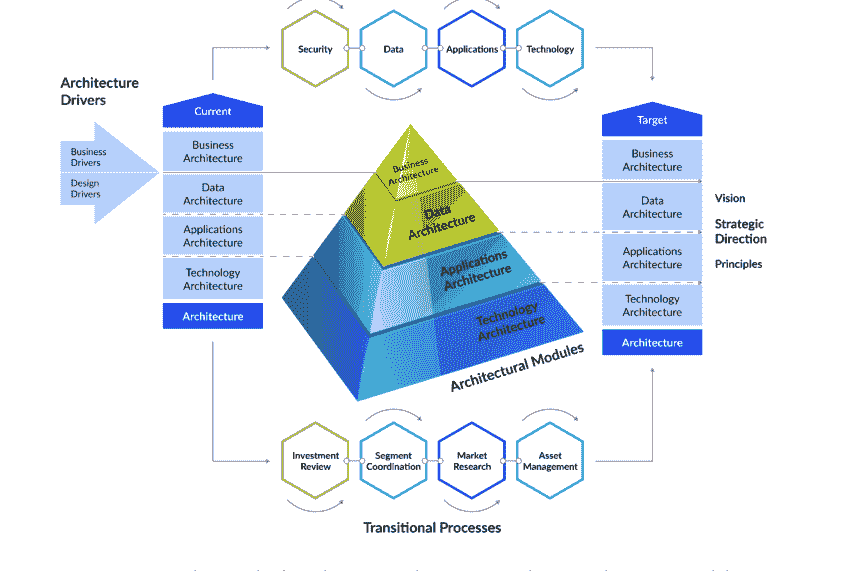
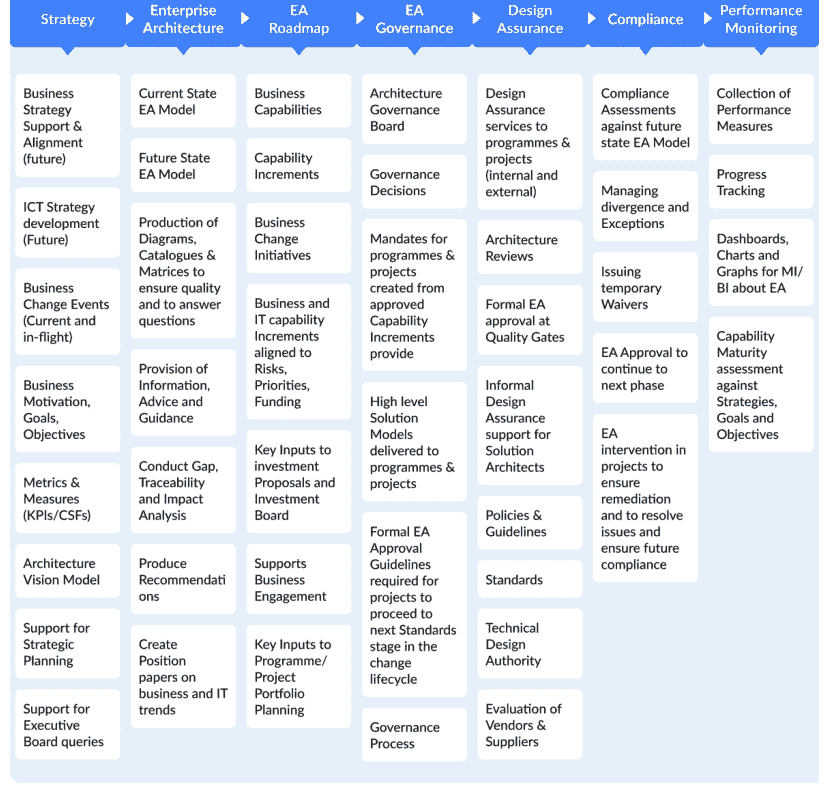

## 定义核心基础以及如何做对

为实现战略性数字目标，企业架构（EA）需要人员、流程和技术的参与与整合。每次与您的应用程序、网站、电话或服务提供商发生负面互动时，架构缺陷就会暴露出来。如果不解决这些问题，伟大的组织也可能被摧毁。本章将涵盖这些问题、其解决方案以及相关方面，其中我们将解释以下方面：

-   拥有 EA 以及有效核心基础框架的体现
-   业务敏捷性和 IT 价值实现是复杂的
-   首次做对的步骤 – 核心基础
-   领导原则及其与企业架构师的关系

### 拥有 EA 以及有效核心基础框架的体现

即使财务上蓬勃发展的组织也面临过巨大挑战，因为它们没有密切关注与客户服务互动相关的客户不满和负面反馈。

这些架构差距在过去对知名公司造成了毁灭性的影响。造成这种不足的主要原因之一在于，它们的数字经济模式基于集成解决方案；然而，大多数企业围绕产品垂直领域运营。公司倾向于根据特定产品或服务来定义客户体验，而非与企业的整体体验。这些是创建能够为目标受众提供顶级体验的基础设施的有效方法：

### EA 与业务必须保持一致

经过仔细考虑，EA 团队会在业务环境中提出变更。他们会深入研究特定实施将如何影响业务，以及在多大程度上提供能够增强整体系统和处理工作流程的能力。使该系统有效的另一种方法是划分各业务单元的职责。EA 是职能部门之间的桥梁；因此，集中的 EA 是首选方案。

不建议为每个业务单元实施独立的 EA 部门。这种方法更可能导致错位、低效以及潜在的毁灭性后果。EA 鼓励组织与各种利益相关者或 EA 互动，这些利益相关者不仅关注技术，例如应用顾问或数据专家，还包括业务利益相关者、财务人员和风险人员，并真正尝试让他们参与到流程模型中，这将更有利于业务与 IT 的对齐。

### 谁对 EA 决策负责？

当计划顺利进行时，每个人都准备接受赞誉，但 IT 业务失败时，每个人往往倾向于将责任推给他人。为了避免出现分歧演变成互相指责的情况，公司必须为与业务架构相关的问题建立明确的责任制。责任问题始于一个挤满 IT 和战略团队、财务部门以及软件开发组的会议室。所有利益相关者都在场时，意见分歧在所难免。透明度很重要，但如果责任制度无效，事情可能会失控。一般来说，EA 治理委员会应对组织内任何 EA 决策负责，但请记住来自不同业务线和领域的架构师的协作努力。

### EA 与业务和组织的协作

沟通是任何组织成功的关键，公司内部各团队之间有意义的协作可确保积极的结果。通常，EA 部门仅限于创建包含关键信息的综合系统地图，以满足所有需求。然而，如果与受这些计划影响的部门之间缺乏或没有讨论，企业就无法解读 EA 的建议。

在 EA 工作中，其他团队对其专业领域负责并承担责任——例如，软件开发人员负责设计复杂的技术框架。通常，EA 团队处理的是更概念性的任务，例如业务流程、交付软件和服务所需的时间和人才、整体业务目标以及单个 IT 项目的范围。为了确保组织内最大程度的生产力和目标的推进，密切协作至关重要。为了提高 IT 部门和其他内部团队接受和支持新架构的可能性，EA 必须指导业务各部门的团队领导，解读复杂概念，收集反馈，并在设计过程中让其他团队参与。

### 保持战略与运营任务分离

EA 团队负责概念性任务，例如战略、分析和促进规定的变更实施。然而，在许多组织中，他们的职责不仅限于这些任务。通常，他们会被拉去管理或为关键问题或举措提供指导。例如，为大型 IT 转型项目构建商业案例或协助 IT 团队进行系统迁移项目。

EA 团队对每个部门和正在进行的项目的深入了解，以及组织内的解决问题能力，被用来做出正确的业务决策。相反，团队的主要重点应放在战略构建上，在其他项目上提供帮助，并在与 EA 团队工作相关的日常业务事务上提供协助。只要运营和战略任务得到高效管理且不重复工作，EA 团队将最具生产力。

### EA 团队的审批权

组织低估了 EA 团队的权力和能力，这在领导层不了解 EA 的运作方式或不认可 EA 团队取得积极成果时可见一斑。其他部门，如 IT、营销和销售，往往拥有更大的预算可供支配，并且经常被给予冒险的空间。

当领导层为 EA 团队提供平等的机会参与决策、政策变更和其他流程时，EA 可能成为组织中最有价值的资产。他们能够洞察组织各方面的议题，并能提前思考企业未来可能遇到的潜在问题。他们可以吸引高潜力的管理人才，帮助组织重新思考量身定制的 IT 系统。被认可和承认作为有价值的利益相关者是有意义的，并能激励 EA 领导者和团队成员继续出色的工作。

### EA 问责要素

用于沟通、协作和问责的集中化系统对于保持无缝工作流程绝对至关重要。在一个组织中，如果每个团队对信息有独特的解读，沟通问题在所难免。EA 团队应完全控制所有 IT 决策流程，同时将特定要素的责任移交给其他业务单元。通过指定团队中的个人对 EA 团队的工作负责，团队可以避免沟通错误并确保最大生产力。

### 衡量 EA 对业务的影响

采用 EA 方法的需求从未如此迫切。EA 支持扁平化领导层级的前瞻性数字化方法。借助这种企业架构模型，轻微故障和运营问题可以更容易、更快地得到解决。

由于 EA 日常流程背后的运营方法，分析和衡量 EA 方法对业务的整体影响是一项非常复杂的任务。团队的日常事务依赖于各个业务单元、外部服务提供商以及许多相互依赖关系。其任务的性质是概念性的，这使得衡量绝对影响几乎不可能。然而，批判性分析它的最佳方式是基于单个项目做出判断。

例如，考虑应用程序功能如何重叠，集成测试可能需要的能力，或整体管理任务的复杂性或成本效益。

组织的整体 EA 战略可以使用各利益相关者已达成一致的 **关键绩效指标 (KPIs)** 进行映射。随着组织的发展，这些战略可以相应调整。

尽管如此，当团队成员少于 50 人时，EA 不能用于重新设计运营。在这种情况下，第一步是数字化业务并追求适当的创新途径。以下图表说明了架构模块的过渡过程以及安全、数据、应用程序和技术之间的关系：

图 2.1 – 架构模型内的标准和过渡过程

业务设计影响业务战略。因此，明确职责和问责制并使团队能够进行跨部门沟通以确保流程顺畅高效非常重要。

## 组织再设计的三大原则

三个组织设计原则可用于简化建立 EA 方法的过程，支持无缝实施并促进最大积极成果的实现。

以下章节描述了组织再设计的三个原则。

### 原则 1 – 组件化 – 明确职责和问责

鉴于当今快速的技术进步，每个组织都必须不断升级和修订 EA 计划。这是通过将组织的多个要素分解为不同的组件来实现的。例如，组织可能会选择特别关注产品、客户体验和核心企业流程。

在这些群体之间明确职责和问责制至关重要。组织适应特定变化的能力直接取决于 EA 团队将 EA 流程快速有效地重新设计以纳入该变化的能力。

例如，通常情况下，支付处理被集成到单个组织内的许多不同产品中。由此产生的依赖关系需要构建技术能力，将支付处理转变为可重用的方法。支付处理是那种可以轻松更新以纳入现代进步的系统的良好示例，这导致以最小的努力满足或超出客户需求。这样的基础设施可能会应用组件化（*将软件分解为可识别的片段*）来战略性地利用数据，并可推动额外的创新机会。

在过去，EA 意味着重新设计整个系统、战略和运营流程。IT 专家和企业架构师帮助管理层设定目标并映射业务流程。然而，这种方法现在已过时，因为它不支持组件化。EA 流程中产生的每个新组件在实施时都会增加价值，而增量方法可确保组织目标稳步、可靠地推进。

### 原则 2 – 功能多样性 – 确保团队成员反映广泛的观点

在此阶段，领导的作用定义了整体业务战略。领导者必须组建高效的团队并提供技能发展培训，帮助每位成员设定切合实际的个人绩效目标，使其能够适当映射，以确保团队整体实现公司的目标。同样，拥抱人员、流程和技术机会最重要的方面之一是赋予跨职能团队权力，并配备明确的职责和问责措施。

这种方法似乎与传统的管理方式相比是一种激进而突然的转变，最初可能会扰乱运营的顺畅进行。为了减轻此类情况的负面影响，领导者必须在每个组件内分配适当的流程和技术。每个团队的每个个人都必须感到有能力发声，并在与业务职能领域相关的流程和技术方面得到领导层的支持。

研究表明，多元化团队的表现优于同质化团队。从数据科学家和软件工程师到律师和财务专家，每个团队成员都必须带来独特的技能组合。多元化人才不仅仅指文化多样性；它还可包括世界观、教育背景、家庭责任、神经多样性等。

每位成员应凭借多元化的能力脱颖而出，以提升创造力并确保更好地对《2002年萨班斯-奥克斯利法案》（https://thehill.com/blogs/congress-blog/technology/531781-why-a-sarbanes-oxley-update-is-needed-to-protect-our-financial/）至关重要，一项要求企业进行财务报告和记录保存的美国法律。

该立法促使许多公司实施执行基础以简化财务管理。2005年，大型公司将其15%的IT预算用于与萨班斯-奥克斯利合规相关的措施。

通过建立定期访问数据的能力，借助 EA 执行基础可以降低监管合规成本。如果一家公司将超过15%的IT预算用于履行法规，则该公司迫切需要采取行动。

### 风险 3 – 敏捷性挑战和无利可图的增长举措

组织内的运营流程具有一定的工作流程，在合并后很难改变。当团队无法利用现有业务战略时，开发新能力可能需要比预期更长的时间。

使用过时的系统而不是数字化基础设施会延迟盈利结果。因此，如果组织将现有能力应用于新的战略举措，并且这些举措是盈利的，则没有迫切需要采取行动。

### 风险 4 – IT 始终是瓶颈

通常，公司遵循传统的 IT 流程实施方法，该方法通过两步练习进行：

- 1. 传达业务战略
- 2. 相应地构建 IT 基础设施

在这种环境中，IT 是拥堵点，而非战略资产，并且实施新系统以促进战略举措可能需要长达 2 年的时间。到那时，同一行业内将出现数十项新创新。因此，让 IT 负责整个 EA 举措几乎肯定会导致实施不必要的延迟，以及跟上组织内部和外部正在发生的 IT 基础设施现代化挑战。

运输和物流公司 UPS 利用当前利益相关者的信息和反馈创建新的客户服务更新，以确保每 90 天增加价值。如果项目交付高效需要超过 12 个月，则组织中迫切需要采取行动至关重要。

### 风险 5 – 用于同一任务的不同平台

你会为执行相同功能的 20 个不同平台付费，还是致力于增强与每个其他系统集成的单一平台的能力？后一种方法更现实、更实用，因此显然是正确的做法。

然而，有数百家公司在多个订单录入系统上运营，还有其他公司有超过 30 种不同的支付客户福利方式。不仅在这些情况下运营成本巨大，而且维持这些平台所需的精力和时间也不值得。

高昂的冗余系统成本以及合规监管和报告中不准确数据的风险会导致破坏性的后果。对多种系统的渴望根本无法证明随之而来的开销是合理的。因此，如果一个组织运行多个平台来执行同一任务，它并不会增加价值。事实上，它会破坏执行的根基，并且在某个时候，将会迫切需要采取行动。

### 风险 6 – 用于决策的关键信息不可用

无论你的仓库有多大，或你的数据管理系统有多广泛和全面，如果它们无效，就毫无用处。有些公司开发了价值数百万美元的软件来简化日常业务事务，但要么正确的信息不可用，要么事实和数据不准确。

EA 决策者的作用在这里至关重要，同时还需要强大的执行基础。他们可以利用正确的数据在利用标准化流程的同时做出适当的决策。如果贵组织内的决策者每天都无法在同一组数据上做出有效选择，那么采取行动的理由就非常紧迫。

### 风险 7 – 员工在系统之间移动数据

当一家公司花费巨资设置硬件和软件以确保最大效率时，如果员工仍在手动在系统之间移动数据，这有什么意义呢？毕竟，这就是组织花费数百万美元在技术和软件上的原因。

最重要的是，在这种情况下，错误的风险极高，员工宝贵的时间被浪费了。大多数领先公司已转向人工智能（AI）、物联网（IoT）和机器人流程自动化（RPA）系统，这些系统几乎不需要或完全不需要人工干预。这些系统执行安全措施、数据编译、存储和分析、库存管理、集中整个采购流程等。

例如，惠普打印机在墨粉用完时可以自动重新订购墨盒。该过程属于物联网，并且在任何层级都不需要人工干预。大多数数字化前沿公司通过电子方式完成一半的销售。组织可以将自己的处理情况与现有百分比进行比较，以查看其系统是否需要采取行动。

### 风险 8 – 高层管理回避讨论 IT 议程事项

几乎所有大型、多部门的组织都有委员会负责研究与其指定领域相关的问题（例如，财务、资源分配、IT、硬件和招聘）。

当只有高级执行委员会处理 IT 治理、为原则和投资优先事项奠定基础时，这里可以发现风险。这里的问题是高管对 IT 事务缺乏理解和兴趣。当这种风险存在时，这些会议可能对这些领导者来说显得枯燥乏味，/或他们可能不了解组织的 IT 需求。当组织存在这些问题时，增长计划会面临风险。

另一方面，拥有有效 CIO 且对这些议程表现出坚定承诺的公司蓬勃发展，因为它们专注于战略问题。当负责 IT 相关决策的高级委员会无效时，组织迫切需要采取行动。

### 风险 9 – 对 IT 投资积极成果的不确定性

如果你必须思考 IT 是否提供良好价值，那么答案很可能是否定的。在为项目投资资金、精力和宝贵资源的同时，领导者必须确保设定可衡量的目标。到季度或年度结束时，如果他们无法衡量结果，整个努力可能就白费了。

投入关注正在进行的项目以确保其按计划进行并为业务带来积极成果和价值非常重要。认识价值的努力的一部分是了解与 IT 和财务相关的所有内部事务。

为了应对前面提到的风险并使流程顺畅进行，需求的清晰度和对架构计划结果的持续分析有助于确保 IT 的战略价值。一家能够描述 EA 的高级管理层所在的公司是安全的。然而，无效的核心基础可能导致毁灭性后果。在这种情况下，EA 在充当业务部门之间的桥梁方面发挥着重要作用。组织再设计可能是一个选择，但应考虑一些原则，如前所述。在投入基础设施之前，设定可衡量的目标并为之努力可以产生巨大的积极影响。

## 复杂业务敏捷性和 IT 价值实现

业务敏捷性的需求永远不会被高估，因为敏捷性使得能够像变化发生一样快速地应对任何类型的企业变化。通过选择现代技术来适应市场变化的能力为敏捷的组织流程奠定了正确的基石。

对于某些组织而言，这一过程可能缓慢而稳定；然而，其他组织相信快速转型。这种适应性由现代工具和数字解决方案促进，这些工具和解决方案帮助决策者采取正确的步骤。准确且易于获取的数据被报告和分析，以便可以利用其用于业务敏捷性流程。

数字化成熟的公司比其成熟度较低的同行盈利能力高出 23%。根据组织规模，数字化转型程度与结果之间的比例可能会有所不同。

以下业务敏捷性统计列表源于深入分析，并展示了采用敏捷模式的企业百分比以及该流程的真正价值。此外，这些统计数据反映了公司在转型期间遇到的挑战：

- 大多数（71%）企业已选择业务敏捷性模式。然而，45% 的企业表示，打破业务与 IT 之间的壁垒是其向敏捷转型的主要驱动力。该过程在很大程度上具有影响力，但在放弃传统实践时可能有点具有挑战性。
- 一些决策者如此习惯于其处理业务事务的传统程序，以至于任何变化似乎都让他们感到不舒服。一项员工调查发现，在 35% 的案例中，数字化转型的最常见障碍是 CEO。技术进步和增长计划建议对这些领导者来说根本毫无意义。然而，56% 欢迎技术现代转变的 CEO 表示，数字改进带来了收入增长。
- 组织的文化决定了增长计划执行的速度。大多数（59%）专业人士发现促进任何形式的进步都很困难。据他们说，文化和绩效管理是其向敏捷转型的主要挑战：
  - 81% 的组织在过去 3 年内启动了敏捷转型。
  - 70% 的企业希望在未来 3 年内整合业务和 IT 驱动的敏捷转型。

组织敏捷性不仅仅是保持向前迈进以增加收入和客户满意度的必备要素。这种转型的另一个不可否认的方面是抵御动荡市场、竞争和其他力量的能力。EA 薄弱的公司在地动山摇时难以站稳脚跟。相反，能够预测新市场趋势和客户行为的公司可以据此规划其战略。它们已为最坏的系统冲击做好准备，并利用这些艰难时期为自己谋利。

通向未来状态的转型可能让许多组织的业务和 IT 部门不堪重负。然而，决策者可以通过优先考虑过度支出使整个过程变得可承受。重点必须放在满足客户期望和使公司在长期增长中处于有利地位的进步上。

为确保该基础设施取得最佳成果，企业领导者可以加强企业内部和外部的协作，并将跨部门目标和绩效指标与整体战略保持一致。在组织内建立有效且无缝的信息流之后，团队应建立自动化的知识共享平台，以将共享该知识的过程付诸实践。

## The importance of realizing value

旅程如果没有终极目标又是为了什么？同样地，当一项举措被实施并投入资金以实现战略使命时，其可能的结果将被衡量。

领导层的职责是设定某项实施的目标和预期；然后项目移交给负责实施的团队。团队在遵循既定时间表和分配成本的同时努力交付成果。他们的首要关注点是保持流程顺畅，而不去担心日常事务以及他们的工作将带来的更大业务成果。领导者可以向团队传授他们工作的业务价值。当团队不了解自己的工作如何融入大局时，会导致多种可能中断流程成功的挑战。

治理不善、沟通无效、团队协作失败以及采用率低是团队面临的主要挑战之一。此外，掌握运营效率的延迟通常根源于脱节的流程、角色和战略。

为组织提供工具或解决方案的第三方可能对如何使用它们有独到见解。未能与他们合作以利用其在特定问题上的专业知识可能会产生负面后果。无法采用现代工作文化并根据新的市场趋势调整资源的公司将遭受运营准备不足的困扰。为了从业务举措中获得最大成果，价值实现至关重要。

## How can teams support the realization of value in their investments?

有影响力的组织和治理结构为有效协调利益相关者以使其共同的业务目标保持一致奠定了基础。目标的实现是迈向成功努力的第一步。这些目标的管理方式在很大程度上取决于业务愿景与投资的一致程度，而两者对结果都有巨大影响。对可衡量成就的明确方向、每个利益相关者如何执行其分配的任务，以及在出现偏差时采取适当及时的措施，共同定义了任何项目的目标实现。

这些关键要素汇聚在一起，通过做出正确及时的决策来提升业务基础设施的能力，从而有效领导团队。绩效管理系统随后利用这些要素来衡量和监控投资成果。

在组织内部，重点必须放在服务交付的效率上。有效利用可用资源使团队能够追求增值举措。这些服务的有效性在业务层面衡量，重点是用户体验。在战略层面，优先事项必须是根据市场趋势识别并适应不断变化的业务需求。它衡量增长机会被合理利用的程度。

公司依靠数据和统计数据来计算潜在成果，以便与过去的成就进行比较。然而，当目标基于这些数据设定，而没有任何可衡量的指标时，业务运营将缺乏明确的方向或管理。这就是可能导致毁灭性后果的受损基础设施。

适应独特的模型、工具和战略需要对每一种 IT 解决方案都有切实的掌握。快速而复杂的业务转型需要来自企业架构（EA）的适当指导和管理支持。

总体而言，人们对 EA 效益实现缺乏认知。它为组织带来的价值以及随之而来的转型便利性是巨大的贡献。利用 EA 转换流程、EA 使用流程和 EA 竞争流程开发 EA 价值实现模型可以帮助实现这些效益。它还将有助于识别可能影响价值实现流程的因素。

## EA value realization model

EA 价值实现模型消除了 EA 资金无论 EA 举措如何处理都将始终盈利的认知。组织绩效是影响整体流程的巨大因素。它阐明了 EA 与组织绩效之间复杂的关系。此外，利用该模型可以评估促进 EA 业务价值实现的组织条件。

组织结构中的许多要素对转换过程的有效性有很大影响，例如管理层对系统的信任、有效沟通、EA 目标、愿景和治理。EA 资产的呈现方式及其与现有实践的整合程度对这些资产的利用方式有重大影响。

为了更好地理解 EA 价值创造的过程，我们将其划分为相互关联的类别和更小、更易管理的部分。这项研究为我们指明了正确的方向，但只是更广泛探索的垫脚石。需要更具体、更深入的研究来了解 EA 资金、EA 转换过程中的活动细节、问题以及转换因素之间的相互作用。

通过对 EA 成果和价值的研究，团队不仅不太可能经历大规模失败，而且风险和潜在结果也更容易预测。跟踪决策者根据项目计划采取的所有行动并追究其责任是推进的有效方式。这样，所有错过的里程碑都将清晰地反映在行动计划中。

## Value realization management

高效价值实现管理的迫切需求在大多数企业的项目结构中往往被低估。价值映射是一个绝对必要的步骤，它为以结果为导向的管理提供了一个简单、方便且强大的基础设施。以下步骤使该流程更易于团队适应：

- 1. 让利益相关者参与业务开发过程的每一个方面。这会让他们感到有足够的能力而受到激励。除此之外，他们可以为愿景负责。利益相关者的承诺应被视为潜在的节约驱动因素和社会化目标。让利益相关者参与是确保非凡业务成果的重要方式之一。此外，价值地图是合同流程的重要组成部分。
- 2. 在流程开始之前，将价值地图与项目计划进行对齐和关联。如果没有对业务目标和价值地图进行适当的协作，价值的实现就不太可能。价值实现程序在设定的时间内进行，并增加了每个利益相关者对项目感到满意的机会。接近尾声时，团队会聚集在一起分析转型是否值得付出所有努力，并确定公司是否取得了有价值的成果。

失败的原因可能因多种因素而异，但最常见的原因可能是团队无法及时适应新技术。如果业务需求与开发交付相差甚远，结果很可能将是灾难性的。业务理念和市场趋势的不断演变使大多数组织难以跟上，从而导致它们不再相关。

产品和服务的增量更新和变更应成为投资周期的一部分，以持续管理业务效益。如果举措按预期进行，则对各方都是双赢；然而，对于部分成功，计划可以根据数据进行修订。

## Role of enterprise architects in the transformation process

作为 IT 架构的最大利益相关者，企业架构师深入了解业务的各个方面。因此，他们在转型过程中发挥着重要作用。预见和预测实施可能结果的能力对于定制决策过程至关重要。EA 认识到导致企业成败的 IT 架构的真正价值。业务趋势和客户行为不断变化，并基于这些创新，日常运营、客户体验以及业务增长的方向也在发生变化。企业架构师可以分析和评估这些变化对任何业务的长期影响，以改进转型过程。

让我们回顾一下 EA 在业务转型过程中扮演的几个重要角色：

图 2.2 – EA 在业务转型中的作用

## 非凡的客户体验

今天是数字创新的现代时代，客户是最终的决策者。EA可以帮助组织分析客户与之互动的路径、他们感兴趣的内容以及他们放弃联系的地方。绘制客户旅程是最常见的方法之一，可以从客户的角度看待组织。设计能够吸引客户并促使其购买的策略，只能通过对他们的旅程产生兴趣来实现。客户体验可以通过重新设计策略、根据客户选择提供新服务以及采用现代技术与客户沟通来改善。自动化是确保更好客户体验的关键要素。技术可以帮助组织以更方便、无忧的方式满足客户需求。公司内的企业架构师可以通过帮助人们树立关于创新的适应性思维，从而制定将事物提升到新水平的计划。他们对业务的理解和对数据的分析可以被利用来加快业务转型的进程。

## 提高敏捷性以加快上市时间

敏捷流程带来有效的工作流程和顺畅的内部和外部运营。不仅如此，这还带来了一种富有成效的工作文化，同时为决策者提供更多时间来投入更重要的事务，如战略、创新和增长。

基于此，领先企业管理层的大部分人旨在在不久的将来改变或扩展其在技术和流程改进方面的敏捷流程。公司在营销新产品上花费的时间越少，他们就有越大的窗口来基于数据和分析制定理想的以客户为中心的举措。这是在当今永不停歇、不断演变的数字世界中的关键一步。

无论其方法多么高效和以客户为中心，组织领导者都需要时刻保持警惕，以了解并考虑组织对现代趋势的反应。行业的变化几乎是即时的，有时可能会让领导者措手不及；然而，那些能够预测变化并相应调整策略的人将能够出色地处理这些问题。

为未来做计划的现代行业领导者已将其流程建立在敏捷开发之上，因为这是提高交付速度的唯一实用且强大的方式。最重要的是，企业运营的敏捷方法为公司如何应对快节奏的变化以及每个利益相关者如何拥抱转型提供了极大的灵活性。企业架构师通过为在各自领域工作的开发团队提供战略视角、运营指南和功能方法，为这些变化奠定基础。通常，这些团队会适应并依赖自己的最佳实践和能力来引领行业持续发展的方向。

## 投资先进技术

EA 在促进无缝流程以评估新技术的需求和采用方面发挥着主要作用。那些通过适应新颖、复杂和进步的模式来拥抱转型的组织，比不这样做的组织更有可能做得更好，在竞争方面也更有可能获胜。

通过利用成功的数字化转型，旨在在其行业中发挥领导作用的公司会选择颠覆性技术，例如物联网和机器学习技术。适应现代工具和技术在确保组织留住具备多样化技能的富有资源员工方面发挥着至关重要的作用。

随着数字设备、软件和趋势的不断演变，公司必须持续评估更聪明工作而非更辛苦工作的机会。这是组织在其他行业领导者中创造和保持竞争优势的唯一途径，因为新兴技术对企业的影响可以创造巨大的机会。利用下一代工具和技术也可以在考虑未来战略时为组织提供优势。技术可以改进的不仅仅是产品和服务——它可以提升整个组织。

## 遵守数据隐私法规

数字世界运行于在日常业务过程中直接或间接收集的数据之上。组织在利用数据机会的同时遵守法规，对于运行顺畅合法的运营至关重要。

在当今现代数字世界中，数据无疑是组织最宝贵的资产。其潜力的重要性不容低估，因为它可以促进无缝运营并带来新的机会。它使公司能够利用新兴技术，加速数字化转型进程并在更大范围内改善客户体验。在确立数据的重要性时，考虑监管合规要求和数据治理方面至关重要。

网络安全事件正在上升，它们使任何类型的数据持续面临被盗、丢失或用于非法目的的风险。为解决这些问题，世界各国政府已合理地实施了限制性法规，以保护个人数据隐私和安全。因此，每个组织都必须围绕这些法规规划其 IT 路线图并构建其战略，以保护个人身份。

EA致力于改善业务的方方面面；然而，有一些领域位居榜首。专注于提升组织客户服务和技术能力的业务战略能带来最佳成果。让我们逐一回顾这些因素，并确定它们的重要性、在运营工作流程中的作用以及它们所促进的可能成果。

## 改善客户体验、数字化流程并实现运营卓越

客户体验与数字能力紧密交织。拥有最先进、现代化的设置和精简的 IT 基础设施的公司更有可能提供更好的客户体验。

消费者在产品和服务以及可以购买它们的平台方面面临 overwhelming 的选择。公司的数字体验必须非凡才能吸引并赢得访客。与客户的关系在他们完成购买后并未结束；客户仍保留在组织的数据库中。

公司可以使用数据来告知和娱乐客户与其感兴趣的产品相关的话题。通过利用数字能力在销售后保持客户参与，例如提供电子邮件通讯、在线调查和产品评论机会，可以增强客户体验并提高销售额。必须始终牢记，不满意的客户可以通过社交媒体轻松损害公司的声誉，并且可以方便地转向另一家提供商。

客户体验是在构建业务战略时最高优先级，但在运营卓越、实施、举措的执行以及提高生产率方面则是下一个优先事项。在员工处理复杂查询、应对沮丧客户或处理大量退货订单的情况下，拥有采取最佳方法的工具和流程可以决定品牌的声誉成败。

## 绘制当前 IT 环境以创建更好的未来战略

每个公司都有各部门依赖的技术应用程序来维持日常运营的顺畅。组织的每个方面都依赖于网络技术，因此创建全面的应用程序清单是评估能力和为未来战略举措做计划的重要方式之一。可以使用多种框架和工具来评估、维护和分析此清单，同时考虑包括应用程序生命周期、成本、部署、交换流程以及对业务的影响等因素。

IT 专家和其他利益相关者必须能够访问这些数据并理解它以做出更好的决策。支持更好决策的一种方法是设计尽可能全面的清单，包括角色、流程、位置、业务能力、供应商和其他关键因素。

这些反映组织业务能力的清单图可以填补运营差距。这是企业架构师用来通过针对利益相关者的自动化问卷进行客观和主观分析的数据，利益相关者提供信息以帮助评估他们使用的应用程序的价值、技术效率和业务契合度。通过这些分析练习，企业架构师能够列出所有消耗组织资源的应用，并根据其重要性和价值对其进行排名，汇总评分并交叉引用 KPI。结果有助于确定过去哪些资源最有成效、未来战略中应包含什么以及 IT 团队应如何处理正在使用的应用程序。

数字化转型与创新紧密相连，因此对于落后于人的组织而言，这是追赶的最佳方式。经常而言，在 IT 系统和战略业务举措方面，行业领导者之间会存在冲突。每家公司都有其独特的目标，因此每个计划也必须独一无二。组织往往未能理解变更对项目范围、时间或预算的影响，尤其是在敏捷环境中。团队为实现最终目标而利用的资源应与业务战略保持良好一致。如果不是这样，团队将无法应对需要创新的需求。

为了避免此类极端情况，EA 为蓬勃发展的企业提供了正确的方法。明确理解业务目标是迈向高效业务架构的第一步。企业架构师基于与业务团队的互动来评估当前的业务能力，以绘制并理解它们如何随时间变化。这一练习帮助他们确定组织在未来几年应重点发展的能力，以及哪些客户细分需要重新制定战略。

企业架构师在确保 IT 基础设施与业务能力保持同步的同时，定义未来的行动方案。绘制当前 IT 环境并为新的 IT 架构奠定基础就是他们实现这一目标的方式。该地图有助于明确公司在向前推进并为应对新挑战做好准备时，哪些 IT 资源对业务发展至关重要。

EA 简化了收集、访问和理解有助于治理流程的数据的过程。组织通过企业架构师基于语义模型创建的数据清单来表示。从公司资源中提取基本事实和数据，并用于绘制业务战略、流程和 IT 基础设施。

将业务数据与数据字典关联可以实现自动化，从而为跟踪业务数据血缘奠定基础。这样，架构师就能在考虑到新的行业趋势的前提下，分析近期可能发生的潜在变更的影响。精简数字化转型工作使组织为市场变化做好准备，并帮助领导者据此进行规划。

新法规，例如 **《通用数据保护条例》(GDPR)** 和其他数据隐私法律，已加速了公司的合规流程。GDPR 的文档记录及其对应用程序的影响可以得到简化。告知监管机构个人数据在考虑所有法规的情况下正在被处理是至关重要的。GDPR 实践使合规变得更容易、更简单。通过此工作流程，**数据保护官 (DPOs)** 可以通过重用企业架构师创建的应用程序轻松记录 GDPR 处理活动。他们可以随时获取有关业务流程和应用程序的详细信息以供审查和分析，包括图表、流程图和其他详细属性。

## 企业架构师引领数字化转型

有人可能认为企业架构师脱离了实际工作现场的现实，那里进行着日常工作。他们认为企业架构师生活在真空中，在那里他们规划理想的情况和场景，而这些场景在现实中难以实施。他们甚至可能声称，企业架构师难以证明 EA 带来的业务价值，因为他们对核心业务运营了解不足。

然而，在当今现代数字时代大多数企业中常见的敏捷环境中，企业架构师是推动和促进数字化业务转型的业务合作伙伴。他们预见并预测市场创新和客户行为变化，并据此规划未来。通过与敏捷团队密切合作，他们为数字化转型举措做出重大贡献，使公司走上正确的道路：

- 企业架构师不仅为最有效的业务成果做出战略建议，而且他们会在一个季度或设定期限内持续评估业务机会。他们是那些保持与新兴技术和最新业务趋势联系以评估潜在长期影响的人。市场和相关行业不断变化对 IT 系统产生影响，有时这会导致全新生态系统的构建。企业架构师预见了这些变化。他们作为业务合作伙伴的角色体现并代表了根植于人员、现代流程、适当应用和高效基础设施的协作努力所带来的价值。
- 每家公司，无论是有意还是无意，都在为最终成功而竞争。进行有价值的投资，并花费时间和精力来适应和采用新兴技术，是保持竞争力并与其他公司竞争的最佳方式。
- 根据 Forrester 的一份报告，86% 的领先公司受访者认为技术是推动业务战略的最重要因素。今天，企业架构师帮助公司理解和分析新兴和战略技术的影响。他们帮助确定数字业务平台在现代企业中可以提供的价值。他们时刻关注市场动态，更有能力预见新趋势和机遇。
- 企业架构师具备识别和向决策者传达市场趋势的能力。他们很可能会建议采用潜在有价值的新技术，尤其是那些相对较新或可能在市场上具有颠覆性的技术。基于这些建议，IT 领导者开始头脑风暴、分析和确定此类技术可能对业务产生的影响，并判断它们是否会使公司领先于竞争对手。
- 需要注意的是，新兴的 EA 设计可能会带来诸多挑战，因为开发团队往往不了解更广泛的业务目标、技术资源和业务标准。然而，敏捷团队被赋予权力并具备足够的能力，基于敏捷宣言的第 11 条原则来设计他们所需的架构，以实现精简的技术工作流程：“最佳的架构、需求和设计来自自组织团队。”
- 过去，企业架构师曾被指责为“为架构而架构”。他们被认为不利于业务增长。现实恰恰相反，商业世界已注意到并认可了他们的价值。企业架构师是组织中最有影响力的领导者，能够预见未来并据此提出建议。他们负责增长举措和实施工作。他们通过密切关注市场趋势，利用公司资产和资源探索新的业务机会。他们为组织带来的价值决定了业务成功的步伐：

### 企业架构师是谁？
- 负责监督完整系统架构、业务流程和 IT 基础设施的软件架构师
- 在降低数字化转型相关的复杂性以及建立围绕技术使用的规则和流程方面发挥重要作用

### EA 在数字化转型中的角色是什么？
- 执行数字化项目，如云计算和在线业务模式，并简化并现代化公司的 IT 系统
- 其角色是将复杂性降至最低水平，以便公司能够利用数字技术、开发产品开发方法论并更快地响应客户需求

### 企业可以采取哪些步骤来赋能 EA？
- 分配更多责任给 EA 并鼓励实施其政策和指南
- EA 团队应定期向业务部门提供他们所做的重要决策的技术成本
- EA 获得与决策者直接沟通的渠道

图 2.3 – 企业架构师在数字化转型中的作用

在生活的任何领域，迈出第一步几乎总是困难的部分，无论这一步是创办一家全新企业、报名参加在线课程，还是建造一栋新房子。开始是最艰难的阶段。对 EA 来说也是如此。

## Steps for getting it right the first time – core foundation

对 EA 新手来说，这既复杂又令人不知所措。有些人可能无法理解转型对业务成果的影响。

为 EA 的整体成功建立正确的基础也是一项具有挑战性的任务。初始规划阶段结束后会怎样？下一步是什么？制定正确的战略、制定计划并坚持执行将确保最佳结果。

以下是逐步流程，说明所有这些是如何运作的，从沟通开始。

获取每个利益相关者对可能影响或不影响转型的事项的意见。建立对 EA 真正目的和动机的清晰理解是整个过程中最关键的步骤之一。如果团队对 EA 对业务生产力的重要性价值没有达成一致，流程可能无法提供最有效的结果。收集团队用于日常业务事务的所有公司资源的数据可以帮助评估影响。

一旦战略步骤在纸面上基本完成，就必须在职能部门之间共享，以确保大家意见一致。这样，每位利益相关者都可以沟通其关切点，识别任何漏洞，并在流程开始前解决可以修复的问题。从实际问题入手并开始采取行动以实现实际转型是合理的。

以下是建立正确的核心基础以确保 EA 成功的一次性关键步骤：

- **评估驱动执行的任何现有基础**

通常，公司坚持使用过时的业务战略表述方法，然后再与 IT 对齐。这些流程在过去运作良好，但今天，随着众多创新和数字化进步，公司可能会发现 IT 成为瓶颈而非战略资产。一般来说，公司中的任何新举措都需要大约 2 年时间才能实现运营化。员工需要时间和空间来适应新系统，以便建立对更新运营方式的深入理解。为了实施支持战略举措的新系统，团队可以在评估潜在成果前至少给予其几年时间。该基础设施的问题在于，公司在适应它的同时，行业中可能出现了许多新进展。

高层 IT 和业务管理层的支持是高效管理 EA 举措的理想条件。业务职能和流程必须使用相关制品进行描述，并应符合范围。换句话说，业务和 IT 必须达成一致以定义 EA 的范围。为了确保 EA 的最大生产力，其内容需要具备某些特征，与现代行业趋势保持良好同步。

## Evaluate the operating model

每个举措都需要一个蓝图来定义特定项目的发展方向。为了让团队遵循指导方针并与计划保持一致，必须有适当的文档来指导他们。在数字业务世界中，这一指导方针被称为 *运营模式*。它被认为是 EA 执行基础中的第一层。该综合模型定义了标准化的业务流程，并解释了整合的需求，以提升特定客户群或其他目标受众的价值。

简单来说，运营模式是业务战略的垫脚石，因为它指出了流程的进行方式、最终目标以及业务部门最终将创造、交付和捕获的价值。企业架构师能够分析业务流程、系统关联和数据，以支持业务模型的各个方面。业务模型中存在某些元素在确定运营模式方面发挥着重要作用，包括客户细分、关键活动、资源和合作伙伴。

所有这些元素汇聚在一起，提供了一张地图，有助于识别组织的当前潜力和能力。这种映射是在一段时间内进行的，利益相关者共同坐下来评估流程。来自业务模型的数据和特征被提供以促进映射矩阵。这种映射过程和标准非常适合评估企业的特定业务模型和创新参数。

## Define processes and goals for the EA

简单来说，EA 的主要目标是创建路线图或蓝图，使组织在转型过程中走上正轨。必须包含的一组有价值的信息和公司数据是 IT 资产和业务流程。如果没有对公司资源的基础知识，确定未来会相当困难。

企业架构师经过良好培训，能够分析过去的数据并设计战略计划，以利用组织的当前能力并带来变革。其他常见目标包括促进团队一致性和标准化。做到这一点的最佳方式是确保每个利益相关者都保持一致，且团队之间和团队内部的沟通顺畅。确保团队和组织之间拥有统一的环境对这一过程至关重要。

作为 EA 流程的一部分，组织的架构、角色和职责会得到概述。EA 模型提供了组织架构的概览并提供长期视角。包括信息系统和技术在内的业务流程被描述。新技术和流程也将被采用。

企业架构师是引导者，帮助组织规划其目标并随着时间的推移努力实现它们。利用可用资源和技术来实现这些目标也在指导方针中有所规定。以下是任何 EA 的一般目标列表：

- **Effectiveness**
设定切实可行且极具激励性的目标就是 EA 的全部内容。核心基础通过监督运营的各个方面，为基本且准确的流程建立工作流程。通常，蓝图和路线图定义了实现最终目标并产生业务设定的交付成果的指导原则。

- **Efficiency**
公司拥有一套资源，以最有效的方式加以利用以维持业务运营。企业架构师提供计划并确定重复使用这些资源的能力。通过消除冗余，他们确保每个员工在已识别的 EA 框架中设定的资源创造力得到最佳贡献。业务流程建模和工作流映射可以产生更大的协作。

- **Agility**
为实现单一目标而执行多个程序可能是一种毁灭性的方法。但企业架构师专门从事将传统技术与现代技术相结合并促进采用过程。此外，他们的业务模型通过持续监控指标和分析来评估任何技术风险。这解释了需要确定何时以及如何使 IT 发展与业务目标保持一致。

- **Continuity**
一致性是确保良好结果的方式。尤其是对于大型企业组织而言，每个计划、战略或举措都是一个持续过程，需要数年时间才能转化为富有成效的决策。保持关键业务运营对企业至关重要，因为团队瓦解或管理层对举措失去兴趣的风险相当常见。企业架构师通过业务和 IT 流程的标准化来帮助确保连续性。

此外，为了满足组织业务和 IT 的需求，EA 开发流程整合了组织内部的不同观点。

## EA management process

**Enterprise architecture management (EAM)** 利用 EA 实现并推动业务价值。它定义了组织为实现顺畅无缝的实施、确保最佳成果的战略构建以及治理所需的方向，以规划并为公司的愿景、目标、指导方针、政策和原则设定正确的路线图。

EAM 流程在 EA 内部具有多重角色：

- 它为与 EA 相关的活动定义正确的路径。组织内的所有利益相关者必须遵循 EAM 设定的方向。
- 在沟通、协作和保持联系方面，它充当业务战略与 EA 之间的桥梁。
- 它利用 EA 的核心价值来实现业务转型的过程。

此外，沟通、监控、控制以及其他定期进行的活动都在 EAM 流程下管理，以确保 EA 支持的开发和部署以及业务价值的交付。

## EA 治理流程

与正在进行的流程相关的所有信息都需要跨部门共享和评估。这正是 EA 治理流程发挥重要作用的地方。通过该流程，团队识别、管理和审计所需的所有信息，并将其传播，以管理 EA。除了管理和控制之外，组织内部还有数百个流程必须进行监控，例如架构原则、政策、决策、建议、交付物、合同和协议。EA 治理流程确保它们在适当的时间得到正确执行。

## 项目参与流程

EA 与项目交付之间的关系在 EA 流程中具有特殊重要性，因为它提供了预测业务变化的方向。此外，还会预测未来 3 至 5 年内可能基于客户行为而出现的新市场趋势。

EA 模型是为单个交付项目奠定基础的主要信息来源。交付项目结束时，所制定的解决方案架构会链接回当前的 EA。

## EA 合规流程

规则、法律和法规的合规性会根据 EA 评估标准、标准、质量、服务水平协议和架构要求进行评估。这一复杂但至关重要的流程分多个阶段进行，具体执行的任务将在下文详细介绍。

## 优先战略制定

在当今不断发展的数字世界中，企业必须走在创新的前沿，以保持竞争地位。EA 领导者在帮助组织跟上最新趋势方面发挥着至关重要的作用。他们不能依赖传统的架构实践，因为这些实践今天已不相关。EA 领导者运用其关键能力为公司定义 EA 的新愿景以及其带来的益处。

企业架构师应将时间和资源集中在架构模型中的优先要素上。通常，这些优先事项基于全球采用的场景和实践。EA 根据与每个业务优先事项相关的当前趋势提供相关的业务价值：

| 关键业务优先事项 | 企业架构价值 |
|---|---|
| 业务转型 | 明确业务目标、重新设计业务模式、评估影响、设计并传达未来愿景、优先排序并规划变更，以及加速需求。 |
| 战略规划 | 提供业务和企业框架，用于基于战略一致性和合理化，对投资组合内部和跨投资组合进行客观的优先级排序。 |
| 客户体验 | 为体验结果提供根本原因分析，指导体验决策制定（例如优先级、可用能力），双向评估影响（即体验与业务/技术环境），并将体验转化为行动。 |
| 敏捷执行 | 提供宏观方向和通用语言，使执行团队聚焦于正确的企业优先事项，并加速需求。 |
| 资源优化 | 为出于成本/简化原因优化资源（例如流程、系统应用）提供业务和企业视角，并协助相关学科（例如业务流程管理和运营卓越）的努力。 |
| 合规监管与变化 | 提供用于评估、应对和传达监管影响和风险的业务和企业框架；通过从政策到业务和 IT 资产的端到端可追溯性证明合规性。 |
| 新兴技术 | 明确业务目标、重新设计业务模式、识别新兴技术的关键应用、评估影响、设计并传达未来愿景、优先排序并规划变更，以及加速需求。 |
| 跨组织协调 | 提供用于评估、设计、规划和执行合并、收购、合资企业、联合倡议和初创企业的业务和企业框架。 |

图 2.4 – 关键业务优先事项与 EA 价值

## IT 参与模型架构和实施

EA 模型的定义原则包括组织内的使命、目标、具体目标、职责和资源。让所有人参与转型之旅是确保取得丰硕成果的一种方式。

在全公司范围内创建和共享参与模型有助于所有利益相关者了解范围和最终的 EA 目标。沟通计划、资金细节和创新想法随后记录在章程中。

参与模型的各种组成部分如下：

- EA 确保组织内各团队之间的协作。了解业务流程的实际情况至关重要。因此，每个模型都附带参与目的。它定义了 EA 团队与其他团队之间互动的原因。
- 参与者包括参与流程的所有利益相关者，包括 EA 团队及其互动的团队，以实现既定目标。
- 工件从数据中提取出来，基于分析，然后由这种参与类型进行评估或修改，以便作为未来参考使用。
- 沟通方法确保所有参与者在成功、失败、能力和机会方面保持一致。它确保这种参与类型最有效。
- 参与的时间定义了特定任务所需的时间。它评估与参与目的相关的流程的总持续时间。

为了更好地理解这些参与目的，以下是 EA 参与的四个常见类别：

- 仅专注于为 EA 提供支持以及战略制定、投资组合管理和治理的参与。
- 专注于评估、识别、收集和起草工件的参与。这些要素负责定义 EA 的当前状况以及其未来的样子。
- 专注于对当前工作流程产生影响以支持 EA 的中间和未来状态的参与。
- 专注于影响与 EA 的中间和未来状态相关的未来成果和决策的参与。

培养一致的心态、策略和行动来理解参与目的可能还有额外的目的和方法，但主要内容已在上文讨论。

## 测试业务敏捷性的核心基础

以下是 EA 在实现业务敏捷性方面的重要原因。

### 敏捷团队专注于价值创造

EA 使组织能够在交付团队之间重复使用其有价值的资产。当公司开展创新项目时，保持正在进行流程的流动至关重要。因此，当敏捷团队拥有高质量的可重复使用资产时，他们能够专注于创建新的有价值的解决方案。

### 共同指导实现更大一致性

企业架构师制定的路线图和蓝图能够确保取得良好的成果。当团队遵循这些指南时，其工作会产生更高的质量。EA 促进了对新资产的学习、适应新流程以及了解事物在新的业务环境基础设施中如何运作。团队之间的流动方便有效，因为团队成员更容易了解其进展并与其他团队成员分享技能和经验。

### 敏捷架构实现解耦

将任务分配给具有最相关和适当技能的团队的能力本身就是一种伟大的才能。当业务解决方案基于高度凝聚的组件时，将工作分配给较小的团队变得更容易。这样，通过降低组织复杂性的风险，交付时间得以缩短。

### EA 扩展敏捷方法

当在整个组织中高效执行时，敏捷策略可以提供非凡的成果。公司可以体验到顺畅的工作流程和无缝的转型过程。

严谨的敏捷 EA 方法使组织能够在整个企业范围内扩展敏捷策略。有效的领导力和一套明确的原则在建立坚实基础方面发挥着重要作用。

### 领导原则及其与企业架构师的关系

组织的文化、最终目标、创新理念、团队互动以及保持团队成员专注和积极的因素共同定义了公司的纪律。为了确保 EA 对组织基础设施产生最大影响，团队必须行使强大的组织纪律来建立和利用坚实的 EA 成功基础。

## 承诺并消除障碍

利益相关者必须秉持成为团队宝贵资产和运营模式贡献者的纪律。在标准流程、数据和技术的实施方面，这些利益相关者发挥着至关重要的作用。

不仅员工需要遵守组织的规章制度，管理层也必须拥抱这些规章制度。在这些领域的严谨性有助于把握战略机遇，利用公司的基础，通过关注能够产生可衡量差异且非常适合业务的机遇。为了建立有效的执行基础，企业不应将战略建立在客户需求和竞争对手举措之上。相反，他们应采取引领性的方法，制定一项完全围绕识别利用现有能力的机会的战略。

公司需要一个驱动力才能执行其为自己设定的计划。企业架构师在公司执行其战略的能力方面处于最前沿。尽管路线图由 EA 设计，高级管理层的关注和投入需求仍然非常重要。在有多位董事会成员和决策者的情况下，在采取重要步骤时让所有人保持一致可能很困难。

当企业架构师仅基于自己认为正确的事情采取行动时，可能弊大于利。因此，高级管理层必须保持开放的心态，放下自我，并参与 EA 的阐述。通过承担将架构转化为可持续执行基础的责任，管理层可以通过强化治理产生重大影响。

## 强调战略规划

如果您希望使敏捷资源与公司准则保持一致并使其很好地同步，组织战略是向前迈进的绝佳方式。通常，企业架构师会被日常事务困住，而无法专注于战略规划。为了避免此类干扰，与各团队沟通流程的各个方面是一种强大的方法。通过与业务和 IT 密切合作、制定路线图和目标日期并可视化最终结果，可以确保更好的成果。

## 担任指挥官并引领方向

当团队拥有以身作则的领导者时，表现会更好。组织需要熟练的员工，但领导者是激励团队发挥最佳工作的人。指挥官在理解事物可能会变化的前提下，向其员工提供有关核心方向和战略的详细信息。

他们为团队提供空间，让团队安定下来并适应新发展，同时保持其管理意图。旅程很重要，但大多数人记住的是最终结果。这就是目标所在：实现架构师的意图。

## 展示业务架构的价值

哪种更好：告诉人们某人如何解决问题，还是向他们展示解决问题所走的旅程？实际案例——分享旅程——往往更有效。公司领导者必须以身作则，因为行动胜于言辞。

通常，组织花费大部分时间试图推销业务架构的优点和好处。但在过程中，他们经常未能在业务架构中实施这些品质。一旦 EA 团队在组织内部介绍了业务架构，推销它的最好也是唯一方法就是全面实施该计划。

## 总结

市场趋势和技术不断变化，未能随之发展的组织难以保持相关性。密切关注客户行为并了解他们如何看待创新和技术，可以为即将到来的趋势提供大量见解。企业架构师是研究这些要素并提出创新战略的专家。他们根据各种因素预测和预见市场可能发生的变革，并帮助组织更好地为应对这些变革做好准备。

在此分析、数据评估和战略运营规划过程中，企业架构师经常遇到许多挑战。有时，管理层的参与程度不如应有的那样，团队结构不佳，或任务分配不当。在这些挑战之下，不同群体之间的沟通和协作可能会失败。

重新定义和设计整个组织结构可能是一项艰巨的任务，但应用正确的战略和人才来处理每一步可以帮助促进这一过程。有些公司第一次可能做不到，这并不罕见。团队和个人需要空间和时间来相互同步并适应转型过程。领导力在 EA 中发挥着重要作用。没有什么比拥有一个激励团队成员并通过其行动树立正确榜样的经理更有帮助的了。

下一章是关于 Amazon Web Services (AWS) 云。我们将探索并阐明这一变革性技术以及在应用时确保积极成果的指导规则。借助 EA，云能力提供了探索和承担技术进步风险的自由。此外，我们还将讨论支持该过程的原则。
