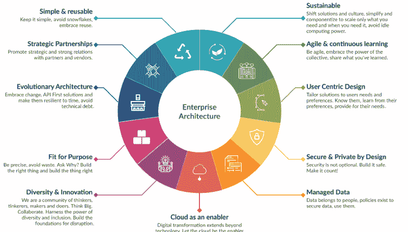
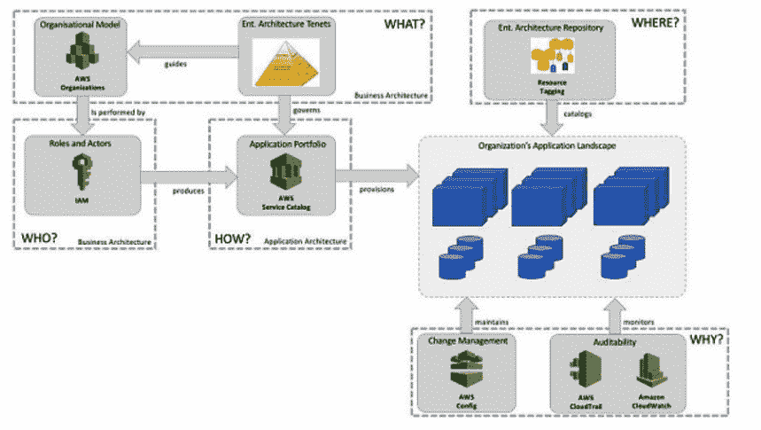
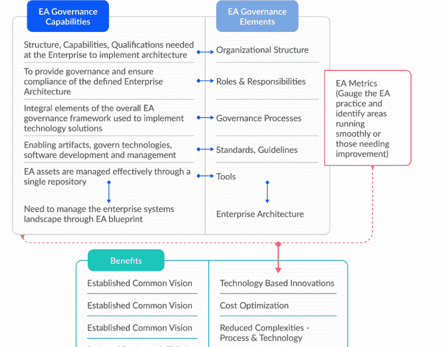

## 将企业架构应用于 AWS 云

An **enterprise architecture (EA)** 为精简的工作流程奠定了基础。因此，基本上，当我们谈论技术人员、开发人员、数据库和网络工程师团队时，他们都使用相同的框架进行日常组织运营。EA 有助于为云中工作负载的业务规划、设计和实施创建一致且明确的标准。为了进一步探讨，我们将在本章讨论以下主题：

- 在 **Amazon Web Services (AWS)** 中介绍 EA
- AWS EA 原则和 EA 域
- 支持 EA 活动的 AWS 服务
- 与 AWS 逆向工作
- 治理、可审计性和变更管理

## AWS 中的企业架构

集中化工作流程建立了构建工作负载的方式，确定了当前和未来运营的路线图以及应采取的路径以实现利益相关者设定的最终目标。

一旦所有参与流程的个人都同意 EA，相同的运营方法就会在全公司范围内执行。它确实带来了多重好处，包括工作负载的清晰度更高，防止组织内部的竞争利益，以及更好的合规性。除了有价值的财务成果外，每个企业的首要目标都是提供满足客户需求的服务。为了使组织执行以客户为中心的战略，EA 指导其业务、信息、流程和技术决策。

## 业务架构域

每家公司都有一套在全公司范围内遵循的准则和标准法规。这些为每个业务增长举措和实施定义了蓝图。为了实现这些创新的作用，业务架构域描述了公司为实现最终目标所具备的功能能力。业务增长战略的“是什么”和“谁”以有助于确立组织愿景以及任何新发展背后的目标的方式得到解决。除此之外，还涵盖了将被分配执行已定义服务的团队、群体或有能力的人员。

## 应用架构域

在此步骤中确定了公司运营所依赖的每个应用程序的作用。在这里建立了应用程序与组织内部核心业务流程之间的交互和关系。简单来说，业务战略的“如何”是通过弄清先前定义的业务服务是如何实现的来确定的。

## 数据架构域

数据是世界上任何企业最重要的资产，定义了服务的过去、现在和潜在未来。这一步骤描述了组织的数据资产以及其被利用以改善业务和客户满意度的方式。分析最终导致业务流程的演进。

## 技术架构域

没有现代技术资产，任何公司都无法实现顺畅无缝的运营。尤其是在当今先进的数字宇宙中，描述组织为业务和应用服务所需的软件和硬件绝对至关重要。

## 云计划和 IT 格局中的可追溯性

繁荣的企业最喜欢的就是能够更快响应客户需求和现代业务需求的能力，为此，最完美的选择是 EA，它提供敏捷性并确保开发团队的韧性。此外，有了云，企业在新技术进步方面拥有完全的自由来承担风险。然而，如果没有对公司运营的完全控制，事情可能不会像预期的那样高效和方便。通过拥有正确的控制，可以确保更好的合规性、安全性和工作负载管理。

职位描述和定义好的角色是传统**信息技术**（**IT**）运营模式的重要组成部分。这些模式的利益相关者是开发人员、工程师和服务器管理员。此类模式允许组织作为一个在统一基础设施中工作的**端到端**（**E2E**）团队来消费云。采用云优先策略的 IT 组织意味着所有参与者在其决策过程和管理系统中都使用类似的框架。

通过采用 EA 模型而将运营仍通过传统信息孤岛运行的方式混合使用两种不同方法可能会产生毁灭性影响。如果没有标准化采用，公司很可能最终没有集中管理和合规性。朝着同一目标努力的团队应朝着终点线走同一条道路。当一项倡议的方法或方法不一致时，组织内部的竞争无法避免。IT 部门在工作负载部署、安全漏洞、集成、关键指标等方面会产生很多混乱，等等。如果没有集中管理，公司永远无法确信其安全标准，因为没有控制或审计跟踪。

创建可扩展云应用程序和服务的组合可以减少计算机或网络设备在基础设施配置和设备管理中可能遇到的延迟或问题。当我们谈论 AWS 时，我们指的是定义云环境中**基础设施即服务**（**IaaS**）和**平台即服务**（**PaaS**）服务的市场领导者。在任何 AWS 服务中实施 EA 之前，针对结果设定架构目标是第一步。

在云中纳入架构之前，请确保所有所需资产都在您可支配范围内，并且团队对其非常了解。云解决方案为组织提供了关于关键要素的指导，包括利润最大化、业务连续性原则、敏捷性、可扩展性、灵活性以及网络或数据安全。

在云架构中正确嵌入 EA 域可以通过制定战略并满足业务期望来避免许多问题。让架构师将精力集中在协作上以充分利用业务战略被证明是极其有益的。

EA 促进了云中业务规划和工作负载实施的标准。此外，它使企业能够使用可扩展云应用程序的组合来改善客户服务以获得更好的成果。

## AWS EA 准则和 EA 域

决策的质量和一致性在倡议的整体过程和结果中发挥着重要作用。为了确保最佳的基础设施，需要考虑某些 AWS EA 原则。它们是一套需要遵循的指导方针，因为它们描述了企业的全貌，特别是技术能力和它们对机构的影响。这些原则与业务使命和目标高度同步，并且每个原则都有独特的定义和实施过程。

组织最终目标、议程集和使命的所有信息都由企业原则定义，以确保公司内部流程之间的和谐。在**业务单元 (BU)**或**组织单元 (OU)**内，IT、**人力资源 (HR)**、国内运营或海外运营是任何企业原则的重要元素。用于指导架构开发的原则需要与组织本身定义的架构能力（定义组织所做工作的稳定构建块）保持良好一致。

在组织内建立可持续的架构实践可以通过采用与在组织内建立任何其他能力（如**业务流程管理 (BPM)**能力）所使用的相同方法来实现。

这些原则确保了企业范围内的协作和共识水平，从而带来更好的决策。架构原则通过管理架构过程、其维护、影响和影响为有效过程奠定了基础。它们通常以有效指导架构开发的方式重申其他企业指导。企业范围内所有 IT 资源和资产的部署也由架构原则监控和定义，因为它们构成了未来 IT 决策的基础。尽管如此，架构原则的所有方面都与推动其背后的业务目标紧密相连。

## 架构原则的组成部分

每个架构原则都应具有相关的理由和影响陈述。当适当部署时，它们可以毫不费力地促进对原则本身的理解和接受。整个过程最终有助于解释和证明采用某些原则的原因，并应包括以下方面：

- **Name**: 应易于记忆并应代表规则的本质。本节不需要任何规范，例如特定的技术平台。模糊的词语如*支持*、*开放*和*考虑*可能会造成一些混淆。始终记住避免不必要的形容词和副词。
- **Statement**: 应通过消除任何歧义来清晰传达基本规则。大多数组织的信息管理原则声明相似。
- **Rationale**: 应突出遵守该原则的业务利益，使用企业词汇。指出技术原则与管理业务运营的原则之间的相似性。提及与其他原则的关系以及关于平衡解释的意图。描述遵循这些原则设定的指导方针的使用案例场景。
- **Implications**: 应突出执行该原则在资源、成本和活动方面的业务和 IT 要求。清楚说明对业务的影响以及采用原则的后果。回答诸如*这如何影响我？*这样的问题。提及某些结果是推测性和潜在的，而不是完全分析的。

## 开发架构原则

系统内的关键利益相关者会聚集在一起开发架构原则。这些原则由企业架构师制定，并在架构委员会批准后实施。最重要的先决条件之一包括清晰的可追溯性，从而导致全面的表述以指导决策过程。这些原则确保架构和目标架构的实施与业务战略和目标保持一致。以下是影响架构原则的元素：

- 公司的企业使命证明了其在实现企业某个目标的每一步的规划。
- 企业**优势、劣势、机会和威胁 (SWOT)**在很大程度上影响着原则。此外，当前举措为未来业务战略定义了路线图。
- 定义市场趋势的外部因素，例如**上市时间 (TTM)**紧迫性、客户行为等等，以及现有和潜在的立法。
- 组织现有的资产和基础设施对架构原则有巨大影响，例如信息资源，包括系统文档、设备清单、网络配置图、政策和程序。
- 最新技术和业务趋势——例如，关于影响整体企业设置的经济、政治和市场因素的预测。

## 原则的质量

判断一个原则是好、伟大还是仅仅是浪费努力需要各种因素。糟糕的一套原则会很快变得冗余并导致信誉缺失。纸上收集的一堆花哨的词语并不能定义原则的价值或决策者是否同意它。根植于公司基础并在整个组织中无意识遵循的价值观是我们称之为良好原则集的东西。它们是用每个利益相关者都能理解的语言定义的，并且不复杂或不必要地冗长。能够得到管理层认可的原则为架构和规划决策提供了坚实的基础。它们围绕未来战略、程序和标准制定政策，以支持矛盾情况的解决。我们列出了五个标准来帮助区分好原则和坏原则。根据此列表，好的原则具有以下属性：

- **Understandable:** 难以理解的东西永远无法产生深远持久的影响。然而，易于组织内个人理解的基本原则已进入我们良好原则的名单。其目的应清晰无歧义，以便最大限度地降低内部或外部违规的风险。

-   **健壮**：原则应使决策者能够就架构做出有价值的决策，并随后实施政策。每个原则本身应足够明确，并且精确到足以支持非常规情况下的持续决策过程。
-   **完整**：原则的属性不仅管理公司关于业务的信息，还涵盖技术和其他进步方面所感知到的每一种情况。
-   **一致**：与业务战略整体过程相关并在解释上提供平衡的原则类型。遵守一个原则不应违反另一个原则的精神。对文档中每个词进行一致、可扩展和灵活的解释至关重要。
-   **稳定**：企业会根据客户行为不断发展，原则应足够持久以适应变化。应有空间根据这些变化增添、移除或修改原则。

## 应用架构原则

企业在组织内部使用和部署 IT 资源和资产的方式由利用架构原则的利益相关者决定。它们在整个过程中被使用，以确保高效顺畅的流程并实现最大成果，如下所述更详细地解释：

-   架构原则指导路线图的创建，并促进企业就 EA 做出有意识决策的过程。
-   架构原则作为指导力量，影响产品和解决方案的选择，并随后建立相关评估标准。
-   架构原则简而言之，是定义与架构业务和技术相关需求的驱动因素。
-   架构原则有助于评估现有实施的过程。此过程有助于符合定义的架构。通过分析报告，有价值的见解被用于过渡活动，以定义和实施架构目标。
-   架构原则的含义陈述为未来的过渡计划和规划活动提供有价值的输入。此外，它为企业的主要任务、资源和潜在成本奠定基础。
-   在架构治理活动方面，架构原则为架构合规性评估提供支持。此外，它们使系统能够在本地操作流程中启动豁免请求。这是通过评估系统/应用程序/解决方案的健康状况来完成的，以确定其是否符合目标参考架构的标准和指南，包括检测模式和技术异常。

在应用架构原则时，根据情况选择合适的原则可能是一项困难且复杂的工作。错误的选择往往会导致毁灭性的后果。为了避免未来任何混淆或互相指责，此类决策的理由应始终记录在案。公司或部门在特定时点可能不觉得需要持续记录。然而，将一切以书面形式记录在案的做法应成为常态。原则往往看起来不言自明，但原则中的指导可能复杂且具有多方面。尽管具有多维性，原则应显而易见，因为它们有助于确保导致预期结果的决策。

违反原则的人可能会掉以轻心，放任此类事项可能树立错误的先例。原则宣言可能不包含具体处罚，但实际上可能导致运营问题，并影响组织长期履行其使命的能力。

## 一个架构原则示例集

高层管理就若干原则达成相互一致可能是一项艰巨的任务，因为原则太多会降低架构的灵活性，而原则太少则不会产生适当的影响。一些组织为部门内的每个层级记录原则；然而，其他组织则更喜欢仅定义高层原则。

将以下图表作为一组架构原则的典型内容以及定义它们的推荐格式的参考：

图 3.1 – 架构原则及其定义格式

接下来，我们将讨论业务原则及其理由和局限性。每个原则都是独特的，并定义了用户从中得出自身含义并面临特定限制的特定情况。

## 业务原则

### 原则 1 – 原则的首要性

**声明：** 企业内的所有组织必须遵守以下信息管理原则。

**理由：** 为了确保提供给决策者的信息一致且可衡量，所有组织必须使其基础设施保持一致并遵守原则。

**影响：**
-   该原则有助于避免排斥、偏袒和不一致。否则，它可能破坏信息管理。
-   信息管理计划若未经过是否符合原则的审查，则无法实施。
-   修改计划框架以解决与原则的冲突。

### 原则 2 – 最大化企业利益

**声明：** 企业整体的信息管理决策确保了对企业的最大利益。

**理由：** 最大化**投资回报率（ROI）**要求信息管理决策坚持企业范围的战略。*服务高于自我*就是这一原则的核心。任何以开阔的思维方式并牢记企业整体视角所做出的决策或步骤，都比从特定组织视角做出的决策更有效。个人或团体不会脱离整个企业的利益。

**影响：**
-   更大的目标需要更大的风险和激进的决策，因此企业范围的巨大利益需要规划策略的改变。此步骤需要决策者超越 IT 以带来这一变化。
-   可能需要放弃组织的偏好，或将其在优先列表中降低，以实现整个企业的更大利益。
-   整个企业应参与决定整个企业的应用程序开发优先事项，并且应用程序组件应在全公司范围内共享。
-   企业计划必须始终为开展信息管理计划奠定基础。与此同时，各个组织追求与企业制定的蓝图相符的计划。
-   随着根据特殊情况重新定义原则的需求变化，优先事项必须进行调整。为此目的，综合的企业代表论坛应做出决定。

### 原则 3 – 信息管理是每个人的业务

**声明：** 为实现业务目标而做出的信息管理决策必须得到企业内所有组织的支持。

**理由：** 企业内的所有组织必须全面参与信息环境的所有方面。这是确保信息管理与业务保持一致的唯一方法。所有信息用户在实施最终解决业务需求的技术中发挥关键利益相关者的作用。来自企业各地的业务专家和技术人员作为团队共同承担起开发和维护定义 IT 目标和目标的信息环境的责任。

**影响：**
-   作为团队朝着共同目标努力。每个利益相关者必须承担起开发信息环境的责任。
-   实施该原则所需的充足和可持续资源需要持续提供。

### 原则 4 – 业务连续性

**声明：** 尽管系统中断，企业运营仍得以维持。

**理由：** 想象一下在你的工作场所没有台式机、笔记本电脑、互联网或 Slack 等通信平台的一天。那一天会有多不productive？这全是因为我们极度依赖系统运行。随着其日益普及，企业必须在设计和使用过程中考虑此类系统的可靠性，以确保信息不间断流动。某些工具对于开展日常运营至关重要，因此企业各地的业务场所应配备能够在外部事件发生时继续业务功能的工具。需要采取额外措施以避免硬件故障、自然灾害和数据损坏等情况下的任何中断。必须始终备有替代的信息交付机制。

**影响：**
-   自然灾害或系统故障是过程的一部分，因此必须提前建立可靠的替代方案并进行管理。

- 定期审查、漏洞测试以及关键任务服务的设计应通过替代能力确保业务功能不中断。
- 当企业架构师部署系统时，可恢复性、冗余性和可维护性等事项应在此时得到解决。
- 必须评估应用程序对企业使命的影响。这有助于制定恢复计划。

### 原则 5 – 通用业务应用

**Statement:** 用于执行流程的在整个企业中使用的业务流程和应用程序，比仅提供给特定组织的重复性应用程序更好。

**Rationale:** 重复资源意味着成本增加并滋生冲突数据。

**Implications:**
- 依赖仅服务于特定组织而非整个企业的应用程序的组织必须用可在全企业范围内适应的应用程序替换它们。建立并遵守要求此项的政策至关重要。
- 组织不得自行开发类似/重复的能力。通过采用联合应用方法，可以减少稀缺资源的支出，该方法将更有效且更具成本效益。
- 由数据和信息支持的企业决策将得到更大程度的标准化。
- 生产不同数据的组织能力将被全企业范围的能力所取代。

### 原则 6 – 服务导向

**Statement:** 反映现实世界业务活动的服务的设计会创建与业务流程相伴的架构。

**Rationale:** 信息流动没有边界，而服务导向提供了企业敏捷性。

**Implications:**
- 服务表示利用业务描述提供上下文，例如业务目标、流程、政策、服务接口等，并且服务使用服务编排实现
- 基础设施面临独特要求，并且实施中使用开放标准以实现位置透明
- 实施通常受上下文限制或由上下文启用，必须在该上下文中描述
- 需要对服务表示和实施进行强有力的治理

### 原则 7 – 遵守法律

**Statement:** 企业信息管理流程遵守所有相关政策和法规。

**Rationale:** 遵守企业政策中的法律、政策和法规不会妨碍导致法规变化的业务流程改进。

**Implications:**
- 企业遵守有关数据收集和管理的法律、法规和政策
- 企业确保对规则的教育和获取
- 更新的法律和法规可能会推动流程或应用程序的变化

### 原则 8 – 知识产权保护

**Statement:** 企业**知识产权（IP）**的保护绝对至关重要。必须体现在 IT 架构、实施和治理流程中。

**Rationale:** 企业大部分知识产权托管在 IT 领域。

**Implications:**
- 知识产权资产的实际保护在 IT 领域实施。对非 IT 流程的信任也可以通过 IT 流程进行管理，例如电子邮件、强制性备注等。
- 需要制定针对人员和 IT 行为主体的治理的安全政策以提高知识产权保护。这消除了妥协并降低了责任风险。

## 数据原则

### 原则 9 – 数据是资产

**Statement:** 数据对企业具有极大价值，并据此进行管理。

**Rationale:** 数据的真实且可衡量的价值永远不应被低估，因为它促进了决策过程。数据与其他公司资产一样被仔细管理，以奠定业务战略的基础。企业清楚地知道数据在哪里，团队是否可以依赖其准确性，以及是否可以在需要时提取数据。

**Implications:**
- 三个原则结合形成此原则：数据是资产、共享且可访问。
- 确保企业内所有组织都理解数据价值、共享和可访问性之间的关系。
- 团队必须获得授权管理其负责的数据。
- 采用 *data stewardship* 的方法并放弃 *data ownership*。
- 不要让过时或不一致的数据传递给企业人员，因为这可能对整个企业的决策产生不利影响。
- 管理数据的 数据管理员 也确保数据质量。
- 制定程序以防止、识别和纠正信息中的错误。修复产生有缺陷信息的流程。
- 全企业范围的论坛应决定由管理员建议的流程变更。
- 在企业层面指定对谁负责妥善管理数据负责的数据管理员。

### 原则 10 – 数据共享

**Statement:** 执行职责所必需的数据可供组织访问，因此在企业职能和组织之间共享。

**Rationale:** 为了提高企业决策的质量和效率，必须在一个应用程序中维护及时、准确的数据然后共享，而不是在多个应用程序中维护重复数据。企业中存储了大量数据，但它被组织在数百个烟囱式数据库中。能否在企业范围内共享这些数据孤岛将决定其收集、创建、传输和同化数据的速度。

当数据共享时，我们将能够做出更好的决策，因为依赖的数据来源更少且管理更准确。通过网络传输的数据将更高效，因为数据实体可以重复使用而无需再次输入数据。

**Implications:**
- 三个原则结合形成此原则：数据是资产、共享且可访问。
- 确保企业内所有组织都理解价值、共享和数据可访问性之间的关系。
- 遵守管理数据管理的通用政策、程序和标准，以确保短期和长期易于访问。
- 投资能够将遗留系统数据迁移到共享数据环境的软件。
- 开发标准模型和其他元数据以创建存储库系统，以便在高效存储后使其可访问。
- 在替换遗留系统时，采用并执行针对新应用开发人员的数据访问指南。确保新应用程序中的数据保持可访问并继续被新应用程序使用。
- 采用通用方法和工具在企业范围内创建、维护和访问共享数据。
- 数据共享需要重大的文化变革。
- 在任何情况下，数据共享原则都不会损害机密信息。
- 所有用户都将依赖数据执行各自的任务。确保决策依赖于最准确的数据。

### 原则 11 – 数据可访问

**Statement:** 数据可供用户执行其职能。

**Rationale:** 为用户提供信息访问权限使他们能够做出快速有效的决策并及时响应信息和服务请求。信息的使用必须从企业角度考虑，以允许各种用户广泛访问。

**Implications:**
- 三个原则结合形成此原则：数据是资产、共享且可访问。
- 确保企业内所有组织都理解价值、共享和数据可访问性之间的关系。
- 提供用户获取信息的易用性。
- 信息必须可访问并以能够适应广泛企业用户的方式显示。
- 理解数据至关重要。个人不应误解信息。
- 访问数据并不意味着用户有权修改或披露数据。

### 原则 12 – 数据受托人

**Statement:** 受托人负责每个数据元素的质量。

**Rationale:** 当数据多次输入时，其完整性可能会受到损害，因此数据受托人将唯一负责消除冗余工作和数据资源。能够在企业内部共享数据是架构化环境的一个优势。决策的单一权威是数据受托人变得越来越重要。

## 重要说明

与管护人相比，受托人负责数据的准确性和时效性，而管护人也可能负责标准化和定义。

### 影响
- 在真正的受托管理下，数据所有权问题得以解决，使所有用户都能访问数据。因此，可能需要从数据 *所有权* 向数据 *受托管理* 转变的文化转变。
- 数据受托人应对满足数据质量要求负责。
- 受托人应能够基于数据源为用户提供对数据的信心。
- 识别数据的真实来源，以便将受托人的责任分配给数据权威机构。然而，分类来源将不会被披露。
- 一旦信息以电子方式捕获，应尽可能靠近源头进行验证。为确保数据的完整性，必须实施 **质量控制 (QC)** 措施。
- 跨组织共享数据使受托人对其数据元素的准确性和时效性负责。因此，受托人必须认识到其受托管理角色的重要性。

### 原则 13 – 共同词汇和数据定义

**声明：** 企业范围内的数据定义保持一致，用户可以轻松访问这些定义。

**理由：** 为了促进总部之间的数据共享，用于开发应用程序的数据必须以统一的方式定义。这将增强沟通并促进有效对话。系统还必须实现接口，并进行数据交换。

### 影响
- 由于存在担任 *数据管理* 职位的员工，我们被认为该问题已得到充分解决。此任务需要大量额外的精力和资源，改善信息环境在很大程度上依赖于此。大量社区正在解决数据元素定义问题，这与共同词汇类似，是独立但密切相关的。
- 企业必须为业务建立初始的共同词汇表。
- 当需要新的数据定义时，定义工作将与公司 *术语表* 进行协调。
- 数据的多种地方性含义必须让位于企业范围内的定义，以避免歧义。
- 需要协调的数据标准化举措。
- 必须为职能数据管理分配职责。

### 原则 14 – 数据安全

**声明：** 对未经授权使用的保护包括但不限于对决策前、敏感、来源选择敏感和专有信息的保护。此外，国家安全分类的典型特征也适用。

**理由：** 限制对机密、专有和敏感信息访问的必要性必须与信息开放共享以及通过适当立法发布信息相权衡。

为尽量减少不必要的猜测、误解和不当使用，**在制品 (WIP)** 材料必须得到保留。现有法规要求在允许自由开放访问的同时保护国家安全和数据隐私。

### 影响
- 以任何形式收集信息都将成为一个巨大的目标，需要调查和去特征化方法以保持适当的控制。
- 此审查和解密由适当的政策和程序处理。定期审查信息很重要，因为信息访问基于需知原则。
- 应改造用于容纳不同分类的独立系统。
- 查看当前系统或解决方案是否过于昂贵以至于在保密系统上管理非保密数据。通过将非保密数据放置在保密系统上将两者结合起来，而非保密数据不应保留在其中。
- 识别安全需求，以安全的方式提供对开放信息的访问。
- 出于安全目的，将访问限制为 *仅查看* 或 *永不查看*。
- 确定数据的标记，以便访问决策前、决策中、机密、敏感或专有信息。
- 从一开始就将安全设计到数据元素中。
- 保护系统、数据和技术免受无意或未经授权的更改、破坏、灾难或披露。
- 使用新政策管理决策前信息的保护期限，同时考虑内容的新鲜度。

## 应用原则

### 原则 15 – 技术独立性

**声明：** 应用程序独立于明确的创新决策。这样，它们可以在多个创新阶段运行。

**理由：** 技术独立性允许应用程序以最具成本效益和及时的方式进行开发、升级和运行。然而，依赖于供应商等外部因素的创新成为驱动因素，而非用户需求本身。

每个与 IT 相关的决策都使我们依赖该技术。该原则确保应用程序软件不依赖于特定的硬件和操作系统软件。

### 影响
- 支持可移植性的标准至关重要。
- 大多数 **商用现成产品 (COTS)** 和 **政府现成产品 (GOTS)** 应用程序依赖于技术和平台。
- 需要开发子系统接口以支持遗留应用程序。它们与 EA 内的应用程序和运行环境互操作。
- 使用中间件将应用程序与特定的软件解决方案解耦。
- 可以选用 Java 和未来的类似 Java 的协议，因为它们高度优先考虑平台独立性。

### 原则 16 – 易用性

**声明：** 应用程序易于使用，并且底层技术透明，以便用户能够专注于手头的任务。

**理由：** 易用性是用户采用的积极激励因素。用户需要理解的底层技术越多，其生产力就越低。与在企业集成信息环境之外开发独立系统来执行相同任务相比，集成信息环境鼓励用户在其内部工作。

使用系统应像驾驶不同汽车一样简单，因为操作它所需的大部分知识与操作其他系统所需的知识相似。培训将保持在最低限度，系统被不当使用的可能性极小。

### 影响
- 所有应用程序都需要具有相同的 *外观和感觉* 并支持人体工程学要求；因此，必须创建通用的外观和感觉标准，以及可应用于所有应用程序的可用性测试标准
- 界面不应受关于用户位置、语言、系统培训或身体能力的狭隘假设的限制
- 多种因素影响应用程序的易用性，包括语言学、用户的身体属性（视力、能够使用键盘和鼠标的能力）以及技术使用技能
- 技术原则

### 原则 17 – 基于需求的变更

**声明：** 对应用程序和技术的更改仅在响应业务需求时进行。

**理由：** 通过这一原则，信息环境将响应业务需求而变化，而不是业务适应 IT 变化。

通过改变技术，业务需求可能会发生变化，因此对业务的非预期影响将被最小化。

### 影响
- EA 将用于在实施前审查拟议的更改。
- 在没有有文件记录的业务需求的情况下，技术改进和系统开发将不会获得资金。
- 我们将开发并实施符合本原则的变更管理流程。本原则可能与响应式变更原则冲突。我们必须确保对合法业务需求的响应不会因需求文档而受阻。
- 应关注业务需求，而非技术需求——以响应方式管理变更也属于此类。

### 原则 18 – 响应式变更管理

**声明：** 企业信息环境的更改必须及时进行。

**理由：** 企业信息环境必须能够满足人们的需求，以便人们能够在其内部工作。

### 影响
- 必须有方法在不造成延误的情况下管理和实施变更。
- 感到需要变更的用户需要与 *业务专家* 交谈，后者可以为其提供启发并帮助实施。采用本原则可能需要额外资源。
- 为了实施变更，架构应保持最新。

-   这将导致与其他实践产生冲突，例如企业范围效益和应用的最大化。

### 原则 19 – 控制技术多样性

Statement: 由于技术多样性，在多个处理环境之间保持专业知识和连通性并非易事。

Rationale: 为了支持计算环境的替代技术，存在真实的、非微不足道的基础设施成本。维护相互连接的多个处理器架构也存在进一步的基础设施成本。保持支持的组件数量最少可简化维护并降低成本。

Standard packaging will simplify implementation; deployment impacts will be predictable; valuations and returns will be predictable; testing will be redefined. Technical administration is controlled better when limited resources focus on a shared set of technologies.

Implications:
-   本原则直接关联到管理技术获取的政策和程序。
-   技术选择受蓝图内可用技术高度影响。
-   随现代需求而演进的技术必须得到开发并投入使用。
-   技术蓝图将根据运营效率的改进而修改。

### 原则 20 – 互操作性

Statement: 数据、应用程序和技术应使用定义的标准实现互操作性。

Rationale: 通过提供一致性，标准使系统管理更轻松、提高用户满意度并保护现有 IT 投资，在降低成本的同时最大化其回报。互操作性有助于确保多家厂商对其产品的支持并促进供应链整合。

Implications:
-   除非有令人信服的业务理由实施非标准解决方案，否则将遵循行业标准和互操作性标准
-   必须建立定义标准、定期审查和修订标准以及授予例外情况的流程
-   必须识别并记录当前 IT 资源

所有原则都为建立有效工作流程的正确基础提供了垫脚石。此外，确保 EA 活动高效的 AWS 服务的需求仍然至关重要。

## 支持 EA 活动的 AWS 服务

组织通常充斥着人才、软件、硬件等，但知道在特定项目或任务中利用哪些是必要的。在庞大的 AWS 目录中，公司会找到最有效的服务来支持企业架构中的活动，例如 AWS Organizations、Identity and Access Management (IAM)、CloudTrail、Service Catalog、CloudWatch 等。

There are certain stakeholders of AWS services that support EA activities defining who, why, what, where, and how aspects of the infrastructure, as illustrated in the following diagram:

Figure 3.2 – 支持 EA 活动的基础设施的不同方面

Within infrastructure, the business architecture domain defines actors, software, and other tools, compliance with governance bodies, change management, and an EA repository.

### 角色和参与者

Actors include an organization, a person, or the system executing business activities. Being well aware of each and every aspect of the business and understanding the role of each actor can enable you to create definitive listings. Organizations evolve with time and that is how they stay relevant. In order to facilitate the smooth transitional process, the relationship between each actor and their role needs to be well defined. Any enterprise can model actors and roles in two stages. Usually, organizations have a corporate directory with all the information in it. Other than that, some companies reinforce these elements with AWS IAM solutions.

### 应用组合

Any software plays a significant role in attaining a company’s objective, whether they are in-house or external, long-term, or short-term. Application portfolio management is detailed information about which applications a company uses. It is an essential part of the application architecture domain in EA. Through this metadata of applications and other software, the company sets the standard for the utilization of applications. AWS can help streamline the management of commonly deployed applications while providing consistent governance and meeting compliance requirements. Audits and compliance with regulations are efficient and hassle-free when AWS provides a single location where organizations can centrally manage these applications. Keep in mind this only applies to AWS-related services, and organizations may have other environments, architecture, or services within the enterprise. Offering a particular version to users, configuring the services, and controlling access can all be easily managed with the AWS cloud.

### 治理和可审计性

Compliance with internal and external services to your organization is crucial to ensure that every operation is streamlined as per the requirements and regulations. This is where CloudTrail helps by giving your organization transparency across its entire AWS landscape. The event history of all activities provided by CloudTrail simplifies security analysis, resource change tracking, and troubleshooting. Ultimately, the process of governance, compliance, and operational auditing is made much easier and error-free.

CloudWatch, the monitoring service for AWS cloud resources, helps collect and track metrics, monitor log files, and automatically react to changes in your AWS resources. Events based on the application behavior are triggered by this service as well. CloudTrail and CloudWatch make a powerful duo as they have a huge impact on audit functions and architecture governance.

### 变更管理

The transition process going on within an organization or a system is managed effectively by EA. The primary objective of this monitoring is to ensure that organizational operations continue to be productive and deliver as per the business strategy. To automate this activity, AWS Config is leveraged as it lets you assess, audit, and evaluate the configurations of your AWS resources. The process of reviewing changes is made easier, which leads to an effective evaluation of compliance against the configurations specified in your internal guidelines.

### EA 资料库

What is the ultimate goal that an organization is working toward? Which resources are being exploited to achieve that goal? What kinds of IT assets does a company have when it comes to internal and external operations? Well, all this information can be found in an EA repository. It reflects the organization's technology, data, applications, and business artifacts and the relationships between these components. A while ago, companies used to spend millions of dollars on off-the-shelf products to meet their repository need. However, with cloud services, things have changed to a great extent, and AWS tagging and resource groups are now letting companies organize their AWS landscape by applying tags at different levels of granularity.

They offer labeling, collecting, and organizing resources and components within the services. Another major benefit that comes with AWS services is that managing applications’ businesses and technical components of the target landscape globally are made possible. Together, AWS Config, tagging, and Resource Groups make it easier to detect a rogue server or shadow application in a target production landscape.

Customer obsession is one of Amazon’s customer-centric guiding principles. The company’s approach begins with focusing on the customer and then builds products to delight that customer. AWS helps figure out customer needs to come up with innovation and improvements.

### Working backward with AWS

Working backward is a fundamental part of the AWS innovation process. AWS begins by determining what the customer needs and wants, and then makes improvements based on their requirements.

The product team at Amazon thinks through all of the reasons why a certain product is developed and why anyone would be interested in it. A compelling news release is then drafted to announce the product and convince the target customer to opt for it. This announcement should take readers into an imaginary world where their lives would be incomplete without this product. That’s the only way to be impactful.

Amazon services do not just represent a software structure but also an organizational structure. By working backward, a better offering can be created for your customers. Small teams are allocated to a certain product to work together for maximum productivity with a strong ownership model as if it were a start-up on its own. Individual and undivided attention is paid to aspects such as who the customers are and what they are looking for. Working backward is a process we employ to ensure service meets the needs of a customer by starting with the customer and working backward until you have the minimum set of technology requirements to reach your goals.

反向工作产品定义流程为即将构建的内容奠定了基础。它通常包含四个步骤，如下所述：

- 1. 编写一份新闻稿，描述产品的一切：它对你为什么重要、它做什么、它将给你的生活带来什么改变，以及它为什么存在。 该产品的特性和优势是什么，它建议为你生活中的哪个问题提供解决方案？ 新闻稿预期要直接且简洁。 新闻稿决定了组织外部的人如何看待该产品。
- 2. 编写**常见问题 (FAQs)**，包括人们在阅读新闻稿后可能对产品产生的疑问。 添加定义产品用途的问题。 将自己置于对客户请求做出回应的人的立场上，就如何在每个支柱的背景下更具指导性地进行云架构设计。

## 治理、可审计性和变更管理

组织架构的治理、可审计性和变更管理是实现有效 IT/业务整合、跟踪成果和工作流程管理的重要因素，这也是它们日益成为董事会职责的原因。

## 治理

本节的目的是阐明 IT 和架构治理，以便解释架构活动和制品的业务责任。

### 架构治理特征

EA 及其他架构通过企业范围的架构治理进行管理。它包括以下特征：

- 为确保在整个组织中有效引入、实施和演进架构，必须为整体架构组件和活动实施控制系统
- 开发并实施系统以确保符合内部和外部标准及法规
- 建立流程，使前述流程能够在商定的参数范围内得到有效管理
- 建立实践以确保组织内部和外部的问责制，与明确识别的利益相关者保持一致

## 企业内的治理层级

架构治理通常作为治理结构层级的一部分运行，尤其是在大型企业中，可能包括公司治理、技术治理、IT 治理和架构治理等多个领域，各有不同的学科和流程。在整个企业内部，这些治理领域中的每一个都可能存在于不同的地理层级——全球、区域和本地。

## 治理的本质

战略规划与其说是严格遵守规则，不如说是提供指导，并确保资源的公平合理分配，以确保公司目标的可持续性。 本质上，治理是指确保业务得到妥善开展。

在此，我们列举经济合作与发展组织（OECD）确定的公司治理基本原则：

- 对股东权利、角色和公平待遇的讨论
- 对披露和透明度以及董事会责任的讨论
- 确保组织的战略指导
- 确保对董事会管理的有效监督
- 确保董事会对其公司的问责
- 董事会审查并指导公司战略
- 董事会监督管理层绩效是否与业务目标保持一致

在公司治理中，董事会、经理、股东和其他利益相关者被分配了各自的权利和责任，以及关于公司事务决策的规则和程序。 此外，它还提供了一个设定公司目标的框架，以及监测实现这些目标进展的方式。

EA 治理能力和其要素由多个需要解决的因素组成，以实现顺畅运营。 其优势也在以下屏幕截图中突出显示：

图 3.3 – EA 治理能力与要素

## 治理特征

以下特征突出了治理的价值和必要性。 组织在处理所有相关方时应采用这种方法：

- **纪律**：所有利益相关者必须遵守组织制定的程序、流程和授权结构。
- **透明度**：所有可能影响或不影响 IT/业务的决策都将可供授权组织检查。
- **独立性**：可能出现利益冲突，因此将建立决策过程和其他机制。
- **问责制**：治理委员会对行动或决策负责，因此对其行动拥有授权并承担责任。
- **责任**：每个利益相关者或投资者必须遵守法律并对组织承担责任。
- **公平性**：将确保决策、流程和实施的无偏性。 不允许它们为任何特定一方创造不公平的优势。

## 技术治理

随着技术渗透到组织的各个方面，技术治理对其而言是一项关键能力、要求和资源。 在此阶段，对用于研究、开发和生产其商品和服务的技术的利用将被执行并进行监控。 其范围比单纯的 IT 治理活动更广。

根据最近的研究，许多组织在需要管理的无形资产与有形资产之间保持着偏向无形资产的平衡。 考虑到几乎所有这些无形资产都是信息和数字资产，很明显企业越来越依赖 IT 和 IT 治理。 因此，使 IT 治理尽可能有效变得越来越重要。

此外，它们表明企业越来越依赖的不仅是信息，还包括信息被创建、交付和消费的流程、系统和结构。 许多行业正转向通过无形资产创造价值，因此风险管理必须被视为理解和应对新挑战、威胁和机遇的关键。 越来越多地，企业依赖 IT 不仅是为了顺畅且盈利地运营，而且是为了建立其声誉、品牌——最终——其价值观。

## IT 治理

IT 治理将规划、获取、实施和监控 IT 绩效的最佳实践制度化，以确保企业的 IT 资产支持其业务目标。 为了将 IT 资源和信息与公司目标和战略联系起来，IT 治理提供了一个框架和结构。

在过去几年中，IT 治理已成为企业治理的重要组成部分。 业务职能和流程越来越依赖 IT，而为了获得竞争优势，企业必须管理分散在整个组织中的复杂技术，以便快速、安全地响应需求。 由于信息系统灾难和电子欺诈的报告不断增加，世界各地的监管环境越来越要求企业对信息进行更严格的控制。

现在，IT 相关风险的管理被广泛认可为企业治理的重要支柱。综上所述，高层管理必须认可 IT 治理战略并建立适当的组织来实施它，明确谁最终负责其企业范围内的整合以及谁拥有企业的 IT 资源。

## AWS architecture governance

AWS 使客户能够为业务敏捷性和治理控制而配置和运营其环境。AWS 管理和治理服务以及云卓越中心 (CCoE)，为构建者提供资源，通过定义预防性和检测性控制来降低漏洞并在整个组织中保持合规性。

云治理是推动云采用并在不损害安全性的情况下提高组织敏捷性的流程、人员和技术的结合。安全概念很重要，因为云治理涵盖的不仅仅是网络安全。

在分散治理下，安全标准和成本可以得到控制。这也确保了更好的响应能力和敏捷性。为了部署适当的资源并定义最佳实践，发展大量 AWS 经验、建立运营流程并建立 CCoE 很重要。这也带来以下益处：

- **规模**：通过 AWS 管理和治理服务，可以在巨大规模上管理高度动态的云资源。
- **简易性**：单一的 AWS 控制平面降低了客户的复杂性，因为他们可以管理并治理 AWS 和本地的资源。
- **第三方解决方案**：管理和治理系统扩展是 AWS 的重要组成部分。它为客户提供广泛的合作伙伴生态系统。
- **成本节约**：AWS 管理和治理服务让客户评估其资源利用情况并识别高效且成本更低的工作方式。

## Auditability

本节确定的是具备明确且运行良好的企业架构原则和流程：满足当前业务需求并为未来需求做准备的基础设施。这些需求与整体企业方法保持一致。以下是审计的一些具体角色评估清单：

- 通过充分的治理确保与企业架构相关的透明规划和决策。
- 通过开发和实施流程，IT 与业务有效的企业架构之间保持了足够的对齐。
- 企业架构应进行绩效衡量和监控，以确保最大成果并实现关键效益。

正如 **互联网安全中心 (CIS)** 云平台基础基准、**通用数据保护条例 (GDPR)** 和 **支付卡行业数据安全标准 (PCI DSS)** 所记录的那样，AWS Audit Manager 的预建框架有助于将来自云服务的证据转化为审计人员友好的报告。

AWS Audit Manager 通过自动化对您 AWS 使用情况的持续审计，简化了风险和法规及行业标准合规性的评估。除了自动化证据收集外，Audit Manager 还允许您根据业务增长按需扩展审计能力，并减少与审计相关的 *全员投入* 手工工作。借助审计管理器，评估您的政策、程序和活动——称为控制——是否有效非常简单。随着审计临近，AWS Audit Manager 可帮助您管理利益相关者对控制措施的审查，并以远少于手工的工作量构建可审计报告。

AWS 管理控制台允许您立即开始使用 Audit Manager。您可以根据公司特定需求定制框架及其控制措施。Audit Manager 根据您选择的框架收集和整理相关证据——例如资源配置快照、用户活动和合规检查结果。因此，要开始评估，只需选择一个预建框架，证据将被自动收集和分析。

默认启用的 AWS CloudTrail 服务可帮助您实现 AWS 账户的治理、合规性以及运营和风险审计。所有活动均记录在 CloudTrail 事件中。您可以通过前往 **事件历史记录** 在 CloudTrail 控制台中查看最近的事件。

## Change management

本节旨在为通过完成前述活动所实现的新企业架构基线建立架构变更管理流程。该流程通常为持续监控技术新发展和业务环境变化提供指导。此外，它还启动新的架构演进周期。

### Change management approach

变更管理流程旨在确保架构变更以连贯且架构化的方式进行管理。它们还确保已实施的企业架构具有动态性——即能够快速响应业务和技术环境的变化而增长。

变更管理流程确定企业架构在实施后允许变更的情况、变更发生的流程，以及何时为新架构再次启动开发周期。在企业内部，架构变更管理和架构治理流程密切相关。

治理机构建立标准来判断变更请求是否仅需要架构更新，还是需要启动 **架构开发方法 (ADM)** 的新周期。为了避免任何不愉快的后果，治理机构必须继续推进与业务价值直接相关的变更。由于公司对风险的感知不同，很难为建立这些标准制定指导方针。然而，随着治理机构成熟度的提高，在 ADM 下，针对特定需求的标准变得清晰。

## Drivers for change

多种技术相关驱动因素为架构变更奠定了基础。首要因素包括新技术报告、资产管理成本降低、技术淘汰和标准倡议。这些请求通过企业的变更管理和架构治理流程进行管理。此外，这些架构变更还由某些业务驱动因素促进和推动，如下所述：

- 业务照常发展
- 业务例外
- 业务创新
- 业务技术创新
- 战略变革

这些请求在许多情况下往往导致企业架构的全面重新设计和开发。

## The change management process

项目管理方法就是用于管理变更的管理技术和方法论的示例。系统开发或项目管理等其他领域的变更管理流程可以由已有流程的企业改编用于架构。

确定变更如何管理、将遵循哪些流程以及将使用哪些方法论是变更管理中的关键步骤。除了过滤功能外，流程还必须确定架构开发流程的哪些阶段受需求影响。如果只有迁移受变更影响，则架构开发阶段不会关注这些变更。

本节概述了一种变更管理方法，重点支持动态企业架构，可能在目前没有类似流程的情况下使用。

变更管理流程方法基于将架构变更归类为以下类别之一：

- 1. 简化变更通过变更管理技术处理。
- 2. 增量变更也能够通过变更管理技术处理。根据变更性质，可能需要部分重新架构。
- 3. 重新架构变更使整个架构再次经历架构开发周期。

这三种选择也可以描述为简化、增量变更和重新架构。简化变更通常由减少投资的愿望驱动，增量变更由最大化现有投资的愿望驱动，而重新架构变更则由增加投资以寻找新的利用机会的需求驱动。

以下活动用于确定变更是简化、增量还是重新架构：

- 1. 注册可能影响架构的所有事件
- 2. 架构任务的资源分配和管理
- 3. 负责架构资源的流程评估应做什么

关键是要始终记住，所有变更都应为业务增加价值。变更管理应基于在提高生产率的同时最小化业务风险并减少浪费性工作或成本。此外，除了为变更提供可预测、可测试的结果外，还应消除为满足业务需求而提交变更以扩展基础设施的需求，以及自动从故障中恢复并回滚失败的变更。最终，通过降低变更相关风险并提高业务敏捷性，自动化可以提供更多业务价值，而这正是变更的意义所在。

云自动化、集成和部署工具使企业能够进行小规模、频繁的变更，从而降低风险并增加业务价值。流程需要适应实际变更情况，例如变更增加和风险降低。最后，考虑不实施变更或出现延迟的风险总是比完全回避更好。不要忘记，管理变更的主要目的是简化业务风险。

AWS Change Manager 简化了您请求、批准、实施和报告对 AWS 和本地应用程序配置和基础设施的运营变更的方式。

## 摘要

那些痴迷于客户需求并始终领先一步以跟上最新行业趋势的组织，了解企业成功的关键。由企业架构（EA）推动的、对云中工作负载的业务规划、设计和实施的一致且全面的策略，是前进的正确方式。每家公司都有一套各利益相关方必须遵守的准则和法规。此外，随着时间的推移，技术进步对于推动公司迈向成长和创新至关重要。

云为企业架构提供了充分的自由去尝试新技术，因为它提供了更好的合规性、安全性和工作负载管理。基于假设的不利情况来制定下一步策略的商业技巧之一被证明相当富有成效。

用于指导架构开发的某些原则需要与组织自身定义的架构能力保持良好一致。这些原则是根据其特征、影响以及在不同情况下的理由来定义的，如本章所述。

下一章重点关注新的数字环境，该环境需要对企业架构进行更具适应性的概念化以实现预期影响。数字化转型对企业架构有影响，我们将对此进行探讨。
