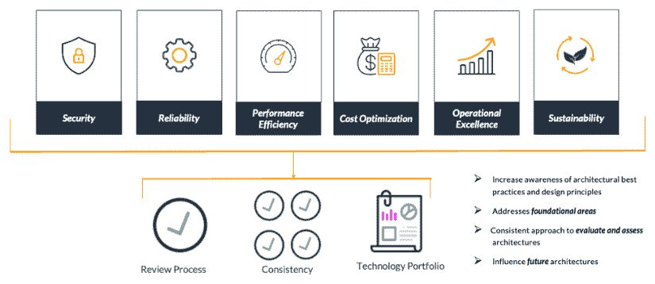
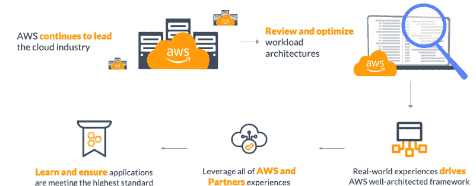
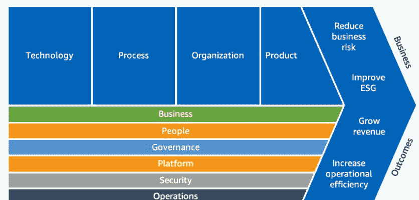
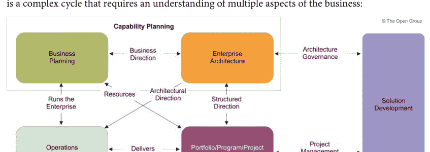

## AWS 指导性框架

在向云过渡的过程中，包括 **信息技术 (IT)** 框架在内的多个部门和主要业务流程都会受到影响。提前规划对于成功迁移至关重要，但将业务目标转化为迁移计划需要时间。

本章详细讨论了规划和实施你的云愿景所涉及的步骤概览。

本章将涵盖以下主题：

- 了解云之旅的当前状态和目标业务成果
- 为你的云迁移确定业务目标
- **亚马逊网络服务 (AWS)** Well-Architected 框架评审
- AWS **迁移就绪评估 (MRA)** 阶段
- **AWS 云采用框架 (AWS CAF)**
- **AWS 参与交付框架 (AWS EDF)**

## 了解云之旅的当前状态和目标业务成果

无论你处于云之旅的哪个阶段，无论你刚刚起步还是处于中途，都还没有结束。无论组织处于云之旅的哪个阶段，都需要不断审查其战略，以确保其充分利用旨在提供的服务。由于技术和服务总是在变化，企业需要利用它们不断改进运营。改变旅程的路径是保持竞争力、发展业务并最终取得成功的关键。为了确保组织走在正确的道路上并提高其业务敏锐度，需要创建或审查云采用策略。

那些已经踏出第一步的人应审查与安全、可用性、自动化和成本管理相关的最佳实践，以确保其投资获得最佳回报。旅程已概述并制定了路线图后，下一步是勾勒解决方案并填补细节。

进入云不需要仓促，也不是 *云原生* 解决方案一定适合你的业务。以下是定义将为你的业务带来价值的云战略的一些关键考虑和步骤：

- **阐明你的愿景**
  在记录企业未来云使用愿景时，确保你的云战略考虑到组织的业务目标。考虑到你目标的长期视角以及云计算带来的相关好处，例如从专有解决方案转向 **软件即服务 (SaaS)** 解决方案，将有助于业务内的决策并获得关键利益相关者的认可。

- **制定战略和路线图**
  公司认可愿景后，将其塑造成云战略的步骤就开始了。制定了一份全面的路线图，指导短期和长期工作。

- **了解你的资产全景**
  在确定战略和评估效益时，了解业务中基础设施和软件资产的全面视图会有所帮助。维护和更换资产需要花费金钱，其预期使用寿命也应被考虑，以及定性方面，例如定制程度和迁移过程的复杂性。

- **着眼于改进运营模式**
  组织在迁移到云时应考虑重塑其流程。无论流程是否在云中，即使技术更好，它仍然可能存在缺陷；仅靠技术无法使其变好。最好让广泛的利益相关者参与流程，以确定可在云中实现的改进。因此，可以避免抬升和转移系统，从而跳过稍后再次更改它们的需要。

  需要考虑的一个重要因素是在保留内部解决方案和定制功能与云原生方法之间的平衡。此外，还应考虑后端流程的简化，例如系统集成和 **业务连续性 (BC)** 计划，以及员工和客户使用的流程。

- **供应商选择**
  建立云路线图始于选择合适的供应商。必须对供应商进行尽职调查，以确保他们提供最佳的解决方案、支持和成本模式。通过考虑供应商的韧性以及迁移流程的关键性，验证未来状态是否符合您的风险承受能力。随着云采用率的增加，监管机构可能会建议某些公司制定多云战略，以应对云故障的系统性风险。

- **资源管理**
  云计算需要专业技能——例如项目管理、云架构、**用户体验 (UX)**、数据架构以及软件开发专业知识。投入运行后，新角色包括云安全专业人员和网络专家。为了满足资源需求，应注意在新员工入职和第三方支持与从已退役系统重新部署人员之间取得平衡。

- **收益与成本分析**
  云计算具有许多优势，其中包括可扩展性、灵活性、复杂性降低和成本平滑。SaaS 部署到平台和基础设施的完全外包将带来不同的收益。无论情况如何，企业很可能会经历一些短期中断。为了提出完整的商业案例，了解短期和长期影响（包括数据转换和迁移需求）将非常重要。在考虑节省和预计成本时，请记住建模固有的挑战，特别是如果当前 IT 成本不够精细。

- **云安全**
  基于云的解决方案可能会增加组织的攻击面或入口点，并扩大其数字边界。在云环境中实施网络、数据和网络安全控制时，必须考虑它们在迁移前后如何部署。在境外存储或处理数据时，有必要考虑监管要求和第三方隐私问题，特别是与在国外持有或处理的数据有关。成功且安全的云部署还要求具备成熟的数据治理和数据泄漏控制流程。

- **云治理**
  为确保云应用、数据、安全和控制措施获得足够的问责和所有权，IT 治理模型需要进行修改。重要的是减轻影子 IT 活动的风险，并确保云环境得到适当控制，例如许可管理和容量监控。

- **运营化**
  新的工作方式需要通过培训和意识练习立即嵌入。在需要文化变革的情况下，例如实施敏捷项目管理实践，其重要性不容低估。在新环境中，应考虑持续的审计和监管要求——包括跨境数据共享。最后一步是对与核心业务领域相关的政策和程序进行审查和更新，例如备份和**灾难恢复 (DR)**、变更管理、服务交付和供应商关系管理。

多个业务部门和关键业务流程将因变革而改变。因此，企业云之旅不仅仅涉及技术变革。

## 云之旅的阶段

一个纳入业务目标的迁移计划耗时较长，但先进的规划对于成功迁移至关重要。本节将概述如何规划和交付您的云愿景。

### 第 1 步 – 制定商业案例

踏上云之旅是一个重要的商业决策。在采用云基础设施之前，企业应评估其业务影响。云计算与传统 IT 设置不同，决策者应意识到这一点。评估收益、风险、合规性、安全性和数据控制对公司整体及其 IT 活动（尤其是）的影响至关重要。确定应首先迁移哪些系统和应用程序，以及云部署的预期成本和**总拥有成本 (TCO)**。

### 第 2 步 – 确定合适的应用程序

每个应用程序的设计各不相同，因此云环境可能不适合每个应用程序。如果应用程序适合云，您可以简单地将其*迁移*和*转移*到云中。Lift-and-shift 迁移是迄今为止最简单的迁移方式，因为无需修改代码，但有时应用程序在迁移到云之前只需要进行少量调整。当整个应用程序需要重写时，那就是最坏的情况。

评估您的架构及其复杂性是确保效率的最佳且最具成本效益的方式。决定您是否可以完全迁移到云，还是最好只将少数应用程序迁移到云，同时保留其他应用程序在本地。

### 第 3 步 – 选择云服务提供商

在分析和盘点完您的环境后，下一步是选择云环境。每个**云服务提供商 (CSP)** 都有自己的架构以及各自的特点、许可和支持能力。在评估云提供商时，您应提出以下问题：

- *您的工作负载是否与云的架构兼容？*
  为了减少代码更改和开销，您可能更喜欢对应用程序修改较少的云环境。
- *提供商如何实施云服务？*
  大多数云厂商都有公共云和私有云产品。如果您计划实施多云或混合云架构，应检查供应商是否提供复杂云环境的能力。
- *是否可以使用您自己的现有许可证在云上？*
  管理许可证可能复杂且昂贵。检查您现有的许可证是否与软件兼容，如果不兼容，请提前确定您需要哪种许可证以及其成本是多少。
- *在支持方面，迁移前后需要什么？*
  有些云提供商提供工具但支持很少，而其他提供商则提供从开始到结束的帮助。

除了安全、合规性和**服务等级协议 (SLAs)**之外，云迁移还有许多其他方面需要考虑，但您应首先考虑上述问题。

### 第 4 步 – 初始采用

为了迁移到云，大多数公司首先采用 SaaS。诸如**客户关系管理 (CRM)**、办公生产力工具（Office 365 和 Google Workspace）、会计、**人力资源 (HR)** 以及 Slack、Asana 或 Trello 等协作工具等平台属于不太关键的应用程序。对公司成功至关重要的软件解决方案——例如仓储、生产和**企业资源规划 (ERP)**——通常与核心运营紧密集成。您可以通过实施**平台即服务 (PaaS)** 解决方案将整个基础设施迁移到云中。向基于云的解决方案的过渡通常需要试点和**概念验证 (POCs)**，这种方法称为*重新采购*。

在初始阶段，**基础设施即服务 (IaaS)** 可用于非关键应用程序、测试和开发环境、批处理和数据归档。随着组织采用云解决方案，制定云治理策略。制定涵盖本地和云环境的业务流程，创建访问策略，并实施监控和安全工具。

### 第 5 步 – 完整迁移

您的云迁移现在应该已完成并具备所有必要信息。然而，需要记住的是，执行过程中的很大一部分实际上是测试，而进行试点是实现这一目标的绝佳方式。需要持续运行的应用程序无法承受长时间的停机，尤其是关键任务型应用。为此，始终最好先测试您的计划，然后再推进。出现问题时，请制定恢复策略。

### 第 6 步 – 迁移后

您的迁移已完成，但您的旅程尚未结束。我们现在可以开始比较迁移前后的性能。确保您将云性能与提供商的 SLA 以及您自己的性能目标保持一致。您应警惕新云环境中出现的问题，检测意外变化，并据此精细调整应用程序和基础设施。

## 云迁移挑战

您在云迁移项目中很可能会遇到一些挑战，以下是一些克服这些挑战的建议：

- **互操作性**
  使现有应用程序能够与云环境交互可能需要重构或完全重写。应决定是按原样将应用程序的依赖项迁移到云中，还是过渡到基于云的对应产品。
- **可用性**
  迁移过程中可能需要暂时关闭业务系统。迁移期间也可能发生意外停机。制定与云兼容的灾难恢复计划，以确保业务运营不会中断且客户不受影响。
- **数据安全和完整性**
  除了数据丢失或损坏的风险外，迁移到云端还可能为黑客敞开大门。在迁移过程和目标云环境中，确定您可能面临的风险和合规问题，并相应调整安全策略。
- **云专业知识**
  传统上，您的 IT 部门可能没有处理云环境的经验。数据中心专业知识和管理物理服务器的经验并不能直接转化为云环境。应招聘或聘请云专家来解决这些问题，例如培训团队并提供实验沙箱。

云迁移项目中每个阶段都会遇到挑战是不可避免的；然而，最重要的是您如何克服它们并变得比以前更强大。当您以优秀的资源和策略为迁移做好充分准备时，结果将极其有益。我们将在下一节更深入地探讨这一点。

## 云就绪的三种可能结果

有效的战略规划以及现代工具和技术对于云迁移成功绝对至关重要。正确执行时，您将体验到以下积极成果：

- 我们所称的 *采用阶段* 的路径通常会被考虑大规模迁移到 AWS 的组织所遵循。重要的是在每个阶段评估您组织的就绪情况，并确定环境中哪些部分已足够成熟以进入下一阶段。

  例如，项目阶段（或概念验证阶段）包括计划将首个工作负载迁移到云中的组织。在此阶段，不需要基础构建或统一的 AWS 账户。然而，在规划更大规模的迁移计划之前，必须正确执行标记。缺少此项，迁移可能会因基础问题而延迟。
- 就绪评估的另一个主要成果是识别优势和劣势。基于优势，组织确定哪些团队和实践已准备好广泛采用。为了确保云迁移成功，这些领域不需要额外工作。劣势是需要解决的领域，以便能够进行云迁移。越早解决差距，迁移过程就越容易，项目延期的可能性就越小。
- 为了发展组织中的优势领域并缩小差距，您需要制定行动计划。为了使项目成功，应指定负责人并设定截止日期。为了推进您的云计划，我们建议聘请内部流程改进和组织变革团队。这些团队通常拥有分析当前能力、沟通和规划采纳的工具，这很有帮助。

评估组织的就绪情况、识别优势和劣势以及弥合团队之间的差距在成功的云迁移过程中发挥着重要作用。接下来，将讨论迁移的目标和目的。

## 识别迁移到云的业务目标

只有在了解您为何迁移到云后，才能制定云迁移策略。以下是公司迁移到云的最常见原因：

- 避免数据中心维护成本
- 具有增强的可扩展性
- 以更高能力提高弹性
- 增强团队之间的远程协作

为了确保所有团队成员理解业务目的，获得对业务目标的一致认可也很重要。一旦了解切换背后的业务原因，确定迁移到云的内容将变得容易得多。迁移之旅涉及许多决策，包括规划迁移策略、选择 CSP、选择部署模型等等。沿途做出正确决策的唯一方法是拥有明确且切合实际的目标。

就绪评估包括四个任务。让我们逐一查看它们。

## 就绪评估会议

就绪评估始于安排会议并邀请所需与会者，例如以下人员：

- **首席执行官** (**CEO**)
- 首席架构师
- **首席信息官** (**CIO**)
- **总经理** (**MD**)
- **业务单元** (**BU**) 负责人
- IT 财务
- 安全负责人
- 网络负责人
- 应用开发负责人
- 基础设施负责人
- 运营负责人
- 应用负责人

这些实体是组织中最大的利益相关者之一，他们为各团队的长期成功和效率做出贡献。

## 进行利益相关者访谈

与执行团队进行一小时或两小时的访谈后，将进行与关键利益相关者或角色的访谈。启动会议是评估过程的关键部分，因为它启动了整个流程，您应努力做到以下几点：

- 在启动会议中，确定一套核心应用程序，这些应用程序将在未来两周内根据组织的业务优先事项进行评估。确保应用程序与这些优先事项保持一致。
- 为了实现一致性并获得执行层对资源分配的承诺，举办为期两天的研讨会，让关键业务和技术领导者在优先事项上保持一致。

该研讨会将确定可通过现代化计划交付的最重要成果。为了实现既定目标，确定当前能力、架构和技能。建立云管理团队、云业务办公室和云平台工程团队作为运营模式中的关键参与者。

研讨会应由现代化项目经理以及数据专家、基础设施专家和现代化架构师主导。利益相关者在愿景研讨会结束时确定成功因素、方法论和典型成果。因此，组织将全面了解其在下一阶段的重点和承诺。

## 使用资源收集信息

使用应用程序现代化问卷收集信息，分析收集到的信息，记录观察结果，并通过以下步骤确定下一阶段：

1. 确定将进行再平台化、重构和替换的应用程序，并创建旅程指南，以便每个人都能理解生态系统。制定应进行现代化的工作负载的优先列表，然后为这些工作负载创建现代化蓝图。
2. 确保满足要求，因此在创建蓝图之前，完成所有先决条件。验证应用程序现代化的驱动因素包括测试其有效性、性能、集成和可服务性，并确定其应用采用路径。
3. 执行准确的资产对齐。为支持优先工作负载，确定需要哪些拟议和现有资产。
4. 需要定义迭代和发布。需要确定现代化迭代的时间分配。在更改生产流程之前，决定执行哪些发布。

- 5. 通过为每个领域识别适当的行动，确保您的组织已准备好进行现代化改造。对于您计划首先进行现代化的几个应用程序，您应确保迁移体验无缝。在此次首次尝试中，不要为所有应用程序提供行动计划。通过采用迭代方法，您将在保持质量和安全性的同时实现敏捷性和速度。

- 6. 设定截止日期并确定负责人。每个行动至少应提供一名负责人和截止日期。

一旦需要重新平台化和替换的应用程序根据优先工作负载被识别并处理后，才会采取适当的行动。

## 进行复盘会议

根据复盘会议中确定的发现和风险因素制定路线图，概述每个应用程序的业务计划和路径。以下是您可能分析的一些因素：

- 对应用程序进行排序、排名和排序顺序
- 过渡期和目标运营模式
- 与技术和法规相关的要求
- 大量数据的迁移
- 多种数据类型转换

由此产生的观察和活动有助于为实现这些成果设定正确的基调。在复盘中，利益相关者应保持一致并就下一步达成一致，在此期间某些主题将深入探讨，然后进行实施和势头建设。

在评估应用程序就绪度的过程中，我们会产生以下内容：

- 复盘演示文稿中观察结果和下一步的总结
- 安排一次会议以审查输出并确定下一步
- 估算并提出用例，包括 **工作说明书 (SOWs)** 和 **最小可行产品 (MVPs)**

成功完成愿景研讨会后，扩展的现代化团队应启动为期 1 周的启动参与，其中包括以下内容：

- 使利益相关者群体保持一致
- 确定实现业务目标的高层技术解决方案
- 建立详细说明 MVP 开发里程碑和阶段的路线图
- 利用 AWS Control Tower 自动化，使用登陆区模板创建您的第一个云基础

联合执行团队预计将与贵组织的高级业务和技术领导者沟通愿景并设定期望。尽管如此，大多数研讨会将针对现代化工作团队，其中应包括应用程序所有者、技术负责人、业务所有者和架构师。

借助 AWS，您的业务发展团队将能够获得技术现代化以及 **端到端 (E2E)** 支持，用于应用程序架构、设计、开发、移动能力、测试和协作解决方案。凭借合适的人员和合适的设置，您可以通过结合经过验证的流程、智能自动化、数据和模式以及开放标准来帮助现代化您的遗留应用程序。

## AWS Well-Architected 框架评审

诸如 AWS 等云计算平台提供许多好处。您可以在不投资现场硬件的情况下以实惠的价格访问强大的 IT 基础设施。因此，您可以根据业务表现扩展 IT 运营和基础设施，并在低迷期间根据需要减少它们。

您的企业将通过云计算节省时间和金钱，这将为组织内的其他计划释放更多资源。借助我们的 Well-Architected 框架，您可以充分利用 AWS 的云计算能力。AWS Well-Architected 框架评审可以帮助您判断是否正确遵循该框架，并以系统的方式审视您的云架构。AWS Well-Architected 框架报告评估您是否遵循该框架以及可能改进的地方。

AWS Well-Architected 框架提供建议，帮助优化组织在 AWS 上开发、维护和升级应用程序的方式。在 AWS 上构建系统时，您可以了解每个决策的利弊。以下是一些额外优势：

- 通过应用 AWS 设计原则，随着时间的推移改进 AWS 工作负载
- 为了确保性能和成本优化，规划未来工作负载至关重要，使其尽可能安全可靠，同时尽可能高效
- 能够以云原生方式对架构做出明智决策，并了解设计决策如何影响您的产品或服务
- 您还可以使用 AWS 赞助的资金计划，通过利用每个已提交和获批工作负载的使用积分来增强您的 AWS 工作负载

AWS 的 Well-Architected 框架包含六个核心要素——运营卓越、安全、可靠性、性能效率、成本优化和可持续性，在此有更详细的描述：

- **运营卓越**
  以高性能方式支持工作负载的开发和运行，深入了解其运营。流程和程序的改进也能确保交付业务价值。
- **安全**
  可以使用云技术通过云技术保护您的数据、系统和资产来改善整体安全态势。
- **可靠性**
  工作负载可靠性涉及工作负载在需要时能够正确且一致地执行其预期功能的能力。工作负载必须能够在其整个生命周期内进行操作和测试。有关实施可靠 AWS 工作负载的深入指南在此提供。
- **性能效率**
  随着需求和技术变化，效率是指有效利用计算资源的能力。
- **成本优化**
  在为业务提供最大价值的同时，以尽可能低的价格运行系统的能力。
- **可持续性**
  随着时间的推移减少能源消耗并提高效率，以持续改善可持续性影响的能力。我们最大化预配资源的效益，同时最小化工作负载各组件所需的总资源。

AWS Well-Architected 框架中包含的六个核心要素在以下图表中呈现：

- 提高对架构最佳实践和设计原则的认识
- 解决基础领域
- 评估和评估架构的一致方法
- 影响未来架构

图 5.1 – 促进 AWS Well-Architected 框架的因素

架构团队应能够创建架构并遵循最佳实践。AWS 首席工程师的虚拟社区可以审查设计并帮助新团队了解 AWS 最佳实践。这将帮助新团队获得这些能力或现有团队提高标准。最佳实践由首席工程社区使其可见且可访问。午餐演讲是他们实现此目的的一种方式；例如，通过讨论最佳实践的真实案例。在演讲期间，新团队成员将能够观看演讲录像。

我们在 AWS 上运行互联网规模系统的经验导致了最佳实践的发展。最佳实践通常由数据决定，但 **主题专家 (SMEs)**——例如首席工程师——也至关重要。首席工程师确保团队随着社区工作的推进而遵循新兴的最佳实践。我们的内部评审流程将随着时间的推移纳入这些最佳实践，以及确保合规的机制。我们已将首席工程思维编纂到我们的 Well-Architected 框架中，它作为我们内部评审流程面向客户的实现。现场角色，例如解决方案架构师和内部工程团队，已被整合其中。通过使用 Well-Architected 框架，您可以在可扩展的层面上利用这些学习成果。

通过使用具有分布式所有权的首席工程社区的方法，可以根据客户需求形成一个架构良好的企业架构。**首席技术官 (CTOs)** 和其他技术领导者应在其整个投资组合中进行 Well-Architected 评审，以更好地了解风险。使用这种方法，您可以识别跨团队的主题，您的组织可以通过培训、午餐讨论或其他机制来解决这些主题，让首席工程师能够与其他团队分享他们对特定主题的想法。

## 通用设计原则

Well-Architected Framework 识别出五项通用云设计原则。让我们逐一了解它们，如下所示：

- **停止猜测您的容量需求**
  如果在部署工作负载时做出错误的容量选择，您可能会花费几乎所有时间在空闲资源上，或处理低容量带来的性能影响。这些问题可以通过云计算解决。您的容量可以根据需求自动向上或向下调整。
- **在生产规模下测试系统**
  云使您能够快速设置生产规模的测试环境，成功测试，然后按需停用资源。虚拟测试环境的成本是本地测试成本的零头，因为您只在测试环境运行时付费。
- **自动化以便于架构实验**
  您可以自动化工作负载以节省资金并避免人工操作，从而以低成本创建和复制它们。监控您的自动化将允许您审计所做的任何更改，并在必要时恢复到之前的参数。
- **允许演进式架构**
  在传统环境中，架构决策通常在系统生命周期中作为静态的一次性事件实施，只有少数主要版本。企业及其背景做出的初始决策可能会阻碍系统随着企业发展而满足不断变化的业务需求的能力。具有自动化和按需测试的云解决方案最大限度地降低了设计更改影响最终产品的风险。企业可以将其用作随着时间的推移将创新纳入其系统的标准方式。
- **利用数据驱动架构**
  您的架构选择可以在云中进行跟踪，以确定工作负载如何对架构选择做出反应。利用这些信息，您可以根据事实改进工作负载。您可以使用云基础设施中的代码做出明智的架构决策，并随着时间的推移不断改进它。

Well-Architected Framework 识别出的云设计原则在随着时间的推移提升架构决策方面发挥着重要作用。

## 通过游戏日改进

定期安排生产模拟以检查您的架构和流程。结果，您将能够识别改进领域并获得处理组织内事件的经验。

应始终如一地审查架构，不指责任何人，并鼓励深入挖掘。此过程中不应有审计；它应只是一次对话。其目的是在审查架构时识别关键问题和改进领域。审查将导致一系列旨在改善客户体验的行动。

承担团队架构的责任是每个人的工作。与其召开正式的评审会议，设计架构的团队成员应持续使用 Well-Architected Framework 审查其设计。当您的团队采用持续的方法时，随着功能的实施，架构可以得到更新，并在添加新功能时得到改进。

在 AWS 中，架构良好的系统和服务遵循 AWS 的内部评审流程。**根因分析 (RCA)** 专注于影响架构方法的设计原则；它还包括问题，以确保人们不会忽略 RCA 中经常出现的领域。我们在内部系统或服务出现重大问题时，或当客户联系我们时查看 RCA，以查看是否可以改进评审流程。在产品生命周期中，应在关键里程碑进行评审，设计阶段早期以避免单向门，并在服务首次发布前进行。添加新功能和实施新技术将在投入生产后继续增加您的工作负载。随着工作负载的增长，其结构会发生变化。为了使其架构特性在演进过程中不退化，遵循良好的卫生实践至关重要。如果您进行重大的架构更改，Well-Architected 评审应成为流程的一部分。

如果您将评审用作一次性快照或独立测量，则必须确保所有合适的人参与对话。评审时间通常是团队真正了解他们所做工作的第一个机会。当评审另一团队的工作负载时，有助于就另一团队的架构进行非正式对话，以获取大多数问题的答案。如果仍存在歧义或感知到的风险，您可以跟进一两次会议以获得清晰度或深入研究问题。经过审查问题后，您应根据业务背景制定优先事项清单。还需考虑这些问题对团队日常工作的影响。您可以更早地解决反复出现的问题，腾出时间用于创造业务价值。随着您解决问题的进展，评审将更新并观察架构如何改进。

在进行评审后，您将了解其价值，但您可能首先会遇到新团队的抵制。为了解决一些反对意见，您可以教育团队了解评审的好处。展望未来，我们将查看可能在后期影响评审的不同场景，如下所示：

*我们太忙了！（通常在大型发布前说）*

以下是如何回应：

- 如果您事先做好准备，大型产品的发布将顺利进行。通过评审，您可以发现是否遗漏了任何问题。
- 在产品生命周期的早期进行评审最重要，以便识别风险并制定缓解计划。

> *没有时间采取行动来处理结果！（这通常在重大活动如超级碗之前说。）*

以下是如何回应：

- 之前提到的事件无法改变。您是否愿意在不知道它们如何与您的架构相关联的情况下经历这些风险？即使您不解决所有问题，如果它们出现，您仍然需要处理它们的剧本。

> *我们不想让其他人了解我们是如何实施解决方案的！*

以下是如何对此作出反应：

- 如果您将团队指向 Well-Architected Framework，很明显框架中的任何问题都不会透露任何商业或技术专有信息。

由于与不同团队进行多次评审，您的组织可能会识别出主题性问题。如果您检查一组团队，您可能会发现他们在特定支柱或主题上存在问题。

以下图表展示了 AWS 云基础设施中的评审周期：

图 5.2 – AWS 评审周期

作为您全面的评审的一部分，您需要识别任何可能有助于您解决这些主题性问题的机制、培训或首席工程谈话。

## AWS MRA 阶段

与其仅仅描述您的工作负载，MRA 应记录您迁移到 AWS 的需求。它将帮助您预见风险、成本和必要的流程，以及潜在的迁移路径。执行 MRA 时，AWS 迁移就绪性得到增强，使您为每种情况做好准备并防止问题出现。

通过使用 MRA，您的公司可以做出明智的数据驱动迁移决策并解决您可能有的任何问题。在全面的 MRA 中，您应提出以下问题：

- 我是否有充分的理由迁移到 AWS？在投入时间和金钱和精力进行迁移之前，先了解 AWS 是否可能不是您需求的正确解决方案。
- 如果我将工作负载迁移到 AWS，我需要进行哪些重新架构？应为难以移植的应用程序的重新架构进行计划和预算。
- 在这种情况下，搬迁迁移是否有用？如果您的应用程序需要大量重新设计，请考虑采用不同的方法来使用 AWS。
- 迁移到 AWS 的成本是多少？由于 AWS 仅提供计算资源和数据存储和传输的定价，您可能首先需要帮助估算迁移成本。
- AWS 迁移将如何帮助您的业务？AWS 的好处因您公司的计算需求而大不相同，因此您可能能够找到特定于您公司的好处。了解这些细节将使您更好地准备迁移。
- 成功迁移后，此工作负载的成本是多少？您需要考虑多个因素才能获得准确的成本估算。然而，为了正确预算，必须考虑这些因素。

为了对云迁移做出明智决策，MRA 至关重要。此外，回答这些问题需要一个涉及各种数据的复杂流程。

来自组织不同部门的参与者将参与由经验丰富的架构师或顾问领导的互动研讨会。他们将收集有关 AWS 云采用框架的关键信息以指示云就绪性。研讨会后您将收到完整的简报和建议。您可以单独进行此评估，或将其与其他研讨会和迁移服务集成。

## AWS CAF

要提供全面的数字化转型，您需要 AWS CAF。通过利用它，您将能够识别和优先考虑转型机会，评估和改进您的云就绪性，并在转型过程中迭代地发展您的路线图。让我们专注于数字化转型并强调数据和分析的使用。作为框架的一部分，确定了六个视角（业务、人员、治理、平台、安全和运营），共计 47 项独立能力。

成功实现数字化转型需要在四个关键领域保持一致：**技术**、**流程**、**组织**和**产品**。AWS 根据能力和转型领域推荐了四个迭代且增量的云转型阶段，具体如下：

- **Envision**：展示云将如何使您的业务受益。在此阶段，您将参与由引导员主导的互动研讨会，以确定转型机会。
- **Align**：识别基础能力中的能力差距。此阶段也采用引导员主导的研讨会形式，并得出行动计划。
- **Launch**：通过生产环境中的试点项目展示增量的业务价值。
- **Scale**：将试点项目扩展到期望的规模水平以实现业务收益。

随着数字技术的 proliferate，变化发生得更快，许多行业的竞争也在加剧。随着维持竞争优势变得越来越困难，企业被迫每隔几年就重新发明自己。此外，公民的期望和行为正在推动政府机构改善数字服务的提供。在数字商业世界中使用数字技术有助于企业适应市场变化、取悦客户并加速其业务成果。

AWS 被数百万客户使用，包括初创企业、企业和政府，用于数字化并优化业务流程、迁移和现代化遗留工作负载，以及重新发明运营模式。他们的业务成果得到改善——包括成本降低、风险降低和运营效率提高——这是云驱动转型带来的结果。他们的敏捷性得到提升，并创造了新的收入来源，同时改善了员工士气和客户满意度。要有效地利用云进行数字化转型，您需要一套基础的组织能力（您的云就绪度）。如以下图所示，通过 AWS CAF，全球数千家组织通过识别这些能力并提供指导性建议，加速了其云转型之旅。在这里，您可以看到组织内产品转型的构成要素：

图 5.3 – 组织内产品转型的[content]
成功实现数字化转型需要在四个关键领域保持一致：**技术**、**流程**、**组织**和**产品**。AWS 根据能力和转型领域推荐了四个迭代且增量的云转型阶段，具体如下：

- **Envision**：展示云将如何使您的业务受益。在此阶段，您将参与由引导员主导的互动研讨会，以确定转型机会。
- **Align**：识别基础能力中的能力差距。此阶段也采用引导员主导的研讨会形式，并得出行动计划。
- **Launch**：通过生产环境中的试点项目展示增量的业务价值。
- **Scale**：将试点项目扩展到期望的规模水平以实现业务收益。

随着数字技术不断普及，变化发生得更快，许多行业的竞争也在加剧。随着维持竞争优势变得越来越困难，企业被迫每隔几年就重新发明自己。此外，公民的期望和行为正在推动政府机构改善数字服务的提供。在数字商业世界中使用数字技术有助于企业适应市场变化、取悦客户并加速其业务成果。

AWS 被数百万客户使用，包括初创企业、企业和政府，用于数字化并优化业务流程、迁移和现代化遗留工作负载，以及重新发明运营模式。他们的业务成果得到改善——包括成本降低、风险降低和运营效率提高——这是云驱动转型带来的结果。他们的敏捷性得到提升，并创造了新的收入来源，同时改善了员工士气和客户满意度。要有效地利用云进行数字化转型，您需要一套基础的组织能力（您的云就绪度）。如以下图所示，通过 AWS CAF，全球数千家组织通过识别这些能力并提供指导性建议，加速了其云转型之旅。在这里，您可以看到组织内产品转型的构成要素：

图 5.3 – 组织内产品转型的构成因素

在前述图表中，有一个价值链，由使产品转型成为可能的技术、流程和组织组成。降低风险、改善**环境、社会和治理**（ESG）绩效、以及提高收入和运营效率是其中的一些业务成果。

## 云转型价值链

使用云进行遗留基础设施、应用程序以及数据和分析平台的迁移和现代化是技术转型的核心，具体如下：

- 根据云价值基准测试，从本地迁移到 AWS 可将每用户成本降低 27%，将每位管理员管理的**虚拟机 (VMs)** 数量增加 58%，停机时间减少 57%，安全事件减少 34%。
- 通过流程转型，业务运营可以实现数字化、自动化和优化。分析平台是提取数据可操作见解的有力工具。**机器学习 (ML)** 可用于在客户服务、员工生产力、欺诈检测和预测等多个领域提高运营效率。这样，您可以在提高运营效率和运营成本的同时提高客户和员工满意度。
- 组织的转型侧重于重新发明其运营模式——即如何协调努力为客户提供价值并与战略目标保持一致。利用敏捷方法快速迭代和演进，同时围绕产品和价值流组织团队，将有助于您变得更具响应性和以客户为中心。
- 业务模式转型涉及通过新的价值主张重新构想您的产品/服务提供和收入模式。您可能能够利用此机会触达新的客户细分市场。根据*云价值基准报告*，使用 AWS 可将**上市时间 (TTM)** 缩短 37%，代码部署频率提高 32%，部署新代码的时间减少 38%。

能力有助于组织利用资源（人员、技术以及任何其他有形或无形资产）来实现特定目标。使用 AWS CAF 能力，您可以提高有效利用云以推动数字化转型的能力。**云原生计算基金会 (CNCF)** 将其能力分为六个类别——**业务**、**人员**、**治理**、**平台**、**安全**和**运营**。

您的云转型之旅由不同功能相关利益相关者拥有或管理的多项能力组成，如下所述。

## AWS CAF 视角和基础能力

如果您牢记业务目标，您的云投资将更成功。首席执行官、**首席财务官 (CFOs)**、**首席运营官 (COOs)**、CIO 和 CTO 构成了这一群体。以下是一些可采取的方法：

- 将人员视角带入云之旅，可加速我们的战略，帮助组织更快地实现学习型文化的持续成长。CIO、COO、CTO、云总监以及各职能和部门的高级领导通常是利益相关者。
- 治理视角有助于您最大化云计划的收益并最小化风险。**首席转型官**（也称为**CTOs**，与首席技术官一起）、CIO、CTO、CFO、**首席数据官 (CDOs)** 和**首席风险官 (CROs)** 是典型的利益相关者。
- 构建企业级、可扩展的混合云平台、现代化现有工作负载以及实施云原生解决方案只是平台视角带来的诸多益处之一。典型的利益相关者是 CTO、工程师和技术领导者。
- 当您采取安全视角时，您的云工作负载和数据将更安全。安全管理的利益相关者包括**首席信息安全官 (CISOs)**、**首席合规官 (CCOs)**、内部审计专家以及安全工程师和架构师。
- 通过了解运营，您可以确保云服务交付达到满足业务要求的水准。许多利益相关者参与此过程，例如 IT 服务经理、基础设施和运营领导者以及站点可靠性工程师。

一旦确定了 AWS CAF 视角和基础能力，我们将继续深入探索云转型的旅程。

## 云转型之旅

云驱动的业务成果在**Envision**阶段得到展示。该流程在四个转型领域内识别并优先考虑转型机会，以符合您的战略业务目标。以下是您可以采取的措施以从此流程中获得最大价值：

- 将关键利益相关者和可衡量的业务成果与转型计划联系起来，将增强您在转型之旅中展示价值的能力。
- 对齐流程的*阶段 A* 检查 AWS CAF 视角中的差距，识别组织间的依赖关系，并揭示利益相关者的关注点和挑战。制定云就绪策略、确保利益相关者一致性以及促进组织变革管理将有助于您变得更具云就绪性。
- 在启动阶段，试点计划在生产环境中交付，并展示增量的业务价值。为了影响未来的方向，试点需要具有高度影响力。从试点中学习将帮助您在扩展到全面生产之前调整方法。
- 作为规模化阶段的一部分，您的云投资应具有可扩展性，并且您的业务价值将根据需要得以持续。

某些基础能力可能不需要立即解决。您的云转型之旅需要您开发基础能力并提高云就绪度。

## AWS EDF

云迁移使用敏捷方法进行准备和实施。该流程涉及以下内容：

- 为能够响应变化，请考虑将工作结构化为史诗和用户故事
- 优先排序积压工作并进行生产
- 制作进度报告
- 通过迁移路线图确保业务需求高效有效地与技术计划相联系

敏捷开发涉及从小处着手、迭代、评估、管理和扩展庞大的用户故事。接下来讨论的是使流程无缝衔接所涉及的步骤。

## Preparation

这里是迁移准备工作涉及的步骤：

- 1. 组建两个由就绪和规划阶段定义的内部资源组成的、每队规模相当于两块披萨的 Scrum 团队。团队应分为职能和技术角色。除了实现迁移外，这些团队还为企业规模的迁移做好业务准备：
- A. *2披萨团队1* 结构和资源——业务案例开发、项目治理、人员技能和 **卓越中心 (CoE)**
- B. *2披萨团队2* 结构和资源——应用发现、应用迁移、登陆区、安全和运营集成
- 2. 迁移就绪评估结果将在与两个 Scrum 团队的规划会议中进行审查。
- 3. *AWS 第一波* 将处理 10 到 30 个应迁移到 AWS 的本地应用程序。
- 4. 根据 *预先准备好的* 史诗，规划并优先处理所有工作流。
- 5. 应用程序的迁移将分为八个为期两周的冲刺。
- 6. 创建迁移计划，包括资源、待办事项、风险和缓解措施，以及角色和职责，例如 **负责、问责、咨询、知情 (RACI)**。

鉴于这些要点，您可以识别出在项目期间负责管理风险的资源。

## Implementation

迁移实施涉及以下步骤：

- 1. 为每个冲刺与两个团队共同创建冲刺计划和目标。
- 2. 史诗应被审查，分解为具有验收标准的用户故事，并组织到冲刺 *1* 到 *8*。
- 3. 每个 2 披萨团队需要每日开会以保持节奏。
- 4. 更快的反馈和不间断的工作流程是此次会议的两个重要成果。通过创建每日站会，Scrum 负责人传达进展、解决阻碍并报告交付成果。
- 5. 建立实施监督会议计划用于沟通和报告。确保团队运作良好并使用敏捷指标交付价值。
- 6. 专注于管理冲刺，重点目标如下：
- A. 理解、使能和动员劳动力的能力是做中学关键。
- B. 通过从小开始并取得早期成功，构建完整的迁移能力。
- 7. 建立可在规模化迁移中使用的输出、最佳实践和经验教训清单。
- 8. 以 Wave 1 为指导，创建敏捷迁移的蓝图。为规划和就绪阶段奠定基础。

在完成这些初始 Wave 1 迁移的过程中积累经验和信心是有益的。作为此过程的一部分，您将选择最适合您组织的迁移模式和工具。测试运营和安全流程也包含在此过程中。创建基于常见模式的应用程序分组列表，以识别投资组合内的模式（例如，常见架构和技术堆栈）。结果是针对一组应用程序的标准化的迁移流程。

## Value-adding outcomes

当您将此敏捷模型应用于大规模运营时，可以加速实现业务成果。敏捷方法产生以下增值业务成果：

- 1. 迁移的 7 个 R 应应用于应用程序选择。
- 2. 规划迁移工具的迁移波——使用迁移工具制定迁移组优先级列表。
- 3. 测试和部署登陆区的各种组件将验证其功能。
- 4. **Development operations (DevOps)**——通过 DevOps 模型促进新功能、修复和更新的持续开发。
- 5. 使用供应商工具自动化迁移流程。
- 6. 使用 AWS Prescriptive Guidance catalog 查找迁移模式。
- 7. 目标是为服务器、数据和应用程序的迁移设计目标状态架构。
- 8. 资源将接受 AWS 服务培训并获得迁移的实践经验。
- 9. 运行 AWS 运营运行手册使您能够验证运营模型。
- 10. 迁移管理——处理迁移范围、计划、资源计划、问题和风险。

通过加速改进迁移的过程，这些要素被证明极其有效且有益。

## Summary

为了保持竞争力、发展业务并取得成功，您必须改变前进的道路。云采用策略需要创建或审查，以确保组织走在正确的道路上并提高其业务敏锐度。在定义组织未来将如何利用云的愿景时，确保云战略考虑到公司的业务目标。无论是短期还是长期举措，都应概述全面的路线图，然后制定纳入业务目标的迁移计划，这需要花费时间。

在了解为何迁移到云后，您可以制定云迁移战略。云计算通常用于避免数据中心维护成本、增强可扩展性、提高弹性并增强团队之间的远程协作。作为 AWS 的客户，您的业务发展团队可以访问技术现代化以及应用程序架构、设计、开发、移动能力、测试和协作解决方案的端到端支持。AWS 的 Well-Architected Framework 可以帮助您优化在 AWS 上构建、维护和升级应用程序的方式。

您的组织可以通过培训课程、午餐讨论或其他促进首席工程师在特定主题上沟通的机制来解决跨团队的主题。AWS CAF 将使您能够识别和优先考虑转型机会、评估和改进您的云就绪情况，并在转型组织时迭代增强您的路线图。

下一章将介绍 **The Open Group Architecture Framework (TOGAF)** 架构域并在 AWS 上下文中探讨云生态系统。我们还将回顾参考架构和模型，以了解更多关于每个 TOGAF **Architecture Development Method (ADM)** 在 AWS 云转型中每个阶段的信息。

## TOGAF Framework in Action with AWS

与传统的瀑布流程相比，架构可以以迭代方式开发。显然，敏捷-Scrum 方法已被证明是成功的，因为它们强调迭代。在此过程中，文档和适当的规划不必被忽视。事实上，它们应该受到鼓励。

在本章中，我们将涵盖以下主题：

- TOGAF – Architecture Development Method (ADM) phases and approaches
- Cloud architecture development method
- Cloud ecosystem reference models
- Enterprise architecture principles of the cloud ecosystem

### TOGAF – ADM phases and approaches

我们的目标是开发一个高效且有效的 information systems 架构。但请记住，这不是为了创建无尽且不必要的工件。通常，敏捷项目在需求阶段涉及迭代。项目很少有明确定义且理解的业务需求，而无需事先收集和澄清它们。

下表中列出了 ADM 阶段。每个阶段涵盖特定角色并描述基本方面：

| Phase | Description |
|---|---|
| Preliminary Phase | 创建架构能力需要准备和启动活动，例如定制 TOGAF、选择工具和定义架构原则。 |
| Requirements Management | 业务需求应在 TOGAF 项目的每一步中纳入。ADM 阶段处理、处理和根据其识别、存储以及输入和输出来优先考虑需求。 |
| Phase A: Architecture Vision | TOGAF 项目应具有明确的范围、需求和期望。建立架构愿景并识别利益相关者。建立架构工作说明书并验证业务背景。获得任何变更的批准。 |
| Phase B: Business Architecture Phase C: Information Systems Architectures Phase D: Technology Architecture | 以下四个域应开发： 1. 业务 2. 信息系统 – 应用 3. 信息系统 – 数据 4. 技术  为每种情况构建基线和目标架构并评估差距。 |
| Phase E: Opportunities and Solutions | 识别之前识别的构建块，并确定将交付它们的载体。识别如果需要增量方法所需的过渡架构。 |
| Phase F: Migration Planning | 通过制定详细计划，规划基线架构到目标架构的实施和迁移。 |
| Phase G: Implementation Governance | 从架构角度监督实施。起草架构合同并发布。检查项目执行是否符合架构。 |
| Phase H: Architecture Change Management | 为确保架构满足企业需求并最大化其价值，应持续监控架构并建立变更管理流程。 |

### Preliminary phase

在此第一阶段，企业正在定义架构应在企业中何时、何地、何事、为何、谁以及如何完成。主要方面如下列出：

- Enterprise definition
- Key drivers and elements in the organizational context identification
- Requirements for the architecture
- Development of architecture principles

- 架构框架的定义
- 管理框架之间的关系
- 企业架构成熟度的评估

为了使高管、规划者、架构师和工程师能够有效协调、整合并开展其活动，企业架构为组织提供战略性的自上而下的视图。通过企业架构框架，该团队拥有一个战略框架，使其能够有效开展活动。因此，企业架构师必须考虑其框架与组织内其他框架之间的互操作性，因此不可能孤立地开发企业架构。愿景和目标必须在战略、中期和战术层面设定。

## 企业架构
架构面临与组织范围相关的诸多挑战。企业架构能力对利益相关者的影响程度取决于企业的范围以及是否采用联邦模式。为了使由此产生的活动获得资源并得到管理层的明确支持，在此阶段，任命一位赞助者至关重要。企业内部可能存在多个组织，赞助者负责确保所有利益相关者群体都参与到架构能力的定义、建立和利用过程中。

## 组织背景
企业在做出明智和有效的决策之前，必须了解其计划使用的架构框架所处的背景。应考虑以下具体领域清单：

- 当企业架构没有商业模式或预算可用时，应基于初步阶段
- 在架构生命周期中识别企业利益相关者的关键问题和关注点
- 描述组织的业务原则和目标，如董事会制定的方向、要求和战略所表达的那样
- 关注技术和信息组合管理流程和方法，以及当前系统设计和开发框架和方法
- 基于基线架构，描述当前在文档中如何呈现架构全景，以及企业的现状
- 采用该框架的组织和企业必须识别其技能和能力。

## 架构工作的要求
企业架构工作的要求和绩效指标由业务要求驱动。必须确保业务成果和资源需求足够明确，以便本阶段能够定义待完成企业架构工作的范围，并定义企业业务信息需求和相关战略的大纲。以下是一些示例：

- 业务需求
- 文化愿景
- 组织意图
- 战略意图
- 预测财务需求

阐明其中每个要素的关键要素很重要。作为定义和建立架构能力的过程的一部分，赞助者有必要识别所有相关的决策者和利益相关者。

## 原则
在开始任何需要企业批准的架构工作之前，初步阶段定义架构原则。为了开发企业架构，必须定义架构原则。除了架构原则外，业务原则也在企业架构中发挥作用。业务原则也是架构原则本身的一部分。通常，架构职能不负责定义业务原则。如果这些原则在企业内部制定并推广，则可能将其与其他业务原则、战略业务驱动因素或业务目标交叉引用。

## 管理框架
TOGAF 框架必须与组织内可能存在的其他管理框架（正式或非正式）共存。大多数组织使用系统开发解决方案，其中大多数情况下包含 IT 组件。在业务中，系统很重要，因为它们包括人员和流程。建议将 TOGAF 与以下框架列表进行协调：

- 业务能力管理包括 **投资回报率 (ROI)** 的定义以及确定交付业务价值所需业务能力所需的绩效指标
- 用于管理公司变革计划的方法取决于项目或组合
- 运营管理描述了企业如何开展日常运营，包括其如何管理自身的 IT
- 根据解决方案开发方法，按照 IT 系统架构交付业务系统的流程

## 管理框架的关联
为了规划、创建和交付项目章程中指定的架构组件，组合管理框架采用解决方案开发方法论。新建建筑、新技能、新设备、招聘、营销等都是交付成果的示例，但它们并不仅限于 IT。企业架构支持业务流程，而不仅仅是 IT。为了企业利益，管理框架需要相互补充并协同工作。

在战略层面，企业架构由业务规划指导。以年度为单位提供更新的规划是一种提供更精细指导水平的方法。企业中另一种流行的方法是基于能力规划。有时，企业架构师会被调至战略方向组或在某些组织内与其密切合作。企业架构框架使用 TOGAF 开发。如以下图所示，能力规划是一个复杂的循环，需要了解业务的多个方面：

图 6.1 – 业务发展和能力规划的循环

## 业务变革成熟度评估
使用能力成熟度模型，组织可以评估其行使各种能力的能力。通常，能力成熟度模型会识别行使能力所需存在的因素。通过衡量组织执行特定因素的能力，可以识别出有助于改进能力的顺序步骤。高管可以将此作为一种工具来务实地改进其能力。

为了开发和应用企业架构，企业架构成熟度模型必须涵盖必要的特性。然而，建议组织采用现有的成熟度模型，对其进行定制，然后确定应考虑的因素。

## Phase A – 架构愿景
从 Phase A 开始，赞助组织向架构组织发送《架构工作请求》文档。此外，它还描述了架构工作 effort 中包含的内容和不包含的内容，以及必须解决的约束条件。

## 总则
ADM 周期中架构活动的范围定义将在初步阶段确定，并在架构愿景阶段的架构框架中体现。架构愿景阶段仅解决 ADM 周期的特定目标。当现有的架构框架与拟议的架构愿景不一致时，请考虑重新审视初步阶段并扩展企业架构框架。

## 创建架构愿景
通过架构愿景向企业利益相关者和决策者推销拟议能力的益处是赞助者的工作。通过解决利益相关者的关注点，它在满足组织目标的同时也解决了利益相关者的关注点。适应新兴技术及其可能对行业和企业产生的影响是架构愿景不可或缺的一部分，否则可能会错失许多业务机会。

此活动的关键部分之一是明确并就目的达成一致，并且目的需要在为架构工作创建的内容中得到清晰体现。在更广泛的业务战略或企业规划过程中，企业使命、愿景、战略和目标是组织架构愿景的一部分。为了在企业战略与架构背后的目标和决策之间建立桥梁，核实和理解已记录的业务战略和目标至关重要。企业对其客户和利益相关者的利益进行建模，这是一项重要的战略成果。

让我们研究并查找有关基本业务架构概念的材料，例如以下内容：

- **业务能力：**
  这些是企业可能拥有或交换的特定能力，以帮助其实现特定目标或目的。架构师必须确定组织是否具有表示业务能力的框架。

- **价值流：**
  这些是为客户、利益相关者或终端用户贡献整体成果的活动。
- **组织图：**
  它们展示了企业与其合作伙伴和利益相关者之间主要组成部分的关系。

除企业架构之外，架构愿景还探索与企业架构相关的额外领域。利益相关者域可能由基础域的元素组成，但也具有独特的目的。以下是一些示例：

- Information
- Security
- Digital network
- Network management
- Knowledge
- Industry-specific domains
- Services
- Partnership
- Cybersecurity

我们的基线架构和目标架构可以根据此架构愿景针对业务、数据、应用和技术域进行描述。该大纲的进一步开发将随后进行。

## Phase B – 业务架构

在本报告中，您将获得对能力、端到端价值交付、信息和组织结构的全景概述，以及这些组件、产品、政策和举措之间的联系。以域为基础的方法，业务架构将业务要素与业务目标和其他域要素联系起来。

### General

业务架构知识是所有其他架构活动的先决条件，应是流程中的第一步，特别是当它未在其他组织流程中得到解决时。此外，通常需要业务架构，以便让关键利益相关者相信后续架构工作的业务价值，并相信他们通过支持和参与后续工作所获得的好处。

业务战略定义业务战略及其目标，尽管不一定是如何实现它们。Phase B工作的范围主要由Phase A的架构愿景决定。Phase B详细定义了业务架构的作用。在最大程度上，应重复使用现有材料。在架构更成熟的环境中，可能已经存在架构定义，这些定义可能自上次架构开发周期以来一直得到维护。

### Developing the baseline description

如果企业已有架构描述，基线描述应基于现有架构描述。在开发架构愿景时，Phase A可能已包含业务能力图或核心价值流集。

如果实施了新的价值流、缺少业务能力，或发生了企业架构项目中未考虑的组织单位变更，则应更新这些材料。如果不存在架构描述，则应收集信息并开发业务架构模型。

### Applying business capabilities

作为架构愿景阶段的一部分，业务能力图是从独立于组织结构、业务流程、信息系统以及投资组合中包含的其他产品或服务的单独业务的角度开发的。必须在企业架构项目的范围内，基于组织单位、价值流和信息系统创建这些业务能力的地图。这样，每个域都能更有效地对齐和优化。

### Applying value streams

在架构愿景阶段，记录业务的初始价值流模型。如果特定企业架构项目的范围足够广泛，则可能需要在该项目中创建新的价值流。通过热力图或围绕价值流的完整定义开发用例，可以在项目范围内分析新的或现有的价值流。

### Applying the organization map

组织企业生态系统涉及识别构成其的关键组织单位、合作伙伴和利益相关者群体。组织图基于业务单元概念。与仅显示层级汇报关系的组织结构图不同，该图还应显示这些实体之间的工作关系。该图描绘了各种业务实体之间的交互和关系，通常表示为网络或网状结构。

### Applying modeling techniques

如Phase B所述，业务能力、价值流和组织图在该阶段通过建模和映射技术进行扩展并应用于业务。为了实现其目标，组织必须扩展其运营模型。运营模型是对组织在各个域中如何运作的表示。除了能力图、价值流和组织图之外，还可以应用许多其他建模技术，例如以下内容：

- **活动模型/业务流程模型** – 这些描述与企业内部交换相关的功能，例如业务活动、活动之间交换的数据和/或信息。
- **用例模型** – 这些基于建模工作的目的；它们描述业务流程或系统功能。
- **类模型** - 这些描述信息行为。它们也可以对多种粒度进行建模，就像许多其他模型一样。

架构团队将在Phase B期间探索架构存储库，具体如下：

- Reference models for the industry for which the organization operates
- Views specific to a business enterprise such as capability maps, value stream maps, and organization maps
- Building blocks that are specific to your enterprises such as process components, business rules, and job descriptions
- Applicable standards

## Phase C – 数据架构的关键考虑因素

企业在进行大规模架构转型时必须解决数据管理问题。系统化和全面的数据管理方法使利用数据发挥其竞争优势变得更加容易。

### Data management

当企业选择进行大规模架构转型时，必须理解和解决相关问题。通过结构化和全面的数据管理方法可以实现数据的有效使用。数据管理考虑因素包括以下列表：

- It should be determined which of the application components in the landscape will serve as the enterprise master data system or reference
- See whether there are any enterprise-wide standards that all software packages and application components must adopt
- Understand how data entities are used in business processes, functions, and services
- Be able to clearly understand how, where, and for how long enterprise data entities are stored, transported, and reported
- In order to support information exchange between applications, what level of data transformations are required?
- In what ways will the software be required to support the integration of enterprise data with that of its customers and suppliers?

### Data migration

当新应用替换现有应用时，必须从现有应用迁移数据。数据架构应包括数据转换、筛选和清理的程度，以便以满足目标应用要求和约束的格式呈现数据。填充目标应用时的目标是数据质量。此外，为了使转换成功，需要开发通用的数据定义。

### Data governance

为了确保企业能够成功转型，数据治理考虑因素将确保必要的[content]
- **价值流：**
  这些是为客户、利益相关者或终端用户贡献整体成果的活动。
- **组织图：**
  它们展示了企业与其合作伙伴和利益相关者之间主要组成部分的关系。

除企业架构之外，架构愿景还探索与企业架构相关的额外领域。利益相关者域可能由基础域的元素组成，但也具有独特的目的。以下是一些示例：

- Information
- Security
- Digital network
- Network management
- Knowledge
- Industry-specific domains
- Services
- Partnership
- Cybersecurity

我们的基线架构和目标架构可以根据此架构愿景针对业务、数据、应用和技术域进行描述。该大纲的进一步开发将随后进行。

## Phase B – 业务架构

在本报告中，您将获得对能力、端到端价值交付、信息和组织结构的全景概述，以及这些组件、产品、政策和举措之间的联系。以域为基础的方法，业务架构将业务要素与业务目标和其他域要素联系起来。

### General

业务架构知识是所有其他架构活动的先决条件，应是流程中的第一步，特别是当它未在其他组织流程中得到解决时。此外，通常需要业务架构，以便让关键利益相关者相信后续架构工作的业务价值，并相信他们通过支持和参与后续工作所获得的好处。

业务战略定义业务战略及其目标，尽管不一定是如何实现它们。Phase B工作的范围主要由Phase A的架构愿景决定。Phase B详细定义了业务架构的作用。在最大程度上，应重复使用现有材料。在架构更成熟的环境中，可能已经存在架构定义，这些定义可能自上次架构开发周期以来一直得到维护。

### Developing the baseline description

如果企业已有架构描述，基线描述应基于现有架构描述。在开发架构愿景时，Phase A可能已包含业务能力图或核心价值流集。

如果实施了新的价值流、缺少业务能力，或发生了企业架构项目中未考虑的组织单位变更，则应更新这些材料。如果不存在架构描述，则应收集信息并开发业务架构模型。

### Applying business capabilities

作为架构愿景阶段的一部分，业务能力图是从独立于组织结构、业务流程、信息系统以及投资组合中包含的其他产品或服务的单独业务的角度开发的。必须在企业架构项目的范围内，基于组织单位、价值流和信息系统创建这些业务能力的地图。这样，每个域都能更有效地对齐和优化。

### Applying value streams

在架构愿景阶段，记录业务的初始价值流模型。如果特定企业架构项目的范围足够广泛，则可能需要在该项目中创建新的价值流。通过热力图或围绕价值流的完整定义开发用例，可以在项目范围内分析新的或现有的价值流。

### Applying the organization map

组织企业生态系统涉及识别构成其的关键组织单位、合作伙伴和利益相关者群体。组织图基于业务单元概念。与仅显示层级汇报关系的组织结构图不同，该图还应显示这些实体之间的工作关系。该图描绘了各种业务实体之间的交互和关系，通常表示为网络或网状结构。

### Applying modeling techniques

如Phase B所述，业务能力、价值流和组织图在该阶段通过建模和映射技术进行扩展并应用于业务。为了实现其目标，组织必须扩展其运营模型。运营模型是对组织在各个域中如何运作的表示。除了能力图、价值流和组织图之外，还可以应用许多其他建模技术，例如以下内容：

- **活动模型/业务流程模型** – 这些描述与企业内部交换相关的功能，例如业务活动、活动之间交换的数据和/或信息。
- **用例模型** – 这些基于建模工作的目的；它们描述业务流程或系统功能。
- **类模型** - 这些描述信息行为。它们也可以对多种粒度进行建模，就像许多其他模型一样。

架构团队将在Phase B期间探索架构存储库，具体如下：

- Reference models for the industry for which the organization operates
- Views specific to a business enterprise such as capability maps, value stream maps, and organization maps
- Building blocks that are specific to your enterprises such as process components, business rules, and job descriptions
- Applicable standards

## Phase C – 数据架构的关键考虑因素

企业在进行大规模架构转型时必须解决数据管理问题。系统化和全面的数据管理方法使利用数据发挥其竞争优势变得更加容易。

### Data management

当企业选择进行大规模架构转型时，必须理解和解决相关问题。通过结构化和全面的数据管理方法可以实现数据的有效使用。数据管理考虑因素包括以下列表：

- It should be determined which of the application components in the landscape will serve as the enterprise master data system or reference
- See whether there are any enterprise-wide standards that all software packages and application components must adopt
- Understand how data entities are used in business processes, functions, and services
- Be able to clearly understand how, where, and for how long enterprise data entities are stored, transported, and reported
- In order to support information exchange between applications, what level of data transformations are required?
- In what ways will the software be required to support the integration of enterprise data with that of its customers and suppliers?

### Data migration

当新应用替换现有应用时，必须从现有应用迁移数据。数据架构应包括数据转换、筛选和清理的程度，以便以满足目标应用要求和约束的格式呈现数据。填充目标应用时的目标是数据质量。此外，为了使转换成功，需要开发通用的数据定义。

### Data governance

为了确保企业能够成功转型，数据治理考虑因素将确保必要的[content]
- **价值流：**
  这些是为客户、利益相关者或终端用户贡献整体成果的活动。
- **组织图：**
  它们展示了企业与其合作伙伴和利益相关者之间主要组成部分的关系。

除企业架构之外，架构愿景还探索与企业架构相关的额外领域。利益相关者域可能由基础域的元素组成，但也具有独特的目的。以下是一些示例：

- 信息
- 安全
- 数字网络
- 网络管理
- 知识
- 行业特定域
- 服务
- 合作伙伴关系
- 网络安全

我们的基线架构和目标架构可以根据此架构愿景针对业务、数据、应用和技术域进行描述。该大纲的进一步开发将随后进行。

## Phase B – 业务架构

在本报告中，您将获得对能力、端到端价值交付、信息和组织结构的全景概述，以及这些组件、产品、政策和举措之间的联系。以域为基础的方法，业务架构将业务要素与业务目标和其他域要素联系起来。

### 通用

业务架构知识是所有其他架构活动的先决条件，应是流程中的第一步，特别是当它未在其他组织流程中得到解决时。此外，通常需要业务架构，以便让关键利益相关者相信后续架构工作的业务价值，并相信他们通过支持和参与后续工作所获得的好处。

业务战略定义业务战略及其目标，尽管不一定是如何实现它们。Phase B工作的范围主要由Phase A的架构愿景决定。Phase B详细定义了业务架构的作用。在最大程度上，应重复使用现有材料。在架构更成熟的环境中，可能已经存在架构定义，这些定义可能自上次架构开发周期以来一直得到维护。

### 开发基线描述

如果企业已有架构描述，基线描述应基于现有架构描述。在开发架构愿景时，Phase A可能已包含业务能力图或核心价值流集。

如果实施了新的价值流、缺少业务能力，或发生了企业架构项目中未考虑的组织单位变更，则应更新这些材料。如果不存在架构描述，则应收集信息并开发业务架构模型。

### 应用业务能力

作为架构愿景阶段的一部分，业务能力图是从独立于组织结构、业务流程、信息系统以及投资组合中包含的其他产品或服务的单独业务的角度开发的。必须在企业架构项目的范围内，基于组织单位、价值流和信息系统创建这些业务能力的地图。这样，每个域都能更有效地对齐和优化。

### 应用价值流

在架构愿景阶段，记录业务的初始价值流模型。如果特定企业架构项目的范围足够广泛，则可能需要在该项目中创建新的价值流。通过热力图或围绕价值流的完整定义开发用例，可以在项目范围内分析新的或现有的价值流。

### 应用组织图

组织企业生态系统涉及识别构成其的关键组织单位、合作伙伴和利益相关者群体。组织图基于业务单元概念。与仅显示层级汇报关系的组织结构图不同，该图还应显示这些实体之间的工作关系。该图描绘了各种业务实体之间的交互和关系，通常表示为网络或网状结构。

### 应用建模技术

如Phase B所述，业务能力、价值流和组织图在该阶段通过建模和映射技术进行扩展并应用于业务。为了实现其目标，组织必须扩展其运营模型。运营模型是对组织在各个域中如何运作的表示。除了能力图、价值流和组织图之外，还可以应用许多其他建模技术，例如以下内容：

- **活动模型/业务流程模型** – 这些描述与企业内部交换相关的功能，例如业务活动、活动之间交换的数据和/或信息。
- **用例模型** – 这些基于建模工作的目的；它们描述业务流程或系统功能。
- **类模型** - 这些描述信息行为。它们也可以对多种粒度进行建模，就像许多其他模型一样。

架构团队将在Phase B期间探索架构存储库，具体如下：

- 组织运营所在行业的参考模型
- 特定于业务企业的视图，例如能力图、价值流图和组织图
- 特定于贵企业的构建块，例如流程组件、业务规则和职位描述
- 适用标准

## Phase C – 数据架构的关键考虑因素

企业在进行大规模架构转型时必须解决数据管理问题。系统化和全面的数据管理方法使利用数据发挥其竞争优势变得更加容易。

### 数据管理

当企业选择进行大规模架构转型时，必须理解和解决相关问题。通过结构化和全面的数据管理方法可以实现数据的有效使用。数据管理考虑因素包括以下列表：

- 应确定景观中哪些应用组件将作为企业主数据系统或参考
- 查看是否存在所有软件包和应用组件必须采用的企业范围标准
- 了解数据实体在业务流程、功能和服务中的使用方式
- 能够清楚地了解企业数据实体如何、在何处以及存储、传输和报告多长时间
- 为了支持应用程序之间的信息交换，需要什么级别的数据转换？
- 软件将以何种方式需要支持企业数据与其客户和供应商数据的集成？

### 数据迁移

当新应用替换现有应用时，必须从现有应用迁移数据。数据架构应包括数据转换、筛选和清理的程度，以便以满足目标应用要求和约束的格式呈现数据。填充目标应用时的目标是数据质量。此外，为了使转换成功，需要开发通用的数据定义。

### 数据治理

为了确保企业能够成功转型，数据治理考虑因素将确保必要的[content]
- **价值流：**
  这些是为客户、利益相关者或终端用户贡献整体成果的活动。
- **组织图：**
  它们展示了企业与其合作伙伴和利益相关者之间主要组成部分的关系。

除企业架构之外，架构愿景还探索与企业架构相关的额外领域。利益相关者域可能由基础域的元素组成，但也具有独特的目的。以下是一些示例：

- 信息
- 安全
- 数字网络
- 网络管理
- 知识
- 行业特定域
- 服务
- 合作伙伴关系
- 网络安全

我们的基线架构和目标架构可以根据此架构愿景针对业务、数据、应用和技术域进行描述。该大纲的进一步开发将随后进行。

## Phase B – 业务架构

在本报告中，您将获得对能力、端到端价值交付、信息和组织结构的全景概述，以及这些组件、产品、政策和举措之间的联系。以域为基础的方法，业务架构将业务要素与业务目标和其他域要素联系起来。

### 通用

业务架构知识是所有其他架构活动的先决条件，应是流程中的第一步，特别是当它未在其他组织流程中得到解决时。此外，通常需要业务架构，以便让关键利益相关者相信后续架构工作的业务价值，并相信他们通过支持和参与后续工作所获得的好处。

业务战略定义业务战略及其目标，尽管不一定是如何实现它们。Phase B工作的范围主要由Phase A的架构愿景决定。Phase B详细定义了业务架构的作用。在最大程度上，应重复使用现有材料。在架构更成熟的环境中，可能已经存在架构定义，这些定义可能自上次架构开发周期以来一直得到维护。

### 开发基线描述

如果企业已有架构描述，基线描述应基于现有架构描述。在开发架构愿景时，Phase A可能已包含业务能力图或核心价值流集。

如果实施了新的价值流、缺少业务能力，或发生了企业架构项目中未考虑的组织单位变更，则应更新这些材料。如果不存在架构描述，则应收集信息并开发业务架构模型。

### 应用业务能力

作为架构愿景阶段的一部分，业务能力图是从独立于组织结构、业务流程、信息系统以及投资组合中包含的其他产品或服务的单独业务的角度开发的。必须在企业架构项目的范围内，基于组织单位、价值流和信息系统创建这些业务能力的地图。这样，每个域都能更有效地对齐和优化。

### 应用价值流

在架构愿景阶段，记录业务的初始价值流模型。如果特定企业架构项目的范围足够广泛，则可能需要在该项目中创建新的价值流。通过热力图或围绕价值流的完整定义开发用例，可以在项目范围内分析新的或现有的价值流。

### 应用组织图

组织企业生态系统涉及识别构成其的关键组织单位、合作伙伴和利益相关者群体。组织图基于业务单元概念。与仅显示层级汇报关系的组织结构图不同，该图还应显示这些实体之间的工作关系。该图描绘了各种业务实体之间的交互和关系，通常表示为网络或网状结构。

### 应用建模技术

如Phase B所述，业务能力、价值流和组织图在该阶段通过建模和映射技术进行扩展并应用于业务。为了实现其目标，组织必须扩展其运营模型。运营模型是对组织在各个域中如何运作的表示。除了能力图、价值流和组织图之外，还可以应用许多其他建模技术，例如以下内容：

- **活动模型/业务流程模型** – 这些描述与企业内部交换相关的功能，例如业务活动、活动之间交换的数据和/或信息。
- **用例模型** – 这些基于建模工作的目的；它们描述业务流程或系统功能。
- **类模型** - 这些描述信息行为。它们也可以对多种粒度进行建模，就像许多其他模型一样。

架构团队将在Phase B期间探索架构存储库，具体如下：

- 组织运营所在行业的参考模型
- 特定于业务企业的视图，例如能力图、价值流图和组织图
- 特定于贵企业的构建块，例如流程组件、业务规则和职位描述
- 适用标准

## Phase C – 数据架构的关键考虑因素

企业在进行大规模架构转型时必须解决数据管理问题。系统化和全面的数据管理方法使利用数据发挥其竞争优势变得更加容易。

### 数据管理

当企业选择进行大规模架构转型时，必须理解和解决相关问题。通过结构化和全面的数据管理方法可以实现数据的有效使用。数据管理考虑因素包括以下列表：

- 应确定景观中哪些应用组件将作为企业主数据系统或参考
- 查看是否存在所有软件包和应用组件必须采用的企业范围标准
- 了解数据实体在业务流程、功能和服务中的使用方式
- 能够清楚地了解企业数据实体如何、在何处以及存储、传输和报告多长时间
- 为了支持应用程序之间的信息交换，需要什么级别的数据转换？
- 软件将以何种方式需要支持企业数据与其客户和供应商数据的集成？

### 数据迁移

当新应用替换现有应用时，必须从现有应用迁移数据。数据架构应包括数据转换、筛选和清理的程度，以便以满足目标应用要求和约束的格式呈现数据。填充目标应用时的目标是数据质量。此外，为了使转换成功，需要开发通用的数据定义。

### 数据治理

为了确保企业能够成功转型，数据治理考虑因素将确保必要的[content]
- **价值流：**
  这些是为客户、利益相关者或终端用户贡献整体成果的活动。
- **组织图：**
  它们展示了企业与其合作伙伴和利益相关者之间主要组成部分的关系。

除企业架构之外，架构愿景还探索与企业架构相关的额外领域。利益相关者域可能由基础域的元素组成，但也具有独特的目的。以下是一些示例：

- 信息
- 安全
- 数字网络
- 网络管理
- 知识
- 行业特定域
- 服务
- 合作伙伴关系
- 网络安全

我们的基线架构和目标架构可以根据此架构愿景针对业务、数据、应用和技术域进行描述。该大纲的进一步开发将随后进行。

## Phase B – 业务架构

在本报告中，您将获得对能力、端到端价值交付、信息和组织结构的全景概述，以及这些组件、产品、政策和举措之间的联系。以域为基础的方法，业务架构将业务要素与业务目标和其他域要素联系起来。

### 通用

业务架构知识是所有其他架构活动的先决条件，应是流程中的第一步，特别是当它未在其他组织流程中得到解决时。此外，通常需要业务架构，以便让关键利益相关者相信后续架构工作的业务价值，并相信他们通过支持和参与后续工作所获得的好处。

业务战略定义业务战略及其目标，尽管不一定是如何实现它们。Phase B工作的范围主要由Phase A的架构愿景决定。Phase B详细定义了业务架构的作用。在最大程度上，应重复使用现有材料。在架构更成熟的环境中，可能已经存在架构定义，这些定义可能自上次架构开发周期以来一直得到维护。

### 开发基线描述

如果企业已有架构描述，基线描述应基于现有架构描述。在开发架构愿景时，Phase A可能已包含业务能力图或核心价值流集。

如果实施了新的价值流、缺少业务能力，或发生了企业架构项目中未考虑的组织单位变更，则应更新这些材料。如果不存在架构描述，则应收集信息并开发业务架构模型。

### 应用业务能力

作为架构愿景阶段的一部分，业务能力图是从独立于组织结构、业务流程、信息系统以及投资组合中包含的其他产品或服务的单独业务的角度开发的。必须在企业架构项目的范围内，基于组织单位、价值流和信息系统创建这些业务能力的地图。这样，每个域都能更有效地对齐和优化。

### 应用价值流

在架构愿景阶段，记录业务的初始价值流模型。如果特定企业架构项目的范围足够广泛，则可能需要在该项目中创建新的价值流。通过热力图或围绕价值流的完整定义开发用例，可以在项目范围内分析新的或现有的价值流。

### 应用组织图

组织企业生态系统涉及识别构成其的关键组织单位、合作伙伴和利益相关者群体。组织图基于业务单元概念。与仅显示层级汇报关系的组织结构图不同，该图还应显示这些实体之间的工作关系。该图描绘了各种业务实体之间的交互和关系，通常表示为网络或网状结构。

### 应用建模技术

如Phase B所述，业务能力、价值流和组织图在该阶段通过建模和映射技术进行扩展并应用于业务。为了实现其目标，组织必须扩展其运营模型。运营模型是对组织在各个域中如何运作的表示。除了能力图、价值流和组织图之外，还可以应用许多其他建模技术，例如以下内容：

- **活动模型/业务流程模型** – 这些描述与企业内部交换相关的功能，例如业务活动、活动之间交换的数据和/或信息。
- **用例模型** – 这些基于建模工作的目的；它们描述业务流程或系统功能。
- **类模型** - 这些描述信息行为。它们也可以对多种粒度进行建模，就像许多其他模型一样。

架构团队将在Phase B期间探索架构存储库，具体如下：

- 组织运营所在行业的参考模型
- 特定于业务企业的视图，例如能力图、价值流图和组织图
- 特定于贵企业的构建块，例如流程组件、业务规则和职位描述
- 适用标准

## Phase C – 数据架构的关键考虑因素

企业在进行大规模架构转型时必须解决数据管理问题。系统化和全面的数据管理方法使利用数据发挥其竞争优势变得更加容易。

### 数据管理

当企业选择进行大规模架构转型时，必须理解和解决相关问题。通过结构化和全面的数据管理方法可以实现数据的有效使用。数据管理考虑因素包括以下列表：

- 应确定景观中哪些应用组件将作为企业主数据系统或参考
- 查看是否存在所有软件包和应用组件必须采用的企业范围标准
- 了解数据实体在业务流程、功能和服务中的使用方式
- 能够清楚地了解企业数据实体如何、在何处以及存储、传输和报告多长时间
- 为了支持应用程序之间的信息交换，需要什么级别的数据转换？
- 软件将以何种方式需要支持企业数据与其客户和供应商数据的集成？

### 数据迁移

当新应用替换现有应用时，必须从现有应用迁移数据。数据架构应包括数据转换、筛选和清理的程度，以便以满足目标应用要求和约束的格式呈现数据。填充目标应用时的目标是数据质量。此外，为了使转换成功，需要开发通用的数据定义。

### 数据治理

为了确保企业能够成功转型，数据治理考虑因素将确保必要的[content]
- **价值流：**
  这些是为客户、利益相关者或终端用户贡献整体成果的活动。
- **组织图：**
  它们展示了企业与其合作伙伴和利益相关者之间主要组成部分的关系。

除企业架构之外，架构愿景还探索与企业架构相关的额外领域。利益相关者域可能由基础域的元素组成，但也具有独特的目的。以下是一些示例：

- 信息
- 安全
- 数字网络
- 网络管理
- 知识
- 行业特定域
- 服务
- 合作伙伴关系
- 网络安全

我们的基线架构和目标架构可以根据此架构愿景针对业务、数据、应用和技术域进行描述。该大纲的进一步开发将随后进行。

## Phase B – 业务架构

在本报告中，您将获得对能力、端到端价值交付、信息和组织结构的全景概述，以及这些组件、产品、政策和举措之间的联系。以域为基础的方法，业务架构将业务要素与业务目标和其他域要素联系起来。

### 通用

业务架构知识是所有其他架构活动的先决条件，应是流程中的第一步，特别是当它未在其他组织流程中得到解决时。此外，通常需要业务架构，以便让关键利益相关者相信后续架构工作的业务价值，并相信他们通过支持和参与后续工作所获得的好处。

业务战略定义业务战略及其目标，尽管不一定是如何实现它们。Phase B工作的范围主要由Phase A的架构愿景决定。Phase B详细定义了业务架构的作用。在最大程度上，应重复使用现有材料。在架构更成熟的环境中，可能已经存在架构定义，这些定义可能自上次架构开发周期以来一直得到维护。

### 开发基线描述

如果企业已有架构描述，基线描述应基于现有架构描述。在开发架构愿景时，Phase A可能已包含业务能力图或核心价值流集。

如果实施了新的价值流、缺少业务能力，或发生了企业架构项目中未考虑的组织单位变更，则应更新这些材料。如果不存在架构描述，则应收集信息并开发业务架构模型。

### 应用业务能力

作为架构愿景阶段的一部分，业务能力图是从独立于组织结构、业务流程、信息系统以及投资组合中包含的其他产品或服务的单独业务的角度开发的。必须在企业架构项目的范围内，基于组织单位、价值流和信息系统创建这些业务能力的地图。这样，每个域都能更有效地对齐和优化。

### 应用价值流

在架构愿景阶段，记录业务的初始价值流模型。如果特定企业架构项目的范围足够广泛，则可能需要在该项目中创建新的价值流。通过热力图或围绕价值流的完整定义开发用例，可以在项目范围内分析新的或现有的价值流。

### 应用组织图

组织企业生态系统涉及识别构成其的关键组织单位、合作伙伴和利益相关者群体。组织图基于业务单元概念。与仅显示层级汇报关系的组织结构图不同，该图还应显示这些实体之间的工作关系。该图描绘了各种业务实体之间的交互和关系，通常表示为网络或网状结构。

### 应用建模技术

如Phase B所述，业务能力、价值流和组织图在该阶段通过建模和映射技术进行扩展并应用于业务。为了实现其目标，组织必须扩展其运营模型。运营模型是对组织在各个域中如何运作的表示。除了能力图、价值流和组织图之外，还可以应用许多其他建模技术，例如以下内容：

- **活动模型/业务流程模型** – 这些描述与企业内部交换相关的功能，例如业务活动、活动之间交换的数据和/或信息。
- **用例模型** – 这些基于建模工作的目的；它们描述业务流程或系统功能。
- **类模型** - 这些描述信息行为。它们也可以对多种粒度进行建模，就像许多其他模型一样。

架构团队将在Phase B期间探索架构存储库，具体如下：

- 组织运营所在行业的参考模型
- 特定于业务企业的视图，例如能力图、价值流图和组织图
- 特定于贵企业的构建块，例如流程组件、业务规则和职位描述
- 适用标准

## Phase C – 数据架构的关键考虑因素

企业在进行大规模架构转型时必须解决数据管理问题。系统化和全面的数据管理方法使利用数据发挥其竞争优势变得更加容易。

### 数据管理

当企业选择进行大规模架构转型时，必须理解和解决相关问题。通过结构化和全面的数据管理方法可以实现数据的有效使用。数据管理考虑因素包括以下列表：

- 应确定景观中哪些应用组件将作为企业主数据系统或参考
- 查看是否存在所有软件包和应用组件必须采用的企业范围标准
- 了解数据实体在业务流程、功能和服务中的使用方式
- 能够清楚地了解企业数据实体如何、在何处以及存储、传输和报告多长时间
- 为了支持应用程序之间的信息交换，需要什么级别的数据转换？
- 软件将以何种方式需要支持企业数据与其客户和供应商数据的集成？

### 数据迁移

当新应用替换现有应用时，必须从现有应用迁移数据。数据架构应包括数据转换、筛选和清理的程度，以便以满足目标应用要求和约束的格式呈现数据。填充目标应用时的目标是数据质量。此外，为了使转换成功，需要开发通用的数据定义。

### 数据治理

为了确保企业能够成功转型，数据治理考虑因素将确保必要的[content]
- **价值流：**
  这些是为客户、利益相关者或终端用户贡献整体成果的活动。
- **组织图：**
  它们展示了企业与其合作伙伴和利益相关者之间主要组成部分的关系。

除企业架构之外，架构愿景还探索与企业架构相关的额外领域。利益相关者域可能由基础域的元素组成，但也具有独特的目的。以下是一些示例：

- 信息
- 安全
- 数字网络
- 网络管理
- 知识
- 行业特定域
- 服务
- 合作伙伴关系
- 网络安全

我们的基线架构和目标架构可以根据此架构愿景针对业务、数据、应用和技术域进行描述。该大纲的进一步开发将随后进行。

## Phase B – 业务架构

在本报告中，您将获得对能力、端到端价值交付、信息和组织结构的全景概述，以及这些组件、产品、政策和举措之间的联系。以域为基础的方法，业务架构将业务要素与业务目标和其他域要素联系起来。

### 通用

业务架构知识是所有其他架构活动的先决条件，应是流程中的第一步，特别是当它未在其他组织流程中得到解决时。此外，通常需要业务架构，以便让关键利益相关者相信后续架构工作的业务价值，并相信他们通过支持和参与后续工作所获得的好处。

业务战略定义业务战略及其目标，尽管不一定是如何实现它们。Phase B工作的范围主要由Phase A的架构愿景决定。Phase B详细定义了业务架构的作用。在最大程度上，应重复使用现有材料。在架构更成熟的环境中，可能已经存在架构定义，这些定义可能自上次架构开发周期以来一直得到维护。

### 开发基线描述

如果企业已有架构描述，基线描述应基于现有架构描述。在开发架构愿景时，Phase A可能已包含业务能力图或核心价值流集。

如果实施了新的价值流、缺少业务能力，或发生了企业架构项目中未考虑的组织单位变更，则应更新这些材料。如果不存在架构描述，则应收集信息并开发业务架构模型。

### 应用业务能力

作为架构愿景阶段的一部分，业务能力图是从独立于组织结构、业务流程、信息系统以及投资组合中包含的其他产品或服务的单独业务的角度开发的。必须在企业架构项目的范围内，基于组织单位、价值流和信息系统创建这些业务能力的地图。这样，每个域都能更有效地对齐和优化。

### 应用价值流

在架构愿景阶段，记录业务的初始价值流模型。如果特定企业架构项目的范围足够广泛，则可能需要在该项目中创建新的价值流。通过热力图或围绕价值流的完整定义开发用例，可以在项目范围内分析新的或现有的价值流。

### 应用组织图

组织企业生态系统涉及识别构成其的关键组织单位、合作伙伴和利益相关者群体。组织图基于业务单元概念。与仅显示层级汇报关系的组织结构图不同，该图还应显示这些实体之间的工作关系。该图描绘了各种业务实体之间的交互和关系，通常表示为网络或网状结构。

### 应用建模技术

如Phase B所述，业务能力、价值流和组织图在该阶段通过建模和映射技术进行扩展并应用于业务。为了实现其目标，组织必须扩展其运营模型。运营模型是对组织在各个域中如何运作的表示。除了能力图、价值流和组织图之外，还可以应用许多其他建模技术，例如以下内容：

- **活动模型/业务流程模型** – 这些描述与企业内部交换相关的功能，例如业务活动、活动之间交换的数据和/或信息。
- **用例模型** – 这些基于建模工作的目的；它们描述业务流程或系统功能。
- **类模型** - 这些描述信息行为。它们也可以对多种粒度进行建模，就像许多其他模型一样。

架构团队将在Phase B期间探索架构存储库，具体如下：

- 组织运营所在行业的参考模型
- 特定于业务企业的视图，例如能力图、价值流图和组织图
- 特定于贵企业的构建块，例如流程组件、业务规则和职位描述
- 适用标准

## Phase C – 数据架构的关键考虑因素

企业在进行大规模架构转型时必须解决数据管理问题。系统化和全面的数据管理方法使利用数据发挥其竞争优势变得更加容易。

### 数据管理

当企业选择进行大规模架构转型时，必须理解和解决相关问题。通过结构化和全面的数据管理方法可以实现数据的有效使用。数据管理考虑因素包括以下列表：

- 应确定景观中哪些应用组件将作为企业主数据系统或参考
- 查看是否存在所有软件包和应用组件必须采用的企业范围标准
- 了解数据实体在业务流程、功能和服务中的使用方式
- 能够清楚地了解企业数据实体如何、在何处以及存储、传输和报告多长时间
- 为了支持应用程序之间的信息交换，需要什么级别的数据转换？
- 软件将以何种方式需要支持企业数据与其客户和供应商数据的集成？

### 数据迁移

当新应用替换现有应用时，必须从现有应用迁移数据。数据架构应包括数据转换、筛选和清理的程度，以便以满足目标应用要求和约束的格式呈现数据。填充目标应用时的目标是数据质量。此外，为了使转换成功，需要开发通用的数据定义。

### 数据治理

为了确保企业能够成功转型，数据治理考虑因素将确保必要的[content]
- **价值流：**
  这些是为客户、利益相关者或终端用户贡献整体成果的活动。
- **组织图：**
  它们展示了企业与其合作伙伴和利益相关者之间主要组成部分的关系。

除企业架构之外，架构愿景还探索与企业架构相关的额外领域。利益相关者域可能由基础域的元素组成，但也具有独特的目的。以下是一些示例：

- 信息
- 安全
- 数字网络
- 网络管理
- 知识
- 行业特定域
- 服务
- 合作伙伴关系
- 网络安全

我们的基线架构和目标架构可以根据此架构愿景针对业务、数据、应用和技术域进行描述。该大纲的进一步开发将随后进行。

## Phase B – 业务架构

在本报告中，您将获得对能力、端到端价值交付、信息和组织结构的全景概述，以及这些组件、产品、政策和举措之间的联系。以域为基础的方法，业务架构将业务要素与业务目标和其他域要素联系起来。

### 通用

业务架构知识是所有其他架构活动的先决条件，应是流程中的第一步，特别是当它未在其他组织流程中得到解决时。此外，通常需要业务架构，以便让关键利益相关者相信后续架构工作的业务价值，并相信他们通过支持和参与后续工作所获得的好处。

业务战略定义业务战略及其目标，尽管不一定是如何实现它们。Phase B工作的范围主要由Phase A的架构愿景决定。Phase B详细定义了业务架构的作用。在最大程度上，应重复使用现有材料。在架构更成熟的环境中，可能已经存在架构定义，这些定义可能自上次架构开发周期以来一直得到维护。

### 开发基线描述

如果企业已有架构描述，基线描述应基于现有架构描述。在开发架构愿景时，Phase A可能已包含业务能力图或核心价值流集。

如果实施了新的价值流、缺少业务能力，或发生了企业架构项目中未考虑的组织单位变更，则应更新这些材料。如果不存在架构描述，则应收集信息并开发业务架构模型。

### 应用业务能力

作为架构愿景阶段的一部分，业务能力图是从独立于组织结构、业务流程、信息系统以及投资组合中包含的其他产品或服务的单独业务的角度开发的。必须在企业架构项目的范围内，基于组织单位、价值流和信息系统创建这些业务能力的地图。这样，每个域都能更有效地对齐和优化。

### 应用价值流

在架构愿景阶段，记录业务的初始价值流模型。如果特定企业架构项目的范围足够广泛，则可能需要在该项目中创建新的价值流。通过热力图或围绕价值流的完整定义开发用例，可以在项目范围内分析新的或现有的价值流。

### 应用组织图

组织企业生态系统涉及识别构成其的关键组织单位、合作伙伴和利益相关者群体。组织图基于业务单元概念。与仅显示层级汇报关系的组织结构图不同，该图还应显示这些实体之间的工作关系。该图描绘了各种业务实体之间的交互和关系，通常表示为网络或网状结构。

### 应用建模技术

如Phase B所述，业务能力、价值流和组织图在该阶段通过建模和映射技术进行扩展并应用于业务。为了实现其目标，组织必须扩展其运营模型。运营模型是对组织在各个域中如何运作的表示。除了能力图、价值流和组织图之外，还可以应用许多其他建模技术，例如以下内容：

- **活动模型/业务流程模型** – 这些描述与企业内部交换相关的功能，例如业务活动、活动之间交换的数据和/或信息。
- **用例模型** – 这些基于建模工作的目的；它们描述业务流程或系统功能。
- **类模型** - 这些描述信息行为。它们也可以对多种粒度进行建模，就像许多其他模型一样。

架构团队将在Phase B期间探索架构存储库，具体如下：

- 组织运营所在行业的参考模型
- 特定于业务企业的视图，例如能力图、价值流图和组织图
- 特定于贵企业的构建块，例如流程组件、业务规则和职位描述
- 适用标准

## Phase C – 数据架构的关键考虑因素

企业在进行大规模架构转型时必须解决数据管理问题。系统化和全面的数据管理方法使利用数据发挥其竞争优势变得更加容易。

### 数据管理

当企业选择进行大规模架构转型时，必须理解和解决相关问题。通过结构化和全面的数据管理方法可以实现数据的有效使用。数据管理考虑因素包括以下列表：

- 应确定景观中哪些应用组件将作为企业主数据系统或参考
- 查看是否存在所有软件包和应用组件必须采用的企业范围标准
- 了解数据实体在业务流程、功能和服务中的使用方式
- 能够清楚地了解企业数据实体如何、在何处以及存储、传输和报告多长时间
- 为了支持应用程序之间的信息交换，需要什么级别的数据转换？
- 软件将以何种方式需要支持企业数据与其客户和供应商数据的集成？

### 数据迁移

当新应用替换现有应用时，必须从现有应用迁移数据。数据架构应包括数据转换、筛选和清理的程度，以便以满足目标应用要求和约束的格式呈现数据。填充目标应用时的目标是数据质量。此外，为了使转换成功，需要开发通用的数据定义。

### 数据治理

为了确保企业能够成功转型，数据治理考虑因素将确保必要的[content]
- **价值流：**
  这些是为客户、利益相关者或终端用户贡献整体成果的活动。
- **组织图：**
  它们展示了企业与其合作伙伴和利益相关者之间主要组成部分的关系。

除企业架构之外，架构愿景还探索与企业架构相关的额外领域。利益相关者域可能由基础域的元素组成，但也具有独特的目的。以下是一些示例：

- 信息
- 安全
- 数字网络
- 网络管理
- 知识
- 行业特定域
- 服务
- 合作伙伴关系
- 网络安全

我们的基线架构和目标架构可以根据此架构愿景针对业务、数据、应用和技术域进行描述。该大纲的进一步开发将随后进行。

## Phase B – 业务架构

在本报告中，您将获得对能力、端到端价值交付、信息和组织结构的全景概述，以及这些组件、产品、政策和举措之间的联系。以域为基础的方法，业务架构将业务要素与业务目标和其他域要素联系起来。

### 通用

业务架构知识是所有其他架构活动的先决条件，应是流程中的第一步，特别是当它未在其他组织流程中得到解决时。此外，通常需要业务架构，以便让关键利益相关者相信后续架构工作的业务价值，并相信他们通过支持和参与后续工作所获得的好处。

业务战略定义业务战略及其目标，尽管不一定是如何实现它们。Phase B工作的范围主要由Phase A的架构愿景决定。Phase B详细定义了业务架构的作用。在最大程度上，应重复使用现有材料。在架构更成熟的环境中，可能已经存在架构定义，这些定义可能自上次架构开发周期以来一直得到维护。

### 开发基线描述

如果企业已有架构描述，基线描述应基于现有架构描述。在开发架构愿景时，Phase A可能已包含业务能力图或核心价值流集。

如果实施了新的价值流、缺少业务能力，或发生了企业架构项目中未考虑的组织单位变更，则应更新这些材料。如果不存在架构描述，则应收集信息并开发业务架构模型。

### 应用业务能力

作为架构愿景阶段的一部分，业务能力图是从独立于组织结构、业务流程、信息系统以及投资组合中包含的其他产品或服务的单独业务的角度开发的。必须在企业架构项目的范围内，基于组织单位、价值流和信息系统创建这些业务能力的地图。这样，每个域都能更有效地对齐和优化。

### 应用价值流

在架构愿景阶段，记录业务的初始价值流模型。如果特定企业架构项目的范围足够广泛，则可能需要在该项目中创建新的价值流。通过热力图或围绕价值流的完整定义开发用例，可以在项目范围内分析新的或现有的价值流。

### 应用组织图

组织企业生态系统涉及识别构成其的关键组织单位、合作伙伴和利益相关者群体。组织图基于业务单元概念。与仅显示层级汇报关系的组织结构图不同，该图还应显示这些实体之间的工作关系。该图描绘了各种业务实体之间的交互和关系，通常表示为网络或网状结构。

### 应用建模技术

如Phase B所述，业务能力、价值流和组织图在该阶段通过建模和映射技术进行扩展并应用于业务。为了实现其目标，组织必须扩展其运营模型。运营模型是对组织在各个域中如何运作的表示。除了能力图、价值流和组织图之外，还可以应用许多其他建模技术，例如以下内容：

- **活动模型/业务流程模型** – 这些描述与企业内部交换相关的功能，例如业务活动、活动之间交换的数据和/或信息。
- **用例模型** – 这些基于建模工作的目的；它们描述业务流程或系统功能。
- **类模型** - 这些描述信息行为。它们也可以对多种粒度进行建模，就像许多其他模型一样。

架构团队将在Phase B期间探索架构存储库，具体如下：

- 组织运营所在行业的参考模型
- 特定于业务企业的视图，例如能力图、价值流图和组织图
- 特定于贵企业的构建块，例如流程组件、业务规则和职位描述
- 适用标准

## Phase C – 数据架构的关键考虑因素

企业在进行大规模架构转型时必须解决数据管理问题。系统化和全面的数据管理方法使利用数据发挥其竞争优势变得更加容易。

### 数据管理

当企业选择进行大规模架构转型时，必须理解和解决相关问题。通过结构化和全面的数据管理方法可以实现数据的有效使用。数据管理考虑因素包括以下列表：

- 应确定景观中哪些应用组件将作为企业主数据系统或参考
- 查看是否存在所有软件包和应用组件必须采用的企业范围标准
- 了解数据实体在业务流程、功能和服务中的使用方式
- 能够清楚地了解企业数据实体如何、在何处以及存储、传输和报告多长时间
- 为了支持应用程序之间的信息交换，需要什么级别的数据转换？
- 软件将以何种方式需要支持企业数据与其客户和供应商数据的集成？

### 数据迁移

当新应用替换现有应用时，必须从现有应用迁移数据。数据架构应包括数据转换、筛选和清理的程度，以便以满足目标应用要求和约束的格式呈现数据。填充目标应用时的目标是数据质量。此外，为了使转换成功，需要开发通用的数据定义。

### 数据治理

为了确保企业能够成功转型，数据治理考虑因素将确保必要的[content]
- **价值流：**
  这些是为客户、利益相关者或终端用户贡献整体成果的活动。
- **组织图：**
  它们展示了企业与其合作伙伴和利益相关者之间主要组成部分的关系。

除企业架构之外，架构愿景还探索与企业架构相关的额外领域。利益相关者域可能由基础域的元素组成，但也具有独特的目的。以下是一些示例：

- 信息
- 安全
- 数字网络
- 网络管理
- 知识
- 行业特定域
- 服务
- 合作伙伴关系
- 网络安全

我们的基线架构和目标架构可以根据此架构愿景针对业务、数据、应用和技术域进行描述。该大纲的进一步开发将随后进行。

## Phase B – 业务架构

在本报告中，您将获得对能力、端到端价值交付、信息和组织结构的全景概述，以及这些组件、产品、政策和举措之间的联系。以域为基础的方法，业务架构将业务要素与业务目标和其他域要素联系起来。

### 通用

业务架构知识是所有其他架构活动的先决条件，应是流程中的第一步，特别是当它未在其他组织流程中得到解决时。此外，通常需要业务架构，以便让关键利益相关者相信后续架构工作的业务价值，并相信他们通过支持和参与后续工作所获得的好处。

业务战略定义业务战略及其目标，尽管不一定是如何实现它们。Phase B工作的范围主要由Phase A的架构愿景决定。Phase B详细定义了业务架构的作用。在最大程度上，应重复使用现有材料。在架构更成熟的环境中，可能已经存在架构定义，这些定义可能自上次架构开发周期以来一直得到维护。

### 开发基线描述

如果企业已有架构描述，基线描述应基于现有架构描述。在开发架构愿景时，Phase A可能已包含业务能力图或核心价值流集。

如果实施了新的价值流、缺少业务能力，或发生了企业架构项目中未考虑的组织单位变更，则应更新这些材料。如果不存在架构描述，则应收集信息并开发业务架构模型。

### 应用业务能力

作为架构愿景阶段的一部分，业务能力图是从独立于组织结构、业务流程、信息系统以及投资组合中包含的其他产品或服务的单独业务的角度开发的。必须在企业架构项目的范围内，基于组织单位、价值流和信息系统创建这些业务能力的地图。这样，每个域都能更有效地对齐和优化。

### 应用价值流

在架构愿景阶段，记录业务的初始价值流模型。如果特定企业架构项目的范围足够广泛，则可能需要在该项目中创建新的价值流。通过热力图或围绕价值流的完整定义开发用例，可以在项目范围内分析新的或现有的价值流。

### 应用组织图

组织企业生态系统涉及识别构成其的关键组织单位、合作伙伴和利益相关者群体。组织图基于业务单元概念。与仅显示层级汇报关系的组织结构图不同，该图还应显示这些实体之间的工作关系。该图描绘了各种业务实体之间的交互和关系，通常表示为网络或网状结构。

### 应用建模技术

如Phase B所述，业务能力、价值流和组织图在该阶段通过建模和映射技术进行扩展并应用于业务。为了实现其目标，组织必须扩展其运营模型。运营模型是对组织在各个域中如何运作的表示。除了能力图、价值流和组织图之外，还可以应用许多其他建模技术，例如以下内容：

- **活动模型/业务流程模型** – 这些描述与企业内部交换相关的功能，例如业务活动、活动之间交换的数据和/或信息。
- **用例模型** – 这些基于建模工作的目的；它们描述业务流程或系统功能。
- **类模型** - 这些描述信息行为。它们也可以对多种粒度进行建模，就像许多其他模型一样。

架构团队将在Phase B期间探索架构存储库，具体如下：

- 组织运营所在行业的参考模型
- 特定于业务企业的视图，例如能力图、价值流图和组织图
- 特定于贵企业的构建块，例如流程组件、业务规则和职位描述
- 适用标准

## Phase C – 数据架构的关键考虑因素

企业在进行大规模架构转型时必须解决数据管理问题。系统化和全面的数据管理方法使利用数据发挥其竞争优势变得更加容易。

### 数据管理

当企业选择进行大规模架构转型时，必须理解和解决相关问题。通过结构化和全面的数据管理方法可以实现数据的有效使用。数据管理考虑因素包括以下列表：

- 应确定景观中哪些应用组件将作为企业主数据系统或参考
- 查看是否存在所有软件包和应用组件必须采用的企业范围标准
- 了解数据实体在业务流程、功能和服务中的使用方式
- 能够清楚地了解企业数据实体如何、在何处以及存储、传输和报告多长时间
- 为了支持应用程序之间的信息交换，需要什么级别的数据转换？
- 软件将以何种方式需要支持企业数据与其客户和供应商数据的集成？

### 数据迁移

当新应用替换现有应用时，必须从现有应用迁移数据。数据架构应包括数据转换、筛选和清理的程度，以便以满足目标应用要求和约束的格式呈现数据。填充目标应用时的目标是数据质量。此外，为了使转换成功，需要开发通用的数据定义。

### 数据治理

为确保企业成功转型，数据治理需建立必要基础，包括：

- **结构** – 企业若具备相应组织结构和标准机构，即可管理变更的数据实体方面。
- **管理系统** – 为在全生命周期管理数据实体的治理方面，企业应具备必要的管理系统和数据相关计划。

- **人员** – 该维度识别企业在转型其基于数据的业务模式时所需的技能和角色。

重要的是企业要获得这些技能，并且如果缺乏此类资源和技能，则现有员工需通过明确的学习计划进行培训。

## 架构存储库

在本阶段，架构团队致力于理解组织架构存储库中与数据架构相关的现有资源。它特别关注针对组织行业部门的通用数据模型：

- Energistics® – 石油和天然气行业数据交换的标准
- 国家信息交换模型（美国政府）

来自零售技术标准协会的运营数据模型和数据仓库模型。

在本阶段，架构团队需要考虑架构存储库中哪些可用资源与应用架构相关。特别是与垂直行业相关的通用业务模型，以及常见的业务高层功能，例如电子商务、供应链管理等。请注意以下事项：

- **对象管理组（OMG）** 内设有多个垂直领域工作组，负责为特定垂直领域（如医疗保健、交通运输和金融）开发软件模型
- 开放集团已为组织的 IT 部门开发了应用架构的详细参考模型
- 对于拥有 IT 部门的组织，开放集团已开发了应用架构的详细参考模型

## Phase D – 技术架构

寻求以新颖创新方式运营和改善业务的企业受新技术发展的驱动。在采用新技术时，技术架构有机会利用组织可获得的转型机遇。

## 新兴技术

通过使 TOGAF ADM 具有灵活性，技术成为变革的资源和驱动力，而非 IT 部门。因此，技术架构可能成为交付业务能力和满足信息系统需求的驱动力。

## 架构存储库

架构存储库被考虑用于识别相关的技术架构资源，特别是根据 IT 服务目录和已采用的技术参考模型而存在的 IT 服务。此外，与组织业务垂直领域相关的技术模型在市场上可用，例如 The TM Forum – 已开发出与电信行业相关的综合技术模型。

## Phase E – 机遇与解决方案

交付架构是 Phase E 的重点。目标架构与基线架构之间的所有差距都会被突出显示，任何变更都会根据需要分组到企业的投资组合中的工作包中。主要目标是确定一份符合利益相关者需求、企业业务转型准备度、现有机遇与解决方案以及可用实施约束的路线图。为了实现增量业务价值，我们必须专注于最终目标。

## Phase F – 迁移规划

Phase F 包括与项目和投资组合经理协作制定实施和迁移计划。我们将在 Phase F 中完成不完整的路线图以及实施和迁移计划，并将其与剩余的变更活动集成。

Phase F 将制定最终的实施和迁移计划，该计划将基于架构路线图版本 0.1 包含投资组合和项目级细节。此时，应记录架构开发周期中的经验教训以促进持续改进。

## Phase G – 实施治理

所有成功实施各种项目所需的信息都可以在这里找到。特定于您组织的流程的执行与 Phase G 并行进行，您在此执行实际开发。为了最大限度降低转型和迁移计划中的风险并实现业务价值和收益的早期实现，建议您将目标架构作为一系列过渡进行部署。除了推动组织实现其目标外，每次过渡本身都会产生业务收益。

## Phase H – 架构变更管理

为架构增加业务价值是架构变更管理流程的目标。需要一个连贯的、经过架构设计的流程来管理对架构的变更。通常，此类流程用于持续监控治理请求、技术发展和业务环境变化。变更管理将在识别到变更时决定是否需要启动新的架构演进周期。

企业的架构治理流程与架构变更管理流程密切相关。此外，架构职能管理其与企业业务用户之间的合同。治理机构必须在 Phase H 中确定变更请求是否仅应作为架构更新处理，或是否需要启动新的架构开发方法周期。

## 需求管理

灵活的方法对于应对不断变化的需求至关重要。架构本身就涉及不确定性和变化——利益相关者期望与可指定和规划的内容之间的灰色地带。因此，架构需求会随着时间的推移而不断变化。此外，架构还涵盖组织无法控制的许多驱动因素和约束（如市场条件变化和新立法），这会导致需求出现意外的变化。需求管理流程不处理、决定或优先排序需求。它们在 ADM 的相关阶段管理需求，即在整个 ADM 过程中管理需求。

## 资源

在需求工程领域，出现了大量用于管理需求的建议和流程。这些流程只是规定了成功的需求管理流程应实现的目标。TOGAF 标准不强制规定任何特定流程或工具。为了发现和捕获业务需求，业务场景技术是一种有效且合适的工具。

除了架构定义和实现之外，所有云架构开发活动都遵循迭代流程。组织采用这种逐步方法来将其架构与业务目标和机遇一起转型。

## 云架构开发方法

在开发下一代云原生服务和应用的背景下，采用自上而下的方法最有意义，因为它们应从零开始设计、架构和构建。将 TOGAF 适配用于构建云架构包括特定步骤。

## 初步阶段

*企业如何进行架构* 将在该初步阶段定义。确定要使用的框架并定义作为任何架构相关工作指南的架构原则非常重要。在企业内部重用架构资产是框架和架构原则不可或缺的一部分。已识别并建立了一种用于识别和建立架构原则的机制：

| Inputs | Outputs |
|---|---|
| - TOGAF - 业务计划、原则和目标，以及业务和 IT 战略 - 治理和法律框架；架构能力 - 合作伙伴关系和合同协议 - 现有的组织企业架构模型 - 企业架构框架可以包括以下内容： &nbsp;&nbsp;o 架构方法 &nbsp;&nbsp;o 架构内容 &nbsp;&nbsp;o 已配置和部署的工具 &nbsp;&nbsp;o 架构原则 &nbsp;&nbsp;o 架构存储库 | - 企业架构 - 定制的架构框架，包括架构原则 - 初始架构存储库 - 业务原则、目标和驱动因素的重述 - 架构工作请求和架构治理框架 |

为了建立架构治理，一旦确定了适当的方法论，架构原则就很重要。

## A – 架构阶段

Phase A 中将开发架构的高层次描述，以反映基于云的特征。将解决与数据安全、隐私、合规性、可扩展性、投资回报率和透明度相关的云特定问题：

| 输入 | 输出 |
|---|---|
| - 架构工作请求 - 业务原则、目标和驱动因素 - 企业架构组织模型 - 定制架构框架、方法、内容、原则和工具 - 已填充的架构库；现有架构文档 | - 架构工作批准 - 精炼的业务原则、目标和驱动因素陈述 - 能力评估 - 定制架构框架 - 架构愿景，包括关键利益相关者需求 - 架构定义文档，包括基线业务、数据、应用和技术架构。还包括目标业务、数据、应用和技术架构。 - 沟通计划 |

## B – 业务架构

云启用应用程序相关的业务目标没有变化。然而，在多租户场景中，业务用户本身是可变的。因此，这一视图可能需要调整以满足不同用户群体的需求。基于云的应用程序需要管理安全、隐私和其他质量属性，并且必须与企业资源同步。另一个需要考虑的重要方面是治理、可视性和可控性：

| 输入 | 输出 |
|---|---|
| - 架构工作请求 - 业务原则、目标和驱动因素 - 能力评估沟通计划 - 企业架构组织模型 - 定制架构框架 - 已批准的架构工作说明 - 架构原则，包括已存在的业务原则 - 企业连续体架构库 - 架构愿景，包括精炼的关键高层利益相关者需求 - 架构定义文档，包括基线业务、数据、应用和技术架构。还包括目标业务、数据、应用和技术架构。 | - 架构工作说明已更新 - 已验证的业务原则、目标和驱动因素 - 细化的业务架构原则 - 包含内容更新的草案架构定义文档：   - 基线业务架构   - 目标业务架构   - 解决关键问题的视角 - 包含内容更新的草案架构需求规范：   - 缺口分析结果   - 技术需求   - 更新的业务需求 - 架构路线图中的业务架构组件 |

## C – 信息系统架构

云应用程序在实体关系建模方面可能与传统的本地企业对应物相似。尽管如此，逻辑数据模型的多租户方面将引入新的变化。本地应用程序的过程与数据安全视图的过程不同。除了数据集成之外，云计算可能会导致IT无法直接访问的信息孤岛问题。数据的分类和隐私也很重要，同样重要的是优先考虑数据迁移到云中以及数据保留在本地所带来的风险：

| 输入 | 输出 |
|---|---|
| - 架构能力评估沟通 - 企业架构组织模型 - 定制架构框架的数据原则 - 架构工作说明、架构愿景和架构库 - 包含以下内容的草案架构定义文档：   - 基线、目标业务和数据架构。   - 缺口分析结果   - 相关技术需求 - 架构路线图的业务架构组件 | - 架构工作说明 - 包含内容更新的草案架构定义文档：   - 基线和目标数据架构视图   - 包含内容更新的草案架构需求规范   - 缺口分析结果   - 数据互操作性   - 相关技术需求   - 更新的业务需求   - 更新的应用需求 - 架构路线图的数据架构组件 |

## D – 技术架构

在评估当前能力并开发环境时，我们将使用TOGAF来指导我们的努力。应用架构视图中包含的几个传统组件将被**平台即服务 (PaaS)**抽象，从而使该视图与传统的企业应用不同。云架构将与本地架构不同：

| 输入 | 输出 |
|---|---|
| - 架构工作评估沟通请求 - 企业架构组织模型 - 定制架构框架技术原则 - 架构工作说明 - 架构愿景、架构库 - 包含以下内容的草案架构文档：   - 基线、目标和数据架构 – 详细和高层 - 包含以下内容的草案架构需求：   - 缺口分析结果   - 相关技术需求 - 业务、数据和应用架构组件。 | - 架构工作说明 - 已验证的技术原则 - 包含与所选视角相对应的基线、目标、技术架构视图的草案架构文档 - 包含以下内容的草案架构需求：   - 缺口分析结果   - B阶段和C阶段的输出   - 技术需求 - 架构路线图的技术架构组件 |

## E/F – 迁移规划

为了在云中部署服务，您需要了解云的可用资源。请记住，价值可以通过多种方式定义，它绝不意味着与总拥有成本和投资回报率相关的财务价值：

| 输入 | 输出 |
|---|---|
| - 产品信息 - 架构工作能力评估请求 - 治理模型 - 架构框架说明 - 架构库 - 草案架构文档 - 草案架构需求 - 现有项目和计划的变更请求 - B、C和D阶段的组件 | - 架构工作说明 - 架构愿景 - 包含过渡架构、数量和范围的草案架构文档 - 合并的草案架构需求 - 能力评估：   - 业务和IT能力 - 架构路线图 - 工作包组合   - 过渡架构的识别   - 影响分析   - 推荐实施 - 实施/迁移计划 |

## G – 实施治理

请考虑在迁移期间纳入业务流程、应用程序、数据和数据库以及技术服务，以及安全和运营的实施。这在实施的G阶段发挥关键作用。各种实施项目在此管理，拥有成功所需的所有信息：

| 输入 | 输出 |
|---|---|
| - 架构工作评估请求 - 企业架构组织模型 - 定制架构框架说明 - 架构库架构文档 - 架构需求 - 架构路线图 - 架构工作在E和F阶段识别请求 - 实施/迁移计划 | - 架构合同合规性评估 - 变更请求 - 已部署的符合架构的解决方案，包含以下内容：   - 符合架构的已实施系统   - 架构库   - 架构合规性建议   - 服务交付建议   - 性能指标建议   - 服务等级协议 (SLAs)   - 架构愿景   - 更新的架构定义文档   - 业务和IT运营模型 |

## H – 架构变更管理

由于G阶段的结果，将建立新的企业架构基线，该基线将通过架构变更管理流程进行管理：

| 输入 | 输出 |
|---|---|
| - 架构工作请求 - 企业架构组织模型 - 定制架构框架 - 架构工作说明 - 架构愿景 - 架构库 - 架构定义文档 - 架构需求 - 架构路线图 - 因IT和业务变更而产生的变更请求 - 治理模型实施 - 架构合同 - 合规性评估和实施/迁移计划 | - 架构更新 - 架构框架更新 - 架构工作请求 - 更新的架构工作说明 - 更新的架构合同 - 更新的合规性评估 |

因此，利用架构变更管理流程为企业架构设定新的基线。

## 云生态系统参考模型
该模型描述了如何通过至少一个新参与者或现有参与者的参与，在企业云生态系统中实现和促进架构能力。

## 云生态系统参考模型的业务支持服务和 ABBs
本节的目的是讨论 IT 和业务分类法的互操作性。以下各节构成了一份全面的服务清单，这些服务将简化企业业务运营并降低复杂性。

### 会计和计费
根据预定义的计费策略生成和管理云服务使用数据的账单。云服务提供商可能会允许消费者为多个订阅合并一张账单以符合批量折扣资格。程序还处理其他会计功能。

### 审计和报告
审计和报告服务会保留一段商定时间内的所有活动记录，这将有助于未来的调查。这有助于降低破坏性业务流程和性能下降的风险。执行面向客户的业务运营活动的报告将被生成。

### 可用性和连续性
该服务处理云服务提供商之间的冗余和工作负载迁移。主要目标是确保在云服务设计中选择高可用性实践和考虑因素。

### 合规性和政策
企业治理和遵守适用法律法规是合规性和政策服务定义的一些活动。组织维护组织结构、流程、工具和业务政策以确保这些服务。

### 消费者服务
为了确保云服务消费者获得有效的关怀，并且有关他们与公司关系的信息得到妥善处理，消费者服务提供消费者信息的权威视图。

### 合同和协议
关于合同生命周期和合同生命周期管理，合同和协议服务提供和管理云服务的各个方面。作为合同的一部分，云服务消费者会被告知使用云服务的适用政策和 SLA。

### 计量服务
云服务及其底层资源使用情况通过计量服务进行计费/收费。根据该计量系统提供的服务类型，适用一定程度的抽象。

### 订单服务
云服务订单由订单服务管理。在这种情况下，云服务会被配置，服务生命周期服务会被编排，并提供计费和会计。

### 服务需求
根据过去的业务活动模式和未来的增长预测，该服务识别对云服务的需求。

### 订阅服务
订阅服务为云服务提供商提供根据不同订阅模式收费的选项。订阅者可以选择固定费率、分层或按需付费订阅。提供商监控向其订阅者提供的云服务的分配、消耗和回收费。

## 运营支持服务
企业云生态系统可以通过运营支持服务高效运行。

### 容量和性能服务
通过容量和性能服务优化云容量和性能。在云服务运行期间执行实时分析和自动工作负载调整。

### 事件和问题处理服务
在该服务中，处理与服务相关的故障和事件并分析根本原因。数据存储在知识支持库中以供进一步分析。

### 跨云连接服务
为了实现云服务之间的互操作性，跨云连接服务在不同环境之间充当无缝桥梁。连接云服务促进远程访问，允许用户跨越不同的网络边界并提高性能。

### IT 资产和许可服务
IT 资产和许可服务控制与各个方面相关的云服务的许可协议。此外，一些提供商允许云服务消费者直接从软件/解决方案供应商处购买许可证，或根据需要租赁。

### 服务编排
云服务编排允许以自动化方式管理云服务的容量和性能。这样，多云服务能够无缝协调。

### 模板服务
服务模板用于创建可重用实例。模板服务能够在云服务平台上自动部署和重新部署应用程序。

## 云安全服务
存储在云中的数据、应用程序和基础设施由云安全技术、政策、控制措施和服务保护。

### 数据保护
尽管在当今世界，数据是无价资产，但如果不加以保护，大部分数据将毫无价值。我们需要在数据生命周期的每个阶段、所有数据类型以及数据生命周期的所有层面对数据进行保护。为了提供数据保护，必须实施各种控制措施，包括数据生命周期管理、数据泄露预防、知识产权保护、数字版权管理和加密服务。

### 企业数据管理
为了在企业云生态系统之间安全共享信息，信息/数据是必须管理的关键企业资产。企业数据管理必须解决所有类别数据的生命周期所有阶段。数据治理、信息规划、IT 架构、记录和归档配置以及隐私是企业数据管理的核心功能。

### 治理风险和合规
合规和治理涵盖、整合并协调各种公司治理、企业风险管理和监管合规活动。这些组成部分包括供应商管理、审计管理、IT 风险管理、政策管理、技术意识和培训。

### 基础设施保护服务
数据安全是使用传统的纵深防御方法确保数据容器和管道安全的实践。通常，基础设施保护服务被视为预防性技术控制。大多数传统或非高级攻击可以相对有效地防御。

### 信息安全
信息安全旨在实施适当的措施以消除与数据相关的威胁和漏洞。在国际企业中，由于不同国家的立法不同，数据传输和存储可能会有显著差异，从而影响通常与隐私和保密相关的信息安全问题。

### 政策和标准
信息安全政策概述了应应用多少安全措施来保护业务。然而，通常技术解决方案不会在政策中提及，政策指定应做什么。为了使许多不同组件能够集成到系统中，安全标准是在组件级别的抽象。

### 权限服务
作为身份和访问管理的一部分，权限服务确保用户拥有履行职责所需的访问权限。示例包括身份管理、身份验证服务、授权服务和权限使用管理。它允许在日益异构的技术中访问正确的资源并满足日益严格的合规要求。

### 威胁和漏洞服务
威胁和漏洞管理涉及核心安全问题。企业必须跟踪和监控其资产，扫描已知漏洞，并通过修补软件采取行动。这称为漏洞管理。为了有效识别漏洞，还需要威胁建模和安全测试。

## 性能服务
性能服务确保云服务的 SLA 得到遵守。它包括监控资源利用率、分析云计算环境中的资源性能，以及实时评估服务性能。

### 资源健康监控
为了提供更好的性能、问责制和业务成果，资源健康监控生成云资源性能报告。该解决方案允许基于定义指标对 SLA 进行监控。

### 服务健康监控
服务健康监控允许用户查看其云服务的健康状况，创建云服务性能报告，并改善性能、问责制和成果。还支持 SLA 指标。

### SLA 强制执行
为了避免处罚，SLA 强制执行确保 SLA 得到严格执行。随着订阅续订流程的临近，与 SLA 相关的数据也可以被捕获并用于对合同和协议进行调整。

## 互操作性和可移植性服务
云生态系统需要通过互操作性和可移植性服务与所有利益相关方实现有效集成。

### 数据互操作性
通过互操作性，云服务消费者可以无缝管理结构化和非结构化数据。语义一致的数据可以在多个企业之间共享。合适的语义标准可以基于云特定元数据，例如 Open Group 的通用数据元素框架 (UDEF) 或美国政府的国家信息交换模型 (NIEM)。云生态系统中的信息/数据可以被共享和重用。

### 服务互操作性
通过云服务互操作性，数据和服务可以通过统一的管理界面在多个云服务提供商之间使用。

云服务提供商能够使用 IaaS 互操作性无缝访问底层资源相关信息并配置工作负载。

PaaS 级别的互操作性围绕着无缝开发和部署平台服务以及对其进行许可。然而，SaaS 消费者期望其 SaaS 应用在多个渠道上支持关键功能。

### 数据可移植性
数据迁移允许数据从一个云环境转移到另一个云环境，或从一台计算机转移到另一台计算机。另一方面，云生态系统内的数据同步是确保单个源数据集的所有重复目标数据存储之间一致性的机制。数据在一段时间内保持持续一致。

## 产品目录服务
企业云服务被编目在云生态系统的产品目录中。

### 变更和配置服务
变更和配置服务确保云服务配置符合政策和合规性的变化。它们确保目录中提供的云服务配置正确。

### 服务目录
云服务消费者可以订阅服务目录中列出的服务，并且目录信息可以轻松配置。云消费者可以通过使用自助云服务配置门户更轻松地描述和管理云服务。除了描述云服务提供商的能力外，服务目录还可以描述它们满足云性能评级的情况。

### 资源目录服务
云生态系统通过资源目录服务管理底层云服务资源。

### 变更和配置服务
通过变更和配置服务，云服务根据不断变化的政策和合规要求进行配置。

### 资源目录
资源目录管理有关支持云服务配置请求所需资源的信息。这些信息通过自助云服务管理进行捕获。

在目录中，元数据表示资源特征，可供人类和机器进行进一步分析。

## 云生态系统的企业架构原则
用于管理云服务生命周期的云生态系统参考模型中定义的架构构建块 (ABBs) 保持了企业在整个企业中使用 ABB 的企业架构原则。企业原则和在架构设计方面的共识应支撑这些原则。

### 自动配置的共享系统基础设施
协作基础设施由共享和自动配置的计算资源支持。IaaS 云服务提供商的底层计算资源利用多租户环境以最大化利润。如果在 IaaS 之间迁移工作负载做得正确，开销可以减少，并且可以满足 SLA。

### 云解决方案旨在解决性能差异
由于性能差异、延迟波动和网络故障，一些依赖公共网络和互联网协议 (IP) 的云解决方案是不安全的。云计算的特征是通过标准和公共互联网连接访问云服务的能力。云解决方案必须解决不可靠的 IP 服务和延迟差异至关重要。

云计算解决方案应提供无缝连接并满足与性能相关的 SLA。

### 衡量和优化云解决方案的自动化方式
云服务的衡量和优化可以通过使用计量和云服务解决方案实现自动化。

为了最大限度地减少对云服务的投资，云服务提供商和云服务消费者需要对云服务利用率的实时可见性。

### 松耦合云服务
云基础设施应在 SaaS、PaaS 和 IaaS 之间松散耦合。动态和可扩展的云环境由云服务支持。提供多租户部署模型，并对云服务进行最少的定制。

### 云服务抽象和控制
提供云服务的抽象级别，使其能够在隐藏所有实现细节的同时安全地公开。服务敏捷性通过分离部署细节并在云服务内部隐藏实现细节来实现。

云服务的概念必须从实现细节中抽象出来。

### 多租户
多租户云必须支持租户和解决方案隔离。在每种情况下，无论存储介质如何，将每个客户端的资产与其它客户端的资产分开都至关重要。确保客户之间的资产安全隔离是云服务提供商的主要优先事项。他们的隔离控制机制似乎确实成功地控制了这一能力，尽管他们很难证明这一点。

## 摘要
本章的全部内容就是了解 TOGAF 架构域并在 AWS 的背景下探索云生态系统。我们还回顾了参考架构和模型，并阐明了如何在 AWS 云转型中处理 TOGAF ADM 的每个阶段。目标是了解系统的非功能方面，包括安全性、可靠性、运营卓越、性能效率和成本优化。展望未来，我们将讨论并解释 WAR 与 TOGAF 原则的对齐。

本章还提到了 IT 和业务分类法的互操作性以及将简化企业业务运营并降低复杂性的全面服务列表。

接下来，我们将找到以下问题的答案：在整个企业中如何选择 IT 计划，以及驱动 ABB 和解决方案构建块的策略是什么？通过对多个架构阶段和实现的深入研究，我们将讨论并解释基础设施实施策略，包括本地、云和混合。此外，我们将更深入地研究 SAFe，并了解更多关于如何将企业架构和 SAFe 对齐，以便为任何企业确定其如何满足 AWS 云客户的需求。

