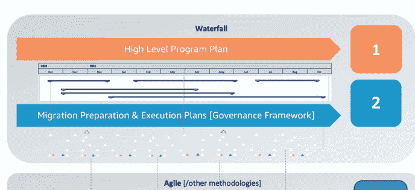

## AWS 云迁移的 SAFe 实施

本章将详细讨论云迁移以及其他方面，包括如何以及从何处开始您的旅程。此外，我们还将讨论在业务的某些阶段，云是否适合您。此外，我们还将阐明采用敏捷或 SAFe 如何帮助云转型。

本章将涵盖以下重要主题：

- 审查当前的云采用和迁移框架
- 云迁移策略的类型
- 其他云迁移策略
- 云到云迁移挑战
- 从云迁移回本地
- AWS 云迁移工具
- 采用以史诗为导向的敏捷方法
- 成功迁移的指南
- 瀑布还是敏捷——选择哪条路线

## 云迁移需要考虑的事项

AWS 云采用框架（CAF）提供了一个框架，以确保对云之旅的全面视野。它连接了六个最重要的方面，即业务、人员、治理、平台、安全和运营。在尝试企业迁移工作时，该框架可以帮助您了解需要改进的领域。如果将该框架与敏捷实践和精简的云迁移相结合，您可以更快地推进并有效创新。对于大规模云迁移，我们建议采用敏捷方法，而不仅仅是作为一项独立活动。

考虑云迁移时，无论您计划使用何种类型的云和服务模型，以下三个因素都必须考虑：

- 您计划迁移什么？
- 您为什么要迁移它？
- 您将使用哪些方法来迁移它？

更具体地说，重要的是弄清楚迁移过程将如何进行，并给予足够的规划关注。无论流程多么有效或高效，无论团队技能多么高且致力于此次迁移，您都可能会面临某些挑战。应对它们的最佳方式是提前做好准备。您的云迁移战略必须包括预见潜在问题。以下各节描述了一些可能在云迁移过程中导致问题的领先挑战。

## 成本管理

云计算提供成本节约；然而，确定确切成本可能具有挑战性。云计算费用更可能被低估。请务必考虑的不仅是迁移成本，还包括迁移服务、潜在的带宽需求以及未来的经常性费用。高效的规划、长期的战略决策和最佳的云成本会产生巨大差异。

## 复杂性

如果开始引入混合云元素，公有云将变得更加复杂且难以管理。团队必须由熟悉云迁移并有能力管理您的云的人员组成。此外，他们必须预见、预测并理解成功迁移所必需的努力。

## 依赖关系

当涉及应用程序依赖关系时，迁移会变慢并变得不必要地复杂。然而，您可以通过使用提供商发现工具来确保您关注所有提供商。

## 遗留应用程序

出于许多原因，将某些应用程序迁移到云中可能令人恐惧，其中复杂设置和效率低下的团队名列前茅。在这些情况下，您移动的原因变得至关重要。在这种情况下，最好的方法是考虑保留现有内容、重建需要重建的内容以及重新购买可能有价值的内容。

## 数据库

对于大量数据，云计算可能需要很长时间。提供商可以通过为客户提供将数据物理复制到提供的硬件上的选项来帮助使流程更顺畅、更无缝，然后他们稍后将其运回。

## 利益相关者支持

就云计算而言，拥有愿意长期投入的领导者至关重要。因此，建立云卓越中心（CCoE）非常重要，并且可以大有裨益。

## 建立云流畅性

扩展中央云团队是不可行的。云流畅性的目标是组织内每个人都保持一致。因此，避免了过度负担翻译的需求。

## 审查当前的云采用和迁移框架

根据 Gartner 的报告，AWS 在基础设施即服务（IaaS）和 IaaS + 平台即服务（PaaS）方面仍保持领先地位，收入明显增加。

## 云的财务和竞争优势

那些不熟悉 AWS 运行的深入基础设施的人可能会想知道 AWS 快速增长的原因。根据 IDC 对 10 家公司进行的研究，亚马逊客户预计在未来 5 年内对 AWS 的投资回报率为 560%。按需付费的 IT 基础设施不仅提供财务效益和消除数据中心成本的能力，还为公司提供许多竞争优势。正如 Capital One 首席执行官 Robert Alexander 所解释的那样，AWS 是 Capital One 将其基础设施迁移到 AWS 的主要原因。

云基础设施管理和迁移到云是 AWS 通过利用最先进的技术和实践解决的挑战。借助亚马逊，我们可以将云迁移过程转变为企业的数字化转型，因为迁移到云不仅仅涉及技术。

## 迁移到云端的主要优势

除前面提到的优势外，组织应考虑出于以下原因将业务迁移到公有云：

- **可扩展性**：与传统的本地基础设施相比，云计算可以相对轻松地扩展，以支持更大的工作负载和更多用户。随着企业扩展其 IT 基础设施，他们会购买并安装物理服务器、软件许可证、存储和网络设备。
- **成本**：迁移到云端可带来显著节省，因为云服务提供商负责维护和升级。通过开发新产品或改进现有产品，他们可以将更多资源投入到创新中。
- **性能**：除了提升性能外，迁移到云端还能改善终端用户体验。在云环境中，应用程序和网站可以轻松扩展以满足更多用户或更高性能的需求，并且可以部署在靠近终端用户的地理位置附近，从而降低延迟。
- **数字体验**：无论您是员工还是客户，都可以从任何地方访问数据和服务。这为员工提供了现代化的灵活工具，并有助于数字化转型和改善客户体验。

云迁移具有挑战性；根据文章 *几乎一半的 IT 迁移注定失败*，44% 的公司迁移失败，66% 的公司推迟了迁移。数百家公司已使用 CAF 成功迁移到 AWS。AWS CAF 使云迁移变得更加容易。在该框架内，有六个 *视角* 构成框架的重点。重点如下：

- **业务视角**：贵组织的资源、使命、流程和当前状态是起点。例如，大多数公司希望通过利用云来最大化业务价值，而不是管理数据中心。
- **人员视角**：云迁移和管理技能在此视角的背景下定义。提供了更新组织流程、培训和沟通的指导，以支持新的业务流程。
- **治理视角**：通过一致的 IT 决策和风险管理，治理将 IT 和业务成果结合在一起。这带来了安全、高效且合规的技术环境。
- **平台视角**：迭代迁移和管理云服务是可行之道。基础设施必须持续优化以保持有效。尝试新事物时无需害怕；如果某件事行不通，可以尝试其他方法。
- **安全视角：** 在云中，安全是共同责任。此视角概述了在云中开发或部署资源的技能和流程。合规要求、安全控制和弹性要求必须与这些资源保持一致。
- **运营视角：** 随着企业对云的依赖程度提高，运营和 IT 的界限变得模糊。这样，组织双方可以更好地了解确保业务连续性和运营健康的必要技能和流程。

AWS CAF 提供了一个结构来查找和解决技能和流程差距，使组织能够更好地了解云采用对其业务的影响。应用 CAF 可让您拥有清晰、可执行的迁移计划和完整定义的执行工作流来指导流程。亚马逊的最佳实践可以帮助您加快开发和业务进程。

## 云迁移策略的类型

下文列出了迁移到云的三种基本类型或模式。它们按从最容易、最快（但存在一些缺点）到最困难（收益更大）的顺序排列：

- 迁移并保留
- 迁移并改进
- 拆除并替换

现在，让我们深入探讨云迁移策略的类型及其优缺点。

### 迁移并保留（重新托管）

Lift and shift（重新托管）的一个优势是，与传统托管方法相比所需时间更少。它几乎不需要重构，实施时间也更短。尽管如此，迁移并保留可能只会导致最少程度的更改，因此您可能看不到采用云原生所能获得的优势。短期来看，速度和便捷性可能会让您付出比更彻底的迁移更高的成本——尤其是与短期内的速度和便捷性相比。

那些距离云成熟度还很遥远的组织可以利用迁移并保留策略来运行简单、低影响的工作负载。如果您已有大量虚拟机，您会发现这相对简单。甚至可以从供应商处购买承诺自动化迁移的产品。另一方面，手动执行迁移也是一次良好的学习体验。如果您仓促采用了迁移并保留策略，好消息是，一旦应用程序在云中运行，重构和优化它们会更容易。

### 迁移并改进（重新平台化）

在重新平台化过程中，通过进行少量云优化，应用程序被塑造为云原生。迁移期间，云负载均衡器可以替代虚拟机内的负载均衡器，以通过减少需要迁移的虚拟机、配置和操作流程的数量来简化迁移过程，而无需更改应用程序。此外，这代表了应用程序迈向云原生开发的第一步。对于重新平台化，您需要更多地了解云、应用程序以及虚拟机内部的内容。换句话说，您确实需要了解应用程序，但不一定必须是程序员。如果您知道如何连接事物，例如将 Web 应用连接到数据库，您可能可以进行重新平台化——这属于正常的系统管理范畴。

在重新平台化的情况下，最常见的塑造活动之一是仅将数据迁移到云中，而不是数据库。使用迁移并改进或重新平台化方法迁移涉及更新应用程序以使其更现代化，例如通过引入扩展或自动化，而无需完全重构。乍一看，很容易认为这种折中方法是最好的选择，但最终您将保留所有技术债务，并且无法受益于云原生架构。

### 拆除并替换（重构）

这种方法也称为重构或重新架构，涉及完全重新设计工作负载以实现云原生。云中可获得的最大收益值得投入时间和技能发展，尤其是对现有人才进行再培训和提升技能——使重构成为积极的体验。这就是为什么大多数时候我们建议采用最小可行重构方法。该做法是在迁移前对应用程序进行低风险、低成本、高价值的更改。它使迁移能够更快进行，同时充分利用机会。

云测试平台可用于在迁移生产应用程序之前加速这些改进。开发和测试环境可以在几秒钟内启动，并且可以同样轻松地关闭。此外，云计算在工作方面提供了更大的灵活性。通过 PaaS 和 **软件即服务（SaaS）** 解决方案，您只需几行代码即可连接强大的解决方案。

## AWS 提供的重构实现高影响、低投入

下文列出了 AWS 上最重要的五项最小可行重构活动。尽管应用程序之间存在差异，但这些操作通常能以很小的风险带来丰厚回报。

### 更新操作系统（OS）

您是否会为您的 **操作系统**（OS）接收安全更新和补丁？如果没有，您应考虑在迁移过程中进行升级。由于本地升级，您必须购买新许可证，通过复杂的 IT 采购流程配置容量，测试应用程序，然后执行迁移。步骤众多，该过程既耗时又昂贵。正因如此，企业经常推迟操作系统升级，尤其是当存在必须始终运行的时效性应用程序时。在旧版操作系统上运行可能会同时损害性能和安全性。

通过云迁移是升级的理想机会。您可以通过快速、廉价地启动一个小型实例轻松开始测试应用程序。**亚马逊机器映像（AMIs）** 已预装了许多 Linux 和 Windows Server 操作系统，以及数十种其他选项。您可以通过连接 Amazon CloudWatch 管理的监控服务并上传代码来测试它。通常，迁移到受支持的版本不需要更改应用程序。系统可以在迁移前以低成本保持运行并进行测试。

在一个小型团队且无需正式采购流程的情况下，大多数应用程序所有者可以自行处理。通过压缩反馈循环，升级过程变得更快、更便宜。有时这并不容易。通常，大型公司中有些应用程序运行在较旧的平台上。由于文档缺失，这种长期运行的软件可能晦涩且脆弱。在这种情况下，基于云的实验环境将更有价值。为了更快地将其迁移到云中，您可以将其在容器中运行，然后在沙箱环境中继续改进它。

### 升级您的框架

通常，框架版本（如 .NET 和 Node.js）有到期日期，之后不再受支持，也不再提供补丁。这是有逻辑原因的，因为公司需要维护框架相当长的时间。内部升级通常涉及应用程序手术，成本高昂。在云中尝试框架更新要容易得多。整个堆栈可以在无需额外数据中心容量的情况下获得许可并部署，正如操作系统场景所示。

云使得能够并行并排运行同一框架的两个版本并分析结果以确定哪种方案效果最佳。安全组使您能够确保生产网络不受应用程序影响。通过分离您的应用程序，您可以在压力下对其进行测试，并找出以最经济的方式升级框架的方法。仍支持一些较旧的 Windows 版本，并且您可以升级到它们。无论如何，这种方法都能为您提供快速、廉价的反馈，以确定需要满足哪些要求。

## 改进安全
在防火墙后面拥有自己的数据中心会给您一种虚假的安全感。将您的 DNS 或 IP 地址带入云端，2004 年看起来安全的本地地址或 DNS 在 2020 年可能成为黑客的入口点。在迁移过程中通常会发现存在重大的安全漏洞；在许多情况下，这些是一次性例外，从未得到处理。在您的应用程序迁移到公共云之前，利用这个机会确保足够的安全性。

数据在传输中以及存储在服务器上时是否会被加密？API 是否使用现代安全措施？DevOps 流程是否包含安全测试？了解供应商负责的安全要素、您共同负责的部分以及您必须自行处理的部分。在云中管理安全方面，贵组织的文化如何？关于最低可行安全性的讨论需要在迁移前深入进行，尽管您无法解决所有问题。

## 优化访问权限
安全与身份和访问密切相关。技术债务在这些领域也很容易累积。在大多数情况下，应用程序从干净的状态开始，只有少数特权用户可以访问它。

当您准备迁移时，您将知道谁有权访问您的数据，因此您可以选择授予谁访问权限。使用 AWS 时，您将享有无直接访问数据的优势。由于我们的变更管理流程，我们通过命令行或自动化流程管理每个访问请求。长期权限不存在。权限根据角色授予或拒绝。此外，IP 屏蔽在管理员和实例之间提供了额外的保护层。

## 探索数据库选项
将此列表中的数据库迁移到新数据库涉及广泛的难度等级。云可以成为实验和增量改进的理想平台，这也是事实。对于大多数组织而言，升级到 Amazon Relational Database Service (Amazon RDS) 相对容易，且几乎无需更改或无需更改。

使用 Amazon RDS，您可以降低成本并调整容量，同时自动化诸如数据库设置、修补、备份和硬件配置等一系列管理任务。

在可用的众多 PostgreSQL、MySQL、MariaDB、Oracle、SQL Server 和 Amazon Aurora 版本中，您的应用程序应该能够使用它。使用 AWS Database Migration Service，迁移或复制数据令人惊讶地快速且简单。对于商用应用程序而言，供应商支持可能是限制因素。您可能会看到 Amazon RDS 被列为选项，但 Amazon Aurora 尚未得到支持。当供应商允许时，云中升级到不同的数据库选项比本地部署简单得多。如果您的目的是利用其优势和功能迁移到云端，则应采用云原生设计原则。虽然每个组织和工作负载都不同，但采用云原生设计应该是您的方法。通过做出正确的举措，您可以确保您的人员具备必要的技能。

## 其他云迁移策略
其他一些云迁移策略包括重新采购、驱动因素、限制和风险。

您是否有无法迁移到云端的遗留应用程序？考虑购买基于云的产品。以下是重新采购的示例列表，可促进整个流程并提供指导原则：

-   从自管理的电子邮件系统切换到提供电子邮件即服务的系统。
-   由 Marketplace 供应商构建的设备取代自建 VPN 服务器。
-   使用 Web 应用防火墙代替云提供商提供的 Marketplace 方案。

事实上，自建和运营自己的电子邮件系统变得越来越罕见。如果在发现评估的一部分中电子邮件服务目前在内部运行，那么推荐 SaaS 电子邮件方案很可能是最划算的。

AWS 重新采购持续发展，随着这一发展为重新采购开辟了许多新途径，迁移到 AWS 的数量可能会从目前的 5% 显著增加。一直以来都有在 AWS Marketplace 中重新购买应用程序而不是迁移脆弱的本地产品这一选项。它类似于升级过程，其中旧配置和数据被转移到重新购买的平台。

现在 AWS Marketplace 和 Service Catalog 已开发完成，可以租用设备和 SaaS 产品。此外，您可以自带许可证，甚至可以与 AWS 和供应商合作协商复杂的私有报价。

## 重新采购的驱动因素
需要注意的是，云计算革命正受到若干重要影响的推动。

## 基于消费的采购模式
基于消费的采购是技术消费者首选的模式。因此，他们更喜欢按月、无义务的付款计划，这些计划有效地将支出与个人收入挂钩，而不是为期三年的资本支出合同。

## 淘汰遗留“企业”软件
企业软件已失去作为技术黄金标准的地位。由于开源、软件创新及其快速发展，企业软件现在被视为过时、不吸引人且难以使用。因此，客户更频繁地更换软件堆栈以保持竞争力。企业可以通过云采购框架（如 AWS Marketplace）购买软件，以无摩擦的方式刷新其应用程序堆栈，这对企业有利。通过消除冗长、复杂且昂贵的软件采购周期，例如多阶段信息请求 (RFIs) 和建议请求 (RFPs)，该流程降低了成本。

AWS Marketplace 是测试软件的有效方式，如果不符合您的需求，可以将其关闭。由于迁移到 AWS，组织选择精简自设计、自建和自运营应用程序的数量以降低成本并提高净利润。

## 重新采购的好处
除了前面已经提到的一些好处之外，我们还列出了一些可以从根本上改变组织结构的重新采购好处：

-   **未来导向**：现代设备和基于云的软件应取代陈旧系统。
-   **简化采购**：通过一种采购机制，客户可以购买设备、**自带许可证 (BYOL)** 产品、SaaS 和私有报价。
-   **降低内部技能需求**：可以购买由专家构建的系统，无需您雇用他们。此外，SaaS 应用程序由您无需雇用的人员运行。
-   **减少工作量/更快迁移**：当需要迁移的内容更少时，迁移计划将更便宜、更快、风险更低。

## 重新采购的风险
重新采购存在风险。未能考虑和管理这些风险会使迁移变得更糟：

-   **集成和依赖**：如果您用云版本替换本地 Active Directory 系统，使用新的云服务时，您必须重新配置哪些客户端和应用程序？

- **采购摩擦：** 这种新的购买应用程序的方式可能与您的采购团队和流程不兼容。对他们来说学习四种方法至关重要：设备许可证（租赁）、BYOL 产品、SaaS 和私有报价。
- **不兼容的财务模型、文化和流程：** 财务是否能够处理未来不可预测且按需付费的成本？
- **不兼容的运营模型、文化和流程：** 如果运营希望管理已购买的系统怎么办？数据和应用程序很少是影响迁移的唯一因素。人员和流程往往发挥同等重要的作用。

如果避免或忽视这些风险，当购买的闪亮新系统未按预期运行 时，可能会出现不匹配。

## 如何重新采购

重新采购的常见方法可以总结为以下步骤。AWS Marketplace 是一种标准方法，但可能需要针对不同的应用程序进行修改：

- 使用 AWS Marketplace 比较发现的和已知的应用程序。
- 充分了解当前和即将到来的许可和采购选项。
- 考虑重新采购应用程序的付款、运营和消耗情况。
- 在配置和迁移到新应用程序时尽早识别任何阻碍因素。
- 使用 AWS Marketplace 将应用程序重新采购到设计良好的 AWS 账户中是最佳选择。
- 迁移应用程序的数据和配置。
- 测试与生产之间的过渡。

尽管 AWS 平台是一种被广泛采用的解决方案，有时，它需要进行调整以适应各种项目、应用程序和要求。

## 重新采购所需的内容

重新采购与重新托管和再平台化大不相同。迁移配置和数据现在成为唯一的迁移活动。在具有导入功能 的系统上，数据迁移应该很简单。

为了使重新采购成功，您需要具备以下能力：

- 内部运营、财务和采购。
- 在更换现有应用程序时，您应让内部应用程序专家参与。
- 聘请拥有广泛 AWS Marketplace 和 AWS Service Catalog 知识的合作伙伴，或在内部培训某人。正确的导航和执行需要专家。
- 有一个有组织的迁移计划，其中重新采购作为工作包，具有支持的商业案例、资源分配和时间表。
- 重新采购时没有标准的时间表或预算。这是迁移信息最简单、最快的方法，但根据软件的不同而差异很大。

当您重新采购时，您将放弃当前系统并寻找新系统。您可能会发现环境中存在一些可以不需要的东西，而不必担心后果。因此，请考虑以下几点：

- **退役**：采取行动。您将节省资金、提高安全性，并减少员工必须学习的新软件数量。
- **保留**：您不确定是否准备好退役或将某些尚未准备好的东西迁移到云端吗？稍后再看一看。有时，保持现状可能是一个明智的做法。正如我们所见，仅为迁移而迁移到云端可能会阻止您实现随之而来的所有好处。
- **云到云迁移**：例如，从 AWS 迁移到 Azure 需要从一个云迁移到另一个云。通常，公司在选择第一个提供商时未能考虑所有决定良好云匹配的因素。此外，公司可能只考虑短期至中期至关重要的因素。然而需求会随着时间的推移而变化。

以下是公司可能希望迁移到另一个云提供商的一些原因：

- 降低成本
- 提高可靠性
- 安全环境
- 更大的可扩展性
- 性能增强
- 需要额外云功能的业务变化
- 当前平台无法满足业务需求
- 集成改进

当这种情况发生时，从云到云的迁移是最好的解决方案。即使对于以前已迁移到云的公司来说，通常也会更具挑战性。通过在问题出现之前解决它们，您可以防止这些问题变成问题。

## 云到云迁移挑战

在公司可能面临的云计算最常见挑战中，以下是一些可使用正确方法避免的主要挑战：

- **迁移工作负载**：数据、应用程序和服务器必须在精确的规划和流程下在云提供商之间移动。工作负载需要在云之间安全移动，就像从本地迁移到云时一样。以足够快的速度下载数据可能是一个挑战，这可能会花费更多。
- **停机**：云迁移期间停机的风险很大。迁移应以数据一致性、网络连接检查以及为内部应用程序停机可能性做好准备的方式完成。
- **适应新的云环境**：大多数情况下，公司会为特定云提供商构建自己的应用程序。当迁移到另一个提供商时可能会遇到一些困难，因为这些定制可能与新云不兼容。为了利用新平台的优势，公司必须提前规划重新配置应用程序所需的时间。
- **预算和时间**：从服务器到云的迁移以及从一个云到另一个云的迁移都应考虑这两个因素。在此阶段，公司应考虑与迁移公司合作，因为他们可以确保顺利且经济实惠的迁移。

云回迁是将应用程序从云迁移到现场数据中心的过程。去云化也称为逆向云迁移。云环境与本地环境的不同之处在于用户拥有和管理技术。云解决方案和本地解决方案都可以使用相同的技术。然而，解决方案的消费方式不同。另一方面，云用户需要依赖通用工具，因为云提供商不太可能提供专业设备。

此外，一些政府要求敏感信息必须在现场存储和运行。云提供商无法确保仅在政府、健康和金融部门组织的安全法规合规性。相反，分布在许多大型分散网络中的云基础设施提供了更高的冗余度，同时允许组织访问比他们原本可以访问的更多计算资源。通常，内部环境前期成本更高且维护更复杂。

## 从云迁移回本地

就云提供商而言，如果他们开始收取更高的价格，您的选择可能会受到限制。因此，包括任何其他因素，这为迁移回本地存储奠定了基础。

## 规划您的退出策略

要成功退出云，规划至关重要。如果您有适当的计划，应用程序在转移时将是安全的。如果您必须快速离开云，请确保您提前做好准备。为了制定退出策略，应考虑以下因素列表：

- **盘点**：列出您拥有的所有资产清单，以免遗漏任何内容。确定应用程序的所有依赖项如何在云基础设施内分布，以及您的数据位于何处。
- **了解您的 SLA**：在去云化或更换供应商时，您需要遵守您的 **服务等级协议（SLAs）**。确保您了解合同下的义务。
- **从小开始**：先迁移小型应用程序，然后再迁移到整个系统。
- **测试**：选择部署模型的最佳方法是测试和重新测试潜在解决方案。在迁移之前执行测试以避免中断。
- **重新分配资源**：评估您是否需要更多资源、资产分配或优先事项的重新调整。确保潜在解决方案在运营上可行、安全且持久。为了大规模迁移到 AWS，组织必须沿着采用阶段的路径前进。项目、基础、迁移和再发明是四个阶段：
- **项目**：该项目评估 AWS 云是否满足组织的具体需求并确定行动方案。它不需要任何 AWS 经验。
- **基础**：组织将其数据中心扩展到 AWS。特别是，组织实施 AWS 合规性和安全模型。在 AWS 迁移专家的帮助下，它创建初始登陆区框架。员工接受 AWS 技能培训和云重点培训。应用程序从企业内部转移到 AWS。
- **迁移**：在此阶段，组织通过在 IT 部门定义角色来为长期云运营做准备。此外，CCoE 在公司内部创建一个跨职能团队，帮助推动公司范围内的云采用工作并迁移数据中心和生产应用程序。
- **再发明**：因此，所有项目现在都使用云。在云中探索新的商业模式，组织对云运营的舒适度超过了对本地运营的舒适度。

组织准备度评估的目的是评估组织进入采用下一阶段的准备情况。在开始迁移的准备和规划阶段之前，您必须完成准备度评估。作为本指南中描述的敏捷计划的一部分，您会查看准备度评估结果以了解您当前的状态。

## AWS 云迁移工具

AWS 如何支持云迁移？答案在于 AWS 拥有丰富的解决方案可供云迁移使用——其中许多是免费的——助您快速起步。接下来将介绍其中一些领先的工具。

### AWS Migration Hub

AWS Migration Hub 为您提供工具，通过将云迁移和现代化需求集中在同一平台下，加速并简化您与 AWS 的旅程。您可能正在开发现有 IT 资产的数据驱动清单，或在组织内部为云构建案例。如果是这样，您可能正在将应用程序迁移到 AWS 并进行管理。或者您可能正在升级之前的 AWS 应用程序。Migration Hub 可以帮助您完成所有这些复杂的云转型项目。通过 AWS Migration Hub，IT 资产清单数据可以存储在一个地方，同时可以跟踪到任何 AWS 区域的迁移。如果您已经完成迁移，请使用 Migration Hub 加速将应用程序转型为原生 AWS 功能。利用 Refactor Spaces，您只需为使用的资源付费。Migration Hub 允许您在 AWS 解决方案之间跟踪迁移进度，选择合适的工具、跟踪指标等。

### AWS Application Discovery Service

企业客户可以使用 AWS Application Discovery Service 规划迁移项目，该服务收集本地数据中心的信息。在规划数据中心迁移时，通常需要考虑数千个极其相互依赖的工作负载。迁移的初始步骤包括收集服务器利用率数据和映射依赖关系。AWS Application Discovery Service 为您提供有关服务器配置、使用情况和行为的信息，帮助您更好地理解它们。

AWS Application Discovery Service 以加密形式存储收集的数据。此数据可以导出为 CSV 文件，用于估算您的总拥有成本 TCO 并规划迁移到 AWS。此外，发现的服务器可以迁移到 AWS Migration Hub，您可以在其中跟踪它们迁移到 AWS 的进度。请 AWS 审查您本地的数据设置以规划迁移。通过 Migration Hub 收集的所有数据均已加密。

### AWS Server Migration Service

迁移到 AWS 应使用 AWS Application Migration Service。Application Migration Service 推荐给目前使用 Server Migration Service SMS 的客户。AWS Application Migration Service 简化并加快了云迁移。通过在不更改应用程序且停机时间最少的情况下将其迁移到云中，您可以快速实现云计算的优势。在将大规模服务器迁移到 AWS 时，此服务将使流程尽可能简单快捷。

### AWS Database Migration Service

借助 AWS Database Migration Service AWS DMS，数据库迁移到 AWS变得轻松。这样，依赖源数据库的应用程序在迁移期间不会出现停机时间。使用 AWS Database Migration Service，可以从最流行的商业和开源数据库迁移数据以及迁移到这些数据库。

除了包括 MySQL 到 MySQL 的同构迁移外，AWS Database Migration Service 还支持不同数据库之间的迁移，例如 Oracle 和 Microsoft SQL Server 到 Amazon Aurora。AWS Database Migration Service 可与任何受支持的源和任何受支持的目标配合使用，以低延迟持续复制您的数据。Amazon Simple Storage Service Amazon S3 允许您从多个源复制数据，以构建高可用且可扩展的敏捷数据湖解决方案。数据可以流式传输到 Amazon Redshift 以创建 PB 级数据仓库。安全可靠地将数据库传输到 AWS。迁移期间没有停机时间，因为源数据库始终可用。

### CloudEndure migration

此迁移和搬迁解决方案提供 90 天免费试用。借助 CloudEndure Migration，您的应用程序可使用基于代理的工具重新托管到 AWS。借助自助服务功能和自动化流程，可以在不影响业务的情况下进行迁移和搬迁。CloudEndure Agent 应安装在源机器上。应用程序和数据由 Agent 复制到 AWS 的暂存区域。CloudEndure Agent 对源和目标环境执行异步、块级数据复制，因此可以跟踪源环境到目标暂存区域的更改并进行迁移，而不会造成停机或性能问题。

CloudEndure 网站上提供自助服务 Web 控制台，用于配置目标环境、检查兼容性问题，并在迁移前验证您的应用程序在 AWS 上是否顺畅运行。您可以在将应用程序托管到 AWS 并使用服务后对其进行重写、重新架构和重构。用于迁移数据的其他工具包括 AWS Snowball、AWS Snowball Edge、AWS Snowmobile、AWS DataSync 和 AWS Transfer for SFTP。

## 采用敏捷方法使用史诗

史诗的概念是指可以分解为更小故事的大量工作，Jira 有时将其称为问题。多个团队可以共同在多个项目上工作，并且可以使用多个看板同时跟踪多个史诗。通常，一组冲刺先于史诗。史诗的用户故事会随着团队通过开发和客户反馈对其了解的加深而被添加和删除。本质上，敏捷史诗采用基于客户反馈和团队节奏的灵活范围。

一个好的史诗应为开发团队成功提供所有所需资源。就其工作层级而言，它是最高层级。了解史诗如何融入其他敏捷结构对于指导日常开发工作至关重要，同时也为评估史诗提供了重要背景。

将史诗分解为更小的部分使其更容易理解并保持势头，但对于新手来说可能看起来令人望而生畏。没有完美的方法可以从史诗中创建故事线，但我们可以考虑几个选项：

- **User role or persona**：每个用户角色都应有自己的故事。新访客将能够更快地登录， returning customers 将能够更快地登录，等等。
- **Ordered steps**：定义每个步骤并提供其背后的故事。
- **Culture**：让团队的规范决定故事是快速完成还是需要一周时间完成。
- **Time**：设定切合实际的截止日期。设计应在一次冲刺中完成的故事。

大故事和史诗都没有通用定义。一般来说，最好将预计需要数周甚至数月的工作分解为更小的故事。项目的初始史诗很少由企业确定；然而，其定义是必要的。让我们通过以下简单步骤学习如何创建您的第一个史诗。

应首先概述史诗的定义。史诗是 SAFe 中的解决方案开发计划，在启动前衡量潜在投资回报率 ROI。此外，SAFe 中的每个史诗都可以在组织的商业案例中概述。

类似的概念可以在软件项目和程序中找到。为了获得资金，两者都必须在经济上可行并评估 ROI。SAFe 史诗与其他项目制方法之间的主要区别在于，公司为已资助的项目创建一个新团队。ART Resource Tagging API 可以处理史诗，团队规模为 50 至 125 人，专门从事此任务。

### Portfolio epics and software epics

软件或程序史诗源自投资组合史诗，但这是常见的误解。投资组合史诗实际上由多个敏捷发布 ART 组成，而程序史诗由单个 ART 组成。复杂性进一步加剧，因为软件史诗和投资组合史诗通常都收集在一个名为投资组合的存储库中。投资组合管理团队负责创建史诗。

类似于项目传送带，这两种史诗都通过 Kanban 投资组合进行无缝执行。根据 ART 模型，每个软件史诗都是一个史诗。然而，只有少数可以追溯到投资组合史诗。

## 业务史诗与架构史诗

业务和架构中的史诗明显不同。架构史诗为您的投资组合增添质量并加速其价值交付。业务史诗改善客户体验。

## 定义您的初始史诗

我们合作过的一些公司在推进尚未获得资金的项目方面没有明确的流程。在获得资金后，想法或提案就成为项目。将现有提案、计划、项目和计划转换为史诗，是设计初始史诗集的最快经过验证的方法。

同样，您也可以基于此初始流程确定可能的 ART。不要创建新团队，请考虑使用现有团队。您的团队已经拥有多名专家，可以在项目或计划初期作为主要资源。在下一节中，我们将讨论如何将敏捷原则应用于云迁移，包括准备、实施和跟踪成果。

## 方法

史诗管理的敏捷方法涉及从小处着手：迭代、衡量、管理并扩展。大型云迁移可以使用敏捷方法进行准备和实施。此方法包括以下内容：

- 使用史诗和用户故事作为组织工作的方式，可以让您快速适应变化。
- 制定具有明确优先级的待办列表。
- 您的进展应得到报告。
- 构建利益相关者需求与技术计划之间的连接路线图，以提高效率和有效性。

## 准备

以下是迁移准备涉及的步骤：

- 1. 设置两个双披萨团队规模的 Scrum 团队。作为就绪和规划的一部分，这些团队由来自不同工作流的内部资源组成。团队根据其底层功能/技术角色分组。团队共同努力推动采用、实现初始迁移，并为企业规模迁移做好组织准备：
  - I. 双披萨团队 1 结构和资源：商业案例分析、项目治理、人际技能和卓越中心 (CoE)
  - II. 双披萨团队 2 结构和资源：应用发现和迁移、着陆区，以及安全和运营的集成
- 2. 与两个 Scrum 团队一起审查迁移就绪评估结果。
- 3. 第一波迁移应涉及 10 到 30 个从本地迁移到 AWS 的应用程序。
- 4. 应设置待办列表。所有已有迁移模式的工作流都应用于创建 *预烘焙* 史诗。以下图表显示了一些最相关的示例：

| 摘要 | 问题类型 | 描述 |
|---|---|---|
| 应用迁移 - 第一波 | 史诗 | 作为迁移项目负责人，我希望分阶段迁移为 MRP 识别的所有应用程序，与客户... |
| OI - 许可证管理 | 史诗 | 作为云服务负责人，我希望有效地管理软件许可证，以确保没有许可... |
| OI - 问题管理 | 史诗 | 作为云服务负责人，我希望确保建立问题管理机制和流程，以便... |
| OCM - 使其持久 | 史诗 | 作为云执行赞助商，我希望确保缓解策略和计划中概述的关键活动得到执行... |
| OCM - 提升能力 | 史诗 | 作为云执行赞助商，我希望推动一种新的组织文化，该文化能够产生回报... |
| OCM - 组织参与 | 史诗 | 作为云执行赞助商，我希望确保领导层和关键利益相关者之间的... |
| OCM - 展望未来 | 史诗 | 作为云执行赞助商，我希望确保变更策略、沟通、参与策略、培训... |
| OCM - 对齐领导层 | 史诗 | 作为云项目赞助商，我希望确保关键全球和区域/本地业务利益相关者的... |
| OCM - 团队动员 | 史诗 | 作为执行云项目赞助商，我希望采用深思熟虑、结构化、文档化的方式交付云... |
| OI - 补丁管理 | 史诗 | 作为安全负责人，我需要提供机制并确保所有应用程序服务和信息... |
| 安全 - 事件管理 | 史诗 | 作为事件响应经理，我希望制定和实施事件响应计划/方法，以便... |
| 安全 - 数据管理 | 史诗 | 作为数据保护经理，我希望建立并实施静态和传输中加密方法... |
| 安全 - 基础设施管理 | 史诗 | 作为基础设施安全经理，我希望实施安全和合规基础设施，以便... |
| 安全 - 日志和监控管理 | 史诗 | 作为日志和监控经理，我希望实施日志和监控框架，以便... |
| 安全 - 访问管理 | 史诗 | 作为身份和访问经理，我希望安全地控制用户对我的 AWS 服务和资源的访问... |
| 大规模迁移规划 | 史诗 | 作为迁移项目负责人，我希望确保所有先决条件已建立基线，以便... |
| 着陆区设置 | 史诗 | 作为 CIO，我希望在云中构建可扩展且 resilient 的虚拟数据中心，以便... |
| 项目管理设置与执行 | 史诗 | 作为执行赞助商（CIO），我希望为动员团队奠定基础，以便... |
| 商业案例和 TCO | 史诗 | 作为执行赞助商，我希望了解 AWS 中的迁移和运行成本，以便... |
| 基线发现 | 史诗 | 作为 IT 总监，我希望发现所有基础设施资产，以便... |
| MRA | 史诗 | 作为 CIO，我希望评估当前组织能力，以便... |

图 8.1 – 用于设置待办列表的预烘焙史诗

- 5. 应指定产品负责人和 Scrum 负责人来管理待办列表。
- 6. 在八个为期两周的冲刺中迁移应用程序。
- 7. 您应准备一份迁移计划，其中包括资源、待办列表、风险/缓解日志以及角色和职责矩阵，例如责任分配矩阵。

使用以下计划，您可以识别在整个计划中负责每个风险的资源。

## 实施

迁移实施阶段如下所示：

- 1. 与团队一起规划冲刺计划并共同设定冲刺目标。
- 2. 通过将史诗分解为具有验收标准的用户故事并审查史诗来组织冲刺 1–8。
- 3. 两个双披萨团队都应举行每日会议。持续的工作流程和快速响应取决于此会议。通过促进每日站会，Scrum 负责人让 Scrum 团队了解解决阻碍的进展并报告交付成果。
- 4. 通过建立沟通和报告协议来组织实施监督会议。
- 5. 在冲刺期间对齐、使能和动员资源和团队。慢慢开始，创造早期成功，并逐步达到完整的迁移能力。
- 6. 围绕输出、最佳实践和经验教训构建大规模迁移。
- 7. 使用第一波创建可扩展迁移的敏捷蓝图。这将为准备和规划迁移提供基础。

在进行第一波迁移时，您会获得经验和信心。此外，您必须根据组织的需求选择迁移计划，以及将使用的模式和工具。这可确保运营和安全程序得到测试。还创建了基于常见模式的应用程序分组列表，使用投资组合内的模式（例如架构和技术堆栈）。然后以标准化方式处理分组迁移。

## 增值成果

使用此敏捷模型，您可以加速大规模运营。这种敏捷方法带来以下增值业务成果：

- **应用选择**：使用 7 Rs 迁移分析评估应用程序。
- **迁移波计划和迁移工具**：确定移动组优先级并确定可用工具。
- **着陆区**：测试和部署各种着陆区组件。
- **DevOps**：使用 DevOps 提供频繁的功能、修复和更新。
- **自动化**：实施供应商提供的迁移工具。
- **迁移模式**：参考 Prescriptive Guidance 目录中的可用模式。
- **设计架构**：规划、设计并为服务器、数据和应用程序创建迁移目标。
- **培训工具**：为资源提供 AWS 的动手培训。
- **运营运行手册**：如果您在 AWS 上运行应用程序，请对其进行监控和报告。

最后，建立迁移的计划和时间表至关重要，同时进行协调和资源分配，识别问题和风险并进行沟通。

## 成功迁移的指南

本节中的指南分为多个部分，以帮助您规划迁移并进行迁移冲刺。

## 规划

为了将资源迁移到 AWS，您必须弄清如何迁移它们、将使用哪些工具，以及将使用何种运营模式来维护、治理和保护它们。按照以下最佳实践为迁移做好准备：

-   确定全面波浪计划的关键假设。每个冲刺中使用的数量、依赖关系和工具，以及每个冲刺的负责人都应被确定。
-   集成账户结构、安全、网络、自动化和管道。
-   准备登陆区至关重要。
-   必须选择并获取迁移工具。
-   定义变更管理和影响评估流程。
-   决定如何进行沟通。
-   建立生产流程和运营模式。
-   必须选择并承诺资源，包括合作伙伴。

## 活动

所有冲刺周都应提前规划。团队成员应参与每个冲刺周！请记住以下几点：

-   为了监控进度并指导团队成员，创建关键指标。定义每个目标应如何以及如何衡量。
-   通过进行预验尸分析来规划风险。
-   决定如何让每个人保持知情并设定时间表。
-   通过举行启动回顾来识别和改进冲刺活动。
-   产品待办事项应重新排序。
-   计划您将如何每天继续练习。
-   组织回顾以确定改进领域。
-   始终按计划进行。

冲刺、规划和回顾会议也应以更短的节奏安排。两到三周的冲刺提供快速反馈，允许您调整方向，并创造紧迫感。第一波迁移包括开发蓝图和构建块以及测试特定的迁移模式。随着您组建团队来支持初始波次的迁移，开发迁移工厂流程并为整个应用程序组合扩展敏捷模型现在是您的下一步。

迁移工厂通过铺平道路实现大规模迁移到 AWS。高效的迁移工作流程结合了云迁移的技术、业务和人为因素。云迁移在某些情况下对团队来说令人失望。尽管他们失败了，但他们坚持下来并通过后续尝试改善了结果。当您计划作为组织现代化的一部分将关键任务应用程序迁移到云时，您无法承受重复他人的错误。为了最大化成功云迁移的机会，本文利用这些经验教训制定了 10 步清单，列出您需要考虑的最重要因素。以下各节是云迁移清单的组成部分。

## 第 1 步 – 建立迁移架构师角色

您应在开始云迁移之前建立迁移架构师的角色。迁移架构师在规划、实施和完成迁移的各个方面发挥着关键作用；其主要职责包括定义促进迁移成功的重构策略、制定数据迁移的迁移策略、定义云解决方案需求以及确定迁移优先级和切换机制。

当迁移项目规模较大时，需要做出许多技术决策，而能够处理项目各个方面的迁移架构师的存在对于项目的成功至关重要。

## 第 2 步 – 选择云集成级别

将应用程序从数据中心迁移到云时，可以使用浅层云集成或深度云集成。当您使用浅层云集成时，您将本地应用程序迁移到云，而无需更改在云中运行应用程序所使用的服务器。只需进行少量更改即可使应用程序在新环境中运行。这些服务并非云独有。Lift-and-shift 是该模型的另一个术语，其中应用程序完整地转移到云中。

对于深度云集成，您在迁移过程中修改应用程序以利用关键云功能。对于应用程序的某些部分，诸如 AWS Lambda 之类的无服务器计算功能可能与自动扩展和动态负载平衡一样复杂。使用基于云的数据存储（如 Amazon S3 或 DynamoDB）可能是另一个选择。

## 第 3 步 – 选择单一云或多云

如果您计划将应用程序迁移到云，您应该问自己以下问题：您计划在单一云提供商上运行应用程序，还是计划在多个提供商上运行？特定于云提供商的应用程序优化相对简单。您只需学习一套云 API，您的应用程序就能利用云提供商提供的所有功能。这种方法存在供应商锁定方面的缺点。当您已经更新应用程序使其与该提供商配合使用时，将应用程序迁移到另一个云提供商可能需要同样多的工作。此外，如果您只有一个云提供商，您可能无法就关键条款（如价格和 SLA）与云提供商进行谈判。

一个云包含一个应用程序，另一个云包含另一个应用程序。起初使用多个云似乎很简单；一组应用程序运行在一个提供商上，另一组运行在另一个提供商上。这种方法的优点是您可以利用多个提供商来增加业务杠杆和灵活性，以确定将新应用程序放在何处。此外，应用程序可以针对其运行的提供商进行优化。使用多个云提供商可以帮助您扩展应用程序。一些公司选择使用一个云提供商运行其应用程序的一部分，但使用另一个提供商运行其他部分。这使您可以利用每个提供商提供的关键优势。在这种情况下，您的应用程序可能会受到任一提供商性能的影响，任一提供商的任何问题都可能影响客户体验。

云无关开发对您应用程序的成功至关重要。那些不采用云无关开发的人可能会失去客户。您的应用程序可以在多个提供商之间同时运行，或在它们之间共享负载。该模型使您可以轻松地在不同的云提供商之间切换负载，在与供应商谈判时为您提供最大的灵活性。

## 第 4 步 – 建立云 KPI

应用程序的关键绩效指标（KPI）与其相对于您对其的期望的表现有关。您的应用程序和服务可能已经分配了 KPI，但当它们基于云时，它们仍然是正确的吗？KPI 对于了解云迁移的进展最有用，突出您可能没有注意到的任何问题。云迁移 KPI 可以确定迁移何时完成且成功，这也许是最重要的因素。云迁移 KPI 可以分为几个类别：

| 类别 | 示例 KPI |
|---|---|
| 用户体验 | 页面加载时间 |
|  | 延迟 |
|  | 响应时间 |
|  | 会话持续时间 |
| 应用/组件性能 | 错误率 |
|  | 吞吐量 |
|  | 可用性 |
|  | Apdex |
| 基础设施 | CPU 使用率 % |
|  | 磁盘性能 |
|  | 内存使用量 |
|  | 网络吞吐量 |
| 业务参与度 | 加入购物车 |
|  | 转化次数和转化率 % |
|  | 参与率 |

评估每个类别对您业务的重要性，并确定哪些指标将受到云迁移影响最大。然后使用诸如基础设施监控之类的工具，您可以跟踪正在发生的情况。

## 第 5 步 – 建立性能基线

基线建立涉及衡量服务或应用程序的当前性能并确定其未来性能是否可接受。根据基线，您可以确定迁移何时完成以及迁移后可以提高多少性能。随着您迁移到云，您还可以使用基线来诊断发生的任何问题。

每个关键绩效指标都应有基线指标。设定收集数据以建立基线的时间范围。较短的基线周期允许您更快地移动，但它们不会为您提供具有代表性的性能样本。从时间上讲，较长的基线周期会产生更具代表性的数据，但需要更多时间。

此外，您应决定是否仅收集平均或具有代表性的基线数据，或是否包含在关键或高峰时段收集的数据。如果您是新闻网站，是否希望在有重大新闻事件的某一天收集信息，还是更愿意避开此类日子？无论哪种数据收集模型适合您的行业，您都应明确定义将收集的数据类型和持续时间。

## Step 6 – 优先考虑迁移组件

除了将整个应用程序一次性迁移到云端之外，您还必须决定是按组件还是按服务逐个迁移应用程序。确定哪些服务依赖于哪些其他服务，以及哪些服务连接着哪些其他服务。对于更大、更复杂的应用程序，请考虑使用能够根据服务地图创建依赖关系图的应用程序性能监控工具。

确定迁移哪些组件以及迁移顺序需要使用依赖关系图。通常，依赖最少的服务是最适合先开始的。因此，您会先迁移最内部的服务，然后再迁移最外部的服务，而最外部的服务通常是客户可以访问的服务。另一种选择是，您可能希望从最接近客户的最关键外部服务开始，以便您可以控制对它们的影响。

## Step 7 – 执行必要的重构

如果您希望基于云的应用程序和服务尽可能有效地工作，您可能需要在之前对应用程序和服务进行一些其他更改。如果是这样，您应该重构您的应用程序：

- 这使您能够使用可变数量的运行实例动态扩展服务，从而可能为您节省资金。
- 通过这样做，您将能够更好地利用云技术，例如根据需要动态分配和取消分配资源，而不是提前静态分配。
- 在将单个服务迁移到云之前，请考虑转向面向服务的架构，以便迁移更轻松。

## Step 8 – 创建数据迁移计划

云迁移 notoriously 复杂，尤其是在迁移数据方面。了解数据位置如何影响应用程序性能非常重要。当主要访问方法仍在本地时添加基于云的数据访问可能会极大地影响性能。此外，数据可能驻留在本地或云中，具体取决于访问的是哪个服务。

您可以使用以下选项迁移数据：

- 使用双向同步机制集成本地和云数据库。所有数据使用者迁移到云后，应删除本地数据库。
- 在本地数据库和基于云的数据库之间实施单向同步，并允许使用者仅访问本地版本。当您准备好禁用对本地版本的访问时，启用基于云的使用者访问新数据库。
- 可以使用数据迁移服务，例如 AWS’，将数据迁移到云中。

妥善规划您的数据迁移，不要低估其复杂性。如果您在开始之前不严格遵循数据迁移计划，很容易导致云迁移失败。在数据迁移规划过程中，您的迁移架构师应发挥核心作用。

## Step 9 – 切换生产环境

那么，您如何将旧的本地系统迁移到新的基于云的版本，以及何时迁移？您的答案将取决于应用程序的复杂性和架构，以及您的数据和数据存储的构建方式。

您可以选择以下两种方法之一：

- **一次性完成**：确保在将流量切换到云堆栈之前，本地堆栈正在正常运行。
- **逐步迁移流量**：先从少数客户开始，测试以确保一切正常，然后再迁移更多客户。继续将您的客户迁移到基于云的应用程序，直到您转移了所有客户。

## Step 10 – 审查应用程序资源分配

将所有内容迁移到云后，有几件事需要考虑。您的首要任务应该是优化资源。在云中，资源分配可以是动态的，因此您不应静态分配资源以利用云的优势。在迁移到云的过程中，为您的团队准备好向应用程序分配资源。通常，当云中应用程序需要额外资源时，云提供商会在瞬间提供几乎任何数量的额外资源。假设您的团队拥有能够适应动态扩展的应用程序架构，您通常可以依靠按需扩展的能力来满足用户需求。

## 云迁移的其他注意事项

除了本清单中提到的步骤之外，云迁移期间还有其他需要考虑的事情。例如，任何云迁移的重要组成部分都是确保环境安全可靠。您可以使用大多数云提供商提供的工具和资源来构建和维护安全系统。

关于云定价，有两个经验法则很突出：云计算比本地计算便宜，云计算比本地计算更昂贵。视情况而定，任一规则都可能成立。事实上，如果您开始使用它而不是使用前者，云计算可能会增加您相对于物理数据中心的<|message|> 基础设施账单。这可能是由于以下几个原因。

如前所述，所有基础设施系统都有隐藏成本，您可能没有考虑运行自己的数据中心的全部费用，而云提供商则明确列出所有费用。有时您会将苹果与橘子进行比较，从而使云看起来比本地更昂贵。

基于云的基础设施通常由 **运营支出 (OpEx)** 融资，而本地基础设施主要由 **资本支出 (CapEx)** 融资。视企业记账方式而定，资本支出可能比运营支出更容易获得。确保您的财务模型反映云和本地基础设施之间的差异对于能够认识到云成本改进至关重要。

## 瀑布还是敏捷 – 选择哪条路线

多年来，行业发生了重大变化，特别是行业在大量无效资源方面取得了巨大进展。大量工具、方法和经验已被记录下来，但指针几乎没有显著移动。那么，这是怎么可能的？在我们拥有所有工具和方法的情况下，我们不应该更明智地管理项目吗？

## 即将到来的变化

在纸面上和原则上，是的，但就大型项目而言，特别是数据中心迁移和整合项目，尽管有最新的工具和方法，结果几乎没有变化。

无论所有研究和指标如何，似乎情况就是如此。此外，众所周知，投资组合、项目和项目管理是可以奏效的，因为某些行业——通常在 IT 之外——使用最佳实践成功管理项目，例如建筑。制定目标适当、切实可行且符合关键项目约束（如时间和资源）的计划，对于从零开始创建摩天大楼至关重要。

## 计划就是一切，计划什么都不是

事情很容易在这里开始出错。大多数希望以敏捷方式工作的组织很难制定出足够详细的计划来代表实际要完成的工作。然而，这个困境如何解决？答案是创建主计划，建立一套关键里程碑和交付成果作为治理框架，但让子项目在其范围内敏捷工作。

## 实际应用

到年底，交易已经失控。不同质量水平的迁移计划很多，但没有高层计划将它们统一起来。从本质上讲，没有高层计划，这意味着没有人清楚地了解需要做什么、完成的时间表以及围绕它的依赖关系。

我们的结论是我们需要开发高度标准化的迁移模板计划，涵盖迁移的准备阶段和执行阶段。在每个团队受邀后，我们举行了启动会议，解释了概念并根据模板计划确定了具有约束力的交付日期。超过 1,400+ 个应用程序已成功迁移，我们已根据高层迁移计划跟踪了它们的进展。为了简单起见，我们没有关注团队如何跟踪其个人进展；这样做是为了避免不必要的文书工作。

## 统御一切的计划

就数据中心的整合和迁移项目而言，这种方法与 AWS 作为其迁移最佳实践的一部分所实施的方法非常相似：

图 8.2 – 云迁移最佳实践、策略和工作流程

## 过度设计

如果在迁移阶段提前规划并事先思考潜在风险和缓解措施，您将面临更少的问题。当然，企业在迁移期间失败并不是一个选项。

## 摘要

采用云不仅仅是技术转型的唯一好处。该框架提供了使用 AWS CAF 通往云的旅程的全面视图。凭借业务、人员、治理、平台、安全和运营，它连接了软件最重要的六个方面。以下框架在企业尝试迁移工作时可能有所帮助。然而，它并非没有挑战，例如财务限制、数据库问题和依赖性。

一旦成功实施，云迁移的好处将非常明显，其中包括高可扩展性、更好的性能和出色的数字体验。基于团队和组织基础设施的众多云迁移策略之一包括重新采购、各种驱动因素、限制、风险等。

此外，云到云迁移可能会给结构松散的组织带来多重挑战，例如停机时间、适应新的云环境和预算。云应用程序重新回迁到本地数据中心是将它们从云迁移到本地服务器的过程。将云应用程序带回本地数据中心是将它们从云迁移到本地服务器的过程。去云化也被称为逆向云迁移。

在下一章中，我们将深入探讨 EA 使能就绪度。我们将重点了解建立 EA 实践的过程和流程，确定负责人，以及每个负责人的工作流程以及他们的角色和职责。
