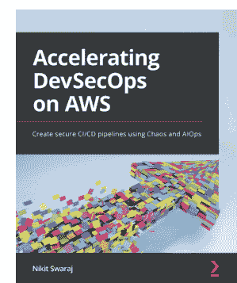
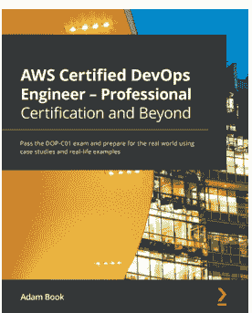

## 索引
### A
- ADM，架构变更管理
  - 需求管理 151
  - 资源 151
- ADM，架构愿景
  - 创建 144, 145
  - 概述 144
- ADM，业务架构
  - 开发基线描述 146
  - 应用业务能力 146
  - 概述 145
  - 应用建模技术 147
  - 应用组织图 147
  - 应用价值流 146
- ADM，数据架构
  - 架构存储库 149
  - 考虑因素 148
  - 数据治理 148, 149
  - 数据管理 148
  - 数据迁移 148
- ADM 阶段
  - 关于 139, 254
  - 架构变更管理 256
  - 架构愿景 255
  - 业务架构 255
  - 框架和原则 254
  - 实施治理 256
  - 信息系统架构 255
  - 迁移规划 256
  - 初步阶段 140
  - 机遇与解决方案 255
  - 技术架构 255
- ADM，初步阶段
  - 能力成熟度模型 143
  - 企业 141
  - 管理框架 142, 143
  - 关联管理框架 143
  - 组织环境 141
  - 原则 142
  - 架构工作的需求 142
- ADM，技术架构
  - 架构存储库 150
  - 新兴技术 149
- 采用史诗的敏捷方法
  - 采用 206-208
- 敏捷架构 171
- 敏捷环境
  - EA 实践，演进 180, 181
- 敏捷转型
  - 绩效改进 20
- Amazon
  - 服务和组织结构 251
- Amazon Machine Image (AMI) 197
- Amazon Relational Database Service (Amazon RDS) 198
- Amazon Simple Storage Service (Amazon S3) 206
- Amazon Web Services (AWS)
  - 关于 109, 250
  - 企业架构 (EA) 55
  - 参考链接 185
- 应用架构师 90
- 应用架构 15
- 应用架构域 56
- 应用原则
  - 关于 70
  - 控制技术多样性 72
  - 易用性 70, 71
  - 互操作性 72
  - 基于需求的变更 71
  - 响应式变更管理 71
  - 技术独立性 70
- 应用程序编程接口 (API) 97
- Architectural Building Blocks (ABBs) 164
- 架构跑道 179
- 架构策略
  - 关于 174
  - 实施策略 176
  - 基础设施策略 175
  - 解决方案策略 174, 175
- 架构
  - 与业务价值保持一致 186
  - 为 PI 规划做准备 187, 188
- 架构委员会
  - 委员会结构 235
  - 目标 232
  - 运作 235
  - 职责 233
  - 设置 234
  - 规模 234
  - 触发条件 234
- 架构委员会会议
  - 关于 236
  - 分配的行动 237
  - 其他事项 (AOB) 238
- 架构策略和方向
  - 文档 237
  - 变更请求 236
  - 合规性评估 237
  - 合同文档管理 237
  - 豁免 236
  - 纠纷解决 237
  - 会议纪要 236
  - 安排 238
- 架构构建块 (ABBs) 100
- 架构变更管理 157
- 架构内容框架
  - 工件类别 99
  - 构建块 100
  - 交付物类别 99
- Architecture Development Method (ADM)
  - 关于 83, 98, 39, 175
  - 架构变更管理 151
  - 架构需求管理 256, 257
  - 架构愿景 144
  - 业务架构 145
  - 实施治理 150
  - 迁移规划 150
  - 机遇与解决方案 150
  - 阶段 254
  - 技术架构 149
- ADM 阶段
  - 关于 254
  - 架构变更管理 256
  - 架构愿景 255
  - 业务架构 255
  - 框架和原则 254
  - 实施治理 256
  - 信息系统架构 255
  - 迁移规划 256
  - 机遇与解决方案 255
  - 技术架构 255
- DevOps 的架构
  - 关于 181-183
  - 构建 183
  - 代码 184
  - 部署 184
  - 监控 184
  - 运营 184
  - 计划 184
  - 发布 185
  - 测试 184
- 架构治理
  - 关于 247
  - 特征 77, 249
  - 框架 250
  - 企业中的层级 248
  - 性质 248
- 架构模型
  - 过渡过程 29
- 架构阶段 152
- 架构原则
  - 关于 58
  - 应用 60, 61
  - 组件 58
  - 开发 59
  - 示例 61, 62
  - 质量 59
- 架构存储库 149
- 人工智能 (AI) 170
- 架构原则属性
  - 完整 60
  - 一致 60
  - 健壮 60
  - 稳定 60
  - 可理解 59
- 可审计性
  - 关于 81, 82
  - 角色 81
- 自动配置的可共享系统
  - 基础设施 164
- AWS Application Delivery Service 205
- AWS 架构治理
  - 关于 81
  - 成本节约 81
  - 规模 81
  - 简洁性 81
  - 第三方解决方案 81
- AWS Cloud Adoption Framework (AWS CAF)
  - 关于 131, 261
  - 云转型之旅 135
  - 云转型阶段 132
  - 云转型价值链 133, 134
  - 促进产品转型的要素 132
  - 基础能力 134, 135
  - 视角 134, 135
- AWS 云迁移工具
  - 关于 205
  - AWS Application Delivery Service 205
  - AWS Database Migration Service (AWS DMS) 206
  - AWS Migration Hub 205
  - AWS Server Migration Service 205
  - CloudEndure 迁移 206
- AWS Database Migration Service (AWS DMS) 206
- AWS EA 域 57
- AWS EA 原则 57
- AWS Engagement Delivery Framework (AWS EDF)
  - 迁移实施 136, 137
  - 迁移准备 136
  - 迁移过程 135
  - 增加价值的业务成果 137
- AWS Migration Hub 205
- AWS MRA 阶段 131
- AWS 提供的重构
  - 优化访问权限 198
  - 探索数据库选项 198
  - 更新框架 197
  - 更新操作系统 (OS) 197
  - 改进安全性 198
- AWS 重新采购
  - 优势 200
  - 基于消费的采购模式 200
  - 企业软件 200
  - 限制 200, 201
  - 先决条件 201, 202
  - 步骤 201
- AWS Server Migration Service 205
- AWS 服务，与 EA 活动
  - 关于 73
  - 应用组合 74
  - 变更管理 74
  - EA 存储库 75
  - 治理和可审计性 74
  - 角色和参与者 73
- AWS Well-Architected Framework
  - 关于 127
  - 优势 125
  - 识别云设计原则 128
  - 核心要素 126
  - 成本优化 77
  - 运营卓越 77
  - 性能效率 76
  - 可靠性 76
  - 审查 125-130
  - 安全性 76
  - 可持续性 77
### B
- 行为驱动开发 (BDD) 171, 256
- Big Up-Front Design (BUFD) 171
- 无边界沟通 175
- Bring-Your-Own-License (BYOL) 200
- 业务敏捷性
  - 关于 20, 35
  - 挑战 35
  - EA 原则 21
  - 需求 34
  - 统计数据 35
  - 价值实现 36
- 业务敏捷性管理
  - 挑战 22
  - 因素 22
- 业务应用 64
- 业务架构 4, 14, 153, 179
- 业务架构域 56
- 业务连续性 (BC) 计划 116
- 业务学科 20
- 业务动态
  - 与 IT 复杂性对比 17
- 业务史诗 208
- 业务目标
  - 为云迁移识别 122
- 业务原则
  - 关于 62
  - 业务应用 64
  - 业务连续性 63
  - 遵守法律 65
  - 企业收益 62, 63
  - 信息管理 63
  - 保护知识产权 (IP) 65
  - 原则的首要性 62
  - 服务导向 64
- 业务流程管理 (BPM) 58
- 业务成果
  - IT 景观影响 262, 263
- 特定业务的核心基础
  - 构建 12-14
- 业务转型过程
  - 企业架构师角色 38
- 业务单元 (BU) 58
- 业务价值
  - 通过执行基础创造 21
### C
- 容量和性能服务 159
- 资本支出 (CapEx) 217
- Center for Internet Security (CIS) 82
- 卓越中心 (CoE) 208
- 变更管理
  - 关于 82
  - 方法 82
  - 变更驱动因素 83
  - 过程 83, 84
- 特征，企业细分
  - 关于 239
  - 具有技术深度的广泛技术广度 240
  - 全项目范围经验 240
  - 领导力 241
  - 面向执行的以方法驱动的方法 240
  - 个人和专业技能 241
  - 行业技能和经验 241
  - 设计生产方面的技能和经验 240
- 首席技术官 (CTOs) 127
- 云
  - 财务和竞争优势 193
  - 应用 SAFe 185
- 云采用
  - 审查 193
- 云架构开发方法
  - 关于 152
  - 架构变更管理 157, 158
  - 架构阶段 152
  - 业务架构 153
  - 实施治理 156
  - 信息系统架构 154
  - 迁移规划 156
  - 初步阶段 152
  - 技术架构 155
- 云卓越中心 (CCoE) 193
- 云计算
  - 挑战 259-262
- 云设计原则
  - 识别 128
- 云生态系统
  - 企业架构原则 164
- 云生态系统参考模型
  - ABBs 158
  - 关于 158
  - 会计和计费 158
  - 审计和报告 158
  - 可用性和连续性 158
  - 业务支持服务 158
  - 云安全技术 160
  - 合规性和政策 158
  - 消费者服务 158
  - 合同和协议 159
  - 互操作性和可移植性服务 162
  - 运营支持服务 159
  - 订单服务 159
  - 性能服务 162
  - 产品目录服务 163
  - 资源目录服务 163
  - 服务需求 159
  - 服务，计量 159
  - 订阅服务 159

云生态系统参考模型，
    互操作性和可移植性服务
    数据互操作性 162
    数据可移植性 163
    服务互操作性 162
云生态系统参考模型，
    运营支持服务
    容量和性能服务 159
    事件和问题处理服务 159
    跨云连接服务 160
    IT 资产和许可服务 160
    服务编排 160
    模板服务 160
云生态系统参考模型，
    产品目录服务
    变更和配置服务 163
    服务目录 163
云生态系统参考模型，
    资源目录服务
    变更和配置服务 163
    资源目录 163
CloudEndure 迁移 206
云之旅 115
云之旅，阶段
    识别应用程序 118
    创建商业案例 118
    选择云服务提供商 119
    完整迁移 120
    初始采用 119
    迁移后 120
云迁移
    优势 194
    最佳实践 217-219
    识别业务目标 122
    挑战 120, 121
    考虑因素 217
    原因 122
云迁移，考虑因素
    关于 191, 192
    建立云熟练度 193
    复杂性 192
    成本管理 192
    数据库 193
    依赖关系 192
    遗留应用程序 192
    利益相关者支持 193
云迁移框架
    业务视角 194
    治理视角 194
    运营视角 195
    人员视角 194
    平台视角 194
    审查 193
    安全视角 195
云迁移策略
    关于 199, 254
    AWS 回购 199
    高影响且低投入，与
        AWS 提供的重构 197
    迁移和转移（重托管） 195
    迁移并改进（再平台化） 196
    拆除并替换（重构） 196
        类型 195
云原生计算
    基金会（CNCF） 134
云就绪
    结果 121
云回迁 260
云安全技术
    关于 160
    数据保护 160
    企业数据管理 160
    治理风险和合规 161
    信息安全 161
    基础设施保护服务 161
政策和标准 161
特权服务 161
威胁和漏洞服务 161
云服务抽象和控制 164
云服务编排 160
云服务提供商（CSP） 119
云解决方案
    设计，以解决性能
        差异 164
    衡量和优化，自动化方式 164
云战略，为业务交付价值
    考虑因素和步骤 116-118
云到云迁移 202
云到云迁移挑战
    预算和时间安排 203
    适应云环境 203
    停机时间 203
    迁移工作负载 203
云转型 96, 252
云转型之旅 135
云转型阶段
    对齐 132
    设想 132
    启动 132
    扩展 132
云转型价值链 133, 134
协作，IT 和业务利益相关者
    关于 242
    自动化数据发现和
        报告生成 242
    集成平台 243
商用现成产品（COTS） 70
复杂性
    关于 17, 18
    能力 19
    成本 18
    影响 18
遵守法律 65
组件，架构原则
    含义 58
    名称 58
    理由 58
    声明 58
信息和
    相关技术（COBIT） 235
控制技术多样性 72
核心 EA 基础
    优势 16
核心基础
    构建 3-5
    元素 6
    在业务中的角色 15-17
核心基础，用于业务敏捷性
    测试 52
核心基础，用于 EA
    构建 46
    当前推动
        执行，评估 46
    定义目标 47
    评估运营模式 47
    定义流程 47
核心基础，用于执行策略
    关于 7
    平衡方法 8
    平衡团队 9
    CIO 与业务领导者的和谐 8
    沟通 9
    以客户为中心 9
    早期认可 8
    以未来为中心的方法 8
    以目标为导向的愿景 9
    治理 8
    互操作性和集成 9
    领导力和愿景 8
    弹性 9, 11

## D
企业治理
  原则 78, 248, 250
客户关系管理
  （CRM） 119
数据可访问 67
数据架构 15
数据架构域 56
数据资产 65, 66
数据定义 68
数据治理
  关于 148
  考虑因素 148, 149
数据互操作性 162
数据管理 148
数据迁移 148
数据可移植性 163
数据原则
  关于 65
  数据可访问 67
  数据资产 65, 66
  数据定义 68
  数据安全 69
  数据受托人 67, 68
  共享数据 66
  词汇表 68
数据隐私官（DPO） 43
数据安全 69
数据受托人 67, 68
总结会议
  进行 124, 125
去云化 203
开发运营（DevOps） 137, 183
数字技能
  开发 246

## E
数字化转型
  关于 111, 170
  使用 EA 实现 112
  处理运营问题 112
EA 合规流程
  IT 参与模型架构 51
  优先级，战略规划 50
EA 开发流程
  合规流程 49
  核心基础，测试
    业务敏捷性 52
  治理流程 49
  管理流程 48
  项目参与流程 49
EA 域，用于构建核心基础
  应用架构 15
  业务架构 14
  数据架构 15
  技术架构 15
EA 参与模型
  组件 51
  创建 51
EA 参与
  类别 51
EA 框架（EAFs）
  方法论 97
EA 治理能力
  优势 78
EA 治理要素
  优势 78
EA 规划 4
EA 实践
  在敏捷环境中的演变 180, 181
EA 实践，在组织中
    演变 244, 245
    启动 244
EA 原则
    用于业务敏捷性 21
易用性 70, 71
EA 软件
    功能 109-110
EA 战略
    关于 3-5
    建立，挑战 177
    运营化 177
EA 用例
    应用合理化 92, 93
    云转型 96
    数据合规 94
    集成架构（IA） 93
    物联网架构 97
    微服务单体 95, 96
    并购后管理 92
    标准治理 95
    技术风险管理 93, 94
EA 价值实现模型 37
涌现设计 227
涌现设计，精益敏捷架构
SAFe 和架构跑道 179
SAFe 和业务架构 179
与有意架构对比 179
端到端（E2E） 57
企业架构师
    关于 90
    职位描述 238, 239
企业架构师角色
    关于 38, 230
    投资先进技术 41
    敏捷性改进，用于加速
        上市时间 40
    作为敏捷开发团队的积极成员 227
    作为业务合作伙伴 226
    作为影响者和领导者 228
    作为技术趋势观察者 227
    映射当前 IT 环境，用于
        更好的未来战略 42, 43
    改善客户体验 42
    遵守数据隐私法规 41
    数字业务转型，
        领导 44, 45
    非凡的客户体验 40
    实现运营卓越 42
    数字化流程 42
企业架构 252, 253
企业架构书籍
    知识（EABOK） 228
企业架构（EA）
    关于 25, 176
    问责制 26
    与业务对齐 26
    方法 225
    批准权 27
    优势 229
    与业务协作
        和组织 26
    协作和报告 109
    核心基础框架
        体现 25
    数字化转型，实现
        与 111, 112
    衡量对业务的影响 27
    问责制要素 27
    执行的基础需求 31
    目标 48
    组织设计原则 29
    目标 90, 91

-   实践 224
-   实践，附带职责 232, 233
-   实践，附带角色 231, 232
-   程序 225, 226
-   流程 228
-   角色 180
-   SAFe，应用于 185
-   范围 11
-   战略和运营任务，分别维护 27
-   工具和建模语言 241
-   工具和软件 230, 231
-   用例 89, 90
-   工作流 228
-   Zachman 框架 102
-   企业架构 (EA)，在 AWS
  -   关于 55
  -   应用架构域 56
  -   业务架构域 56
  -   云计划 56, 57
  -   数据架构域 56
  -   信息技术 (IT) 56, 57
  -   技术架构域 56
-   企业架构管理 (EAM)
  -   关于 48
  -   多个角色 49
-   企业架构实践
  -   目标 229
-   企业架构原则，云生态系统
  -   自动配置的可共享系统基础设施 164
-   企业资产管理 (EAM) 工具
  -   功能 241, 242
  -   推荐步骤，用于采用 243, 244
-   企业收益 62, 63
-   企业连续体 100
-   企业资源规划 (ERP) 119
-   企业细分
  -   特征描述 239, 240
-   环境、社会和治理 (ESG) 133
-   史诗
  -   敏捷方法，采用 206
  -   选项，用于从中创建故事线 207
-   退出策略
  -   规划，因素 204

## F
-   Federal EA (FEA)
  -   关于 103
  -   流程 103, 104
-   联邦企业架构框架 (FEAF) 103
-   基础
  -   构建 20
-   执行基础
  -   风险，避免 31
-   基本业务架构概念
  -   材料，搜索 144, 145

## G
-   Gartner 的 EAF
  -   关于 104
  -   收益 104
-   通用数据保护条例 (GDPR) 43, 82, 89, 226
-   目标，EA
  -   敏捷性 48
  -   连续性 48
  -   有效性 48
  -   效率 48
-   治理
  -   关于 77
  -   架构治理 77
  -   AWS 架构治理 81
  -   特征 79, 80
  -   IT 治理 80
  -   企业内部层级 78
  -   战略规划 78
  -   技术治理 80
-   政府现成产品 (GOTS) 70

## H
-   人力资源 (HR) 58

## I
-   身份和访问管理 (IAM) 73
-   实施治理 156
-   实施策略 176
-   事件和问题处理服务 159
-   信息
  -   收集，使用资源 123, 124
-   信息管理 63
-   信息系统架构 154
-   基础设施即服务 (IaaS) 243
-   基础设施策略 175
-   初始史诗
  -   定义 208
-   集成架构 (IA) 93
-   知识产权 (IP)
  -   保护 65
-   有意架构
  -   与涌现设计对比 179
-   跨云连接服务 160
-   International Brands Limited (IBL) 集团 109
-   物联网 (IoT) 33
-   互联网协议 (IP) 164
-   互操作性 72
-   IT 资产和许可服务 160
-   IT 复杂性
  -   与业务动态对比 17
-   IT 治理 80, 250
-   象牙塔方法 175

## K
-   关键绩效指标 (KPIs) 28, 213

## L
-   领导原则
  -   关于 52
  -   障碍，承诺 53
  -   障碍，移除 53
  -   业务架构价值，展示 54
  -   与企业架构师相关 52
  -   战略规划，强调 53
  -   团队，领导 53
-   精益敏捷架构
  -   涌现设计 178, 179
  -   示例 177
  -   有意架构 178
  -   有意性，结合涌现设计 178
-   松耦合云服务 164

## M
-   机器学习 (ML) 6, 133, 170, 229
-   度量 182
-   并购 (M&A) 92
-   迁移
  -   实施 209
  -   规划 156
  -   准备 208, 209
-   迁移指南
  -   关于 210
  -   活动 211
  -   应用，重构 215
  -   应用资源分配，审查 216
  -   云集成级别，选择 212
  -   云 KPI，建立 213, 214
  -   数据迁移计划，创建 215
  -   迁移架构师角色，建立 212
  -   迁移组件，优先排序 215
  -   本地系统，切换到基于云的版本 216
  -   过量生产，切换 216
  -   性能基线，建立 214
  -   规划 211
  -   运行，在多云提供商上 213
  -   单一云，选择 213
-   最小可行产品 (MVPs) 124
-   多租户云 165

## N
-   国家信息交换模型 (NIEM) 162
-   非功能需求 (NFRs) 187

## O
-   目标，EA
  -   关于 91
  -   更好的 IT 投资 91
  -   业务运营 90
  -   数字化转型和 IT 运营 91
  -   采购 91
-   对象管理组 (OMG) 149
-   本地部署
  -   云，迁移回 203
-   运营费用 (OpEx) 217
-   操作系统 (OS) 197
-   运营层级 10
-   运营级协议 (OLAs) 237
-   运营，架构委员会
  -   关于 235
  -   议程，用于会议 236
  -   企业架构师职位描述 238, 239
  -   一般 235
  -   会议纪要 236
  -   准备 236
-   经济合作与发展组织 (OECD) 248
-   经济合作与发展组织 (OECD) 78
-   组织设计原则
  -   组件化 29
  -   功能多样性 30
  -   用户关注 30
-   组织单元 (OU) 58

## P
-   支付卡行业数据安全标准 (PCI DSS) 82
-   性能服务，云生态系统参考模型
  -   资源健康监控 162
  -   服务健康监控 162
  -   SLA 执行 162
-   平台即服务 (PaaS) 243
-   投资组合 207

## Q

## R

## S
-   投资组合史诗 207
-   初步阶段 152
-   原则的首要性 62
-   流程图 (PFDs) 99
-   Program Increment (PI) 规划
  -   关于 187
  -   架构，协调 188
  -   架构，准备 187, 188
  -   CD，通过 PI 执行支持 189
  -   元素 187
  -   精益敏捷转型，领导 189
  -   战略主题，支持 189
  -   价值流，支持 189
-   项目管理办公室 (PMO) 174
-   概念验证 (POCs) 119
-   质量控制 (QC) 68
-   服务质量 (QoS) 93
-   准备度评估会议 122
-   发布 182
-   按需发布
  -   关于 181
  -   活动 182
-   向客户发布价值
  -   方法 182, 183
-   重新采购 119
-   建议请求 (RFP) 170
-   信息请求 (RFIs) 200
-   建议请求 (RFPs) 200
-   基于需求的变更 71
-   资源健康监控 162
-   资源
  -   用于收集信息 123, 124
-   资源标记 API (ART) 207
-   负责、授权、咨询、知情 (RACI) 136
-   响应式变更管理 71
-   投资回报率 (ROI) 142
-   逆向云迁移 203, 262
-   风险管理
  -   关于 105
  -   分类 105
  -   识别 106
  -   初始级别评估 106, 107
  -   风险初始级别 105
  -   监控和治理 107, 108
  -   残余风险级别 105
  -   残余风险评估 107
  -   残余风险评估，执行 107
  -   风险缓解策略 107
  -   步骤 105-108
-   风险，EA
  -   避免 31-34
-   机器人流程自动化 (RPA) 170
-   根本原因分析 (RCA) 129
-   规模化敏捷
  -   在技术域中 171
  -   有意架构，结合涌现设计 172-174
-   规模化敏捷框架 (SAFe)
  -   关于 185
  -   应用于云 185
  -   应用于 EA 185
  -   应用于硬件 171, 172
  -   架构，与业务价值对齐 186
  -   参考链接 185
  -   解决方案意图，开发 186, 187
-   解决方案路线图，开发 186, 187
-   解决方案愿景，开发 186, 187
-   服务器迁移服务 (SMS) 205
-   服务健康监控 162
-   服务互操作性 162
-   服务等级协议 (SLAs) 204, 237
-   服务导向 64
-   共享数据 66
-   SLA 执行 162
-   软件即服务 (SaaS) 242, 258
-   软件史诗 207
-   解决方案构建块 (SBBs) 100
-   解决方案意图
  -   开发 186
-   解决方案路线图
  -   开发 186
-   解决方案架构师 90
-   解决方案架构策略 174, 175
-   解决方案愿景
  -   关于 187
  -   开发 186
-   利益相关者访谈
  -   进行 123
-   标准信息库 (SIB) 101
-   工作说明书 (SOWs) 124
-   战略层级 10
-   优势、劣势、机会和威胁 (SWOT) 59
-   主题专家 (SMEs) 127
-   系统应用产品 (SAP) 97

## T
-   信息管理技术架构框架 (TAFIM) 98
-   技术参考模型 (TRM) 105
-   技术架构 15, 155
-   技术架构域 56
-   技术域
  -   规模化敏捷 171
-   技术治理
  -   关于 80, 249
  -   IT 治理 250
-   技术独立性 70
-   模板服务 160
-   测试驱动开发 (TDD) 171
-   开放集团架构框架 (TOGAF)
  -   关于 98, 139
  -   架构存储库 100, 101
  -   架构存储库元素 101
  -   域 98
  -   EA 能力，维护 101
  -   企业连续体 100
  -   联邦企业架构框架 (FEAF) 103
  -   目标 98, 251
  -   Zachman 框架，用于 EA 102
-   上市时间 (TTM) 59
-   TOGAF 架构开发方法 (ADM) 240
-   总拥有成本 (TCO) 205

## U
-   通用数据元素框架 (UDEF) 162
-   用户界面 (UI) 76

## V
-   增值业务成果 210
-   价值映射 38
-   价值实现，业务敏捷性
  -   EA 价值实现模型 37
  -   管理 38

重要性 36

支持 36, 37

价值实现管理 38

虚拟机 (VMs) 133, 261

词汇 68

漏洞管理 161

## W

反向工作

关于 75

与 AWS 75, 76

进行中工作 (WIP) 69

## Z

Zachman Framework，用于 EA

关于 102

系统视角 102

Packt.com

订阅我们的在线数字图书馆，即可完全访问超过 7,000 本图书和视频，以及业界领先的工具，帮助您规划个人发展并推进职业生涯。更多信息，请访问我们的网站。

## 为什么订阅？

- 使用来自 4,000 多名行业专业人士的实用电子书和视频，花更少时间学习，花更多时间编码
- 使用专为你打造的技能计划提升学习效果
- 每月获得一本免费电子书或视频
- 完全可搜索，便于快速获取重要信息
- 复制粘贴、打印和书签收藏内容

您知道 Packt 为每本出版的图书都提供电子书版本，可用 PDF 和 ePub 文件吗？您可以在 packt.com 升级到电子书版本，作为印刷图书客户，您有权享受电子书的折扣。欲了解更多详情，请联系我们 customercare@packtpub.com。

在 www.packt.com，您还可以阅读免费技术文章合集，订阅各类免费通讯，并获得 Packt 图书和电子书的独家折扣和优惠。

## 您可能喜欢的其他书籍

如果您喜欢这本书，您可能也会对 Packt 出版的其他书籍感兴趣：

### 加速 AWS 上的 DevSecOps

Nikit Swaraj

ISBN: 9781803248608

- 使用 AWS Codestar 设计并实施完整的分支策略
- 使用 CloudFormation Guard 和 HashiCorp Sentinel 强制执行即代码策略
- 使用 AWS Proton 大规模掌握应用和基础设施部署，并使用 CodeGuru 审查应用代码
- 使用 AWS EKS、App Mesh 和 X-Ray 部署和管理生产级集群
- 利用 AWS Fault Injection Simulator 测试应用的弹性
- 利用 AWS Security Hub 和 Systems Manager 的全套工具进行基础设施安全自动化
- 使用 AI 驱动的 DevOps Guru 服务增强 CI/CD 流水线

### AWS 认证 DevOps 工程师 - 专业认证及进阶

Adam Book

ISBN: 9781801074452

- 使用 AWS 原生工具自动化您的流水线、构建阶段和部署
- 了解如何使用 AWS 原生工具实现日志记录和监控
- 深入了解 AWS DevOps 专业考试包含的服务
- 从考试角度强化 AWS 平台上的安全实践
- 了解如何在 AWS 环境中自动执行标准和策略
- 探索 AWS 最佳实践和反模式
- 通过练习和模拟测试提升您的核心 AWS 技能

## Packt 正在寻找像您这样的作者

如果您有兴趣成为 Packt 的作者，请访问 `authors.packtpub.com` 并立即申请。我们已与数千名开发人员和技术专业人士合作，就像您一样，帮助他们与全球技术社区分享见解。您可以提交通用申请、申请我们正在招聘作者的特定热门主题，或提交您自己的想法。

## 分享您的想法

现在您已完成 *使用 AWS 和 SAFe 实现企业架构*，我们很想听听您的想法！如果您在亚马逊购买了本书，请 `click here to go straight to the Amazon review page` for this book 并分享您的反馈，或在您购买的网站上留下评论。

您的评价对我们和技术社区非常重要，将帮助我们确保提供优质内容。
