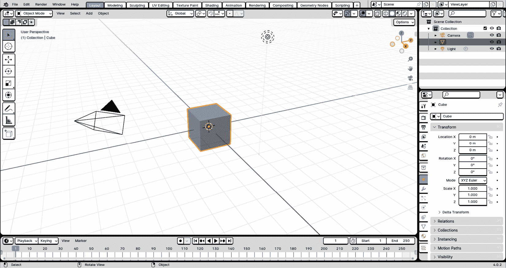
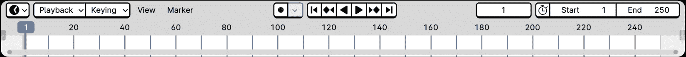
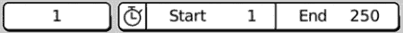
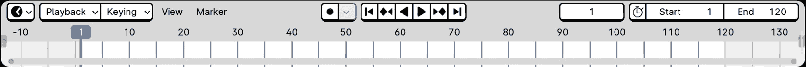
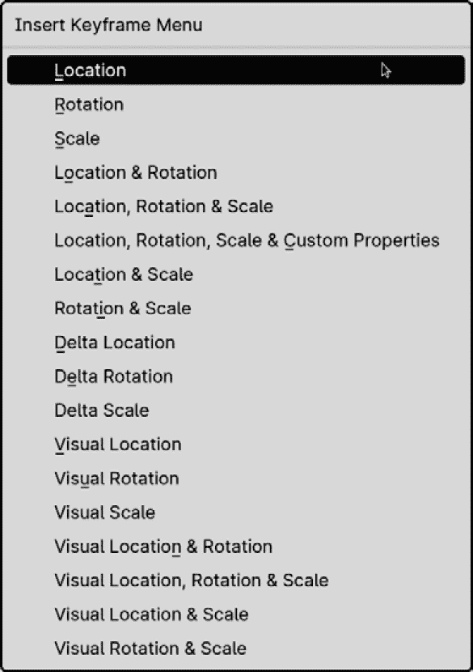
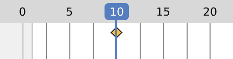
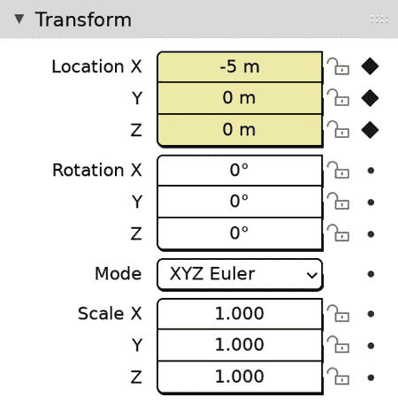
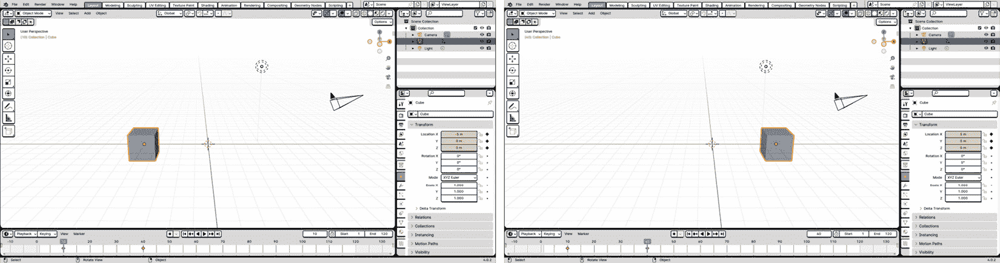
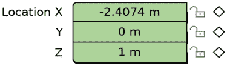
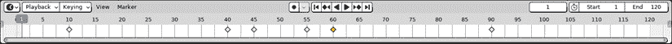

# 第 1 章：时间轴中的基础关键帧

对于我们在 Blender 中的第一个动画，我们将为默认立方体制作动画。它总得有点用处！这可能看起来枯燥乏味，但我们最初必须保持简单，即使是简单的物体也能讲述故事。我们的故事将是一个关于年轻立方体的 5 秒史诗：它向东冒险进入未知领域，随后转身，返回家园，最终在旅途的许多帧中磨砺得休息下来。

本练习将作为 Blender `Timeline`（时间轴）以及 `keyframes`（关键帧，任何动画的构建基块）的入门介绍。我们将使用 `keyframes` 来确定立方体在不同时间点的位置、旋转和颜色。

虽然本章面向对 Blender 动画系统零基础的读者，但您需要具备一些 Blender 基础功能的使用经验。这包括在 3D 视口中导航、编辑数值，以及在 3D 空间中选择和移动物体。

在本章中，我们将涵盖以下主要主题：

* 导航时间轴
* 使用关键帧创建简单移动
* 在时间轴中编辑关键帧
* 为 Blender 中几乎任何属性制作动画

## 技术要求

要跟随练习，您只需要在满足最低系统要求的计算机上运行 Blender 4.0。更高版本的 Blender 也可能适用于本书，仅有细微差别，尽管无法保证。

图 1.1：Blender 4.0 中的默认场景，此处显示为“打印友好”主题

如果您已经对用户偏好设置或启动文件进行了重大更改，请转到 `File`（文件） | `Defaults`（默认值） | `Load Factory Settings`（加载出厂设置）以恢复图 1.1 所示的相同环境。

> **提示**
>
> 暂时无需点击屏幕顶部的 `Animation`（动画）选项卡，也无需切换到任何其他 `workspace`（工作区）。本章的所有内容都可以在默认的 `Layout`（布局）工作区中完成。请记住，工作区只是为您方便而预设的窗口配置。它们并非各自标记任务所必需的。由于 Blender 的界面非常灵活，我通常忽略它们或自行创建。

## 导航时间轴

在 Blender 中打开一个新文件，看看 3D 视口正下方底部的编号区域。这个区域称为 `Timeline`（时间轴），是动画工作最基础的编辑器：

图 1.2：时间轴

`Timeline` 显示您的 `keyframes`（关键帧），并包含用于播放和基本 `keyframe` 编辑的控件。动画制作的大量工作将涉及此窗口和/或 Blender 的其他几个动画编辑器之一。

### 在时间中移动

您在 Blender 中学到的第一件事可能是如何导航 3D 视口，使用中键和各种键盘快捷键在 3D 空间中移动视角。出于同样的原因——您在实际建模前需要学会导航——您必须在制作动画前学会在时间中导航。

在 `Timeline` 的 `header`（页眉，带有菜单的部分）中，您将看到一些菜单、播放控件，最后是一些整数属性：

图 1.3：从左到右——当前帧、起始帧和结束帧属性

这些是您场景的 `Current Frame`（当前帧）、`Start Frame`（起始帧）和 `End Frame`（结束帧）属性。其中最关键的是 `Current Frame`。

`Current Frame` 是一个非常特殊的属性，它决定了场景显示的帧，即时间点。正如您必须从许多不同角度查看 3D 模型一样，作为动画师，您在工作时必须穿梭于时间中，在许多不同的帧上查看您的动画场景。

更改 `Current Frame` 值会在动画中向后和向前移动时间。有多种方法可以做到这一点：

* 直接在 `Timeline` 的页眉中编辑 `Current Frame` 值
* 点击 `Timeline` 帧号行上的任意位置
* 点击键盘上的左右方向键
* 按住 `Alt` 键的同时滚动鼠标滚轮

> **提示**
>
> `Timeline` 中标记当前帧的垂直蓝线称为 `playhead`（播放头/当前帧指示线）。拖动 `playhead` 左右移动的技术称为 `scrubbing`（擦洗/拖动预览），这对于审查和检查动画至关重要。

试试这些方法。当您调整 `Current Frame` 值时，`Timeline` 中 `playhead` 的水平位置会随之移动。请记住，因为我们还没有制作任何动画，所以 Blender 中没有其他东西会移动。

### 设置帧范围

Blender 中的默认场景 `Start Frame` 值为 `1`，`End Frame` 值为 `250`。这意味着动画将从第 `1` 帧开始，到第 `250` 帧结束，总时长为 250 帧。在默认的每秒 24 `frames per second`（`FPS`，帧率）下，这将产生一个略长于 10 秒的动画。

> **提示**
>
> 您动画的 `Frame Rate`（帧率）设置位于 `Properties Editor`（属性编辑器）中 `Output Properties`（输出属性）的 `Dimension`（尺寸）面板里。然而，在本书的其余部分，我们将坚持使用每秒 `24` 帧，这是一个很好的可整除数字，且通常与胶片般或“电影感”的外观相关联。

## 设置结束帧

对于我们的第一个动画来说，`250` 帧实在太多了，所以让我们缩短一下工作范围。将 `End Frame`（结束帧）属性从 `250` 调低到 `120`：

图 1.4：结束帧设置为 120

这将动画时长缩短为 `120` 帧，正好 5 秒。足够我们进行这场史诗般的三幕冒险了！

## 调整时间轴视图

虽然我们已将动画设置为在第 `120` 帧结束而非第 `250` 帧，但时间轴显示的帧号范围仍然是 `0` 到 `250`。我们不再关心 `120` 之后的任何帧，所以让我们调整视图，以更有效地利用该区域的水平跨度：

1. 在时间轴中按住中键并向右拖动，将帧范围 `0` 到 `120` 大致移动到区域中心。
2. 使用滚轮或按住 `Ctrl` 加中键进行缩放，使时间轴仅显示感兴趣的范围 `0` 到 `120`。

正如你所见，更改时间轴视图的控制方式与 Blender 中几乎所有其他区域都大同小异：

图 1.5：调整后的时间轴，仅显示第 0 到 120 帧

> **提示**
>
> 如果你在时间轴中迷失了方向（实际上几乎在任何其他编辑器中也是如此），请按 `Home` 键或前往 `View | Frame All`（视图 | 全部帧）。这与我们刚才所做的效果相同，恢复编辑器视图，使所有可见内容完美居中。

在后续章节中，随着动画变得更复杂，我们将需要四处滚动，在不同关键帧处放大缩小。但对于本章的其余部分，我们可以保持时间轴视图原样。

## 动画播放

**播放**控制和跳转到特定帧的控制位于时间轴标题栏的中心：

图 1.6：时间轴播放按钮

按下 `spacebar`（空格键）或点击 `Play`（播放）按钮将播放你（目前非常无聊的）动画，以既定的帧率快速递增 `Current Frame`（当前帧）数值。按下 `Ctrl` + `Shift` + `Spacebar` 或点击向后的 `Play`（播放）按钮将倒放动画。除非停止，否则动画将循环播放，到达 `End Frame`（结束帧）后跳回 `Start Frame`（开始帧）。

你可以通过再次按下 `spacebar`（空格键）或按下时间轴上的 `Pause`（暂停）按钮，在当前帧**立即停止**动画。按下 `Esc` 将停止动画并返回播放开始时的原始帧。请记住，在尝试编辑任何内容之前先停止动画。

> **提示**
>
> 播放和停止动画是如此频繁的操作，以至于我几乎总是使用键盘快捷键而不是点击这些按钮。播放的热键在每个编辑器中都有效，所以你不必总是打开时间轴。

## 使用关键帧创建简单移动

在第一幕中，我们的主角 `Cube`（立方体）将无畏地从西向东大步前行。我们将使用关键帧来实现这一点，这是一种源自传统手绘动画流程的技术。

在手绘动画中，主管动画师绘制镜头中最重要的帧，即“关键帧”，它们决定了角色和物体在关键时间点的位置和表情。这些关键帧随后交给“中间绘制师”，由他们绘制中间的其余帧，以创造出平滑的运动外观。

在 Blender 和其他动画应用程序中，关键帧扮演着相似但简单得多的角色：*确定某个属性在给定帧上的数值*。亲自动手比阅读更容易理解，所以让我们直接开始吧！

## 为初始位置设置关键帧

首先，我们要给主角 `Cube` 一个合适的起始位置：

1. 前往第 `10` 帧。
2. 选择 `Cube`。
3. 在 `Z` 轴上将 `Cube` 向上移动 `1` 个单位，使其在 3D 视口中静止于“地板”上。
4. 在 `X` 轴上将 `Cube` 向左移动 `-5` 个单位。
5. 现在，让我们插入第一个关键帧！保持 `Cube` 选中状态，并将鼠标光标放在 3D 视口中，按下 `I` 键。

这将弹出 `Insert Keyframe`（插入关键帧）菜单，这是插入位置关键帧的几种方法之一：

图 1.7：插入关键帧菜单

这里显示的是所选物体部分（并非全部）可设为关键帧的属性列表。点击 `Location`（位置）以插入位置关键帧。

> **重要提示**
>
> 从现在开始，请时刻注意你选中了什么以及当前处于哪一帧，尤其是在插入关键帧时。

## 已设关键帧的属性

我们刚刚在第 `10` 帧为 `Cube` 的位置插入了一个关键帧。这意义重大！未来我们将一次性插入和编辑数十个这样的关键帧，但目前，让我们细细品味一下发生了什么变化。

首先，时间轴中出现了一个小菱形。如果一开始没看到，向上滚动或按 `Home` 键；它可能藏起来了：

图 1.8：第 10 帧上的新关键帧

就时间轴而言，这就是我们的关键帧。它的水平位置标记了你为 `Cube` 的某个属性“设置关键帧”的那一帧。虽然在时间轴中还看不出来，但它也包含了设置关键帧时 `Cube` 的 `Location`（位置）属性的 `X`、`Y` 和 `Z` 值。

> **提示**
>
> 默认情况下，时间轴仅显示选中物体的关键帧；当你选择不同物体时，它们会隐藏。在后续章节中，我们将探讨更适合同时显示多个物体关键帧的其他编辑器。

其次，看看 `Cube` 的 `Transform`（变换）属性：

图 1.9：已设关键帧的位置属性

`Location`（位置）数值现已高亮显示，并由右侧的一小组关键帧形状的图标加以区分。这表明它们已被“设为关键帧”。

> **提示**
>
> 当当前帧上有该属性的关键帧时，动画属性高亮显示为黄色；在其他帧上为绿色；手动更改时为橙色。

尝试再次移动 `Cube`，然后切换帧。`Cube` 将立即“弹回”其设关键帧的位置。该属性已被其关键帧“接管”。从现在起，除非你为它插入另一个关键帧，否则你对立方体位置所做的任何手动更改都只能是暂时的。

> **重要提示**
>
> 单个属性不能在同一帧上拥有两个关键帧。如果你在已有关键帧的地方插入关键帧，新关键帧将直接替换旧关键帧。

## 为第二个位置设置关键帧

播放动画并仔细观察 `Cube` 发生了什么。什么也没发生！现在，倒放动画。会发生什么？同样什么也没发生——但现在是倒着发生的。

我们的一个关键帧仅仅决定了 `Cube` 必须在第 `10` 帧位于某个特定位置，但一个关键帧不足以创造运动。在我们添加第二个位置关键帧之前，`Cube` 将保持在同一个位置——不仅在第 `10` 帧，而且在其他所有帧上也是如此。

让我们添加第二个关键帧：

1. 前往第 `40` 帧。
2. 在 `X` 轴上将 `Cube` 向右移动 `10` 个单位。
3. 按 `I` 并插入另一个 `Location`（位置）关键帧：

图 1.10：第 10 帧和第 40 帧上的立方体

现在，播放动画。`Cube` 动了！仅仅两个关键帧就足以创造运动。现在让我们仔细看看这两个关键帧之间发生了什么。

## 关键帧设置原则

## Blender 中的关键帧动画

注意，我们从未向 `Cube` 发出任何“命令”来使其移动。例如，我们并未编码任何事件，如“在第 `10` 帧开始移动”，或“在第 `40` 帧后停止移动”。这是初学者常有的一种误解。通过插入这些关键帧，我们只是声明在第 `10` 帧时 `Cube` 应位于某特定位置，而在第 `40` 帧时应位于另一位置。

此外，观察当你切换帧时 `Cube` 的 `X Location` 值会发生什么变化：

**图 1.11：** 第 20 帧上的 Location 属性

虽然我们可能会说我们“给 `Cube` 做了动画”，但更准确的说法是我们只给 `Cube` 的一个属性（`Location`）做了动画，即便如此，该属性的三个分量中也只有一个真正发生了变化（即 `X Location`）。目前，`Cube` 的其他一切（例如其 `Rotation` 和 `Scale`）均保持不变。

最后，请注意，我们无需干预第 `10` 帧和第 `40` 帧之间的另外 29 帧，就能让 `Cube` 平滑地从一处移动到另一处。Blender 会自动处理这一过程，为我们充当了“中间帧绘制员”的角色。这可以说是数字动画相较于传统动画所提供的最大优势。

> **Tip**
>
> 一个值过渡到另一个值的方法称为**插值**。我们将在下一章探讨几种不同的插值模式。

## 关键帧旋转

在我们这部史诗般的 120 帧动画的第二幕中，`Cube` 思乡心切，*转过身来*，准备踏上漫漫归途回到诞生地。我们将通过关键帧 `Rotation` 属性而非 `Location` 属性来制作这部分动画。

正如你所料，我们可以遵循与之前相同的流程，使用 `Insert Keyframe`（`I`）菜单。既然你已经有了一些练习，我们可以更快地讲完这部分：

1.  前往第 `45` 帧。
2.  确保 `Cube` 仍处于选中状态。
3.  按 `I` 唤起 `Insert Keyframe` 菜单并点击 `Rotation`。
4.  前往第 `55` 帧。
5.  在 `Z` 轴上将 `Cube` 旋转 `180` 度（顺时针或逆时针均可，随你喜好）。
6.  重复*步骤 3* 以插入第二个旋转关键帧。

现在 Timeline（时间轴）中应该显示有四个关键帧：两个用于立方体的位置，两个用于其旋转。目前，仅凭观察 Timeline 无法分辨哪个是哪个，但请放心，它们是截然不同的。我们将在下一章学习如何更仔细地查看它们的内容。

现在当你播放动画时，`Cube` 将从西向东移动，停顿 5 帧，然后利索地旋转 10 帧以面向相反方向。

## 在 Timeline 中编辑关键帧

我们准备好为惊心动魄的第三幕大结局制作动画了！在背弃了东方的边境后，我们的主角 `Cube` 将踏上归途，带着旅途的疲惫，回到生命开始的原点休息。

为了制作这最后一部分动画，我们可以继续沿用一直在练习的技巧——前往新帧、移动物体、插入关键帧，等等——但还有其他可用的动画制作方式，你有必要了解一下。

事实上，Timeline 不仅仅是一个显示关键帧的窗口。我们还可以用它来编辑关键帧！在本节中，我们将暂时搁置所学的使用 `Insert Keyframe`（`I`）菜单插入新关键帧的方法，转而使用 Timeline 来利用我们已经制作好的关键帧。

### 基础关键帧编辑

如何编辑关键帧？目前你只需了解以下操作：

*   在 Timeline 中选择关键帧，用你惯用的鼠标按键点击即可。按住 `Shift` 并点击可选择多个关键帧。
*   使用 `Grab`（`G`）在时间轴上移动选中的关键帧。你也可以用选择时用的同一个鼠标按键点击并拖动关键帧。
*   要**复制**关键帧，请使用 `Duplicate`（`Shift` + `D`）。复制的关键帧会“吸附”在光标上，就像你对它们使用了 `Grab`（`G`）一样。

如果你觉得这只是一堆你已经熟知的控制方式，你完全正确！如果你知道如何在 3D 视口中选择、移动和复制物体，那么你就已经知道如何在 Timeline 中选择、移动和复制关键帧了。*控制方式完全相同。*

许多其他操作和控制方案也是如此。如果在 3D 视口中有效，那么它大概率也适用于 Timeline 和其他动画编辑器。

> **Tip**
>
> 选中的关键帧会以黄色高亮显示。新插入的关键帧会自动被选中。在复制关键帧等操作前，请确保你的选择中没有不需要的关键帧。如果操作的关键帧比你打算的多，很容易搞乱一切！

### 复制关键帧

直接编辑关键帧的一个常见用途是复制动画的特定片段以节省时间。要让 `Cube` 回到原位，我们不必亲自移动它回去；只需复制我们之前制作的一个关键帧即可：

1.  选择我们在第 `10` 帧创建的关键帧。
2.  按 `Shift` + `D` 复制它。
3.  将复制的关键帧移动到第 `90` 帧。

> **Tip**
>
> 编辑关键帧的控制方案真的非常类似于你在 Blender 3D 视口中习惯使用的那些。例如：在此处的*步骤 3* 中，你可以输入数值 `80`，将复制的关键帧从第 `10` 帧精确移动 80 帧到第 `90` 帧。

我们已经为 `Cube` 设定了最终安息地的关键帧！现在，它在第 `90` 帧的位置将与第 `10` 帧相同，但现在我们的动画看起来有点奇怪……

### 保持位置

观察 `Cube` 如何移回起点。看起来多么缓慢笨拙！紧接在第 `40` 帧之后，它就开始向西移动；甚至来不及转身就已经开始移动了。

这是一个常见错误，也是动画未完成的标志。我们制作的最后一个位置关键帧在第 `40` 帧。然后，我们把下一个关键帧直接放到了第 `90` 帧，却未考虑这会如何影响之前的所有帧。

第 `40` 帧之后，我们希望 `Cube` 像之前那样静止一会儿。这不需要任何特殊的“保持静止型”关键帧。相反，我们只需复制第 `40` 帧的另一个位置关键帧：

1.  选择 `Cube` 物体在第 `40` 帧的位置关键帧。
2.  按 `Shift` + `D` 复制它。
3.  将复制的关键帧移动到第 `60` 帧。

现在第 `60` 帧有一个与第 `40` 帧相同的位置关键帧，因此这两帧之间位置不会发生变化。因为我们只编辑了位置关键帧，立方体的旋转动画未受影响：

**图 1.12：** 包含六个关键帧的 Timeline

### 编辑动画的时机

按照这些分步说明插入关键帧，可能会让你误以为我们应该预先知道在何时何地插入关键帧。事实恰恰相反——动画师极少能在第一次尝试时就把所有关键帧都插在正确的帧上。当你独立制作动画时，你肯定需要在添加关键帧后调整它们的时机。

以我们当前的动画为例。在第 `90` 帧的最后一个关键帧之后，场景结束前还有 30 帧的静止时间。为什么不放慢节奏，给动画留出更多呼吸空间，以便利用完场景的整个帧范围呢？

下一步将更加开放，以便你可以实验并观察不同的关键帧位置如何影响动画结果：

1. 转到第一个和最后一个关键帧之间的任意一帧。

2. 仅选择 `Current Frame`（当前帧）之后的关键帧。

3. 抓取选中的关键帧并将它们向右移动 `20` 帧。

**提示**

尝试按 `]`（右中括号键）来执行*步骤 2*。相应地，`[` 和 `]` 是 `Before Current Frame`（当前帧之前）和 `After Current Frame`（当前帧之后）的快捷键，它们有助于快速选择当前帧之前或之后的所有关键帧。

如果你还没弄明白，将关键帧向右移动会延迟它们，拉大这些关键帧与被留下的关键帧之间的时间间隔，从而减慢动画的一部分。动画的哪一部分会被减慢，取决于关键帧之间的额外间隙是在哪里产生的。

例如，移动最后两个关键帧会让 `Cube`（立方体）在返回西边之前似乎犹豫了一下：

图 1.13：移动最后两个关键帧后的时间轴

移动最后三个关键帧会让立方体的 180° 旋转耗时更长：

图 1.14：移动最后三个关键帧后的时间轴

此外，移除第一个关键帧以外的所有关键帧（即移动除第一个以外的所有关键帧）会让立方体的初始启程比返回旅程稍慢一些：

图 1.15：移动最后五个关键帧后的时间轴

在不改变这些关键帧顺序的前提下，请随意继续尝试调整它们的时机。

既然已经赋予了 `Cube` 运动，我们这章也就接近尾声了！我们仅让它的两个属性随时间变化，就让一个简单的物体有了冒险的一生。

三维物体的三个空间属性——位置、旋转和缩放——可能是你在三维动画中最常打交道的三个属性，但动画远不止这些。正如我们在下一节将看到的，关键帧可用于影响几乎任何属性。

## 在 Blender 中为几乎任何属性制作动画

我们的奥德赛以主角安息告终，它终于从惊心动魄的海外冒险中回到了家。我们的英雄是凯旋而归，还是满怀悲伤与悔恨？难以言说（毕竟它是个立方体），但有一点是肯定的：事情永远不会再一样了。是世界变了吗？恰恰相反；除非英雄被世界改变，否则没有英雄的旅程是完整的。一个立方体离开了，一个不同的立方体（从隐喻的角度来说）回来了。

在本节中，我们将为 `Cube` 的另一个属性——颜色——设置关键帧，以演示 Blender 中几乎任何东西都可以制作动画。

### 其他设置关键帧的方法

到目前为止，我们一直在使用 `Insert Keyframe`（插入关键帧）菜单来插入初始关键帧，但这个菜单纯粹是为了方便，并不是 Blender 中所有可设关键帧属性的完整列表。首先，它就不包含 `Color`（颜色）。

幸运的是，我们不需要那个菜单。当你找到想要制作动画的属性时，Blender 的界面提供了多种方法直接在原地为其设置关键帧：

*   右键点击该属性，然后从上下文菜单中点击 `Insert Keyframe`（插入关键帧）。
*   将鼠标光标直接悬停在该属性上并按 `I`。
*   点击属性右侧的小圆点（注意，这个圆点只是为了单击方便；没有圆点的属性仍然可能是可设关键帧的）。

这些方法每一种达到的结果都完全相同。

**提示**

对于每一种插入关键帧的方法，你都能找到类似的方式来删除它。例如，尝试按 `Alt` + `I` 代替 `I`。

### 为材质颜色设置关键帧

让我们试着为 `Cube` 的颜色设置关键帧：

1.  选择 `Cube` 并前往 `Material Properties`（材质属性）以编辑立方体的默认材质 `Material`。
2.  找到 `Base Color`（基础颜色）属性：

图 1.16：基础颜色属性

1.  转到第 `1` 帧。
2.  为起始 `Base Color` 选择任何你喜欢的颜色。
3.  使用前面提到的任意一种方法为 `Base Color` 设置关键帧。
4.  转到第 `120` 帧。
5.  为结束 `Base Color` 选择一个不同的颜色。
6.  再次为 `Base Color` 设置关键帧。
7.  将 `Viewport Shading`（视口着色）模式切换为 `Rendered`（渲染）或 `Material Preview`（材质预览），以便在 3D 视口中查看结果：

图 1.17：视口着色设置为材质预览模式

除了移动之外，`Cube` 现在将在其旅程过程中逐渐从一种颜色变为另一种颜色。就我个人而言，我让我的立方体从愉快的绿色变成了深沉悲伤的紫色：

图 1.18：第 1 帧和第 120 帧上的立方体

**提示**

数值并不是唯一可以设置关键帧的属性类型。复选框和开/关按钮，也就是 `Boolean`（布尔）属性，也可以设置关键帧来开启和关闭。除其他用途外，这对于让物体出现和消失很有帮助。

## 总结

如果你读到了这里，恭喜你——你现在是一名动画师了。惊讶吗？你不应该惊讶——动画师就是制作动画的人，而你刚才做了什么？仅凭时间轴、默认立方体和不到十几个关键帧，你就制作了一部史诗般的冒险动画！

好吧，我承认——也许我们的第一部动画没那么史诗，但它很重要！我们把枯燥的东西变成了充满潜力的精彩事物。当然，立方体只是一个带有面和顶点的网格，但你最喜欢的 3D 动画电影中的角色和物体也是如此。而那些花哨的角色和物体，正是用一堆像你刚才制作的关键帧赋予了生命。

唯一的区别？主要是关键帧的*数量*。未来我们将需要*多得多*的关键帧。我们还需要更多地了解这些关键帧的真实本质，为了本章的简洁起见，这一直被保密。事实上，时间轴并不是高级关键帧编辑的理想工具。在下一章中，我们将需要一个完全不同的编辑器来打开那些关键帧并深入探究……

## 问题

1.  场景的哪两个属性决定了动画的长度（以帧为单位）？
2.  如果我们的帧率是每秒 30 帧，我们的动画将持续多少秒？
3.  什么是帧？*转到*某一帧是什么意思？
4.  在传统手绘动画中，关键帧是一种特定类型的帧。这在 3D 动画中也适用吗？它们有何不同？
5.  说位置关键帧让物体*去*某地，还是让物体*在*某地，哪个更准确？
6.  仅通过在时间轴中查看关键帧，你能了解到关于它的哪些信息？
7.  是否需要按顺序从头到尾为所有东西设置关键帧？
8.  如何判断给定的属性是否已制作动画？
9.  在 Blender 中随机挑选一个属性，看看它能否制作动画。如果可以，为该属性制作动画可能有什么用处或趣味？
10. 什么是属性？在 Blender 中，属性属于什么事物？
