# 第 2 章：图表编辑器

在上一章中，我们创建了一个基础动画，同时将关键帧编辑局限在 Blender 的时间轴中。虽然这对于最初保持简单是必要的，但我们为了简洁起见隐藏了一些重要的动画工作流程。对于大多数动画来说，仅使用时间轴会让人非常沮丧！

Blender 中三维动画的下一个最重要工具是 `Graph Editor`（图表编辑器）。除了能做时间轴几乎能做的所有事情外，图表编辑器还在二维图表上显示关键帧的时间和数值，以及它们影响的最终动画属性。

## 简介

为了了解图表编辑器及其强大之处，我们将在本章中通过实践来学习——制作动画行业中最流行的案例研究之一：弹跳球。

近百年来，弹跳球一直是二维和三维动画中公认的学习练习。如果我们想让弹跳球看起来真实，就需要密切关注其 `velocity`（速度）和 `acceleration`（加速度）——而图表编辑器正是处理这些属性不可或缺的工具。

在本章中，我们将涵盖以下主要主题：

*   制作滚动球的动画
*   导航图表编辑器
*   设置插值和缓动类型
*   制作弹跳运动的动画
*   设置外推模式

## 技术要求

要跟随本章进行操作，你需要 Blender，以及一个标准尺寸足球（也称为 soccer ball）的合适模型。

你可以在此处下载此类模型：

`https://github.com/PacktPublishing/Realizing-3D-Animation-in-Blender`

你可以打开下载的文件并立即开始工作，或者如果你愿意，也可以自己建模一个足球：

图 2.1：左侧——足球模型，右侧——我用一分钟建模的一个可用的球

任何球体都可以，只要它的直径为 0.7 米，静置在场景的网格地板上，并且是多色的，以便你能轻松看到它在滚动。

## 让球滚起来

在进入图表编辑器之前，我们需要像上一章那样插入一些初始关键帧。一般来说，最好在添加细节之前先 `block out`（分步定出/布局）物体最重要的位置，因此我们的前两个关键帧将只是让球从左向右滚动。

滚动只是旋转与位移完美同步。我们所要做的就是在相同的帧上为球的位置和旋转设置关键帧，确保根据球移动的距离，按精确的数学公式旋转球。在让球滚动之后，我们将使用图表编辑器让它弹跳。

让我们为球设置初始位置的关键帧。为了节省时间，我们可以一次性为球的位置和旋转设置关键帧：

1.  转到第 `10` 帧。
2.  选择球，并沿 `X` 轴向左移动 `-5` 个单位。
3.  按 `I` 调出 `Insert Keyframe`（插入关键帧）菜单，选择 `Location & Rotation`（位置和旋转）。

    这会同时插入旋转和位置关键帧，而无需我们调出菜单两次。

    接下来，让我们准备插入第二组位置和旋转关键帧：

4.  转到第 `90` 帧。
5.  沿 `X` 轴向右移动球 `10` 个单位。

    现在我们已经确定了球在 80 帧的跨度内将移动多远，我们只需要计算它应该旋转多少才能真实地滚动。如果我们设置的旋转过多或过少，球看起来就会像在地面上滑动。

    那么，我们应该旋转多少度，绕哪个轴旋转？虽然有一些很好的公式可以计算出来，但这对于本章来说有点太高级了。目前，让我们稍微“作弊”一下，直接输入一些“魔法数字”：

6.  绕 `Y` 轴旋转球 `1164` 度。
7.  像*步骤 3* 中那样插入位置和旋转关键帧。

当你播放动画时，球现在应该能平滑地从左向右滚动，而不会出现滑动或打滑的现象。这个简单的运动将伴随我们稍后添加的弹跳关键帧。

## 导航图表编辑器

在跟随上一章操作时，你可能会想知道动画师该如何在 `Timeline`（时间轴）中识别那些看起来一模一样的关键帧。我们是否总得记住哪些是位置关键帧，哪些是旋转关键帧？如果旋转和位置关键帧存在于同一帧上（就像在我们当前的动画中那样），你该如何单独编辑它们？

话虽如此，你如何辨别关键帧内部的*任何*数值？在 `Timeline` 中，一个让物体向下移动几英寸的关键帧，看起来和一个让它向上飞入外太空一百英里的关键帧没有任何区别。

因此，`Timeline` 是一个不足以编辑整个动画的工具。这就是图表编辑器等工具发挥作用的地方。

## 调出图表编辑器

进入图表编辑器的一个便捷方法是使用当前放置 `Timeline` 的界面区域。图表编辑器需要比 `Timeline` 更多的垂直空间才能发挥作用，所以我们只需拖动 `Timeline` 和 `3D Viewport`（3D 视口）之间的边框向上，使该区域变高。之后，就可以轻松地将 `Timeline` 切换为图表编辑器了：

1.  找到 `3D Viewport` 和 `Timeline` 之间的边框（当鼠标悬停在其上方时，光标会变为箭头）。
2.  向上拖动边框，将下方区域调整到整个屏幕高度的一半左右。
3.  使用 `Ctrl + Tab` 或 `Editor Type`（编辑器类型）菜单将该区域切换为图表编辑器。

现在我们准备好开始在图表编辑器中工作了！

图 2.2：带有图表编辑器的用户界面

该编辑器将动画属性显示为二维图表中的线条，将关键帧显示为这些线条上的点，从而允许你直观地编辑关键帧的时间和数值。

**重要提示**

与 `Timeline` 一样，图表编辑器的默认设置是仅显示所选物体的关键帧。请确保选中了球，否则图表编辑器将显示为空白。

对于从未见过该编辑器的人来说，它可能令人困惑，所以让我们花点时间思考一下我们到底在看什么。

**提示**

在我的示例中，我禁用了 `View | Show Cursor`（视图 | 显示光标），以停止在图表编辑器中显示一条额外的水平线，因为它用处有限。

## 图表编辑器中的 X 轴和 Y 轴

`Timeline` 中的关键帧只能左右移动——即在时间上前后移动。既然这使得 `Timeline` 本质上是一个一维编辑器，你可以把图表编辑器想象成一个*二维时间轴*。

就像在 `Timeline` 中一样，你会看到图表编辑器顶部有一排帧号——就像在 `Timeline` 中一样，也可以点击它们来拖动和浏览时间。在图表编辑器中沿 `X` 轴左右移动关键帧，会使它们在时间上前后移动，就像在 `Timeline` 中一样。因此，我们可以理所当然地认为，图表编辑器中的 `X` 轴代表以帧为单位的时间……就像在 `Timeline` 中一样。

然而，与 `Timeline` 不同的是，我们现在有了一个垂直轴，关键帧可以沿着它上下移动。这个 `Y` 轴代表每个单独属性的数值。根据属性的不同，这可以是任何单位——米、度、瓦特，无论什么。只要它是动画化的，图表编辑器就会显示它。

**重要提示**

不要将图表编辑器中的 `X` 轴和 `Y` 轴与 `3D Viewport` 中的 `X`、`Y` 和 `Z` 轴混淆。三维物体的属性（如 `Location`、`Rotation` 和 `Scale`）都有 `X`、`Y` 和 `Z` 分量，分别对应三维场景中的 `X`、`Y` 和 `Z` 轴。然而，在图表编辑器中查看时，这些分量都只是映射到同一个 `Y` 轴上的数字，与其他属性一样。

看看你图表编辑器中那条从左向右平滑向上弯曲的红线。通过结合 X 轴和 Y 轴上指示的数字来观察这条曲线，你可能能猜出它代表哪个动画属性。其他线条呢？如果你不确定也没关系；我们马上就会消除关于哪些线条代表哪些属性的猜测。

## 动画通道

## 图表编辑器

在图表编辑器的左侧，你会看到一个包含三个嵌套列表的面板：

图 2.3：物体、动作和通道组的字段

`Ball` 物体包含 `BallAction` 动作，后者又包含 `Object Transforms` 通道组。

点击 `Object Transforms` 行左侧的小三角形以展开它。这将显示我们刚刚创建的所有 `animation channels`（动画通道）的列表：

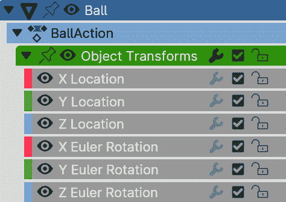

图 2.4：动画通道

这些动画通道包含所选物体所有拥有关键帧的属性，并按垂直列表组织。每个独立的通道包含其分配属性的所有关键帧。

**提示**

当你首次插入关键帧时，动作和通道组会自动创建。你可以将它们视为物体动画通道的嵌套“文件夹”。暂时忽略它们。除非你在做高级角色动画，否则通常永远不需要重新组织通道组，也不需要为每个动画物体使用多个动作。

对于每个动画通道，在图表编辑器的主区域都会显示一条对应的线图，称为 `F-curve`（F-曲线）。你可以把这些 F-曲线想象成股市走势图；每一条都是一条线，代表一个属性随时间变化的值。点击左侧面板中的通道名称将选择该通道并高亮显示其 F-曲线。

**重要提示**

在图表编辑器中，术语 `curve`（曲线）、`F-curve`（F-曲线）和 `channel`（通道）可以互换使用。它们本质上指代同一事物。

### 六个关键帧合而为一

目前，我们的动画有六个通道。如果六个通道看起来很多，请记住，空间属性（如位置和旋转）各自都是一组三个数值——分别对应三维空间中 `X`、`Y` 和 `Z` 三个轴。

当你在 `Insert Keyframe`（插入关键帧）菜单中点击 `Location & Rotation`（位置与旋转）时，你实际上一次性插入了不是一个，而是六个关键帧！既然做了两次，你现在总共有 12 个关键帧，尽管时间轴似乎只显示了 2 个：

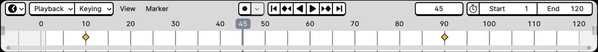

图 2.5：带有两个关键帧的时间轴

事实上，不存在单个 `Location & Rotation` 关键帧这种东西。这些 `summary keys`（汇总关键帧）实际上是同一帧上所有关键帧的分组，可以在时间轴中选中，并像它们是一个关键帧一样进行编辑。这就是我们在上一章编辑动画的方式。然而在本章中，我们需要明确具体要编辑哪个通道的关键帧。

**提示**

通过拖动打开默认隐藏的左侧面板，也可以在时间轴中访问单个动画通道。这允许你在不切换到其他编辑器的情况下编辑单个通道。然而，时间轴仍然不是以这种方式编辑关键帧的理想工具；这一荣誉属于 Dope Sheet（动作编辑器/逐帧编辑器），我们将在 *第 6 章* 中介绍。

### 隐藏、锁定和删除 F-曲线

让我们浏览一下小球的每个动画通道，并思考哪些与我们的弹跳球动画相关：

*   `X Location`（X 位置）：这是让小球从左向右移动的通道。该通道的 F-曲线在图表编辑器中清晰可见；它是那条从第 **10** 帧值为 **-5** 到第 **90** 帧值为 **5** 的红线。
*   `Y Location`（Y 位置）：我们不需要在 `Y` 轴上移动小球，所以该通道可以丢弃。
*   `Z Location`（Z 位置）：向该通道添加更多关键帧将使小球上下移动。我们绝对需要这个来让小球弹跳！
*   `X Euler Rotation`（X 欧拉旋转）：如果我们为这个制作动画，小球看起来会有点怪。考虑到小球当前的移动方向，它只需要绕 `Y` 轴旋转才能看起来像在滚动。如果它向其他方向旋转，会破坏效果！
*   `Y Euler Rotation`（Y 欧拉旋转）：我们为这个值制作了动画，使小球在沿 `X` 轴移动时看起来令人信服地滚动。你可以看到该 F-曲线在第 **10** 帧处急剧向上，随后超出图表编辑器的视图边界消失不见。
*   `Z Euler Rotation`（Z 欧拉旋转）：我们也不需要为这个值制作动画。

已经有这么多通道和关键帧需要跟踪了！如果我们不小心，可能会搞不清哪个通道是哪个，或者意外编辑错误的关键帧。当许多关键帧重叠时，这特别容易发生。

幸运的是，我们可以隐藏、锁定，甚至删除不想查看或编辑的通道。每个通道都有一个眼形切换按钮来开关其可见性，还有一个锁形切换按钮来防止其被编辑。

如果我们永远不打算使用某个通道，也可以直接删除它。现在让我们在不需要的动画通道上试一下：

1.  通过左键点击一个通道名称，然后按住 `Shift` 点击另外两个，选择 `Y Location`、`X Euler Rotation` 和 `Z Euler Rotation` 通道。
2.  按 `X` 或前往 `Channel`（通道）| `Delete Channels`（删除通道）来删除选中的通道。这也会删除该通道的所有关键帧。
3.  通过点击“眼形”或“锁形”切换按钮来隐藏或锁定 `Z Location` F-曲线。我们稍后会回到这个通道。

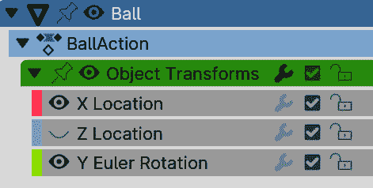

图 2.6：剩余的三个动画通道

好多了！现在没有多余的 F-曲线碍事了。

**提示**

锁定或隐藏的 F-曲线将继续像往常一样影响动画结果。如果你想在不删除的情况下禁用 F-曲线，可以尝试那个勾号形状的切换按钮，它可以“静音” F-曲线。静音的 F-曲线可能仍在图表编辑器中可见，但不会对任何东西产生影响。

## 调整图表编辑器视图

看看图表编辑器中剩余的 F-曲线。你能看到所有内容吗？虽然 `X Location` F-曲线的红线恰好在视图中心显示得很不错，但 `Y Euler Rotation` F-曲线大部分仍在视图区域之外。该属性的值从第 **10** 帧的 **0** 一路上升到第 **90** 帧的 **1164**，所以你能看到它的一个关键帧，但看不到另一个。

大多数 Blender 专家都同意，在编辑之前先看清东西很有帮助。正如我们需要在 3D 视口中移动来操作 3D 元素一样，我们也需要在图表编辑器中移动，以便在不同时间点和不同缩放级别下查看不同的关键帧。

### 在图表编辑器中平移和缩放

你会很快发现，你在 Blender 其他区域使用的导航控件在图表编辑器中同样适用。按住中键拖动可向四个方向平移视图，而滚动滚轮可放大和缩小。然而，你也会很快注意到，仅用滚轮缩放在图表编辑器中是远远不够的。

我们来试一下。在图表编辑器中使用滚轮缩小，使 `Y Euler Rotation` F-曲线的整条曲线可见。现在我们可以看到整条 F-曲线了……勉强算：

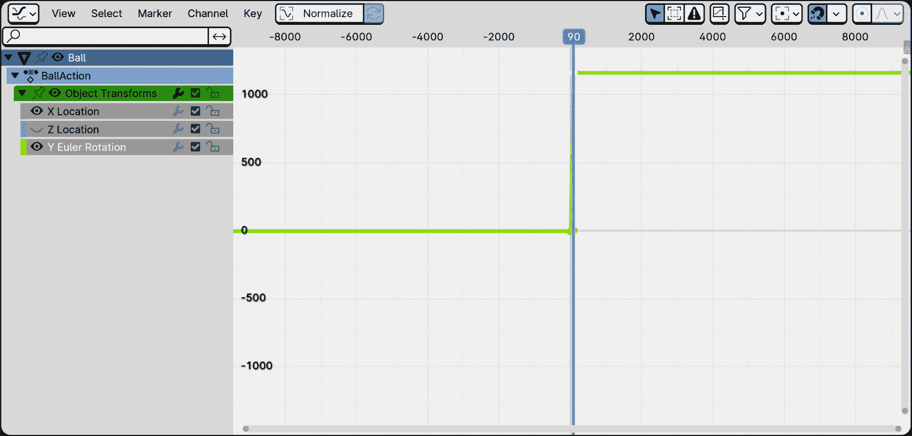

图 2.7：Y Euler Rotation F-曲线的缩小视图

我们缩小得足以让曲线的垂直范围可见，但同时也将图表水平轴的帧范围缩小到了完全无用的程度。我们整个动画的帧范围太窄了，播放头几乎把它盖住了！

## 浏览图表编辑器

当我们在 2D 编辑器中使用滚轮缩放时，我们会让视图在水平和垂直方向上按相同比例缩放。这对于放大缩小图像纹理等操作来说没问题，但这并不是我们在图表编辑器中所需要的。

## 缩放 X 轴和 Y 轴

我们在这里需要的是能够以不同于 `Y` 轴的方式对 `X` 轴进行“缩放”。试试这个：

1.  按住 `Ctrl`，在图表编辑器中小心地点击并向右拖动中键，直到图表编辑器的水平范围主要局限于 `Y 欧拉旋转` F 曲线的“弯曲”部分。
2.  使用中键平移视图，使曲线保持在图表编辑器的中心位置。
3.  根据需要重复上述操作，直到 `Y 欧拉旋转` F 曲线填满整个显示范围，如下所示：

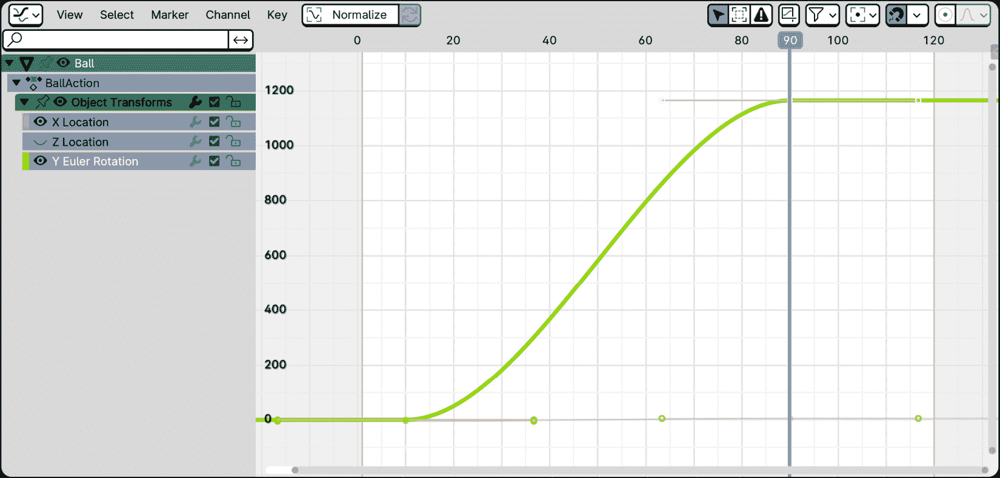

图 2.8：一个更合适的 F 曲线框架

按住 `Ctrl` 和中键可以独立缩放图表编辑器的 `X` 轴和 `Y` 轴，向上向下移动光标缩放 `Y` 轴，向左向右移动光标缩放 `X` 轴。这个操作可能需要一些时间来适应。请记住，这不会影响动画；我们只是在改变图表编辑器显示的范围。

了解如何做到这一点是必不可少的，因为图表编辑器的 `X` 轴和 `Y` 轴并不像 Blender 中的其他编辑器那样成比例地相互关联。动画属性可以用各种单位表示，有的为负，有的为正，有的非常大，有的非常小，所有这些都映射到图表编辑器中的同一个 `Y` 轴上。你动画中的某些值会在极短的时间内大幅上升和下降，而其他值则需要很长时间才能移动极小的一段距离。对于每种情况，你都需要相应地调整图表编辑器中的视图。

所以，现在你可以清楚地看到两个 `Y 欧拉旋转` 关键帧了，我们要专门编辑它们吗？不，这只是为后面的练习做准备，但看——现在还有另一个问题可以练习修复！

## 归一化 F 曲线视图

看看 `X 位置` F 曲线发生了什么。它现在看起来几乎是平的！通过调整视图以适应一条 F 曲线，我们让辨认另一条曲线的形状变得非常困难。

默认情况下，位置以一定数量的米表示，而旋转以一定数量的度表示，两者都映射到图表编辑器的 `Y` 轴。我们的球必须旋转 **1164** 度才能滚动 **10** 米，因此一个简单的滚动动画会使 `Y 欧拉旋转` F 曲线的高度远超 `X 位置` F 曲线。如果我们想同时跟踪这两条 F 曲线，这会很不方便。这就是 `归一化` 功能派上用场的地方。

启用后，`归一化` 会在 `Y` 轴上“挤压”所有 F 曲线，使它们都显示在 `-1` 到 `1` 的相同数值范围内。当多条数值范围差异巨大的 F 曲线需要一起编辑时，这很有帮助，尽管这也可能使读取它们的实际数值变得更难。

请继续在图表编辑器的页眉中启用 `归一化`：

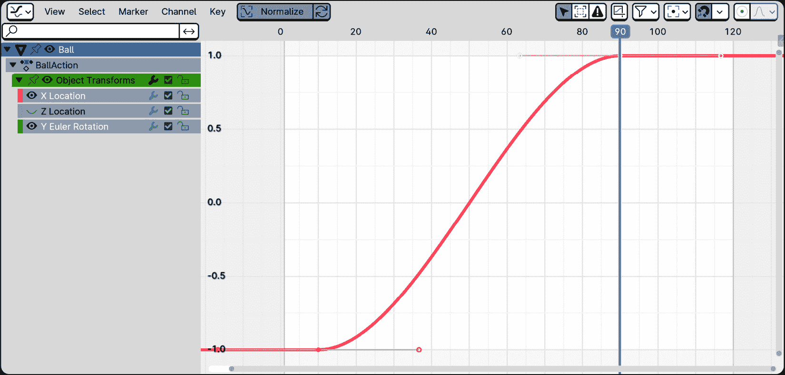

图 2.9：图表编辑器中的归一化视图

好多了！注意 `X 位置` 和 `Y 欧拉旋转` F 曲线现在看起来一模一样，所以一条 F 曲线会藏在另一条后面。如果我们需要选择一条 F 曲线的关键帧而不选中另一条，这可能是个问题，但这也是因祸得福；我们现在可以检查这两个属性是否保持完美同步。但请记住，图表编辑器 `Y` 轴上显示的数值不再直接对应动画属性的真实数值；每条 F 曲线的最低点和最高点现在只是映射到 `-1` 和 `1`。

既然你已经移除了所有不必要的 F 曲线并掌握了浏览图表编辑器的基础知识，你就差不多准备好开始编辑关键帧了！

## 插值与缓动

仔细观察 `X 位置` 和 `Y 欧拉旋转` F 曲线，注意第 **10** 帧和第 **90** 帧关键帧之间的线段会发生什么。线条平缓地开始上升，在第 **50** 帧达到最陡峭的点并继续上升，然后在顶部平缓地变平。

每个关键帧规定了某个属性在某个时间等于某个值。当该关键帧后面跟着一个数值不同的关键帧时，随着动画随时间向前播放，该属性的值必须从一个变为另一个。在中间的所有帧上，我们可以把属性本身看作是从一个值“移动”到下一个值。

一种值过渡到另一种值的方式称为**插值**。这在上一章中简要提到过；这就是为什么我们只需在两个不同的帧上制作两个关键帧，就能在中间的所有帧上获得平滑的运动。像定格动画这样的动画技术要求动画师在每一帧上手动增量调整，而数字动画工具则采用插值算法为我们完成大量工作。插值是一种作用于所有数值的数学过程。Blender 不关心属性是什么；如果它是一个会变化的数字，它的变化就可以被插值。

有各种类型的插值。我们目前看到的只是默认类型。它是一条简单、好看的曲线，但不适合弹跳球的运动。在本节中，我们将探索 Blender 中可用的所有不同插值模式。一旦你尝试过这些，你就会更清楚该为这个动画使用哪些模式。

## 设置插值模式

Blender 中有多种类型（或模式）的插值可用。对于 F 曲线中的每个关键帧，你可以指定一个插值模式，它将决定该关键帧之后的 F 曲线形状。现在我们已经打开了图表编辑器且只显示相关的 F 曲线，我们可以在滚动球上尝试所有插值模式，并同时查看它们如何影响 F 曲线和动画结果。

> **提示**
>
> 就像在时间轴中一样，你不需要被提醒图表编辑器中选择和编辑关键帧的大多数控制方式。只要假装你在选择和编辑网格的顶点即可！

现在让我们来玩转插值：

1.  选择球的 `X 位置` 和 `Y 欧拉旋转` 动画通道的前两个关键帧（第 **10** 帧上的那些）。
2.  按 `T` 或转到 `关键帧 | 插值模式` 以 `设置关键帧插值`。

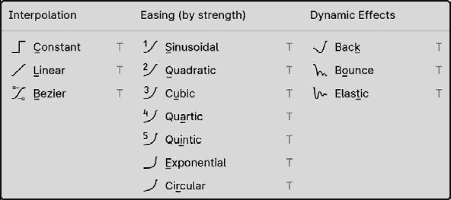

图 2.10：可用插值模式的菜单

3.  选择一个插值模式并播放动画以查看结果！

有趣，对吧？这些玩起来很有意思。虽然我们可以在 Blender 的任何动画编辑器中设置选定关键帧的插值模式，但图表编辑器是唯一显示该插值形状的编辑器。

以下是不同插值模式的简要概述：

* **常量**：这种插值模式实际上根本不插值；数值保持不变，直接“跳跃”或“突变”到后续关键帧的数值。
* **线性**：这是最简单的插值类型；它在关键帧之间画一条直线。结果是以单一速度运动，没有任何加速或减速。

*   `Bezier`：默认的插值模式，此模式将关键帧转变为带有可编辑手柄的贝塞尔节点，这些手柄会影响关键帧前后 `F-curve` 的轨迹。你可能在曲线对象和许多矢量图形应用程序中见过此类节点。贝塞尔关键帧功能强大但棘手；我们将在下一章详细了解它们。

*   `Easing (by strength)`（缓动[按强度]）：别搞错了——这些也是插值类型，但属于特殊类型，必须设置为 `ease in`（缓入）、`ease out`（缓出）或两者兼有。我们马上就会了解这意味着什么。

*   `Dynamic Effects`（动态效果）：这些是独特的模式，会让 `F-curve` 朝交替方向运动；当你想要简单的弹跳或弹性运动，但不需要太多精确控制时，这很不错。它们也被设置为缓入或缓出。

继续尝试不同的插值模式，直到你至少观察过每种模式的一个示例。

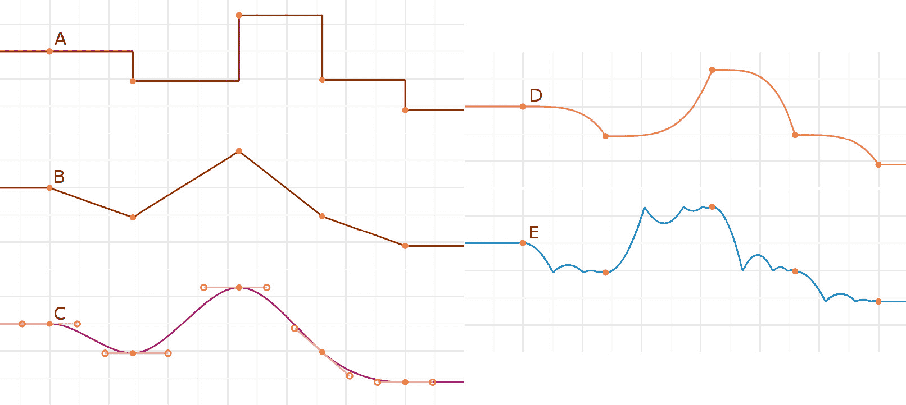

图 2.11：常量、线性、贝塞尔、缓动和动态插值

当你在动画中尝试不同的插值模式时，请密切关注 `F-curve` 的形状如何与球的运动相关联。注意 `F-curve` 的斜率或陡峭程度如何表达属性值的变化率，这反过来决定了物体的速度。

## 设置缓动类型

如果你尝试几种 `Easing` 插值模式，你会注意到它们都表现出相同的行为——开始缓慢，稳定加速，然后在结束关键帧处突然停止。如果我们希望物体减速而不是加速怎么办？这就是 `easing types`（缓动类型）发挥作用的地方。缓动可以被视为插值的一个子类型，它决定插值函数是缓入、缓出，还是两者兼有。我们可以通过亲自尝试来了解这意味着什么。

设置缓动类型就像设置插值一样简单：

1.  使用前面描述的步骤，在 **`Easing`** 或 **`Dynamic Effects`** 列下选择一种插值模式。

2.  使用 `Ctrl + E` 或转到 `Key | Easing Type` 来设置所选关键帧的缓动类型。

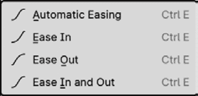

图 2.12：缓动类型菜单

1.  从菜单中选择一种缓动类型并查看其结果。

以下是可用缓动类型及其功能的简要说明：

*   `Automatic Easing`（自动缓动）：基本没用，这仅意味着对所有 `Easing` 插值模式使用 `Ease In`，对 `Dynamic Effects` 模式使用 `Ease Out`。

*   `Ease In`（缓入）：`F-curve` 开始缓慢并加速，在结束关键帧处突然停止。

*   `Ease Out`（缓出）：与 `Ease In` 相反，这开始时很快并减速，在结束处趋于平缓。

*   `Ease In and Out`（缓入缓出）：`F-curve` 在两端都平滑地趋于平缓，在两个关键帧之间的中间帧达到最快点。

你可以跳过 `Automatic Easing`，但请务必看看列表中其他三种缓动类型。

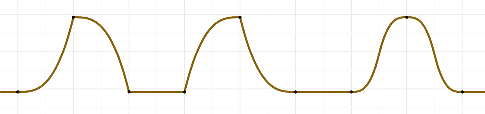

图 2.13：缓入、缓出和缓入缓出

**重要提示**

`Interpolation Mode`（插值模式）和 `Easing Type`（缓动类型）是关键帧的属性，即使效果出现在 `F-curve` 的其余部分，而不是关键帧本身。对于两个关键帧之间 `F-curve` 的每个片段，*是开始处的关键帧决定了插值* *和缓动*。

很酷吧，但这些有什么用？你马上就会发现；现在你知道了什么是插值和缓动以及如何设置它们，你已经准备好让球弹起来了！

## 让球弹起来

球应该怎么弹？不同于我们在上一章制作动画的那个会神奇变色的立方体，弹跳的球是你在现实生活中见过的东西。这让它稍微有点挑战性——我们脑海中已经有一个弹跳球应该是什么样子的概念，所以实现这种效果有正确和错误的方法。

为了寻求指导，我们将求助于物理定律，它们主宰着弹跳球等事物的运动。既然我们是动画师而不是物理学家，这些定律只是我们可以遵循或忽略的指南——例如，这个特定的球最终将被设置为永远弹跳和滚动。尽管如此，了解一点物理学将帮助我们预判作用力并为我们的 `F-curve` 确定最佳插值模式。

根据牛顿第一定律，*除非受到外力作用，运动的物体将保持运动状态*。这意味着需要力来改变物体的方向或速度。那么，弹跳球涉及哪些力？

我们想要模拟的最明显的力是重力，它将物体向下拉。第二个不太明显的力是我们想象中的地板的作用力，它（假设是水平的）会在每次撞击时将球向上弹回。所以，一个向下的力，一个向上的力。上和下——嘿，这些都在同一个轴上。多方便啊！为了模拟这两个力作用在球上，我们将在 `Z Location` `F-curve` 上进行最花哨的关键帧操作。那么另外两条 `F-curve` 呢？

## 空中物体的线性插值

如果你玩过或看过任何涉及球的运动，你会注意到被踢或扔出的球在空中时，会以恒定的速率旋转和水平移动。除了鸟或强风，空气中没有什么会显著改变球旋转或水平移动的速度。这对我们意味着 `X Location` 和 `Y Euler Rotation` `F-curve` 应该显示线性运动，速度不发生任何变化。

这当然是 `Linear`（线性）插值模式的理想用途：

1.  选择球的 `X Location` 和 `Y Euler Rotation` 动画通道上 **第 10 帧** 的两个关键帧。

2.  将关键帧插值设置为 `Linear`。

这可能是最不令人兴奋的插值模式之一，但它是这些特定 `F-curve` 最合理的选择。

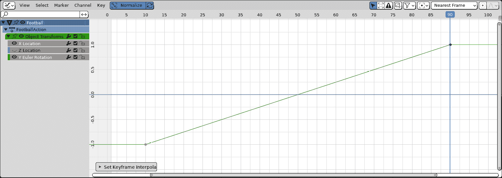

图 2.14：线性 F-curve 片段

我们的动画在 **第 10 帧** 和 **第 90 帧** 仍然存在速度突变，但我们将在最后解决这个问题。让我们开始制作弹跳效果吧！

## 在图表编辑器中添加弹跳关键帧

给球的 `X Location` 和 `Y Euler Rotation` 动画通道添加关键帧很简单（无意双关），但我们的 `Z Location` `F-curve` 看起来将完全不同。我们还需要仔细选择一些不同的插值模式来模拟作用的物理力。

仿佛 Blender 中插入关键帧的方法还不够多似的，我们还将利用这一节作为示例，展示如何仅使用 `Graph Editor`（图表编辑器）进行动画制作。不离开这个编辑器，我们将添加单次弹跳所需的关键帧，然后确定它们的插值。

**重要提示**

你需要确保 `Z Location` 已解锁且未隐藏，以进行下一部分操作。还记得如何切换 `F-curve` 的可见性和编辑保护吗？你可能还想隐藏或锁定其他两个通道，并可能禁用 `Normalize`（归一化），但这由你决定。从现在开始，你将负责我们迄今为止学到的 `Graph Editor` 中的视图和显示设置。

### 在图表编辑器中插入关键帧

一次弹跳将在 `Z Location` `F-curve` 上需要三个关键值——球在网格地板上的最低点、弹跳的最高点，以及再次落到地板上的最低点。这将需要三个关键帧（如果你使用贝塞尔手柄则只需两个，但你还不知道这一点）。这些关键帧将位于 **第 10 帧**、**第 20 帧** 和 **第 30 帧**，给我们一个漂亮的 20 帧弹跳周期。

## 添加第二个关键帧

我们已经有了第一个 **Z Location** 关键帧；现在让我们添加第二个：

1. 选择 `Z Location` 通道。
2. 转到第 **20** 帧。
3. 将鼠标光标放在图表编辑器中，按 `I` 键。请注意，这会弹出一个与上一章使用的不同的菜单：

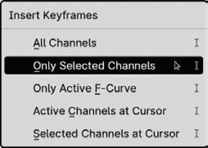

图 2.15：在图表编辑器中插入关键帧的菜单

1. 从菜单中选择 `Only Selected Channels`（仅选中通道）。

通过使用此菜单仅在 **Z Location** F 曲线上插入关键帧，我们只添加了一个关键帧，而不是像以前那样添加一组三个或六个。这对我们其他的两条 F 曲线**零影响**。何必在不需要的地方插入额外的关键帧呢？

这个第二个关键帧可用于确定球弹跳的最高点。当然，现在它仍在地板上……

## 编辑关键帧的值

我们将利用这个机会移动刚刚创建的关键帧，以便你能体验直接在图表编辑器中编辑关键帧的值。我们将把第二个关键帧向上移动 1 米，这恰好是 20 帧弹跳的一个美观高度。

现在就让我们来做：

1. 选择第 **20** 帧上的 `Z Location` 关键帧。
2. 按 `G` 和 `Y`，将其向上移动约 **1** 个单位。

当你在图表编辑器的 `Y` 轴上移动该关键帧时，请注意 3D 视口中发生的情况：

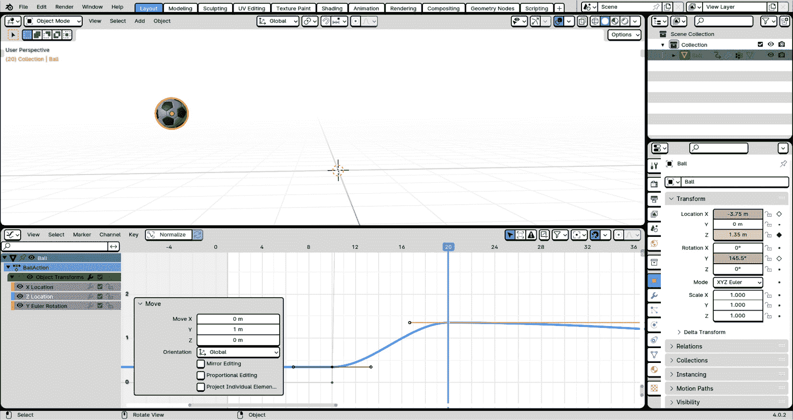

图 2.16：在第 20 帧将关键帧向上移动

如果你仍停留在第 **20** 帧，你会看到球向上移动！通过编辑 **Z Location** 关键帧的值，我们正在从图表编辑器内部影响球在 `Z` 轴上的位置！

> **提示**
>
> 在图表编辑器中所做的更改会根据它们如何影响当前帧的 F 曲线，立即反映在其他区域中。你不必跳转到关键帧所在的帧来编辑它，但这通常是个好主意。

现在我们已经有了一条显示明确变化的 **Z Location** F 曲线，弹跳动画已完成了一半。球从地板开始，然后向上——接下来，我们只需要让球落下来。

## 在图表编辑器中复制关键帧

上去的终究要下来。让球落下的任务将由该序列中的第三个 **Z Location** 关键帧来完成，我们马上就要添加它。

这个关键帧的值（即 `Y` 轴位置）应该是多少？答案是与第一个关键帧相同的值，那时球正接触地板。我们假想的地板是平的，自从球在第 **10** 帧离开后，它就没去过别的地方。那个关键帧的值恰好是 **0.35**。这很简单。弄清这个关键帧的时间（即 `X` 轴位置）也不难。如果球用 10 帧弹起 1 米，那么落回原始高度也应该用 10 帧。第 20 帧之后的 10 帧会将我们的关键帧放在第 **30** 帧。

我们确切知道第三个关键帧需要放在哪里，在 Blender 中有很多方法可以把它放在那里。例如，我们可以简单地在第 **10** 帧插入另一个关键帧并将其移下。这样做没问题，但还有个更快的方法——我们可以直接复制第 **10** 帧的关键帧并将其移至第 **30** 帧。它已经处于完全正确的高度了！

你已经知道如何在时间轴中移动和复制关键帧。在图表编辑器中这样做的方法相同，但多了一个额外步骤：

1. 选择第 **10** 帧上的 `Z Location` 关键帧。
2. 按 `Shift + D` 复制选中的关键帧。
3. 按 `X`。
4. 将复制的关键帧移动到第 **30** 帧。

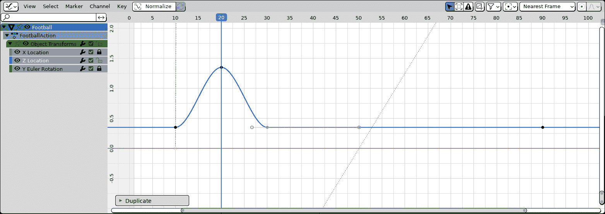

图 2.17：三个关键帧在 Z Location F 曲线上形成一个“驼峰”

你注意到我提到的那个额外步骤了吗？我们必须按 `X`。这与我们在抓取关键帧向上移动后必须按 `Y` 是同一个原因。图表编辑器中的关键帧可以沿两个轴移动，而不是仅一个——这些轴映射到完全不同的事物。当我们在不锁定 `X` 轴的情况下左右移动关键帧时，它们可能会稍微上下移动，从而改变其值。即使这个第三个关键帧的值有微小差异，稍后也可能给我们带来奇怪的结果。

> **重要提示**
>
> 对于上一段中的示例，当在图表编辑器中移动关键帧时，我们经常希望将变换锁定到 `X` 或 `Y` 轴。只需记住按 `X` 或 `Y` 即可！

**Z Location** 通道上的前三个关键帧现在让球上去又下来。不过，看看 F 曲线的形状——这个“驼峰”算弹跳吗？播放动画亲自看看吧。

> **提示**
>
> 如果你从正面在 3D 视口中查看动画，可以观察到球的路径如何完美地模仿 **Z Location** F 曲线的形状，从左向右移动。

如果你觉得这已经足够好了，那你肯定住在水底。在这里的旱地上，球不会做正弦波运动。它不会在离开地板后匀速向上加速，也不会在再次触地前减速。要完成这个弹跳，我们需要用到之前学到的插值和缓动知识。

## 弹跳球的正确插值与缓动

我们如何改进这个“弹跳”的运动？问题不在于我们三个 **Z Location** 关键帧在图表编辑器中的位置；我们知道球必须从地板开始，知道它需要达到一个高点，然后知道它应该在相同的时间内落下来。这些关键帧的帧数和数值都没问题。问题在于这些关键帧之间 F 曲线的形状。我们就是不能忽视插值！

那么，这里需要什么样的插值？你能从 `Set Keyframe Interpolation`（设置关键帧插值）菜单中挑出来吗？别说 `Bounce`（弹跳）——那是作弊，而且你会发现它对高度、速率和弹跳次数等几乎没有控制力。

记住，我们是在模拟重力！重力被观测为恒定的向下加速度，加速度是速度的变化率，而速度是位移（即位置）的变化率。因此，我们需要创建的那种线，其*变化率本身具有恒定的变化率*。

我就不继续上这物理课了。这本质上意味着我们需要一个具有二次函数的斜率。现在让我们找到那个插值模式：

1. 选择第 **10** 帧和 **20** 帧上的前两个 **Z Location** 关键帧。
2. 将 `Set Keyframe Interpolation` 设为 `Quadratic`（二次）。

这完成了一半，但弹跳的前半段仍然不对劲：

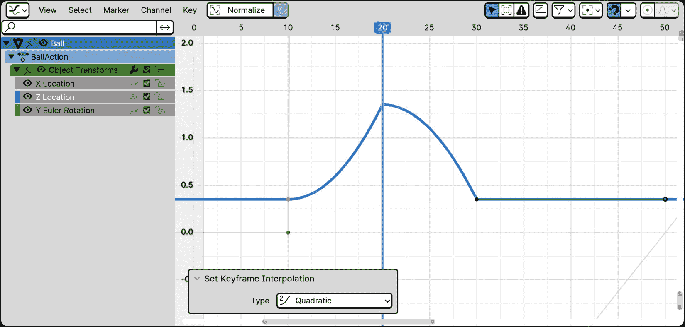

图 2.18：一个不太理想的、鲨鱼鳍状的 F 曲线片段

它是*缓入*的，而我们需要该片段做相反的事。好在我们知道如何更改缓动类型：

1. 选择第 **10** 帧上的第一个 **Z Location** 关键帧。
2. 将 `Set Keyframe Easing Type` 设为 `Ease Out`（缓出）。

现在我们有了一个弹跳！

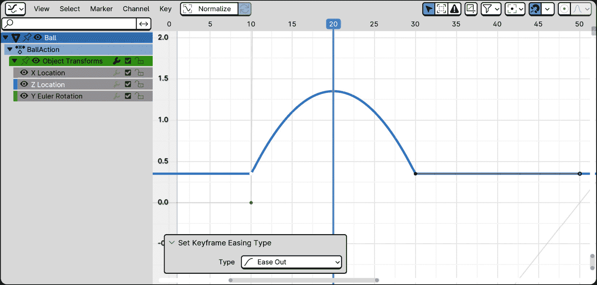

图 2.19：Z Location F 曲线中的一个正确弹跳

只剩一件小事——球只弹跳了一次。

## F 曲线外推

目前，小球只会弹跳一次，这不太有趣。它还会在第 `10` 帧之前和第 `90` 帧之后保持静止，这看起来也不太好。为了修复这个问题，我们可以简单地将弹跳关键帧复制几次，并缩短场景的帧范围。不过，还有更好的方法——一种能让小球永远弹跳和滚动下去的方法。我们可以使用一个叫做 `extrapolation`（外推）的功能轻松实现这一点。

要理解外推，请想象 F 曲线在其第一个和最后一个关键帧之间有一段有限的“主”段。现在，试着看看它的其余部分，也就是它结束的地方。你得缩放很久。F 曲线是永恒的；`it has no beginning or end`（它没有开始也没有结束）。它不会仅仅因为没有关键帧了就消失！它必须始终有一个确定的值，即使在动画开始之前，以及在动画结束很久之后。外推就是我们用来描述 F 曲线在其余时间里应该做什么的术语。

默认情况下，所有 F 曲线都具有 `Constant Extrapolation`（常量外推），它只是将曲线平坦地延伸，导致值停止变化。这对大多数情况都适用，但不适用于我们现在的 F 曲线。在为这些曲线选择不同的外推模式后，你就能拖动 `End Frame`（结束帧）值，如果你愿意，甚至可以让场景持续一小时，看着小球弹跳着滚向地平线彼端。

## 线性外推

让我们先处理让小球滚动的前两条 F 曲线——`X Location`（X 位置）和 `Y Euler Rotation`（Y 欧拉旋转）。我没有让你在场景的开始帧和结束帧为这些曲线添加关键帧，而是让你在帧 `10` 和 `90` 添加，这样问题就更容易看出来了。

如果我们想让小球继续滚动怎么办？我们得用关键帧把这些 F 曲线进一步向上和向外延伸。要延伸多远？如果你不确定动画到底该在何时结束，这会变得难以控制。幸运的是，那些关键帧就留在原地就好。

我们要做的只是设置一种不同的外推模式：

1.  选择 `X Location` 和 `Y Euler Rotation` 动画通道。

2.  按 `Shift` + `E` 或前往 `Channel`（通道）| `Extrapolation Mode`（外推模式）。

3.  选择 `Linear Extrapolation`（线性外推）。

`Linear Extrapolation` 会让 F 曲线沿着线性斜率继续延伸，该斜率源自前两个和后两个关键帧。由于这些 F 曲线上各只有两个关键帧，且它们都已经使用 `Linear`（线性）插值，因此以这种方式外推时，F 曲线将显示为完美的直线：

图 2.20：X 位置和 Y 欧拉旋转 F 曲线的线性外推

注意这对我们的动画有什么影响。小球不仅会继续滚动，`it now always has` `been rolling`（它现在一直都在滚动）。

## 循环外推

现在让我们看看 `Z Location`（Z 位置）F 曲线。为了让小球反复弹跳，我们可以利用已有的知识，把那三个弹跳关键帧复制一百次左右……但我们不这么做。还有另一种外推模式能更干净利落地帮我们完成所有工作。

现在来看看它：

1.  选择 `Z Location` 动画通道。

2.  按 `Shift` + `E` 或前往 `Channel` | `Extrapolation Mode`。

3.  选择 `Make Cyclic (F Modifier)`（制作循环 [F 修改器]）。

F 曲线现在有了所谓的循环外推。F 曲线的关键段现在将无限重复。等等！好像不对劲：

图 2.21：一种弹跳加滚动式的 F 曲线

这是个奇怪的模式。这是怎么回事？

记住，循环外推会重复 F 曲线的整个关键段——也就是第一个和最后一个关键帧之间的所有内容。这条曲线的最后一个关键帧在哪里？远在帧 `90` 那边！我们在本章一开始就加了它，然后把它忘了。这种事在动画师身上常有发生。

我们想重复的是 20 帧的弹跳，而不是 80 帧的弹跳加滚动。那个讨厌的关键帧搞乱了我们 F 曲线的循环周期！让它见鬼去吧：

1.  选择帧 `90` 上的 `Z Location` 关键帧。

2.  按 `X` 删除它。

啊，这下好多了。

图 2.22：正确循环的弹跳

现在只剩下我们的三个弹跳关键帧，下一次弹跳会紧接在上一次之后，给我们带来清脆、干净的弹跳效果。

你已经完成了弹跳球动画！如果你愿意，继续玩玩看吧——也许把 `End Frame` 设为 `10,000`，看着你的作品奔向世界：

图 2.23：回来啊！

大功告成！

## 总结

通过将所有动画属性显示为线图，`Graph Editor`（图表编辑器）揭示了 3D 动画的真相——它归根结底只是一堆数字。你场景中的所有参数和每个 3D 物体的所有属性——它们都是随时间变化的数字。你让某些数字在一帧上是一个值，然后让这些相同的数字在另一帧上是另一个值。一直搞下去，直到它不再难看。

就是这样。这就是 3D 动画。结束了。

好吧，也许不完全是。我们还得写一整本书，讲那些美妙的数字，它们是什么，为什么需要它们，在哪里找到它们，以及如何让它们完全按照我们的意愿行事。

我们只是刚刚触及了 `Graph Editor` 功能的皮毛。比如你见到的那些 `Bezier keyframes`（贝塞尔关键帧）……那些有什么用？继续读下去，看看我们如何直接雕刻动画中的 F 曲线！

## 问题

1.  当你从 `Insert Keyframe`（插入关键帧）菜单中选择 `Location`（位置）时，实际上插入了多少个单独的关键帧？`Location & Rotation`（位置和旋转）呢？`Location, Rotation, & Scale`（位置、旋转和缩放）呢？

2.  当你删除一个动画通道时，它的关键帧会发生什么？如果你删除 F 曲线上的所有关键帧会怎样？

3.  在 `Graph Editor` 中，`X` 轴和 `Y` 轴是不同的。在 `3D Viewport`（3D 视口）中，`X` 轴和 `Y` 轴也是不同的。但这两种差异有何不同？

4.  在 `Graph Editor` 中移动关键帧时，上、下、左、右等方向意味着什么？

5.  启用 `Normalize`（归一化）时，`Graph Editor` 的 `Y` 轴上的 -1 代表什么？

6.  为什么在 `Graph Editor` 中复制关键帧后通常建议按 `X`？

7.  从一条完全平坦的 F 曲线中你能推断出什么？

8.  具有 `Linear`（线性）插值的 F 曲线段显示速度吗？显示加速度吗？

9.  F 曲线的哪些部分受外推影响？

10.  我们在 `Graph Editor` 中学到了哪些具体操作是 `Timeline`（时间轴）无法完成的？
