# 第 3 章：贝塞尔关键帧

此时，应该不用多说，关键帧是一种帧，就像地址是一种裙子……也就是说，它不是。在 Blender 中，关键帧更像是一个小物体，它影响你 3D 场景中某物体的某个属性。它存在于 `3D Viewport` 之外的多个区域；在 `Graph Editor` 中表现为曲线上的一个点，在 `Timeline` 和其他编辑器中表现为菱形形状。它的主要属性是值和时间，它们决定了指定帧上所分配属性的值，但它还拥有插值和缓动等属性，这些有助于确定两个关键帧之间的插值。

还有一类特殊的关键帧拥有自己独特的属性，我们在上一章中留待探索：`Bezier keyframes`（贝塞尔关键帧）。

## 简介

这些关键帧非常强大且可能令人困惑，值得在本书中拥有独立的一章。从技术上讲，`Bezier` 是在 `设置关键帧插值` (`T`) 菜单中找到的一种插值模式，但将这种类型的关键帧放在一组单纯的插值模式中似乎并不合适。`Bezier` 关键帧改变了游戏规则。以前，我们只是从菜单中选择不同的插值模式和缓动类型来塑造 `F 曲线`；使用 `Bezier` 关键帧，我们可以直接对其建模，创建出其他任何插值模式都无法实现的 `F 曲线`。

在本章中，您将学习以下内容：

*   在 `图表编辑器` 中自由插入关键帧的方法
*   `Bezier` 关键帧手柄类型及其设置方法
*   如何编辑“手动”关键帧手柄
*   `F 曲线` 中拐点的意义
*   如何（以及为何）将关键帧从一个通道复制到另一个通道

## 技术要求

本章需要一个独轮车场景，可在此处下载：

`https://github.com/PacktPublishing/Realizing-3D-Animation-in-Blender`

该独轮车专为本练习设置，场景包含一个简短的障碍赛道以增加趣味性。在 Blender 中打开 `Unicycle.blend` 文件，让我们开始吧！

## 一位疲惫的动画师

哦，对了——我们要制作独轮车动画。

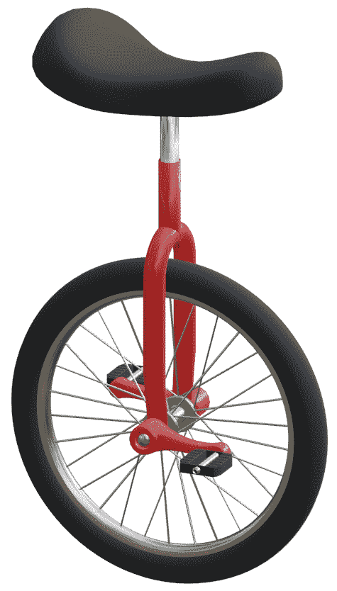

图 3.1：独轮车

制作独轮车动画将比上一章的球更具挑战性。它可以弹跳和滚动，但也需要转向并向运动方向倾斜。它还由多个可移动部件组成，因此您需要更密切地关注所选内容。

这辆特定的独轮车将在没有骑手的情况下沿提供的赛道移动。想象它自行获得了生命，或者可能有一个隐形人坐在车座上。即使没有骑手，独轮车本身仍可被视为一个角色！

## 独轮车的连接部件

我们的独轮车模型由四个对象组成。这些对象通过 `父子关系` 和 `约束` “连接”在一起，我们将在下一章详细介绍该主题。目前，您只需知道对象 `Left Pedal`（左踏板）和 `Right Pedal`（右踏板）都设为 `Wheel`（车轮）的子级，而 `Wheel` 本身又约束于 `Seat`（车座）对象。

车座去哪里，车轮及其踏板就会跟随到哪里。这使其成为我们的*根*对象。就本章而言，移动此对象即视为移动独轮车，尽管没有名为“独轮车”的单一对象。我们将花费大部分时间为 `Seat` 制作动画。之后，我们将为 `Wheel` 的旋转制作动画，使其正常滚动。两个踏板可以保持不动。

## 为赛道检查点设置关键帧

本章的动画将比以前更灵活。为开始，我将给出一些在前几个关键帧上插入关键帧的精确指令，它们将作为您动画其余部分的基础。稍后您将自行放置更多关键帧。

**提示**

场景和以下关键帧的设置允许您在移动对象 `Seat` 到指定位置时按住 `Ctrl` 键。这会将您的移动吸附到 1 米增量，有助于保持操作快速且精确。在其他章节中，“米”可能简称为“单位”，在 Blender 中二者实际上是同一回事。

准备好添加更多位置和旋转关键帧吧！

1.  转到第 **1** 帧。
2.  选择对象 `Seat`。
3.  将独轮车向上、向后、向左移动，使其位于赛道顶部的起跑线上。
4.  绕 *Z* 轴旋转 **90** 度，使其面向赛道的桥梁方向。
5.  通过 `插入关键帧` (`I`) | `位置和旋转` 设置位置和旋转关键帧。

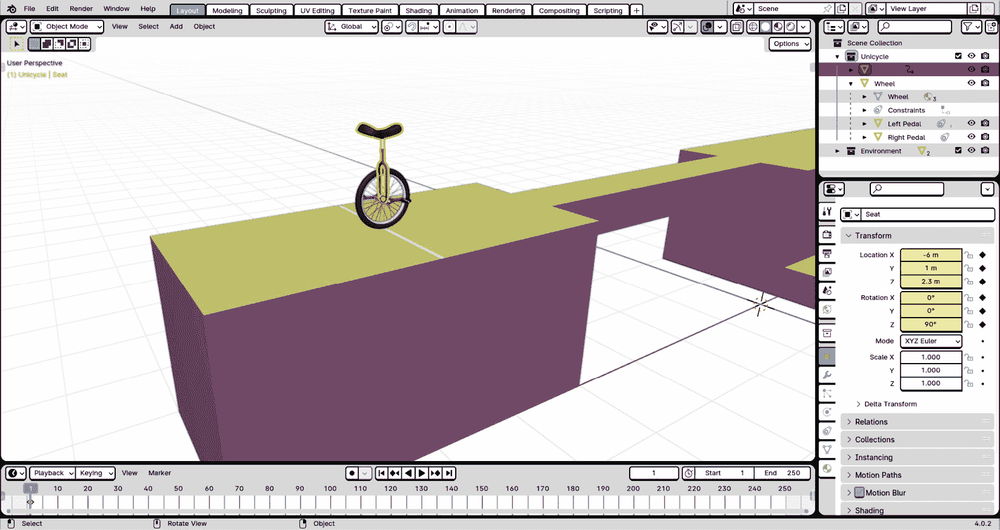

图 3.2：第 1 帧的独轮车

仅仅一个帧就需要这么多步骤！让我们加快速度，完成接下来的几个关键帧。

1.  独轮车有 5 秒时间通过第一个检查点。在第 **120** 帧，沿 *X* 轴向右移动独轮车，使其与安全锥筒对齐。设置位置和旋转关键帧。

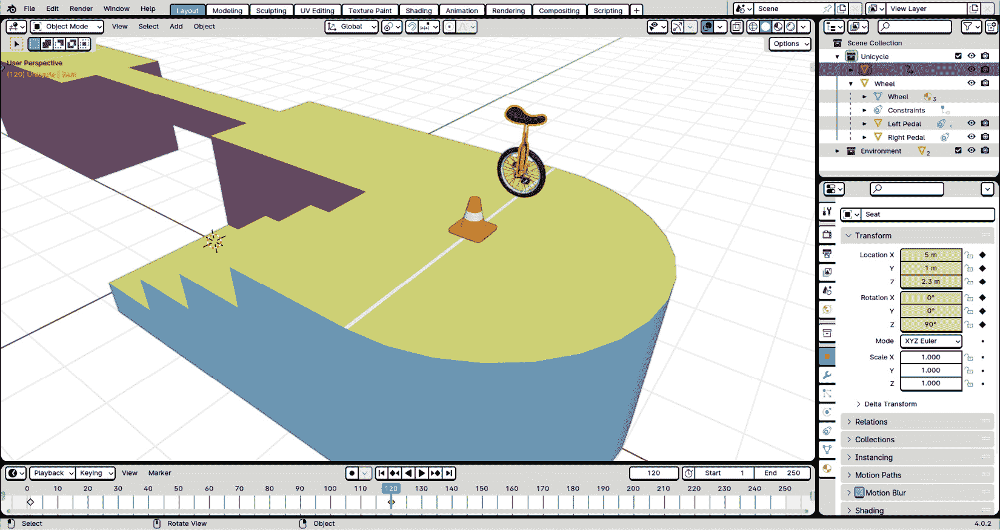

图 3.3：第 120 帧的独轮车

1.  现在独轮车必须绕过安全锥筒向右转。在第 **150** 帧，沿 *Y* 轴向前移动独轮车到锥筒另一侧。绕 *Z* 轴向右旋转 **\-180** 度，使其面向台阶。设置位置和旋转关键帧。

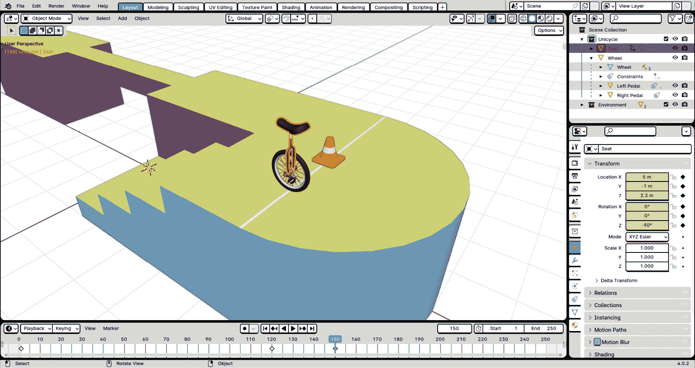

图 3.4：第 150 帧的独轮车

1.  在第 **160** 帧，沿 *X* 轴移动独轮车 **\-1** 米至台阶顶端。这将是它的第一个起跳点。设置位置和旋转关键帧。

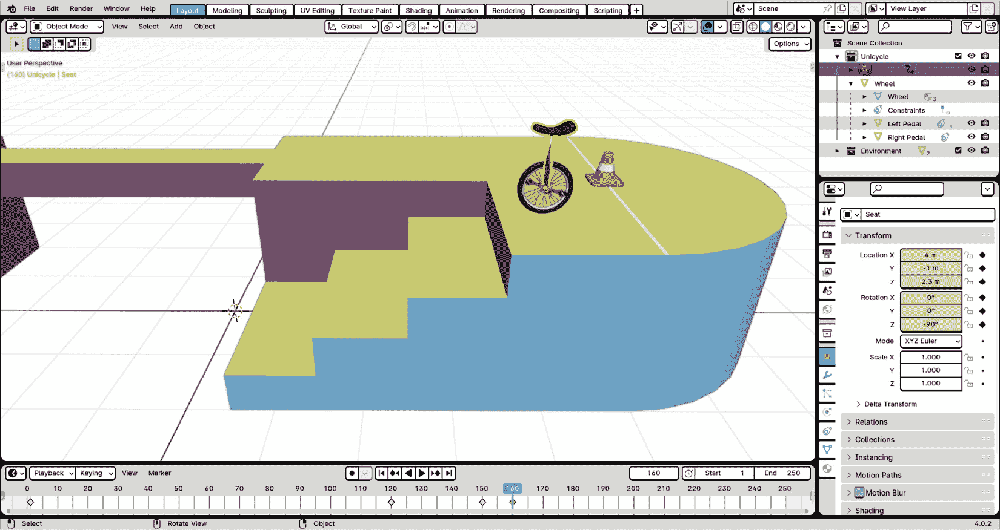

图 3.5：第 160 帧的独轮车

1.  在第 **200** 帧，将独轮车带回场景“地面”高度的台阶底部。它应看起来静止在 *Y* 轴网格线上。设置位置和旋转关键帧。

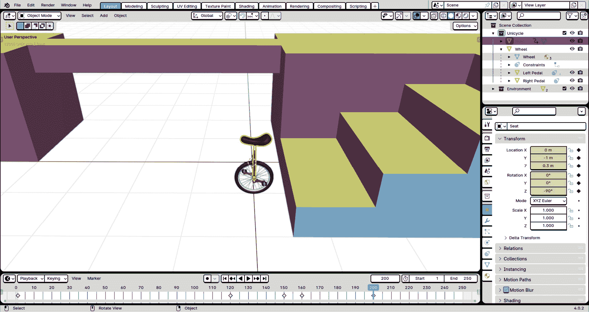

图 3.6：第 200 帧的独轮车

1.  最后冲刺！转到第 **250** 帧，沿 *X* 轴向左移动独轮车约 **\-15** 米。设置位置和旋转关键帧。

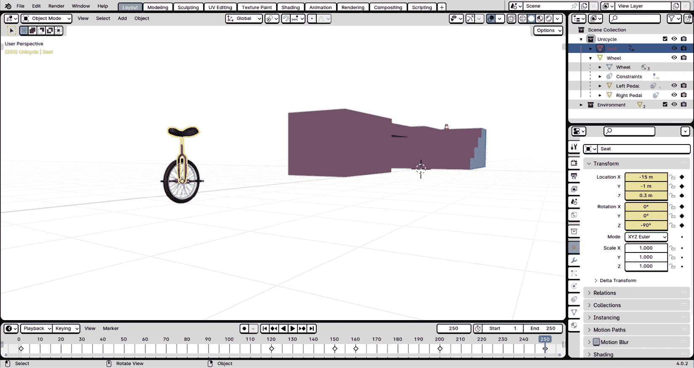

图 3.7：第 250 帧的独轮车

**提示**

插入这些关键帧后，使用键盘上的 `上` 和 `下` 方向键快速查看独轮车在各关键帧处的位置。如果您觉得在任何步骤中出错，不要害怕删除或覆盖现有关键帧并重试。

这就结束了本章的“填色游戏”部分。如果此时动画看起来不太好，不要气馁。重要的是我们的主要位置已经分镜定稿，这使我们能更轻松地继续在 `图表编辑器` 中添加和编辑更多关键帧来完善动画。

## 在图表编辑器中插入关键帧的新方法

说到 `图表编辑器`，为什么不把它打开呢：

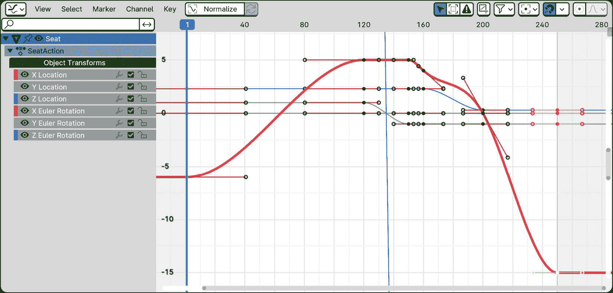

图 3.8：初见图表编辑器

天哪！这与上一章使用的截然不同。您可能希望隐藏此处的一些通道，但请勿删除任何通道。我们需要该对象的所有六个动画通道。回想起来，那个弹跳球显得多么简单！

**重要提示**

本章将展示大量 `F 曲线` 图片。由于这是一本包含静态图像的书，您需要在自己的屏幕上观看动画结果。请记住保持 `3D 视口` 与 `图表编辑器` 同时打开，并在进行更改后始终播放和擦洗动画以查看您创建的内容。

让我们关注 `X 位置` 通道的前 120 帧：

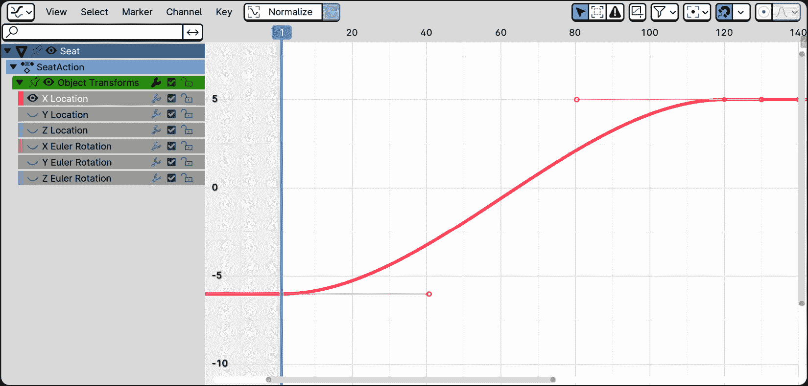

图 3.9：`X 位置` `F 曲线` 的第一部分

有点无聊，对吧？我们将通过在这一段插入几个更多关键帧来丰富 `X 位置` `F 曲线` 的运动。这些关键帧究竟该放在哪里？为什么不由您决定？为什么不利用这段作为机会，让您自由表达，在喜欢的地方添加几个关键帧？是的，让我们拆掉辅助轮！独轮车本来就没有辅助轮。

顺便，我们将学习一种在 `图表编辑器` 中任意插入关键帧的有趣方法：

1.  在 `图表编辑器` 中，选择对象 `Seat` 的 `X 位置` 通道。

2. 按住 `Ctrl` 并用非选择鼠标按钮点击，即可在鼠标光标位置直接插入一个 `X Location` 关键帧。

3. 重复此操作，直到你在第 1 帧和第 120 帧之间添加了 3 或 4 个新的 `X Location` 关键帧。

4. 通过选择并按 `G` 抓取这些新关键帧来按你的喜好进行调整。结果应使你的独轮车速度和方向平滑变化。避免制造离谱的陡峭斜率和峰值，那会导致独轮车移动得突兀地快或冲出赛道。

重要提示

当你想要选择并抓取贝塞尔关键帧时，请确保抓取的是关键帧本身（中间的点），而不仅仅是它的手柄（关键帧两侧伸出的那两个小“天线”）。我们将在下一节学习手柄。

我选择添加四个关键帧，使独轮车在最开始时向后移动一次，随后再向后移动一次：

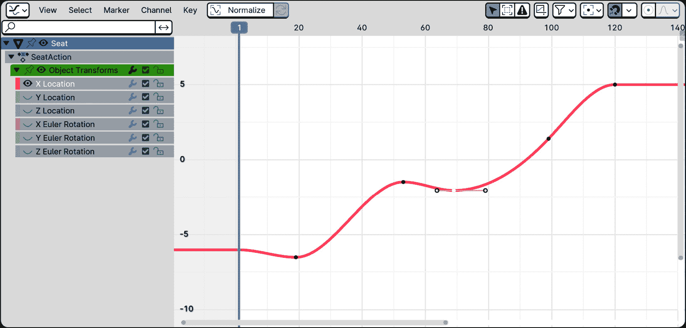

图 3.10：X Location F 曲线示例

你的 F 曲线可能看起来不同。这没关系！如果你只是复制我在图表编辑器中看到的内容，那就不是你的动画了。

现在我们已经为我们的分步动画添加了自己的个人风格，看起来……依然很糟糕。别担心；我们马上就要利用贝塞尔手柄的魔力来改善它。

## 贝塞尔手柄类型

在 Blender 的图表编辑器中，`Bezier` 被归类为一种关键帧插值模式。此模式可在 `设置关键帧插值` (`T`) 菜单中找到，但本练习无需调出该菜单，因为 `Bezier` 是默认的插值模式。你所有的关键帧已经是贝塞尔关键帧了！

区分贝塞尔关键帧和其他类型的关键帧很容易。贝塞尔关键帧具有**手柄**：

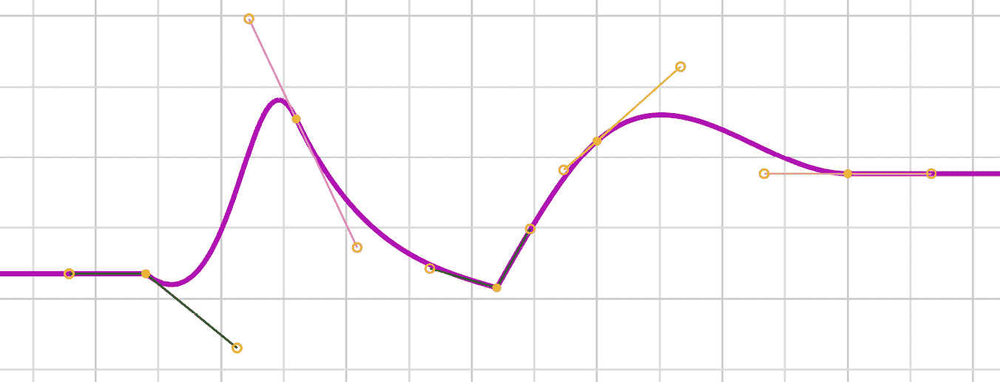

图 3.11：带有可见手柄的贝塞尔类型关键帧

关键帧本身是 F 曲线上的中间点。手柄是关键帧左右两侧延伸出的两个点，由线条连接，这些线条在关键帧处与曲线*相切*。

如果你用过任何类型的矢量图形应用程序，你会认出这些是什么，它们的功能也不会让你感到惊讶。贝塞尔手柄弯曲曲线，将其轨迹推向手柄的方向。手柄越长，对该曲线段的影响越强。在 Blender 的图表编辑器中，我们可以直接编辑这些手柄，或利用特定手柄类型的自动行为来创建其他插值模式无法实现的 F 曲线形状。

在继续之前，我们必须采取一个重要步骤，以帮助这些手柄更易于查看和选择。

## 显露关键帧手柄

你可能已经注意到，只有选中的关键帧似乎有手柄。默认情况下，必须先选择关键帧，其贝塞尔手柄才会出现在图表编辑器中。多么不方便的工作方式啊！对于本练习，我们希望能看到并选择所有手柄，而无需先选择关键帧：

1. 转到图表编辑器的 `视图` 菜单。

2. 取消勾选 `仅选中关键帧手柄`。

现在我们可以看到所有手柄了！好多了。

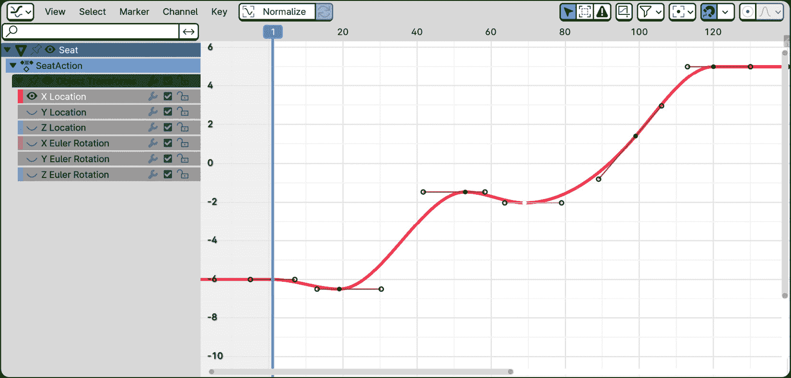

图 3.12：图表编辑器中所有手柄均可见

提示

图表编辑器的 `视图` 菜单中还隐藏着一些其他实用功能。另一个你可能考虑启用的有用功能是 `显示滑块`，它会直接在动画通道列表中显示每个动画属性的当前值。在图表编辑器中编辑这些滑块是插入关键帧的另一种方式！

## 贝塞尔手柄类型概览

在上一章中，我们从 `设置关键帧缓动类型` (`Ctrl` + `E`) 菜单中选择了不同的缓动类型，这在使用任何 `缓动` 或 `动态效果` 插值模式时是必要的。相比之下，贝塞尔关键帧没有缓动类型。它们改为拥有手柄类型，通过 `设置关键帧手柄类型` (`V`) 菜单进行设置：

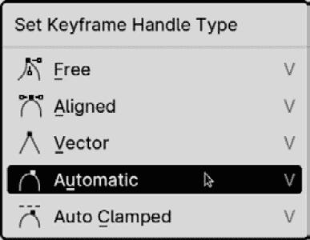

图 3.13：设置关键帧手柄类型菜单

这些类型决定了手柄应具有何种自动行为（如果有）。以下是所有类型的简介：

*   `Free`（自由）：最“手动”的贝塞尔手柄，可自由且独立地移动。这会在 F 曲线中产生尖锐角度，从而导致物体速度或方向发生剧烈变化。`Free` 手柄忠实地保持调整后的状态，不受相邻关键帧影响。

*   `Aligned`（对齐）：这种手柄几乎可以自由移动。它不对任何事物做出反应，除了关键帧另一侧的“同胞”手柄，它必须与之保持对齐。当你仍希望 F 曲线在关键帧处保持平滑时，可用于手动控制。

*   `Vector`（矢量）：一个略具误导性的名称（技术上讲所有贝塞尔手柄都是矢量），这些手柄自动指向相邻关键帧或其曲线段的顶点。一排多个 `Vector` 手柄将创建一条外观与线性插值完全相同的 F 曲线。

*   `Automatic`（自动）：这些手柄自动旋转和缩放，以生成尽可能平滑的 F 曲线。`Automatic` 手柄非常适合松散且自然的运动，但如果粗心使用，容易产生“漂移”和“超调”，搞得一团糟。

*   `Auto Clamped`（自动钳制）：默认手柄类型，也是迄今为止最实用、最常见的。像 `Automatic` 手柄一样，它们也试图制作平滑曲线，但倾向于在可能的情况下保持水平，以避免不必要的运动。

重要提示

使用 `设置关键帧手柄类型` (`V`) 并不是更改贝塞尔关键帧手柄类型的唯一方法。手动编辑任何手柄都会导致其类型变为 `Free` 或 `Aligned`。因此，在 Blender 中很容易意外更改手柄类型！

我们将有机会在动画中利用这些手柄类型中的每一个。让我们从最简单的一个开始！

## Automatic 和 Auto Clamped 贝塞尔手柄

当你移动带有 `Auto Clamped` 手柄的贝塞尔关键帧时，你可能已经注意到手柄会相对于相邻关键帧自动移动。`Auto Clamped` 和 `Automatic` 关键帧手柄的相似之处在于它们不由动画师直接控制。这些所谓的“手柄”根本就不打算被“手动操作”！相反，手柄会根据相邻关键帧的位置和轨迹自动反应，以生成最优平滑的 F 曲线。在拥有数千个关键帧的动画中，我们不想逐个编辑每个手柄，此功能必不可少。

让我们回到 `X Location` F 曲线的第一部分，即第 1 帧到第 120 帧之间，我们刚刚添加了一些随机关键帧使其更有趣。结果应该看起来相当平滑，但还可以更平滑。

让我们试用 `Automatic` 手柄类型：

1. 选择第 120 帧之前的所有 `X Location` 关键帧。

2. 按 `V` 调出 `设置关键帧手柄类型` 菜单。选择 `Automatic`。

3. 完成此操作后，你可能希望进一步微调这些关键帧的位置，以适应它们奇特的新行为。

`X Location` F 曲线和生成的动画现在看起来应该比以前稍微平滑一些：

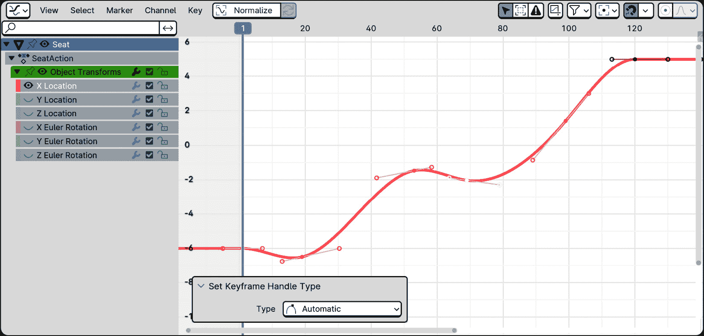

图 3.14：带有“全自动”关键帧的 F 曲线

将你新的 `Automatic` 关键帧手柄与之前的 `Auto Clamped` 手柄进行对比。`Auto Clamped` 手柄更为保守；它们倾向于尽可能保持平坦，将 `F 曲线` 的数值范围限制在每一对相邻关键帧之间。

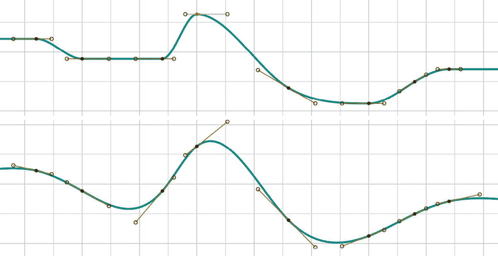

Figure 3.15：上 – `Auto Clamped` 关键帧；下 – `Automatic` 关键帧

另一方面，`Automatic` 手柄则狂野不羁，毫无顾忌。它们让 `F 曲线` 像蜿蜒的河流一样流动，赋予自己所需的任何方向和幅度，使穿过关键帧点的曲线尽可能平滑。在 `图表编辑器` 中移动它们时，人们不必过多关注其精确的 `XY` 位置，而应更多地关注生成的 `F 曲线` 形状。这种行为使得 `Automatic` 手柄非常适合厚重、摇晃、扭动的运动，在这些情况下物体保持动画状态且不需要高精度。

### 为什么不到处都用 `Automatic` 关键帧？

`Auto Clamped` 之所以是默认选项，是有原因的。看看如果我们给所有关键帧都设置 `Automatic` 手柄，我们的 `Y 位置` `F 曲线` 会变成什么样：

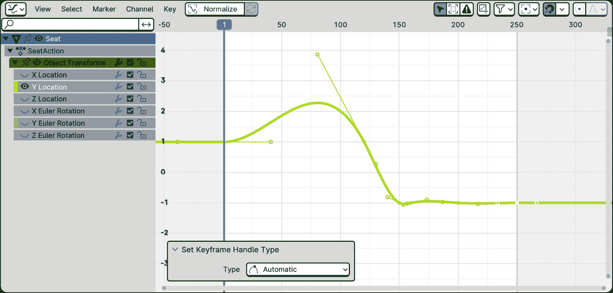

Figure 3.16：所有关键帧均为 `Automatic` 的 `Y 位置` `F 曲线`

这是之前提到的 `漂移` 效应的一个绝佳例子。在这里，独轮车会偏离整个赛道！我们从未想让它在 `Y` 轴上移动那么多。

`Automatic` 手柄太狂野了，很难让它们在你想要平坦的地方保持平坦。这种同类效应还会导致“超出”，产生不可预测的极值，或 `F 曲线` 上不在关键帧处的“峰值”，使 `F 曲线` 更难控制。

相比之下，`Auto Clamped` 关键帧手柄更加明智。无论在 `F 曲线` 上哪里有两个这样的关键帧，你都可以确信该 `F 曲线` 段上的数值将保持在这两个关键帧数值的范围内，且不会改变方向。曲线的平坦段将保持平坦，峰值将始终固定在关键帧的时间和数值上。在接下来的练习中，我们将继续使用 `Auto Clamped` 关键帧手柄作为默认值，仔细且刻意地选择要更改为其他类型的手柄。

我们已经充分了解了 `Automatic` 和 `Auto Clamped` 的区别。让我们继续学习另外两种手柄类型。

## Vector 和 Aligned 手柄

还有大量工作要做！暂时，我们将搁置独轮车在 `120` 帧和 `150` 帧之间微弱的“转弯”，因为独轮车尚未“绕过”任何东西，转而关注 `X 位置` `F 曲线` 中另一个需要我们注意的部分。

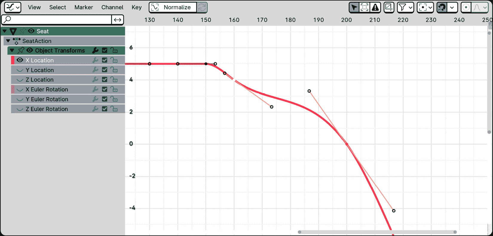

Figure 3.17：`160` 到 `200` 帧的 `X 位置` `F 曲线`

在 `160` 帧和 `200` 帧之间，我们希望独轮车在下楼梯时能一级级地“跳跃”前进。就像我们弹跳球练习那样，这意味着独轮车在这一部分大部分时间不接触地面，因此它应该保持恒定的水平速度——即 `X 位置` `F 曲线` 上的线性插值。

我们可以使用 `Linear` 插值模式来实现，但让我们尝试使用 `Vector` 手柄：

1. 选择 `Seat` 在 `160` 帧和 `200` 帧上的两个 `X 位置` 关键帧。
2. 按 `V` 并将 `设置关键帧手柄类型` 设为 `Vector`。

现在，两个关键帧相对的手柄直接指向对方，形成了一条完美的直线段：

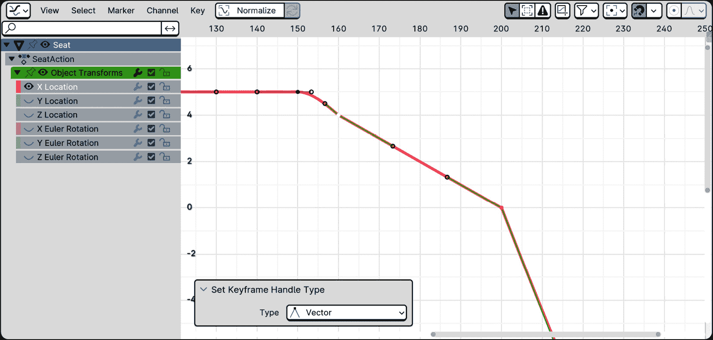

Figure 3.18：使用 `Vector` 手柄创建的线性段

如果你认为这与 `Linear` 插值模式完全相同，你是对的！与其他手柄类型相比，这些 `Vector` 手柄的用处有限。不过，我们可以利用它们做一个小技巧……

## 组合 Vector 和 Aligned 手柄

你知道单个 `贝塞尔关键帧` 可以拥有两种不同的手柄类型吗？对于某些手柄组合这是成立的，在以下情况下可能很有用。要更改单个手柄的类型而不是两个，你只需选择单个手柄而不是整个关键帧。

让我们用刚才编辑的关键帧试一下：

1. 选择 `160` 帧 `X 位置` 关键帧的**左侧**手柄。
2. 按住 `Shift` 选择 `200` 帧 `X 位置` 关键帧的**右侧**手柄。
3. 将两个关键帧的手柄都设为 `Aligned`。

注意 `Aligned` 手柄现在如何与其同胞 `Vector` 手柄刚性对齐。如果你尝试拖动它们，它们可以被缩放，但无法自行改变方向：

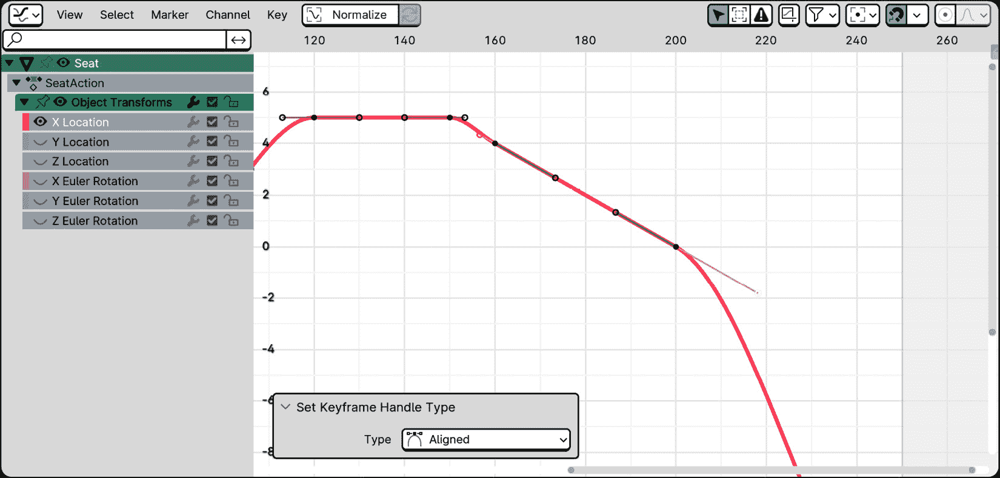

Figure 3.19：组合了 `Vector` 和 `Aligned` 手柄的 `贝塞尔关键帧`

通过将 `Aligned` 手柄与 `Vector` 手柄结合使用，我们能够消除最初那些尖锐的拐角，保持平滑的 `F 曲线`，同时不影响线性段。结果是在 `160` 和 `200` 帧之间的恒定速度前实现了缓入和缓出。

虽然巧妙，但这只是 `Aligned` 手柄较少见的用例之一。在下一节，为什么不通过直接编辑它们来多练习一下呢？

## 编辑贝塞尔手柄

在上一节中，我们尝试了所有不由动画师直接控制的 `贝塞尔` 手柄类型：`Auto Clamped`、`Automatic` 和 `Vector`。这些类型都具有某种“自动”行为，会受相邻关键帧影响。

剩下的类型 `Aligned` 和 `Free` 没有这种自动行为。它们固定在关键帧的中心点，除非直接编辑，否则不会移动。如果我们不学会如何直接编辑，就无法继续前进！

在 Blender 中编辑 `贝塞尔` 手柄与编辑其他元素几乎没有区别。以下是主要操作符：

* `旋转` (`R`)：这会改变所选手柄的方向，从而改变关键帧点处曲线的轨迹。
* `缩放` (`S`)：这会改变手柄的大小（幅度），从而改变其方向影响的强度。
* `抓取` (`G`)：抓取手柄可自由移动它，同时影响其方向和大小。

毫不意外！不用太担心选择或旋转；在大多数情况下，你只需使用 `抓取` (`G`) 即可。点击拖动也行。

了解了这些，让我们继续处理我们的 `X 位置` `F 曲线`。

## 使用 Aligned 手柄实现平滑运动

`X 位置` `F 曲线` 还有一个部分需要我们紧急关注：`120` 和 `150` 帧之间的掉头：

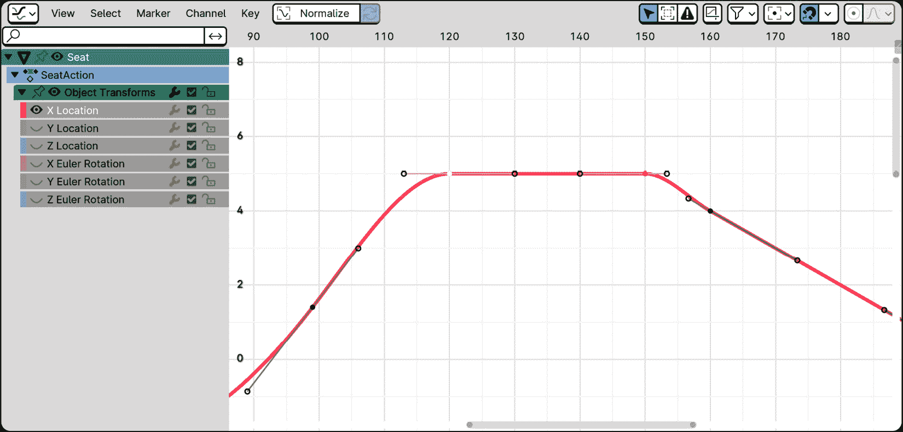

Figure 3.20：`X 位置` `F 曲线` 中不理想的平坦段

为了让独轮车真正绕过安全锥，我们需要做些什么来推高曲线的这一部分，使得在 `135` 帧时，独轮车位于安全锥之外而不是穿过它。虽然我们不需要在 `135` 帧插入关键帧来实现这一点。相反，我们可以编辑现有关键帧的手柄。这次我们不需要将手柄类型改为 `Aligned`。当我们编辑手柄时，这会自动发生：

1. 选择 `Seat` 在 `120` 帧 `X 位置` 关键帧的**右侧**手柄。
2. 使用 `抓取` (`G`) 将其向上移动。
3. 对 `150` 帧 `X 位置` 关键帧的**左侧**手柄做同样的操作。
4. 继续编辑这两个关键帧，直到在 `120` 和 `150` 帧之间获得一个漂亮、对称、拱形的形状，且两侧极少有“褶皱”：

## X 位置 F 曲线调整

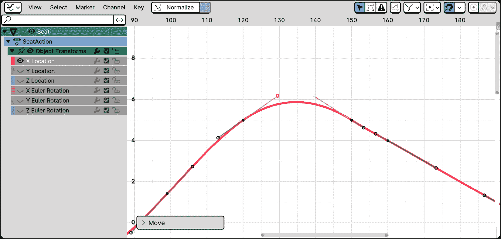

Figure 3.21: 改进后的 X 位置 F 曲线

我们之所以避免添加额外关键帧，并非出于固执。有时，确实尽可能少用关键帧就能实现平滑运动。结果应该让独轮车绕过安全锥，沿着一个略呈椭圆的路径行驶。

我们即将完成这条 F 曲线了！让我们做最后一次调整来收尾。为什么独轮车要在第 `250` 帧减速停下？如果它看起来像是在动画结束后还将继续巡航，会少些枯燥感。

让我们调整最后那个关键帧，使独轮车加速（并保持）巡航速度，直到最后一帧：

1.  选中第 `250` 帧关键帧的 `左侧` 手柄并 `抓取` (`G`)，向上移动。
2.  你可能还需要 `缩放` (`S`) 第 `200` 帧上 `对齐` 的 `右侧` 关键帧手柄。
3.  重复操作，直到独轮车以令人满意的方式达到令人满意的速度。

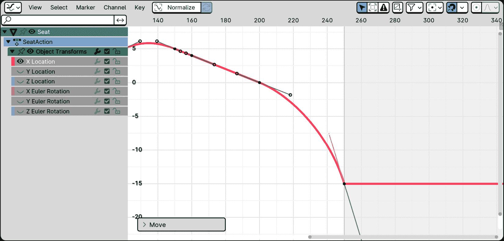

Figure 3.22: X 位置 F 曲线的最后部分

我们对 `X 位置` F 曲线的工作现在完成了。请记住，并非所有（甚至大多数）动画都会这样制作（即一次做一条 F 曲线），但目前能完成一整条 F 曲线还是很不错的。现在继续下一条！

## 使用自由手柄制作弹跳

在 `Seat` 对象的动画通道列表中向下看，我们现在可以关注 `Z 位置` 了。`Y 位置` 恰好可以保持原样。

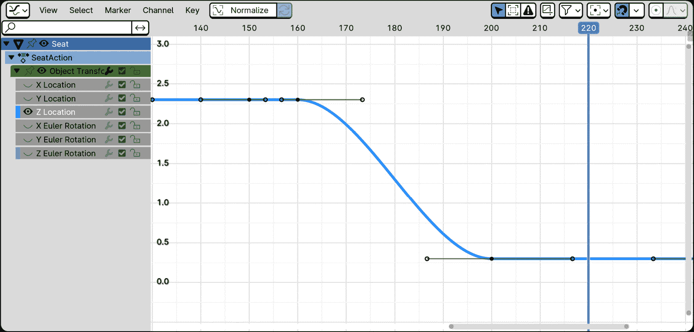

Figure 3.23: 当前的 Z 位置 F 曲线

我们的主要关注点是第 `160` 帧到 `200` 帧之间的 F 曲线部分。在这 40 帧的区间内，我们希望独轮车跳下那段短楼梯。如果我们使用带有 `自由` 手柄的关键帧，就能用极少的额外关键帧实现这一点。

我们的路线恰好在这 40 帧内有 4 级台阶要通过，所以独轮车必须跳 4 次——即每跳 10 帧。通过在第 `170`、`180` 和 `190` 帧插入关键帧，我们将 F 曲线分成了 4 个片段，每个长 10 帧。然后我们可以编辑所有关键帧的手柄，手动创建每一次向上的弹跳。

这次，你可以用任何喜欢的方法插入关键帧：

1.  在第 `170`、`180` 和 `190` 帧为 `Seat` 插入 `Z 位置` 关键帧。
2.  调整每个新关键帧的数值，使独轮车在每一帧都接触到一个台阶（提示：台阶每级下降半米）。
3.  选中第 `160` 到 `200` 帧之间的所有 `Z 位置` 关键帧（包括第 `160` 和 `200` 帧上的）。
4.  将选中的关键帧转换为 `自由` 手柄类型。
5.  向上调整手柄，在 `Z 位置` F 曲线中创建四个“跳跃”，如下所示：

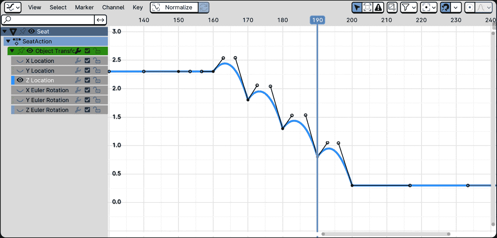

Figure 3.24: Z 位置 F 曲线上的下楼跳跃运动

`自由` 手柄可以像老式电视机的天线一样独立移动，这使它们非常适合这种类型的动作。注意，我们实际上不需要在弧顶放关键帧；两个关键帧相对的手柄就足以创建运动了。

回顾一下目前动画的状态，并对 `Seat` 的 `位置` F 曲线做任何你喜欢的其他微调。当你满意时，我们将以此为基础，在后续章节中为座椅和车轮的旋转制作动画。

## 朝向、重心与平衡

让我们回顾一下 `Seat` 还需要我们关注的其余动画通道：

*   `X 欧拉旋转` 让独轮车座椅前后摇晃，这对于在独轮车前后移动时表现重心和平衡是必要的。
*   `Y 欧拉旋转` 让独轮车左右倾斜。当独轮车从第 `120` 帧到 `150` 帧向右转时，我们希望它向右倾斜。
*   `Z 欧拉旋转` 控制独轮车转向，决定其朝向（或者至少是它应有的朝向）。我们已经从第 `120` 帧到 `150` 帧给它做了一点动画，但还需要调整。

为了让独轮车表现出令人信服的平衡、重心和方向，所有这些通道都需要在图表编辑器中制作动画和/或修正动画。我们具体如何制作动画，将取决于对已创建的现有运动进行仔细研究。

## 运动路径作为视觉指南

独轮车在 `X` 或 `Y` 轴上该倾斜多少在某种程度上是主观的。另一方面，它在 `Z` 轴上该指向哪里可不是口味问题；它可能是辆魔法独轮车，但它必须指向其运动的方向！因此，我们不按旋转分量的字母顺序依次处理，而是先处理 `Z 欧拉旋转` F 曲线。反正它也快完成了，因为它只需要在第 `120` 到 `150` 帧之间变化。

然而，请密切观察这些帧之间发生的情况。有些帧中，独轮车的表观朝与其实际运动方向不完全一致。它的朝向略微歪斜，导致它看起来像是在斜向滑动。如果你从上方查看独轮车并在这些帧间刷帧，会更容易发现这一点。

> **提示**
>
> 你一直在刷帧，对吧？你必须刷帧！为了制作精准的动画，必须通过在 3D 视口从各个角度查看动作、在动画编辑器中拖动帧来审查动画。只需点击并拖动任何动画编辑器顶部的帧号行。这有助于揭示实时播放时难以诊断的动画问题。

如果你还是不信，有个方法能让错误更易看清，并利用 `运动路径` 进行修正：

1.  选中 `Seat`，在 `属性` 区域前往 `对象属性` 选项卡。
2.  找到并展开 `运动` `路径` 面板。

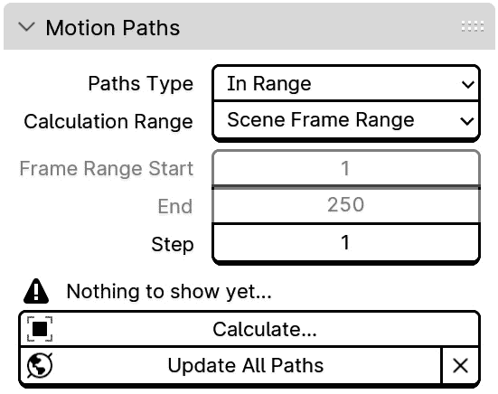

Figure 3.25: 运动路径面板

1.  点击 `计算`，然后点击 `确定`（此处的默认设置即可）。

现在你能真正看到独轮车的路径了：

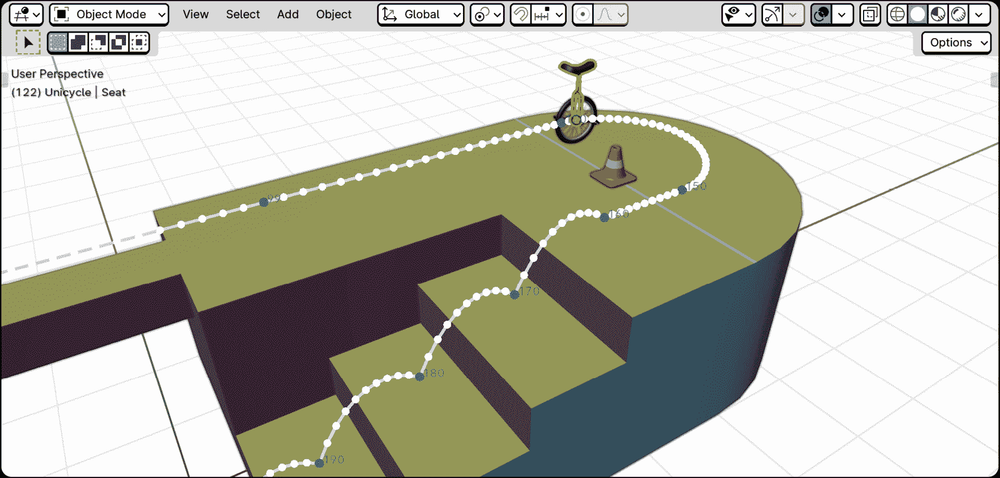

Figure 3.26: 独轮车的运动路径

> **重要提示**
>
> 此运动路径纯粹是视觉参考，无法直接编辑。它仅显示物体原点在每一帧的位置。如果你对动画做出会影响路径的更改，必须点击 `更新路径` 才能看到这些变化的反映。

从上方查看时，问题现在显而易见。甚至一张静态图就能看出独轮车并没有指向它该指向的方向：

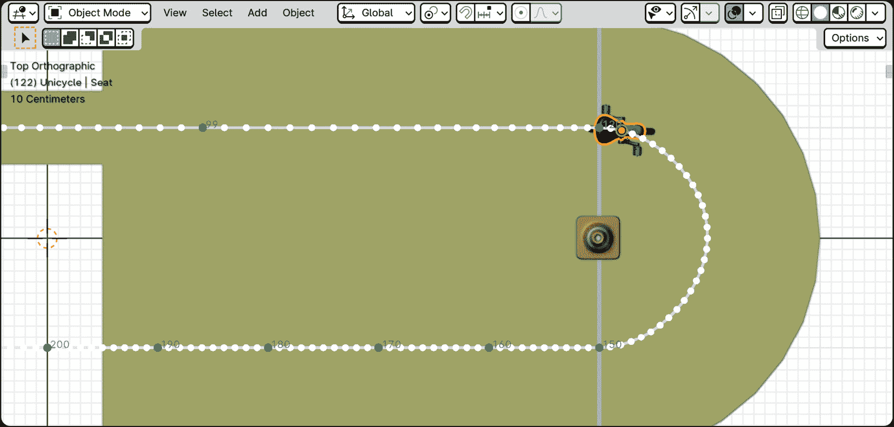

Figure 3.27: 从上方查看的运动路径

有了这个视觉辅助，我们可以更有信心地修正 `Z 欧拉旋转` F 曲线：

1.  找到 `Seat` 的 `Z 欧拉旋转` F 曲线。
2.  尽可能少用关键帧，编辑 F 曲线，使独轮车在第 `120` 到 `150` 帧之间的每一帧都指向其运动方向。

你自己的解决方案将取决于你在前几节中如何为 `Seat` 的 `X 位置` 和 `Y 位置` 制作的动画。在我的例子中，我发现只需缩小关键帧手柄以获得近乎线性的形状，就能得到不错的结果：

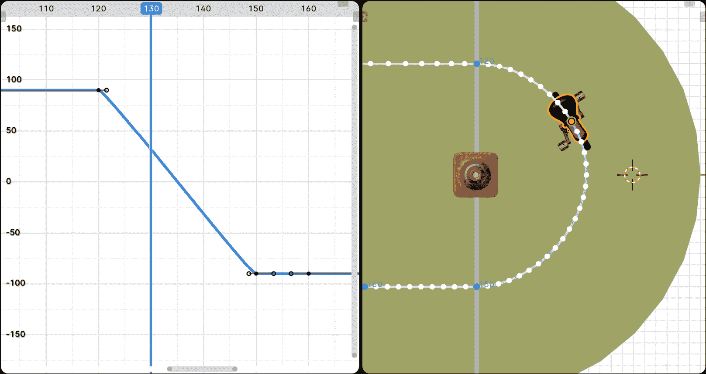

Figure 3.28: 修正后的 Z 欧拉旋转 F 曲线示例及其结果

## 转弯时的倾斜

一旦你对独轮车的转向感到满意，我们就可以继续处理下一个通道，以使转弯看起来更完整。

> **提示**
>
> 运动路径有时可以作为有用的参考，但有时也会分散注意力，弄乱 3D 视口。完成本节后，你可以通过在 3D 视口的 `Viewport Overlay`（视口覆盖层）设置中禁用 `Motion Paths`（运动路径）来隐藏为 `Seat`（座位）创建的运动路径，或者通过点击对象 `Object Properties`（对象属性）选项卡中 `Motion Paths` 面板上的 `X` 按钮将其彻底删除。

如果你会骑自行车，你就会知道你需要向转向的方向倾斜，否则很快就会摔倒。独轮车也不例外。在本节中，我们将编辑 `Y Euler Rotation`（Y 欧拉旋转）`F-curve`（F 曲线），使独轮车倾斜，从而让转弯更逼真。

独轮车该倾斜多少度？该在转弯前多久开始倾斜？我建议 20 度和 10 帧，但这只是我的看法。你是动画师——由你决定什么看起来好。顺便说一句，这里使用什么贝塞尔手柄类型以及如何编辑它们，也由你决定。

让我们试一试：

1.  在第 `110` 帧为 `Seat` 插入一个 `Y Euler Rotation` 关键帧，即大致在转弯（第 `120` 帧）前 10 帧的位置。
2.  编辑第 `120` 帧和第 `150` 帧现有 `Y Euler Rotation` 关键帧的数值和手柄，使独轮车在转弯方向倾斜，然后再恢复直立。

我的尝试如下图所示：

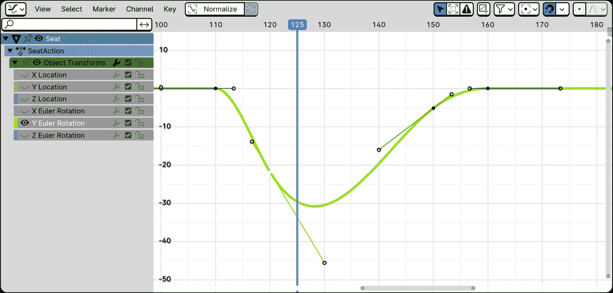

图 3.29：Y Euler Rotation F 曲线示例

但等等——既然我们第一次让独轮车倾斜了，现在发现这导致车轮不再接触地面：

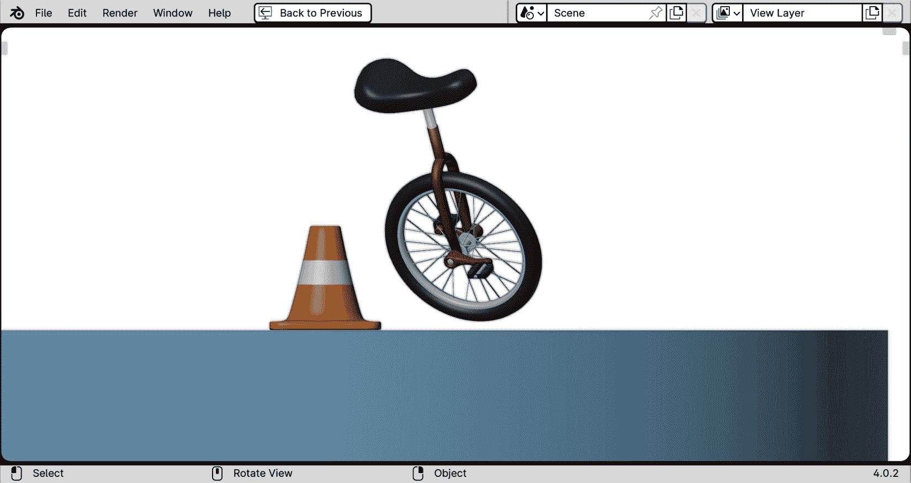

图 3.30：旋转后的独轮车，略微悬浮在地面上方

随着独轮车倾斜，我们希望它保持贴地。我们必须再次编辑 `Z Location`（Z 位置）`F-curve`，将整个独轮车向下微移一点以进行补偿：

1.  在第 `110` 帧插入一个 `Z Location` 关键帧（或在你插入额外 `Y Euler Rotation` 关键帧的任意帧）。
2.  编辑 `Z Location` 关键帧，使独轮车在倾斜时向下微移，以保持车轮接触路面。

你可能已经猜到，`Z Location` `F-curve` 的这一部分应该模仿 `Y Euler Rotation` `F-curve`。当在 `Graph Editor`（图表编辑器）中放大 *Y* 轴时，两者看起来应该非常相似：

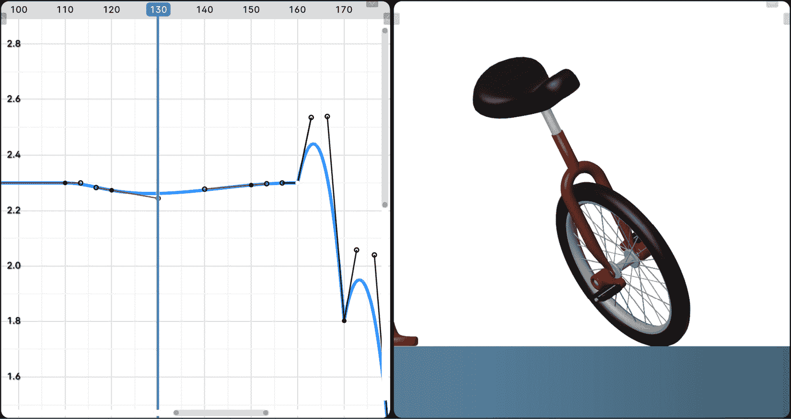

图 3.31：Z Location F 曲线修正示例及结果

这种方法不需要（也不必）完美精确，所以不必担心把它调得完全正确。

现在我们的独轮车在转弯时会倾斜，它开始看起来更像一个真实的物体，而不是被上方一根绳子吊着直立的东西。为了完成这种重量感和平衡感的假象，只剩下最后一个通道需要制作动画了。

## 深入倾斜

我们把 `X Euler Rotation`（X 欧拉旋转）通道留到了最后。出于独轮车转弯时需要绕 *Y* 轴倾斜的同一个原因，当座位前后移动时，它也需要绕 *X* 轴倾斜。当你观察独轮车在第 `1` 帧到第 `120` 帧之间从左向右移动时，这一点尤为明显。

每当 `Seat` 的 `X Euler Rotation` 为正值时，独轮车前倾；每当为负值时，独轮车后倾。独轮车何时该前倾，何时该后倾？你可能会想：“*简单*，它向前移动时前倾，向后移动时后倾。向前或向后移动得越快，朝该方向倾斜得就越厉害。*” 这很接近，但不完全正确。

我们不应关注独轮车*移动的方向*，而应关注其*加速度的方向*。一般来说，当独轮车向前加速时应前倾，向后加速时应后倾。加速度越大，为显得平衡，它就应朝加速度方向倾斜得越厉害。

> **重要提示**
>
> 这里的“加速”既包含“减速”，也包含“增速”。例如，当在空中时，弹跳球因重力始终向下加速，即使它此时仍在向上运动。

## 识别拐点

我们独轮车的大部分水平移动发生在全局 *X* 轴上，因此我们主要可以通过检查 `Seat` 的 `X Location`（X 位置）`F-curve` 来推断独轮车的加速度。加速度体现在 `F-curve` 斜率的变化，即“弯曲”处。每当 `X Location` `F-curve` 显示向前加速时，`X Euler Rotation` 就应为正值；每当显示向后加速时，`X Euler Rotation` 就应为负值。`X Location` 曲线弯曲方向发生改变的帧被称为**拐点**。

以下是我 `X Location` `F-curve` 上的拐点。注意它们不一定出现在关键帧上：

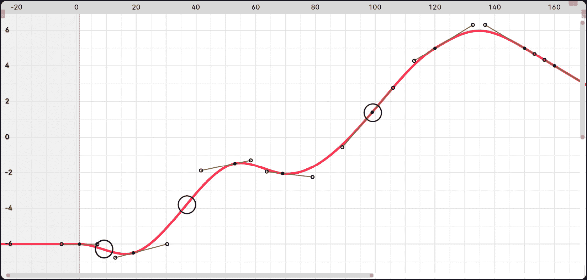

图 3.32：每个圆圈表示 X Location F 曲线上的一个大致拐点

我们将在另一条曲线上用关键帧标记这些拐点。在 `X Location` `F-curve` 出现拐点的每一帧，`X Euler Rotation` 都应为零，使 `Seat` 在切换前倾或后倾的瞬间直立一帧。这意味着 `X Location` `F-curve` 上的每个拐点都将伴随 `X Euler Rotation` `F-curve` 上的一个 `x-intercept`（即数值为 `0` 的点）。

你的 `X Location` `F-curve` 包含你个人的风格，你在第 `1` 帧到第 `120` 帧之间添加了一些额外关键帧来丰富动作，所以我无法明确告诉你在哪里添加接下来的几个关键帧。相反，你必须仔细观察你的 `X Location` `F-curve` 来亲自寻找拐点：

1.  调整 `Graph Editor` 的通道可见性设置，使 `X Location` 和 `X Euler Rotation` `F-curve` 同时可见。
2.  选中 `X Euler Rotation` `F-curve`。
3.  在 `X Location` `F-curve` 出现拐点的每一帧，使用 `Insert Keyframe`（插入关键帧，快捷键 `I`）| `Only Selected Channels`（仅选中通道）来插入一个 `X Euler Rotation` 关键帧，保持 `X Euler Rotation` 的值为 `0`。

当然，你的 `X Euler Rotation` `F-curve` 此时仍是平的，但现在它拥有了关键帧，将确保无论我们接下来插入什么其他关键帧，`F-curve` 在所有正确的帧上数值都为 `0`。

## 完成平衡的假象

在用 `X Euler Rotation` 关键帧标记了所有 `X Location` 拐点后，我们现在可以沿 `F-curve` 添加正负关键帧：

1.  从动画开始到第 `120` 帧，插入非零 `X Euler Rotation` 关键帧（在上一步骤生成的每个旧关键帧之间至少插入一个），使 `Seat` 按 `X Location` `F-curve` 弯曲指示的加速度方向倾斜。
2.  在第 `120` 帧到第 `160` 帧之间，独轮车绕 *Z* 轴旋转，并在 *X* 和 *Y* 轴上都有一些移动。保持这部分 `F-curve` 相对平坦，或者用尽可能少的帧做成你看起来好的样子。
3.  在第 `160` 帧到第 `200` 帧之间，独轮车的 `X Location` 以恒定速度移动，没有加速度。保持这部分 `X Euler Rotation` `F-curve` 大体平坦。

## 步骤 4-6

4. 对 **X Euler Rotation** F-curve 重复*步骤 3*，范围从第 **200** 帧到结束。注意独轮车已掉头，因此 **X Location** F-curve 上的“向下”现在意味着向前而非向后。

5. 根据需要对 **X Euler Rotation** F-curve 进行进一步调整，直到你对结果满意。你可以考虑使用更多 `Automatic` 关键帧，旋转部分 `x-intercept` 关键帧，或根据加速度大小改变独轮车的倾斜程度。

6. 这是我最终的 **X Euler Rotation** F-curve，与 **X Location** F-curve 一起显示，以便你查看前者如何受后者影响：

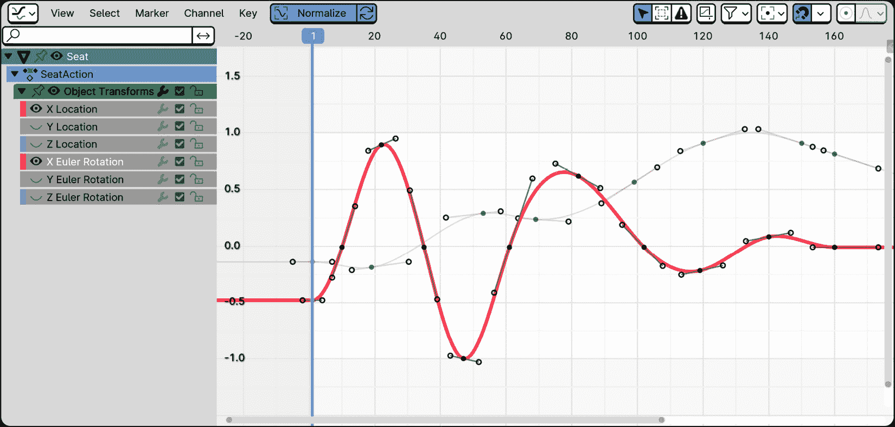

Figure 3.33: Example X Euler Rotation and X Location F-curves

这可能是我们迄今为止最难制作动画的通道！这种技术——在制作一个 F-curve 动画时检查另一个 F-curve——适用于各种动画物体和角色。

`Seat` 对象现已完全制作动画，独轮车在倾斜、转弯和穿越赛道时表现出逼真的平衡。至于组成独轮车的其余元素，还有一个显而易见的对象需要赋予生命。

## 将关键帧复制到另一通道

骑真实独轮车时，你必须蹬踏板，旋转车轮使独轮车前进或后退。具有讽刺意味的是，在本练习中，我们先为独轮车其余部分制作了动画，最后才弄清楚车轮该如何旋转！

本章的最后任务是为 `Wheel` 对象的旋转制作动画。到目前为止，`Wheel` 一直被 `Seat` 拖拽跟随。如果我们正确制作其旋转动画，它将看起来像与地面有摩擦力，甚至看起来像是驱动独轮车其余部分的部件。要显得正确，`Wheel` 的旋转必须与 `Seat` 的运动紧密相关——紧密到我们可以**复制并粘贴**关键帧。

关键帧可使用常规的 `Copy Keyframes` (`Ctrl` + `C`) 和 `Paste Keyframes` (`Ctrl` + `V`) 操作符进行复制和粘贴。这是 `Duplicate` (`Shift` + `D`) 的一个有用替代方案，但有一个特殊优势：关键帧可从一个通道复制并粘贴到另一个通道。

在 Blender 中复制粘贴关键帧的过程绝不局限于贝塞尔关键帧，但在 Graph Editor 中这是一个有用的技巧，将在我们完成本章动画时节省大量时间！我还会展示几个我们之前错过的其他动画技巧。

## 复制关键帧

正如你可能猜到的，我们将从 `Seat` 的 **X Location** F-curve 复制关键帧，因为独轮车几乎所有水平移动都发生在场景的全局 *X* 轴上：

1. 在 Graph Editor 中找到 `Seat` 的 **X Location** F-curve。
2. 仅选择所有 **X Location** 关键帧。
3. 使用 `Copy Keyframes` (`Ctrl` + `C`)。

> **Tip**
> 你可以通过双击通道名称，或选择 F-curve 上的一个关键帧并使用 `Select Linked` (`L`) 来快速选择一个通道中的所有关键帧。确保复制的选择中没有来自其他通道的关键帧；否则粘贴时可能会出现问题。

选中的关键帧现已复制到“剪贴板”——这个复制数据等待粘贴的不可见中转站。接下来，我们必须创建将成为它们永久归宿的通道。

## 为单个属性插入关键帧

仅需为 `Wheel` 的一个属性制作动画：**X Euler Rotation**。复制的关键帧无法粘贴到尚不存在的 F-curve 中，因此粘贴前必须先为该属性插入关键帧。这将在 Graph Editor 中创建一个 **X Euler Rotation** F-curve。

以下是仅为一个空间属性而非所有三个轴插入关键帧的方法：

1. 选择 `Wheel` 对象。
2. 在 **Transform** 面板中找到 `Wheel` 的 **Rotation** 属性。该面板位于 **Properties** 编辑器的 **Object Properties** 中，或 3D Viewport 侧边栏的 **Item** 选项卡中。
3. 右键点击 **Rotation** 属性的 **X** 分量，从上下文菜单中选择 `Insert Single Keyframe`。

这将仅为单个属性插入关键帧，而非为每个轴插入三个：

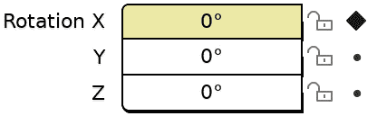

Figure 3.34: Keyed X Euler Rotation property

`Wheel` 的 **X Euler Rotation** 通道现在应在 Graph Editor 中可见，我们甚至不必删除任何不必要的通道。这个关键帧将作为临时占位符，稍后粘贴时会被替换。

## 粘贴关键帧

现在我们可以将复制的关键帧粘贴到新通道：

1. 选择 `Wheel` 的 **X Euler Rotation** 通道。
2. 使用 `Paste Keyframes` (`Ctrl` + `V`)。

    某些操作符（如上一个）具有可在 **operator** 面板中修改的参数，该面板在操作符执行后出现在编辑器角落。我们现在需要调整这些参数。

3. 打开 Graph Editor 左下角的 `Paste Keyframes` 操作符面板。
4. 将 **Offset** 改为 **No Offset**，将 **Type** 改为 **Overwrite All**。

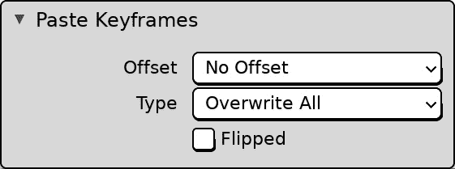

Figure 3.35: The Paste Keyframes operator panel

这些新操作符设置确保粘贴的关键帧与原始关键帧具有相同的时序，并移除之前的临时关键帧。

注意粘贴的关键帧似乎被**放大**了，其数值范围比复制的原始关键帧大得多。这是因为 Blender 中旋转值以弧度存储但以度数显示。当位置关键帧被复制粘贴到旋转通道时，名义值实际上乘以了 *180/π*。在我们的例子中，这种自动**放大**实际上使数值更接近所需位置。我们只需再稍微放大一点……

## 缩放关键帧数值

你能明白为什么要复制那些关键帧吗？只要独轮车仅在 *X* 轴上移动，`Wheel` 的 **X Euler Rotation** 就可视为 `Seat` **X Location** 的函数。这不是复杂函数，而是线性函数；独轮车前进时车轮朝一侧滚动，后退时朝另一侧滚动。这就是为什么关键帧可以直接从一个通道复制到另一个通道！

通过在第 **1** 到 **120** 帧间擦洗并近距离观察独轮车，检查 `Wheel` **X Euler Rotation** F-curve 的效果。它看起来像在滚动吗？有点像，但不完全是。虽然复制粘贴了正确的关键帧，但仍有一个变量未被考虑：车轮相对于独轮车位置必须旋转的程度（字面上的度数）。这个因子（字面上的因子）取决于车轮直径。如果车轮小得多，它需要旋转更多以跟上独轮车的移动；如果大很多倍，它可能不转一整圈就能过桥。

我们的下一个任务是乘以 `Wheel` 的 **X Euler Rotation** 数值，以考虑车轮的相对大小。我们可以通过在 Graph Editor 的 *Y* 轴上缩放关键帧来实现：

1. 选择 `Wheel` 的所有 **X Euler Rotation** 关键帧。
2. 按 `Scale` (`S`)，按 `Y`，输入 **3.33**，将 F-curve 在 Graph Editor *Y* 轴上放大 3.33 倍。

车轮现在具有正确的旋转——至少前 120 帧是这样：

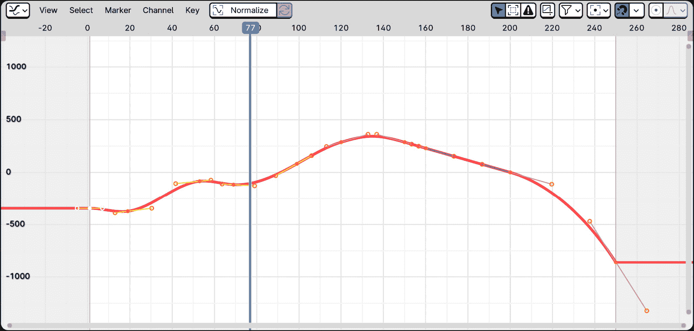

Figure 3.36: The X Euler Rotation F-curve for Wheel

## 总结

当我们旋转时间并使其在图表上从左向右流动时，会发生有趣的事情。可以说一条线会“去”到某些地方，平坦变成静止，陡峭变成快速，F 曲线的平滑度变成物体运动的平滑度。

从一堆线图中解读动画，你是否觉得奇怪？在某种意义上，F 曲线有点像乐谱；起初，很难看出五线谱上的音符如何形成旋律，或者 F 曲线的关键帧手柄如何创造物体在空间中的运动。然而信息就在那里，经过一些练习，就能轻松“视奏”，仅通过观看图像就能在脑海中听到音乐或看到运动。完成了两章关于图表编辑器的内容后，你已经掌握了足够的知识，可以随心所欲地弯曲这些线条，并用你自己的作品进行创作。

在使用 `Bezier` 关键帧的过程中，我们还研究了一个事物的位置或旋转如何受另一个事物影响的方式，例如座椅的旋转如何取决于其水平加速度，或者车轮的旋转如何取决于座椅的水平移动。不过，想想如果车轮没有被约束在座椅上，动画制作会难多少；我们得把关键帧复制到不止一个通道！正如我们在下一章将看到的，对象之间的这些关系可以由不仅仅是精心设计的 F 曲线来决定。

## 问题

1. `Bezier` 在何种意义上是一种插值模式？
2. `Bezier` 关键帧具有什么属性来代替缓动类型？
3. `Bezier` 手柄对 F 曲线有什么作用？
4. 何时使用 `Vector` 手柄会很有用？
5. 为什么不能让 F 曲线形成循环？如果形成了会发生什么？
6. `Free` 手柄是自己自由移动，还是由用户自由移动？这是谁的自由定义？你自由吗？
7. 填空：*slope* 之于 *velocity*，如 *bend* 之于 \_\_\_\_\_。
8. x 截距、峰值和拐点有什么区别？它们有何相似之处？
9. 在上一节中，我们在图表编辑器的 `Y` 轴上将 `Wheel` 的 `X Euler Rotation` F 曲线缩放了 `3.33` 倍。这个数字从何而来？提示：搜索它的倒数。
10. 如果我们在图表编辑器的 `X` 轴上缩放 F 曲线，动画会发生什么变化？
