# 第 4 章：探究对象关系

我们很容易忽视宇宙中事物之间是如何相互关联的。地球围绕太阳永恒运转，被引力向内吸引。地球自身的引力将你拉向中心，而坚实的地面托住你，使你的运动被限制在行星表面，随着它在宇宙中旋转。磁铁通过相互吸引和排斥来关联。你走动时裤子留在腿上。

在 3D 动画的世界里，我们不能把这种关系视为理所当然。如果我们不自己完成大自然的工作，空间中的物体就不会相互作用，事物会分崩离析并穿过固体物质，角色的裤子会在腿走开后仍停留在空间中的固定点（这种情况发生的频率比你想象的要高得多）。

在本章中，我们将暂时搁置迄今为止所学的大部分关于直接使用关键帧为对象制作动画的知识。相反，我们将学习使用各种对象关系来间接为对象制作动画——这些设置控制一个对象的属性如何由另一个对象决定。这与其说是一堂动画课，不如说是一堂关于如何构建场景以便有效地为其中的对象制作动画的课。

以下练习将指导你如何为沿轨道行驶的、具有多个移动部件的玩具火车制作动画。在设置好对象之间的关系后，你只需要一条 F 曲线就能为整个火车制作动画！

在本章中，你将学习如何执行以下操作：

- 移动对象的原点
- 将对象附加到其他对象
- 复制对象的旋转
- 沿精确路径为对象制作动画
- 使用驱动器控制旋转

## 技术要求

本章练习的玩具火车场景可在此处下载：

https://github.com/PacktPublishing/Realizing-3D-Animation-in-Blender

在 Blender 中打开下载的 `.blend` 文件并开始：

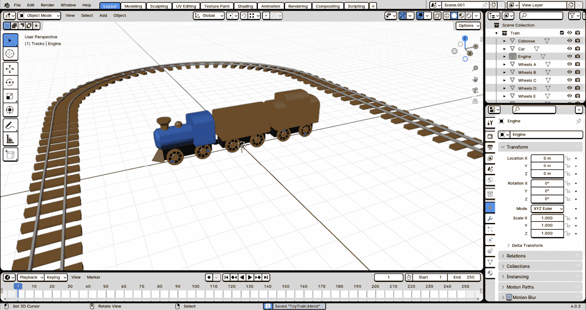

图 4.1：玩具火车场景

与上一章中可以直接制作动画的独轮车不同，组成玩具火车部件的对象之间没有任何关系。火车的任何部分都不跟随其他对象……目前还没有。这正是本练习的全部内容！

## 理解对象原点

这里有个建议——如果你想拥有一段健康的关系，首先得完善自己。关系需要大量的投入，所以在我们为对象分配关系之前，需要确保它们已准备就绪。如果一个对象存在未解决的问题，最好现在就修复，以免它们成为另一个对象的问题。

我们的玩具火车部件有一个共同的小问题。选择火车的任意部件对象，看看能否找到它的 `origin`：

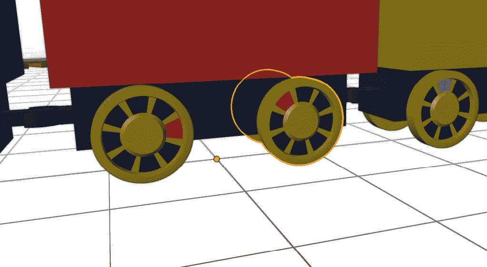

图 4.2：场景中心的车轮对象原点

Blender 中的每个对象似乎都有一个 `origin`，它是空间中的一个点，当对象被选中时，在 3D 视口中显示为一个小橙点。它通常被认为是对象的“中心”，尽管它不一定非要位于任何东西的中心。

在我们的例子中，似乎每个火车部件的 `origin` 都位于场景的全局中心。对象原点为什么重要？看看如果我们尝试旋转任意一个车轮会发生什么：

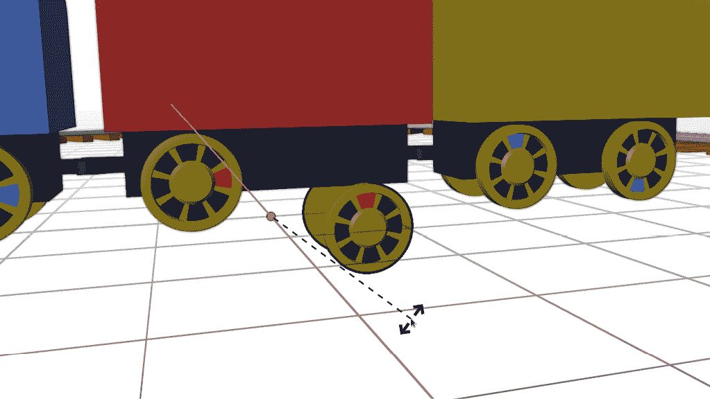

图 4.3：使用未居中原点旋转车轮

真是离谱！想象一下试图为这种东西制作动画。`origin` 决定了网格几何体旋转和缩放的空间点。如果我们任何一个车轮的 `origin` 偏离了其旋转中心应有的位置，它就无法正常旋转。在这种情况下，车轮的 `origin` 偏离太远，以至于车轮甚至不旋转——它们在公转！

我保证我不是恶意制造这个问题；这是一个常见问题，当你从其他格式导入 3D 模型到 Blender，或将单个网格的部件分离为多个对象时可能会遇到。几何体似乎位于所有正确的位置，但原点却都在别处的同一个位置。

为了解决这个问题，我们只需移动原点，对吧？

### 关于对象和原点的真相

### 起源与物体

所以你想“移动原点”，是吗？但不移动物体？如果原点的位置可以不同于物体的位置，那么物体的位置究竟是什么？让我们看看其中一个轮子的位置：

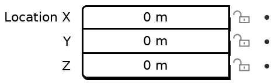

图 4.4：其中一个轮子物体的位置

这不对劲，对吧？`[0.0, 0.0, 0.0]` 是场景的全局中心，也就是原点所在的位置。那么物体在哪里？物体和原点到底有什么区别？我们一直在给物体做动画，但你真的确定知道什么是物体吗？

准备好面对真相了吗？再看看那个橙色的点。**那才是物体。**

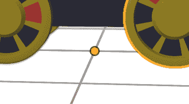

图 4.5：物体

原点和物体本质上是同一回事。Blender 中的物体仅仅是空间中的一个点，带有一个名称和基本属性，如位置、旋转和缩放。这些点是在大多数物体关系中唯一被考虑的事物。我们从 *第 1 章* 起就一直在移动原点！

每当我们提到所谓的原点时，我们专门指的就是那个点，别无其他。附着在该点上的其他一切都是物体的数据。对于像我们的轮子和车厢这样的网格类物体，这意味着网格几何体（即在 `编辑模式` 中暴露给你的所有顶点、边和面）。

**提示**

`空物体` 是 Blender 中一种特殊的物体类型，它没有数据。就像删除了所有顶点的网格物体一样，它本质上只是一个原点。“空物体”可以像其他任何物体一样用于关系中，但永远不会被渲染。你可以通过 `添加` | `空物体` 来添加一个。

因此，你无法将原点与物体分开移动，因为术语 *物体* 和 *原点* 之间没有任何有意义的区别。这个任务是空的。无意义的。甚至比不可能还要不可能。

然而，**相对于其几何体反向移动物体**，则完全没有问题。

## 将原点居中

Blender 提供了一些操作和设置，将原点视为与物体不同的东西，可以“单独”移动。这对我们很方便，但它掩盖了一个更复杂的操作，即两样东西同时移动——物体向一个方向移动，网格几何体向相反方向移动。

让我们回到那些轮子。有 12 个轮子，但只有 6 个轮子物体。每一个都是一对具有左右对称性的轮子。如果这六对轮子中的每一对都要围绕六根假想的车轴正确旋转，我们必须（某种程度上）“将原点移动”到旋转中心应在的位置。

这可以通过单个操作符完成：

1.  选中所有六个轮子物体。
2.  点击 `物体` | `设置原点` | `原点到几何体`。

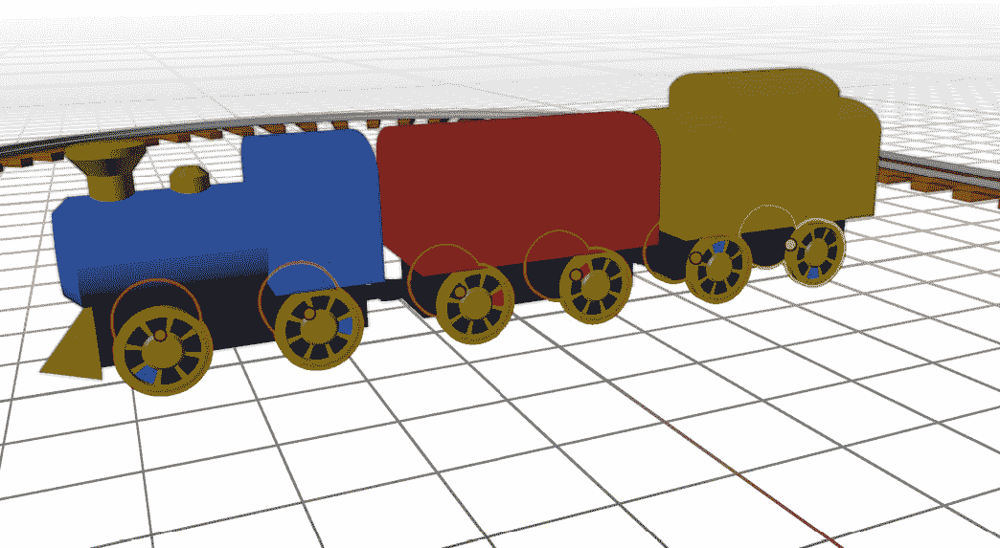

图 4.6：轮子物体的六个居中原点

现在每个轮子物体都在正确的位置，与其几何体完美居中。所有轮子现在都可以在 `X` 轴上正确旋转。

**提示**

计算网格中心时，操作符 `原点到质量中心（表面）` 和 `原点到质量中心（体积）` 有时能在复杂模型上产生更理想的结果。在我们的例子中，对于几何体简单的轮子，这没有任何区别。

看起来我们是将“原点移动”到了每对轮子的中心，但我们其实并没有！相反，对于每对轮子，计算了网格几何体的全局中心，物体本身被移动到了该点，而其网格几何体被向反方向移动。就好比我们在 `物体模式` 下移动了物体，然后进入 `编辑模式`，全选所有内容，再把它移回去。

这种效果看起来就像只有原点移动了。然而，我们懂得更多！

**提示**

除了下一节的技术，你还可以通过将 3D 游标移动到所需位置，然后使用 `物体` | `设置原点` | `原点到 3D 游标`，将原点重新定位到任何地方。

## 抓取原点

Blender 界面中某些操作和设置的标签暗示 Blender 真的希望我们相信物体拥有一个可以单独移动的原点。虽然我们懂得更多，但我们将继续纵容开发者的幻想，让他们以为骗过了我们。当然，让我们再“移动”一些“原点”。

让我们把注意力转向火车的三个主要组件，稍后我们将它们约束到轨道上——前部的 `Engine` 物体、中间的 `Car` 和后部的 `Caboose`。与轮子不同，它们的原点不必完全位于其几何体的中心；事实上，如果我们保持它们在地面上并精确间隔 **3** 米，会让事情对我们更容易。使用 `设置原点` 操作符之一来居中原点只会使事情复杂化，因为每节车厢的几何体都不同。

`Car` 物体已经完全位于它需要的位置。我们只需要移动 `Engine` 和 `Caboose`，使它们的原点以相同的方式位于各自网格的下方。要做到这一点，只需在像往常一样抓取物体之前启用一个设置：

1.  在 3D 视口的页眉中，转到 `选项` | `变换` | `仅影响` 并启用 `原点`。

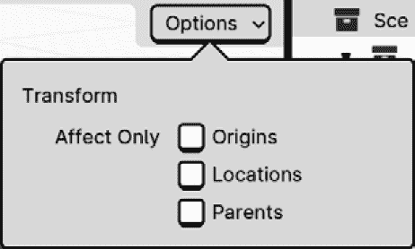

图 4.7：3D 视口中启用了“仅影响 | 原点”

1.  选中物体 `Engine`。
2.  使用 `移动` (`G`)，按 `Y`，将原点在 `Y` 轴上向前移动 **\-3** 个单位，使其位于火车头网格下方。
3.  选中物体 `Caboose`。
4.  使用 `移动` (`G`)，按 `Y`，将原点向后移动 **3** 个单位，使其位于守车网格下方。
5.  完成后，记得禁用 `选项` | `变换` | `仅影响` | `原点`。

这三个物体现在均匀地间隔 3 个单位：

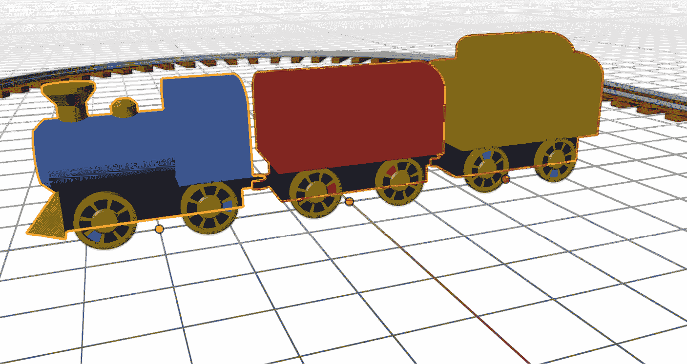

图 4.8：三节火车车厢的原点

请记住，我们并没有真正以你可能被誤导的方式“仅移动原点”。我们刚才所做的就是像往常一样移动物体，只是这一次，当我们这样做时，那些火车车厢的网格也被向相反方向移动了。这就像在跑步机上走路——你相对于传送带向前移动，但在全局位置保持不动。当启用 `仅影响` | `原点` 时，我们的变换操作同时影响物体和网格数据。我们根本没有“仅影响”一样东西；我们影响的比平时更多！

我们已经修正了所有物体原点——或者更准确地说，我们修正了物体的位置及其各自网格的相对偏移。接下来，我们将探索一种方法——在某种意义上——让一个物体成为另一个物体的原点。

## 父子关系物体

如果说术语 *原点* 指的是物体相对于其自身数据的位置，那么在本节中，我们将学习两个不同物体之间最基本的关系——`父级` 和 `子级` 的关系。

在 Blender 中，父子关系是指将一个或多个物体“附加”到另一个物体上，从而允许父级物体及其所有子级作为一个整体被移动和制作动画。

可以使用 `设置父级到` 菜单 (`Ctrl` + `P`) 将物体设为其他物体的父级：

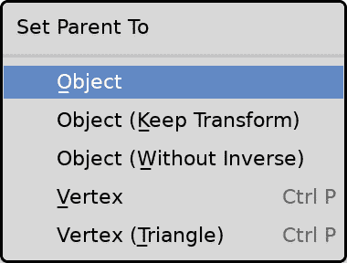

图 4.9：设置父级到菜单

**重要提示**

在执行 `Set Parent To` (`Ctrl+P`) 之前，你需要选中多个物体——至少一个作为子物体，一个作为父物体。活动物体（即你最后选择的那个物体）将成为父物体。为避免搞混父子关系，请记住：你想设为父物体的那个物体必须最后被选中。

这非常适合将车轮连接到车厢上：

1.  同时选中 `Wheels A` 和 `Wheels B`。
2.  按住 `Shift` 并选中 `Engine`（最后选中 `Engine` 可确保它是活动物体）。
3.  使用 `Set Parent To` (`Ctrl+P`) | `Object`。

我们已经将车轮设为火车头的子物体了！让我们对另外两节车厢的车轮重复此方法：

1.  将 `Wheels C` 和 `Wheels D` 设为 `Car` 的子物体。
2.  将 `Wheels E` 和 `Wheels F` 设为 `Caboose` 的子物体。

如果你抓取 (`G`) 任意一节车厢，你会看到它的车轮现在已经连接上了。你还会在 3D 视口中看到一些细细的虚线，连接着子物体的原点和父物体的原点：

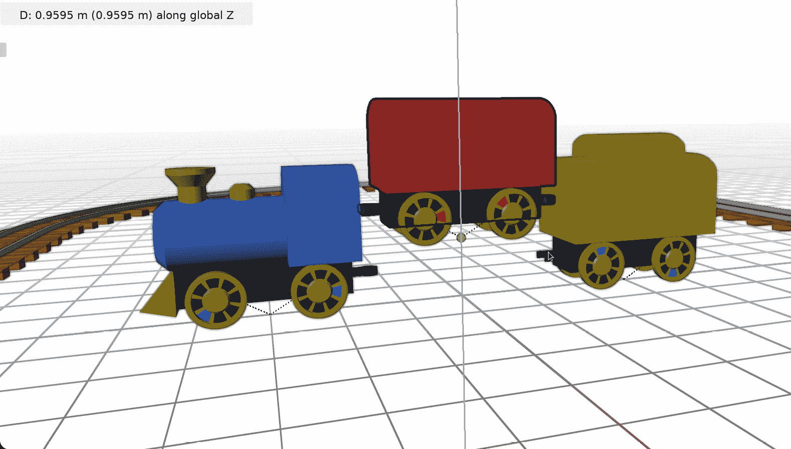

Figure 4.10: 车轮已设为车厢的子物体

**Tip**

你可以抓取 (`G`)、旋转 (`R`) 或缩放 (`S`) 物体来测试它们的关系。别害羞——把东西拿起来晃晃看看什么连在一起了！你随时可以右键点击取消操作。

现在每节车厢物体都是两个车轮物体的“骄傲父母”了。想象一下这能为我们节省多少时间，现在我们可以移动车厢而无需担心车轮的位置！

## 父/子关系

Blender 中的任何物体都可以是父物体或子物体。一个物体可以拥有无限数量的子物体，但不能拥有超过一个父物体。

你可以通过在大纲视图中检查物体来查看其所有子物体。子物体显示为父物体“文件夹”中的“文件”：

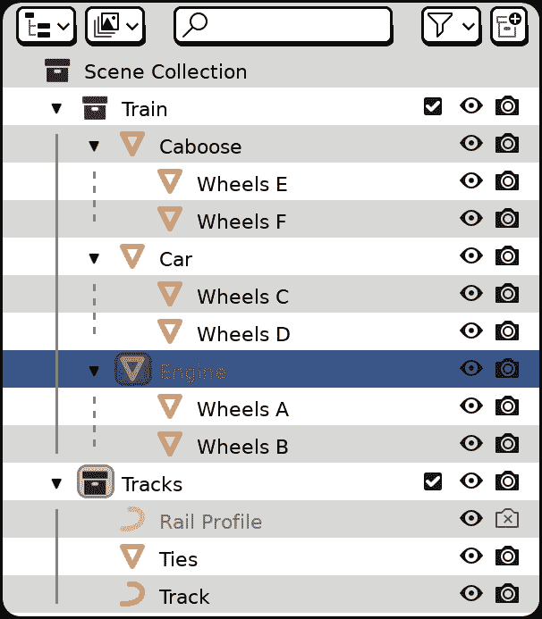

Figure 4.11: 大纲视图中的父子物体

同样，你也可以在 `Object Properties`（物体属性）中的 `Relations`（关系）面板里查看某物体的父物体是谁：

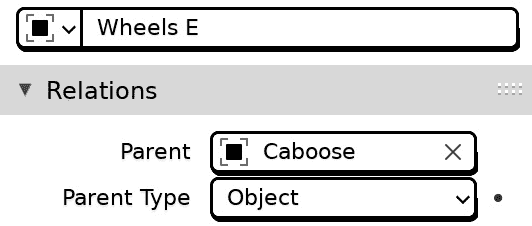

Figure 4.12: 其中一个车轮物体的 Relations 面板

**Important note**

你可以通过编辑 `Relations` 面板中的 `Parent` 字段来为物体选择不同的父物体，但这不一定能产生与使用 `Set Parent To` (`Ctrl+P`) | `Object` 操作符相同的结果，后者会自动执行额外的变换偏移以保持子物体的全局位置不变。

父子关系是一个应用极广的功能，比如当你需要把一个东西“粘”到另一个东西上时（它真的非常有用）。在许多情况下，其实际效果等同于选中多个网格物体并使用 `Join` (`Ctrl+J`) 将所有东西融合成一个单一网格。

但请思考一下我们为什么没对车轮物体那样做。即使设置了父子关系，每个车轮仍然是一个独立的物体，依然可以制作动画。为这些车轮物体准备动画将是我们下一主要章节“约束”的任务。

### 依赖关系

Blender 中的父/子关系是一种 **dependency**（依赖关系）；子物体的全局位置取决于其父物体的位置。这些关系可以是 *nested*（嵌套的），即一个物体的子物体本身又可以是其他物体的父物体。然而，这是一种严格的单向关系。父物体影响子物体，但子物体的任何操作都无法影响父物体。从某种意义上说，父物体甚至“不知道”自己有子物体。

这里是我们目前创建的关系的简单可视化，灰色箭头从每个子物体指向其依赖的父物体：

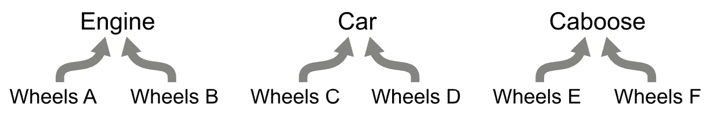

Figure 4.13: 当前父/子依赖关系的可视化

随着我们继续创建依赖关系，这个图表将变得越来越复杂……

现在，让我们继续学习约束。

## 理解约束

我们的玩具火车有 12 个车轮，我们希望它们随着火车沿轨道移动而旋转。因为它们都属于同一列火车、同一组轨道，这些车轮可能会同步旋转。火车一侧的每个车轮都与另一侧对应的车轮连接，总共六个车轮物体。这比 12 个要好，但对我们来说制作动画仍然很多。使用 `constraints`（约束）会让我们的任务轻松得多。

约束是一种物体关系，类似于父子关系，但更高级。一个物体可以拥有多个约束，即使它已经有父物体了。有多种约束类型可供选择：

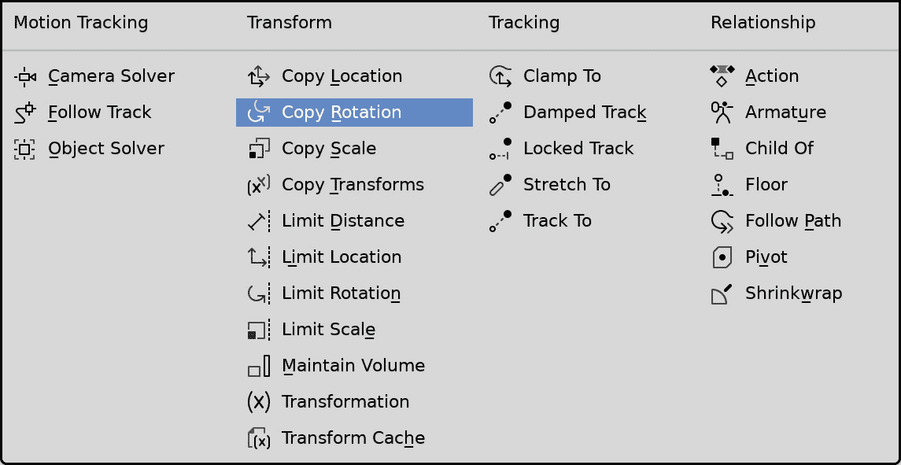

Figure 4.14: Add Object Constraint（添加物体约束）菜单

在本节中，通过使用 `Copy Rotation`（复制旋转）约束，我们可以让五个车轮物体复制其中一个的旋转——这比为所有六个车轮设置关键帧（或驱动器）要容易得多。

## 添加约束

我们将首先给后面的车轮添加 `Copy Rotation` 约束，以前面的车轮组作为 `Target`（目标）：

1.  选中 `Wheels F`。
2.  在 `Properties Editor`（属性编辑器）中，前往 `Object Constraint Properties`（物体约束属性）选项卡。
3.  点击 `Add Object Constraint` 并选择 `Copy Rotation`。
4.  在新建的 `Copy Rotation` 约束的设置中，选择物体 `Wheels A` 作为 `Target`。

`Wheels F` 现在将复制 `Target` `Wheels A` 的旋转。当 `Wheels A` 旋转时，`Wheels F` 会做同样的动作。

**Important note**

每个约束都“归属于”它直接影响的那个物体。大多数约束需要第二个物体作为 `Target`。这是另一种依赖关系，类似于父/子关系。约束影响的是拥有者，而非目标。

在将此约束复制到除目标以外的所有其他车轮之前，我们需要确保其所有设置都正确。

## 世界空间 与 局部空间

如果我们只想让车轮绕 `X` 轴旋转，当前的约束设置似乎能给我们想要的结果。然而，我们的相互关联的物体系统还需要沿轨道行驶，所以需求更复杂。

例如，如果我们绕 `Z` 轴旋转火车头，可以预览火车转弯时会发生什么：

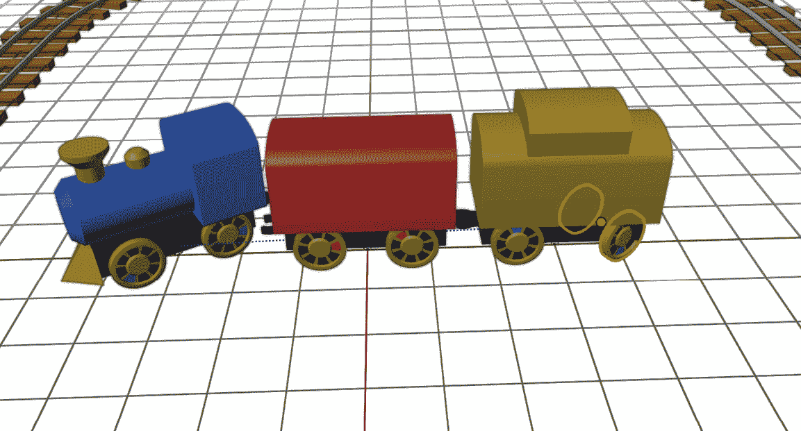

Figure 4.15: 旋转 Engine 导致 Wheels F “断裂”

`Copy Rotation` 约束似乎让 `Wheels F` 过于忠实地复制了 `Wheels A` 的旋转，导致 `Wheels F` 脱离了它假想的车轴。之所以发生这种情况，是因为约束在 `World Space`（世界空间）中评估目标和拥有者的旋转，即你 3D 场景的绝对全局坐标空间。从某种意义上说，约束并不“在乎”任一物体是否有父物体；它读取目标的全局旋转并用它来覆盖拥有者的全局旋转。

一种更合理的方法是在 `Local Space`（局部空间）中评估这两个物体：

1.  在 `Wheels F` 的 `Copy Rotation` 约束属性面板中，找到 `Target` 和 `Owner` 的评估空间属性。
2.  将 `Target` 和 `Owner` 都从 `World Space` 改为 `Local Space`。

约束的最终设置应如下所示：

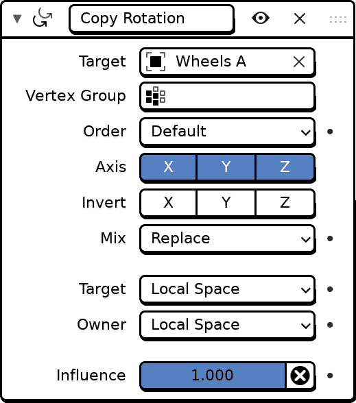

Figure 4.16: Copy Rotation 约束的正确设置

现在车轮工作正常了。一个车轮仍然复制另一个的旋转，但不会“断裂”。这是怎么回事呢？

## 跟随路径

## 世界空间与局部空间

想象一下，你正坐在一辆行驶中的火车上。从某种意义上说，你被“父级绑定”到了这节车厢上。在`World Space`（世界空间）中，你的移动速度与车厢完全一致，随车厢转弯，从车站移动到车站。然而在`Local Space`（局部空间）中，你却坐得纹丝不动，面朝前方，原地不动。如果你站起来在车厢里走动，你在`Local Space`中将以步行速度移动，同时在`World Space`中仍大致保持火车的速度。

我们玩具火车的车轮也是以同样的方式作为“乘客”存在的；它们的旋转可以在`World Space`这个绝对域中评估，也可以在它们各自的`Local Space`这个相对域中评估。通过在`Local Space`中评估`Wheels A`（车轮 A）`Target`（目标）对象的旋转，约束将只读取其相对于其父对象 `Engine`（车头）的相对旋转。然后，该旋转会应用到所有者 `Wheels F`（车轮 F）的局部空间中，相对于其自己的父对象 `Caboose`（车尾）。

> **重要提示**
>
> 对象将始终拥有自己的变换属性，但如果它有父级或约束，这些属性可能不再直接关联到对象在`World Space`中的位置。它们可能仅对最终结果有贡献，甚至可能完全不再产生任何影响。因此，这些属性的值通常被称为*名义*变换值（“仅挂个名而已”).

现在此约束已具备所有正确设置，可将其复制到剩余的四个车轮对象上。

## 复制约束

既然已经为 `Wheels F` 完善了 `Copy Rotation`（复制旋转）约束的设置，我们希望 `Wheels E`、`Wheels D`、`Wheels C` 和 `Wheels B` 各自拥有完全相同的 `Copy Rotation` 约束。

与其再四次添加并调整相同的约束，Blender 提供了一个操作符，可快速将约束从一个对象复制到另一个对象：

1.  选择 `Wheels B`、`Wheels C`、`Wheels D` 和 `Wheels E`。
2.  按住 `Shift` 并选择 `Wheels F`。
3.  使用 `Object`（对象） | `Constraints`（约束） | `Copy Constraints to Selected Objects`（复制约束到选中对象）。

这会将活动对象拥有的约束复制到所有其他选中的对象上。现在所有五个车轮对象都拥有相同的约束，只需旋转剩余的前一对车轮 `Wheels A` 即可旋转所有车轮。

> **技巧**
>
> 那些连接所有对象到其父级和约束目标的虚线可能会分散注意力，有时甚至具有误导性。可以考虑在 `Viewport`（视口） `Overlays`（重叠显示）菜单中禁用 `Relationship Lines`（关系线）来隐藏它们。

这是我们迄今为止建立关系的更新可视化图。细灰线代表约束，它们具有与父子关系相同的单向依赖性：

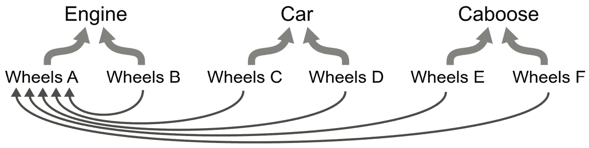

Figure 4.17: 带有约束线的依赖关系图

我们已经完成了将车轮父级绑定到车厢并赋予它们适当约束的工作。这列火车已准备好驶上轨道！

## 编辑动画路径

如果任何一节车厢在移动时哪怕稍微偏离轨道，我们的动画看起来都会很糟糕。若要使用前几章学到的方法为火车制作动画，我们必须同时调整每节车厢所有六条位置和旋转 F 曲线，以便在轨道弯曲时让车轮始终保持在铁轨上。

让我们为即将面临的、无疑是迄今为止最繁琐、最令人沮丧的任务做好准备，并添加第一批 `Location & Rotation`（位置与旋转）关键帧：

1.  其实，咱们别这么干。
2.  不要插入位置或旋转关键帧。
3.  那太荒谬了。

你能想象那有多难吗？上一章给独轮车做动画已经够麻烦了，那东西只用转一次弯。`Follow Path`（跟随路径）约束是沿路径精确制作对象动画的更好方式，尤其是当路径在空间中沿多个轴弯曲扭转时。

本节将使用的路径与上一章使用的 `Motion Path`（运动路径）功能截然不同，后者仅是一个视觉指南。这种路径不仅可以直接编辑，而且已经存在于你的场景中。

检查对象 `Track`（轨道），你会发现它不是网格对象。它是一个 `curve`（曲线）对象，这是一种在建模和动画中都很有用的多功能对象类型。这条特定的曲线被设置为沿其长度挤出 `Rail Profile`（铁轨轮廓）的形状，从而创建出两条平行铁轨。它也是修改器的目标，这些修改器复制并弯曲对象 `Ties`（枕木），从而创建出横跨铁轨的木制枕木。巧妙的是，这同一个决定火车轨道路径的曲线对象，同样可以决定被约束到它身上的对象的路径。

更棒的是——这种特定类型的曲线是贝塞尔样条线，而你已经知道如何编辑贝塞尔样条线。该曲线对象的控制点与 F 曲线中的贝塞尔关键帧完全相同。这就像在编辑一个三维的 F 曲线！

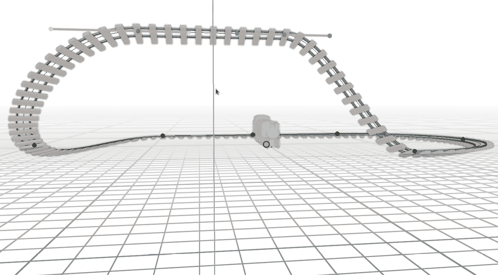

Figure 4.18: 编辑模式下的铁轨

在对象被约束到路径后再编辑动画路径会更困难，所以我们要趁此机会个性化铁路，让火车的路径比现在的简单椭圆更有趣些。

除了用于选择和变换的标准控制和操作符外，还有几个其他的你应该了解，以便编辑 3D 贝塞尔曲线：

*   `Segments`（段） | `Subdivide`（细分）在两个或多个选中的相邻控制点之间插入控制点。
*   `Tilt`（倾斜）（`Ctrl` + `T`）在选中的控制点处扭曲曲线，允许你在路径中加入倾斜转弯和螺旋线。
*   `Toggle Cyclic`（切换循环）（`Alt` + `C`）移除连接首尾控制点的线段，如果你想要一条不循环的路径。
*   `Set Handle Type`（设置手柄类型）（`V`）设置手柄类型，与贝塞尔关键帧完全一样！

让我们试用一下这些控制：

1.  选择对象 `Track` 并进入 `Edit Mode`（编辑模式）。
2.  沿任意轴按你的喜好编辑路径。
3.  仅使用 `Automatic`（自动）和 `Aligned`（对齐）贝塞尔手柄类型，并确保没有过于急促的转弯，以免火车车厢难以通过。火车无论路径如何都会跟随，但我们希望它看起来可信！

> **重要提示**
>
> 你可以在 `Edit Mode` 中将曲线对象 Rails 弯曲成几乎任何你喜欢的形状，但请避免在 `Object Mode`（对象模式）下变换对象本身。这可能会使给车厢添加约束变得更加困难。

我决定大胆发挥，为自己的轨道创建了一种过山车般的效果：

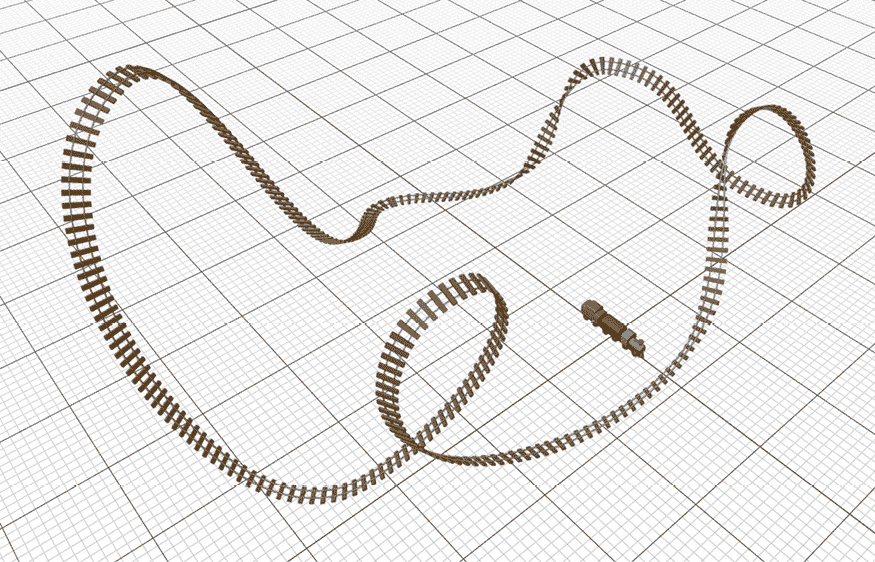

Figure 4.19: 编辑后的 Rails 对象示例

一旦你对铁路感到满意，就可以退出 `Edit Mode`。是时候把火车放上轨道了！

## 添加跟随路径约束

`Follow Path`（跟随路径）约束是少数几个不仅评估目标对象变换的约束之一。目标必须是曲线类型对象，其数据（即我们刚编辑的样条线）将被评估，从而使约束所有者实际上被父级绑定到样条线上的某个点。

有趣的是，我们不需要手动移动任何车厢到轨道上。添加 `Follow Path` 约束时，它会为我们完成大部分工作：

1.  选择任意一节车厢对象 `Engine`（车头）、`Car`（车厢）或 `Caboose`（车尾）。
2.  前往 `Object Constraint Properties`（对象约束属性）并添加 `Follow Path` 约束。
3.  在新约束的属性中，将 `Target`（目标）改为 `Track`，将 `Forward Axis`（前向轴）改为 `-Y`，并启用 `Follow Curve`（跟随曲线）。
4.  将约束复制到剩余的车厢对象上。

> **重要提示**
>
> `Animate Path`（动画化路径）按钮听起来很有用，其实没那么有用。别按它。

所有三节车厢都应该有一个如下所示的约束：

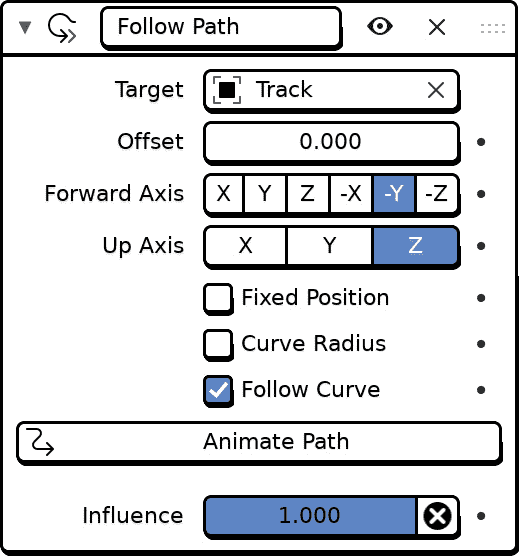

Figure 4.20: The Follow Path constraint settings

与此同时，车厢本身*几乎*都在轨道上。

### 修正路径偏移

如果你在添加约束后，车厢恰好被放置在轨道的弯曲部分，实际上只有其中一节 `Car` 会在轨道上。其他两节车厢似乎只是从中间那节伸出来，就好像整个东西是一节笔直的车厢：

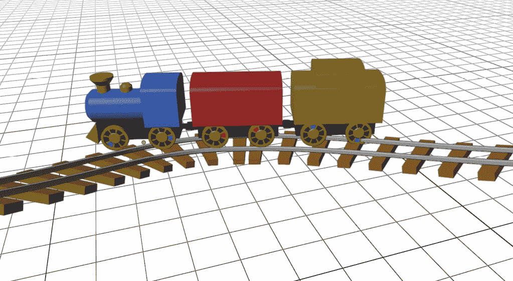

Figure 4.21: Train cars displaced from rails

在目前的困境下，这列火车无法正确地绕过轨道弯曲。为什么会发生这种情况，我们该如何修复？

考虑一下当你添加第一个 `Follow Path` 约束时发生了什么。车厢似乎自动吸附到了 `Track` 样条线上的某个点。目前，这个不可见的点位于路径的起始位置（如果曲线是循环的，这个位置多少有点任意）。这个点在曲线上的位置可以制作动画（稍后会制作），而 `Follow Path` 约束的拥有者实际上会被父级设定到该点。被约束物体相对于曲线上该点的偏移量，等于约束拥有者与目标曲线物体之间的变换差异，是在约束效果生效前计算的。

现在考虑一下车厢在被约束之前的位置。`Engine`、`Car` 和 `Caboose` 的名义位置分别为 `[0, -3, 0]`、`[0, 0, 0]` 和 `[0, 3, 0]`。曲线物体 `Track` 的原点位于 `[0, 0, 0]`。因此，只有 `Car` 的原点会被正确地约束在曲线上，而其他两节车厢在局部 `Y` 轴上“伸出”了 3 个单位，一节向前，一节向后。

我们的解决方案是将那两节车厢的位置数值“重置”，并改用它们 `Follow Path` 约束的偏移值来调整其在曲线上的相对位置：

1. 选择物体 `Engine`。
2. 使用 `Object`（物体） | `Clear`（清除） | `Location`（位置）（`Alt` + `G`）将物体的名义位置重置为 `[0, 0, 0]`。
3. 调整 `Follow Path` 约束的 `Offset`（偏移）值，使 `Engine` 再次以适当的距离与 `Car` 连接。具体数值将取决于你编辑的路径总长度。
4. 对 `Caboose` 重复*步骤 2* 和 *3*。正确的 `Offset` 值极有可能是 `Engine` 那个值的精确反数。

现在每节车厢的原点都精确地位于曲线上：

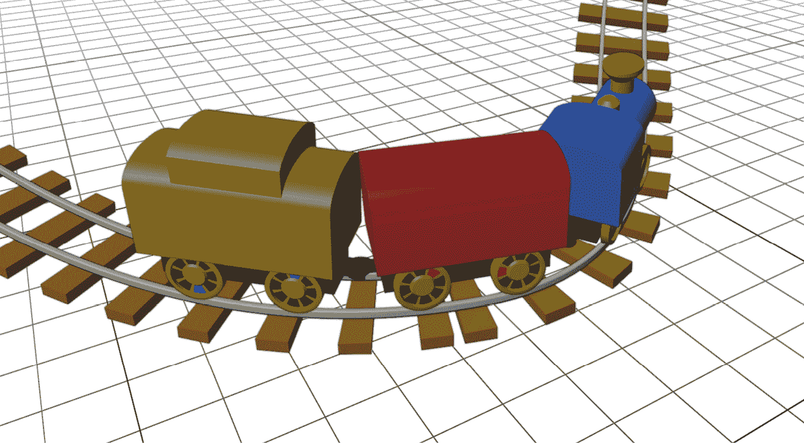

Figure 4.22: Correctly offset train cars

现在可以用单个属性为车厢沿轨道的位置制作动画了。不过，该属性可能不在你预期的位置……

## 为路径制作动画

你可能猜到我们会为物体 `Engine` 制作动画，并约束其他两节车厢跟在后面，就像现实生活中的火车一样。完全不是那么回事。相反，三节车厢现在共享同一个约束目标 `Track`。我们将通过为目标数据的单个属性制作动画，来为整列火车制作动画。

**重要提示**

上一句中的术语 `data`（数据）至关重要。物体及其数据是两个不同的数据块，拥有各自的属性，分别位于属性编辑器的不同选项卡中。物体 `Track` 是一个名为 `Track` 的曲线数据的用户。这些名称是任意的，不必匹配。

选中曲线物体 `Track` 后，我们要找的属性位于属性编辑器中 `Object Data Properties`（物体数据属性）选项卡的 `Path Animation`（路径动画）面板里：

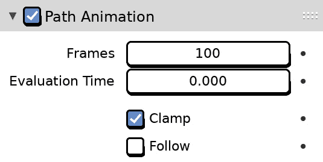

Figure 4.23: The Path Animation panel

这些属性与任何使用该曲线作为目标的 `Follow Path` 约束协同工作。`Frames`（帧数）属性定义了受约束物体遍历曲线总长度所需的“帧”数。这里的“帧”加引号是因为，在此语境下，“帧”指的是 `Evaluation Time`（求值时间）属性的任意单位，我们可以以任何喜欢的速率为其制作动画。

事实上，这些属性与帧或时间没有必然联系。`Evaluation Time` 是分子，`Frames` 是分母，相除的结果等于受约束物体在路径总长度上的相对位置。如果我们将 `Frames` 的值保留为 `100`，我们可以把 `Evaluation Time` 看作百分比！

### 为 Evaluation Time 插入关键帧

这些 `Path Animation` 属性的功能是人为设计的，且标签标注不当。甚至工具提示文本似乎都在撒谱。这就是开源项目令人愉快的怪癖所在。

让我们开怀大笑一下，然后插入最初的两个关键帧：

1. 选择物体 `Track`，在属性编辑器的 `Object Data Properties`（物体数据属性）选项卡中找到 `Path Animation`（路径动画）面板。
2. 转到第 `0` 帧（是的，第 `0` 帧）并为 `Evaluation Time` 插入关键帧。
3. 转到第 `250` 帧（结束帧），将 `Evaluation Time` 改为 `100`，并插入另一个关键帧。

现在你可以观看火车沿轨道总长度移动了！

### 优化火车速度

取决于你的轨道长度，你可能会发现默认的 250 帧动画时长不足以让火车以不过快的速度覆盖轨道长度，又或许 250 帧太长了，导致火车移动太慢。

如果你对火车速度和动画时长感到满意，可以跳过此步骤。否则，让我们调整一些设置以获得我们想要的大致速度：

1. 使用 `Linear`（线性）插值或 `Vector`（矢量）贝塞尔柄，使 `Evaluation Time` F 曲线变为线性。这让我们能以火车的平均速度观看其经过。
2. 抓取（`G`）第二个 `Evaluation Time` 关键帧并将其移动到新帧，赋予火车不同的速度。
3. 调整 `End Frame`（结束帧）的值，使动画在你刚移动的第二个关键帧所在的帧结束。
4. 重复*步骤 2* 和 *3*，直到你对火车的平均速度感到满意。

一旦确定了动画的最佳时长且火车以适当的平均速度移动，根据其遵循的路径形状插入更多关键帧来改变速度就会更容易。

### 峰值处的拐点

如果你的轨道有起伏，你可能希望改变 `Evaluation Time` F 曲线以相应地改变火车速度。我们希望火车下坡时加速，上坡时减速。这意味着每次上下坡方向的变化（即山峰或山谷）都应伴随 F 曲线上的一个拐点。

使用带有 `Aligned`（对齐）贝塞尔柄的关键帧，我们可以创建自己的拐点，使 F 曲线在路径峰值处变平：

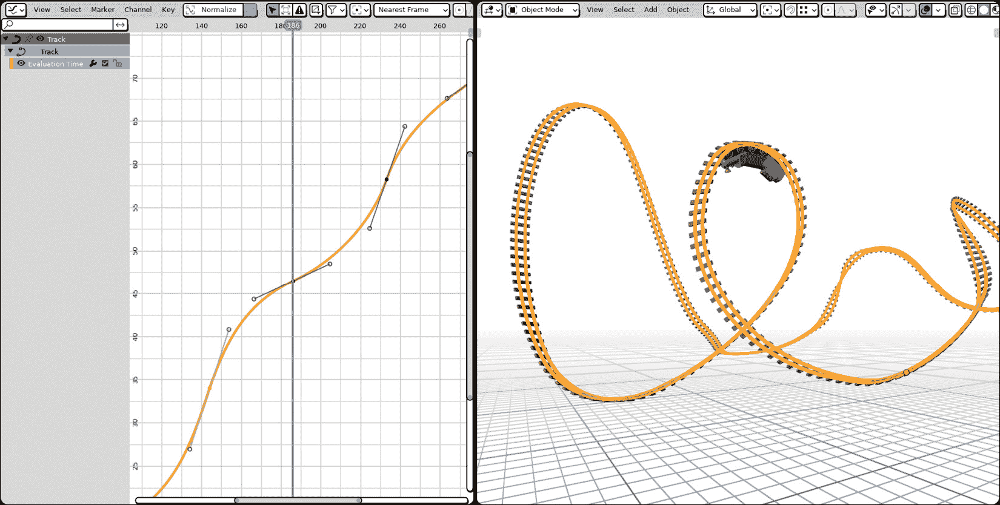

Figure 4.24: A keyframe at a high point in the example path

并使其在山谷处变快：

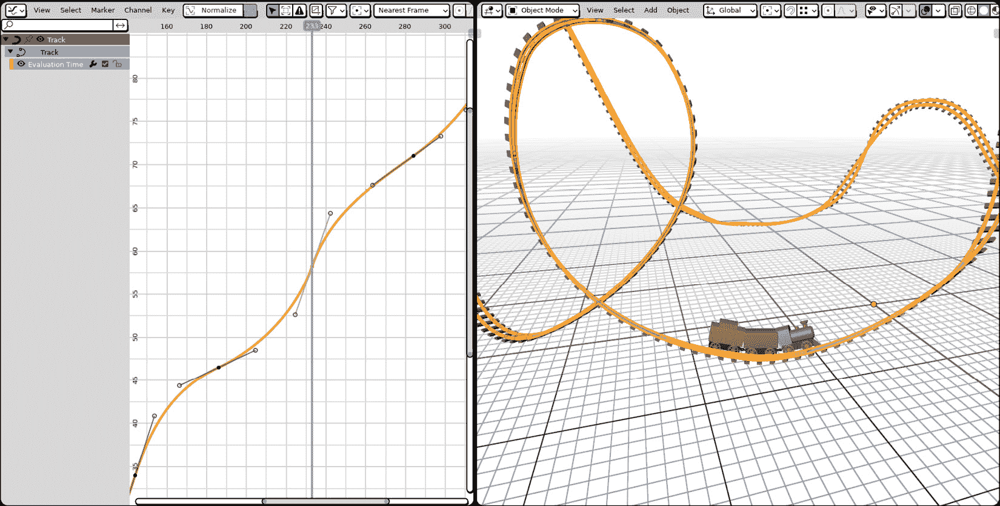

Figure 4.25: A keyframe at a low point in the example path

现在轮到你了：

1. 在 `Graph Editor`（图表编辑器）中擦洗浏览你的动画。
2. 找到火车位于轨道峰值或谷值的每一帧，通过在 `Evaluation Time` F 曲线上插入关键帧来标记它。
3. 将所有关键帧转换为 `Aligned`（对齐）贝塞尔关键帧。
4. 旋转（`R`）关键帧以配合路径形状，使其在峰值处变平、在谷值处更垂直。

5. 继续调整关键帧的旋转和时间，直到你对结果满意。尽量让动画中至少有一小段火车移动得非常缓慢。

看看我们仅用一条 `F-curve` 就创造了多少运动！这个动画快完成了。剩下的就是让车轮转动起来！

## 驱动器

因为我们给六个车轮对象中的五个添加了约束，所以我们只需要关注火车头部剩下的那一对车轮 `Wheels A`。无论这个车轮如何旋转，它后面的其他车轮也会跟着如此旋转。

那么该如何让它旋转呢？`Wheels A` 的 `X Euler Rotation`（X 欧拉旋转）值应该是 `Track` 的 `Evaluation Time`（求值时间）属性的一个简单乘法函数。这应该会让你想起上一章中的独轮车车轮。然而这一次，我们不需要复制粘贴任何关键帧。那样做只是暗示了两个属性之间的关系。通过使用 `driver`（驱动器），我们可以将这种关系编码化，使其自动生效。

驱动器与其说是对象关系，不如说是一个属性与一个或多个其他属性之间的关系。我们将在 `Wheels A` 的 `X Euler Rotation` 属性上使用驱动器，并将 `Track` 的 `Evaluation Time` 属性作为驱动它的输入变量。

## 添加驱动器

任何可添加关键帧的属性都可以被驱动，给属性添加驱动器很简单：

1. 选择对象 `Wheels A` 并找到其 `Transform`（变换）属性。

2. 右键点击 `X Rotation`（X 旋转）属性，从上下文菜单中选择 `Add Driver`（添加驱动器）（`Ctrl` + `D`）。

被驱动的属性会以紫色高亮显示：

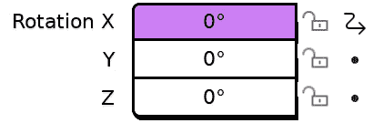

图 4.26：被驱动的 X 欧拉旋转属性

与关键帧属性一样，驱动器“接管”了 `Wheels A` 的 `X Euler Rotation` 属性。该属性的值不再能被直接编辑，甚至连临时编辑都不行！

重要提示

已添加关键帧的属性不能被驱动，被驱动的属性不能添加关键帧。

该属性现在已被驱动。很好。但由什么驱动呢？回答这个问题意味着要解开添加驱动器时同时弹出的那个谜题盒子的谜题。

## 编辑驱动器

添加新驱动器时会出现 `Edit Driver`（编辑驱动器）区域，一旦移开鼠标光标就会消失。随时可以通过右键点击被驱动属性并从上下文菜单中选择 `Edit Driver` 来将其调回。

这些驱动器设置决定了将影响驱动器值的变量以及它们如何被求值：

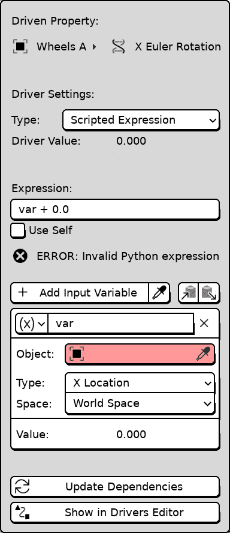

图 4.27：编辑驱动器区域

如果你看到这里有错误消息，意味着你犯错了。开玩笑的！驱动器刚添加时是不工作的。让驱动器工作起来比添加它要棘手一些。

### 驱动器类型

驱动器中的每个变量都是一个数值。因为驱动器可以使用多个变量，所以有几种方法来求值这些不同的值并返回一个单一数字来决定驱动器值：

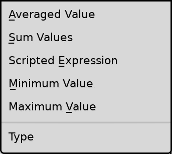

图 4.28：驱动器类型

默认驱动器类型是 `Scripted Expression`（脚本表达式），这是最强大的方法。此类型提供一个 `Expression`（表达式）字段，你可以在其中输入使用多个输入变量的 Python 表达式来计算驱动器值。不过对于这个特定的驱动器，我们只需要一个输入变量，且不需要在表达式中使用它。

让我们使用一种更简单的驱动器类型：

1. 调出 `Wheels A` 的 `X Euler Rotation` 驱动器的 `Edit Driver` 区域。

2. 将驱动器 `Type`（类型）从 `Scripted Expression` 改为 `Averaged Value`（平均值）。

因为我们在这个驱动器中只会使用一个变量，所以无论我们使用平均值、求和、最小值还是最大值都没有区别。变量本身的 `Name`（名称）也不再重要。

提示

每个脚本表达式都是一小段必须反复执行的 Python 代码。这可能导致崩溃、性能问题，甚至安全漏洞，因此如果不必要，最好避免使用 `Scripted Expression` 类型的驱动器。

### 驱动器变量

现在我们稍微简化了驱动器，可以把注意力转向唯一的变量 `var`，它单独决定驱动器值。变量必须从场景中的其他东西获取其值。这可以是几乎任何东西，范围从两个对象之间的变换差异到当前文件中几乎任何数据块的数值属性。

我们想为目标使用单个属性。可选属性很多，所以让我们缩小范围：

1. 将输入变量 `var` 的 `Type` 从 `Transform Channel`（变换通道）改为 `Single Property`（单个属性）：

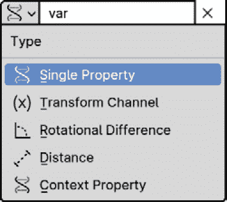

图 4.29：输入变量类型

1. 我们要找的属性技术上属于曲线数据块，而非对象。在 `Prop` 行，将 `ID Type` 从 `Object` 改为 `Curve`：

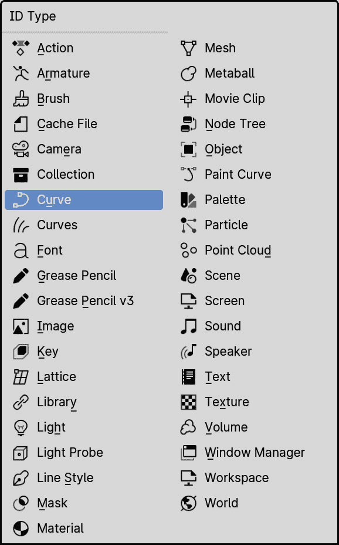

图 4.30：可用的 ID 类型

1. 现在选择我们用来制作火车动画的那条曲线！点击 `ID` 字段并选择 `Track` 曲线。

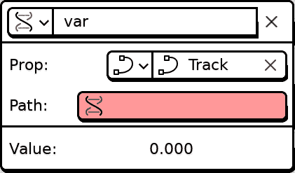

图 4.31：使用 Track ID 块的变量

我们现在步入正轨（双关语）了，将使用属于曲线数据块 `Track` 的单个属性来驱动 `Wheels A` 的 `X Euler Rotation`。只剩最后一个字段需要填写——决定实际使用哪个属性的那个字段！

### 复制数据路径

我们必须在驱动器输入变量的 `Path`（路径）字段中输入内容，以指定我们要使用 `Evaluation Time`，即我们在上一节中制作动画的 `Track` 的属性。这只是一个文本字段。点击它不会给我们任何菜单。那么我们怎么知道该写什么呢？

答案可以通过返回 `Evaluation Time` 属性来找到：

1. 在 `Properties Editor`（属性编辑器）中找到曲线数据 `Track` 的 `Evaluation Time` 属性。

2. 右键点击该属性并从上下文菜单中选择 `Copy Data Path`（复制数据路径）。

3. 返回对象 `Wheels A` 的 `X Euler Rotation` 属性驱动器的 `Edit Driver` 区域。

4. 点击输入变量 `var` 的 `Path` 字段并粘贴（`Ctrl` + `V`）复制的文本。

字符串 `eval_time` 是 `Evaluation Time` 属性在 Blender Python API 中的标识符。完整数据路径是 `bpy.data.curves['Track'].eval_time`。你可以把这些数据路径想象成 Blender 内部属性的网址或 URL。

提示

在你的 `User Preferences`（用户偏好设置）中，进入 `Interface` | `Display` | `Tooltips` 并启用 `Python Tooltips`（Python 提示）。现在你可以通过将鼠标悬停在任何属性上来查看其 Python 数据路径。这对于在 Blender 中创建驱动器或任何类型的 Python 脚本很有帮助。

你的驱动器设置现在应该看起来像这样：

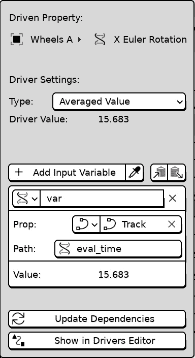

图 4.32：X 欧拉旋转驱动器的最终设置

注意错误消息消失了。终于，我们的驱动器有了一个有效的输入变量！驱动器值现在等于目标属性，车轮将随着火车沿轨道移动而自动旋转。不过，它们的滚动速度正确吗？

## 驱动器 F-curve

## 显示驱动器 F 曲线

可以通过在用户界面的某个区域打开 `Drivers Editor`（驱动器编辑器），或者右键点击被驱动属性并从上下文菜单中选择 `Open Drivers Editor`（打开驱动器编辑器）来找到驱动器 F 曲线。该区域提供了场景中所有驱动器的完整概览。你也可以在右侧边栏的 `Drivers`（驱动器）选项卡中找到我们刚刚编辑的所有参数。

这是我们的驱动器编辑器：

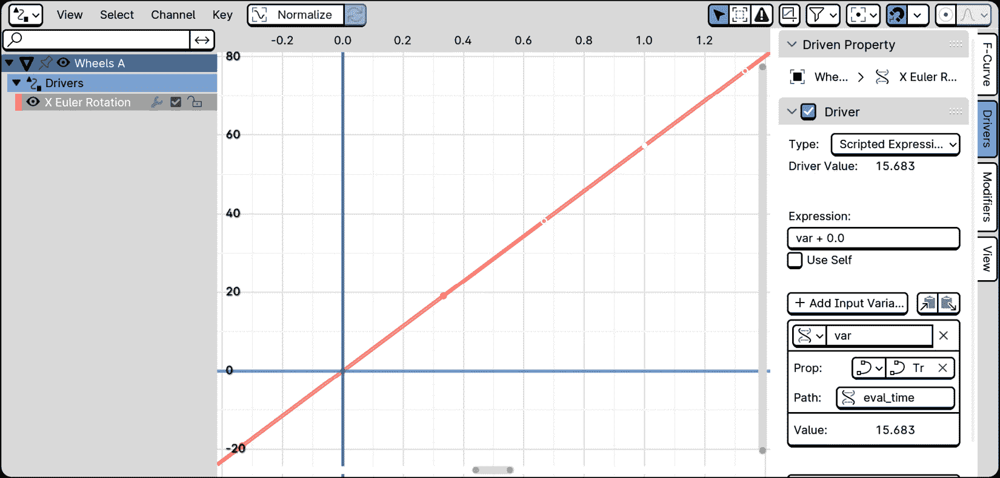

图 4.33：驱动器编辑器

它看起来很像图表编辑器，不是吗？在大多数方面，它*就是*一个图表编辑器，但有一个本质区别——该图表的 `X` 轴不映射到时间。相反，这个 `X` 轴映射到驱动器的驱动值，即基于求值变量计算出的数字。图表的 `Y` 轴映射将要传递给被驱动属性的最终值。我们驱动器的 F 曲线本身就是一种函数——它是调节目标属性 `Track` 的 `Evaluation Time`（求值时间）如何影响被驱动属性 `Wheels A` 的 `X Euler Rotation`（X 欧拉旋转）的最后一个环节。

> **Tip**
>
> `Edit Driver`（编辑驱动器）中的所有设置也可以在驱动器编辑器中找到，位于右侧边栏的 `Drivers`（驱动器）选项卡中（`N`）。

默认的驱动器 F 曲线是一条带有线性外推的对角线，这使其成为一个 1:1 的函数，能有效地将驱动值直接传递给被驱动属性。在许多情况下，你可以忽略它。然而在我们的案例中，我们必须编辑这条 F 曲线的斜率，以调整车轮自动旋转的速率。请记住，旋转值以弧度存储和求值，仅以度数表达/显示，因此我们的 `X Euler Rotation` 驱动器的 F 曲线看起来可能已经具有相当陡峭的斜率。你很可能还需要让它更陡峭。

## 编辑驱动器 F 曲线

`Wheels A` 的 `X Euler Rotation` 驱动器 F 曲线的斜率将取决于 `Track` 的总长度。我无法告诉你你自己的铁路长度，所以这一次你必须通过试错来找出最适合你的驱动器 F 曲线的斜率：

1.  找到一个火车移动非常缓慢的帧范围。
2.  在其中一帧中，在 3D 视口中近距离放大查看火车的车轮。
3.  在界面的另一个区域，打开驱动器编辑器。
4.  选择 `X Euler Rotation` 驱动器 F 曲线的任意一个关键帧。
5.  抓取（`G`）选中的关键帧并移动它以调整 F 曲线的斜率。
6.  拖动帧在帧间切换，在 3D 视口中查看驱动器的新效果。
7.  持续调整，直到火车车轮看起来像是在轨道上具有牵引力（不打滑）。

一旦火车车轮旋转正确，你就完成了：

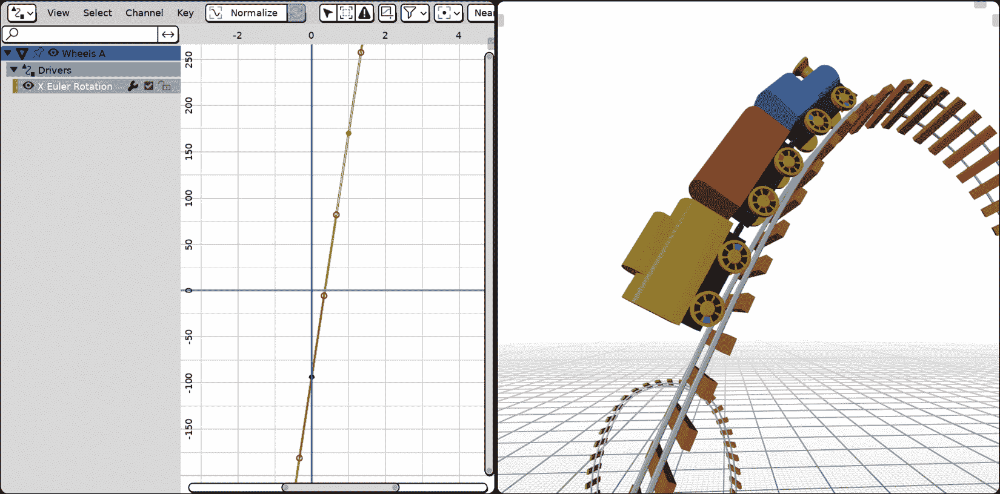

图 4.34：修正后的驱动器 F 曲线和动画火车

以这种方式使用驱动器，与我们建立的其他对象关系有一个共同的优势——如果我们选择回头修改 `Evaluation Time` 的动画，不需要复制任何关键帧，也不需要调整火车的任何其他方面。这是一个优雅的解决方案！

## 最终对象关系图

为了理清我们为何能用如此少的动画通道驱动如此多的事物，请看这张展示我们创建的所有复杂关系网络的图表：

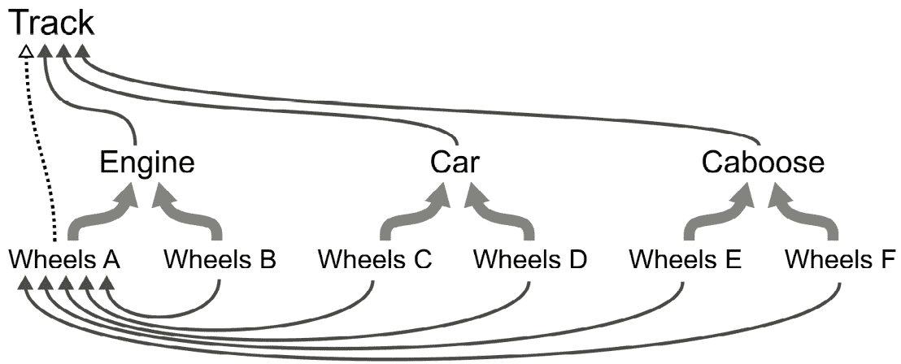

图 4.35：最终关系图——虚线黑线代表驱动器

我们创建了一个相当庞大的对象家族树，彼此相互影响！沿着各种依赖关系的方向，你可以看到一切最终都指向对象 `Track`。

> **Important note**
>
> 在任何相关对象系统中，想象沿着关系图按箭头方向从一个对象走到下一个对象，绝不后退。最终，你应该会到达一个没有依赖关系的对象，在此之后无法继续前进。图表中任何可以绕回同一位置两次的部分被称为**循环依赖**或**依赖循环**，通常会导致错误。

我违背了承诺——严格来说，我们确实不得不编辑不止一条 F 曲线来完成这个动画。尽管如此，如果我们从简化的意义上理解动画，即直接为每个属性插入关键帧，那么从如此少量的“动画”产生如此多的运动，实在是令人惊叹！

## 总结

完成这个练习并让火车动起来后，你可能感觉更像个机械师或工程师，而不是动画师，但动画是一个广泛的类别，包含整个系统的逻辑构建。你构建场景的方式、对象及其属性之间的关系，可能与动画通道中的所有关键帧一样重要。

我们在这里涉及的主题可能看起来很复杂，但还有更多东西要学！所有那些不同的约束、变量类型、依赖链、坐标系、Python 表达式、驱动器 F 曲线……在这些外表简单的“功能”之下，轰鸣着一个神秘的逻辑与数学洞穴。如果我们在旋转话题上走得太远，就永远无法回头完成本书的其余部分。

我们将在本书的*第 2 部分*中，当我们在角色动画中运用父子关系、约束和驱动器时，了解更多关于它们的知识。然而在此之前，我们将简短地转向一个更紧迫的问题——如何将我们完成的所有工作转换为视频文件！

## 问题

1.  什么是对象原点？在什么情况下我们将其称为原点？
2.  使用 `Affect Only`（仅影响）| `Origins`（原点），我们实际上影响对象的方面是否比正常移动其原点时更少？
3.  你如何判断一个对象是否为其他对象的父对象？（至少有三种方法。）
4.  在现实生活中，大多数孩子有两个父母。在 Blender 中，对象也可以这样吗？
5.  从实际角度出发，一个对象可以成为祖父母吗？
6.  约束所有者和约束目标有什么区别？哪一个受约束影响？
7.  检查后车轮之一的 `Transform`（变换）属性。它在移动和旋转，那么为什么这些滑块中的数值似乎没有变化？
8.  驱动器的 `Type`（类型）决定了什么？
9.  在什么意义上火车车轮是“被动画化”的？在什么意义上它们*没有*被动画化？
