# 第 5 章：渲染动画

我们到目前为止真正*完成*本书中的任何动画了吗？我们辛苦工作的成果只是几个 `.blend` 文件。当然，我们可以在 Blender 中打开一个，点击播放，观看对象运动，但这真的是动画该被观看的方式吗？

不是，人们期望将动画作为 `video`（视频）观看，即一系列 2D 图像快速连续显示，格式化为与现代网站和媒体播放器兼容的数字文件。他们还期望视频的每一帧看起来都很美观，有灯光、着色等，且没有网格线或光标碍事。要生成这样的视频文件，我们必须 `render`（渲染）动画。


对于一本关于 Blender 的书来说，在提到渲染之前走到这一步是不常见的。渲染是 3D 动画的最后一步，它生成将被他人看到的成品图像或帧。在这个 3D 动画的最后且至关重要的阶段，我们利用场景中的 3D 数据输出一系列 2D 图像，每一幅都是给定帧下场景的“快照”。渲染生成的高质量 `image sequence` 随后将提供视频的帧，这将成为我们的最终产品。

在本章中，我们将涵盖以下主题：

*   设置相机
*   为渲染准备动画场景
*   将动画渲染为图像文件序列
*   将图像导入 Blender 的 `Video Sequencer` 并渲染为视频文件

## 技术要求

本章的练习比其他章节更加开放。你只需要一个包含完整动画的 `.blend` 文件。前四章中的任何项目都可以。作为示例，我选择使用我来自 第 3 章 的独轮车动画：

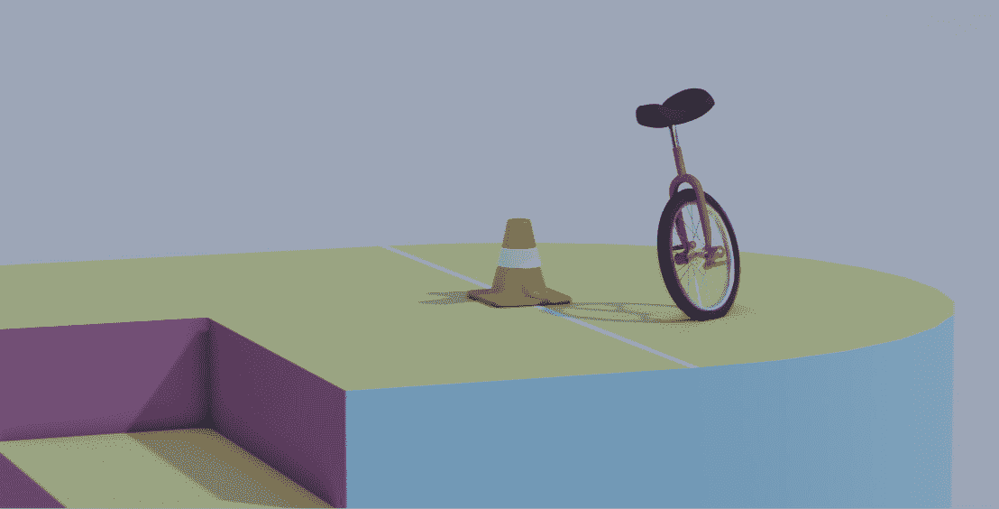

图 5.1：处理后的独轮车动画渲染帧

决定要渲染哪一章的练习，并在 Blender 中打开它。

渲染会生成一系列高质量图像文件，这可能会占用大量文件空间，因此你还需要确保计算机文件系统上有足够的存储空间。要渲染前几章中的某个动画，1 GB 的可用空间应该足够了。

## 设置相机

你可以使用 `Render | Render Image` (`F12`) 渲染单帧，也可以使用 `Render | Render Animation` (`Ctrl + F12`) 渲染所有帧。

不过别急！你的场景里有 `camera` 吗？

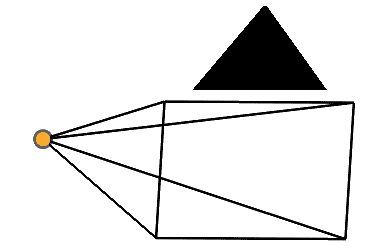

图 5.2：相机对象

如果没有，当你尝试渲染时会收到此错误消息：

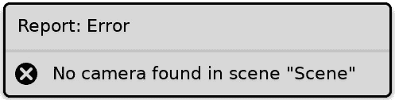

图 5.3：尝试在没有相机的情况下渲染时的错误消息

相机是一个关键对象。如果我们把 3D 场景想象成电影布景，把动画对象想象成演员，那么我们的相机就可以被认为是摄像机。这不是一个深奥的类比。就像真实的相机一样，我们的场景将通过这台虚拟相机的“镜头”被捕捉。

你为本书第一部分练习下载的场景没有相机，这使得它们无法进行渲染。现在让我们添加一个并进行设置。

## 向场景添加相机

你可以在 `3D Viewport` 中使用 `Add | Camera` (`Shift + A`) 添加相机对象。

重要提示

一个场景可能有多个相机，但在任何给定时间点只能有一个 `active camera`。这是用于渲染和查看场景的相机。如果场景中只有一个相机对象，它通常就是活动相机。

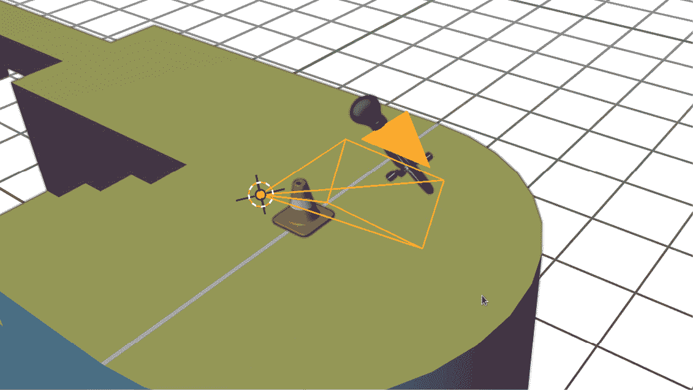

图 5.4：初始相机位置

别担心——相机是可以像其他对象一样移动的对象，并且它们附带一些额外的技巧，我们可以用来快速设置它们。

## 相机取景

无论是渲染还是现实生活中的摄影，你想用相机做的第一件事就是透过它观看。在 Blender 中，这被称为 `camera view`。你可以通过点击 `3D Viewport` 右上角的相机小部件，使用 `View Camera` (`` ` ``, `1`)，或使用 `View | Viewpoint | Camera` (`numpad 0`) 来切换相机视图：

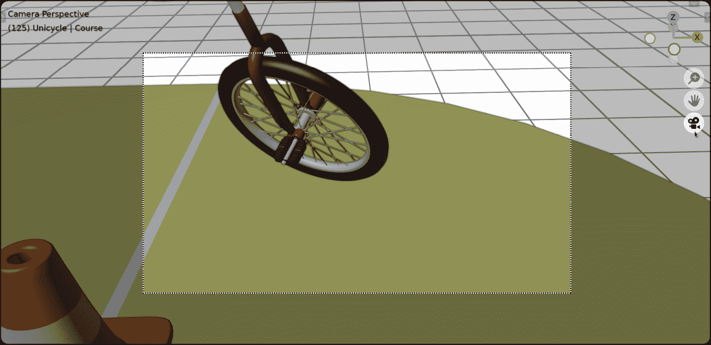

图 5.5：相机视图

相机视图为我们提供了最终产品外观的重要预览。在矩形的实线范围内，我们可以看到相机所见的内容。范围外的任何内容将不会被*直接*渲染，但仍可能发光、投射阴影或以其他方式间接影响结果。

提示

如果你的电脑屏幕有空间，你可以考虑将界面分割为多个 `3D Viewport`，并将其中一个保持在 `camera view` 中。这使你可以在一个视口中工作，同时在另一个视口中预览相机所见的内容。

现在我们可以透过相机观看了，我们可以有意义地调整它的位置和其他属性。

### 定位相机

大多数电影制作人会建议你将相机对准你想让观众看到的东西。在你的情况下，除非你为自己的作品感到羞愧，那指的就是你制作动画的东西。你需要重新定位新相机，使其在场景中正确构图动画对象。

以下是几种方法：

*   像操作其他东西一样直接抓取并旋转你的相机！你甚至可以在 `camera view` 中透过相机观看时选择并移动它。
*   使用标准的 `3D Viewport` 导航控制找到你喜欢的视角，然后使用 `Align Active Camera to View` (`Ctrl + Alt + Numpad 0`)。这会将活动相机对齐以匹配你的视图。
*   默认情况下，在 `3D Viewport` 中使用中键会退出 `camera view`，留下相机原地不动。不过，如果你愿意，可以去侧边栏 (`N`) 的 `View` 选项卡，启用 `View Lock | Lock | Camera to View`。现在 `camera view`——连同相机——将跟随你，当你用中键调整视图时。

以下是我点击几下后的相机视图：

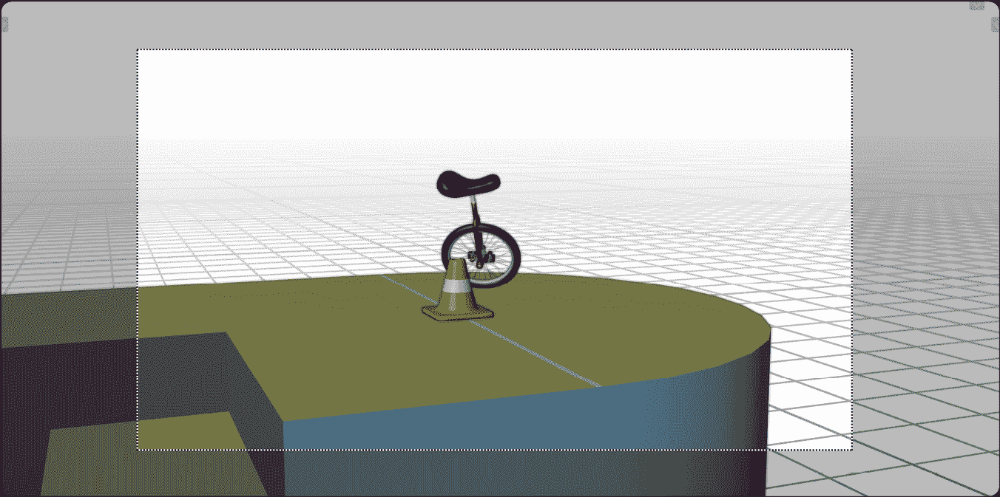

图 5.6：调整后的相机视图

这些方法都只影响相机 `object`，具体来说是它的位置和旋转。这些肯定是最重要的属性，但还有一个属于相机 `data` 的属性（如果你还记得对象及其数据之间的区别），也会显著影响渲染结果。

### 相机镜头

选中相机后，我们可以去 `Properties` 编辑器中的 `Object Data Properties` 选项卡，它现在有一个看起来像电影摄像机的图标。可以说最重要的相机数据属性在 `Lens` 面板中：

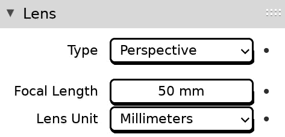

图 5.7：相机数据的镜头属性

调整 `Focal Length` 具有*缩放*进出的效果，其数值对应真实相机变焦镜头的数值。

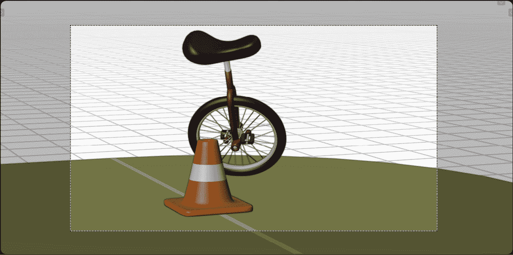

图 5.8：放大后的相机视图

为了补偿这种效果，你可以尝试通过抓取相机的局部 `Z` 轴来 `dollying` 相机，在保持居中的同时将其推近或推远主体。这里有三个可能的视图，展示了缩放和推拉镜头如何对镜头外观产生显著影响：

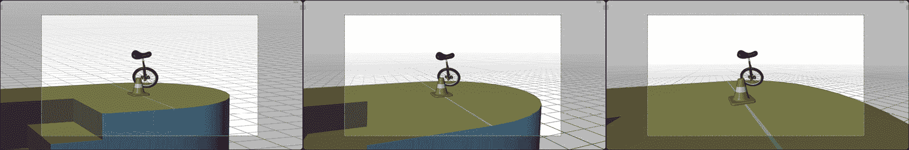

图 5.9：远距离缩放、正常、近距离缩小

当你为相机找到合适的位置和焦距后，别忘在 `camera view` 中播放动画。镜头在某一帧看起来可能不错，但在每一帧上看起来怎么样呢？

## 动画相机

在动画结束时，动画对象还在你留下的相机前面吗？

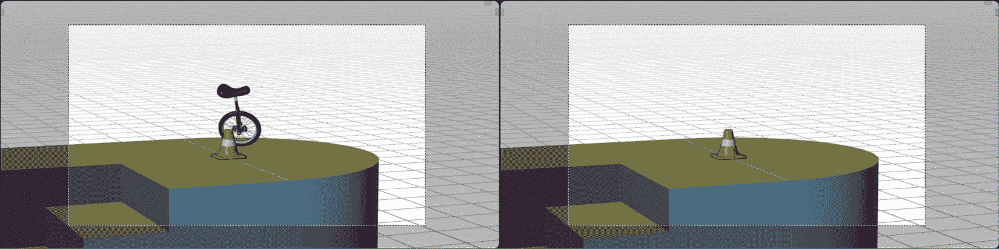

图 5.10：第 125 帧的相机视图……和第 250 帧

我们的动画对象是有生命的东西，它们不一定会为我们停留在一个地方。因此，我们的相机也必须变成有生命的东西。

给相机制作动画和给其他东西一样简单。我可以通过为其旋转和焦距设置关键帧，让我的相机跟随独轮车：


## 渲染基础

在虚拟场景中设置好虚拟相机后，你就可以按下它上面的虚拟快门释放按钮，拍一张虚拟照片了。换句话说，你可以渲染一帧画面！

## 到底什么是渲染？

渲染是 3D 图形学中的一个基本过程，艺术家让程序完成大部分工作——模拟透视、颜色、阴影和反射等现象，这些现象同样影响着现实世界中的光线如何被我们的眼睛或相机感知。

渲染出的图像应该比我们在 3D 视口 中看到的效果更好（至少初衷是这样）。然而，这种质量的提升是有代价的：它可能需要花费一段时间。

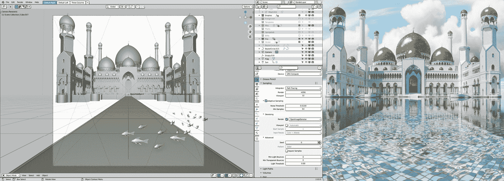

**图 5.12：** 右侧的图像渲染耗时 20 分钟

渲染可能是一个耗时的过程，艺术家必须坐在那里等待计算机处理数据并输出每一帧图像，且并不总能预知结果会怎样。取决于渲染内容和硬件配置，渲染单张图像可能需要从几毫秒到一个月不等的时间。在动画的情况下，这个过程必须为每一帧重复执行！

### 关于渲染引擎的简短说明

3D 应用程序中专门执行渲染的部分称为 **渲染引擎**。渲染引擎非常先进，有时它们会被打包成独立的应用程序。在开始新项目时，3D 艺术家通常会在正式开工前先选择打算使用的引擎。

Blender 自带多个渲染引擎，位于 **渲染属性** 选项卡的最顶端：

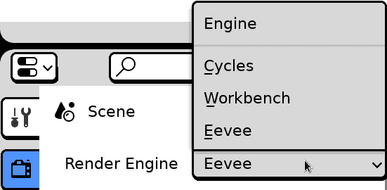

**图 5.13：** Blender 中的渲染引擎

**Cycles** 和 **Eevee** 是用于渲染高质量图像的两大主流引擎。这两个渲染引擎功能都很强大，且相辅相成。

**Cycles** 和 **Eevee** 的区别快速总结：**Cycles** 真实但不一定快，需要仔细调整设置以在不牺牲质量的前提下加快渲染速度。相比之下，**Eevee** 快但不一定真实，需要额外工作来提升图像质量，同时又不能牺牲太多性能。

本章我们将继续使用 **Eevee** 渲染引擎，因为它默认速度快得多，更适合快速渲染你的第一个动画。

### “渲染”视口着色模式

**渲染** 是一个容易混淆的术语，含义多样。严格来说，如果要在计算机屏幕的 2D 像素网格上显示 3D 数据，必须以某种方式对其进行渲染。当我们工作时，3D 视口会使用针对性能优化的各种 **视口着色** (`Z`) 方法实时渲染场景。如果不这样做，我们就无法看到正在处理的内容！

此示例展示了三个 3D 视口，每个使用不同的视口着色方法——**线框**、**实体** 和 **材质预览**：

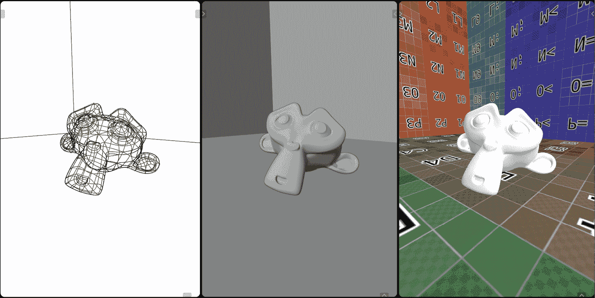

**图 5.14：** 三种实时视口着色方法

这引出了本章最重要的视口着色方法。要获得场景最高质量的交互式预览，请查看 3D 视口中的 **渲染** (`Z`, `8`) 视口着色模式。该模式使用我们选定的渲染引擎直接在 3D 视口中渲染场景：

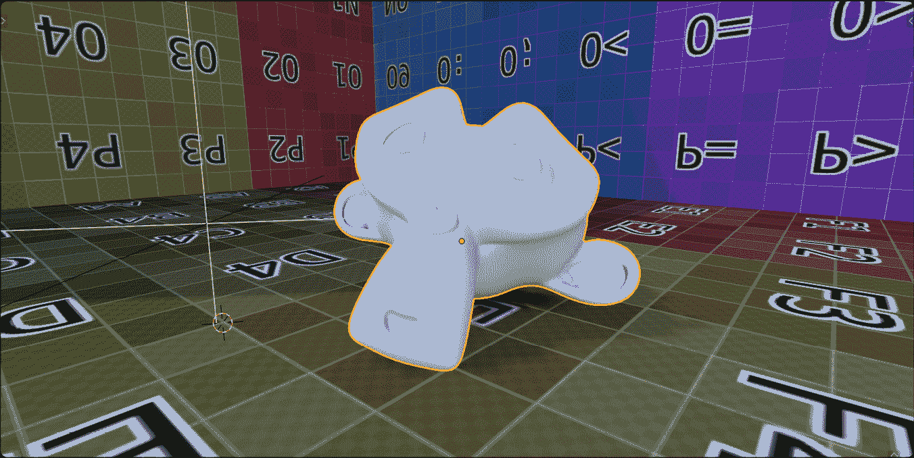

**图 5.15：** 使用渲染模式的 3D 视口

这种方法是我们在 3D 视口中预览渲染结果的最接近方式。结合相机视角使用时尤其有用。你也可以在这种着色模式下播放动画，尽管结果不一定总能以可接受的帧率回放。

请记住，**渲染** 仍然是一种着色模式，就像 **线框**、**实体** 或 **材质** 一样。它不完全等同于执行渲染操作。对于那些在视口和渲染时具有不同数值的属性，将使用视口数值，这倾向于较低的数值，就像 3D 视口中的大多数其他事物一样，偏向性能而非质量。它也无法预览视频编辑器或合成节点完成的任何后期处理。

总而言之，你在 **渲染** 模式下看到的，不一定就是你执行 *渲染* 时得到的……

## 渲染控制

在大多数情况下，*渲染* 的含义比 3D 视口中的一个设置更具体：它是指执行一项操作，根据 **渲染属性** 和 **输出属性** 确定的参数，从活动相机的视角渲染活动场景。这将生成一张图像或一系列图像，它们可能成为视频的帧。

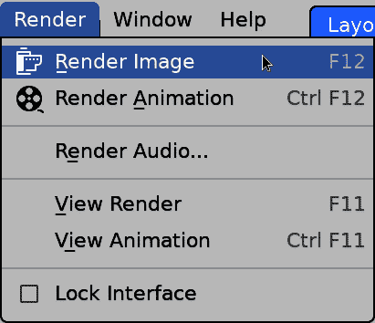

**图 5.16：** 渲染菜单

在动画项目中，研究单个渲染帧以评估其质量非常重要。以下是渲染单帧的主要操作符/控制：

- **渲染** → **渲染图像** (`F12`) 在当前帧渲染场景，并在图像编辑器中显示结果。
- **图像** → **保存** (`Alt` + `S`) 可用于在图像编辑器中将图像保存为文件。
- 随时按 `Esc` 可取消正在进行的渲染，再按一次可离开渲染时调用的图像编辑器。
- **渲染** → **查看渲染结果** (`F11`) 返回图像编辑器，显示上一次渲染的图像。它不会渲染任何新内容。

> **重要提示**
>
> 首次按下 **渲染图像** (`F12`) 后，新手用户往往会兴奋地询问如何在图像编辑器中播放或环绕查看结果。别指望了。请记住，图像编辑器中的图像只是一张 *图像*：一个静态的二维彩色像素网格。

最后，以下是渲染动画的操作符：

- **渲染** → **渲染动画** (`Ctrl` + `F12`) 按顺序从 **起始帧** 到 **结束帧** 为动画中的每一帧渲染并输出一张图像。除非按 `Esc` 取消，否则该过程将持续到渲染完最后一帧。
- **渲染** → **查看动画** (`Ctrl` + `F11`) 在输出路径中搜索本应已渲染好的视频或图像序列，并尝试（成功率不一）按指定帧率播放。

> **重要提示**
>
> 使用 **渲染图像** (`F12`) 渲染的某一帧，与使用 **渲染动画** (`Ctrl` + `F12`) 渲染的同一帧是完全相同的。唯一的区别在于 Blender 是否在渲染完一帧后停止！

此时使用 **渲染动画** 将无法得到好的结果。首先，我们还没检查 **输出属性**。此外，还有一个更宏观的原因说明为什么我们不应好高骛远。

### 为什么我们现在不应该渲染整个动画？

在渲染所有帧之前，不如先渲染一帧试试？

这是我使用 **渲染** → **渲染图像** (`F12`) 得到的结果：

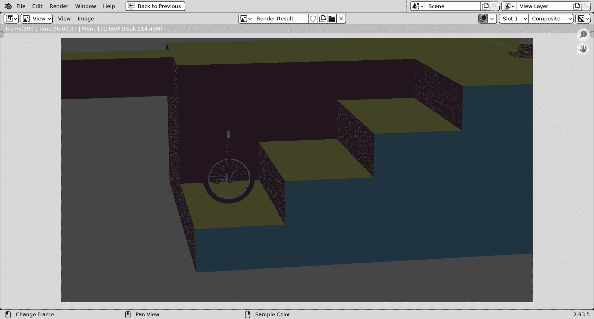

**图 5.17：** 无灯光、天空或地面的渲染帧

通过仅渲染一帧，我可以看到我的场景缺少一些东西，包括适当的照明和地面。如果我等整个动画渲染完成后再检查效果，我也会发现同样的问题，但那时我已经浪费了文件空间和几分钟的渲染时间。


当然，这只是一帧而已。也许场景中每隔一帧渲染出来看起来都不错。不过我可不敢打包票。渲染就是这样：在渲染完成之前，我们无法绝对确定最终成品的样子，但我们仍然可以根据在 3D 视口和单个渲染帧中看到的情况进行推断。

当你进行下一节时，请记住同时使用 3D 视口中的 `渲染` (`Z`, `8`) 模式和 `渲染图像` (`F12`) 在不同帧上进行检查，以监控我们对场景及其属性的更改如何影响渲染结果。

## 为渲染设置场景

我们在 Blender 中所做的一切最终都是为了渲染；它们或直接或间接地贡献于渲染成品。除此之外皆为徒劳。这意味着在 Blender 中几乎没有哪个话题能让我们断言：“这与渲染章节毫无关系。”

灯光、环境、着色：这些内容足以填满其他好几本书，对于制作静态图像的 3D 艺术家来说，它们与 3D 动画师同样重要。既然动画是我们的首要任务，本节将略过这些话题中的大部分，仅涵盖足以让场景能够顺利渲染的内容。

### 添加天空和地面

为求简单，你为第 1 部分练习下载的 `.blend` 文件中不包含任何灯光对象。这种缺乏灯光的情况会导致渲染场景出现业内专业人士所谓的“太暗”问题，其原因过于高深，不宜在本书中解释。我只能引用业内另一句行话：“放个灯进去，别那么暗了。”

顺便一下，我们不妨用一个合适的天空来完善场景，而不是沿用现在的默认灰色背景。一个完整的场景还应该有地面，这样看起来才不像其他所有东西都漂浮在太空中：场景中心的一个简单网格对象就很合适。

现在让我们添加这些基本元素：

1.  通过 `添加` (`Shift` + `A`) | `灯光` | `阳光` 向场景中添加一个太阳。试着稍微旋转一下它以投射出更长的阴影。
2.  前往属性编辑器的 `世界属性` 选项卡。给场景背景设置一个漂亮的颜色，甚至可以用一个 `天空纹理`：

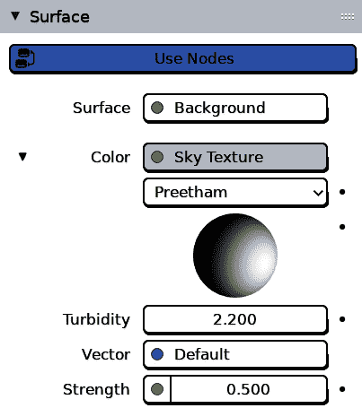

图 5.18：背景天空纹理设置示例

3.  使用 `吸附` (`Shift` + `S`) | `光标到世界原点` 和 `添加` (`Shift` + `A`) | `网格` | `网格` 来添加一个平坦的网格，作为场景的地板或地面。
4.  将地板对象 `缩放` (`S`) 至至少 **100** 倍。

现在我们有了光源、天空，以及用于接收阴影的地面！

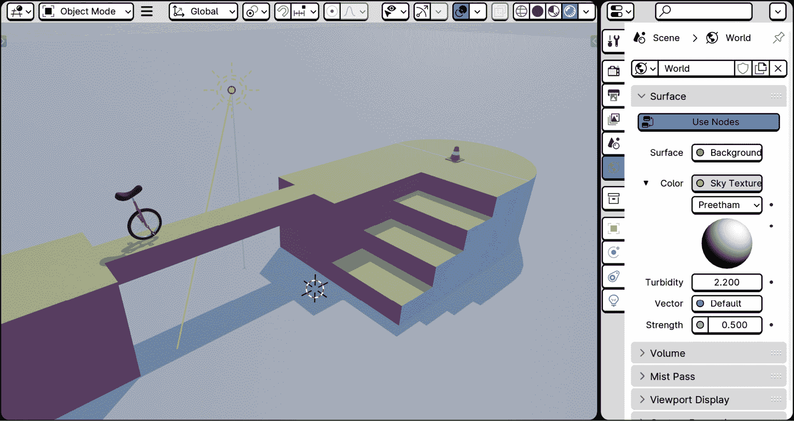

图 5.19：带有光照、天空和地面的场景

### 一些快速简便的渲染设置

`渲染属性` 选项卡包含 Eevee 中各种功能的设置，启用它们可能会增强渲染的真实感。以下是几个值得考虑的选项。

启用 `环境光遮蔽` 通过加深几何体之间的缝隙来提高真实感：

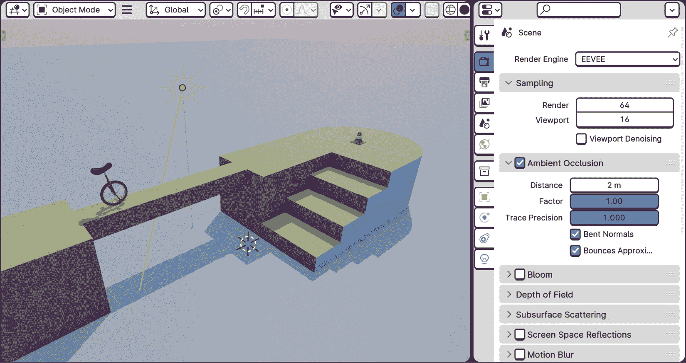

图 5.20：启用环境光遮蔽的场景

启用 `屏幕空间反射` 后，光滑材质看起来会更好：

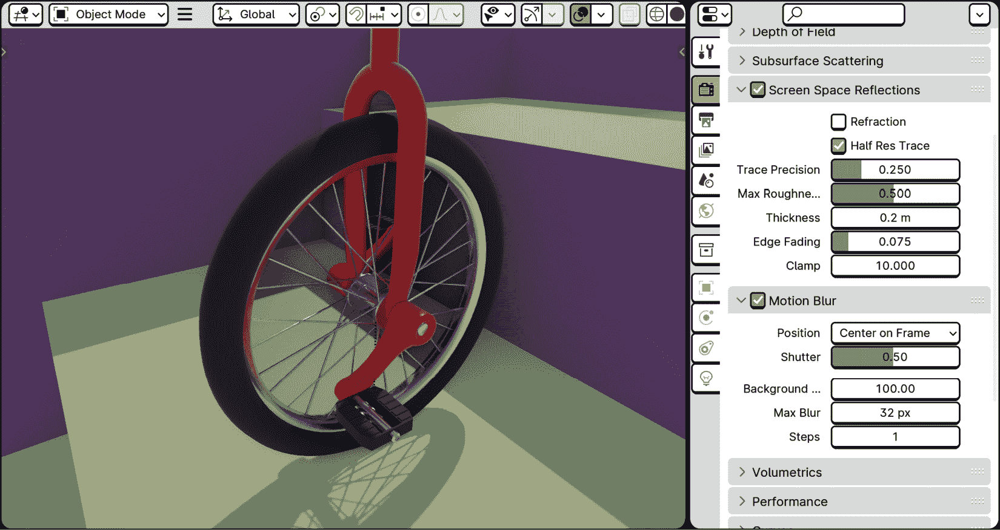

图 5.21：启用屏幕空间反射的独轮车特写

最后，`运动模糊` 是动画的一项绝佳功能。启用后，几何体会沿着其移动方向产生模糊，就像真实相机一样：

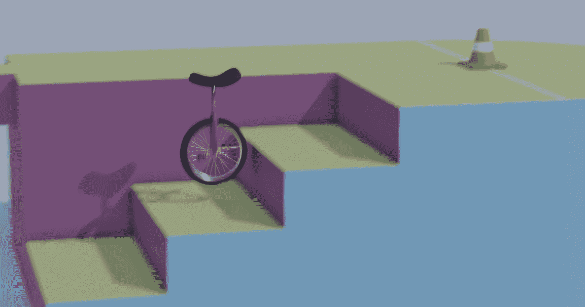

图 5.22：启用运动模糊的渲染帧

这结束了我们关于灯光和渲染设置的教程——与其说是大师课，不如说是在漆黑的浴室里摸索开关。能说什么呢？这是一本动画书！只要动画物体在渲染时清晰可见，那就足够了。

既然这是一个开放式练习，鼓励你根据喜好对场景做尽可能多的额外改进。如果在静态图像中看起来不错，在动画中通常也会同样不错，尽管渲染时间可能会更长。

### 渲染分辨率

还有一个至关重要的场景属性关系到渲染。即使我们在本书剩余练习中不需要编辑它，你仍应了解它，因为它影响图像质量、渲染时间，甚至场景中的相机。

`分辨率 X`、`分辨率 Y` 和 `分辨率 %` 位于 `输出属性` 的 `尺寸` 面板中：

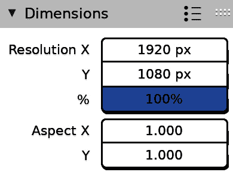

图 5.23：分辨率设置

这些属性决定了渲染图像的像素尺寸。将 `分辨率 %` 分别应用于 `分辨率 X` 和 `分辨率 Y`，然后相乘：这就是 Blender 每帧将渲染的像素数量。

不用说，高分辨率图像被认为质量更高。然而，这种提升伴随着渲染时间的相应增加。同样，低分辨率图像渲染速度会更快。

> **提示**
> `分辨率 %` 提供了一种便捷的方式来缩放渲染分辨率，而无需成比例地编辑 `X` 和 `Y` 值。分辨率 **1920** x **1080** 在 **50%** 时将以 960 x 540 渲染，且耗时约为 1/4！以较低分辨率渲染是艺术家更快预览渲染结果的另一种技巧。

碰巧的是，Blender 默认的 **1920** x **1080** 分辨率在大多数情况下都很合适。这是一个不错的分辨率，在现代格式、网站和媒体播放器中拥有普遍支持。如果你选择其他分辨率，最好选择标准分辨率，例如你电脑显示器的分辨率。

更多信息请参阅此处的常见分辨率列表：

[`en.wikipedia.org/wiki/List_of_common_resolutions`](http://en.wikipedia.org/wiki/List_of_common_resolutions)

## 预测和管理渲染性能

查看渲染图像时，请注意显示区域左上角的那串信息：

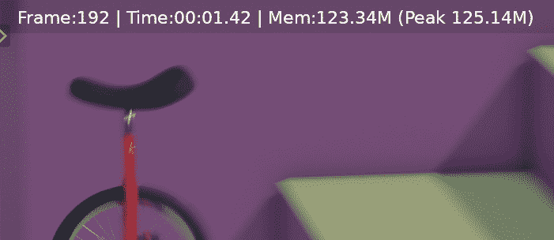

图 5.24：渲染帧的相关信息

**Time** 旁边的数值是渲染该帧所花费的时间。随着我们在场景中添加对象并启用渲染功能，这个数字会上升。用渲染一帧所需的 **Time** 乘以动画的总帧数，你就能得到整个动画渲染所需时间的粗略估计。

一帧渲染用 2 秒而不是 1 秒重要吗？可能很重要，如果动画有 3,000 帧，且 1 小时后就要交付！3D 艺术家在渲染复杂场景并追求高质量时，必须做平衡。如果在场景中塞入太多物体或把某些设置调得太高，Blender 可能会花费难以接受的漫长时间来完成渲染。甚至可能会崩溃！

你的艺术品味、硬件规格和耐心都是你自己的，所以你必须决定愿意等待渲染完成多久。

> **提示**
> 使用 `图像查看器` 标题栏中的 `槽位` 功能，可以存储多张渲染图像以便对比。图像槽位还会保留顶栏的渲染信息，因此你可以连同图像本身一起对比渲染时间。

始终建议在不同帧使用 `渲染图像` (`F12`) 测试场景。当你确信动画中的所有帧看起来都良好且能在可接受的时间范围内渲染完成时，你就准备好迈出下一大步了！


## 渲染图像序列

随着我们越来越接近查看最终产品，我们一直通过两种方式之一来预览它：在相机视图中观看动画播放，或使用 `Render Image` (`F12`) 渲染静态图像。这意味着我们不得不在低质量下观看动画，和/或查看一些不移动的高质量帧，然后靠想象力来填补空白，以期待最终视频的样子。好吧，不必再期待了！是时候渲染你的动画了。

渲染动画很像渲染静态图像，只是这一次，动画中的*每一*帧都必须被渲染。当调用 `Render Animation` (`Ctrl` + `F12`) 时，Blender 将渲染并自动输出（保存）场景帧范围内每一帧的图像，从 `Start Frame`（起始帧）开始，一直持续到 `End Frame`（结束帧）保存为止。

此操作的结果将是一个图像序列：存储在你电脑上的一个文件夹，其中包含你动画中的每一帧作为单独的图像文件。

## 为什么输出图像序列而不是视频？

当我们在 Blender 中渲染动画时，我们可以使用 `Format`（格式）设置来选择输出一系列图像文件，还是仅输出一个视频文件。既然我们需要的是视频文件，为什么不直接渲染成那个格式呢？

诚然，我们可以这么做！就实际情况而言，本书中的项目简短且简单，足以任由两种方式输出。然而，本章旨在教授渲染动画的最佳实践。这意味着先渲染成图像序列，然后在 Blender 或其他应用程序中将该图像序列转换为视频。

以下是我们的理由：

*   在保存序列中的图像文件时可能发生的任何错误，都将仅限于那一个文件，而视频中的单个损坏帧可能会影响其余帧并毁掉整个视频。
*   如果你在渲染过程中遇到崩溃或断电，或者不得不使用 `Esc` 取消正在进行的渲染，图像序列使得从最后一帧完成的帧恢复渲染变得容易得多。
*   除了 Blender，大多数专业视频编辑器和合成软件都能很好地处理图像序列——有时甚至比处理视频文件更好。
*   根据视频的发布方式，它可能需要以各种格式、质量级别和分辨率进行编码。在这种情况下，你反正都得把渲染出的东西转换成另一种视频格式。

总结一下：视频文件很麻烦。如果你直接渲染成视频文件，总有一天你会后悔的，所以让我们趁此机会把事情做对。

## 输出设置

当你使用 `Render Image` (`F12`) 渲染图像时，Blender 会将其暂时保存在图像编辑器中，让你决定是否使用 `Image` | `Save` (`Alt` + `S`) 来保存它。另一方面，Blender 无法在内存中保存整个动画的每一帧图像，因此 `Render Animation` (`Ctrl` + `F12`) 必须在每帧渲染完成后自动将其保存到某处。这意味着我们必须在启动渲染前建立合适的输出设置。

这些属性属于场景，可在 `Properties Editor`（属性编辑器）的 `Output Properties`（输出属性）选项卡中的 `Output`（输出）面板中找到：

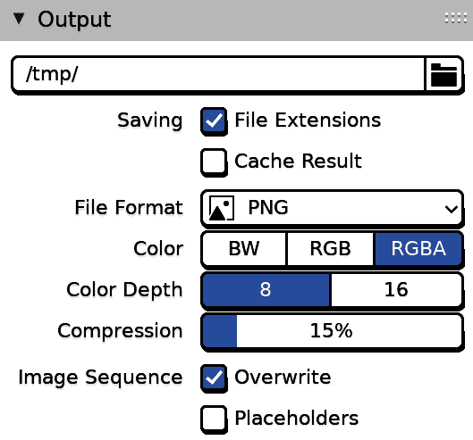

Figure 5.25: File output settings

### 设置输出路径

`Output` 面板中的第一个属性是 `Output Path`（输出路径）。此字段决定了渲染出的图像将自动保存到你电脑上的哪个位置。

默认情况下，图像将保存到一个名为 `tmp` 的文件夹中。那是个保存图像的蠢地方！让我们找个更好的：

1.  点击 `Output Path` 字段右侧的小文件夹图标。这将启动一个文件浏览器，使设置路径更加容易。
2.  导航到你电脑文件系统中一个稍后容易找到的位置。我建议使用包含你正在处理的 `.blend` 文件的同一个文件夹。
3.  点击 `Add New Directory`（添加新目录）按钮以添加一个新文件夹。给它一个你稍后会记住的名字。
4.  双击新文件夹进入，然后点击 `Accept`（接受）。

这个全新的文件夹将成为我们即将生成的几百个图像文件的容器。有这么多文件，将它们保存在自己的容器中非常重要，否则事情会变得一团糟！

> **Tip**
>
> 除了使用文件浏览器，还可以直接编辑 `Output Path` 文本字段。路径中尚不存在的任何文件夹将在保存第一帧时自动创建。

### 输出文件格式

与在任何其他程序中保存图像一样，我们必须选择一种特定的格式。图像格式是编码图像的标准，以便在不占用过多带宽或文件空间的情况下保留足够的数据。

选择图像格式时要考虑的主要因素如下：

*   保存图像的大小
*   图像质量和数据保留
*   图像读写的速度
*   与其他应用程序的兼容性

Blender 可以读取它能输出的任何图像，所以对于本章来说，最后那个因素不成问题。然而，其他因素仍然很重要，特别是在渲染图像序列时。所有那些帧加起来很快，所以我们需要选择一种在保持图像质量的同时性能良好、且不会不必要地占用电脑文件系统空间的格式。

点击 `File Format`（文件格式）属性，从支持的图像和视频格式列表中选择：

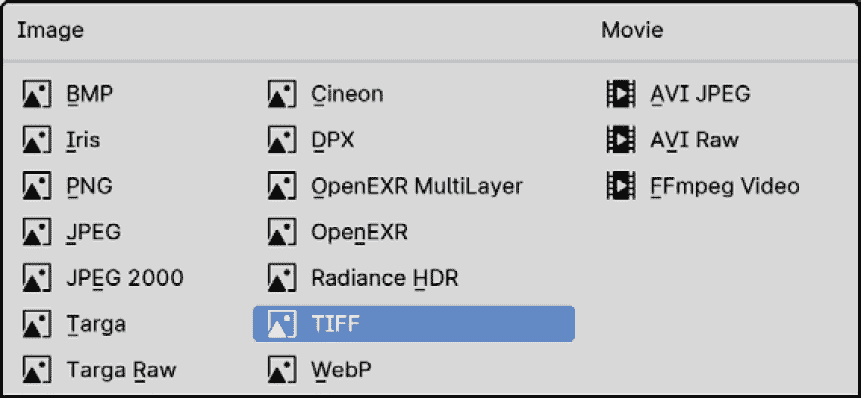

Figure 5.26: Output file formats

以下是支持的图像格式简介：

*   `PNG` (`.png`) 和 `TIFF` (`.tif`) 都是*无损*图像格式，意味着它们采用的压缩方法在不降低图像质量的情况下减小文件大小。这些格式在其他应用程序中得到良好支持。
*   `OpenEXR` (`.exr`) 是一种 `high dynamic range` (`HDR`)（高动态范围）格式，它为每个通道编码 32 位浮点值（而不是通常的 8 位或 16 位整数）。它是唯一能保留渲染图像中所有颜色数据的格式，包括大多数其他格式无法编码亮度的高光部分。`Multilayer EXR` 是一种 `.exr` 图像类型，可以编码多个图像层。`.exr` 文件非常适合高级合成流程，但对于本书来说有些大材小用。
*   `JPEG` (`.jpg`) 是一种有损图像格式，能以牺牲质量为代价将图像数据有效压缩到方便的小文件大小。`Quality`（质量）滑块决定了倾向于图像质量还是小文件大小的程度。`.jpg` 图像文件通常比 `.tif` 或 `.png` 小，但即使在 100% 质量下，也总会有一些数据丢失。
*   `JPEG 2000` (`.jp2`) 是作为 `JPEG` 的继任者开发的。它比 `.jpg`、`.tif` 和 `.png` 有许多优势，但在 Blender 中的读/写性能不尽如人意，其他应用程序采用它的速度也很慢。
*   `Radiance HDR` (`.hdr`) 是另一种 HDR 格式，但保真度低于 OpenEXR。它通常用作环境（天空）纹理的格式。
*   `BMP`、`Iris`、`Targa`、`Targa Raw`、`Cineon` 和 `DPX` 保留下来是为了与旧程序或专业流程兼容。用这些格式编码的图像文件相比上述其他格式没有显著优势，而且可能只是不必要地巨大。
*   `WebP`：这其实是个非常好的格式，但不知为何，如果你用它，大家都会讨厌你。

那么，我们应该用哪种格式？如果有一个适用于所有情况的确定答案，Blender 就不会提供这么多选择了。不过，就本书的目的而言，我推荐 TIFF，因为它像 PNG 一样是无损的，但在 Blender 中输出似乎快得多。


将 `File Format`（文件格式）更改为 `TIFF` 后，其余设置可保留默认值：

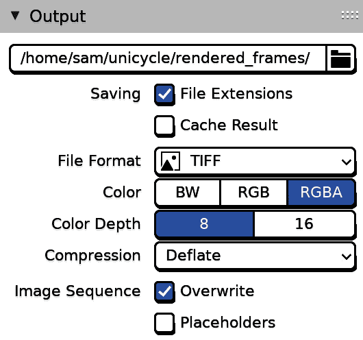

Figure 5.27：输出设置示例

**Tip**（提示）

禁用 `Overwrite`（覆盖）时，如果 `Output Path`（输出路径）中已存在该帧的文件，Blender 将跳过该帧的渲染。这对于恢复部分完成的渲染任务非常有用。

## 预渲染清单

3D 动画师常见的烦恼是渲染数小时后，才发现犯了个错，不得不重新渲染整个动画——这有点像烤蛋糕时少放了一种配料。这种情况迟早会发生在每个人身上，但为了尽可能避免，在渲染动画前我们应核实以下事项：

*   我们已在 3D 视口的相机视图中多次观看动画
*   至少有一帧，使用 `Render Image`（渲染图像）（`F12`）渲染时效果良好，且渲染时间不算太长
*   在 `Output Properties`（输出属性）中，`Format`（格式）正确，且 `Output Path`（输出路径）是我们能识别且稍后能找到的路径
*   `.blend` 文件已保存

如果以上全部属实，你就可以开始渲染动画了！

**Important note**（重要提示）

渲染就像把汽车油门踩到底，这是一个资源密集型过程，会将电脑硬件推向其性能极限。请确保电脑处于通风良好的凉爽环境中，以防过热。如果你在笔记本电脑上渲染，请保持连接电源。渲染消耗笔记本电池的速度简直无与伦比！

## 渲染动画

准备好了吗？按下 `Render Animation`（渲染动画）（`F12`）。

你现在正在渲染动画。如前所述，此过程需要一些时间。由于我们使用的是 `Eevee`，所以不会花费太久，但也不会瞬间完成。

**Tip**（提示）

渲染时 Blender 的界面不会“锁死”，因此你仍可点击其他窗口中的内容并检查设置。不过，在恢复正常工作前，请务必取消或完成渲染。

使用操作系统的文件浏览器，你可以导航到 `Output Path`（输出路径）设定的位置，看着它慢慢被图像文件填满：

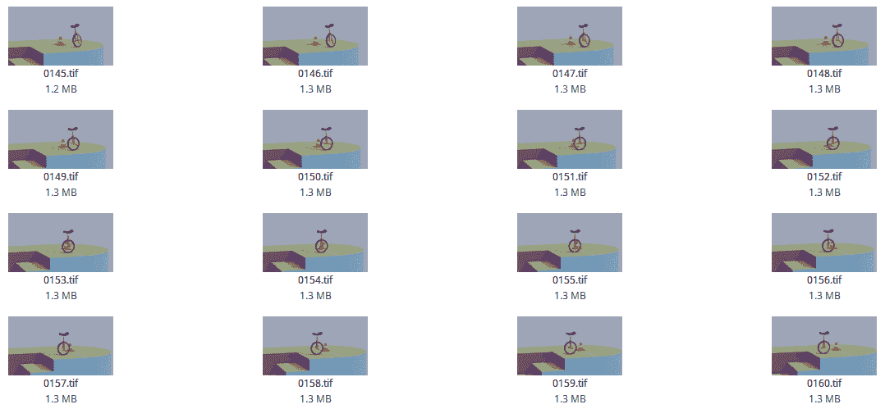

Figure 5.28：文件浏览器显示序列中每张图像的缩略图

请注意，每个图像文件的文件名中都带有帧号。稍后我们将图像作为单个序列导回 Blender 时，这将非常重要。

当动画的最后一帧被保存时，渲染即告完成。

## 查看渲染帧

Blender 自带内部媒体播放器，可播放刚渲染好的图像序列。我们可通过 `Render`（渲染）| `View Animation`（查看动画）（`Ctrl` + `F11`）调用它。调用时，此操作会在输出路径中搜索本应已渲染的内容。当然，这仅在你已渲染过内容时有效。如果找到目标内容，Blender 的内部媒体播放器将尝试播放最近输出的视频或图像序列。

以这种方式查看图像序列有助于我们快速预览渲染结果，以便在转换为视频文件前判断其是否合格。不过，如果生成的视频出现卡顿或抖动，请不要惊慌——Blender 这款可爱的小播放器并不总能以最佳性能播放所有内容。它甚至没有时间轴，但它已经尽力了！

**Tip**（提示）

预览最终成品后，通常会想做些修改并再次渲染动画。第二次渲染与第一次一样简单，但如果不想覆盖旧序列，请考虑设置新的输出路径。

现在我们已完成将场景渲染为图像序列的繁重工作，接下来可以将这些图像转换为单个视频。

## 将图像序列转换为视频

如果我们能用 `View Animation`（查看动画）（`Ctrl` + `F11`）播放图像序列，我们不就已经有视频了吗？嗯，是也不是——视频或许只是一系列图像，但单独的图像文件序列无法被大多数媒体播放器识别，且体积过大、难以处理，不便于上传网络或发送给他人。合规的视频文件将所有帧包含在单个文件中，并能应用空间和时间压缩方法，使视频文件大小远小于图像序列。

许多专业视频编辑/编码应用程序可将图像序列转换为视频文件。例如，我可以使用视频编码工具 `FFmpeg`，通过一条命令将我的 `.tif` 文件序列转换为 `.mp4` 文件：

```
ffmpeg -r 24 -i render/%04d.tif my_video.mp4
```

不过，你不必为了制作第一个视频而下载新程序或学习全新的命令行语法。这是一本 Blender 书，Blender 已内置了我们所需的一切！

## 视频序列编辑器

Blender 自带 `Video Sequencer`（视频序列编辑器），与专业视频编辑应用相比，它既强大又基础（能打开多层 EXR 序列，但不总能全速播放）。

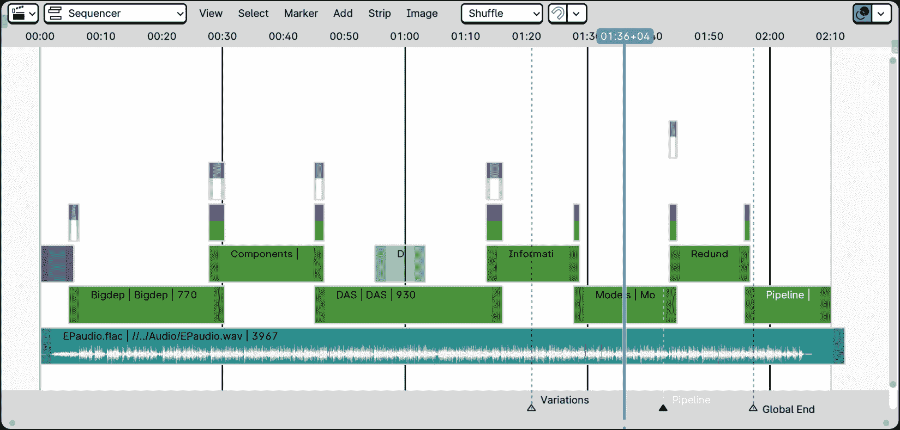

Figure 5.29：视频序列编辑器中的示例项目

你可以通过将屏幕某区域的 `Editor Type`（编辑器类型）切换为 `Video Sequencer`（视频序列编辑器）来访问它。如果你愿意，也可以点击屏幕顶部的 `+` 标签页，选择 `Add Workspace`（添加工作区）| `Video Editing`（视频编辑）| `Video Editing`（视频编辑）来添加一个 `Video Editing` 工作区。

我们将涉足此领域，以便导入刚渲染的图像序列。将图像序列作为条带导入视频序列编辑器后，我们便可渲染为视频文件，这将是我们的最终成品。

### 创建用于视频编辑的场景

为避免图像序列与生成它的 3D 场景混淆，我们应在 `.blend` 文件中使用单独的场景进行视频编辑。为简化操作，我们可以添加一个新场景，其初始设置与现有场景相同：

1.  找到屏幕右上角附近的 `Scene`（场景）选择器。
2.  点击 `New Scene`（新建场景）按钮并选择 `Copy Settings`（复制设置）。
3.  将新场景重命名为有意义的名称（如 `Sequence`），而非 `Scene.001`。
4.  如果尚未打开，在 UI 中调出视频序列编辑器。

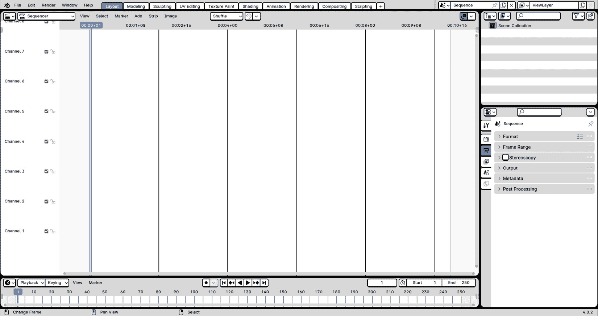

Figure 5.30：带有空白视频序列编辑器的新场景

使用 `Copy Settings`（复制设置）会使新场景拥有与前一个场景相同的 `Output Properties`（输出属性）——这是确保两个场景具有相同帧范围和分辨率的快捷方式。`Render Properties`（渲染属性）也将相同，但正如我们即将看到的，那些属性不再与我们相关。

### 导入图像序列

虽然我们通常将 Blender 中的场景视为包含 3D 物体、可在 3D 视口查看的 3D 空间，但它也可以仅作为视频序列编辑器中序列的容器。

Blender 视频序列编辑器中的元素称为条带。现在让我们添加图像序列 `strip`（条带）：

1.  转到 `Start Frame`（起始帧）（应为帧 `1`）。这样可确保添加条带时从帧 `1` 开始，就像原始场景中的动画一样。
2.  在视频序列编辑器中，使用 `Add`（添加）（`Shift` + `A`）| `Image Sequence`（图像序列）。
3.  在调出的文件浏览器中，导航到包含图像序列的目录。
4.  选中序列中的所有图像，点击 `Add Image Strip`（添加图像条带）。

**Tip**（提示）

视频序列编辑器中导航和移动条带的控制方式，与 `Timeline`（时间轴）的控制方式基本相同。


## 从视频序列器渲染一帧

您的视频序列器现在应该有一个图像序列条带，其时长覆盖场景的帧范围：

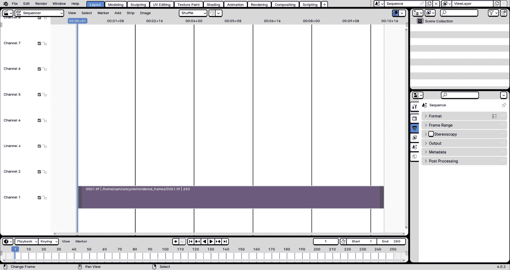

**图 5.31：** 视频序列器中的图像序列条带

本章所需的排序工作就这些！

那么，我们如何设置 Blender 使用视频序列器中的图像序列呢？这是个陷阱问题——我们不需要做任何额外的事情！在场景的 `Output Properties`（输出属性）中的 `Post Processing`（后期处理）下，视频序列器的使用默认已启用：

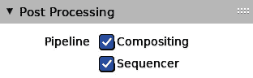

**图 5.32：** 后期处理设置

`Sequencer`（序列器）在视频序列器为空时没有任何效果，但一旦我们添加图像或视频条带，Blender 就会绕过活动场景的 3D 部分，转而渲染视频序列器中的内容。

您现在可以尝试用 `Render Image`（`F12`）自己试试。这些帧的渲染速度似乎比上一个场景快得多，不是吗？那是因为我们并不是以我们理解的方式在“渲染”。虽然我们技术上使用的是相同的 `Render Image`（`F12`）命令，但这次没有评估任何 3D 数据。因为我们当前的序列只是一个没有特效的图像序列条带，Blender 实际上只是向我们显示已经渲染好的图像。

> **重要提示**
>
> 请注意您所在的场景，因为很容易将初始场景中的渲染帧与序列场景中的“渲染”帧混淆。

暂时不要使用 `Render Animation`（`Ctrl` + `F12`）！因为我们的序列场景仍然与初始场景具有相同的 `Output Path`（输出路径）和 `Format`（格式），这样做会用图像覆盖图像本身。完全没用！我们需要设置一个新的 `Output Path` 并选择合适的视频格式。

## 视频导出的输出设置

现在我们的视频序列器已准备好输出所需的帧，让我们再次回到属性编辑器中 `Output Properties`（输出属性）选项卡的 `Output`（输出）面板。这一次，我们将调整设置以输出视频文件。

### 设置输出路径（再次）

1. 再次点击 `Output Path`（输出路径）旁边的文件夹图标以调出文件浏览器。
2. 在文件系统中为即将创建的视频文件选择一个方便的位置。
3. 为视频选择一个文件名（随意）并点击 `Accept`（接受）。

我建议使用父目录（包含图像序列文件夹的文件夹）。这样，视频文件就可以与帮助创建它的序列文件夹放在一起。

现在 `Output Path` 已设置好，我们的最后任务是选择合适的视频格式。

### 使用内置 FFmpeg

乍一看，`File Format`（文件格式）菜单似乎提供的视频格式选项很少，但当我们选择 `FFmpeg Video` 时，可用设置会展开。

将 FFmpeg 称为一种格式有点名不副实。FFmpeg 实际上是一个流行的命令行实用程序，用于读写广泛的视频格式。别担心——您不需要自己学习任何命令；Blender 内置的 FFmpeg 实现会为我们处理这些。

FFmpeg 的参数在 `Encoding`（编码）子面板中：

1. 在 `Output Properties`（输出属性）中，选择 `FFmpeg Video` 作为 `File Format`（文件格式）。
2. 打开 `Encoding`（编码）子面板，将 `Container`（容器）设置为 `MPEG-4`。

所有其他属性的默认值可以保持不变。这些设置将创建一个 `.mp4` 视频，它很可能可以在大多数网站和媒体播放器上播放：

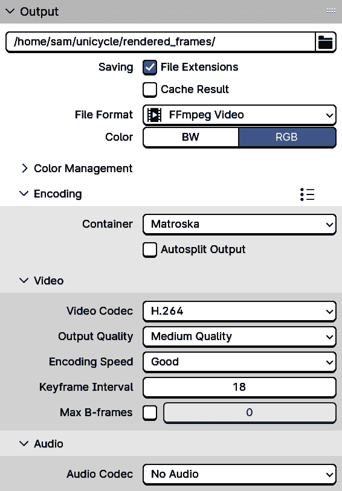

**图 5.33：** 视频输出设置

## 输出视频

按 `Render`（渲染）| `Render Animation`（渲染动画）（`Ctrl` + `F12`）。

就这么简单！因为这次我们是在“渲染”一个预渲染的图像序列，这项工作应该不超过一两分钟。

> **提示**
>
> 您可以尝试不同的容器、编解码器和质量设置，以找到适合您需求的质量、文件大小以及跨平台和设备支持的最佳组合。

您完成了！您如何处理最终的视频文件由您决定，但我建议让其他人观看。这通常是欣赏动画最令人满足的方式。否则，我们根本不会费心渲染任何东西！

## 总结

如果您以前在 Blender 中渲染过静态图像，本章涵盖的大部分内容可能看起来多余。事实证明，如果您知道如何在 Blender 中渲染一帧并将其保存为图像，那么再渲染几百帧并将它们转换为视频并不难。视频实际上就是——一堆快速连续显示的帧，创造出运动的外观。仔细想想，动画也是如此。

在结束本书第一部分时，您已完成在 Blender 中制作动画和渲染最终产品的技术要点。通过领会动画的核心概念——仅仅是逐帧变化的数字和图像，您理论上可以为任何东西制作动画……理论上。实际上，您可能想继续阅读下一章，那里介绍的主题非常庞大，填满了整个第二部分！

## 问题

1. 是什么让相机对渲染至关重要？
2. 为什么渲染引擎有名字？它们有什么特别之处？
3. 有哪些减少渲染时间的方法？
4. `Render Image`（`F12`）产生的图像与 `Render Animation`（`Ctrl` + `F12`）产生的图像看起来不同吗？
5. 有损图像格式丢失了什么？我们能恢复吗？
6. 图像和图像文件有什么区别？在 Blender 的哪些地方可能会遇到图像但不是图像文件？
7. 为什么我们要在转换为视频之前额外输出图像序列这一步？
8. 之前我们将“渲染”定义为从 3D 数据生成 2D 图像。在 Blender 中，什么情况下它意味着其他含义？
9. 在本章中，我们渲染的是动画、场景、帧、图像还是图像序列？
