## 链接与摆姿势角色

本书之前的所有练习都在为这一刻铺垫。你现在已准备好学习如何为角色制作动画！

什么是角色？在文学中，它是文本中表达出行为、思想或言语的任何人物或生物。在电影制作中，角色是由演职人员饰演的任何人。在现实生活中，可能是你的叔叔。他真是个人物！

在 3D 动画中，**角色** 有着更具体的定义：由 **骨架** 控制的 3D 模型。骨架与真实骨骼有许多相似之处，是一种特殊对象，由多根 **骨骼** 组成；移动这些骨骼会变换或变形关联的模型。骨架及其控制的所有对象共同位于一个 **集合** 中，构成了角色或 **角色绑定**。角色动画的工作在于让角色骨架中的骨骼协同运动，使角色行走、跳跃、跳舞，或做任何我们想让他们做的事。

为 3D 动画创建角色是一个独立于制作动画的项目，且难度不亚于动画制作本身！角色建模是一个足以单独成书的高级主题，搭建骨架又能写成另一本书，而将模型绑定到骨架上甚至可能值得再写第三本书。

幸运的是，我们已经有了一个现成的角色。准备好跟 Rain 打招呼吧……

在本章中，你将学习如何执行以下操作：

*   将角色链接到场景中
*   使用角色绑定的脚本化界面
*   为角色摆姿势
*   复制和保存角色姿势

## 技术要求

无需从零开始制作角色 —— Blender Studio 已提供一个专业制作的角色供任何人下载使用。

该角色名为 **Rain**：

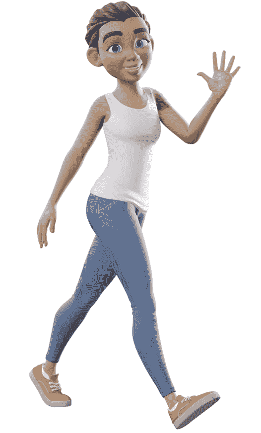

图 6.1：Rain

Rain 即拿即用，拥有专业动画师对人类角色绑定所期待的所有功能，同时设计得也适合新手动画师使用。Rain 采用 *Creative Commons CC-BY* 许可证，这意味着我们可以在作品中将其用于任何目的，只需署名 Blender 基金会，如下所示：

*Rain Rig © Blender Foundation* | [`studio.blender.org/welcome/`](https://studio.blender.org/welcome/)

可在此免费下载：[`github.com/PacktPublishing/Realizing-3D-Animation-in-Blender`](https://github.com/PacktPublishing/Realizing-3D-Animation-in-Blender)。

开始前，请使用上述 URL 下载 Rain 的 `.zip` 文件，并将内容解压到文件系统中方便的位置。

> **重要提示**
>
> 解压 `.zip` 文件时，请确保将 `maps` 文件夹和 `rain_v2_6_packt.blend` 一起解压到同一位置。你可以打开 `rain_v2_6_packt.blend` 查看，但请勿保存对它的任何更改，因为这些更改将来可能会影响其他文件！

## 在新场景中链接角色

在深入交互 Rain 的骨架并让她摆出各种姿势之前，我们必须先探索一些更令人兴奋的主题：**链接库** 和 **文件依赖关系**。多有趣啊！

与之前章节直接打开下载的 `.blend` 文件并在其中工作不同，我们不会直接在 Rain 的 `.blend` 文件上工作。如果那样做，每次在动画中使用 Rain 都必须制作一份完整的副本 —— 无论是 Rain 本人还是她的 `.blend` 文件。正如我们将了解到的，对于像 Rain 这样复杂且宝贵的资产，这是不良做法。

相反，我们将创建一个新文件来引用包含 Rain 的文件。这将使 `rain_v2_6_packt.blend` 成为一个链接库。

### 链接库

在 Blender 中，**链接库** 指包含被另一个 `.blend` 文件引用数据的 `.blend` 文件，通过 `File`（文件）| `Link`（链接）实现。专业工作室（包括 Blender Institute）在制作中使用像角色这样的大型或重要资产时，都会应用链接库这一技术流程。

每个 `.blend` 文件都包含可被链接或追加的数据，即 **数据块**。这些数据块按类型组织成不同类别：

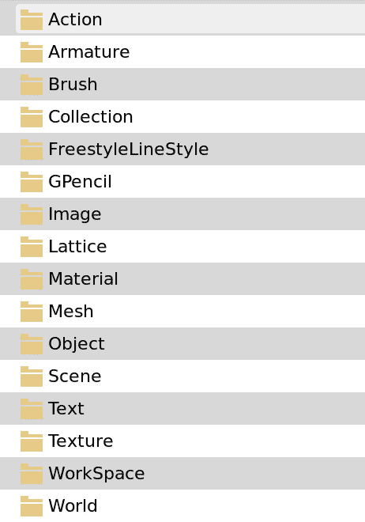

图 6.2：链接时出现的部分数据块类型

角色由多个对象组成 —— 如果角色创建者做得够细致，这些对象会为方便链接而存在于单个 **集合** 中。对于 Rain，该集合名为 `CH-rain`。

现在让我们链接该集合：

1.  在 Blender 中通过 `File`（文件）| `New`（新建）(`Ctrl` + `N`) | `General`（通用）创建新文件。
2.  删除对象 `Cube`（立方体）。
3.  转到 `File`（文件）| `Link`（链接）。
4.  在调出的文件浏览器中，找到并选择 Rain 的文件 `rain_v2_6_packt.blend`。
5.  进入标记为 `Collection`（集合）的文件夹。
6.  选择并 `Link`（链接）集合 `CH-rain`。

在默认设置下，这会将对象集合 `CH-rain` 链接到当前文件，并自动插入一个 **集合实例**。现在 Rain 就在我们的场景中了！

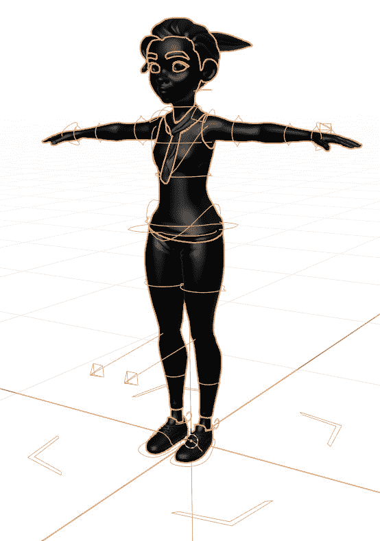

图 6.3：3D 视口中 Rain 的链接集合实例

如果她乍看有点怪别担心 —— 稍后我们会修正。

> **重要提示**
>
> 集合实例像大多数新对象一样添加在 3D 游标处。如果链接 Rain 时 3D 游标不在中心，她也不会居中。使用 `Object`（对象）| `Clear`（清除）| `Location`（位置）(`Alt` + `G`) 使其居中。

我们的当前文件现在正使用 `rain_v2_6_packt.blend` 作为链接库。注意这不会直接影响文件 `rain_v2_6_packt.blend`；只是意味着我们必须比追加集合时更小心地对待它。

### 链接与追加

如果你用过 `File`（文件）| `Append`（追加），就知道另一种将内容从一个 `.blend` 文件带入另一个的方法。乍看之下，`Link` 和 `Append` 功能似乎相同，实则不然。两者有本质区别，可能让粗心用户措手不及：**链接** 创建依赖关系，而 **追加** 创建冗余副本。

追加类似于复制。若我们追加 Rain 到新场景而非链接，`rain_v2_6_packt.blend` 的所有数据都会被复制到新文件。这意味着复制每一个数据块，连 Rain 鞋带的材质也不例外！

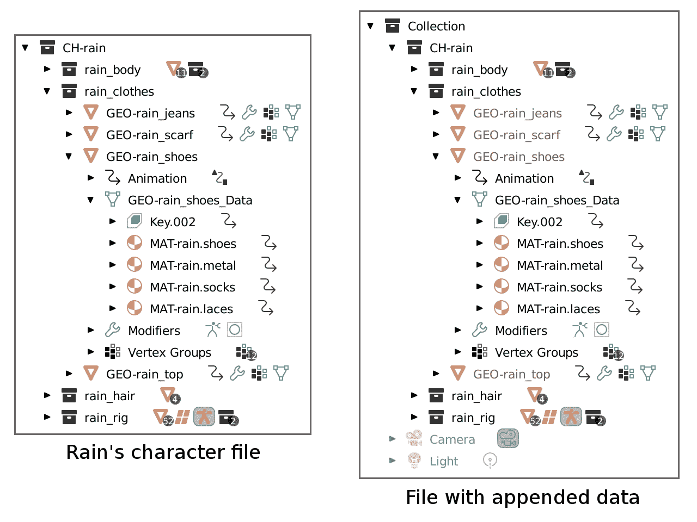

图 6.4：两个 .blend 文件中的数据可视化

在新文件中，我们可随意修改 Rain 的任何部分（包括鞋带），并忘掉她的来源文件。我们实际上拥有了两个 Rain 而不是一个。

另一方面，通过链接 Rain，新文件依赖于旧文件。它必须始终引用 `rain_v2_6_packt.blend` 中 Rain 的数据：

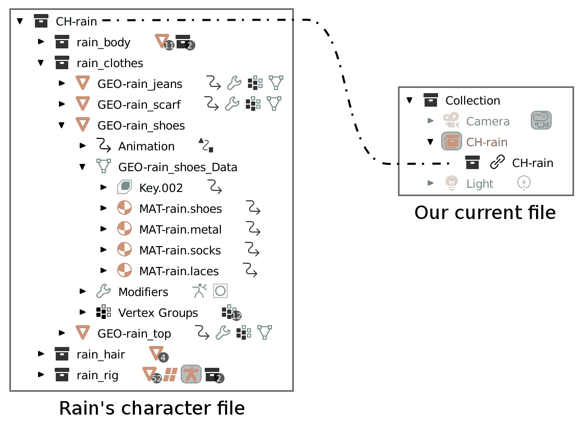

图 6.5：显示文件间依赖关系的可视化

除非编辑原始文件，否则无法对 Rain 做永久更改。若原始文件丢失，Rain 也会从当前场景中消失。

## 链接与追加

`Append`（追加）看起来似乎比 `Link`（链接）更方便，但追加通常更适合从其他项目中复用次要资产，例如材质或简单模型。对于像 Rain 这样复杂的作品，追加是一种杂乱的工作方式。我们将在*第 2 部分*中创建的场景，只需存储我们在姿势和关键帧方面所做的工作；我们不需要在每个场景中都拥有 Rain 鞋带材质的唯一版本。充其量，这只会让我们的文件变得不必要地庞大；最坏的情况是，它会暴露 Rain 的所有数据，使她容易受到难以修复的错误影响。在我们的角色动画章节中，我们将坚持链接 Rain，而不是追加她。

尽管链接库通常是最优雅的解决方案，但使用链接库确实伴随着一项重要责任：为了避免破坏我们新文件的链接库，我们需要确保一个文件始终能使用它记忆中的 `file path`（文件路径）找到另一个文件。

> **重要提示**
>
> 文件路径很像网址，如果你随意移动或删除文件，它们也会同样轻易地失效。无论是图像、声音还是链接库，如果文件路径指向一个不存在的文件，其数据将从依赖它的 `.blend` 文件中丢失。

### 文件路径——绝对路径与相对路径

如果 `rain_v2_6_packt.blend` 中的数据在我们的当前文件中被链接，但未存储在其中，Blender 将如何从我们的当前文件中去查找必要的数据？

答案可以通过前往 `Outliner`（大纲视图）中的 `Blender File`（Blender 文件）来查看：

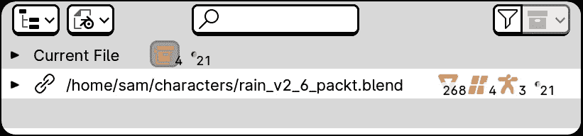

图 6.6：大纲视图显示指向 Rain 的 .blend 文件的绝对路径

在表示链接库的链条图标旁边，你会看到你电脑文件系统中 `rain_v2_6_packt.blend` 的文件路径。如果你还没有保存当前文件，这将是一个**绝对文件路径**——一个从你电脑文件系统根目录开始的完整地址。

> **技巧**
>
> 在 Mac 和 Linux 中，根目录由文件路径开头的 `/` 表示。在 Windows 中，它将是一个盘符，例如 `C:` 或 `D:`。

绝对文件路径可能相当长，且包含文件夹名称，这些名称在每个用户之间可能不同。另一方面，相对文件路径从引用它的文件的位置开始。例如，为了加载她的图像纹理，Rain 使用相对文件路径指向 `maps` 文件夹中的图像文件。

> **技巧**
>
> Blender 中的相对文件路径以 `//` 开头，也可能包含一个或两个 `../`。`../` 使地址“向外”进入父文件夹一级。如果你在文件路径中看到太多 `../`，可能表明组织结构不佳。

Blender 默认倾向于使用相对文件路径，但它们只有在当前文件已保存时才有效。让我们保存当前文件以查看其带来的差异：

1.  点击 `File` | `Save As`（`Shift` + `Ctrl` + `S`）。
2.  将当前文件保存在与 `rain_v2_6_packt.blend` 相同的目录中。

现在我们使用一个短得多的**相对文件路径**：

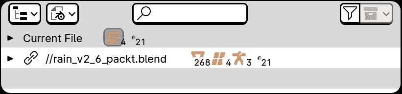

图 6.7：相同的链接但使用相对路径

因为我们将当前文件保存到了与库文件相同的目录，相对路径只需包含文件名——即 `rain_v2_6_packt.blend`。只要我们将这些文件保存在同一个文件夹中，就不必担心破坏这样一个简单的路径。

> **技巧**
>
> 你可以通过在 Blender 的 `File Browser`（文件浏览器）侧边栏（`N`）中启用或禁用 `Relative Path`（相对路径）来选择使用哪种类型的文件路径。

现在我们已经了解了当前文件与其依赖文件之间的显式关系，我们可以将注意力完全集中在当前文件上。

## 创建库覆盖

目前，Rain 是一个“黑盒”。她的链接数据无法被修改，她的肢体也无法被移动。这是链接对象集合实例的默认状态，这些实例本质上只是设置为实例化集合的 Empty 类型对象。我们可以像移动棋子一样移动她，但如果我们想按预期对 Rain 进行姿势摆设和动画制作，我们需要访问她的骨架对象 `RIG-rain`。

要从集合实例内部访问此对象，我们必须创建一个所谓的**库覆盖**：

1.  选择对象 `CH-rain`。
2.  前往 `Object` | `Library Override` | `Make`。

注意覆盖库的数据块旁边出现的独特图标：

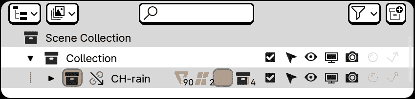

图 6.8：库覆盖

**库覆盖**允许我们选择链接集合中的特定对象并操纵其属性。我们现在能够选择 Rain 的骨架对象 `RIG-rain`。Rain 的设计初衷是仅使用 `RIG-rain` 进行控制，因此我们不需要选择她集合中的任何其他对象。

我们几乎准备好开始为 Rain 摆姿势了，但她看起来还有点怪。像许多功能齐全的角色绑定一样，Rain 有一些小怪癖，需要再走几步来修复。

### 重启 Rain

因为我们刚刚链接了 Rain，她看起来不如在她的原始文件中那样好。取决于你的 3D 视口设置，她的材质可能全黑，或者她的眼睛可能看起来全是高光。虽然她的 Python 脚本随她一起被自动链接了，但它们并未自动执行，所以我们在她的骨架中还看不到有用的 `CloudRig` 界面。

在创建 Rain 集合的库覆盖后，请按照以下步骤访问 Rain 的 Python 脚本界面并改善她在 3D 视口中的外观：

1.  **保存**（`Ctrl` + `S`）你的 `.blend` 文件。
2.  关闭并重新打开你的文件，或使用 `File` | `Revert`（还原）。

> **重要提示**
>
> 当你重新加载文件时，Python 脚本可能会被 Blender 阻止，这将导致 Rain 失去功能。为了保持它们运行，如果 Blender 提示，请点击 `Allow Execution`（允许执行）。更好的做法是，前往 `User Preferences`（用户偏好设置）并启用 `Save & Load` | `Auto Run` `Python Scripts`（自动运行 Python 脚本）。

这应该是你唯一需要重启文件的时候。现在 Rain 看起来好多了：

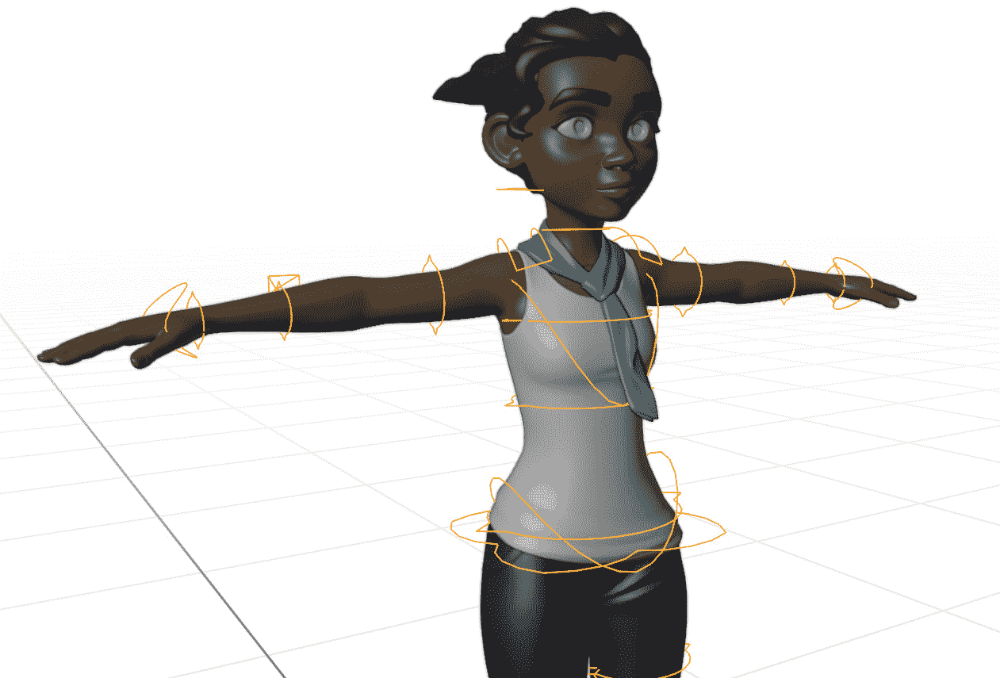

图 6.9：3D 视口中的 Rain

> **技巧**
>
> Rain 的眼睛有一层高光几何体，这使得在某些 `Viewport Shading`（视口着色）设置下它们看起来很奇怪。暂时切换到 `Material Preview`（材质预览）视口着色模式，或继续阅读以在 Rain 的 `Outfits`（服装）面板中找到 `Dummy Eyes`（虚拟眼睛）属性。

我们完成了链接 Rain 的所有繁琐工作；现在她已完全准备好作为角色在我们的场景中使用！

## 理解 Rain 的骨架

完成将 Rain 链接到场景的所有步骤后，我们现在可以访问她的骨架，用它来弯曲她的肢体、为她的脸部应用表情，并以其他方式移动她。骨架是一个复杂的对象——可能是动画师必须处理的最复杂的东西。在我们开始直接使用她的骨架之前，我们需要了解骨架到底是什么，以及在哪里能找到能帮助我们简化 Rain 的 Python 脚本界面。

## Rain 绑定的艺术

骨架也可以被称为**绑定**。为角色模型创建绑定的工作被称为**绑定**，由**绑定师**完成。一个好的绑定师是动画师最好的朋友，因为一个好的绑定不仅仅是一个变形模型的骨架——它是动画师的完整界面。

每个角色绑定都不同。绑定的设计和复杂度因角色风格、生物类型、绑定师的个人选择以及将为其制作动画的动画师的需求而异：

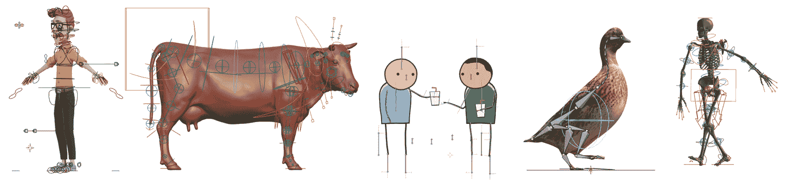

图 6.10：Blender 中的一些不同角色绑定

尽管如此，绑定还是有一些通用约定。之所以选择 Rain 作为本书的角色，不仅因为她能让你轻松上手角色动画，还因为她的绑定是你可能遇到的其他双足角色绑定的一个相当典型的例子。

**提示**

全球 Blender 社区中有大量由个人创建并发布在各个网站上的其他角色绑定可供使用。其中许多像 Rain 一样，可以免费下载和使用。不过要当心——业余爱好者绑定的角色在制作动画时可能会让人欲哭无泪。

## 一切皆骨骼

在 Blender 中，骨架中的元素都被称为 `bones`，即使它们看起来不像骨头。Rain 的骨架拥有 2000 多根骨骼；所有骨骼都组织在一个复杂的父子关系、约束和驱动系统中：

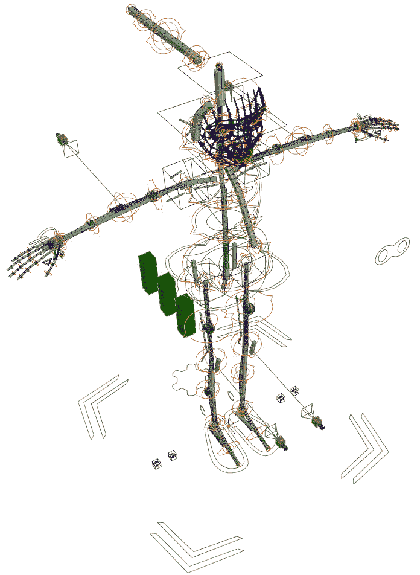

图 6.11：Rain 的所有骨骼

这比真人骨骼的数量多了 10 倍！谢天谢地，其中大部分被绑定师隐藏了；我们不需要用到所有骨骼。

供动画师使用的骨骼已经过建模、着色，并被分类整理以方便使用。这些本质上是控制骨骼，它们间接移动 Rain，就像木偶线末端的控制杆。

那么，这些控制骨骼有多少呢？答案是略少于 400 根：

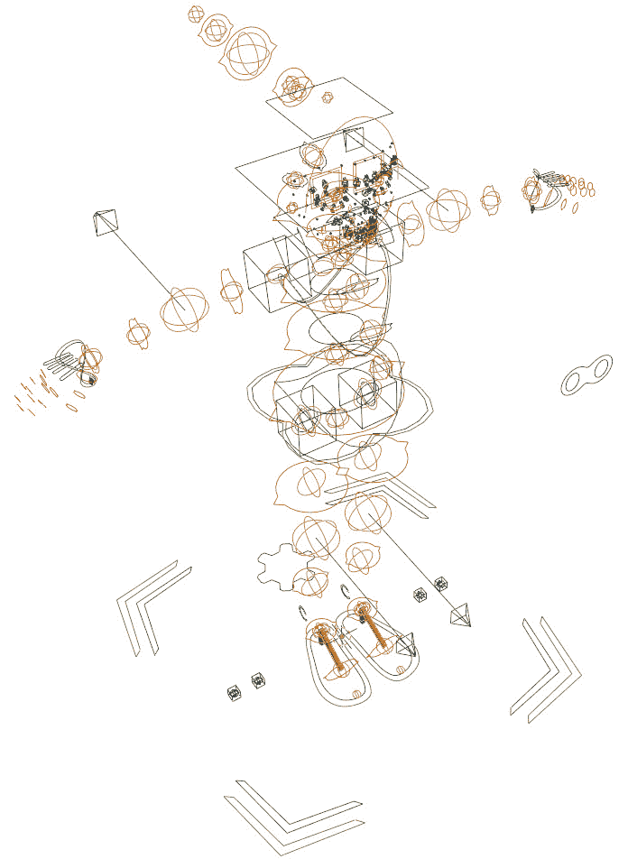

图 6.12：Rain 的所有控制骨骼

这仍然是很多骨骼！即使当前可见的那些少量骨骼也可能让人感到不知所措。我们应该稍微简化一下。继续阅读以了解如何显示 Rain 的所有控制骨骼，再往后读一点会了解如何再次隐藏它们。

## CloudRig 界面

Rain 自带一个名为 `CloudRig` 的脚本，它在 3D 视口的侧边栏 (`N`) 中提供了一个实用的控制面板：

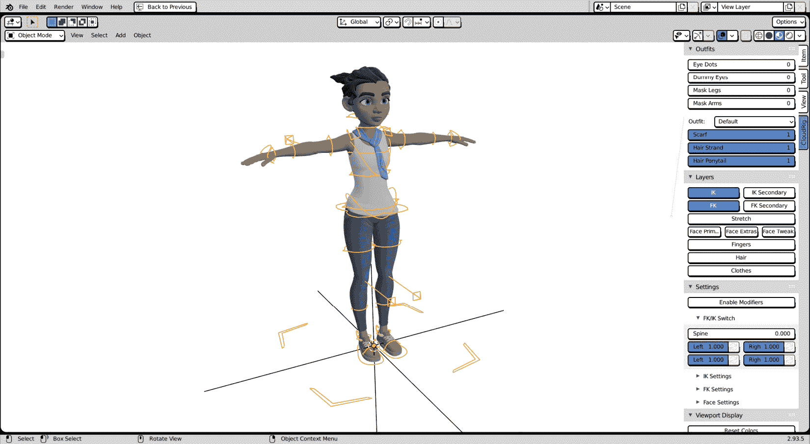

图 6.13：右侧带有 CloudRig 界面的 Rain

只要 Rain 的骨架是活动对象，就可以访问 `CloudRig` 选项卡。无论选中哪根骨骼，其所有可用的按钮、功能和属性都可见。

此类脚本控制面板通常随高级角色绑定提供，其布局和功能因绑定而异。虽然 Rain 工作不需要 `CloudRig`，但它方便地组织了 Rain 的功能和属性，否则这些功能和属性会分散在各个骨骼和界面区域中。

**重要提示**

`CloudRig` 不是插件，也不连接任何“云”。它是从一个文本数据块执行的，该数据块随 Rain 的集合其余部分一起链接。

使用此面板中的功能，你可以执行以下操作：

*   切换 Rain 模型各部分的可见性
*   切换不同骨骼组的可见性
*   更改某些骨骼的行为、它们的关系以及它们对 Rain 模型的影响

现在，关于那些骨骼——我们想隐藏 Rain 的大部分骨骼，直到我们准备好为它们摆姿势，所以我们将从隐藏它们开始。

### 骨架层

值得再次强调的是，Rain 的骨架有大量骨骼。为了动画师的理智着想，Rain 的骨骼已按类别组织到不同的 `armature layers`（骨架层）中。在工作时，你需要根据想专注于 Rain 的哪个部分来切换这些不同图层的可见性。

通常，为此我们必须前往 `Properties Editor`（属性编辑器）中骨架的 `Object Data Properties`（对象数据属性），然后点击此处的图层列表：

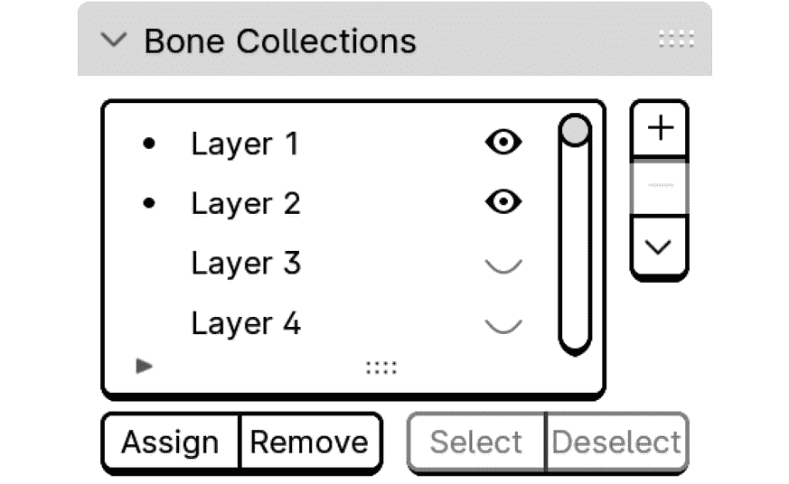

图 6.14：Rain 的“骨骼集合”

**重要提示**

从 Blender 4.0 开始，骨架层现在称为 `Bone Collections`（骨骼集合），但本书其余部分仍将其称为层。

`CloudRig` 在 `Layers`（图层）面板中为我们提供了对其中最重要图层的更便捷访问：

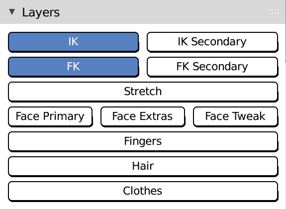

图 6.15：Rain 的骨架层（已标注）

当然，这并非所有的骨架层——只是供动画师使用的那些。你为 Rain 摆姿势所需的每一根骨骼（还有一大堆你可能永远不需要碰的骨骼）都在其中某一层中。如果你在找的骨骼不在这里，要么是绑定师失职，要么就是你陷得太深了！

如果你对这些层中的所有骨骼长什么样感到好奇，如*图 6.12*所示，你不妨继续点击此面板中的所有图层。你会很快明白为什么隐藏骨架层如此有帮助。骨骼*非常多*。随着进程推进，我们会讲解它们的功能和行为。在此之前，让我们暂时隐藏除 `IK`（`Inverse Kinetics`，反向动力学的缩写）层之外的所有图层：

1.  在侧边栏 (`N`) 的 `CloudRig` 选项卡中找到 `Layers` 面板。
2.  禁用除 `IK` 之外的所有骨架层。

当我们开始为 Rain 摆姿势时，这应该会让事情在最初变得更容易一些。

**重要提示**

隐藏/显示骨架层纯粹是为了我们工作时的方便。无论骨骼是否隐藏，它们都会继续影响模型，但只要它们可见，我们就可能意外选中它们并潜在地移动错误的东西。

为了让事情更简单，我们将使用 Rain 的另一个功能来隐藏她的一些几何体。

### 准备 Rain 在 3D 视口中的外观

看看 `CloudRig` 中的第一个面板 `Outfits`（服装）：

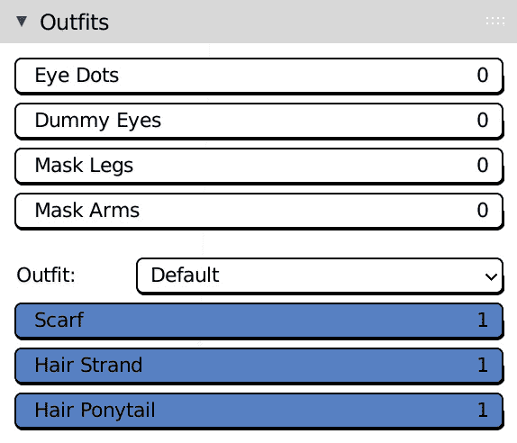

图 6.16：Outfits 面板

这个面板听起来比实际好玩；Rain 目前除了穿在身上的那套之外没有其他服装。尽管如此，我们确实有一些有用的设置，用于确定 Rain 不同部分的可见性。

在某些情况下，隐藏 Rain 的这些部分可以让我们更容易地为她摆姿势和制作动画。例如，Rain 的头发和围巾是她模型中可摆姿势的部分，很像她的手臂和腿，但既然衣服和头发除了挂在那儿没什么动静，我们通常最后才为它们摆姿势和制作动画。在那之前，它们是视觉干扰。

**重要提示**

`Outfits` 中的属性，虽然看起来像是用*整数*表示的，但本质上是*布尔值*。把它们当作复选框；`1` 表示启用，`0` 表示禁用。

现在让我们隐藏一些东西：

1.  找到 `CloudRig` | `Outfits` 面板。
2.  禁用 `Scarf`（围巾）、`Hair Strand`（发丝）和 `Hair Ponytail`（马尾辫）。

    Rain 的新短发和没有围巾意味着在我们对她的姿势进行初步工作时，需要担心的松散部分更少了：

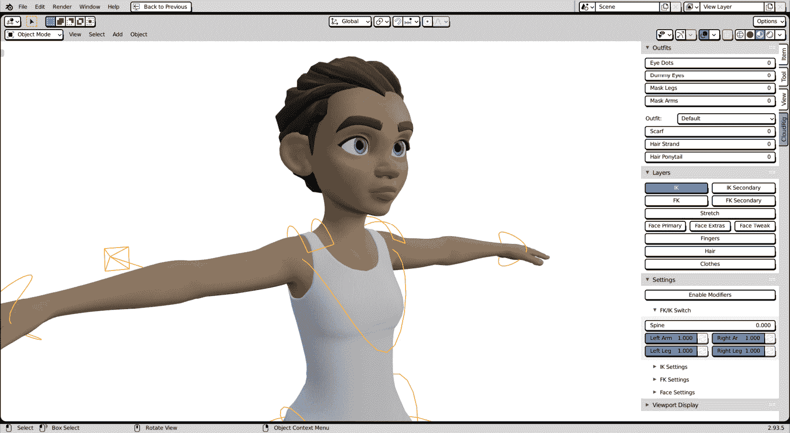

图 6.17：头发变少且无围巾的 Rain

1.  我们可以通过启用 `Mask Arms`（遮罩手臂）进一步简化。

现在我们*真正*简化了 Rain 的模型：

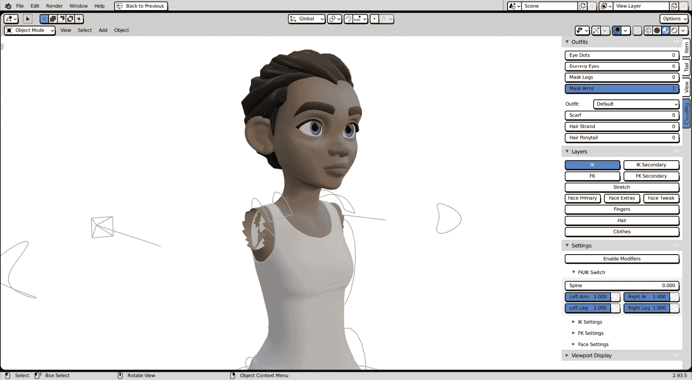

图 6.18：它们没了！

隐藏手臂和/或腿的能力似乎是一个奇怪的功能，但你会惊讶于在准备好为它们摆姿势之前隐藏这些部分有多么有用。

**提示**

考虑也启用 `Dummy Eyes`（虚拟眼睛）。这些“假”眼睛在渲染时不如 Rain 的“真”眼睛好看，但它们确实让我们在使用 `Solid`（实体）视口着色方法处理她的面部表情时，更容易看到她的视线方向。

我们已按需简化了 Rain。至于 `CloudRig` 界面的其余部分，当我们让 Rain 摆出第一个姿势时，学习那些功能会更容易！

## 为骨架摆姿势

正如我们在前几章中制作动画的物体一样，骨架中的所有骨骼都具有位置、旋转和缩放属性。直接变换一个或多个骨骼被称为**姿态设定**，这是角色动画的第一步。在某一时间点，骨架中骨骼的给定位置组合在一起，被称为一个**姿态**。在后续章节为 Rain 制作动画时，我们会让她摆出一个姿态，为刚设定姿态的那些骨骼的属性插入关键帧，然后在另一帧进入下一个姿态，为那些骨骼的属性插入关键帧，以此类推。

这就是角色动画。它与物体动画并没有太大区别！只不过这次我们的物体是骨骼，数量有成百上千个，而且它们连接成一个复杂的系统，乍看之下可能不太直观。简单，对吧？也许并不。在为 Rain 制作动画之前，我们最好花一两节的时间专门学习如何为她设定姿态。

我们的第一个练习将让 Rain 从 *T* 姿态过渡到一个闲置的、自然的站立姿势：

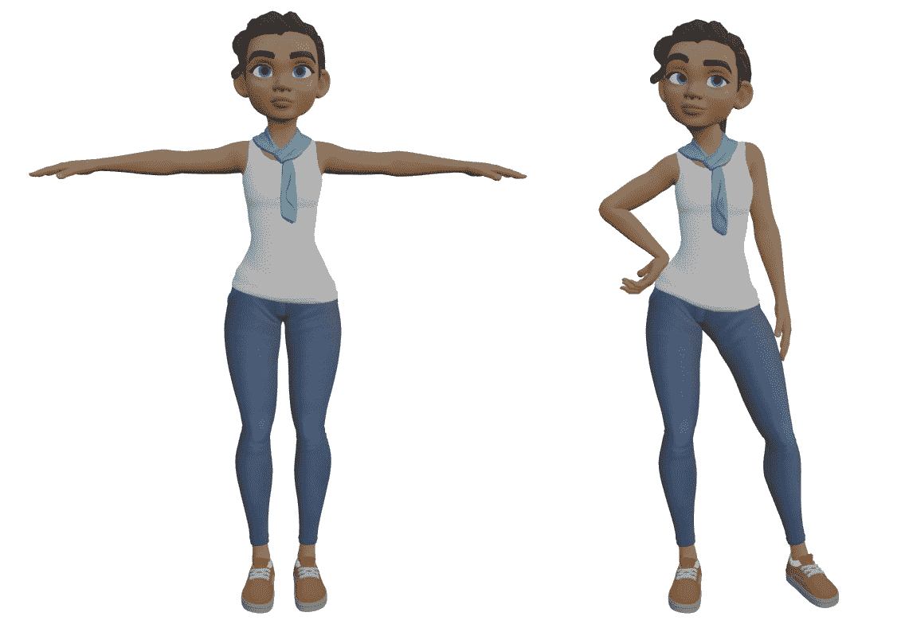

Figure 6.19: 静止“T 姿态”到闲置站立姿态

如果想让它看起来自然，即使是简单的站立姿态也需要操纵大量骨骼。

## 姿态模式

要开始为 Rain 设定姿态，请选择她的骨架，并在 3D 视口中进入 `Pose Mode`（`Ctrl` + `Tab`）：

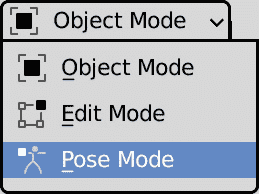

Figure 6.20: 交互模式菜单中的姿态模式

在 `Pose Mode` 中，骨骼的选择和变换方式与 `Object Mode` 中的普通物体非常相似，使用相同的标准控制进行 `Move`（`G`）、`Rotate`（`R`）和 `Scale`（`S`）操作。

在 `Pose Mode` 中为骨架设定姿态，在技术上不同于绑定师所做的在 `Edit Mode` 中编辑骨架。我们无法编辑链接骨架物体中的骨骼，在制作动画时也不应该需要这样做。

**重要提示**

在 `Pose Mode` 下，你无法添加或选择其他物体；必须返回 `Object Mode` 才能进行这些操作。

由于 Rain 的控制骨骼具有复杂的关系，且不会直接变形其网格，因此变换某个特定骨骼的结果并不总是可预测的。虽然某个骨骼的形状及其在 Rain 身体上的位置能提供关于该骨骼功能的线索，但了解骨骼功能的唯一可靠方法是移动它并观察会发生什么。

**提示**

不要害怕移动某个骨骼来查看其功能。你随时可以 `Undo`（`Ctrl` + `Z`），或在确认变换前使用右键或 `Esc` 取消变换。此外，在下一节中，我将向你展示如何重置在 `Pose Mode` 下对骨骼所做的任何更改。

### 设定躯干和臀部的姿态

我们从哪根骨骼开始？在最初为角色设定姿态时，通常最好从控制躯干整体位置的骨骼开始。对于 Rain 来说，这是 `MSTR-Pelvis_Parent`。如果你难以找到它，它是 Rain 臀部周围那根四叶草形状的骨骼。

**提示**

要一目了然地查看 Rain 的骨骼名称，请前往骨架的 `Object Data Properties` 区域，找到 `Viewport Display` 面板，并启用 `Show` | `Names`。稍后当我们取消隐藏更多骨架层时，你可能想要禁用此选项。

我们将使用 `MSTR-Pelvis_Parent` 给 Rain 的腿留出一点弯曲空间：

1.  进入 `Pose Mode` 并选择 `MSTR-Pelvis_Parent`。
2.  沿全局 *Z* 轴向下移动 `MSTR-Pelvis_Parent` 约 **-0.02** 米。

现在让我们使用名为 `MSTR-Hips` 的马鞍形骨骼将 Rain 的臀部向右摆动：

1.  选择 `MSTR-Hips`。
2.  沿全局 *Y* 轴旋转 `MSTR-Hips` 约 **10** 度。

仅仅对这两根骨骼进行这些细微的改动，Rain 看起来就更放松、更自然了。她开始不再像一个模特人台，而更像一个真实的人！

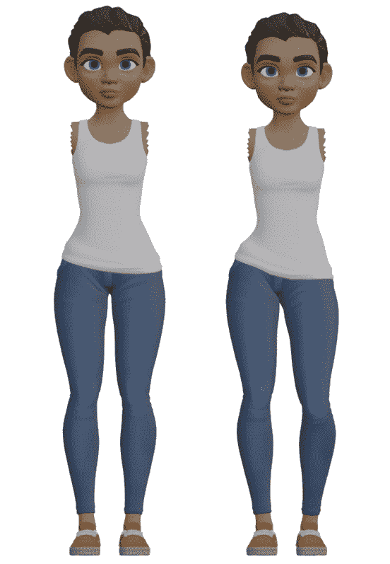

Figure 6.21: 姿态的细微差别

请注意，`MSTR-Pelvis` 和 `MSTR-Hips` 都会移动 Rain 的臀部，但其中一个是另一个的子骨骼，影响范围更局部。这个极端的例子展示了两者的区别：

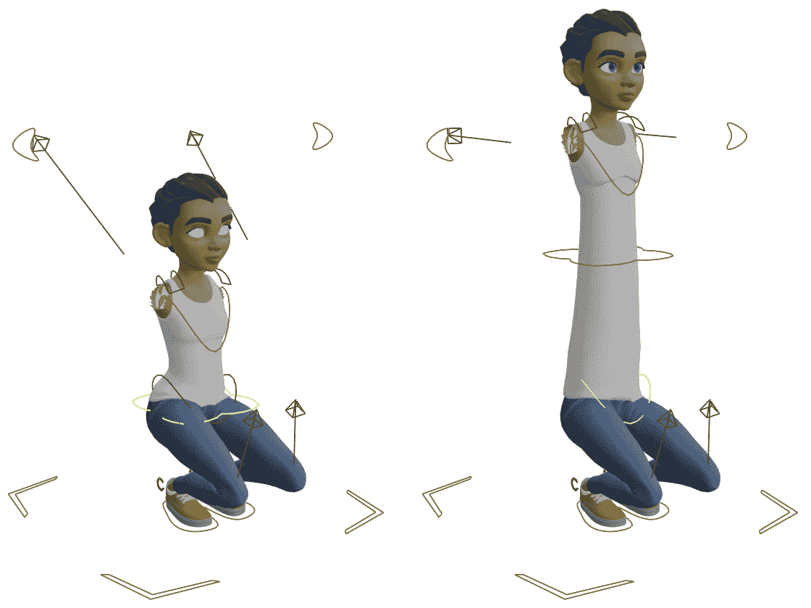

Figure 6.22: 使用 MSTR-Pelvis 与 MSTR-Hips 让 Rain 下蹲的对比

骨骼能动并不总意味着它就该动！话虽如此，你大可放心尝试。在姿态模式下，对骨骼的所有更改都是可逆的，没有意外删除或破坏任何东西的危险。如果有骨骼弯曲得太过分，只需记住以下操作符来重置它……

### “取消姿态”已设定姿态的骨骼

每根骨骼都有一个**休息位置**——即在我们于 `Pose Mode` 中变换它之前的初始位置。设定完骨骼姿态后，我们稍后经常想将它们重置为休息位置。这对于在进入下一个姿态前“放松”骨骼使其脱离当前姿态很有用，以确保 Rain 不会带着任何轻微脱臼的关节四处走动，或者只是在胡闹一番后恢复理智……

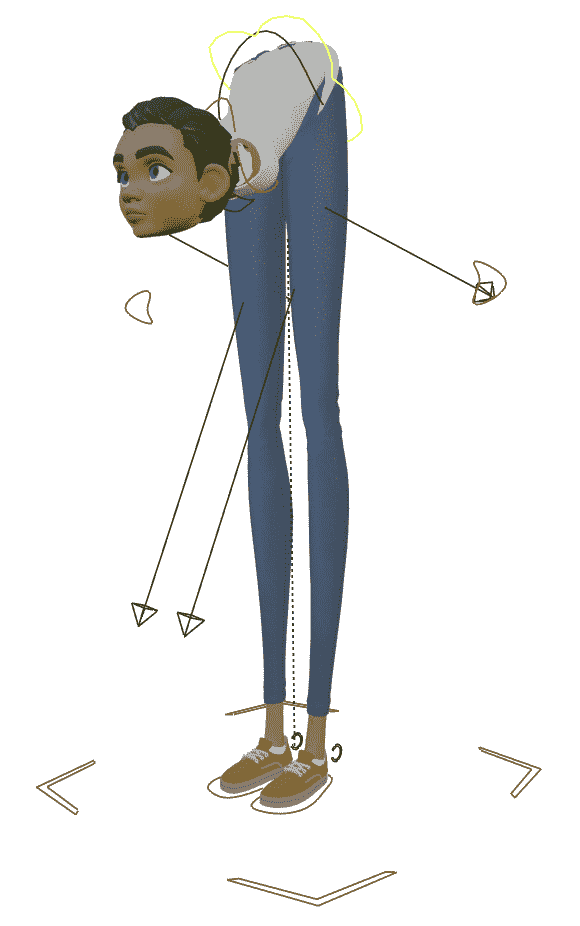

Figure 6.23: 有简单的方法可以修复这个问题

在前面的例子中，我把 `MSTR-Pelvis` 放在了一个荒谬的位置。要修复这个问题，无需尝试手动把 `MSTR-Pelvis` 放回原处，也无需数值化地重置其所有变换数值。我只需选择有问题的骨骼，然后执行 `Pose` | `Clear Transform`：

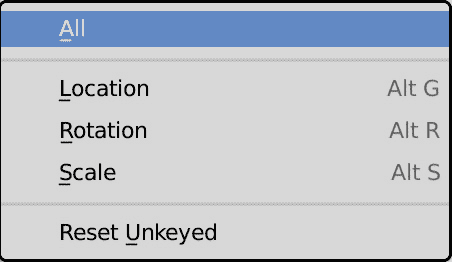

Figure 6.24: 清除变换操作符

使用 `Pose` | `Clear Transform` | `All` 可将 `MSTR-Pelvis` 恢复到初始位置，从该位置重新开始设定姿态会更容易。

**提示**

除了 `Pose` | `Clear Transform` | `All`，三个主要的 `Pose` | `Transform` 操作符（`Move`（`G`）、`Rotate`（`R`）和 `Scale`（`S`））各自都有对应的 `Pose` | `Clear Transform` 操作符：`Location`（`Alt` + `G`）、`Rotation`（`Alt` + `R`）和 `Scale`（`Alt` + `S`）。它们的工作方式与 `Object Mode` 中的 `Object` | `Clear` 操作符相同，但在角色动画中特别有用。

既然我们知道如何快速重置任何骨骼，在设定姿态时尝试各种操作就毫无顾虑了。我们在 `Pose Mode` 中所做的任何更改，无论多么荒谬或扭曲，都可以撤销。

## IK 骨骼

看看 Rain 的脚，注意当我们移动她的臀部和躯干时，她的脚保持静止，导致膝盖弯曲。目前，Rain 的脚由 `MSTR-Foot_Parent.L` 和 `MSTR-Foot_Parent.R` 骨骼控制，它们默认独立于我们之前移动的那些骨骼。

**提示**

因为人和生物在 *X* 轴上往往是对称的，所以许多骨架骨骼成镜像对出现——一根用于左侧，一根用于右侧。这些对中的骨骼名称相同，仅后缀为 *L* 或 *R* 有所不同。

让我们看看移动左脚骨骼会发生什么：

1.  选择 `MSTR-Foot_Parent.L`（这是 Rain 左脚鞋周围那根鞋形骨骼）。
2.  沿全局 *Z* 轴向外旋转该骨骼约 **20** 度。
3.  沿全局 *X* 轴向 Rain 的左侧移动该骨骼约 **0.2** 米。
4.  沿全局 *Y* 轴向后移动该骨骼约 **0.1** 米。

再加上几处不对称调整，就构成了 Rain 姿态那种放松的外观：

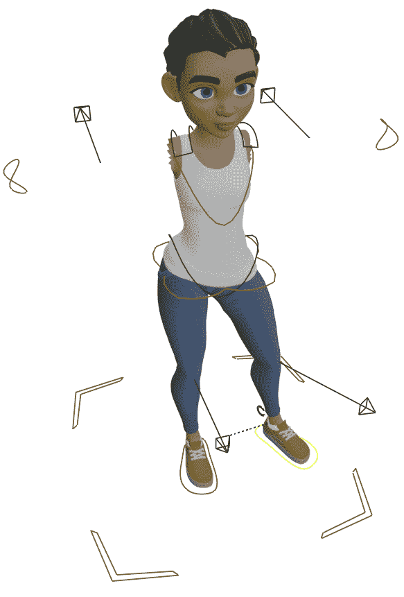

Figure 6.25: 休闲、自然的腿部站姿

你注意到了吗？每次我们移动这些骨骼时发生的小小奇迹？这不关乎我们移动的骨骼，而是关乎那些我们**不必**直接移动的骨骼：确切地说，是腿部本身的骨骼。在一种特殊约束的帮助下，每条腿中一串隐藏的相连骨骼利用髋部和脚部的相对位置，来确定腿部会如何在膝盖处伸展或弯曲。

这种机制被称为 `IK`，没有它，为跳跃或行走等“简单”动作制作动画将会是一场不小的噩梦。有了 `IK`，我们可以设定两个作为独立控制点的骨骼的位置，然后让绑定自动弯曲或拉伸中间的骨骼。想象一下，如果不得不微调大腿骨和小腿骨的旋转，仅仅为了在躯干移动时防止脚部在地面上滑动，那该多麻烦。这足以让大多数动画师想放弃！

## IK 手部

Rain 的骨架有五条 `IK 链` —— 也就是说，她有五个主要部位可以通过 `IK` 机制来控制。前两条控制她的左腿和右腿；可以说这些是最需要 `IK` 的肢体。另外两条在手臂上，通过手和肩膀的相对位置来弯曲手肘。最后，第五条可用于利用髋部和胸部的相对位置来弯曲或拉伸脊柱。

和腿部一样，Rain 手臂的 `IK` 机制默认是启用的。她的手正好停留在我们之前隐藏其几何体时的位置：

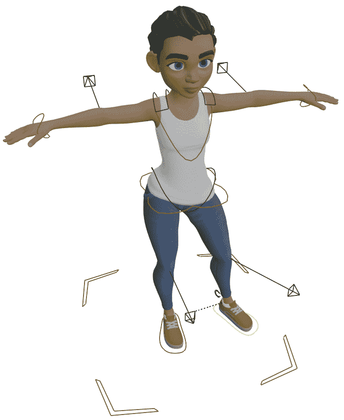

Figure 6.26: Rain's arms, unhidden

有点分心……现在你明白为什么有时保持部位隐藏会有帮助了。

现在让我们取消隐藏 Rain 的手臂，并用另一根 `IK` 骨骼让她的手搭在髋部上：

1.  前往 `Outfits` 面板并禁用 `Mask Arms`。
2.  选中 `IK-Hand_Parent.R`（Rain 右手周围那根马鞍形状的骨骼）。
3.  移动并旋转 `IK-Hand_Parent.R`，使 Rain 右手的手背舒适地搭在她的右髋部上。

现在 Rain 的右大拇指应该朝向她的身后：

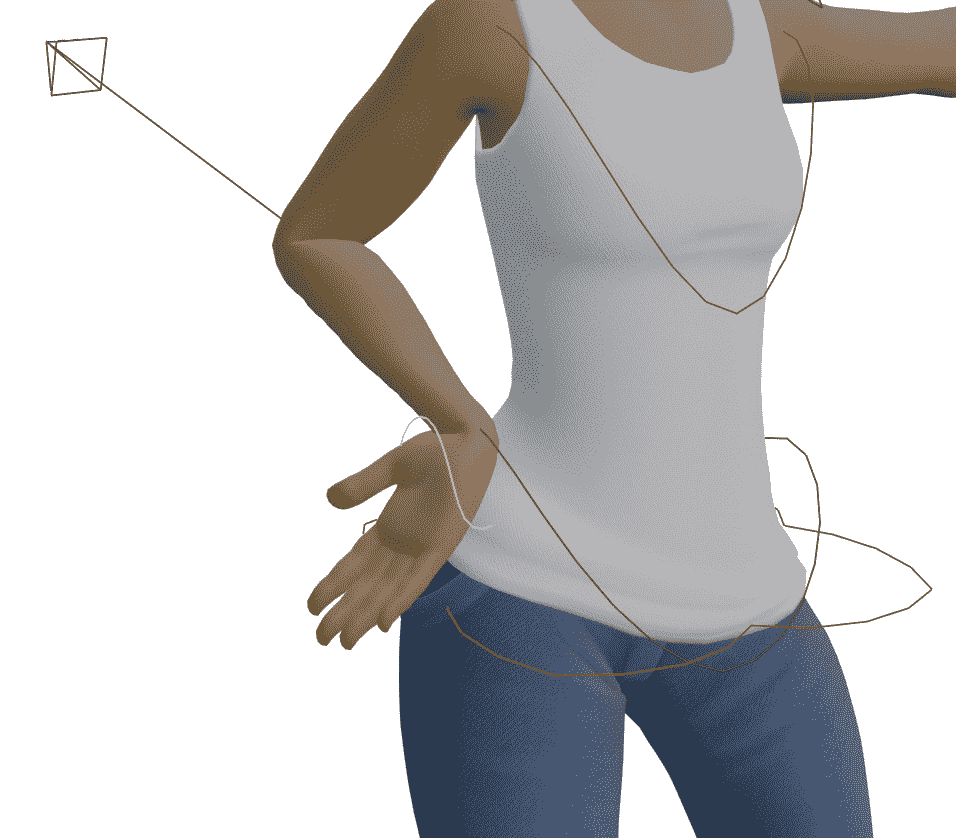

Figure 6.27: Rain's new hand pose

这是一个舒适姿势的开端，但 Rain 的右手腕，连同她右臂的其余部分，看起来一点也不舒服。

### IK 极点目标

驱动 `IK` 约束的算法被称为 `IK 求解器`，因为中间的骨骼必须为 `IK 链` 两端的两个独立目标点的相对位置提供一个关于它们“应该”如何弯曲的“解决方案”。在我们移动 Rain 的手后，`IK` 求解器确实给出了这样一个解决方案，尽管这次不是个好方案。在将手肘弯曲到恰到好处的程度后，`IK` 求解器还留下了一件模棱两可的事：手肘应该朝哪个方向？

这个问题可以用 `IK 极点目标` 来回答：

1.  选中 `IK-Pole_Forearm.R`（那根末端连着一条线、看起来像在“拉”右手肘的骨骼）。
2.  向外和向前移动这根骨骼，使 Rain 的手肘向她的右侧弯出：

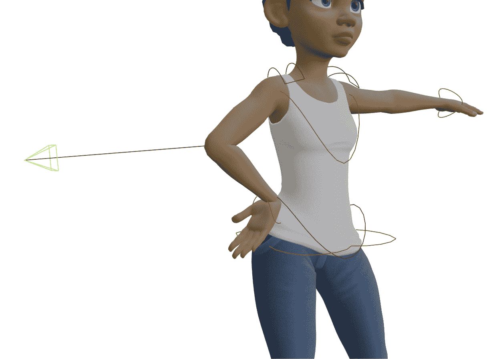

Figure 6.28: A relaxed-looking elbow pose

这看起来好多了 —— 更像你自己尝试做同一个姿势时手臂的样子。事实上，为什么不现在就试着做一下作为参考？

我们的待机姿势正在成型，但剩下最明显的问题是 Rain 的另一只手臂。接下来，我们要让那只手臂自然下垂，但不使用 `IK` 骨骼。

## FK 骨骼

我们并不总想用 `IK` 层中的骨骼来为 Rain 的每个肢体摆姿势。`IK` 求解器解决的每个问题，往往都伴随着同等的缺点。例如，如果我们想让 Rain 的左臂只是直直下垂怎么办？如果我们不在乎 Rain 左手的确切位置，`IK` 求解器就是不必要且笨重的。我们只想让它悬垂在 Rain 左臂的末端。我们更关心左手肘的角度，而不是左手的位置；我们希望它保持伸直，不弯曲、不拉伸 —— 这与右臂遇到的问题截然相反！

作为一个高级角色绑定，Rain 有多种方式来为肢体摆姿势。我们需要的不是 `反向运动学`，而是 `正向运动学`，即 `FK`。Rain 绑定中的五条 `IK 链`，每条都有一条对应的 `FK 骨骼链` 可供替代使用。

当我们移动第一根 `FK` 骨骼时，将很容易看出 `IK` 和 `FK` 的区别，但我们首先需要取消隐藏它们并启用它们的影响力。让我们把注意力转回到我们最初隐藏的 `FK` 层中的那些骨骼上。

### 从 IK 切换到 FK

就移动一串相连骨骼而言，`IK` 和 `FK` 是逻辑完全相反、无法调和的两种方法。两套系统都需要单独的隐藏骨骼链。要让一条链控制肢体，就必须剥夺另一条链的控制权。

默认情况下，Rain 的手臂和腿完全由 `IK` 骨骼控制，与之对应的 `FK` 骨骼将不起任何作用。要确定某个肢体受其 `FK` 还是 `IK` 骨骼影响，请使用 `CloudRig` 界面中的以下属性：

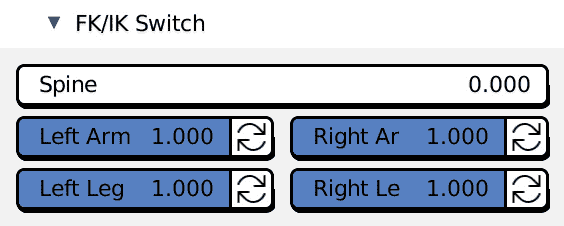

Figure 6.29: The FK/IK Switch panel

1.  启用 `FK` 骨骼层。
2.  在 `Settings` 面板中找到 `FK/IK` 部分。
3.  将 `FK/IK Switch` | `Left Arm` 设为 `0.0`。

你应该能看到 Rain 的左臂从跟随一组骨骼切换为跟随另一组。这条手臂现在变成了 `FK` 手臂，我们准备好使用它的 `FK` 骨骼了。

> **Tip**
>
> `FK/IK Switch` 的值通常是 `0.0` 代表 `FK`，或 `1.0` 代表 `IK`。中间值主要用于在属性动画时，在 `FK` 和 `IK` 之间进行短暂、平滑的过渡。你极少需要设置像 `0.3` 这样的值。

### 摆放 FK 骨骼

现在，我们可以用 `FK` 为 Rain 的左臂摆姿势了：

1.  选中 `FK-Upperarm_Parent.L`（那根看起来像套在 Rain 左上臂上的护臂形状的骨骼）。
2.  绕全局 `Y` 轴向下旋转 `FK-Upperarm_Parent.L` 约 `75` 度。

现在 Rain 的左手应该触碰或悬停在她的左大腿上：

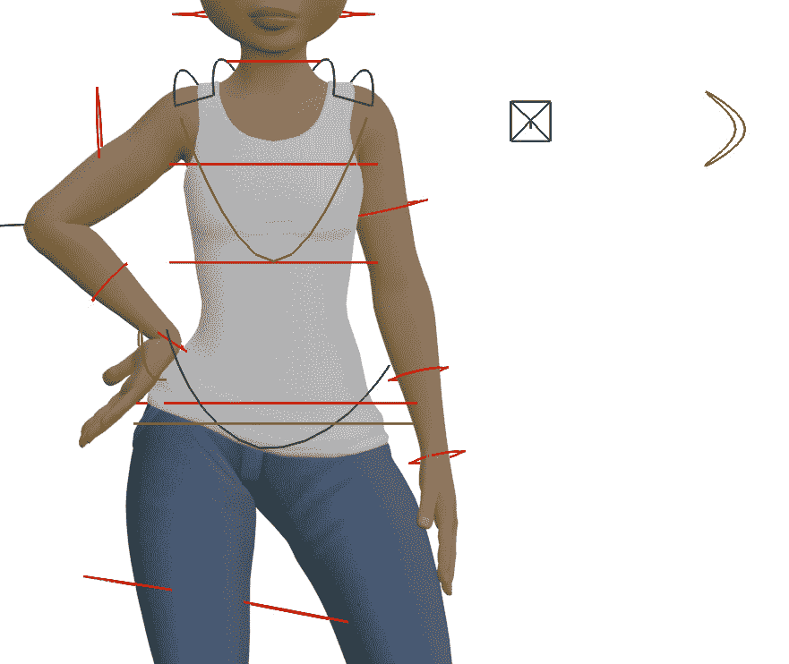

Figure 6.30: Left arm pose

这很简单！使用 `FK` 通常比 `IK` 更简单。`FK` 骨骼给我们提供关节的直接控制，且关系直观；`FK-Upperarm_Parent.L` 是 `FK-Forearm.L` 的父级，后者又是 `FK-Hand.L` 的父级，以此类推。

> **Tip**
>
> 与 `IK` 骨骼（大多用于移动和旋转）不同，Rain 绑定中的 `FK` 骨骼通常**只**用于旋转。虽然有时也可以移动它们，但我们通常只应这样做以进行细微修正。

#### FK 脊柱

沿着 Rain 躯干延伸的 `FK` 骨骼默认是启用的。现在让我们用它们给她的脊柱增加一些弯曲，从链条开始处的 `FK` 骨骼开始向上操作：

1.  选中 `FK-Spine`（Rain 髋部周围的腰带）。
2.  绕全局 `Y` 轴旋转 `FK-Spine` 约 `5` 度。这会让 Rain 最初向左倾斜。
3.  选中 `FK-RibCage`（上面那根）并绕全局 `Y` 轴向相反方向旋转约 `-5` 度。
4.  继续向上，绕全局 `Y` 轴旋转 `FK-Chest` 约 `-5` 度。
5.  绕全局 `Y` 轴再旋转 `FK-Neck` 约 `-5` 度。
6.  最后，绕全局 `Y` 轴旋转 `FK-Head` 约 `5` 度，将她的头向左倾回。

这给 Rain 的站姿带来了一个漂亮的 S 形曲线：

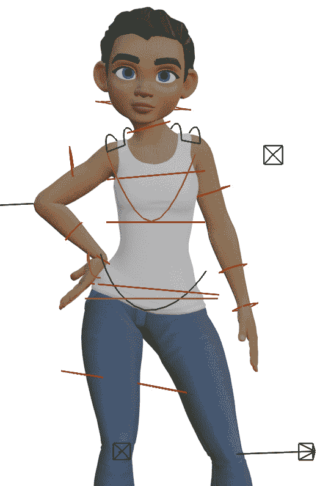

Figure 6.31: Effect of posing the spine

然而，我们在摆姿势让 Rain 的左臂下垂所做的努力付诸东流了——它不再像以前那样自然下垂。我们可以利用 Rain 的另一个功能来解决这个问题。

## 肩部与 FK 铰链

父子关系中的元素不仅具有依赖性，还具有**继承性**；即子级从父级继承变换。这对骨骼和物体都适用，但在我们这种情况下，这对 `FK` 骨骼尤为重要。

当使用 `FK` 时，上臂会从肩部间接继承旋转。当我们旋转 Rain 的左肩（或导致其旋转）时，它会刚性地带动左臂旋转，就好像它们属于同一条 `FK` 链。这在某些情况下是可取的，在另一些情况下则不然，因此绑定师赋予了我们选择某些 `FK` 骨骼是否应继承旋转的能力。

### 使用铰链

当 `FK` 骨骼不再从链条上方的父级继承旋转时，这种效果被称为**铰链**。试着耸耸自己的肩膀作为参考；即使你刚刚旋转了锁骨，你的手臂仍大致保持着下垂的角度。

这就是 `FK 铰链`。让我们在 Rain 身上试一下：

1.  在 `CloudRig` 界面的 `Settings` 面板中找到 `FK Settings` 部分。
2.  将 `FK Hinge` | `Left Arm` 设置为 `1.0`。

Rain 的左臂恢复到了原来的位置（右臂仍在使用 `IK`，因此它毫无问题地处理了我们对脊柱的所有更改）。`FK 铰链` 很有用，因为它允许我们调整角色的脊柱和肩部，而不影响其 `FK` 手臂的旋转。

### 肩部——“身体的眉毛”

现在两只手臂都不再从肩部继承旋转，我们可以更自由地摆姿势肩部骨骼：

1.  将 `MSTR-Clavicle.R` 稍微向下和向前旋转一点，以放松 Rain 的右肩。
2.  将 `MSTR-Clavicle.L` 稍微向上旋转一点，以平衡她的右肩并强调她姿势中的曲线。

现在 Rain 的整体姿势完成了！

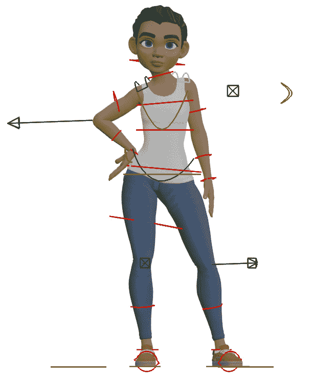

Figure 6.32: 一个近乎完成的姿势

Rain 绑定中庞大的骨骼数量和额外的骨架层可能令人望而生畏，但事实证明，仅 `IK` 和 `FK` 骨骼就能让我们完成完成姿势的一半以上工作。

## 手指、面部和其他配件

在为角色摆姿势或制作动画时，一个通用的经验法则是从角色中心开始，向外扩展。从解剖学角度来看，这意味着从 Rain 位于骨盆处的重心开始，然后摆姿势脚、手和头。现在，我们准备摆姿势细节，如手指和面部表情，最后是 Rain 的“非生命”特征——她的头发和围巾。

> **Tip**
>
> Blender 的 `Object Gizmos`（特别是 `Move` 和 `Rotate`）有助于消除在变换骨骼时该使用哪个局部轴的猜测，并且对于快速摆姿势大量小骨骼非常方便，这正是我们在本节将要做的。考虑前往 3D 视口 `Header` 区域的 `Viewport Gizmos` 菜单并启用它们。

### 摆弄手指

让我们继续处理 `Fingers` 层中的骨骼：

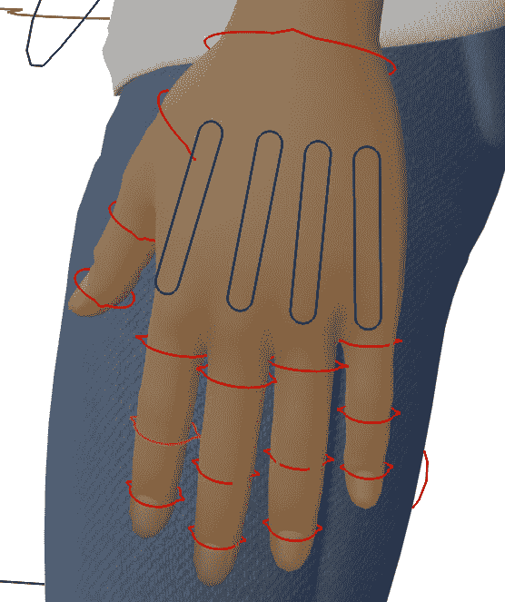

Figure 6.33: Rain 的手指控制器

Rain 的手指控制器相当简单；每个手指一条 `FK` 链，包含每个指骨和掌骨的骨骼。虽然每只手可能总共有 19 根骨骼，但如果你知道一些快捷键，摆姿势并不难。

> **Important note**
>
> 从这一点开始，你需要负责显示和隐藏骨架层。好在绑定师贴心地给它们加上了标签！

#### 使用各自的局部轴

取消隐藏手指骨骼后，让我们启用一些设置，以便一次性轻松摆姿势多根手指骨骼：

1.  在 3D 视口 `Header` 区域，将 `Transform Orientation` 改为 `Local`。
2.  将 `Transform Pivot Point` 改为 `Individual Origins`：

Figure 6.34: 3D 视口 Header 区域的新变换设置

有了这些设置，我们可以在每根骨骼各自的局部轴上同时旋转多个指骨。

> **Important note**
>
> 请密切注意你应该在 `global XYZ` 轴还是某个 `local XYZ` 轴上变换物体。注意 Rain 的手指骨骼相对于任何全局轴都是错位的；现在如果在单一全局轴上旋转它们毫无益处。由于我们旋转了依赖链上方的父骨骼，许多其他骨骼也是这种情况。

#### 弯曲指骨

有了我们启用的设置，弯曲 Rain 手指中所有的 `FK` 骨骼只需两步：

1.  选择 `Fingers` 层中的每一根骨骼（掌心的掌骨除外——它们不该弯曲太多）。
2.  在局部 `X` 轴上稍微旋转选择集，使手指放松，而不是笔直伸出：

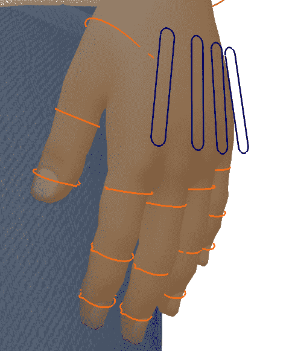

Figure 6.35: 一个随意的手部姿势

这可是一次性摆姿势 30 根骨骼的好方法！如果你愿意，可以回去微调几根单独的骨骼以增加韵味：

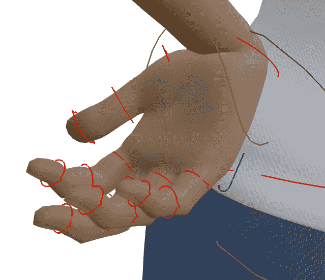

Figure 6.36: 一个更加随意的手部姿势

暂时这样就够了；当我们让 Rain 拿起物体时，我们将有大量时间来摆弄她的手指。

### 面部表情，或“摆姿势面部骨骼”

当我们启用 `Face Primary` 层时，迎接我们的骨骼数量比前三个骨架层的总和还要多：

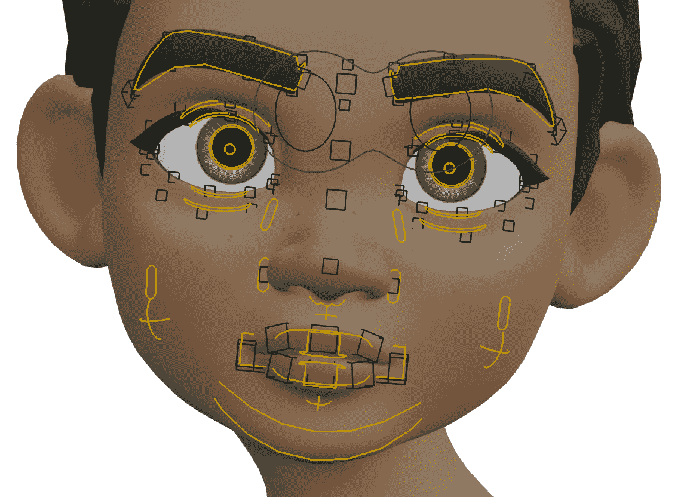

Figure 6.37: Rain 的“面部骨骼”

骨骼的存在并不意味着我们必须摆姿势它，所以别担心！别难过！笑一个！微笑比皱眉用的肌肉少，而在 Rain 的面部绑定中，让 Rain 微笑所需的骨骼甚至更少。

让我们试着摆一个放松的微笑：

1.  控制嘴角的两根骨骼是黄色的盒子 `ACT-Lips_Corner.L` 和 `ACT-Lips_Corner.R`。分别选中它们，并将它们向 Rain 的耳朵方向移动一小段距离。
2.  选中 Rain 的两根上眼睑骨骼 `ACT-Eyelid_Upper.L` 和 `ACT-Eyelid_Upper.R`，并在它们的局部 `Y` 轴上向下移动一小点。

> **Tip**
>
> 真实的微笑会将嘴角向后拉向颧骨，而不是直接向上或向外。如果是真心的大笑，还会提升面颊并降低下眼睑。

仅此而已，就能从中性面部变为平静、快乐的面部：

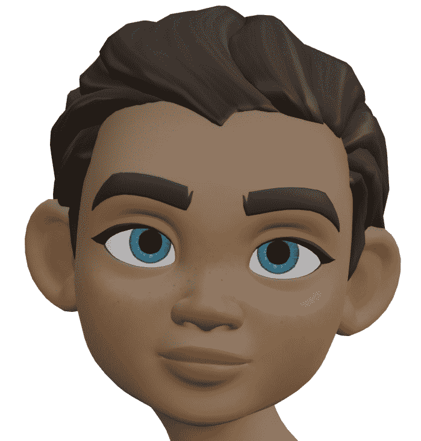

Figure 6.38: 一个温和的微笑

> **Tip**
>
> 在 3D 视口中暂时禁用 `Show Overlays`，以便在没有骨骼干扰的情况下更好地观察 Rain。

如果你愿意，继续完善表情，从主要的黄色骨骼开始，然后微调次要的绿色骨骼。对 Rain 眉毛稍作调整，似乎勾起了她的好奇心：

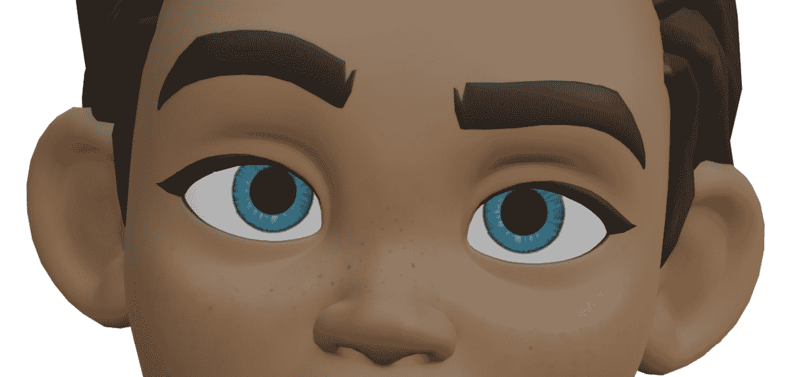

Figure 6.39: 眉毛的进一步调整

一些面部骨骼（如眼睑骨骼）受到绑定师的约束，使其无法摆得太“错”。然而，其他骨骼可以自由移动，如果不小心操作它们，会造成噩梦般的后果：

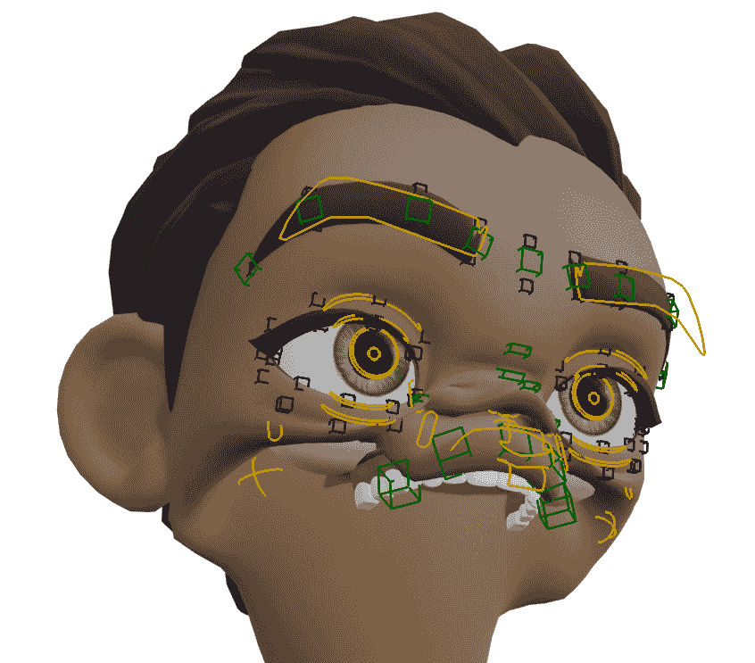

Figure 6.40: 啊啊啊啊！

前面的例子甚至还不算最糟！至少她的眼睛目前还朝着正确的方向……

#### 眼球目标

角色视线的方向（即他们在看什么）在角色动画中至关重要。这由几根骨骼控制，你可能没注意到它们，因为它们漂浮在 Rain 脸前约一臂远的地方：

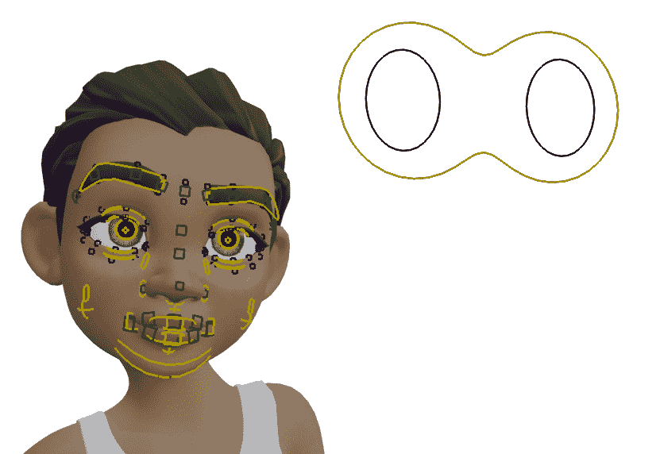

Figure 6.41: 眼球目标骨骼

我们可以使用**眼球目标**来确定 Rain 眼球的朝向，而不必直接旋转眼球。这在 Rain 需要注视特定物体时，能让姿势摆设和动画制作变得更容易。

要了解其工作原理，让我们回到 **FK** 层中的一根骨骼：

1.  找到并选中 `FK-Head`。
2.  在全局 `Z` 轴上旋转 `FK-Head`，将 Rain 的头稍微转向一侧。

注意 Rain 的视线始终锁定在眼球目标骨骼上，导致她斜眼看我们：

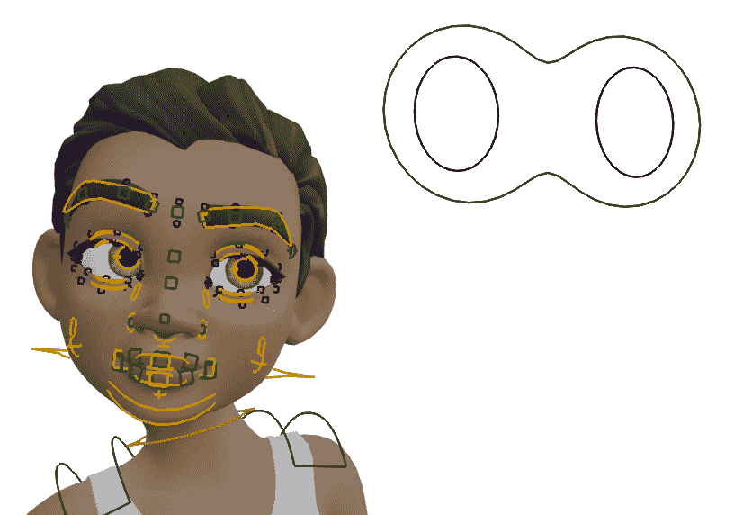

图 6.42：Rain 保持注视眼球目标

至此，你已了解眼球目标骨骼的工作原理，甚至不需要移动它！只需确保这些骨骼始终位于 Rain 面部前方；否则，她最终会看向自己的后脑勺。

> **提示**
>
> 如果不想在 Rain 头部移动时操心眼球目标骨骼，可以前往 `Face Settings` 面板，将 `Eye Target Parent` 改为 `Head`。该面板还允许你调整 Rain 眼球旋转对眼睑和周围皮肤的影响程度。

Rain 的姿势已近完成——剩下的只是摆放之前隐藏的配饰。

### 最后的配饰

取消隐藏 Rain 的头发和围巾后，我们发现还有一点工作要做：

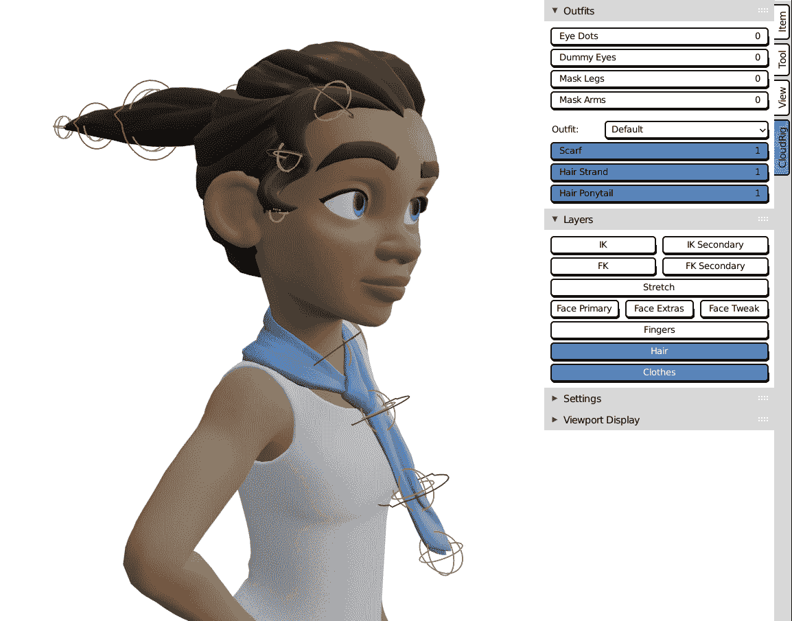

图 6.43：Rain 的围巾和马尾，未摆姿势

头发和宽松衣物不像其他部位那样对角色姿势有贡献。它们没有自己的肌肉，只是垂在那里，对重力、Rain 的动作以及风做出反应。难怪我们想在完成其他所有姿势之前先隐藏这些部分。

让我们把配饰还给 Rain，并让它们自然下垂：

1.  取消隐藏 `Hair` 和 `Clothes` 骨架层，并在 `Outfits` 面板中启用 `Scarf`、`Hair Strand` 和 `Hair Ponytail`。
2.  摆放 Rain 的马尾，使其看起来自然下垂。从头部向外旋转红色的 `FK` 骨骼开始，然后使用球形拉伸骨骼微调结果。
3.  用相同方法摆放 Rain 的围巾（本例中发丝可保持不动）。

现在 Rain 的站立姿势完成了。比她最初的 `T` 姿势好多了！

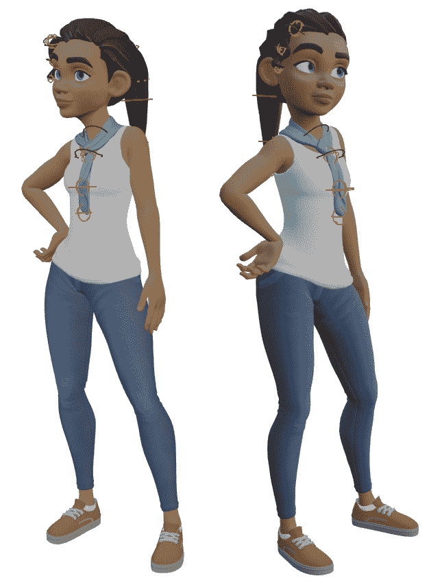

图 6.44：完成的站立姿势

虽然我们的第一个姿势表面上看很简单，但即使是这一个也花了一些时间，并要求我们利用 Rain 的许多功能。随着练习的深入，给角色摆姿势会变得越来越容易！

话虽如此，让我们之前的工作白费可不划算。为此，我将展示如何保存和复用我们制作的任何姿势，以便在后续动画中使用。

## 创建姿势库

角色动画本质上只是一系列经过精炼的姿势，因此通过创建更多姿势进行练习，我们能学到很多。传达动作、重量、力量、张力、思考和情感的姿势，都是制作引人入胜的动画的要素。而且因为制作一个姿势可能需要一段时间，你可能想在后续动画中复用其中一些！

让我们学习如何保存姿势，以便保留当前姿势供后续练习使用。

## 资产浏览器

除了模型和材质，Blender 的新 `Asset Browser` 还能存储我们为角色制作的姿势。

现在打开它。为了自动为每个姿势创建缩略图，我们还需要在场景中添加一个摄像机：

1.  切换到 `Object Mode`，按 `Shift` + `A` 添加一个 `Camera` 对象到场景中。
2.  将摄像机对准 Rain。
3.  在新区域中打开 `Asset Browser` 区域。
4.  在左侧 `Source List`（`T`）区域中，将 `Asset Library` 从 `All` 改为 `Current File`。
5.  点击 `+` 创建一个 `New Asset Catalog` 项。
6.  将其命名为 `Rain Poses`。

现在我们有了一个空目录：

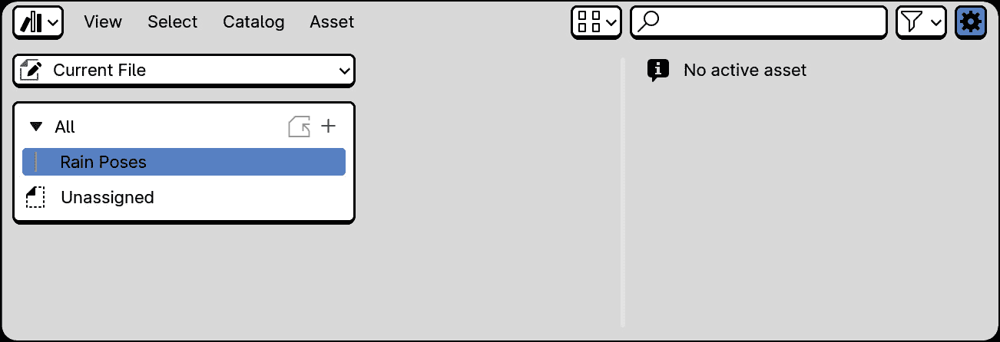

图 6.45：资产浏览器中的目录（当前为空）

我们制作的任何喜欢的姿势都可以存在这里。让我们从已制作的站立姿势开始。

## 创建姿势资产

要将姿势存储为资产，请按以下步骤操作：

1.  选中姿势涉及的所有骨骼。
2.  在 `Asset Browser` 区域中，点击 `Asset` | `Create Pose Asset`。
3.  在 `Asset Browser` 区域右侧边栏（`N`）中更新 `Name` 属性，给姿势起一个更具描述性的名称。

点击 `Create Pose Asset` 时，所选骨骼所在的位置，就是该姿势日后应用时的位置。

“姿势涉及的所有骨骼”指我们希望在将该姿势应用到新项目中的 Rain 时受影响的所有骨骼。这包括我们摆过姿势的所有骨骼，但也可能（或不妨）包括一些未摆姿势的骨骼。对于当前的站立姿势，我们可以直接选中已用图层中的所有骨骼。对于更局部的姿势，可以使用更窄的骨骼选择。例如，仅选面部骨骼做表情，或仅选手指骨骼做“手部姿势”（如握拳）。

> **重要提示**
>
> 存储 `CloudRig` 属性（如 `IK/FK Switch`）的骨骼不在可见图层上，因此不会作为姿势的一部分被保存。我们得自己记得调整这些设置。

试一下。这是我们在 `Asset Browser` 区域中的第一个姿势：

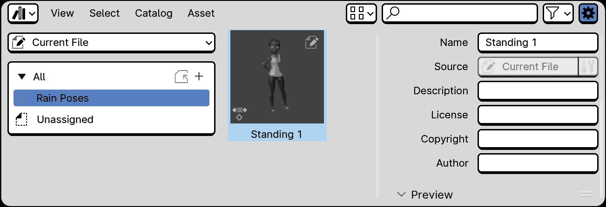

图 6.46：保存为资产的站立姿势

> **提示**
>
> 你可以随时在右侧边栏（`N`）的 `Preview` 面板中更新资产的缩略图。

保存当前姿势后，我们准备制作另一个！你可以选中所有摆过姿势的骨骼，使用 `Pose` | `Clear Transform` | `All` 将 Rain 重置为原始休息姿势；或者，如果你愿意，也可以基于现有姿势在下一节中制作新姿势。

## 练习姿势

我们不再按部就班地摆姿势了；你现在对骨架图层、`CloudRig` 功能以及在姿势模式下操控骨骼已有足够了解，可以自行创建更多姿势。每次创建一个喜欢的姿势，都可以用 `Create Pose Asset` 存入 `Asset Browser` 区域。

> **提示**
>
> 摆姿势时以自己的身体为参考；离开电脑，试着做出你想重现的姿势！有时镜子对面部表情很有帮助。

### 更多简单姿势

尝试制作任意数量的常见姿势。如果保存下来，说不定日后在动画中会用得上。

#### 站立

站立不止一种方式。基于刚才制作的现有姿势，我们可以探索脚、手臂和脊柱的替代位置：

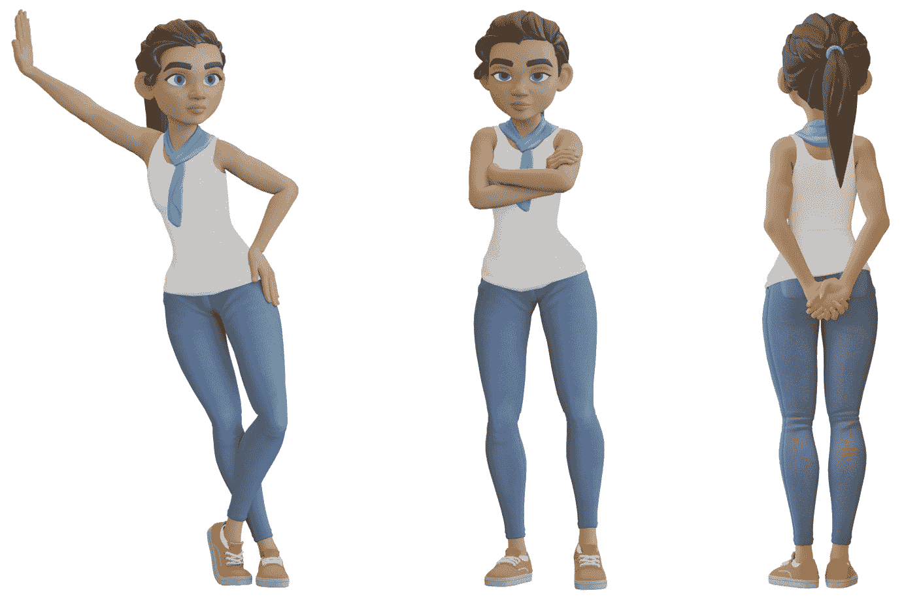

图 6.47：站立姿势——倾斜、交叉双臂、合十双手

接下来，我们尝试对 Rain 容易但对我们稍具挑战的事：坐着！

#### 坐着和/或躺着

试着用立方体作为椅子和桌子的简单参考。对于完全躺卧的姿势，可以对所有肢体使用 `FK`：

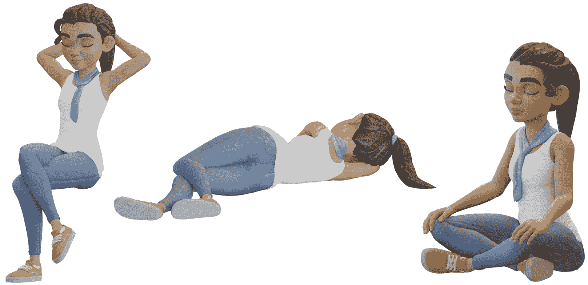

图 6.48：躺卧姿势

坐着或睡着的角色与地面和/或家具有更多接触点。所以具有讽刺意味的是，角色越放松，我们要做的工作越多。

现在让我们看看在面部表情上能有多大创意。

### 面部表情

以下是几个可尝试的面部表情示例。记住，先尽可能利用 `Face Primary` 图层中的黄色骨骼，再用其他骨骼微调表情：

