## 第 7 章：基础角色动画

## 进阶姿势

说实话，这些姿势并没有什么“进阶”的。狂野、夸张的姿势实际上可能比平常的姿势更容易做！

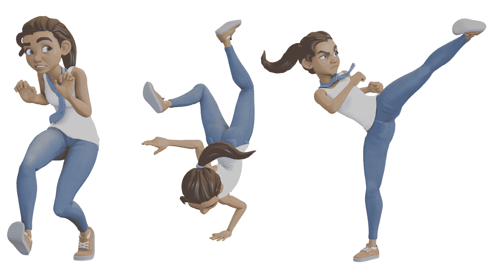

图 6.51：一些更进阶的姿势

你还能做出多少其他姿势？继续练习；姿势制作需要大量的工作和练习，我们甚至还没添加任何关键帧呢！Rain 的骨架非常先进，以至于我们不得不专门用一整章的篇幅来讲解如何使用她的骨架。本练习将是我们进行的最后一个非动画练习。

请记得保存此文件，以便我们稍后复用站立姿势。

## 总结

其他关于角色动画的书籍和教程，往往会试图在教你制作动画之前，先拖着你走过一段漫长的角色绑定章节。如果你偷瞄过 Rain 隐藏的骨架层，或者在 `Outliner`（大纲视图）区域查看过她所有的骨骼，你就能开始理解为什么我们跳过了那项特定任务。依我之见，在学会动画之前先学绑定，就像非得先造一辆自行车才能学骑车——总得有人造，但那个人不该是你。光是学会如何给 Rain 摆姿势就花了不少时间，要是还得自己给每根骨头命名，那可就更久了！

提到角色绑定时，**Anatomy（解剖结构/解剖学）** 一词有双重含义。它可以指角色的形状和尺寸，也可以指骨架骨骼之间不可见的关系。一个高级角色绑定本身就是一个有机体；一个拥有自己“超解剖结构”的生物，其人形外表只是一种投影。Rain 体内的结构不是人类的；它更像是两只蜘蛛、一只章鱼，外加一艘 17 世纪护卫舰的索具的混合体。我们爱死这个怪物了；它让制作动画变得有趣！

既然已经学会了如何给 Rain 摆姿势，我们就准备好开始让她动起来了。正如之前提到的，3D 角色动画本质上是一个摆姿势、设关键帧、再摆姿势、再设关键帧……如此循环的过程。过不了多久，这就会创建出一个拥有成千上万个关键帧的动画，但这对 3D 动画师来说不是问题。如果你知道如何使用它们，一千个关键帧和半打关键帧一样好用，这将在下一章中介绍。

## 思考题

1.  为什么组成角色的物体应该被组织到一个集合中？
2.  如果 Rain 已经在我们当前的 `.blend` 文件中，为什么这个文件比她来源的那个文件要小？
3.  为什么像 `FK` 这样的绝对文件路径……？（注：原文句子似乎不完整或有误，直译为“Why is an absolute file path like `FK`?”）
4.  我们在哪里能找到那些不该制作动画的隐藏骨骼？
5.  “Inverse Kinematics（反向运动学）”中的“Inverse（反向）”可能意味着什么？
6.  为什么 `IK` 对腿部比对手臂更关键？
7.  尝试旋转 Rain 脚踝后方那些小小的圆形 `IK` 骨骼之一。那可能有什么用？
8.  为什么我们应该最后摆姿势头发和围巾？我们最初为什么要隐藏这些东西？
9.  如果 Rain 的骨骼更少，给她制作动画会更容易吗？

## 技术要求

和以前一样，要完成本章的练习，你当然需要 Blender（免费开源的 3D 应用程序）和 Rain（免费的 Blender 角色绑定）。请参阅上一章获取 Rain 的下载链接，以及如何将她链接到场景中的详细说明。

在上一章的练习中，我们还创建了一个站立姿势，并将其保存为资产。我们将在本章中复用该姿势，但如果你没有它或无法追加它，你可以像往常一样通过给 Rain 摆姿势来简单地重新创建它。

## 在新场景中准备 Rain

本章的动画将从第 6 章中为 Rain 制作的站立姿势开始。首先，当然，我们需要创建一个包含 Rain 的新场景。你还记得怎么做吗？

### 关于将 Rain 链接到新项目的简要回顾

这将是另一个 120 帧的动画，场景中除了 Rain 什么都没有。如果你忘记了我们在 `Chapter 6` 开头为了将 Rain 引入新项目做了什么，这里有个快速复习。每次我们开始一个新的 Rain 角色动画时，请记住这些步骤：

1.  在 Blender 中启动一个新文件，前往 `File`（文件）| `Link`（链接）。
2.  在调出的文件浏览器中导航到 Rain 的 `.blend` 文件。
3.  进入 `Collection`（集合）文件夹，选择集合 `CH-rain` 进行链接。
4.  在场景中选中集合实例 `CH-rain`，前往 `Object`（物体）| `Relations`（关系）| `Make Library Override`（创建库覆盖）。
5.  保存文件（`Ctrl` + `S`），然后通过 `File`（文件）| `Revert`（恢复）重新加载它。
6.  要开始摆姿势，选择 Rain 的骨架并进入 `Pose Mode`（姿势模式）（`Ctrl` + `Tab`）。

现在我们准备好再次给 Rain 摆姿势了：

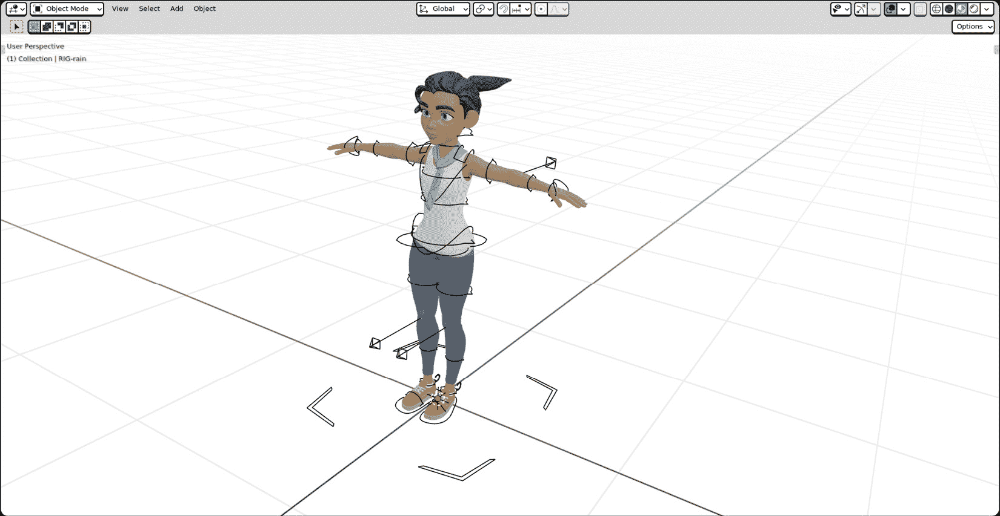

图 7.1：Rain，刚链接进新场景

我们还有大量的摆姿势工作要做，但为了在 Rain 的初始姿势上节省一点时间，我们可以调用上一章制作的那个姿势。

### 使用姿势资产

就像 Rain 的物体集合和 Blender 中大多数其他形式的数据一样，我们之前制作的姿势是一个可以从一个 `.blend` 文件链接或追加到另一个文件的 **datablock（数据块）**。我们将追加该姿势，以便它能在我们当前的动画中提供帮助。

> **重要提示**
> 使用我们的站立姿势资产可以节省一些时间，但节省的不多。如果由于任何原因你无法正确应用我们要找的姿势，这也不是阻碍。就按第 6 章学到的方法手动再摆一遍姿势，然后继续下一节。

#### 将你的姿势添加到资产浏览器

请遵循以下步骤检索站立姿势。这也将使上一练习中保存为资产的任何其他姿势可用：

1.  前往 `User Preferences`（用户偏好设置）| `File Paths`（文件路径）| `Asset Libraries`（资产库）。
2.  点击 `Add Asset Library`（添加资产库）的加号（`+`）。
3.  找到包含你在上一章创建的文件的文件夹。
4.  给新资产库起个更好的名字。

现在我们有了一个新的资产库：

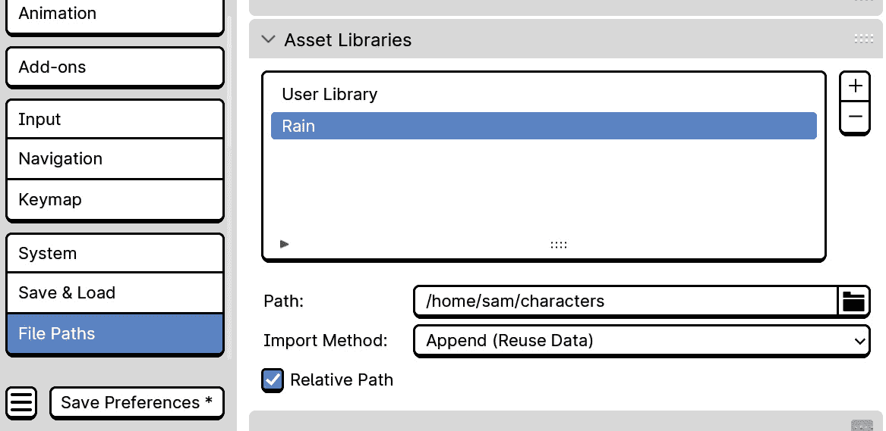

图 7.2：用户偏好设置中的新资产库

对于所选文件夹中的所有 `.blend` 文件，任何标记为资产的内容都将显示在 `Asset Browser`（资产浏览器）中：

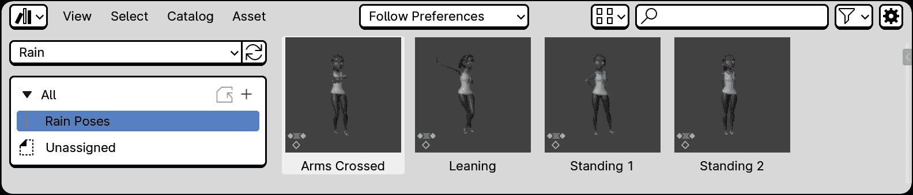

图 7.3：资产浏览器中的姿势

让我们退出 `User Preferences`（用户偏好设置），现在前往那里。

## 从资产浏览器应用姿势

要应用我们在上一章创建的站立姿势，请执行以下操作：

1. 在 `Asset Browser`（资产浏览器）中，找到包含我们为 Rain 创建的站立姿势的 `Asset Library`（资产库）和 `Catalog`（目录）。
2. 确保你处于 Rain 骨架的 `Pose Mode`（姿势模式），并且所有骨骼都已取消选择。
3. 双击上一章的站立姿势以应用它。
4. 为了完成姿势，对 Rain 的 `CloudRig` 属性进行任何必要的调整，这些属性是从原始姿势中丢失的（例如她的 `FK/IK` `Switch`（切换）设置）。

**重要提示**

如果在应用姿势时骨架上的任何骨骼被选中，则所有其他骨骼将被忽略。为确保我们的站立姿势应用于整个骨架（包括隐藏骨骼），请务必在事先取消选择所有骨骼。

使用来自姿势库的姿势，我们可以迅速让 Rain 摆脱枯燥的 T 姿，并将她恢复到放松、自然的站立位置：

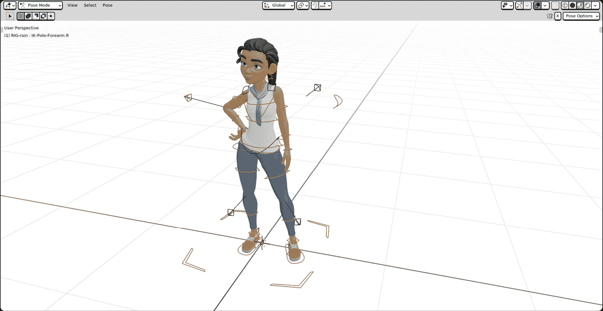

图 7.4：上一章中 Rain 的站立姿势

我们甚至不需要选择任何一个骨骼（至少目前还不需要）！

我们现在在制作角色动画吗？严格来说，不是。从 `Asset Browser`（资产浏览器）应用的姿势不会与当前动画集成；它们只是一次性将属性应用到许多骨骼上，就好像我们刚刚自己为 Rain 摆姿势一样。

离开资产浏览器后，我们可以随心所欲地继续调整这里看到的姿势。有了 Rain 的良好起始姿势，我们几乎准备好插入第一组关键帧了。我们只需要再仔细检查一些设置，以确保我们的首次角色动画体验顺利进行。

## 为动画设置骨骼关系

Rain 骨骼的静态位置看起来不错，但有时它们的关系（或缺乏关系）会在骨骼开始移动时给我们带来麻烦。

### IK Parents（IK 父级）

如前所述，你可以通过在 `3D Viewport`（3D 视口）中抓取骨骼并晃动它来测试骨骼。看看当我们移动 `MSTR-Pelvis_Parent` 时会发生什么（或不会发生什么）：

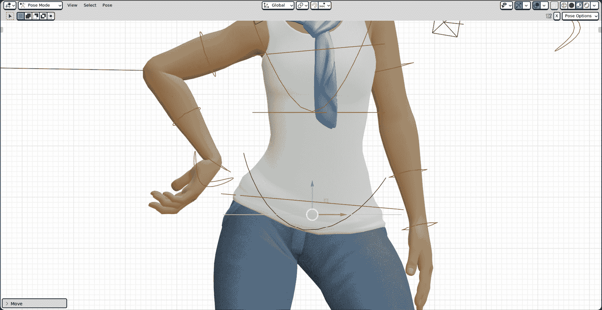

图 7.5：移动 Rain 的躯干导致手被甩在身后

`IK-Hand_Parent.R` 骨骼保持在空间中固定，而不是粘附在她的臀部上。一旦我们开始认真制作动画，这可能会给我们带来麻烦。我们或许能够一起选择、摆姿势并为 `MSTR-Pelvis_Parent` 和 `IK-Hand_Parent.R` 设置关键帧，但这种方法可能很笨拙，且发生的任何意外位移都会显而易见。

如果一个骨骼成为另一个骨骼的父级会怎样？事实上，Rain 的每个 `IK` 目标骨骼都装配了一组有限的骨骼，如果动画师需要，它们可以充当其父级。

你可以在 `CloudRig` 界面的 `IK Settings`（IK 设置）面板下的 `IK Parents`（IK 父级）中找到此功能：

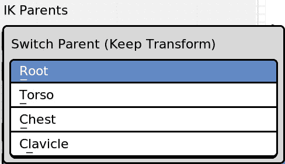

图 7.6：CloudRig 中的切换父级功能

**重要提示**

使用 `Switch Parent (Keep Transform)`（切换父级[保持变换]）操作符与仅更改 `IK Parents`（IK 父级）属性的值是不同的。使用此操作符会更改有效父级，并调整骨骼的名义变换值以补偿该更改，使其在视觉上保持静止。这类似于我们在 *第 4 章* 中设置物体原点时发生的情况，这是另一个在某一方面改变变换以便在另一个意义上“保持”它们的奇怪案例！

最好现在就在插入关键帧之前进行此更改，而不是之后：

1. 在 `CloudRig` 界面中，找到 `IK Settings` | `IK Parents`（IK 设置 | IK 父级）。
2. 点击 `Right Arm`（右臂）属性旁边的菜单按钮。
3. 在 `Switch Parent (Keep Transform)`（切换父级[保持变换]）对话框中，选择 `Torso`（躯干）。
4. 对于此动画，让我们确保 `CloudRig` 界面中的每一个其他 Parent（父级）设置的值均为 `0`（`Root`[根骨骼]）。

现在我们可以自由地为 Rain 的躯干摆姿势和制作动画，她的手将始终保持在臀部上，即使她的肩膀移动也是如此。这是一个极端示例：

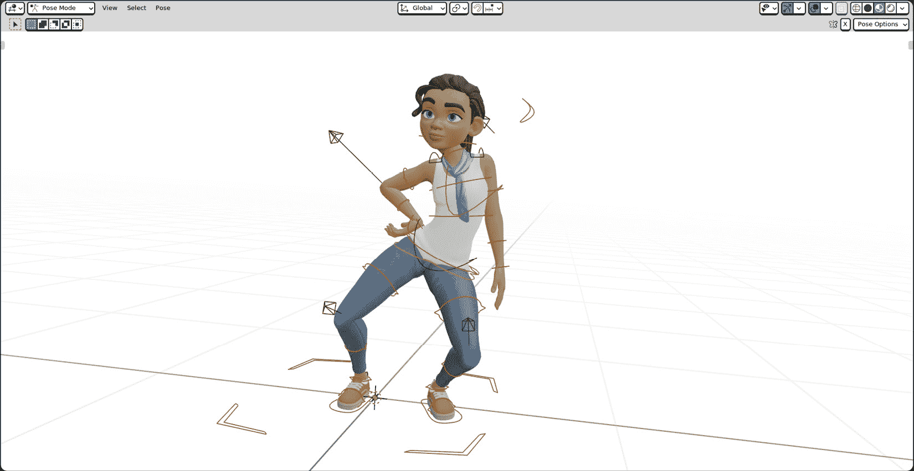

图 7.7：IK 目标帮助将 Rain 的手保持在应有位置

多么神奇的骨骼约束用法啊！不过，如果我们希望那只手在动画过程中离开她的身体侧面，该怎么办呢？

### 应用视觉变换

如果你想寻找额外的挑战，你可以选择在下一节让 Rain 使用右臂挥手，而不是使用已经自由悬垂的左臂。

不过，用 `FK` 来做挥手动作比用 `IK` 更好，因此这将要求我们为右臂的 `FK/IK Switch`（FK/IK 切换）设置制作动画，使其在我们的动画过程中从 `1.0`（`IK`）变为 `0.0`（`FK`）。这样，Rain 的右臂将在适当的时候由其 `FK` 骨骼控制。

看看当我们更改该属性时会发生什么：

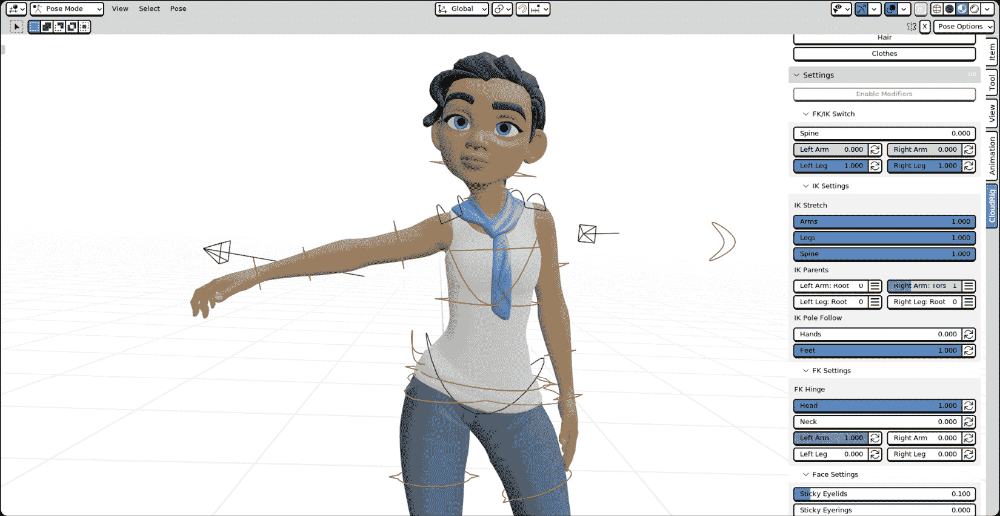

图 7.8：从 IK 切换到 FK

我们没有把那些 `FK` 骨骼放在一个很好的位置，对吧？

从 `IK` 到 `FK`（反之亦然）的“交接”是两个竞争方之间微妙的权力移交，应以一种不引人注目的方式微妙地处理。为了获得最佳效果，我们应该将 `FK` 骨骼移动到与 `IK` 骨骼完全相同的位置，以便它们提前准备好接管对手臂的控制权。这样，变化就不会那么……剧烈。

为了快速做好这一准备，我们可以在 `FK` 骨骼仍受约束于 `IK` 链时应用其视觉变换：

1. 确保 `CloudRig` | `FK Settings` | `FK Hinge` | `Right Arm`（FK 设置 | FK 铰链 | 右臂）设置为 `1.0`。
2. 选择右臂的 `FK` 骨骼：`FK-Upperarm_Parent.R`、`FK-Forearm.R` 和 `FK-Hand.R`。
3. 使用 `Pose` | `Apply`（`Ctrl` + `A`）| `Apply Visual Transform` `to Pose`（应用视觉变换到姿势）。

如果使用得当，该操作符似乎什么也没做，但当你将右臂从 `IK` 切换到 `FK` 时，右臂仍将保持在同一位置！

`Apply Visual Transform to Pose`（应用视觉变换到姿势）是一个方便的操作符，它会自动调整所选骨骼的名义变换值，以确认这些骨骼约束的视觉效果。换句话说，骨骼现在“想要”处于其约束将它们放置的位置，因此当约束稍后被禁用时，手臂将保持原位。然后可以从该起始位置为 `FK` 骨骼制作动画。

现在，我们的初始姿势拥有所有正确的参数，包括那些效果尚不可见的变换，它几乎准备好为动画设置关键帧了！

## 隐藏骨骼

我们的初始动画遍历将集中在 Rain 两个最重要的骨架层中的骨骼上：`IK` 和 `FK`。我们还将启用 `Face Primary`（主要面部）和 `Fingers`（手指）层，以便我们也可以练习为这些部分摆姿势。

这有助于缩小我们需要担心的骨骼范围，但我们可以更进一步。这些层仍然包含一些在本练习中绝对不需要制作动画的骨骼。例如，我们不需要 Rain 的腿部和脚部骨骼；走路对于本章来说太高级了！

现在隐藏一些骨骼，我们可以预先清理 `3D Viewport`（3D 视口）和显示所有关键帧的动画编辑器中的杂乱内容：

1.  启用骨架层 `IK`、`FK`、`Fingers` 和 `Face Primary`。禁用所有其他层。

2.  选择 Rain 腿部和脚部所有可见的骨骼。

3.  使用 `Pose`（姿势）| `Show/Hide`（显示/隐藏）| `Hide Selected`（隐藏选中项）(`H`)。

4.  对本动画中不需要移动的其他几根骨骼重复步骤 2 和 3：`ROOT`、`MSTR-Chest_Parent`、`IK-Hand_Parent.L`、`IK-Pole_Forearm.L`、`TGT-Eyes.L` 和 `TGT-Eyes.R`。

重要提示

隐藏的骨骼稍后始终可以使用 `Reveal Selected`（显示选中项）(`Alt` + `H`) 来显示。不用担心为什么它叫“`Reveal Selected`”，也不用担心在显示之前如何选择一根隐藏的骨骼。

现在 Rain 的骨架看起来如下所示。请注意，我还利用上一章学到的 `Outfits`（服装）功能隐藏了 Rain 的头发和围巾物体：

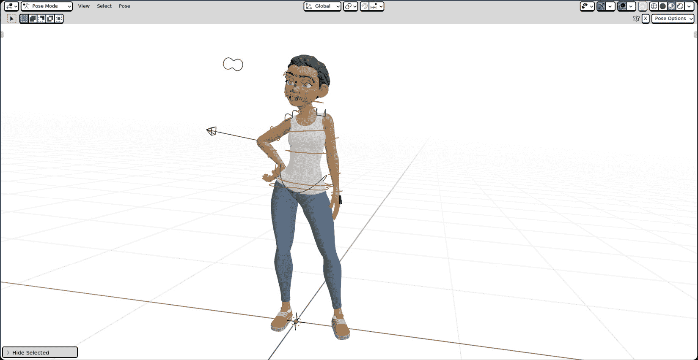

图 7.9：我们初始动画通道的剩余可见骨骼

我们刚隐藏的骨骼并没有消失，但它们不再能在 3D 视口中被看到或选中。这对我们很方便，因为我们马上就要通过选择所有剩余骨骼来为第一个姿势设置关键帧了！

## 为姿势骨骼设置关键帧

在本练习的 5 秒动画中，Rain 将从站立待机开始。几秒钟后，屏幕外的某人会引起她的注意，Rain 将凝视远方以辨认此人。当她认出是朋友时，Rain 会兴奋地向对方挥手。

Rain 到底看到了谁，留给大家想象。Rain 不会与任何东西互动，也不会去任何地方。她的手不会碰到任何东西，脚将保持着地。这不是一个宏大的场景，但即使是如此短的镜头也需要细致的关注。

那么，从哪里开始？从头开始？也许吧，但也不一定……

## 定格动画或动画草稿

在整个角色动画过程中，我们应牢记两条准则：

*   **首先创建并设置最重要姿势的关键帧。** 这些是“极限”姿势，单独来看就能清晰地传达角色所感所做的动作序列。你不总能确切知道每个姿势应设在哪一帧，但这没关系。在为这些姿势设置关键帧后，你可以调整它们的时机、编辑插值，并插入额外的关键帧，以优化角色从一个姿势过渡到下一个姿势时的运动。

*   **从角色中心向外制作动画。** 这意味着确立 Rain 躯干的位置和运动，比对头部、手臂和腿部做同样的事更重要，而后者又比手指和面部优先级高。最后，头发和衣服等应最后制作动画。请记住，你可以使用 `CloudRig` 界面在工作时临时隐藏 Rain 的某些部分，以免分心。

在某种意义上，这两条准则是同一个想法的实用变体；即，我们应该在返回添加任何细节之前，先完成动画的粗略通道，无论是在解剖学意义上还是时间意义上。请注意，“从头开始”并不是准则之一，尽管在我们的例子中，没有理由从别处开始。

考虑到这一点，让我们看看本练习将制作的三个主要姿势。我们称它们为 `idle`（待机）、`looking`（注视）和 `waving`（挥手）：

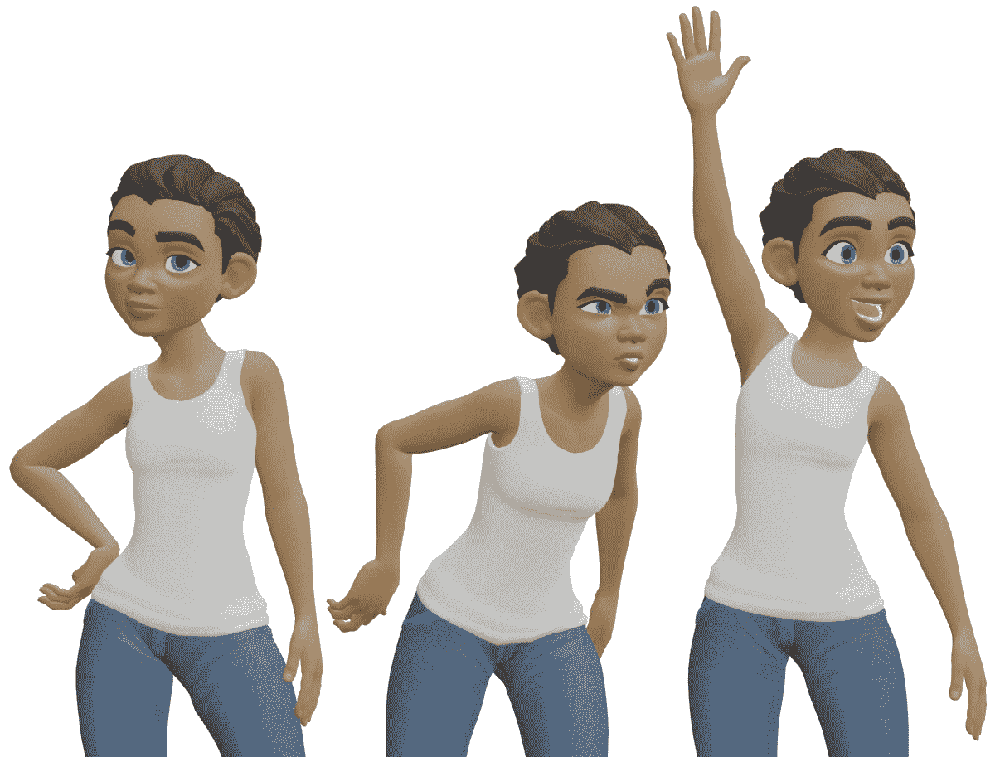

图 7.10：三个关键姿势：待机、注视和挥手

我们已经完成了第一个姿势。现在让我们为它设置关键帧。

### 为“待机”姿势设置关键帧

我们可以通过选择四个最重要图层上所有剩余骨骼，一次性为它们的变换属性设置关键帧，从而为整个姿势设置关键帧：

1.  转到第 `1` 帧。

2.  全选 (`A`) 所有可见骨骼。

3.  调用 `Insert Keyframe Menu`（插入关键帧菜单）(`I`) 并选择 `Location, Rotation, & Scale`（位置、旋转和缩放）。

4.  如果你打算让 Rain 挥动目前放在臀部的那只手，它稍后需要从 `IK` 切换到 `FK`。转到 `CloudRig` 界面，在 `1.0` (`IK`) 处为 `Right Arm FK/IK Switch`（右臂 FK/IK 切换）数值设置关键帧。

只需点击几下，我们就为那四个图层上每一根骨骼的 `Location`（位置）、`Rotation`（旋转）和 `Scale`（缩放）设置了关键帧。你目前还看不到它们，但这比本书迄今为止制作的所有其他动画的关键帧总数还要多！

为什么一次为这么多骨骼设置这么多关键帧？此后，我们是否有义务在每次插入新关键帧时都考虑每根骨骼的 `Location`、`Rotation` 和 `Scale`？不一定。虽然确实我们设置的关键帧比技术上所需的要多，但本章的工具将允许我们按骨骼查看动画通道，而不是按该骨骼的每个动画属性查看。稍后详述。

重要提示

现在这么多骨骼的位置都已设置关键帧，你对它们所做的任何更改也必须设置关键帧；否则，当你切换到不同帧时，更改将会丢失。忘记为动画属性插入关键帧是导致挫败感的常见原因，尤其是在角色动画中，可能会花费大量时间只在一个姿势上。为了防止意外丢失工作，在完成姿势之前通过插入关键帧来“保存”姿势无伤大雅。

现在 Rain 的初始姿势已在第 `1` 帧设置关键帧，我们可以继续下一个姿势了。

### “注视”姿势

该创建一个完全不同的姿势了！在挥手之前，Rain 必须凝视远方，看看是谁或什么引起了她的注意。

一次性为这么多骨骼设置关键帧的一个好处是，我们省去了猜测在此阶段该为哪些骨骼设置姿势和关键帧的麻烦。我们用于制作动画的主要精力可以只集中在 `IK`、`FK`、`Fingers` 和 `Face Primary` 图层上（如果你对后两个图层偷懒我也不介意）。

新手动画师在创建动画中的第二个姿势时往往胆小怕事，过度小心不让它与第一个姿势差异太大。不要害羞；关键姿势*就是*要看起来不同！如果它们之间的精确连贯性很重要，它们就不是关键姿势了。鼓励你重置并重新摆放你看到的任何骨骼。专注于让这个新姿势单独来看尽可能好。稍后我们有大把时间来纠结姿势之间的过渡。

开始工作吧：

1.  转到第 `50` 帧并开始设置姿势。

    在这一帧的姿势中，Rain 应直视一侧的某个隐形人物，并用整个躯干强烈地向对方倾斜。

    手臂通常平衡躯干的运动。在这种情况下，Rain 的手臂和肩膀应朝与她倾斜相反的方向僵硬地伸展。

2.  使用 `Face Primary` 图层中的骨骼，将 Rain 的面部表情改为不确定的神情，眯起眼睛，因为在这一帧中她努力辨认所见之人。为 Rain 的眼球目标找个好位置，因为这将标记她所见之人的位置。

3.  再次为所有相同骨骼的 `Location`、`Rotation` 和 `Scale` 设置关键帧。也请记得为你更改的任何其他属性设置关键帧，例如 `FK/IK Switch`。

现在我们有两个姿势了！它们在一起如下所示：

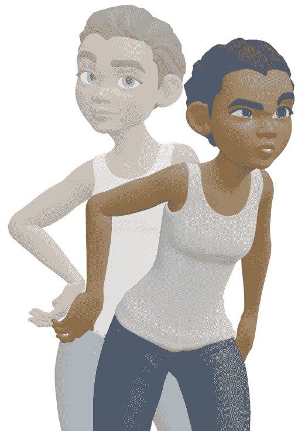

图 7.11：重叠对比的“待机”和“注视”姿势

目前这两个姿势之间的过渡看起来会缓慢且别扭，但我们马上就会处理。我们还剩最后一个关键姿势。

### “挥手”姿势

我们的第三个姿势是 Rain 认出所见之人后的欣喜反应。和之前一样，我们希望这个关键姿势看起来几乎完全不同，仅保持 Rain 双脚着地的位置和视线方向。这意味着你应该保留的唯一可见骨骼就是眼球目标。

## 重要提示

尝试从`插入关键帧`菜单（`I`）中使用`可用`关键帧集，它仅为已有关键帧的选中骨骼/物体的属性插入关键帧。如果你稍后决定删除某些动画通道且不想意外地再次为这些属性添加关键帧，这将很有用。你在 CloudRig 界面看到的大多数属性属于隐藏骨骼，因此你仍需单独为它们添加关键帧。

不要害怕在这里夸张；稍后放松姿势比加强姿势容易得多。你甚至可以让 Rain 的四肢稍微伸展一点点：

1.  前往**第 80 帧**。
2.  对于这个姿势，Rain 应该直立站立，并将一只手尽可能高地举起，手指伸直。确保执行此动作的手臂正在使用 `FK`。
3.  无论你选择举起哪只手臂，都要让肩膀和脊柱的曲线跟随动作。特别是，举起手臂的那侧肩膀本身也应该大幅抬高。
4.  认出朋友后，Rain 的面部表情应该是兴奋的。
5.  像之前一样为所有内容添加关键帧。

这是我的最终姿势与前两个的对比：

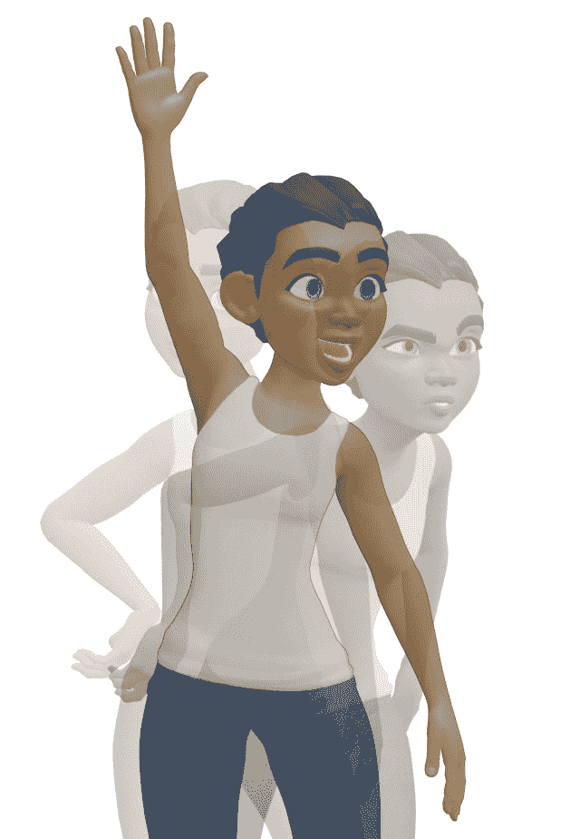

图 7.12：重叠的“待机”、“观望”和“挥手”姿势

这些关键姿势至关重要，所以我们要确保它们正确无误。

## 复查我们的关键姿势

完成后，检查你的三个关键姿势是否有错误。让你作为动画师的判断力成为向导。如果某个骨骼在姿势中的位置看起来“不对劲”，就修复它并重新插入其关键帧。趁早做这件事比等到关键帧可能被移动后再做要容易得多。只需确保你位于想要覆盖的现有关键帧所在的同一帧上；否则，你只会在时间轴上紧邻它的位置添加一个新关键帧！

> **提示**
>
> 除了使用键盘上的`左`和`右`方向键来逐帧前进外，你还可以使用`上`和`下`方向键在选中物体/骨骼的关键帧之间跳转。这对于专注于关键姿势而不被中间帧干扰很有用。

你的作品可能与我的不同，甚至可能更好！Rain 可能看向不同的方向、做出不同的表情，或用另一只手挥手。只要这三个姿势讲得通且在你看来效果良好，目前这才是最重要的。

至于实际动画，那是另一回事。是时候使用一个新工具来完善 Rain 的动作了。

## 动作编辑器

我们的三个姿势看起来不错，但动画目前还谈不上出色。Rain 不会“保持”姿势，看起来不自然。在这个阶段，我们可以开始调整关键帧，复制它们以确定每个姿势应保持多久才过渡到下一个。

让我们在`图表编辑器`中查看整个动画：

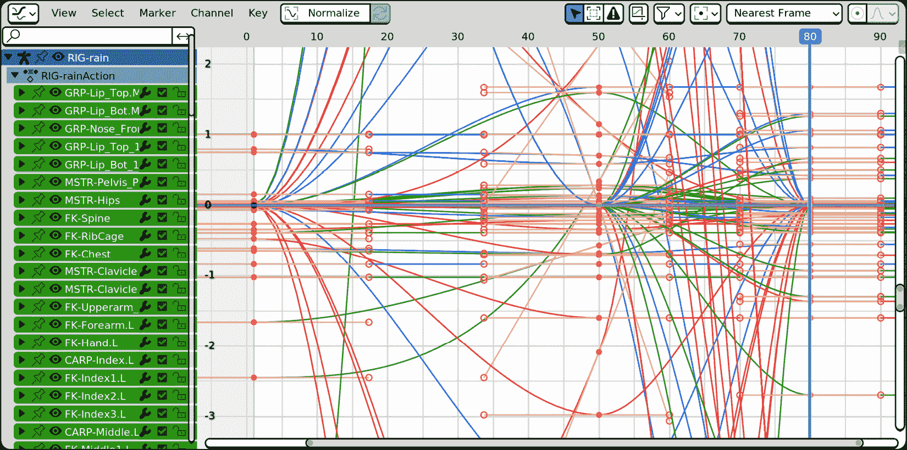

图 7.13：图表编辑器

这看起来不错。开玩笑的！你能想象吗？角色动画以及其他复杂类型的动画会产生太多`F 曲线`，我们无法在图表编辑器中一次性直观地查看所有曲线。从技术上讲我们可以使用它，但我们还是别这么做了。

对于包含大量动画通道的动画进行宏观控制，我们改用`动作编辑器`。它的名字源自传统动画师用来规划镜头时长的曝光表，`动作编辑器`可以追踪我们动画中任意/所有关键帧的位置（在时间上）。

## 动作编辑器简介

你可以通过更改界面中某个区域的编辑器类型，或者直接切换到窗口顶部的`动画`工作区标签页来打开`动作编辑器`。

让我们打开一个。此外，我们需要确保`动作编辑器`显示所有动画数据，包括可能隐藏的骨骼的关键帧：

1.  在用户界面中打开一个`动作编辑器`编辑器。
2.  在`动作编辑器`的标题栏中，禁用`仅显示选中`并启用`显示隐藏`：

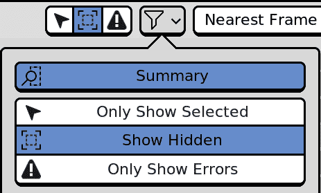

图 7.14：动作编辑器中的可见性设置

对于拥有大量动画骨骼的双足角色，我发现将 3D 视口和`动作编辑器`并排放置很有用。这是我的界面布局：

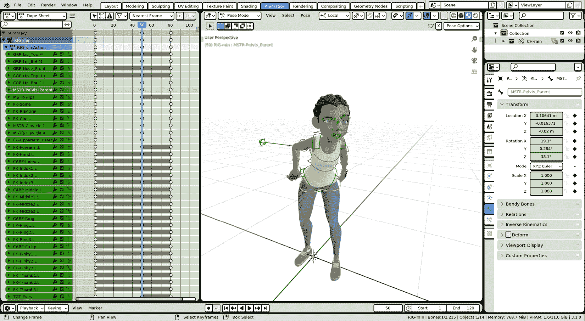

图 7.15：竖屏尺寸下的动作编辑器和 3D 视口

有了`动作编辑器`，我们可以看到插入的所有关键帧整齐地按每个通道排列成行。它有点像没有 Y 轴的`图表编辑器`；通过牺牲一些关键帧信息并将它们组织成行，我们可以一次性轻松管理大量动画属性的关键帧。

### 等等，这不就是时间轴吗？

是的，它们实际上是同一个编辑器，只是标题栏不同：

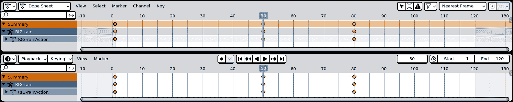

图 7.16：放在时间轴上方的动作编辑器

最初，Blender 的`时间轴`仅用于播放和跳转帧，无法直接编辑关键帧。后来，为了方便，一些功能从`动作编辑器`复制到了`时间轴`。这确实让*第 1 章*容易多了！

我们即将在`动作编辑器`中进行的许多操作在`时间轴`中也能行得通。不过别搞混了；就编辑关键帧而言，`时间轴`能做的事，`动作编辑器`都能做得更好。首先，`时间轴`仅显示选中物体和/或骨骼的通道，而`动作编辑器`在筛选通道可见性方面拥有与`图表编辑器`相同的灵活性。

`时间轴`的核心功能（即`动作编辑器`不具备的功能）都位于其标题栏中，我们可以在那里找到播放、帧范围等设置。其标题栏以下的部分可以视为“快速访问”版的`动作编辑器`。因此，你可能希望在界面中同时显示`动作编辑器`和`时间轴`，以便同时使用两者的功能。

既然澄清了这一点，我们可以回到主题，看看是什么让`动作编辑器`（在某些情况下也包括`时间轴`）如此有用。

### 动画通道（再谈）

看看`动作编辑器`左侧面板的内容，它包含所有动画通道的嵌套列表：

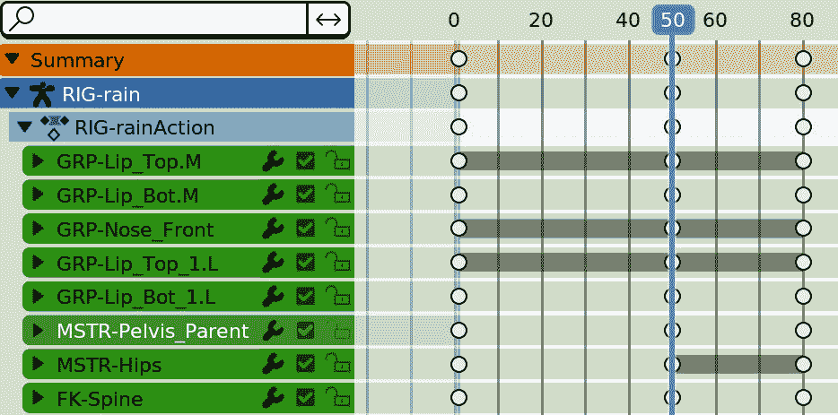

图 7.17：以每根骨骼命名的通道组列表

最顶端是一个标记为`摘要`的项，包含所有动画物体。接着是 Rain 的骨架物体，然后是动作。我们的场景只有一个动画物体，且只有一个动作，所以顶部这前三个通道是冗余的。你无需费心区分它们。

动作内的动画通道会自动组织成通道组。对于角色动画，通道组会自动以每根骨骼命名。在适用的情况下，点击通道组会选中对应的骨骼，反之亦然。

如果展开一个通道组，你会看到该骨骼每个动画属性的单独通道：

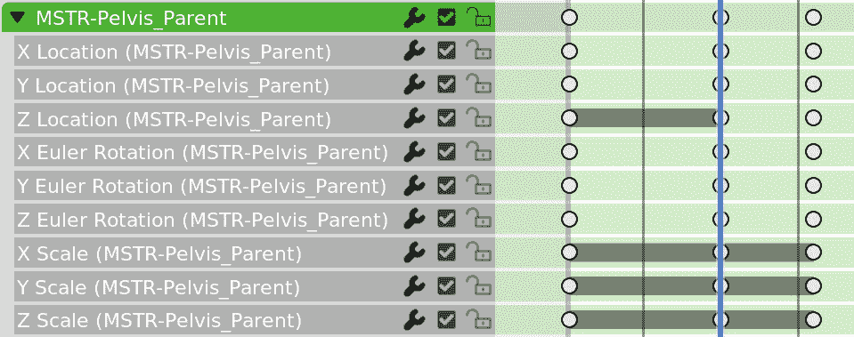

图 7.18：单根骨骼的单独动画通道

这看起来应该很熟悉。这就像我们之前在`图表编辑器`中看到的一样，在`时间轴`中也能找到。不过这一次，我们的动画拥有比以往更多的通道和关键帧。每次我们为前四层中的每根骨骼插入`位置`、`旋转`和`缩放`关键帧时，都会创建一整列关键帧，每个姿势就有 1000 多个。

这么多通道和关键帧让你感到困扰吗？我也是！让我们使用 `Collapse Channels`（`Numpad -`），或者点击 `Summary` 行旁边的小箭头，这样我们就不用去想它们了：

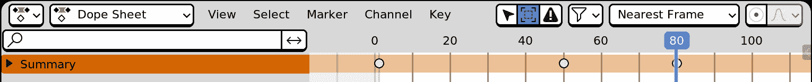

Figure 7.19: 折叠动画通道

现在只有三个关键帧，每个姿势一个！毕竟这不是什么复杂的动画。

## 在 Dope Sheet 中编辑关键帧

仅仅因为我们看不见那些其他数据，并不意味着它们不存在；只是在我们准备好之前，不必去想它们。目前，我们可以在 Dope Sheet 中编辑这三个姿势的时机，就好像它们是三个孤立的关键帧一样。

**重要提示**

以下操作需要影响我们所有的关键帧。Dope Sheet 无法编辑隐藏通道的关键帧，因此请确保在执行后续步骤前，你已禁用 `Only Show Selected` 并启用了 `Show Hidden`。

另一方面，折叠通道组内的通道不算作隐藏。无论通道是折叠还是展开，在功能上都没有区别。

在控件和键盘快捷键方面，Dope Sheet 没有什么惊喜。让我们从使用 `Duplicate`（`Shift + D`）开始，让 Rain 保持她的前两个姿势：

1. 在 Dope Sheet 的 `Summary` 行中，选择第 1 帧上的关键帧。
2. 复制选择，将新关键帧移动到第 40 帧。
3. 对第 50 帧上的关键帧做同样的操作，将新关键帧移动到第 70 帧。

我们刚刚稍微调整了一下动画的时机，让 Rain 在过渡到下一个姿势之前，每个姿势都保持一会儿。复制关键帧是实现这一目的的常用方法，就像我们在 *Chapter 1* 中为立方体制作动画时那样。

Dope Sheet 中关键帧之间的阴影给了我们一个视觉线索，指示动作发生在何处。相同关键帧之间的长灰条表示无变化，而关键帧之间未变灰的区间则是运动发生的地方：

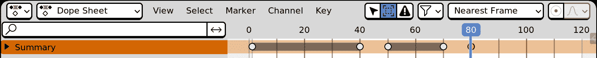

Figure 7.20：Dope Sheet 的 Summary 行中的“保持”关键帧

尽管还有大量信息隐藏着。这是五个关键帧，还是 5,000 多个？我们到底有多少个关键帧？

## Summary 或“分组”关键帧

如果我们使用 `Expand Channels`（`Numpad +`），就能看到 `Summary` 行中的关键帧实际上是如何工作的。看看当我们选择其中一个时会发生什么：

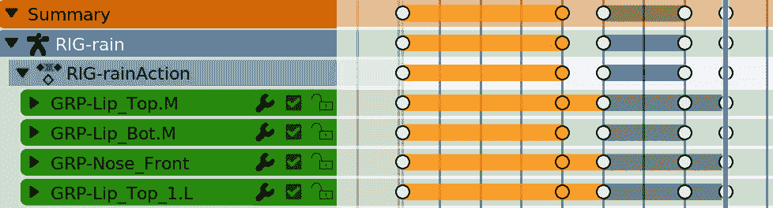

Figure 7.21：关键帧的选择

每一个可见的关键帧（或者如果通道展开后会变得可见的关键帧）都会出现在 `Summary` 行中。对于接下来的两行也是如此，但对于我们的目的来说它们是多余的。

如果两个或更多关键帧共享同一帧，它们就会在 summary 行中折叠成一个代表它们全部的关键帧。我称之为“summary keys”（摘要关键帧），但你可以叫它们“meta-keys”（元关键帧）、“grouped keys”（分组关键帧），甚至“fool’s keyframes”（愚人关键帧）；对于它们叫什么，并没有达成一致的术语。

让我们在层级中进一步向下，选择一个骨骼的 summary key：

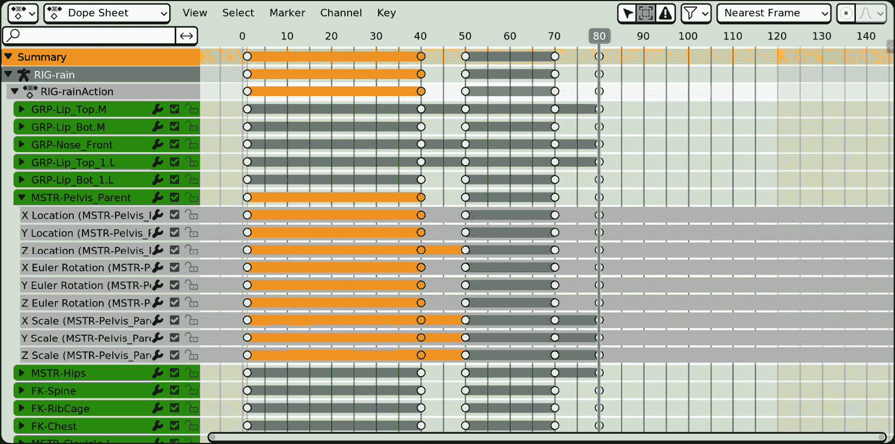

Figure 7.22：一个骨骼所有关键帧的选择

每个骨骼的通道组就像它自己的摘要通道，包含着能够有效编码多个通道数值的 summary keys。对于许多骨骼，我们可能永远不需要单独编辑各个 `Location`、`Rotation` 和 `Scale` 通道的关键帧。相反，我们可以在更抽象的层面上工作，一次为一个完整的“姿势”制作所有这些属性的动画。既然有这么多骨骼要操心，我们需要尽可能多的抽象！我们甚至可能需要比现有的更多。

## 整理 Dope Sheet

仅靠在一行中编辑整个角色动画的关键帧，我们能完成的工作有限。随着工作的进行，我们必须为特定骨骼插入和编辑关键帧，而不是整个姿势。

这里只有一个障碍：在 Dope Sheet 中展开动作通道感觉更像是爆炸而不是展开。即使隐藏了许多其他骨骼以免它们被加关键帧，这个列表里的骨骼实在太多了。它们从上到下的顺序也不太讲得通。

在继续制作动画之前，让我们先整理这些通道组。这会让我们后续的工作进行得更顺利。

### 重新分组通道

即使通道组是折叠的，Dope Sheet 中仍有显眼的大量行，足以让我们的工作比必要时更难。看看这些通道组的名称，并考虑它们对应的骨骼：

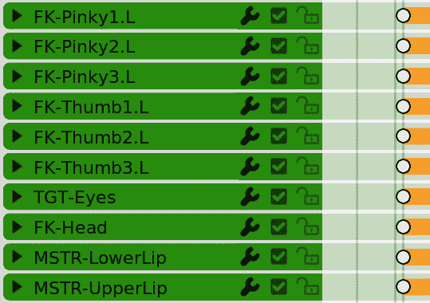

Figure 7.23：列表太长了

看看 Rain 的手指和面部那些小骨骼有多少通道组！其中一些骨骼不需要制作动画，但很多需要，所以我们不能直接删除这些数据。不过，我们真的需要看到每个手指和面部骨骼的关键帧吗？真的那么重要吗？非要为 `FK-Pinky2.L` 和 `FK-Pinky3.L` 设置单独的通道组，以便区分 Rain 左手小指两节末节骨之间的时机差异？也许以后会用到，但这次动画不需要。

相反，我们可以使用 `Channel | Group Channels`（`Ctrl + G`）操作符，将 Rain 手指和面部骨骼的众多通道合并为仅仅几个通道组。

首先，我们应该剔除一些可见的骨骼和通道：

1. 隐藏 `IK` 和 `FK` 骨架层，仅保留 `Fingers` 和 `Face Primary` 层可见。
2. 在 Dope Sheet 中启用 `Show Only Selected`。

这应该能减少选错骨骼或无意中对通道分组的风险。

**重要提示**

在 Dope Sheet 中对通道分组前，请确保你的选择无误。如果你不小心对错误的通道进行了分组，除了 `Undo`（`Ctrl + Z`）之外，没有自动方法能恢复它们最初的分组方式。

#### 对手指骨骼通道分组

现在使用 `Channel | Group Channels`（`Ctrl + G`）对我们想要的通道进行分组更容易了。让我们从手指开始：

1. 在 3D 视口中，选择 Rain 左手可见的手指骨骼。这会使它们在 Dope Sheet 中可见。
2. 在 Dope Sheet 的通道列表中，确保所选骨骼的所有通道组本身都已通过 `Select All`（`A`）选中。
3. 使用 `Channel | Group Channels`（`Ctrl + G`），并将新组命名为 `Fingers.L`。
4. 对右手的手指骨骼重复步骤 1-3，并将通道组命名为 `Fingers.R`。

我们现在只有两个通道组（每只手一个），而不是 38 个（每个手指骨骼一个）：

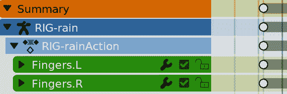

Figure 7.24：手指的两个通道组

这些通道组中的 summary keys 也会按预期工作。如果我们保持通道组折叠，并继续为所有手指一起加关键帧，我们可以把每只手当作一个独立的角色，用编码每个“手指姿势”的 summary “finger keyframes”来制作动画。

这比处理 38 个单独骨骼的 summary keys 容易得多，也比处理这些骨骼的 342 个单独 `Location`、`Rotation` 和 `Scale` 通道容易得多（顺便说一句，那些通道仍然存在）：

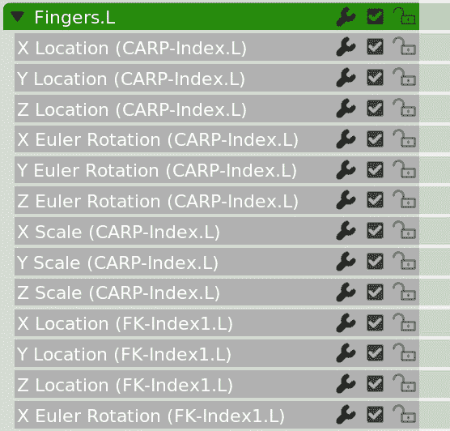

Figure 7.25：啊！收起来！

正如你所见，通道组无法嵌套。我真希望它们能。去问问开发者吧。我们不能把通道组放进其他通道组里；我们只能清空它们各自的动画通道，并将那些通道放入一个新的通道组中。

**重要提示**

由于多个骨骼的通道组在展开时会变得非常混乱，除非我们确定大部分时间都能将它们保持折叠状态，否则我们将避免对通道进行分组。

我们在 `Dope Sheet`（动作编辑器）中的通道显示变得更加精简了！现在，只剩下面部骨骼的动画通道。

## 面部骨骼通道分组

将所有内容归入一个“面部”通道固然诱人，但未免过于激进。面部上半部分在说话等动作中通常会与下半部分不协调地移动，而眼睑等面部部分需要眨动，独立于眉毛移动。

不过，这并不意味着每根眉毛骨骼都需要单独制作动画！为了在保留面部各部分一定独立性的同时折叠更多通道，我们将把所有这些杂乱的通道整理成四个基本通道组：`Mouth`（嘴巴）、`Nose`（鼻子）、`Eyebrows`（眉毛）和 `Eyes`（眼睛）。

**重要提示**

我们给通道组起的名称是任意的，不会改变受影响的骨骼或属性。这由每个单独动画通道的数据路径决定，除非变为孤儿通道，否则数据路径是不可变的。

这里没有新知识点。只是重复我们之前做过的操作，但这次针对面部：

1. 在 `Dope Sheet`（动作编辑器）中选择 Rain 眉骨线上的骨骼，随后选择与之关联的通道。
2. 使用 `Group Channels`（分组通道，`Ctrl` + `G`），并将新组命名为 `Eyebrows`。
3. 对 Rain 的鼻子和内侧颧骨重复步骤 1 和 2，将通道组命名为 `Nose`。
4. 对 Rain 的嘴巴和剩余的颧骨执行相同操作，将通道组命名为 `Mouth`。
5. 现在，对控制 Rain 眼睛和眼睑（但不包括眼球目标）的骨骼执行相同操作。将新组命名为 `Eyes`。

将所有这些动画通道收集到仅有的几个通道组后，我们便可以重新启用 `FK` 和 `IK` 骨架层，并恢复 `Dope Sheet` 的过滤设置，使其再次显示所有动画数据。

**技巧**

你可以（也应该）继续利用 Rain 的骨架层设置和 `Dope Sheet` 中的过滤设置，在处理动画的不同区域时限制骨骼及其通道的可见性。聪明工作，别笨干；如果不需要看某部分，就想办法把它隐藏起来！

运气好的话，完整的通道组列表甚至能在一个屏幕上显示完全！现在，如果它们的顺序也能讲得通就好了……

## 重新排序通道组

我们剩下的大多数通道组都是以单个骨骼命名的默认组。这本身没问题，但它们从上到下的列出顺序毫无逻辑可言。

这对动画结果没有任何影响，但确实让我们在工作时查找特定骨骼的通道变得不必要地困难。我们在尝试制作动画时每一秒花在整理杂乱通道上的时间都会累积，让过程变得不那么愉快，所以让我们利用 `Channel | Move…`（通道 | 移动……）中的这些操作符：

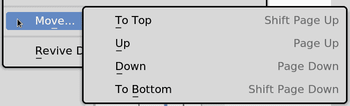

图 7.26：重新排序所选通道的操作符

每次都要点击菜单上百次非常恼人，所以一定要善用 `Page Up` 和 `Page Down` 热键。此外，请注意，如果以骨骼命名的通道组对应的骨骼被隐藏了，则无法选中这些通道组。

关于通道组应如何排序没有严格的约定，但我建议遵循以下准则：

1. 根据前缀将通道组归类在一起。将 `MSTR-` 骨骼放在顶部，其次是 `IK-` 骨骼和 `FK-` 骨骼。
2. 在每个具有相同前缀的“通道组组”内，注意每个通道组的骨骼控制骨架的哪一侧。位于骨架中心的骨骼应排在最前，然后是左侧骨骼，最后是右侧骨骼。
3. 对于每个肢体，按解剖学顺序从近端到远端组织 `FK` 骨骼的通道组（例如 `FK-Upperarm_Parent.L`、`FK-Forearm.L`，然后是 `FK-Hand.L`）。
4. 按解剖结构、重要性或任何对你有意义的方式对剩余的通道组进行排序。

这是我排序后的 `Dope Sheet`：

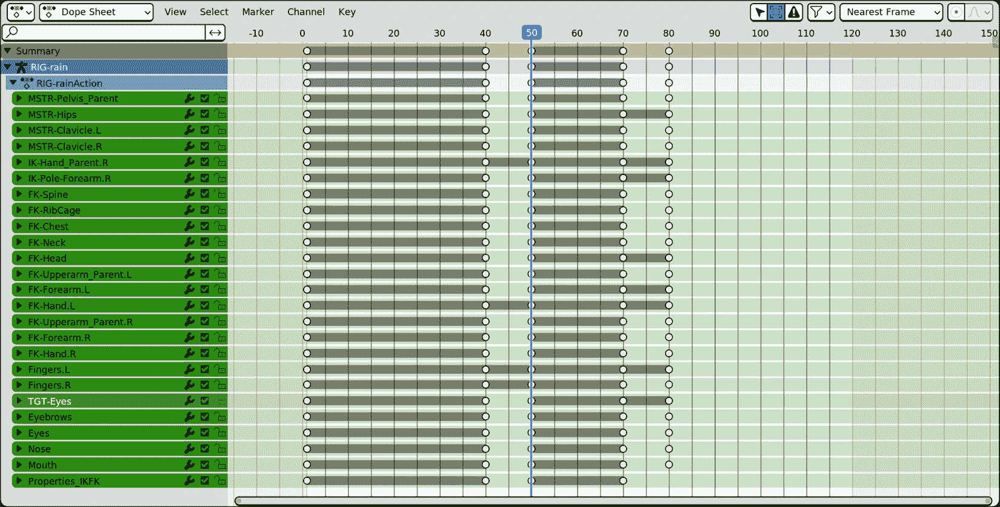

图 7.27：完全重新组织的 Dope Sheet

请记住，我们刚才所做的一切都不影响动画本身；它只影响在 `Dope Sheet` 中查看时动画数据的组织方式。正确排序的通道组将使我们在深入为该角色制作动画时工作更少挫败感。

话虽如此，让我们更深入地为这个角色制作动画吧！

## 更深入地为这个角色制作动画

动画能让秒数感觉像天数。在 Rain 保持姿势的那些帧里——不是我们关键姿势之间的运动间隔，而是那些间隔之间漫长的灰色间隔——Rain 的身体如雕像般静止。我们的动画仍然是一系列离散的全身姿势的简单序列，每个姿势都编码在一列关键帧中。因此，Rain 产生的运动还不算太好，但我们会像雕塑家对待石头一样，不断地雕琢它。随着我们赋予作品形态，我们将见证 Rain 变得更加栩栩如生。

我们的下一阶段涉及为特定骨骼设置关键帧，而不是一次性为整个角色设置关键帧；实现那些需要更多关注其与前后姿势关系的姿势。这个动画的中间阶段比分镜阶段更详细，但离我们所谓的“细化”还远得多。有人可能称之为分解阶段，但我更喜欢叫它，嗯，制作动画！

## 两个额外的中间姿势

在我们现有的三个姿势之间，考虑一下我们即将为 Rain 的头部添加的两个额外姿势。我们将它们称为 `Glancing`（瞥视）和 `Recognizing`（辨认）：

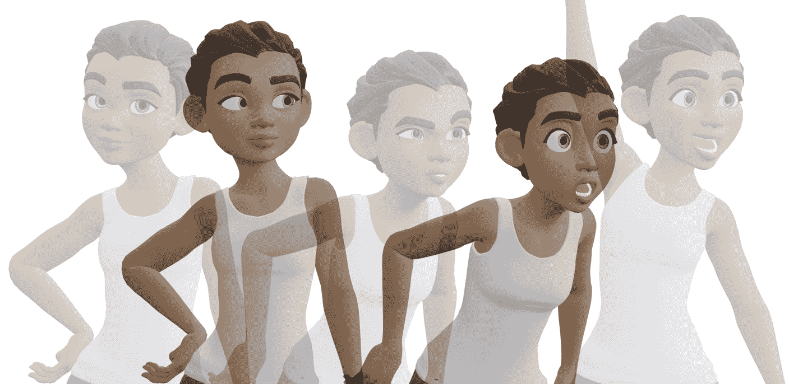

图 7.28：待机、瞥视、注视、辨认和挥手

这些姿势将有助于改善和清晰化我们目前在主要姿势之间过于平滑的过渡，并让观众更清晰地读懂 Rain 的内心思维过程。

### 瞥视

仔细想想，Rain 不应该直接从待机状态变为凝视状态。要引起 Rain 的注意，她的眼睛必须先看到它。感知发生在反应*之前*——不是*期间*，更不是*之后*。

我们将通过在帧 `40` 覆盖一些关键帧来制作瞥视姿势。一些姿势只需复制一个或多个现有的关键帧即可完成：

1. 在 `Dope Sheet`（动作编辑器）中，选择帧 `50` 上 `TGT-Eyes` 的关键帧。
2. 复制（`Shift` + `D`）所选关键帧到帧 `40`。这将覆盖现有的关键帧。
3. 转到帧 `40`。

现在，Rain 的眼睛正“瞥视”着 10 帧后她将要“注视”的同一个东西，尽管眼睛提前那么远看过去看起来不太舒服：

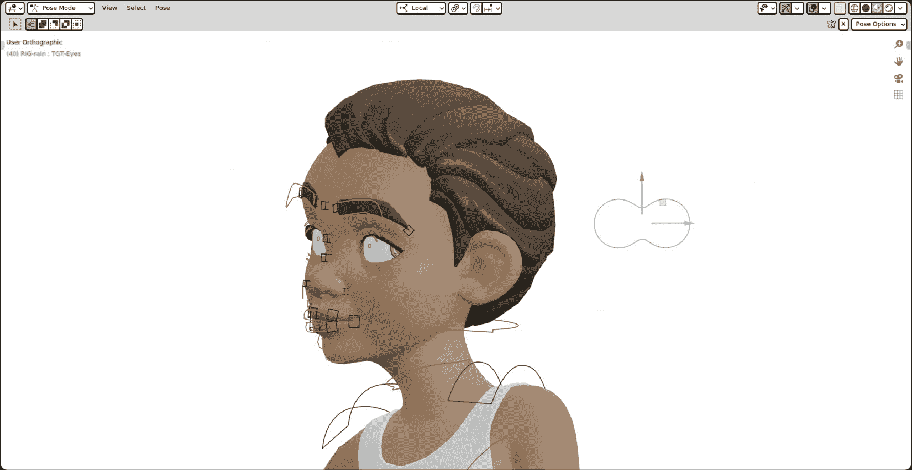

图 7.29：Rain 眼球转动过度的正交视图

我们对角色的共情很重要：如果一个姿势看起来很痛苦，看起来就会让人难受。Rain 需要转动更多身体，朝同一方向移动头部，以便虹膜仍然可见。

让我们继续摆姿势：

1. `Rotate`（旋转，`R`）`FK-Head` 朝向眼球目标方向，这样 Rain 的眼球看起来就不奇怪了。
2. 如有需要，将 `FK-Neck` 和 `FK-Chest` 朝同一方向稍微旋转一点以补偿头部运动。

在为 Rain 的头部动作设置关键帧之前不要离开帧 `40`，否则你会丢失这些修改！既然 `Dope Sheet` 触手可及，我们就借此机会介绍另一种插入关键帧的方法。

#### 在 Dope Sheet 中插入关键帧

`Dope Sheet`（动作编辑器）有自己的 `Insert Keyframes`（插入关键帧，`I`）功能：

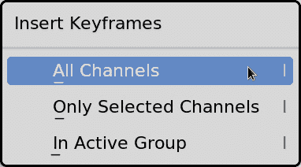

## 动画关键帧工作流

图 7.30：插入关键帧菜单

我们之前在图表编辑器中见过这个菜单。当你想为现有的动画通道插入关键帧，而不必在界面的其他地方查找并选择其对应的所有者时，这非常有用。

让我们用它来为我们刚刚在帧 `40` 上对姿势所做的更改设置关键帧：

## 为瞥视姿势插入关键帧

1.  在动作编辑器中，使用 `Key` | `Insert` `Keyframes` (`I`)。

2.  选择 `All Channels`。请注意，在这一帧上设置“过多”的关键帧无伤大雅，因为它已经为每根骨骼都设置了关键帧。

    现在，动作编辑器清楚地显示了哪些通道受到了影响。注意某些骨骼缺少灰色条带。不过，帧 `1` 和 `40` 之间的这段动作间隔太慢了，所以让我们把它加快：

3.  选择“瞥视”姿势的已更改关键帧（这些是帧 `40` 上 `TGT-Eyes`、`FK-Head`、`FK-Neck` 和 `FK-Chest` 的关键帧）。

4.  复制 (`Shift` + `D`) 所选内容到帧 `35`。

5.  选择同一组骨骼在帧 `1` 上对应的关键帧。

6.  将所选内容复制到帧 `30`。

现在，Rain 的转头动作看起来更好了，并在她仔细观察前，给了她额外的五帧来初步捕捉所见内容：

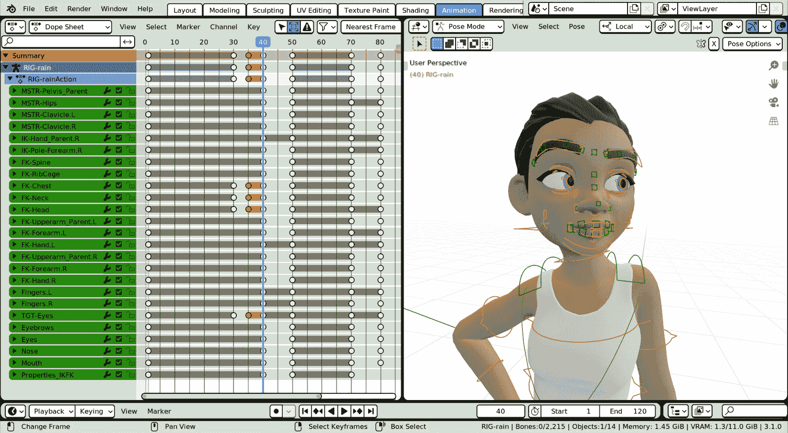

图 7.31：Rain 的新姿势，以及动作编辑器

这段动画目前看起来还可以。让我们添加下一个姿势。

## 识别

与瞥视姿势类似，我们想在观看和挥手之间添加另一个表情：识别。这更清晰地反映了 Rain 的思维过程；Rain 内部状态的变化先于她站起来兴奋挥手的决定。

对于这个面部表情，我们将从帧 `70` 之前一点点开始：

1.  转到帧 `68`。

2.  为 Rain 创建一个新的面部表情，一种惊讶/欣喜的识别表情。

    这个表情有很多可能性。这是我做的：

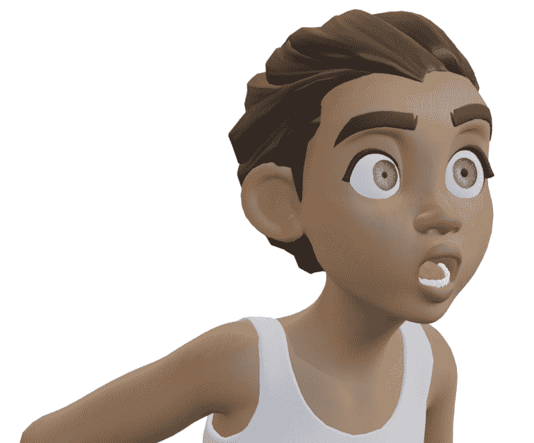

图 7.32：识别姿势

现在让我们为这个表情设置关键帧。既然我们重新组织了面部骨骼的通道，在动作编辑器中做这件事很容易：

1.  选择通道组 `Eyebrow`、`Eyes`、`Nose` 和 `Mouth`。

2.  使用 `Key` | `Insert Keyframes` (`I`) | `Only Selected Channels`。这会在帧 `68` 为该表情插入新的关键帧。

3.  我们不再需要帧 `70` 上的旧表情了，所以让我们覆盖它。将帧 `68` 上的关键帧复制到帧 `70`。

4.  在帧 `50` 上，选择帧 `68` 关键帧之前的关键帧，并将它们复制到帧 `64`。

现在，Rain 从帧 `50` 到帧 `64` 保持着观看表情。相比之下，她的识别表情相对短暂：

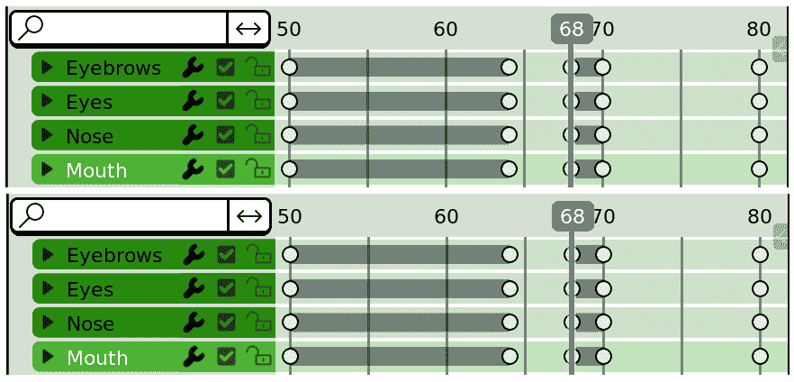

图 7.33：Rain 面部的关键帧序列

为什么这次我们以稍微不同的顺序设置关键帧？没什么原因；这只是为了重申我们可以按任何我们觉得方便的顺序插入、复制和覆盖关键帧。

## 用于姿势的中间帧操作符

在 3D 视口中，我们可以访问一些特殊的姿势操作符。其中一些显示在工具栏中作为工具，但我更喜欢直接在 `Pose` | `In-Betweens` 中调用它们：

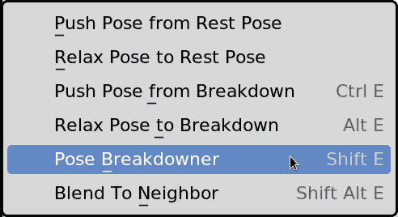

图 7.34：中间帧操作符

称这些操作符为 `In-Betweens` 让它们听起来比实际更重要。我们不一定需要它们；它们只适用于姿势模式下的骨骼，而最后几个只适用于已制作动画的骨骼。尽管如此，它们还是有用处的；可以将它们视为考虑了休息姿势或相邻关键帧等上下文的变换操作符。

例如，`Pose Breakdowner` (`Shift` + `E`) 会在所选骨骼的前一关键帧和后一关键帧之间构想一个线性插值。然后根据因子调整姿势到中间某处，创建一个分解姿势：

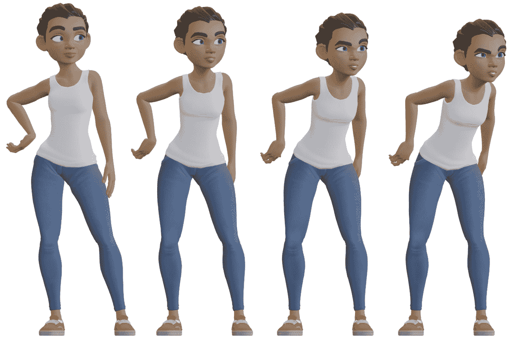

图 7.35：两个不同姿势之间在 `0%`、`50%`、`80%` 和 `100%` 处的分解姿势

让我们在 Rain 的 `IK` 和 `FK` 骨骼上使用它，在帧 `40` 和 `70` 之间创建这样一个分解姿势：

1.  转到帧 `50`。

2.  选择所有可见的 `IK` 和 `FK` 骨骼（面部和手指除外）。

3.  使用 `Pose` | `In-Betweens` | `Pose Breakdowner` (`Shift` + `E`)。向左或向右移动鼠标会沿着相邻关键帧的连续体插值姿势，这在 3D 视口标题栏的水平条中可视化。

4.  选择约 `90`% 的因子并确认。

5.  为你的更改设置关键帧。

我们在这里所做的是稍微“放松”姿势，使得在帧 `50` 时，Rain 几乎完成了前倾，但继续持续到帧 `70`。此类技巧虽微妙，但有助于消除动画早期阶段的“停滞感”。

这类似于擦洗到帧 `48`，设置关键帧，然后将那些关键帧移回我们想要的帧 `50` 位置。然而，通过使用该操作符，我们可以停留在想要的帧上，并获得一个原本可能不易获得的分解姿势。

**提示**

`Push Pose from Breakdown` (`Ctrl` + `E`) 和 `Relax Pose to Breakdown` (`Alt` + `E`) 也是有用的操作符，但除非当前姿势与 Blender 认为的分解姿势有显著差异，否则它们不会有太大效果。

## 挥手

Rain 动画的最后一部分仍然明显未制作动画。Rain 需要真正挥动手臂，而不仅仅是举起来！我将向你展示在动作编辑器中针对这类动作的一个巧妙技巧。一旦你尝试过，你就会开始看到它如何应用于各种动作和身体部位。

我们将首先把 Rain 的抬起手臂视为一个只有三根 `FK` 骨骼的独立角色。对我来说，它们是 `FK-Upperarm_parent.R`、`FK-Forearm.R` 和 `FK-Hand.R`。这是它们的关键姿势：

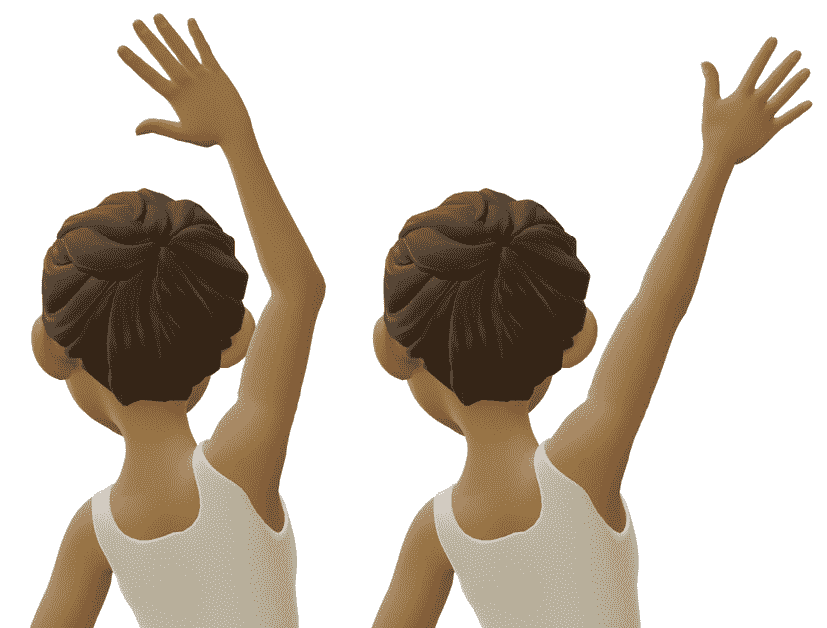

图 7.36：Rain 的手臂向一侧和另一侧挥动

三根骨骼和两个姿势；这应该很容易：

1.  在帧 `83` 上，将抬起的手臂向内摆过 Rain 的头顶并设置关键帧。确保上臂、前臂和手都朝同一方向弯曲。

2.  在帧 `86` 上，将手臂摆向另一侧，远离 Rain 的身体。让 Rain 伸直肘部，并让其他关节朝与之前相反的方向弯曲。

    这给了我们制作单次“挥手”所需的所有关键帧。接下来，我们复制它们以重复动作。

3.  选择你刚在帧 `83` 和 `86` 上创建的关键帧。

4.  复制所选关键帧，将新关键帧向前移动六帧。

5.  持续复制直到超过帧 `120`（我们可能在那里结束动画）。

复制了这个简单的关键帧序列后，Rain 就以每六帧交替两个姿势的方式做了一个相当基础的挥手动作：

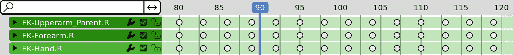

图 7.37：Rain 手臂的重复关键帧

自己看看吧。我觉得看起来还可以，但通过在动作编辑器中使用一个简单的技巧，我们可以让它看起来更好。

### 错开关键帧

这里就是我一直等着要展示给你的技巧。通过错开 `FK` 骨骼的关键帧，我们可以在 Rain 的手臂上创建一个更具视觉美感的运动弧线：

**提示**

要选择一长排多个关键帧，请尝试 `Box Select` (`B`)。查看动作编辑器中的 `Select` 菜单，了解其他一些一次性选择大量关键帧的便捷方法。

### 偏移手臂关键帧

1.  选择 `FK` 前臂骨骼（`FK-Forearm.L` 或 `FK-Forearm.R`）的所有挥手关键帧，并将它们向右 `移动` (`G`) 一帧。

2.  选择 `FK` 手部骨骼（`FK-Hand.L` 或 `FK-Hand.R`）的所有挥手关键帧，并将它们向右 `移动` (`G`) 两帧。

现在，上臂的运动领先于前臂，前臂领先于手腕。最初那两个手臂姿势便于一次性为所有三根骨骼设定极限位置的关键帧，但最后一步是将它们的关键帧分开。

假设你的通道组堆叠顺序和我一样，以下是在 Dope Sheet（动作编辑器）中的显示效果。如果是这样，你会看到按这种顺序排列有多么有用：

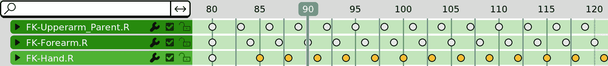

**Figure 7.38: Staggered keyframes（错开的关键帧）**

我们在这里所做的，是在手臂的 `FK` 骨骼链上创建了骨骼运动的延迟。Rain 不仅是在字面上挥手，她四肢的运动本身就像一波浪，从肩膀传递到指尖！

像这样偏移骨骼的运动看起来更好，并有助于表现连接身体部位之间惯性的假象。这在 Dope Sheet 中操作也比在 Graph Editor（图表编辑器）中容易得多。我们将在 Rain 动画的各个领域看到这一原则的应用，从她的脖子和四肢到头发和围巾。

## 润色动画

弄清成千上万个关键帧的时机是一个迭代过程，涉及相互关联的因素。起初，我们根据关于事物应该发生什么以及何时发生的宽泛、有时甚至武断的决定来设定初始姿势的关键帧。随着工作的继续，额外关键帧的时机由我们已经制作的关键帧决定，以此类推。

最后，我们达到了一个可以细化单个骨骼运动的阶段，在某些地方平滑它们的运动，在另一些地方增加细节。我们还将为一些迄今为止未曾动过的骨骼设置关键帧。

> **Tip（提示）**
>
> 除了我们学到的另外两条准则，我还有一条建议送给这部分练习：**没有什么是神圣不可侵犯的！** 在工作过程中，删除任何似乎碍事的不必要关键帧，并且不要害怕编辑任何你想编辑的关键帧，即使它会打破那些关键姿势的长列。

让我们首先拜访一下我们的老朋友 Graph Editor。

## 在骨骼上使用 Graph Editor

我们不会对每一根单独的骨骼都使用 Graph Editor，但如果有任何骨骼值得如此关注，那一定是 `MSTR-Pelvis_Parent`，这根移动 Rain 所有躯干的骨骼。回想一下我们关于从中心向外动画的准则；如果我们把这根骨骼的运动做对，Rain 动画的其余部分就会随之而来。

> **Tip（提示）**
>
> 使用 `Ctrl` + `Tab` 在 Dope Sheet 和 Graph Editor 之间快速切换。

这是我的 `MSTR-Pelvis_Parent` 动画在 Graph Editor 中的样子：

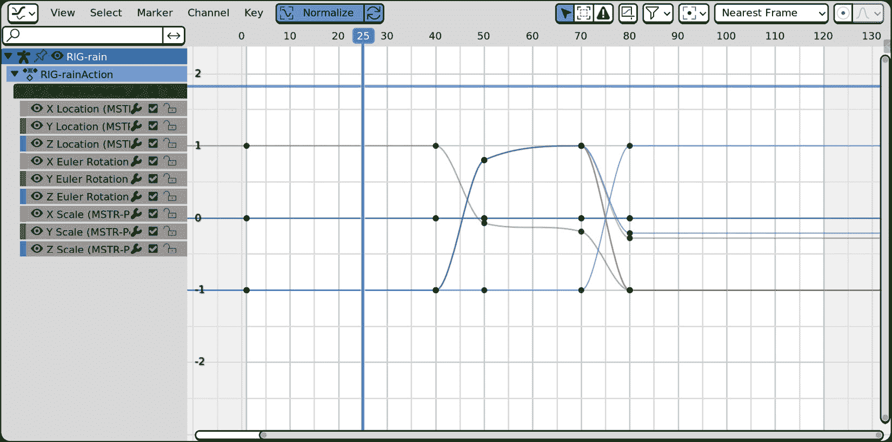

**Figure 7.39: F-curves for pelvis bone (Normalize enabled)（启用归一化的骨盆骨骼 F 曲线）**

当然，这些都是带有自动钳制手柄的贝塞尔关键帧。难怪它们是默认设置；它们表现得太出色了，以至于直到现在我们根本不需要考虑关键帧手柄和/或特定的插值模式。

### 精细调整躯干运动

我们能做些什么来改善这根骨骼的运动？首先，站立角色的身体绝不应保持完全静止；像活人一样，它应该始终至少稍微呼吸和摇晃一下。当她所有的 F 曲线都是平的时，Rain 看起来就像个蜡像，即使只有几帧。

在下面的处理中，我在开头和结尾添加了一些随机关键帧来解决这种静止，主要是在 `X Location` 和 `Y Location` F 曲线上：

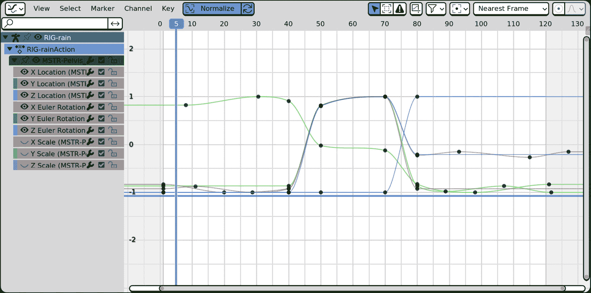

**Figure 7.40: Some subtle variation added（添加了一些细微变化）**

这种偷懒的技巧感觉不像是在做动画，而更像是“消除静止”，但即使是一丁点额外的运动，也能在雕像 Rain 和可信的角色 Rain 之间产生天壤之别。

从某种意义上说，躯干骨骼也是“最重”的骨骼；它的运动看起来应该承载大量动量。可以通过在所有关键帧上使用 `Key`（关键帧） | `Handle Type`（手柄类型） (`V`) | `Automatic`（自动）来实现这种效果：

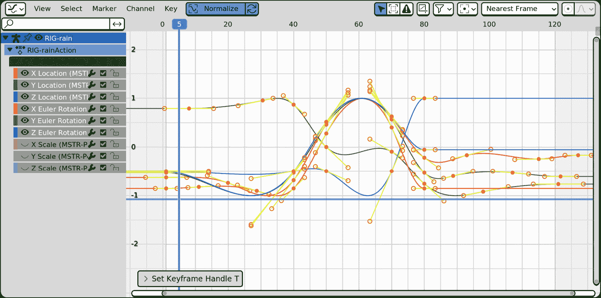

**Figure 7.41: Automatic Bezier keyframes（自动贝塞尔关键帧）**

嗯，也许不是全部……我们需要更有选择性地决定哪些关键帧放手。我们也可以使用 `Aligned`（对齐）类型手动设置一些手柄，添加更多关键帧，并向任何方向移动它们，无论什么能给我们想要的 F 曲线。

> **Tip（提示）**
>
> 插值在两个方向上都起作用，所以要当心过早开始的运动。这对于自动关键帧尤其如此。例如，在前一个例子中，Rain 的躯干会在 `40` 帧很久之前就“蓄力”，为下一个姿势做准备。这说不通；Rain 的身体不应该为了她还不知道即将要做的事情而提前移动。

这是我的最终处理：

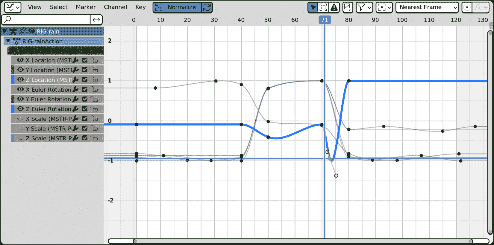

**Figure 7.42: Final F-Curves for MSTR-Pelivs_Parent（MSTR-Pelivs_Parent 的最终 F 曲线）**

现在轮到你了：

1.  选择 `MSTR-Pelvis_Parent` 并在 Graph Editor 中找到它的关键帧。

2.  为 F 曲线的平坦段落添加一些细微运动；`X Location` 和 `Y Location` 将受益最大。你可以忽略其余部分。

3.  在特定关键帧上使用自动贝塞尔手柄，以及你喜欢的任何其他方法，直到你对 Rain 躯干的整体运动感到满意。

我们已经三次检查 `MSTR-Pelvis_Parent` 的动画了，一次是在分镜阶段，一次在第二动画阶段，最后一次在 Graph Editor 中！

## 为 Rain 的配饰制作动画

仅通过为骨骼层 `IK`、`FK`、`Face Primary` 和 `Fingers` 中的骨骼制作动画，我们就已经走了很远，但其他层中还有大量用于动画的骨骼。我们没有义务为所有东西制作动画，但在 `Hair`（头发）和 `Clothes`（衣服）层进行一些快速工作是接下来最明显的步骤。仅仅因为我们在开始制作动画时没有为那些骨骼设关键帧，并不意味着我们现在不能做。我们可以在任何时候为任何我们想要的东西添加动画，只要我们觉得方便！

当我们为这些最后的部分制作动画时，Rain 剩余的松散部分将栩栩如生，我们的动画最终将完成：

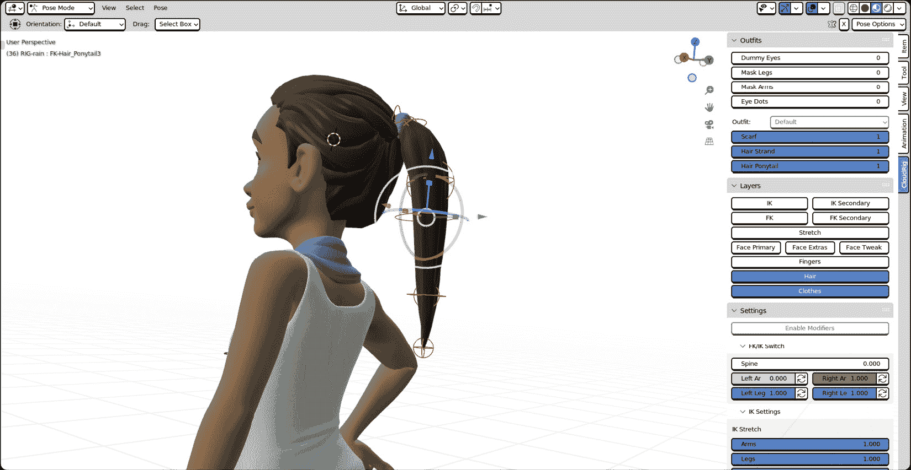

**Figure 7.43: Animating Rain’s hair and scarf bones（为 Rain 的头发和围巾骨骼制作动画）**

1.  启用骨骼层 `Hair` 和 `Clothes` 并禁用其余层。此外，如果你之前隐藏了 Rain 的 `Hair` 和 `Scarf` 网格，请取消隐藏。

2.  为了不被我们即将添加的所有新通道淹没，在 Dope Sheet 中禁用 `Show Hidden`（显示隐藏项）。

3.  找到一帧 Rain 站立相对静止的地方（例如第 `1` 帧），为她的头发和围巾摆姿势，确保它们根据基本重力定律看起来是垂直向下悬挂的。为所有可见骨骼设置 `location`（位置）和 `rotation`（旋转）关键帧。

4.  刷新浏览你的动画。在 Rain 姿势发生每次重大变化的前后，为围巾和头发骨骼设置关键帧，使它们看起来指向正确的方向（向下）。

你还能添加什么其他细节？眼皮的眨动、手指的抽动、手臂和手腕的摆动；可能性太多，本章无法一一涵盖。但这并不意味着你必须停下来！

## Summary（总结）

## 走路循环

由于关键帧数量众多，我们在本练习中使用的关键帧需要在“动作表” 中查看，它们呈现出的外观与在“图表编辑器” 中截然不同。此外，在学习这个新工具的同时，我们还必须同时应对在复杂角色绑定中摆姿势和关键帧设置的所有特殊性。这可能会让人误以为角色动画在本质上与（比如说）立方体动画是完全不同的过程，但这只是一种错觉。关键帧依然是关键帧，而骨骼只是那些拉扯着隐形木偶线的古怪小物体罢了。

另一个我希望你不会陷入的错觉是，认为本练习是角色动画的正式流程，而非“动作表”速成课程以及一小撮专用于姿态骨骼的操作符。本章没有硬性规则，只有指导原则。你将要制作的每一个角色动画（和角色）都会不同，并带来独特且多样的挑战，你将为之发现属于你自己的解决方案。自由思考，发挥创造，别忘了享受乐行！

好了，现在赶紧把乐子享受完，因为下一个练习**才是**有硬性规则的正式流程！这是一个单一的、长期的挑战，你可能会在独自尝试解决它的过程中发疯！别自由思考了；抛弃所有创造力并开始恐慌吧……因为在下一章，我们要做**走路循环**。

## 问题

1.  一个姿势中有多少根骨骼？单根骨骼能有一个姿势吗？

2.  使用 Rain 的 `CloudRig` 界面，哪些骨骼可以充当我们 `IK` 骨骼的父级？在什么情况下每根骨骼作为父级可能会有用？

3.  动作表 和 时间轴 有什么区别？

4.  在图表编辑器 中我们能做什么，而在动作表 中做不到？

5.  既然图表编辑器 显示关于关键帧的更多信息，为什么还要使用动作表 ？

6.  为什么我们要这么多次地编辑/覆盖关键帧？为什么不一开始就做对？

7.  对于 `Push Pose from Breakdown` 或 `Relax Pose to Breakdown` 等中间帧操作符，“Breakdown（分解帧/中间帧）”是什么意思？

8.  为什么头发和衣物之类的东西应该最后制作动画？

## 技术要求

要跟随本章操作，你需要在 Blender 中打开一个新场景。该场景应包含 Rain，即我们一直在使用的角色绑定。如果你需要下载 Rain，或者忘记了如何将她链接到新场景中，请遵循 *第 6 章* 开头的说明。

## 准备走路循环场景

想象一下，你独自走在一条笔直、平坦的走廊里。没有绊脚石，没有干扰，你的走路动作倾向于重复自身——左脚、右脚、左、右、左、右——直到你到达目的地。走廊是几米长还是一英里长并不重要；在给定的一段时间内，你的动作看起来会像任何其他时间段一样。话虽如此，这对齐步走、慢跑、跑步、跳绳——任何用双腿重复自身的运动——也同样适用。

在动画世界里，这种东西被称为 `walk cycle`（走路循环）——一种周期性的走路动画，可以根据动画师的需要无限重复。走路循环不仅仅是一项技术练习，它是一项宝贵的资产，可以在任何角色直线行走的场景中复用。

为了为这种动画设置场景，我们将首先在时间轴 中标记一些帧。然后我们将调整 Rain 绑定中的一些设置，以便她做好持续向前走的准备。

### 走路循环的时间轴

常言道：“千里之行，始于足下”，但咱们别操之过急——*整整一步？！* 为第一步制作动画是件大事，而为两步制作动画几乎就是我们的整个旅程。要实现如此崇高的目标，我们必须耐心且周密地提前规划。

#### 走路循环的周期性

单步应该占多少帧？这取决于角色的解剖结构和你想让他们走多快。对于本练习，我将直接为我们选定一个数字：每步 12 帧。

这意味着 Rain 有 12 帧的时间将一只脚向前迈出，如下所示：

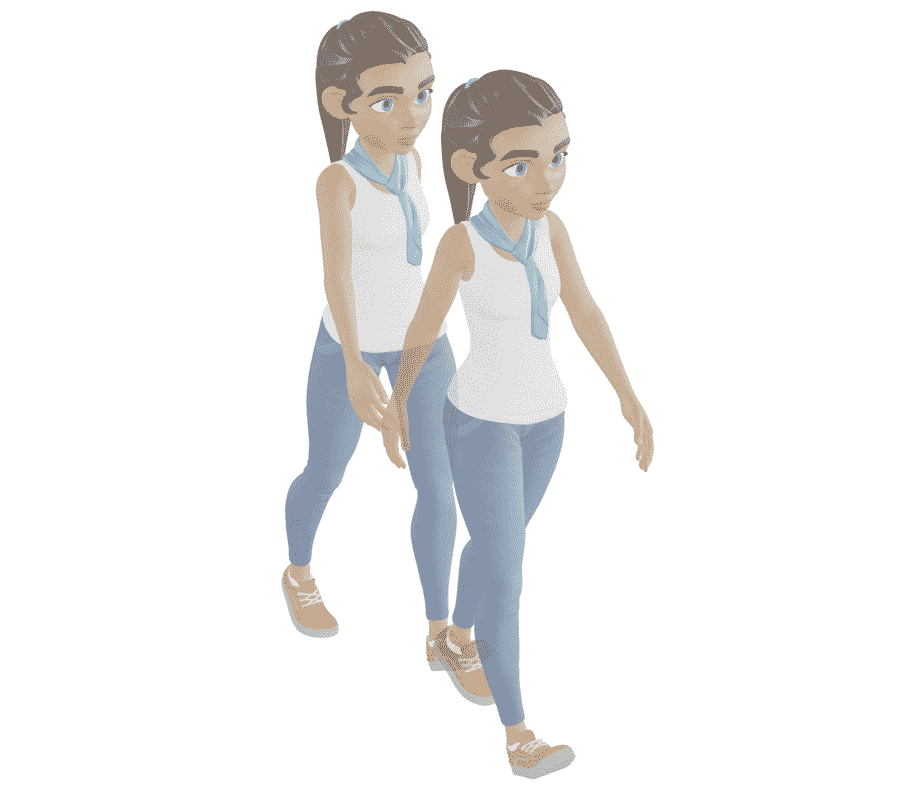

图 8.1：Rain 走路循环的第 0 帧和第 12 帧

……并用另外 12 帧以相同的方式将另一只脚向前迈出：

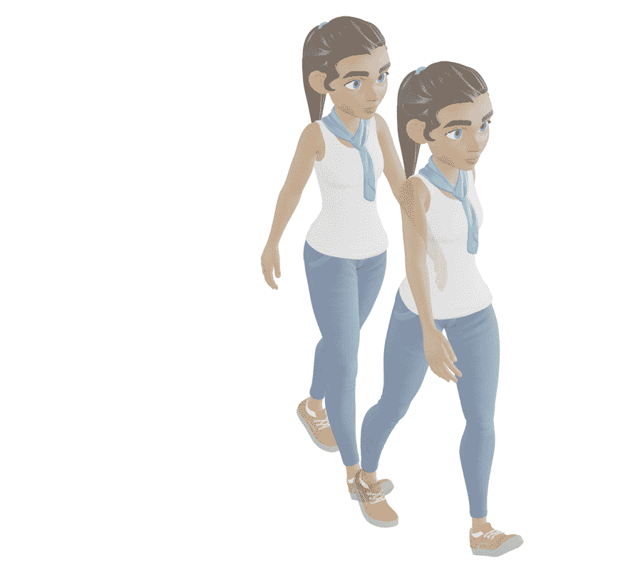

图 8.2：Rain 走路循环的第 12 帧和第 24 帧

前 12 帧将是后续 12 帧关于 `X` 轴的左右镜像，因此整个走路循环的**周期**为 24 帧。如果我们正确地设置了关键帧，Rain 在第 `0` 帧的姿势将与第 24 帧完全一致，周期的结束将完全等同于开始（当然，除了 Rain 向前移动了一米——稍后详述）。

结果将赋予 Rain 一种悠闲、不疾不徐的步伐。更重要的是，我们喜欢 12 和 24 这样的数字。任何能被 4 整除的数字简直太棒了。

我们已经确定了单步应占多少帧，但在这些帧中需要发生很多事！再次强调，我们绝不能急于求成完成第一步，所以让我们把它分解成更小的部分。

#### 走路循环的阶段

虽然动画师对单步中的阶段有许多不同的称呼（以及关于哪个阶段应排在第一的相互竞争的理论），但以下是我们将使用的阶段，从左脚在前开始：

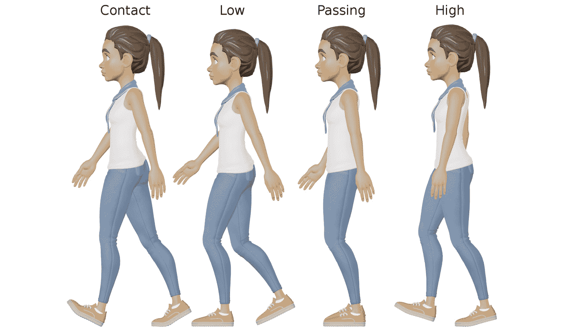

图 8.3：我们走路循环的关键姿势，从左到右

以下是逐姿势的细分说明：

*   `Contact`（触地/着地）：前脚脚跟触地。着地的脚将在接下来的 12 帧中保持着地，承担角色的重量，直到下一个触地阶段。
*   `Low`（低点/下沉）：由于早先的向下动量，躯干在此阶段左右达到最低点。着地的脚现在平贴地面，另一只脚被抬起并向前摆动。
*   `Passing`（交叉/经过）：向前摆动的空中腿经过着地的腿。
*   `High`（高点/抬起）：躯干在此达到最高点。原本在后的脚现在移至前方，并将很快着地进入下一个触地阶段。

这是一只脚的 4 个姿势，接着是同 4 个姿势（关于 `X` 轴镜像）在另一只脚上，然后回到初始姿势。24 帧周期内的 8 个姿势意味着这些姿势中的每一个可以间隔 3 帧，因为 24 是个能被整除的好数字。从 0 开始，我们走路循环中最关键的帧因此是 0、3、6、9、12、15、19、21 和 24。

正如你可能猜到的，我们的许多关键帧将位于这些帧上，因此给它们加上标签会很有帮助。这就是下一个功能的用武之地。

## 时间轴标记

标记是动画编辑器中的小三角形，允许我们给重要帧加标签，以免丢失它们。这些在复杂工作中特别有用，例如制作走路循环动画。

### 添加标记

现在让我们插入标记：

1. 转到帧 `0`（是的，帧 `0`）。
2. 在时间轴中，使用 `Marker | Add Marker`（`M`）。
3. 每 3 帧添加一个标记，直到到达帧 `24`。

你现在应该在帧 `0`、`3`、`6`、`9`、`12`、`15`、`18`、`21` 和 `24` 上有标记：

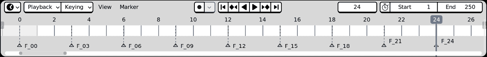

图 8.4：时间轴中的标记

**提示**

标记可以像关键帧一样被选择、移动、复制和删除。执行这些操作时，请记住将鼠标光标保持在标记区域内，否则可能会意外操作到关键帧。

新标记会根据添加时的帧号自动命名。这不是特别有用，如果你将标记移动到不同的帧，会让人困惑。我们最好给标记起一些有用的名字。

### 标记标签

让我们重命名标记，使其对应走路循环的各个阶段：

1. 使用 `Marker | Rename Marker`（`F2`）将帧 `0`、`3`、`9` 和 `12` 上的标记分别重命名为 `Left Contact`、`Left Low`、`Left Passing` 和 `Left High`。
2. 对帧 `12`、`15`、`18` 和 `21` 上的标记重复此操作，将它们命名为 `Right Contact`、`Right Low`、`Right Passing` 和 `Right High`。
3. 帧 `24` 上的最后一个标记应命名为 `Left Contact`，就像帧 `0` 上的那个一样。

我们的标记现在显示更有用的标签：

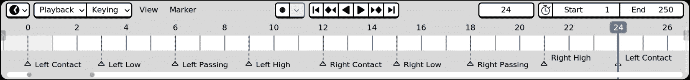

图 8.5：时间轴中重命名后的标记

**重要提示**

帧 `0` 和 `24` 的标记同名绝非巧合。完成后，这两帧将呈现为同一个姿势。它们之间的任何视觉差异都可能表明走路循环中存在故障或卡顿。

我们刚添加的标记不仅会出现在时间轴中，还会出现在大多数其他基于时间的编辑器中，包括图表编辑器和 Dope Sheet。虽然标记还有一些额外功能，比如切换活动摄像机，但那是另一章的主题。在本练习中，我们的标记不赋予任何功能；它们只是参考点，防止我们忘记在给定帧上应该发生什么。

## 让 Rain 准备好走路

像往常一样，像 Rain 这样的高级角色绑定会有一些参数需要预先设置，以应对我们即将进行的工作。我们需要非常具体地说明哪些肢体使用 `IK`，哪些使用 `FK`。

### 专注于 IK 骨骼

`反向运动学` 对任何类型的走路动画都是不可或缺的。没有 Rain 脚部的 `IK` 骨骼，制作走路循环将极其繁琐。

光是为走路循环制作 `IK` 骨骼动画就已经够难了，还要受那些烦人的其他骨骼干扰，所以让我们隔离该图层，并确定 Rain 的哪些额外部位应该使用 `IK`：

1. 如果还没做，将 Rain 链接到场景中，就像我们在第 6 章和第 7 章中做的那样。
2. 在 `CloudRig | Layers` 中，启用 `IK` 骨架图层并禁用其余图层。
3. Rain 的脚默认设置为使用 `IK`，但让我们也尝试对 Rain 的脊柱使用 `IK` 而不是 `FK`。转到 `CloudRig | Settings | FK/IK Switch` 并将 `Spine` 设置为 `1.0`。

选择对脊柱使用 `IK` 而不是 `FK` 对我们的走路循环并非至关重要，但它将让我们仅使用 `MSTR-Chest_Parent` 骨骼就能制作 Rain 胸部的动画。这样，直到我们开始制作 Rain 手臂动画时，才需要处理 `FK` 骨骼。

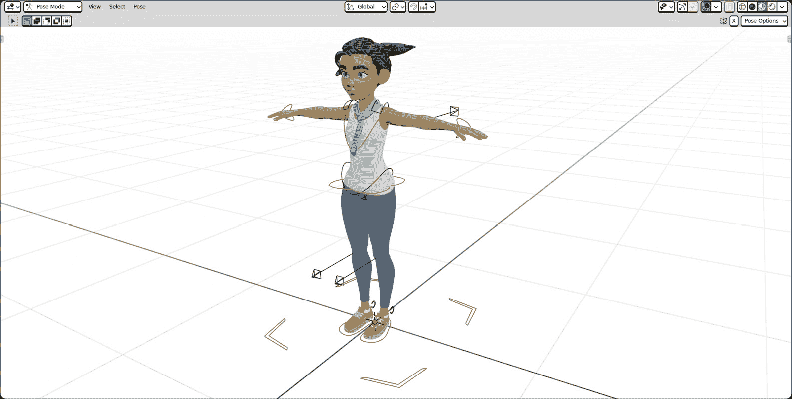

图 8.6：仅显示 IK 骨骼的 Rain

我们暂时隔离了 `IK` 骨架图层，但这并不意味着所有肢体都应该使用 `IK`。

### 不留下任何骨骼

Rain 将沿 `Y` 轴持续向前行走。如果某个骨骼没有被制作动画以向前移动，或者它没有直接或间接地成为另一个向前移动的骨骼的子级，Rain 就会把那个骨骼甩在后面。被甩在后面的骨骼最好不要对 Rain 有可见影响，否则她走几步后可能会看起来灾难性地不同！

正如我们之前学到的，通过自己移动骨骼（当然不确认变换）来预览制作动画时会发生什么，这很有帮助。Rain 的主躯干骨骼 `MSTR-Pelvis_Parent` 肯定需要向前移动，如果我们希望她能走到任何地方，所以让我们抓住它做个粗略诊断：

图 8.7：MSTR-Pelvis_Parent 沿 Y 轴向前移动

从下到上，Rain 的脚粘在地板上，但这是我们想要的。使用独立的 `IK` 目标，脚在我们想要它们移动前不得向前移动。然而，Rain 的手没什么重要的地方可去。它们只需要从肩膀摆动，所以它们真的应该用 `FK` 而不是 `IK`。我们最后制作它们的动画。最后，Rain 的眼球在头里向后翻了。

现在让我们修复这些问题：

1. 在 `FK/IK Switch` 面板中，将 `Left Arm` 和 `Right Arm` 都设置为 `0.0`。
2. 既然我们不需要它们，可以隐藏 Rain 手臂的 `IK` 骨骼。它们是 `IK-Hand_Parent.L`、`IK-Hand_Parent.R`、`IK-Pole_Forearm.L` 和 `IK-Pole_Forearm.R`。选择它们并使用 `Hide`（`H`）。
3. 想来，为什么不把她的手臂完全隐藏呢？转到 `CloudRig | Outfits` 并暂时将 `Mask Arms` 设置为 `1`。像以前一样隐藏 Rain 的头发和围巾也是个好主意。
4. 为防止 Rain 的眼球在眼窝里向后翻，转到 `CloudRig | Settings | Face Settings` 并将 `Eye Target Parent` 设置为 `Torso_Loc`（`2`）。这将使骨骼 `TGT-Eyes` 保持在 Rain 前方，当她远离根骨骼行走时。

如果没有这些设置，骨骼 `IK-Hand_Parent.L`、`IK-Hand_Parent.R` 和 `TGT-Eyes` 都必须制作动画以向前移动，连同 `MSTR-Foot_Parent.L`、`MSTR-Foot_Parent.R` 和 `MSTR-Pelvis`。正如我们即将看到的，任何必须制作动画以持续向前移动的骨骼，都需要我们仔细关注其 `Y Location` F 曲线。限制这种情况的骨骼数量会让我们的工作更轻松。

图 8.8：简化后的 Rain，准备好向前走

通过提前规划、标记帧以及在插入任何关键帧前调整 Rain 的设置，我们避免了不少潜在事故。然而，走路是如此复杂的动画，我们仍需谨慎！现在 Rain 准备好仅用三根骨骼向前走，这三根骨骼及其向前移动将成为下一节的唯一焦点。

## 沿 Y 轴向前移动

再次，是时候开始摆姿势和插入关键帧了！在上一章中，我们一次用许多骨骼为主要姿势设关键帧来制作动画，但在这个练习中，我们将从仅为三个骨骼的位置设关键帧开始：`MSTR-Foot_Parent.L`、`MSTR-Foot_Parent.R` 和 `MSTR-Pelvis`。在对 Rain 的 `CloudRig` 界面中的属性进行调整后，这三根骨骼将全权负责 Rain 在 `Y` 轴上的向前移动。必须特别注意它们的 `Y Location` F 曲线。

事实上，目前我们唯一关心的就是这些骨骼沿 `Y` 轴的前向移动！忘掉摆动手臂、扭动臀部，甚至抬起脚；目前唯一重要的是先移动一只脚向前，然后是另一只脚，最后是身体的其余部分。

**重要提示**

本章中的“前向”是指从 Rain 的视角向前，这要求我们骨骼的 `Y` 轴 `Location`（位置）数值发生负向变化。

在我们完成极其基础的前向移动关键帧后，我们将学习如何让一切正确循环。这要求我们解决一个悖论：Rain 的走路循环必须以开始时的姿势结束，但她也绝不能停留在原地……

## 确定步幅长度

Rain 在 24 帧内将移动多远？每只脚将在何时摆动向前，而另一只脚保持着地？我们可以通过大致关键第一个 `contact`（触地）姿势来回答这些问题。这些是至关重要的时刻：前脚触地以支撑 Rain 的重量，而后脚准备抬起并摆动向前。

**重要提示**

我称这些为“粗略”姿势，因为我们目前只关心骨骼在 `Y` 轴上的位置。尽管如此，每根骨骼的 `Y` 位置必须严格按照以下说明中的数字输入精确录入。哪怕是最微小的偏差，例如将一只脚变换 `\-0.99` 米而不是 `\-1.0` 米，都会随时间累积，导致我们的独立骨骼在走路循环重复时逐渐分离。

### 关键初始前向步幅

对于第一个姿势，我为 Rain 的左脚 `Left Contact`（左触地）姿势准备了一些“魔法数字”。请务必精确输入：

1.  转到第 `0` 帧（`Left Contact`）。
2.  将 `MSTR-Foot_Parent.L` 在 `Y` 轴上精确移动到 Rain 前方 `\-0.2` 米处。
3.  将 `MSTR-Foot_Parent.R` 在 `Y` 轴上精确移动到 Rain 后方 `0.3` 米处。
4.  为 `MSTR-Foot_Parent.L`、`MSTR-Foot_Parent.R` 和 `MSTR-Pelvis_Parent` 插入位置关键帧。

这与你之前看到的触地姿势相去甚远，但暂时够用了：

图 8.9：Rain 迈出一只脚

重要的是我们已经确定了 Rain 双脚在 `Y` 轴上的距离。如果一只脚在前方 -0.2 米，另一只脚在后方 0.3 米，总距离就是半米。翻倍后，你就得到了后脚在后续触地姿势中必须覆盖的距离，以便像前脚一样领先于对侧脚。

这就是所谓的走路循环的 `stride length`（步幅长度），这个值不亚于走路循环周期的关键。步幅长度和周期共同决定了角色在世界空间中的整体移动速度。碰巧的是，我们的步幅长度是 1 米，行走速度为每 24 帧 1 米。整齐划一，对吧？

### Rain 的两小步

现在，迈出我们真正的第一步！我们将跳到第 `12` 帧并关键 `Right Contact`（右触地）姿势：

1.  转到第 `12` 帧（`Right Contact`）。
2.  将 `MSTR-Foot_Parent.R` 在 `Y` 轴上精确向前移动 `\-1.0` 米。
3.  为两只 `IK` 脚骨插入位置关键帧（但不包括躯干）。

好了，我们的第一步完成了！暂时别管它看起来怎么样：

图 8.10：右脚向前 1 米

现在让我们把左脚向前移动以关键最终的 `Left Contact` 姿势。我们还需要将躯干向前移动 1 米以跟上其他部分：

1.  转到第 `24` 帧（另一个 `Left Contact`）。
2.  将 `MSTR-Foot_Parent.L` 和 `MSTR-Pelvis_Parent` 在 `Y` 轴上精确向前移动 `\-1.0` 米。
3.  为这三根骨骼全部插入位置关键帧。

有了这些最后的关键帧，我们在第 `24` 帧结束走路循环，姿势与第 `0` 帧开始时完全一致，但有一个重大变化——这三根骨骼每根都向前移动了 1 米：

图 8.11：第 24 帧的 Rain

让我们在图表编辑器中检查 `Y Location`（Y 位置） F 曲线：

图 8.12：前向移动骨骼的 Y 位置 F 曲线

脚骨交替出现的平坦段代表每只脚着地支撑的时间，此时对侧脚摆动向前，身体其余部分向前移动。这些平坦段必须保持平坦，否则脚在本应保持原地时会发生滑动。

Et voila（瞧），两步走完——我们的走路循环实际上已经完成了！

图 8.13：三个初始关键姿势

怎么说呢？我同意，它看起来 terr...ific（棒极了）！确实是个极好的走路动画。好到我们已经准备好让它永远循环下去了。

## 循环动画

我们需要 Rain 继续行走（好吧，是拖着脚走）下去，但到目前为止，我们只有这两步。要想真正成为一个走路循环，Rain 必须像我们在 *第 2 章* 中扔出去的那个弹跳球一样，持续移动到时间的尽头。

让我们先让这三根骨骼的运动变得循环：

1.  在图表编辑器中，选择所有三根骨骼 `MSTR-Foot_Parent.L`、`MSTR-Foot_Parent.R` 和 `MSTR-Pelvis_Parent` 的所有 F 曲线。
2.  使用 `Set Keyframe Extrapolation`（设置关键帧外推）（`Shift` + `E`）| `Make Cyclic`（设为循环）。

**重要提示**

虽然我们目前专注于 `Y Location` 通道，但请记住也要将所有其他 F 曲线设为循环。

我们似乎有进展了，但 Rain 原地不动。这是生成的 `Y Location` F 曲线，已缩放以便我们看到第一秒动画之外的走向：

图 8.14：循环 F 曲线

呃，我真讨厌那些丑陋的垂直悬崖！它们很少是好兆头。这种周期性导致 Rain 的骨骼每 24 帧就弹回初始位置——这是首尾关键帧不相等的循环 F 曲线导致的结果。技术上讲它在重复，但不是我们想要的那种重复。 Rain 去不到任何地方，而我们需要她在 24 帧后移动 1 米，48 帧后移动 2 米，以此类推。

`Linear Extrapolation`（线性外推）能解决问题吗？那对躯干管用，但无法重复脚部的运动：

图 8.15：外推 F 曲线

我们需要的是外推和重复的结合。我们需要 F 曲线能够复合，即每次重复都在其首尾关键帧的数值偏移基础上累加；如果你愿意，可以称之为 `repeat with offset`（带偏移重复）。

### 偏移循环

循环属性属于 F 曲线的一个 `F-curve modifier`（F 曲线修改器）。F 曲线修改器作为非破坏性效果工作，非常像网格物体上的修改器。活动 F 曲线的修改器位于图表编辑器右侧边栏的 `Modifiers`（修改器）选项卡中：

图 8.16：循环修改器

原来 `Make Cyclic` 操作只是给选中的 F 曲线添加了一个 `Cycles` 修改器！

**重要提示**

此处的“Cycles”仅指循环。该词与 Cycles 渲染器无关。

`Cycles` 修改器面板包含一些我们迫切需要的额外设置。你必须一个修改器一个修改器地手动更改它们，好在只有三条 F 曲线需要这种处理：

1.  导航到图表编辑器右侧边栏（`N`）的 `Modifiers` 选项卡。
2.  将三条 `Y Location` F 曲线的 `Cycles` 修改器的 `Before Mode`（前向模式）和 `After Mode`（后向模式）都改为 `Repeat with Offset`（带偏移重复）。

这是我们现在的 Y Location F 曲线：

图 8.17：使用 `Repeat with Offset` 的 F 曲线

这更像样了。现在 Rain 持续向前蹒跚而行，就像我们一直知道她能成为的马拉松蹒跚者一样。

重要提示

正如循环 `F 曲线` 的周期由首尾关键帧之间的总时间决定一样，使用 `Repeat with Offset` 的循环 `F 曲线` 的偏移量也由这些关键帧之间的数值变化决定。无论如何，首尾关键帧都非常重要。小心别不小心移动了它们！

Rain 的走路循环现在超过 24 帧了，但不用说它仍需打磨。我们稍后会处理，但所有这种前向移动带来的一个直接问题是——很难操作！

## 让 Rain 跑步机上走

播放时，如果 Rain 一直走远离我们，我们要在动画上工作会很恼人。让动画播放足够长的时间，Rain 甚至会离开屏幕：

图 8.18：嘿，你去哪了？！

回顾 3D 动画循环的真言：一切必须回到起点。但由于每 24 帧有 -1.0 米的偏移，我们的走路循环有一个恼人的非循环方面。是的，我们确实想让 Rain 向前移动，但不希望是以这种方式工作！

要在不撤销已完成工作的情况下修复此问题，我们可以选择一个作为其他三根骨骼父级的骨骼，然后让它沿 Rain 行走方向的反方向移动动画。这将产生让 Rain 原地行走的效果，就像她在跑步机上行走一样。

### 反转步幅偏移

用于此目的最明显的骨骼是 `ROOT` 骨骼，所有其他骨骼实际上都父级于它。然而，在 Rain 的 `IK` Secondary 骨架层中藏着一个更好的选择——一根名为 `ROOT_Child` 的骨骼：

图 8.19：`ROOT_Child` 骨骼，比 `ROOT` 稍小

`ROOT_Child` 是 `ROOT` 的直接子骨骼，充当 `ROOT` 和大多数其他骨骼之间的中间父级。

现在让我们为它制作动画。我假设你知道如何创建一条直线 `F 曲线`：

1.  启用 `IK Secondary` 骨架层并找到骨骼 `ROOT_Child`。

2.  为 `ROOT_Child` 制作动画，使其持续且反向于 Rain 的步幅移动。这将产生一条斜率为每 24 帧 1.0 米的线性 `Y Location` `F 曲线`。

3.  你可以像以前一样禁用 `IK Secondary` 层。

Rain 的步幅已被抵消。现在她行走时将保持原地，形成完美的视觉循环：

图 8.20：`ROOT_Child` 的线性动画使 Rain 保持原地

如果稍后我们想让 Rain 自由行走，像以前一样在世界空间中向前移动，我们只需将 `ROOT_Child` 的 `Y Location` `F 曲线` 静音即可。

此技术也适用于 `ROOT`，但使用 `ROOT_Child` 有一些小优势。即它让 `ROOT` 骨骼保持空闲，以便将来如果需要可用于其他目的。

### 为什么要大费周章？

让 Rain 通过向 `Y Location` `F 曲线` 添加特殊循环修改器持续向前移动，然后又全部抵消掉，这有什么意义？我们难道不能一开始就直接为接触姿势设关键帧，而不按步幅长度偏移它们吗？那样我们就不需要让根骨骼向后动画来抵消 Rain 的前向移动，只需让它向前动画即可。

这听起来不错，但让我们看看 `IK` 脚的 `Y Location` `F 曲线` 需要是什么样子：

图 8.21：行走 `IK` 脚的替代 `Y Location` `F 曲线`

在这个例子中，跑步机效果被“烘焙”进了 `IK` 脚的运动中。每条 `Y Location` `F 曲线` 的那些平坦段变成了对角线，需要专门编辑的贝塞尔关键帧手柄。如果我们编辑这样的 `F 曲线`，就必须格外小心，始终保持这些对角线段的斜率，否则脚会产生不希望的滑动。这不是一种有趣的工作方式。

现在无论我们的播放范围是什么，Rain 都将原地行走！

## 使用预览播放范围

如果我们让动画一直播放到第 250 帧，我们会看到动画有个跳跃，因为播放头从第 250 帧跳回第 1 帧。为了让动画播放时正确循环，我们场景的结束帧值应该是 24 的倍数，比如 240 或 120。

其实，完全没必要让动画播放超过第 24 帧。一旦我们看完了第 1 到 24 帧，我们就全看完了，因为我们已经确保最重要的 `F 曲线` 正确循环。缩短工作播放范围还有助于防止在走路循环范围之外意外插入关键帧，这可能会干扰周期性。

我们已经知道如何使用 `Timeline` 中的 `Start` 和 `End` 帧属性设置动画的播放范围，但这次我们将使用另一个小功能：

1.  在 `Timeline` 的标题栏中，启用 `Use Preview Range`。这是 `Start` 和 `End` 帧设置旁边带有秒表图标的按钮。

2.  使用替代的 `Start` 和 `End` 属性（就在 `Timeline` 中原来属性的位置），将场景的预览帧范围设置为从 1 到 24。

我们现在正在一个临时的“预览”帧范围内工作：

图 8.22：替代的开始和结束帧

新范围仅影响播放，且仅在 `Use Preview Range` 启用期间有效。场景仍保留其旧的 `Start` 和 `End` 帧号。此功能对于在不更改整个场景“官方”范围的情况下专注于较长动画中的一小段帧很有用。

提示

你可以切换 `Use Preview Range` 的开关，并应偶尔这样做，以检查第 24 帧之后 Rain 动画的错误。

我们现在可以播放动画，并随心所欲地观看走路循环无缝循环。

现在看起来不怎么样，但技术上它确实是一个走路循环！我们先做了难的部分，满足了一个非常重要的技术要求：建立腿部 `IK` 链中独立骨骼的循环前向运动。而计算机辅助动画的伟大之处在于我们可以回头迭代改进！在下一节，我们将做 exactly that，从 Rain 的躯干开始。

## 添加更多周期性运动

我们将保持 Rain 的脚原地蹒跚，将注意力转回 `MSTR-Pelvis_Parent` 的运动上。从躯干向外工作，我们将使用 `MSTR-Hips` 和 `MSTR-Chest_Parent`（臀部和胸部的骨骼）添加一些简单的扭转。

重要提示

本节你不再需要输入我的精确数值，请随意实验。唯一的硬性规则是你必须对自己的数值精确，以确保走路循环中没有不对称。

完成后，Rain 的走路循环将开始看起来有点可信（只要你不看她的手臂或腿）！

## 躯干运动

完成 `MSTR-Pelvis_Parent` 的 `Y Location` `F 曲线` 后，我们可以处理躯干应沿其移动的其他两个轴。这些 `F 曲线` 将正常循环，无任何偏移，但正如我们将看到的，一些 `F 曲线` 只需要半长度的周期。

这是处理后我的 `F 曲线` 的样子：

## 躯干动画基础

## 上下弹动

图 8.23：`MSTR-Pelvis_Parent` 的 F 曲线

现在轮到你了。

在 `Y Location` 之后，`MSTR-Pelvis_Parent` 的下一个最重要的动画通道是 `Z Location`，它控制人行走时身体的上下运动。这就是 `High`（高点）和 `Low`（低点）走循环阶段名称的由来；躯干通常在前脚接触地面前达到最高点，在接触地面后立即达到最低点。

现在试试：

1. 找到 `MSTR-Pelvis_Parent` 的 `Z Location` F 曲线。
2. 在第 `3` 帧（`Left Low`）插入一个关键帧，使 Rain 的躯干达到低点，约 -2 厘米（`-0.02` 米）。
3. 在第 `9` 帧（`Left High`）插入一个关键帧，使 Rain 的躯干达到略高于零的高点，约 0.5 厘米（`0.005` 米）。
4. 为了让 Rain 的低点持续时间稍短一些，在第 `6` 帧（`Left Passing`）添加一个关键帧，将躯干抬高一点点，比原本略高。
5. 通过将最后一个关键帧从第 `24` 帧移动到第 `12` 帧，缩短 F 曲线的周期。

注意，这种上下运动在一个周期内需要发生两次——每一步各一次。我们没有复制关键帧，而是直接将该 F 曲线的周期设为 12 帧，而不是 24 帧。

## 左右摇摆

除了沿 `Z` 轴的上下运动，行走时的躯干也会倾向于在 `X` 轴上左右摇摆，因为躯干的重量交替地不平衡地支撑在一只脚或另一只脚上。

> **提示**
> 位于 `Graph Editor`（图表编辑器）右侧边栏的 `Active Keyframe`（活动关键帧）面板，便于检查关键帧的确切数值。

使用你喜欢的任何方法为该运动添加关键帧：

1. 找到 `MSTR-Pelvis_Parent` 的 `X Location` F 曲线。
2. 在两个 Passing 帧插入关键帧，使 Rain 的整个躯干在 `Left Passing` 时向左摇摆，在 `Right Passing` 时向右摇摆。

该波动的振幅应很细微，任一方向约 1 厘米（0.01 米）。请参考上图。

仅在两条 F 曲线上添加一些细微的关键帧就能让角色栩栩如生，这难道不神奇吗？事实上，最后那条 `X Location` F 曲线简直就是一条正弦波。等着看看更多这样的波动会给 Rain 的臀部和胸部带来什么效果吧！

## Action Editor（动作编辑器）

从现在开始，我们添加到动画中的每一条 F 曲线都需要是循环的，但 F 曲线默认不是循环的。一件令人烦恼的事是，每创建一条新的 F 曲线都要执行 `Make Cyclic`（设为循环）。

在为更多骨骼添加关键帧之前，我们将在一个听起来没那么令人兴奋的编辑器中解决这个问题：`Action Editor`（动作编辑器）。

## Action Editor 简介

还记得动作吗？它们是包含每个动画对象的多个动画通道和通道组的数据块。Rain 的整个走循环就包含在其中一个动作中；当我们插入初始关键帧时，它会自动创建并被赋予一个通用名称。

动作具有一些基本元数据，可通过动作编辑器访问，方法是转到 Dope Sheet（逐帧编辑器）并更改编辑上下文：

图 8.24：Dope Sheet 中的 Action Editor

`Action Editor` 与标准 `Dope Sheet` 几乎相同。其主要区别在于它一次只显示一个动作：所选对象的当前动作。它还允许我们编辑动作的其他属性，例如名称。

## 重命名动作

首先，让我们使用 `Action Editor` 重命名 Rain 当前的动作：

1. 打开 `Dope Sheet`。
2. 将 `Dope Sheet` 的 `Editing Context`（编辑上下文）更改为 `Action Editor`。
3. 将动作重命名为你容易记住的名称。

重命名此动作将使其更易于查找，以便我们在未来的动画中将其作为资产重用：

图 8.25：“Rain Walkcycle”是个完美的名字

> **提示**
> 从现在开始，你可以一直打开 `Action Editor` 而不是默认的 `Dope Sheet`。区别不大，因为我们不会为其他对象制作动画，也不会处理除 Rain 骨架当前动作之外的任何动作。

除了重命名动作，`Action Editor` 还能做另一件事——甚至可能是两件别的事！让我们用它来启用一些属性，将整个动作设定为循环。

## 将动作设定为循环

在 `Action Editor` 右侧边栏中可以找到一些额外的动作元数据。修改此处的某些属性将使我们的工作更轻松：

1. 在 `Action Editor` 的右侧边栏（`N`）中找到 `Action`（动作）面板。
2. 启用 `Manual Frame Range`（手动帧范围），并确保动作的 `Start`（开始）和 `End`（结束）帧分别为 `0` 和 `24`。
3. 启用 `Cyclic Animation`（循环动画）。

注意，这些设置不会直接改变 F 曲线或影响动画结果：

图 8.26：为动作启用了 Cyclic Animation

我们所做的只是更改关于动作的一些上下文信息，以便其他功能知道它应该是循环的。

### 启用循环感应关键帧

为了让这些设置生效，我们需要在 Timeline（时间轴）中启用 `Cycle Aware Keying`（循环感应关键帧），方法如下：

1. 打开 `Timeline` 头部的 `Keying`（关键帧）弹出菜单。
2. 启用 `Cycle Aware Keying`。

现在，添加到 `Rain Walkcycle` 动作中的所有未来 F 曲线将自动变为循环，并拥有 24 帧的周期：

图 8.27：Timeline 中启用了 Cycle-Aware Keying

让我们在更多骨骼上试试。

## 更多带正弦波的躯干动画

臀部、胸部和肩膀也是走循环的一部分。对这些骨骼进行一些非常简单的关键帧操作，将大大放松 Rain 的动作，使她的走循环更可信。

## 在触地姿势下扭转躯干

我们将从 `Contact`（触地）姿势下的 `Z` 轴旋转开始。因为在走循环的 `Contact` 阶段，双脚通常距离最远，臀部会旋转以帮助跨越这段距离（毕竟它们直接连接到腿部）。因此，胸部和肩膀应反向旋转以平衡该运动：

图 8.28：旋转臀部、胸部和肩膀的 Contact 姿势俯视图

试一下：

1. 转到第 `0` 帧（`Left Contact`）。
2. 将 `MSTR-Hips` 绕 `Z` 轴旋转约 `-10` 度，方向朝向 Rain 的步幅方向（左侧向前，右侧向后）。
3. 将 `MSTR-Chest_Parent` 绕 `Z` 轴向相反方向旋转约 `5` 度。
4. 延续躯干的动作到 Rain 的肩膀，将 `MSTR-Clavicle.L` 向外旋转、将 `MSTR-Clavicle.R` 向内旋转，绕 `Z` 轴各几度。
5. 为这些骨骼插入旋转关键帧。

注意，启用了 `Cycle-Aware Keying` 后，关键帧也已在第 `24` 帧添加。这省去了我们在两个 `Left Contact` 姿势处重复添加关键帧的麻烦。F 曲线也已自动设为循环。

现在我们只需为 `Right Contact` 姿势插入关键帧，就完成了！

### 镜像躯干旋转

`Paste Flipped Pose`（粘贴翻转姿势）（`Ctrl` + `Shift` + `V`）不仅适用于以 `L` 或 `R` 结尾的骨骼；它对于镜像矢状面上的骨骼位置（即角色中间没有 L/R 后缀的骨骼，如臀部和胸部）也很有用。

现在试试以节省一点时间：

1. 选择 `MSTR-Hips`、`MSTR-Chest_Parent` 和两个 `MSTR-Clavicle` 骨骼。
2. 复制姿势。

3. 转到对侧的经过姿势帧（第 `12` 帧）并粘贴翻转后的姿势。

4. 再次为所有四根骨骼插入旋转关键帧。

Rain 的走路循环看起来越来越好了。甚至开始显得——我敢说——自然了！

## 相位偏移

让我们尝试另一种制作正弦波的技术，这次作用于 `MSTR-Hips` 的 `Y Euler Rotation`（Y 欧拉旋转）F 曲线：

1. 找到 `MSTR-Hips` 骨骼的 `Y Euler Rotation` F 曲线。

2. 选中第 `0` 帧和第 `24` 帧的关键帧，并将它们向上移动 `5`。

3. 选中第 `12` 帧的关键帧，并将其向下移动 `-5`。

    这使得 Rain 的臀部在不止一个轴上摆动。到目前为止不错，但这波的波峰实际上应该位于经过姿势帧，以便臀部能帮助抬起每一只向前摆动的经过脚。

4. 选中 `Y Euler Rotation` F 曲线的所有关键帧。

5. 将选中内容向右移动 `6` 帧。

生成的 F 曲线波形与我们之前为 `MSTR-Pelvis_Parent` 的 `X Location` 制作的波形颇为相似，但这次只需要三个关键帧：

Figure 8.29: MSTR-Hips 的旋转 F 曲线

将循环 F 曲线的所有关键帧向前移动四分之一周期，如果我们想显得专业一点，这叫作 *90° 相位偏移*。不过我们不想那么专业，所以我只说：如果我们愿意，走路循环中的关键帧可以移出初始帧范围。

> **Tip**
>
> 想试验一下走路循环？在动画播放时，你可以在图表编辑器中沿 *X* 轴移动 F 曲线的关键帧来改变相位，或缩放关键帧数值以增强或减弱其强度。这种试验能帮你改进结果或产生新点子。

看看 Rain 现在怎么走！只需一些非常简单的关键帧工作，就真正呈现出了走路的外观。我们还通过确保未来添加的所有 F 曲线都将自动变为循环，为自己省去了一些点击操作。

如果我们是在为腰部以上的镜头制作 Rain 的动画，我们可以跳过脚部动画，那就几乎完成了。这通常是 3D 动画师节省时间的方法：

Figure 8.30: Rain 腿部上方的示例相机视角

但我们的目标是制作一个完整的走路循环，所以让我们把注意力转向 Rain 的脚部。

## 进阶脚部动作

我们知道脚部动画不仅仅是让脚向前滑动——现在到了让它们真正“走”起来的部分！许多动画师在这部分会遇到麻烦，但通过像我们一直在做的那样，将流程分解为合乎逻辑的步骤，我们可以让事情变得简单得多。

我们将从为左脚制作整个周期的动画开始，从第 `0` 帧到第 `24` 帧。然后，左脚所做的一切，右脚可以在 `12` 帧之后（或之前）完成。既然我们已经为双脚的 `Y Location` F 曲线设置了关键帧，最棘手的部分就已搞定。

> **Important note**
>
> 本节几乎所有工作都可以（也应该）在 3D 视口的正交侧视图中完成。不再需要数值精度，但要密切关注脚部姿势如何影响膝盖。

## 脚部滚动

在走路循环的前半段，左脚保持与地面接触，但这不意味着它完全静止。以下是我们要找的姿势：

Figure 8.31: 第 0、6、12 帧左脚的位置

最初，左脚以前脚掌着地的方式落在 Rain 身前。脚的其余部分随即迅速拍击地面。平躺几帧后，它将开始向前枢转，但枢转点不同，这次是以前脚掌为支点屈曲，将整个脚踝向上抬起。

这些脚部动作通俗地称为后脚跟滚动和前脚掌滚动，统称脚部滚动。你可能会猜这很难制作动画，如果 Rain 的每只脚没有装配滚动骨骼，你就猜对了！

Rain 的滚动骨骼名为 `ROLL-Foot_Control.L` 和 `ROLL-Foot_Control.R`。它们是位于 Rain 脚踝后方、处于 `IK` 层的旋转箭头形状骨骼：

Figure 8.32: 左脚的滚动骨骼

沿 *X* 轴旋转其中一根骨骼，会激活脚部神奇的隐形装配机制，使复杂的脚部滚动动作仅通过一个控制骨骼即可实现。

### 为滚动骨骼设置关键帧

现在让我们为左脚的滚动骨骼制作动画：

1. 选中 `ROLL-Foot_Control.L`。

2. 在第 `0` 帧（*左脚着地*）设置约 `-40` 度的 `X Rotation`（X 旋转）关键帧。

3. 在第 `3` 帧（*左脚下压*）和第 `6` 帧（*左脚经过*）设置 `0` 的 `X Rotation` 关键帧。

4. 在第 `12` 帧（*右脚着地*）设置约 `40` 度的 `X Rotation` 关键帧。

这是生成的 F 曲线。稍后我们会微调它：

Figure 8.33: ROLL-Foot_Control.L 的 X Euler Rotation F 曲线

这根骨骼很棒吧？我们仅通过为一个属性设置关键帧，就产生了所有那些动作。

这完成了左脚 24 帧周期的前半段。在第 `12` 帧，右脚落地（待我们制作动画后），左脚准备起脚！

## 抬脚

在走路循环周期的前 12 帧中，左脚停留在地面上，支撑 Rain 的重量。在随后的 12 帧中，左脚将不再以任何有意义的方式接触地面；相反，它必须抬起，以便向前摆动而不刮蹭地面。

完全抬起脚离地，可以通过编辑脚部主 `IK` 骨骼的 `Z Location` F 曲线来实现。

1. 找到 `MSTR-Foot_Parent.L` 的 `Z Location` F 曲线。

2. 在第 `15` 帧和第 `21` 帧，添加可抬起 Rain 左脚的 `Z Location` 关键帧。

3. 在第 `18` 帧（*右脚经过*）给曲线添加一个凹陷，比相邻关键帧低，但仍高于 `0.0`，这样脚在经过时贴近地面摆动。

4. 像弹跳球一样，脚在触地前不会减速，所以确保第 `24` 帧几乎没有或完全没有缓出。

生成的 F 曲线看起来有点像双峰骆驼。你可以根据喜好微调它：

Figure 8.34: MSTR-Foot_Parent.L 的 Z Location

当脚在空中时，我们之前制作动画的滚动骨骼可以负责将脚稳定地旋转回原位，以便在第 `24` 帧再次触地。

因此，单只脚的动画循环几乎完成了！不过，膝盖处的运动看起来还有点别扭。在我们决定将左脚的 F 曲线复制给右脚之前，必须完善我们的工作，使整条腿平滑移动。

## 修正腿部运动

直到现在，我们制作左脚动画时，把它当成一个独立的小角色，很少考虑它如何与 Rain 的身体其他部分连接。简直就像我们认为脚和臀部是完全分离的身体部位一样！

从某种意义上说，这并没有错。`IK` 链的末端本意就是作为空间中的独立点来摆姿势和制作动画。骨盆放在一处，脚放在另一处，`IK` 约束会为我们完成其余工作。大腿骨和小腿骨（它们不直接摆姿势或制作动画）完全受制于这些起点和终点。Rain 的腿甚至会伸缩，以便无论距离多远都能始终触达其 `IK` 目标。

虽然方便，但在某些情况下，这种方法会产生奇怪的效果，就像我们走路循环中的腿一样。它们在 Rain 行走时似乎会弯曲和抖动。随着我们完成左脚的动画制作，我们已无法再忽视这个问题。

## 膝盖弯曲

在本节中我们处理左脚时，你可能已经注意到，我们缩短了脚踝与髋部大腿根部之间的距离。当 `IK` 链中的大腿骨和小腿骨不再需要拉伸时，它们会在膝盖处弯曲，这通常是我们想要的效果。

麻烦在于，当 `IK` 腿伸直或接近伸直时，只需极小的变化就会导致 Rain 的膝盖“弯曲”：

图 8.35：脚部的微小变化导致膝盖的巨大差异

走路循环中的腿有大量时间处于拉伸与弯曲之间的这个“最佳区间”。这导致了 Rain 腿部抖动的运动，在膝盖处最为明显。

为了更好地诊断问题，我们将利用运动路径，这是我们在 *第 3 章* 中学到的功能。

## 骨骼运动路径

你知道可以查看单个骨骼的运动路径吗？用于此操作的面板位于骨架对象的 `Object Data Properties`（对象数据属性）中（而非对象属性）。

图 8.36：运动路径面板

我们只需选择一根骨骼来使用它。位于膝盖的任何骨骼都可以。`IK` 层中没有，但在别处有：

1. 启用骨架层 `Stretch`（拉伸）。
2. 选择 Rain 左膝的拉伸骨骼。
3. 在 `Properties Editor`（属性编辑器）的 `Object Data Properties` 选项卡中找到 `Motion Paths` 面板。
4. 为选中的骨骼生成运动路径。你可能需要调整 `Calculation Range`（计算范围）设置，以使所有帧都显示在路径中。

**提示**

考虑为 `Update All Paths`（更新所有路径）操作创建一个快捷键。你会频繁使用它！

这是我的运动路径。注意我已开启帧号显示并再次隐藏了 `Stretch` 层：

图 8.37：膝盖的运动路径

这路径看起来真难看！难怪走路循环在膝盖处看起来很别扭。

## 调整动画以改善膝盖的运动路径

通过擦洗动画并查看左膝的运动曲线，我们可以看到腿在哪些帧表现异常，然后将注意力集中在调整这些帧的 `F-curves`（F 曲线）上。

例如，如果运动曲线包含难看的尖峰或之字形折线，那么 Rain 的膝盖很有可能在其中一帧或多帧被“锁死”。这可以通过编辑动画来纠正，使脚踝稍微靠近大腿根部。

只需对影响 `IK` 链的一个或多个 `F-curves` 进行非常微小的更改即可。我建议从本节刚制作的 `F-curves` 入手，因为它们提供了最大的宽容度。如果能让膝盖看起来更好，谁说脚不能抬得稍快或稍慢呢？

亲自试试：

1. 从你刚处理的 `MSTR-Foot_Parent.L` 和 `ROLL-Foot_Control.L` 的 `F-curves` 开始，调整动画以平滑膝盖的运动路径。
2. 你可能还需要调整髋部和/或躯干的动画，以缩短腿部 `IK` 链两端的距离，从而避免 Rain 的腿锁死。
3. 如果以上都无效，你可以为影响 `IK` 链的其他骨骼添加动画，甚至直接为膝盖的拉伸骨骼制作动画！

经过一点调整后，我的运动路径及其关联的运动看起来好多了：

图 8.38：改善后的膝盖运动路径

一旦你对 Rain 左腿的完整动画感到满意，就可以准备将你的工作复制到右腿了。

## 从左脚复制动画到右脚

在 24 帧的走路循环周期中，左脚和右脚的工作相差 12 帧。当一只脚在空中向前摆动时，另一只脚必须着地支撑 Rain 的身体，反之亦然。每 12 帧，双脚互换角色。我们刚刚完成了单只脚上骨骼这两种对立且交替的运动；现在只是将我们所做的复制并粘贴到另一侧的骨骼上。

### 复制多条 F 曲线

你已经知道如何使用 `Copy`（`Ctrl + C`）和 `Paste`（`Ctrl + V`）将关键帧从一条 `F-curve` 复制到另一条，但你知道我们可以一次性对多条 `F-curves` 执行此操作吗？当跨多个动画通道的关键帧被复制时，粘贴操作可以将这些关键帧粘贴到属于其他骨骼或对象的、同名的选定动画通道中。这在目前非常方便，因为我们想要复制粘贴的动画数据属于两个不同骨骼的两条 `F-curves`。

**重要提示**

两个 `IK` 脚骨的 `Y Location`（Y 位置）通道（我们在开头附近添加了关键帧）是特殊的。一者的关键帧不应复制到另一者。像往常一样，复制时注意重要上下文（如你的选择），粘贴时注意当前帧。

复制粘贴关键帧可在 `Graph Editor`（图表编辑器）、`Timeline`（时间轴）和/或 `Dope Sheet`（动作编辑器）中进行！现在就试试，以节省一些时间：

1. 复制本节中你处理的左脚 `F-curves` 的所有关键帧。它们是 `ROLL-Foot_Control.L` 的 `X Euler Rotation`（X 欧拉旋转）和 `MSTR-Foot_Parent.L` 的 `Z Location`（Z 位置）`F-curve`。
2. 如果目标 `F-curve` 不存在则无法粘贴，而我们尚未为 `ROLL-Foot_Control.R` 的 `X Euler Rotation` 添加关键帧。转到第 `0` 帧并添加。
3. 选择 `MSTR-Foot_Parent.R` 和 `ROLL-Foot_Control.R` 对应的动画通道并粘贴复制的关键帧。

确保右脚上的新关键帧与左脚上的原始关键帧匹配并观看动画。如果你复制粘贴出错，动画看起来会不对劲，但如果一切正确……

图 8.39：左右脚同步的滚动/抬起

……动画看起来仍然不对劲。目前看来，Rain 似乎长了两只左脚。右脚还需要一次调整！

### 相位偏移

右脚和左脚的交替对立运动必须相差 12 帧（半个周期）。我喜欢称之为 `180° phase-shift`（180° 相位偏移），但你可能更喜欢叫它 `moving some keyframes`（移动一些关键帧）：

1. 选择刚才粘贴的所有关键帧。这些是属于 `MSTR-Foot_Parent.R` 和 `ROLL-Foot_Control.R` 的所有内容，但不包括任何 `Y Location` 关键帧。
2. 将选中内容移动 `12` 帧。

你可能会问，“向哪个方向移动 12 帧？”这无所谓！结果是一样的：

图 8.40：左右脚正确的滚动/抬起

**重要提示**

与给左脚制作动画时类似，你可能仍会在右膝看到一些不规则的“抖动”，这可能需要额外调整。有时即使我们竭尽全力保持动画完美对称，也无法避免这种情况。

现在我们可以说 Rain 真的在走路了！我们完成了走路循环中迄今为止最复杂的任务；我们建立了脚骨和骨盆骨独立的前进运动，为躯干添加了自然的节奏，然后制作了脚部复杂的滚动和抬起动画。还有更多工作要做，但从这里开始，一切都将一帆风顺。

## 完成走路循环

## FK 脚趾

在宣称 Rain 的双脚已完全完成动画制作之前，我们还得通过制作脚趾动画来画上句号。我们要让脚趾在脚后跟触地时向后伸展：

**图 8.41：** 前脚脚趾伸展并压平

在后续的某些帧中，你会注意到由于脚掌滚动的效果，Rain 的脚趾会自动弯曲。这在脚被抬起之前看起来很不错，但抬起后显得有点怪异。我们可以让脚趾骨向相反方向卷曲，以在脚离地后抵消这一效果：

**图 8.42：** 后脚脚趾相对于脚部其余部分变直

现在试一下。脚趾的骨骼位于 `FK` 层中：

1.  启用 `FK` 骨架层。
2.  使用 `FK-Toe.L`，在 `24` 帧的周期内制作 Rain 脚趾屈曲和伸展的动画。
3.  将关键帧复制到另一侧脚趾，并向后移动 `12` 帧，就像你在上一节为双脚所做的那样。

这是我的 F 曲线。你的可能需要稍微额外调整一下，以便在脚趾卷曲时不让它们在紧接着的帧中穿透地面：

**图 8.43：** `FK-Toe.L` 的 X 欧拉旋转

随着 Rain 下半身工作的告一段落，我们可以着手处理章节开头隐藏的肢体了。

## FK 手臂

在走路循环中，手臂在身体两侧摆动，与双腿的动作相反：

**图 8.44：** 手臂的初始关键姿势，俯视图

与许多使用 `FK` 手臂的动作一样，动作的时机应从肩膀开始，像延迟信号一样沿着手臂向下传递。回想一下上一章我们做的挥手动作。

1.  前往 `CloudRig` | `Outfits` 取消隐藏 Rain 的手臂。
2.  在 `CloudRig` | `FK Settings` | `FK Hinge` 中，将 `Left Arm` 和 `Right Arm` 设为 `1.0`。
3.  在第 `3` 帧（`Left Low`，左腿低点），为手臂的 `FK` 骨骼在其极限旋转处设置关键帧，右臂向前，左臂向后。
4.  在第 `15` 帧（`Right Low`，右腿低点），为手臂设置翻转后的姿势关键帧。
5.  使用 `Dope Sheet`（动作编辑器）交错调整手臂骨骼的动作，直到满意为止。

> **提示**
>
> Rain 的手摆动时会穿透身体吗？前往发生穿透的那一帧，再设置一个关键姿势将它们向外推开。看看能否在修正后保持 F 曲线尽可能平滑。

## 最后润色？

走路循环还需要什么？如果你跟我一样，你会想放松 Rain 手部的姿势，修整她的头发和围巾，或者给她的脖子和肩膀加个 `12` 帧的小弹跳。你也可以探索一下她的其他辅助骨骼如何在不影响现有 F 曲线的情况下叠加额外的动作。

也许你对双腿的效果仍不满意，或者想看看更快或更慢的走路循环是什么样的。如果是这种情况，请在编辑动画时牢记以下规则。

对于名称中带有 `.L` 和 `.R` 的骨骼对，同步编辑它们的关键帧：

**图 8.45：** 调整两只 `IK` 脚的 `Z Location`（Z 位置）动画

你可以改变步幅，但你需要找到初始阶段我们设置关键帧的所有 `Y Location` 通道，并在 `Graph Editor`（图表编辑器）的 Y 轴上将它们全部一起缩放：

**图 8.46：** 在 `Graph Editor`（图表编辑器）中缩放步幅

如果你想改变整个走路循环的周期，选中所有关键帧并在 X 轴上缩放它们：

**图 8.47：** 通过在 `Dope Sheet`（动作编辑器）中缩放所有内容来放慢走路循环

还有一件事：记得保存你的工作！稍后我会展示如何将这个走路循环整合到其他动画中。

## 总结

希望这个练习对你进行得很顺利。在实际工作中，你可能会为各种场景中的许多不同角色创建自己的循环——爬行循环、跑步循环、骑行循环等等——你的流程可能与此大相径庭。

不过，无论你自己的“____ 循环”有多么不同，你都可以从这堂课中带走一条一致的规则：*弄清楚哪些骨骼不会回来*，即哪些骨骼的位置值会随着循环重复而趋向无穷大。一旦弄清楚这一点，就只专注于那些特定的动画通道。先完成难的部分，其余一切自然会就位……

……除非不行。你和我一样，自己的尝试都将充满错误和修改。你得猜测属于你自己的步幅和周期“魔法数字”，随后意识到它们需要修改。这不代表你是新手；这恰恰证明你是专业人士！

在下一章中，我们将把所有走路用的骨骼放在一边，探索另一件我们大多视为理所当然的事情：说话！

## 思考题

1.  如果我们走路循环的第一个姿势在帧 `0` 设置关键帧，为什么播放范围不应也从帧 `0` 开始？
2.  是什么让数字 `24` 如此重要？
3.  在正常的走路循环中，为什么我们选择对手臂使用 `FK` 骨骼，对脚使用 `IK` 骨骼？你能想到需要相反设置的动画吗？
4.  是什么让我们前三个设置关键帧的骨骼的 `Y Location` F 曲线如此特别？
5.  是什么决定了 F 曲线的周期？
6.  我们走路循环中的大多数 F 曲线需要 `24` 帧的周期，但至少有一个是 `12` 帧周期。是哪一个，为什么？
7.  将关键帧粘贴到右脚骨骼后，你在动画编辑器中将它们向左或向右移动了 `12` 帧。为什么在这种情况下方向无关紧要？
8.  在其他一些角色绑定中，`IK` 脚有一个称为“脚趾滚动”的额外功能。你猜这有什么作用？
9.  是什么让走路的角色像独轮车？
