## 声音与对口型

电影或视频的视觉成分——无论是动画还是实拍——仅构成成品的一半。另一半是声音。观众听到的内容不亚于他们看到的内容，所以每当动画师在项目中把音频当作事后补充时，我都会感到不寒而栗；仿佛声音只是拍在一个主要视觉媒体上的补充感官层。如果有什么区别的话，情况恰恰相反！

只要适用，我坚持在开始制作动画前拥有完成的配乐和/或旁白，无论是从客户处获取、与音频工程师合作，还是自行制作音频。音频对于确立动画的节奏和时机至关重要，而在对口型——让角色嘴部动作与预录台词同步——这一任务中，这一点体现得最为淋漓尽致。

通过在本章让 Rain 进行对口型练习，我们将习惯在 Blender 中使用声音，练习细致的面部动画，并亲身体会声音为何对动画如此重要。

我们将学习如何做以下工作：

*   在 Blender 的 `Video Sequencer`（视频序列编辑器）中导入和处理音频
*   制作 Rain 头部和面部动画，使其与音频同步表演
*   制作 Rain 嘴部动画

## 技术要求

正如本书这一部分的其他章节一样，要完成以下练习，我们需要在 Blender 中创建一个包含角色 Rain 的新场景。

不过，这一次我们还需要一些音频来制作 Rain 说话的动画。我录制了一段完美的音频片段供使用：由一位女配音演员说的一句台词——简短、可供解读且无版权限制。

你可以在此处下载：

[`github.com/PacktPublishing/Realizing-3D-Animation-in-Blender`](https://github.com/PacktPublishing/Realizing-3D-Animation-in-Blender)

你也可以自行提供音频文件，而不使用提供的 `.wav` 文件，方法包括录制你自己的声音或他人的声音，或者从视频、电影或播客中采样说话声。如果你知道如何操作，这样做也完全可行。

> **提示**
>
> Blender 支持大多数常见的声音文件格式，如 `.mp3`、`.ogg`、`.flac` 和 `.wav`，甚至可以从支持的视频文件中提取音频流。其中 `.wav` 格式较好，因为它是无损的，且解码所需的处理很少。

Blender 做不到的一件事是录制音频。为此，你需要像 Audacity 这样免费开源的应用程序：

[`www.audacityteam.org/`](https://www.audacityteam.org/)

最后，确保你有一套正常工作的扬声器或耳机来试听选定的音频片段。你会反复试听它，所以我建议使用耳机，以尽量减少让附近的人抓狂的数量。

## 在 Blender 中使用声音

我们的首要任务是将音频导入 Blender，以便在播放动画时能听到它。能在同一个用于制作动画的程序中听到音频是必不可少的，尤其是对于制作人物说话的动画而言。

在下一节中，我们将学习如何将音频导入场景，然后学习如何编辑它（如果你选择使用提供的配音文件，甚至可能不需要编辑）。一旦我们对音频满意，我将揭示一个容易被忽视的设置，它能确保音频与动画同步播放。

## 将音频文件导入视频序列编辑器

首先将声音文件导入场景。注意，这**不需要**在 3D 空间中添加 `Speaker`（扬声器）对象！

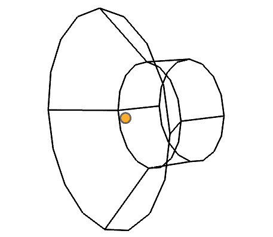

图 9.1：不必要的 Speaker 对象

那些东西用于模拟特定的声源，根据 `Speaker` 对象相对于活动摄像机的位置进行声像平移和淡入淡出。很酷，但超出了我们的需求。

相反，让我们使用 `Video Sequencer`（视频序列编辑器），它同时也可作为音频序列编辑器：

1.  打开 `Video Sequencer`（视频序列编辑器）。
2.  确保你位于 `frame 1`（第 1 帧），因为音频将插入在当前帧。
3.  使用 `Add`（添加）（`Shift + A`）| `Sound`（声音）。
4.  在调出的文件浏览器中，找到并选择你想要的声音文件。

这会将音频作为声音条带插入：

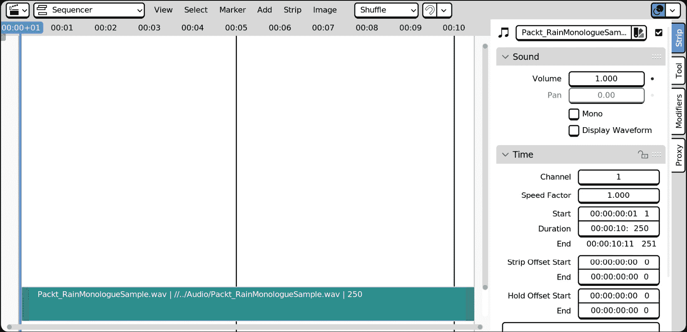

图 9.2：视频序列编辑器中的声音条带，右侧为属性

当你点击 `Play Animation`（播放动画）时，你应该能听到音频，而无需调整任何额外参数。

> **提示**
>
> 如果你听不到声音或音质很差，且你确定问题出在 Blender 上，请检查 `Preferences | System | Sound`（偏好设置 | 系统 | 声音）下的设置。这可能是默认 `Audio Device`（音频设备）的问题。

## 使用声音条带

声音条带可以像 `Video Sequencer`（视频序列编辑器）中的任何其他条带一样进行编辑。当然，Blender 没有真正的多轨音频编辑套件那样的功能，但它提供的功能比你从一个 3D 应用程序中预期的要多！

### 声音条带属性

声音条带有一些独特的属性，可以在 `Video Sequencer`（视频序列编辑器）右侧边栏（`N`）中找到。编辑这里的几个属性可以改善我们的体验：

1.  选择声音条带，转到边栏 `Strip`（条带）选项卡下的属性。
2.  启用 `Sound | Display Waveform`（声音 | 显示波形）。
3.  启用 `Source | Caching`（来源 | 缓存）。

缓存能让音频处理稍微快一点点（也许），但更重要的是启用 `Display Waveform`（显示波形）。启用后，我们就能像在其他音频程序中那样看到声波的峰值：

图 9.3：声音条带中可见的声波

在声音条带中看到波形，使得查找特定声音发生的精确帧变得容易得多。除其他外，这使得在需要时编辑声音条带变得更容易。

> **提示**
>
> 如果你调整 `Video Sequencer`（视频序列编辑器）中的视图大小，使一个音频条带填满空间，你可以自定义界面，以便在工作时看到音频峰值。尝试在 Timeline（时间轴）和 `Video Sequencer`（视频序列编辑器）中都启用 `View | Sync Visible Range`（视图 | 同步可见范围）来对齐它们。

### 裁剪音频长度

如果你选择使用提供的音频片段，几乎不需要编辑它。只需确保它从 `frame 1`（第 1 帧）开始。另一方面，如果你导入了自己的音频，可能需要将其裁剪或调整其在时间轴上的位置。

这是另一个声音条带的示例，直接源自一整期播客节目。注意它是如何超过一小时标记的：

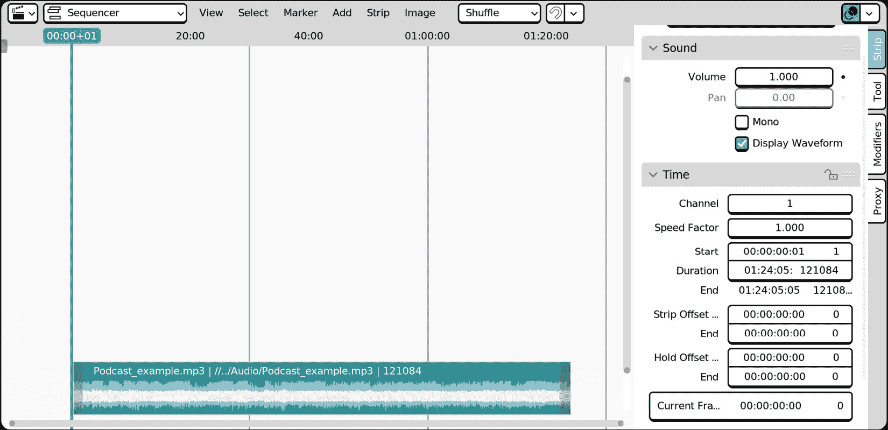

图 9.4：一个长得多的声音条带

如果我要使用这段音频，我需要直接跳到我喜欢的那个有趣片段；绝不可能为整个节目做动画。我可以在 Audacity 等专用程序中裁剪音频，但 Blender 也能做到。

声音条带可以像 `Video Sequencer`（视频序列编辑器）中的任何其他条带一样进行编辑。我发现使用 `Strip | Time | Hold Offset`（条带 | 时间 | 保持偏移）属性能最快地定位到我想要的音频片段：

1.  编辑声音条带，使其仅包含你想要用于场景的音频片段。
2.  在 Timeline（时间轴）中，调整场景的帧范围以适应音频的长度。

务必从头播放音频并一直听到结尾，以确认你的选择。你现在听到的内容将决定动画的时机，并且——假设你不再做进一步更改——将是你在最终视频中听到的内容。

## 处理声音的时间轴设置

如果你曾尝试过将音频和视频一起编辑，或者在一些可疑的盗版网站上看过编码糟糕的电视剧集，你就会知道音频与视频不同步有多么令人抓狂。如果我们要制作一个看起来像是说话声来源的角色动画，我们必须精确掌握这些词语发生的帧。

当我们点击 `Play Animation`（播放动画）时，Blender 会同时播放动画和音频，但这并不一定意味着两者是同步的。默认情况下，Blender 设置为按顺序 `Play Every Frame`（逐帧播放），即使帧率滞后。另一方面，音频平滑播放且不跳帧，从点击 `Play Animation`（播放动画）的那一帧开始。结果类似于看无声电影同时听留声机；视频和音频的时机之间没有保证不会漂移。例如，你可能在 3D 视口中看到 `frame 161`（第 161 帧），却听到来自 `frame 164`（第 164 帧）的音频。

总体而言，使用 Blender 默认的 Timeline（时间轴）设置，很难准确判断特定声音发生在哪一帧。让我们使其更适合我们的目的：

1.  打开 Timeline（时间轴）标题栏中的 `Playback`（播放）菜单。
2.  将 `Sync`（同步）设置为 `Sync to Audio`（同步到音频）。
3.  启用 `Audio Scrubbing`（音频擦洗/刮擦预览）。

## `Sync to Audio`

`Sync to Audio` 确保我们在播放期间于 `3D Viewport` 中看到的内容与音频保持同步，以免影响我们对动画同步程度的判断：

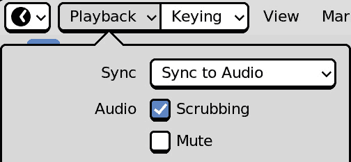

图 9.5：时间轴中的音频播放设置

此外，我们还启用了 `Audio Scrubbing`。现在，每当我们擦洗或更改帧时，都会听到该帧上播放的微小音频片段。

试一试！很烦人，对吧？但也挺有用。在擦洗时使用此功能，我们无需一直盯着音频波形，就能准确听到每个单词开始的时间。

**提示**

保持同步和条理清晰的另一种方法是在每个单词或短语的开头添加标记。我喜欢将这些标记重命名以反映正在说的台词。

关于音频的部分到此结束！既然确保了声音位置正确，我们就可以开始制作动画了，因为知道音频将与动画同步。好吧，也许我们目前还无法确定这一点——但如果不同步，至少我们知道该怪谁。

## 不说话也能表演

以音频为指引，我们可以消除对动画时机的所有疑虑。我们确切地知道 Rain 将说什么词、何时说这些词，以及说这些词需要多长时间。

但这是否意味着我们应该从制作她的嘴部动画开始？未必！事实上，如果我们只先制作那部分动画，看起来会有点怪。嘴巴发出的所有那些小音素和音节都是细节，我们不能从细节入手。此外，角色不仅仅用嘴说话。在本练习中，我们将从让 Rain 用整张脸“说话”开始。

## 关键面部表情

如果你想得比较远，可能已经听了几遍 Rain 的台词，并在桌前或镜子前自己默念了几遍。这很棒。继续这样做。作为动画师，我们可以通过让配音演员通过我们、通过我们自己的身体来“说话”，在她附身于 Rain 这具最终的躯体之前，预演角色即将做的动作。

在听了音频并“给自己做动画”几遍后，再试一次，但这次不要动嘴唇太多。这迫使你用脸部其他部位来表演。Rain 会看向哪里？她会点头还是摇头？会微笑还是皱眉？眉毛会怎么动？这些决定将构成我们动画的第一遍，但尽量别想太多——通过表演出来去感受它！

以下是我第一遍中的一些关键面部姿势：

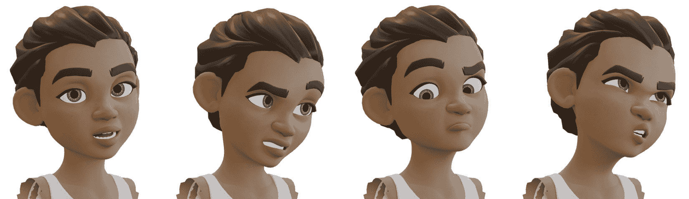

图 9.6：Rain 说话时的面部表情

尽管我们将对口型同步推迟到后面的章节，但这并不意味着我们不应在姿势中包含嘴巴。但请注意，我们应避免为颈部以下的任何部位设置关键帧，因为这可能会与稍后将此动画与之前的走路循环相结合的练习产生冲突。请遵循以下步骤：

1.  启用 Rain 的 `Face Primary` 骨架层。`FK` 层也应该可见，但我们只需要 `FK-Head` 和 `FK-Neck`——你可以隐藏其他 `FK` 骨骼。
2.  选择一帧并为其创建一个面部姿势。不必从开头开始，但要尝试熟练使用大量可用骨骼来实现你想要的外观。
3.  就像我们初次尝试角色动画时那样，选择所有可见骨骼并为其 `Location, Rotation & Scale`（位置、旋转和缩放）设置关键帧。我们稍后随时可以删除不必要的动画通道。
4.  继续！继续在不同帧为整个头部和面部设置关键帧，直到获得一个大致遵循 Rain 应有面部表情顺序的漂亮序列。
5.  你可能还希望通过在 `Dope Sheet`（动作编辑器/逐帧编辑器）中选择单个骨骼的通道组并使用 `Channel | Group Channels`（通道 | 通道分组）（`Ctrl + G`）来合并它们，尽管我建议不要像我们在 第 7 章 中那样激进地操作。例如，这一次我们需要将下巴的关键帧与嘴唇的关键帧区分开：

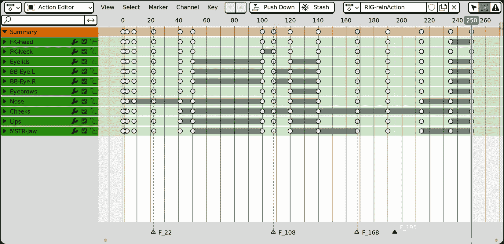

图 9.7：带有自定义通道组的动作编辑器示例

完成后，你应该能看到 Rain 和她的声音之间形成了一种连贯感。她离真正的“说话”还远着呢，但至少她在“感受”所说的内容。别担心如果很乱；在这个阶段，有总比没有强。

## 自动关键帧和关键帧集

需要制作动画的小骨骼太多，插入关键帧变得繁琐。摆好姿势后，你必须记得全选并插入关键帧，否则姿势会重置，你的工作就会白费。这些额外的点击和按键累积起来很可观！

### 关键帧集

到现在，你可能已经厌倦了每次调出 `Insert Keyframe`（插入关键帧）菜单（`I`）时都要选择要设置关键帧的属性。这就是 `Keying Sets`（关键帧集）派上用场的地方。

你可以在 `Timeline`（时间轴）的 `Keying`（关键帧）菜单中选择 `Active Keying Set`（活动关键帧集）类型：

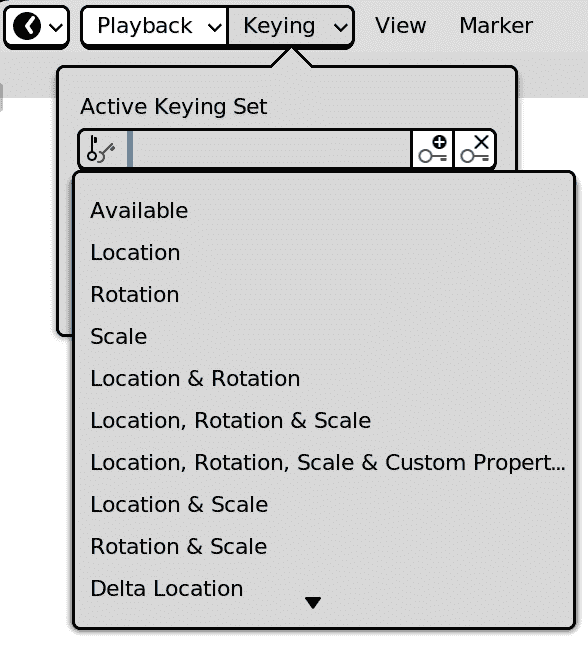

图 9.8：可用的关键帧集

你以前见过这个——这是在 `Insert Keyframe`（插入关键帧）菜单（`I`）中弹出的同一个列表。

选择关键帧集后，`Insert Keyframe`（`I`）将使用该关键帧集，而不是显示 `Insert Keyframe` 菜单。例如，如果你从此菜单中选择 `Location`（位置），在 `3D Viewport`（3D 视口）中按 `I` 将绕过常规菜单，立即为所选内容插入 `Location` 关键帧。如果你想挑剔地选择要设置关键帧的属性，这并不是特别有用，因此，我几乎总是选择 `Available`（可用），这是一个特殊的关键帧集，仅为所选骨骼/物体的现有动画通道设置关键帧。

### 自动关键帧

如果你仍觉得按 `I` 插入关键帧多敲了一次键，请看看那个可以自动插入关键帧的按钮。它看起来像 `Timeline`（时间轴）标题栏中的录制按钮：

图 9.9：自动关键帧

`Auto Keying`（自动关键帧）会在当前帧为所选骨骼或物体插入关键帧，每当它们被变换时——之后无需按 `I`。我一直对这个功能保持沉默，直到现在，因为如果不小心，它会迅速把事情搞砸！

让我们启用 `Auto Keying`，然后选择一个合适的关键帧集：

1.  启用 `Auto Keying`。
2.  打开 `Auto Keying` 按钮旁边的菜单并启用 `Only Active Keying Set`（仅活动关键帧集）。
3.  转到 `Keying | Active Keying Set`（关键帧 | 活动关键帧集）并选择 `Available`（可用）。

有了这些设置，我们就不再需要手动插入关键帧了。此外，如果我们在工作中选择删除任何多余的动画通道，`Available` 关键帧集可确保它们不会被意外创建 again。

当然，即使启用了 `Auto Keying`，在需要为未变换的骨骼/物体设置关键帧的情况下，按 `I` 手动插入关键帧仍然是必要的。还要记住，`Available` 关键帧集无法创建新的动画通道——如果你尝试为尚未制作动画的骨骼设置关键帧，将会报错。

最后一点：小心！`Auto Keying` 的一个缺点是很容易意外覆盖关键帧或弄乱 `Dope Sheet`。

### 使用自动关键帧优化面部姿势

让我们在动画的下一遍中试用这些新设置：

1.  使用 `Dope Sheet` 和 `Pose | In Between`（姿势 | 中间帧）操作符来保持姿势并在已制作的关键帧之间创建分解动作。你可能会惊讶于通过关键姿势之间快速的“缓出”式过渡，你能走多远。
2.  使用 `Graph Editor`（图表编辑器）来最终确定颈部和头部的运动。

### 当你对头部的运动感到满意后，继续处理眉毛，最后是眼睛。

正如你所见，不用嘴巴也能做大量的“说话”动作！当你对雷恩鼻子以北（注：指面部上半部分）的所有情感和感觉表现范围感到满意时，就可以着手制作嘴部动画了。

## 对口型的科学原理

到了本练习最精彩的部分：制作雷恩嘴部的动画。这将让她“开口说话”（这么说吧）。

就像走路一样，说话是我们每天都能看到人们做的事情。正如我之前提到的，这会让动画制作变得更难，而不是更容易！因此，先解构我们说话时嘴巴在做什么，这会有所帮助。

## 给动画师的语音学知识

幸运的是，有效的对口型制作不需要完整的语音学课程。我们不需要学习如何说话——只需了解说话这个动作在观察者眼中是什么样子的。

以下是我们应该了解的语音基本要素——我称之为**嘴型**。当这些下颌、嘴唇、牙齿和舌头的位置按顺序执行时，就是我们说话的方式，也是让角色看起来在说话的方式。大多数单词——甚至短单词——都由多个嘴型组成，因此这些嘴型的切换速度会比我们迄今为止制作动画的任何其他姿势序列都要快。

### 元音

让我们从元音开始：嘴巴张开时发出的基本声音。在英语中，这些通常被称为由字母 *a*、*e*、*i*、*o* 和 *u* 代表的发音。

英语中的简单元音发音，以及产生它们的嘴型，存在于一种频谱之中，起始于 *see* 中的 *ee*，终于 *root* 中的 *oo*：

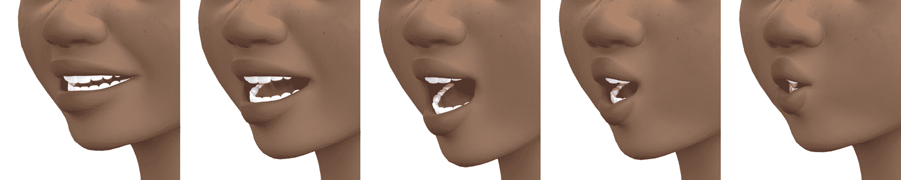

图 9.10：ee, eh, ah, oh, oo

试着把它们连成一个词发出来：*eeeeaaaaaaooooouuuu*。

注意，颚骨在频谱中间的张开程度比两端大；像 *hot* 中的 *ah* 和 *boat* 中的 *oh* 这样的声音，需要口腔内宽敞、共鸣的空间。同时，也要注意嘴角从 *ee* 到 *oo* 稳步向内收拢。

**提示**

*ee* 的嘴型看起来很像微笑，不是吗？事实上，它们非常相似，在现实生活中，它们使用的是同一组肌肉。但这并不意味着雷恩说 "cheese" 时必须开心。皱眉的角色只需“微笑”足够长的时间以发出正确的 *ee* 音，然后嘴巴再恢复到不那么开心的姿势即可。同样，微笑的角色也只能做 *oo* 嘴型足够长的时间来完成 *yous* 和 *whos* 的发音，然后 *ee* 状的微笑就会回到他们的嘴唇上。

除了频谱上展示的元音外，还有像 *comma* 和 *tuna* 这类单词结尾处的弱 *uh* 音，它发音松散，看起来有点像雷恩下颌只张开一半时的样子。最后，任何元音都可以被“r 音化”以发出 *r* 音；这主要靠舌头完成，但在外观上，看起来像是上唇微微噘起：

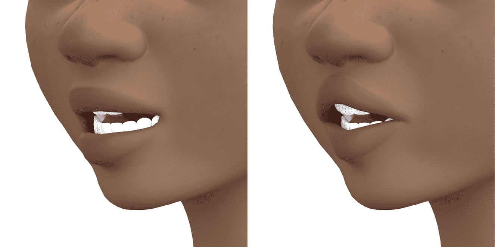

图 9.11：“uh” 和 “er”

#### 组合元音

这些元音发音的发声动作融合流畅，能产生更多声音。像 *face* 中的 *a* 和 *ice* 中的 *i* 这样的元音是双元音——分别是 *eh* + *ee* 和 *ah* + *ee* 的复合音。如果你仔细想想，“辅音” *w* 和 *y* 其实更像元音。

仅使用我们迄今为止看到的嘴型，我们就可以为 *I*、*our*、*way*、*where* 和 *you* 等单词制作动画。但这些还不足以组成一个完整的英语句子，所以让我们继续讲辅音。

### 辅音

辅音是语言中所有其他的声音——位于元音之间的那些——它们需要以某种方式限制气流通过口腔。为了发出这些声音，下颌倾向于稍微闭合——尽管不一定完全闭合——以便嘴唇、牙齿和/或舌头的某些组合能够接触。

#### 嘴唇

我们先从辅音 *b*、*m* 和 *p* 开始。这些很重要，因为它们是**唯一**需要嘴唇完全闭合的辅音，这使它们在对口型制作中最为显眼：

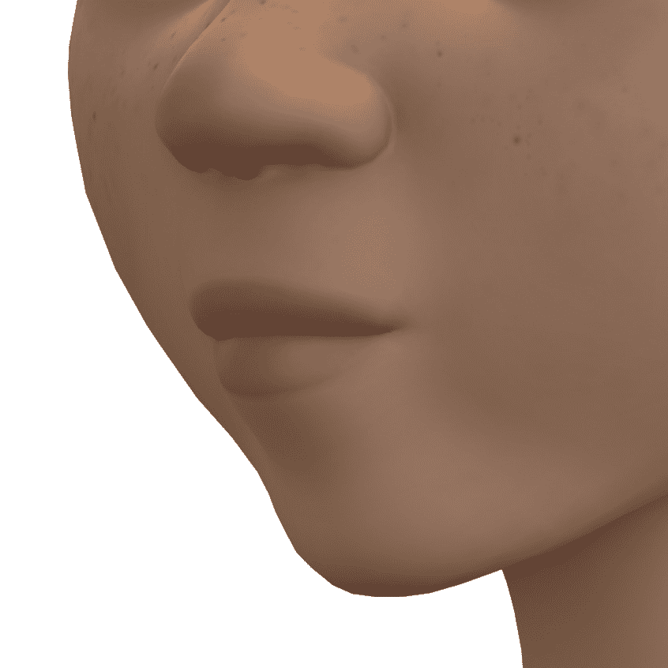

图 9.12：双唇音素

虽然它们听起来不同，但从我们的视角来看，它们长得很像。就我们的目的而言，*mum*、*bum* 和 *pub* 这些词基本上会以同样的方式制作动画。

**提示**

要发出 *b*、*m* 和/或 *p* 音，嘴唇必须合拢，短暂形成一个气密封闭。但这并不意味着整个下颌都需要闭合。还要考虑到，这是角色嘴唇**必须**这样做的唯一情况。其他时候，嘴巴在单词之间、句子前后通常保持张开状态。

三个字母，一个嘴型——简单！现在，让我们继续讲点更难的。

#### 牙齿

辅音 *f* 和 *v*（如在 *five* 中）看起来也很像。发这些音要求下唇接触上齿：

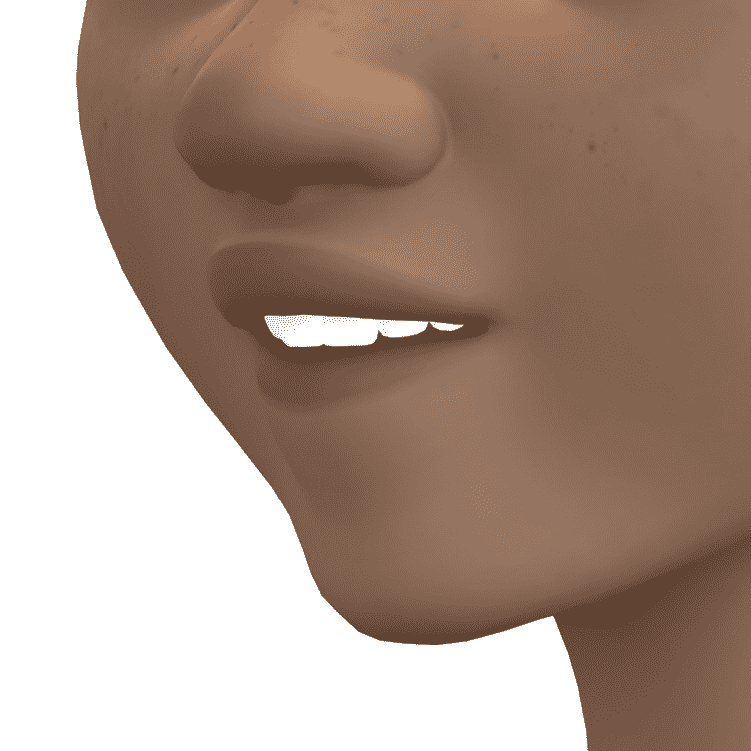

图 9.13：“f” 或 “v” 音

#### 舌头

为了让事情变得更难，*th* 音要求我们调出舌头的骨骼，对于雷恩来说，这些骨骼在一个完全不同的骨架层中：

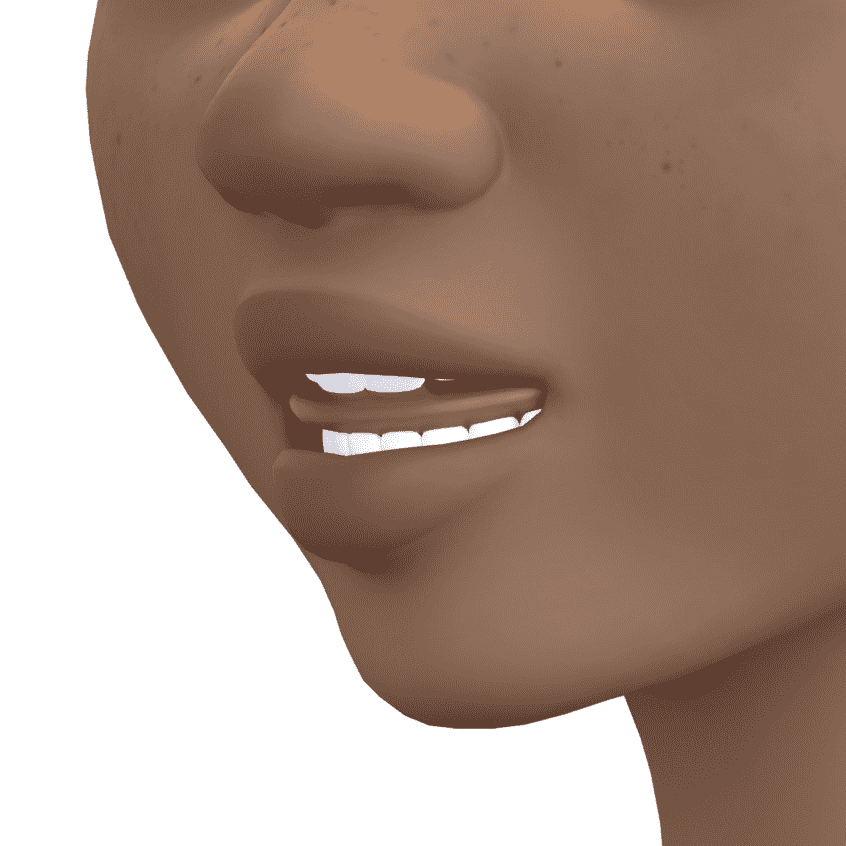

图 9.14：使用 `Face Extras` 中的舌头骨骼制作 “th” 嘴型

舌头的另一个重要用途是发 *l*（小写 *L*）音，如在 *like* 中。为了做出令人信服的 *l*，可能需要看到舌头接触上颚，如下所示：

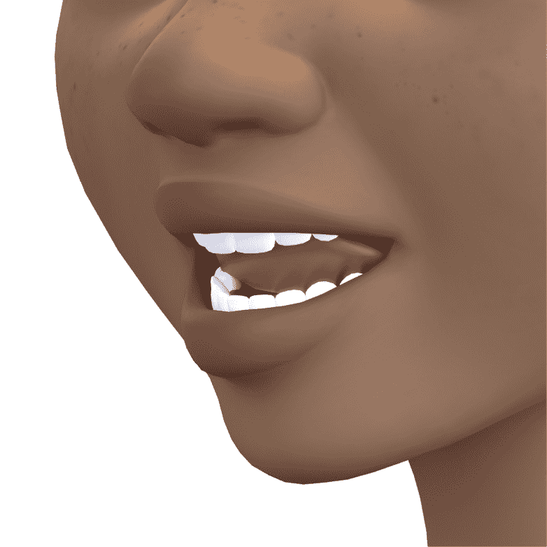

图 9.15：“l” 嘴型

#### 所有其他声音

英语中还有太多音素需要涵盖了！辅音如 *d*、*g*、*j*、*k*、*n*、*s*、*t* 和 *z*，以及 *ch* 和 *sh*……

总之，它们看起来都差不多像这样：

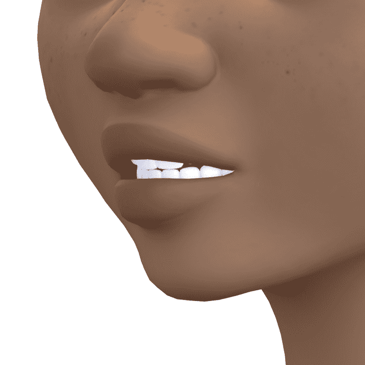

图 9.16：所有其他音素

如果它们看起来还有样子的话！复杂的声道发声动作用于其余这些声音——舌头不同部位接触口腔不同部位，等等——但这些都隐藏在视线之外。因此，对我们动画师来说，它们不那么重要。在许多情况下，你只需稍微晃动一下下颌，让它看起来像在动，这就足够了。

我们现在掌握的语音学知识足以开始制作对口型动画了！

## 制作嘴部动画

制作雷恩嘴部动画与制作比如她手臂的动画没什么两样。制作手臂动画时，你从肩膀和肘部开始，然后是手，最后是手指。这条 `FK` 链虽然不那么明显，但仍然存在于控制雷恩嘴巴的骨骼中。

最重要的骨骼是 `MSTR-Jaw`，它控制雷恩下颌的张合。如果雷恩打算说话，她就得张合这个东西。接下来是嘴角以及控制上下嘴唇的控制骨骼，它们几乎同等重要。最不重要（但仍有点重要）的是舌头，它有点像嘴巴的小指。

注意，这与我们刚才介绍人类语音基本音素的顺序相符！首先，元音的类型决定了下颌骨应该张开多远，以及嘴角大致应该有多宽。接下来是由嘴唇和牙齿发出的辅音，最后是舌头。

大致按这个顺序为雷恩嘴部的各部分设置关键帧，仔细聆听拖动帧时的声音，确保动作在恰当的时间设置了关键帧，以便与声音同步。不知不觉中，你就完成了雷恩说话的动画！

**提示**

通常，配音中单词的开头会正好落在两帧之间，你会不知道到底在哪一帧设置关键帧，以让相关动作看起来像是声音的原因。面对这种两难局面时，试着让动画*极微弱地*先于声音。

与光不同，声音有可感知的缓慢性。我们从观看闪电和烟花等又响又远的视听事件中就知道这一点。仅在 50 英尺（约 15 米）的距离上，某人的声音大约需要 1/24 秒（1 帧）才能传到你耳边。

你现在拥有让 Rain 说话所需的所有工具和知识。试一试吧！

1.  先为一些单词设置关键帧，主要关注 `MSTR-Jaw`，这是张合嘴巴最重要的骨骼，以及嘴角。

2.  一旦 Rain 的下巴随着配音上下同步运动，继续处理嘴唇形成的较小形状；即第一步中遗漏的那些快速的小音节。

3.  最后，启用 `Face Extras` 骨架层，为舌头可见（或本应可见）的剩余语音片段制作动画。

4.  使用 `Action Editor`，将动作重命名为类似 `Rain Speaking` 的名称，并保存你的工作以供后续练习使用。

只要放置好几个关键帧，就会有“豁然开朗”的感觉，我们听到的词语会仿佛是由 Rain 自己说出来的一样！

## Summary

当我们最初将音频导入场景并播放时，Rain 只是站在那里一动不动，而词语却从别人的嘴里冒出来。现在，经过大量工作，我们可以说是 Rain 在说那些台词！这就像让木偶看起来会说话一样。尽管是我们在拉所有的线，但动画师们却有一种狂喜的满足感，让自己被自己的作品欺骗。

想象一下，如果没有配音作为参考来做这个动画会有多难；让 Rain 在无声中张嘴说出同样的台词会有多难。后来，配音演员不得不观看你制作的内容，并将他们的表演与你的作品同步，而不是反过来。这个过程称为配音（dubbing），早期许多动画都采用这种方式，但在我看来，效果从来不太对劲。如果可能，一定要先拿到音频。

作为完成本练习的额外收获，我们现在在 Rain 的小型角色动画作品集中有了两个互补的动作：一个用于说话，另一个用于走路。稍后，我们将使用 Blender 中最后一个、也是最神秘的动画编辑器来组合这些动作。

我们即将完成本书的角色动画部分。延续“寻常事物难以制作动画”这一主题，下一章将讲解制作最寻常动作的动画，因此也是最棘手的动作之一：*拿起* *东西*。

## Questions

1.  Blender 的 `Video Sequencer` 除了编辑视频序列外还能做什么？

2.  当你更改场景帧率时，声音条会发生什么？

3.  Blender 的默认播放设置是 `Play Every Frame`。在哪些情况下这不太理想？

4.  何时适合使用 `Auto Keying`？

5.  你会说英语以外的语言吗？有没有一些你用嘴发出的声音或做出的形状在英语中不存在？

6.  哪个口腔部位在现实生活中说话不可或缺，但在动画中却不那么重要？

7.  声音快还是光快？这对动画师为什么重要？

8.  完成这个动画后，想象有人让你替换音频。导演决定他们更喜欢另一个版本，词语和时机略有不同。你有多恼火？
