# 第 10 章：使用动态约束进行道具交互

与环境互动是……存在的一个重要方面。我喜欢触摸物体、拿着物体、捡起它们又放下、重新安排周围的世界，以及总体上拥有一个坚实的躯体。我打赌你也喜欢做这些事，你的角色也想做这些事！

为这制作动画的难度范围可以从显而易见到极其困难。如果我们想让 Rain 戴帽子，可以将帽子父级绑定到她头部的一个骨骼上，然后照常继续；如果她要坐在椅子上，我们只需制作她坐下的动画，不让她穿过椅子即可；如果 Rain 踢球，我们可以在恰当的时刻制作球飞向空中的动画。

到目前为止一切顺利——但如果她要用手捡起球并扔出去呢？这需要制作一个*动态*约束——一个在 Rain 触碰球时开始生效、在球离开手时结束的动画约束。首先，我们需要把 Rain 的手放在球上。接下来，我们要对齐一些东西并创建约束。就约束而言，这个很容易理解。具有挑战性的是为它制作动画……

在本章中，你将学习如何执行以下操作：

*   摆姿势让 Rain 用手指抓住物体
*   使用约束和特殊骨骼“抓取”物体
*   为约束的影响设置关键帧
*   将约束的效果应用到物体上

## 技术要求

这没什么惊喜的——要跟着做这个角色动画练习，你需要三样东西：

*   Blender
*   Rain
*   一个包含 Rain 的 Blender 新场景

这些要求现在对你来说应该讲得通了。如果你不记得 Rain 是谁或如何在 Blender 中使用她，请回到 `Chapter 6`。如果你不记得 Blender 是什么，可能需要回到 `Chapter 1`！

## 触碰物体

在此动画中，Rain 将用右手捡起一个球，拿一会儿，然后扔出去。这涉及使用约束在 Rain 的骨架和球之间建立对象关系，这与我们在 `Chapter 4` 中看到的不无相似，但增加了一些复杂性。

让 Rain 手里拿球的第一步是创建一个球并把她的手放上去。非常简单！这将是练习中最简单的部分。之后，事情会变得有点棘手……

### 设置镜头

我们需要建模一个球，并把它放在 Rain 容易够到的地方。比如桌子上正对着她的位置？

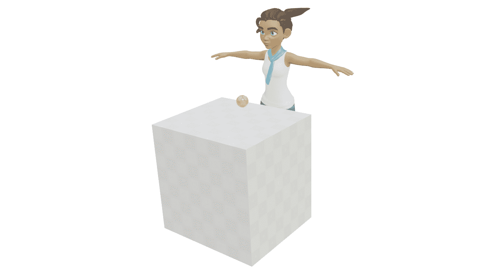

图 10.1：Rain，带道具

顺便说一句，让我们添加两个新物体：一个球和一张桌子。你可能不是 3D 建模师，这也绝不是一本建模书，所以给球“建模”可能仅仅是添加一个球体，而你的“桌子”可以只是一个盒子。我觉得任何 3D 动画师都能搞定！

> **提示**
>
> 如果你似乎无法添加、选择或编辑物体，可能是因为你仍处于 `Pose Mode`。你需要处于 `Object Mode` 才能添加新物体，处于 `Edit Mode` 才能编辑它们。我们有一阵子没用这些其他模式了。

### 创建简单道具

你的桌子可以是任何齐腰高的平坦表面，比如钢琴——最好是三角钢琴：

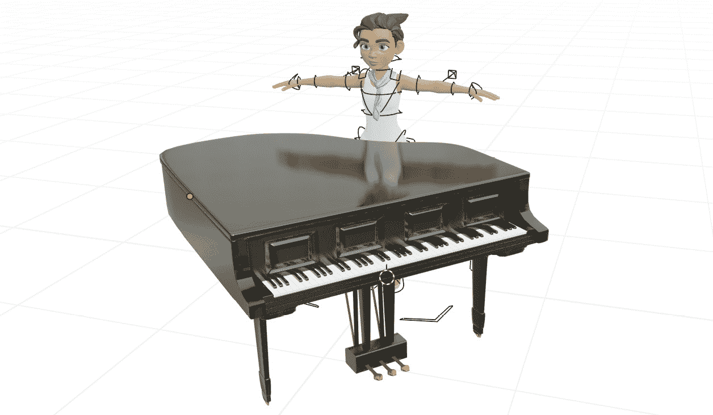

图 10.2：拥有 40,000 个顶点的钢琴模型

开玩笑的！用一个立方体。

至于球，任何球体都可以，只要它足够小能放进 Rain 的手里。`0.1 m` 是个合适的直径。随意设置颜色/纹理。

我给球添加了一个材质，以便更容易地看到它的旋转：

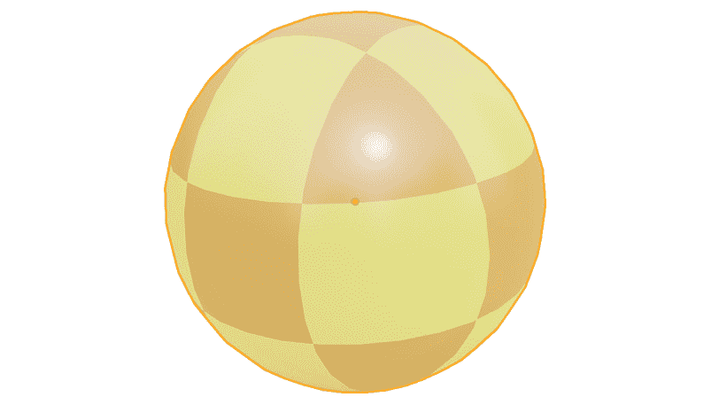

图 10.3：球

> **重要提示**
>
> 移动和缩放球时请留意当前模式。如果你在 `edit mode` 下一次性移动所有顶点，会将球的几何体从原点处移开；如果你在 `object mode` 下缩放球，会将其对象缩放值从 `[1.0, 1.0, 1.0]` 修改掉。这两种情况日后都可能导致一些奇怪的行为。

## 设置物体到骨骼的关系

这甚至勉强能称得上建模，但请继续为 Rain 建模这些物体，并将它们组装在一个方便的位置：

1.  建模一个能放进 Rain 手中的球。
2.  在 Rain 面前建模一张简单的齐腰高的桌子。
3.  将球放在桌子上靠近 Rain 右手的位置，这样她就不需要伸得太远就能抓到它。
4.  将这些物体命名为 `Ball` 和 `Table`。

现在我们拥有镜头所需的所有物体。如图 10.1 所示，我的桌子遮住了 Rain 的腿，而球离 Rain 足够近，以至于我甚至不需要制作她弯腰捡球的动画。任务本身已经够有挑战性了！

有了场景中所需的所有物体，我们准备好将注意力转移到 Rain 的绑定上。

## IK 手臂的用途

为了预演她将要执行的动作，我们将再次调整 Rain 绑定中的一些设置以适应此场景。一如既往，我们的目标是让 Rain 更容易制作动画，而在本例中，我们将让事情变得比以往更简单。面部动画和脚步动作等细节在本章中并不重要。

本练习专注于 Rain 的手与球之间的关系，因此以下调整将为我们简化操作：

1.  使用 Rain 的 `CloudRig` | `Outfits` 界面隐藏她的马尾辫和其他干扰性配饰。
2.  启用 `IK`、`FK` 和 `Fingers` 层。
3.  在 `FK/IK Switch` 设置中，将 `Left Arm` 设置为使用 `FK`，但保持 `Right Arm` 为 `1.0` 以使其使用 `IK`。
4.  在 `FK Settings` | `FK Hinge` 下，将 `Left Arm` 和 `Right Arm` 都设置为 `1.0`。
5.  将 `Face Settings` | `Eye Target Parent` 设置为 `Head` (`3`)。
6.  你可以选择并 `隐藏` (`H`) Rain 髋部以下的所有骨骼。

这是隐藏了多余骨骼和身体部位后的 Rain：

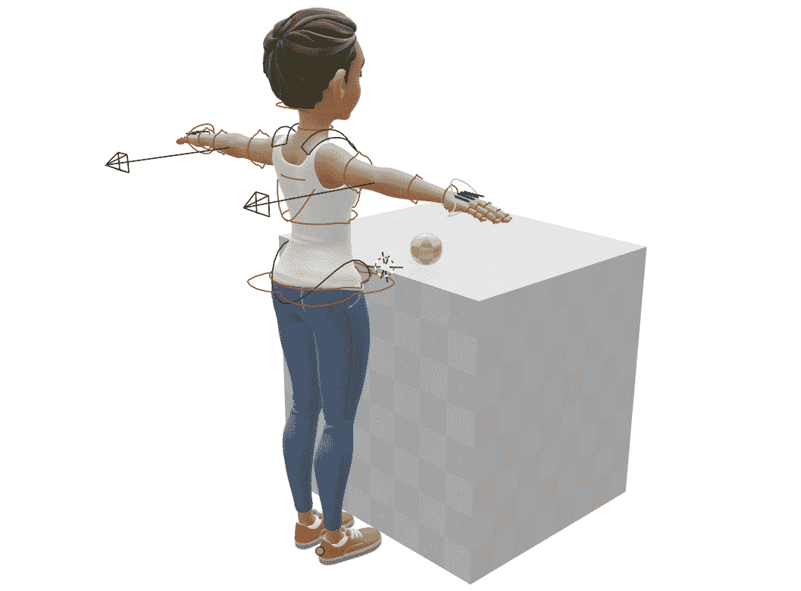

图 10.4：只有抓球所需骨骼的 Rain

也许你能猜到为什么我们要做这些其他更改。首先，将眼球目标父级设置为头部意味着我们可以在本章剩余部分忽略所有面部骨骼——包括眼球目标。

这里最重要的决定是让 Rain 的右臂由 `IK` 而非 `FK` 控制。我们准备开始制作动画了，马上就会看到这让我们的下一个任务轻松多少。

## 伸手去拿物体

现在我们将从第 `1` 帧到第 `30` 帧实现动画的第一部分：

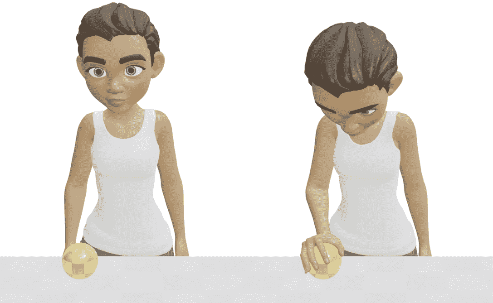

图 10.5：站立的 Rain 与抓球的 Rain

既然我们可以按任何方便的顺序制作动画，那就先从更重要的姿势开始吧。

### 手放在球上

让我们从第 `30` 帧让 Rain 抓住球开始。这将是球与 Rain 皮肤接触、且我们在骨骼与新物体之间建立关系的关键时刻。

一件让这项任务变得更容易的事是抓取手使用了 `IK`。当我们确切知道手需要放在哪里时，只需移动和定向 `IK-Hand_Parent.R` 即可，而不必操作整条手臂的 `FK` 链：

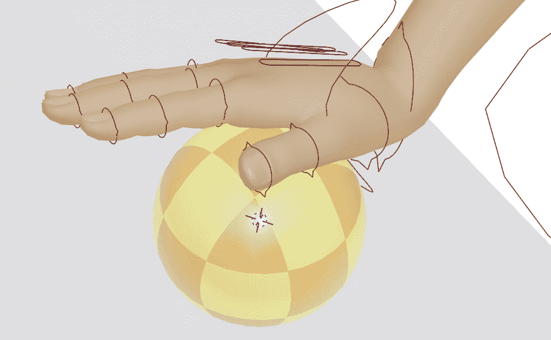

图 10.6：Rain 的手掌放在球上

之后，还需要让手指恰到好处地贴合球面。Blender 中没有神奇的操作符能替我们完成这部分；我们只需把 Rain 的手放在球上，放大视图，从多个不同角度仔细观察，并在调整姿势时反复检查：

1.  前往第 `30` 帧。
2.  调整 Rain 的躯干、颈部和头部骨骼，使她注视并倾向球体。让她的左臂自然下垂，处于舒适角度（本章它不会做太多其他动作）。
3.  使用 `IK-Hand_Parent.R` 将 Rain 的右手放在球上，使其舒适地贴合手掌。如有需要，调整肩部和 `IK` 极点目标。
4.  摆姿势 Rain 右手的手指骨骼，使其抓住球。从最靠近手掌的骨骼开始，沿着 `FK` 链向下依次调整。
5.  为所有可见骨骼的位置和旋转插入关键帧。

大功告成——一个舒适、自然的抓握姿势：

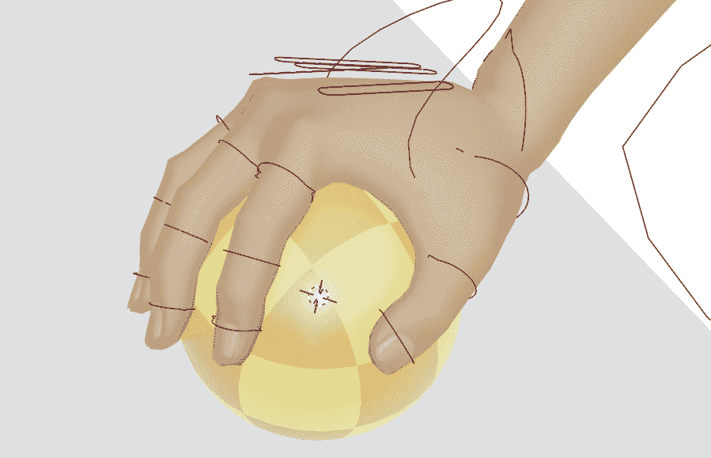

图 10.7：Rain 的整只手放在球上

让角色真实地抓住东西可能很棘手，对吧？如果你在这里遇到困难，我将简要解释让两个元素接触的细节。

#### 关于让物体接触

当为角色持物摆姿势时（实际上无论何时你试图让两个 3D 物体相互接触），你可能会发现自己把视图放得*非常*大——执着地试图让手的一部分越来越靠近物体，却永远不让它们真正“接触”。如果它们接触了，网格就会相交，这往往感觉像是一个不可接受的错误。这似乎让“两物接触”在 3D 中成为技术上的不可能。在“空隙”和“穿模错误”这条剃刀般细微的边界上，该怎么办？

在大多数情况下，答案是最好让物体稍微相交一点。在这个极端的特写中，你可以看到 Rain 手指上的皮肤从球体内部戳出了球的表面：

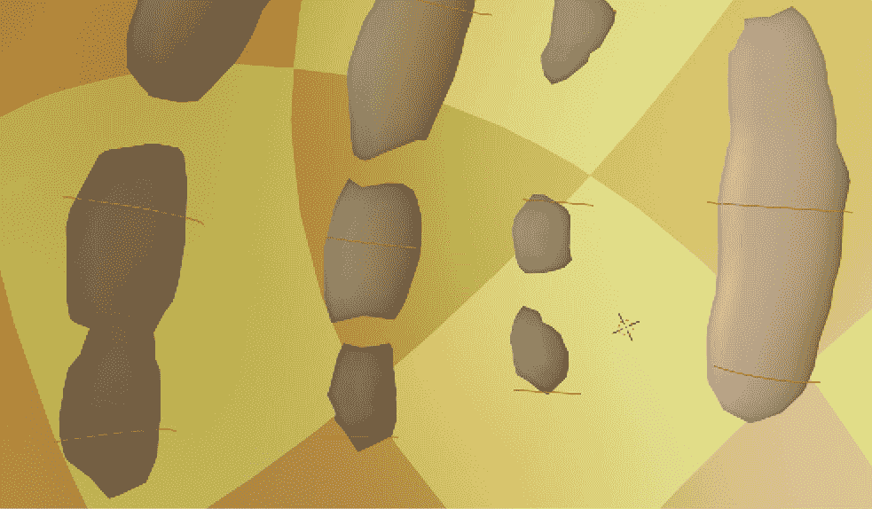

图 10.8：从球内部看去的视角

假设没有人会从这个视角看球，这种微妙的“穿模”通常比物体之间的一层薄薄空气更不易察觉，甚至可能改善视觉效果。只是别让任何手指完全陷进球里……

### 手离开球

我们已经为重要姿势插入了关键帧，那么回到第 `1` 帧，为图 10.5 中展示的第一个简单站立姿势插入关键帧吧。

当然，如果我们只在这两个姿势之间插值，Rain 的手会完全穿过桌子和球：

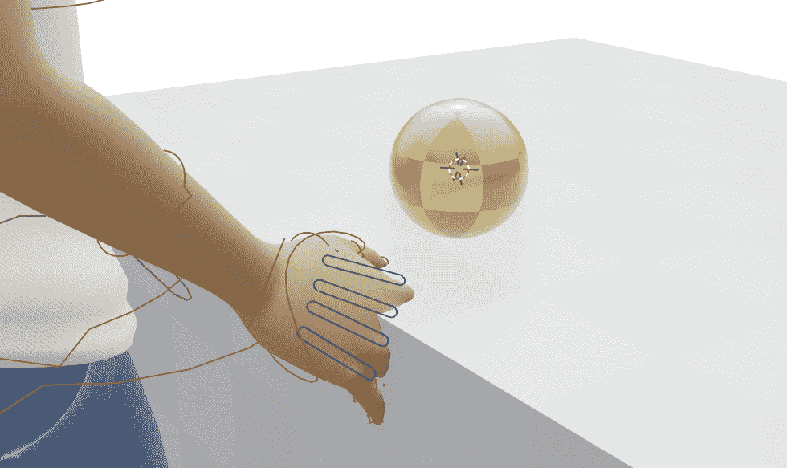

图 10.9：未添加任何分解关键帧的第 16 帧

所以，我们也得解决这个问题。在这里，我们要确保 Rain 的手指不穿过任何东西。角色动画可能不是我们的重点，但我们也不能马虎：

1.  前往第 `1` 帧，为 Rain 在伸手去拿球前的闲置站立姿势插入关键帧。
2.  在第 `1` 帧到第 `30` 帧之间，为 `IK-Hand_Parent.R` 再插入一两个姿势关键帧，使 Rain 的手不穿过球或桌子。
3.  对 Rain 的右手做同样的处理，使她在手抓住球之前先伸直手指、张开手掌。

这是我制作的 Rain 抓球完整动画：

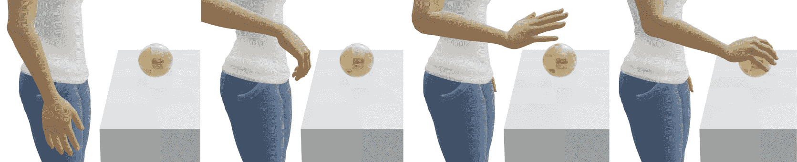

图 10.10：第 1、15、25 和 30 帧的 Rain

有了这个动作，我们初步的角色动画阶段就完成了。最后那个手指姿势对后续很重要，Rain 会保持这个手指姿势直到该松开球的时候。

一旦 Rain 在第 `30` 帧牢牢抓住球，就目前而言，动画制作只能进行到这一步了。在继续制作动画之前，我们需要在 `Ball` 物体和 Rain 的骨骼之间建立关系。

从视觉上讲，你可能会说 Rain 的手和球之间已经有关系了。我的意思是，在第 `30` 帧，看起来确实像 Rain 在拿着它（见图 10.7），但球并不知道这一点，如果我们继续制作 Rain 拿起球的动画，球会固执地停留在原地：

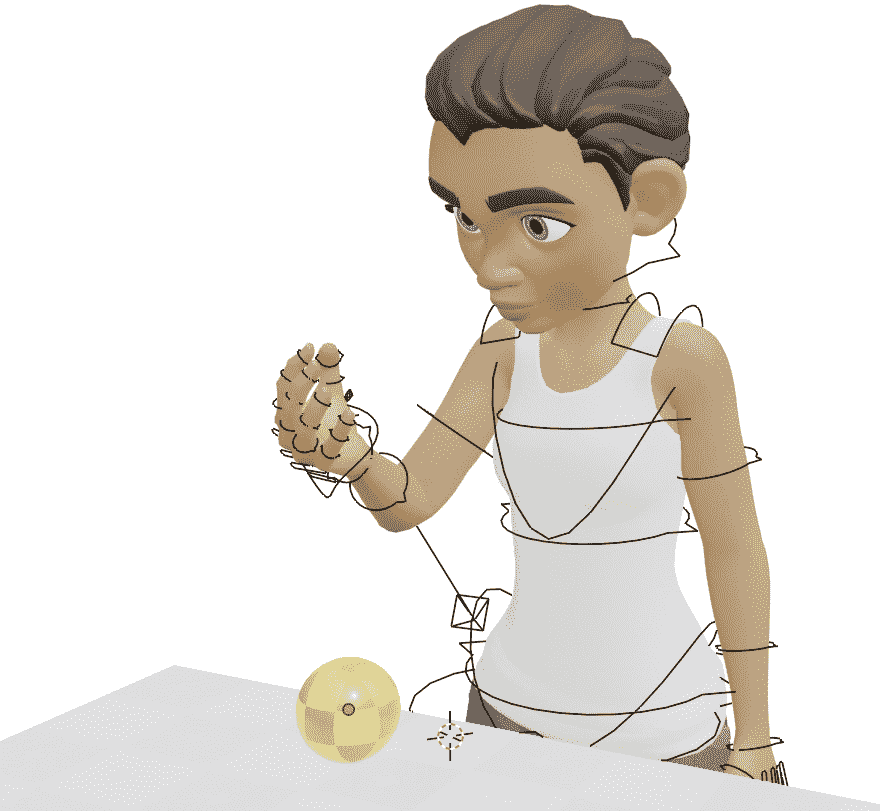

图 10.11：她以为她在看什么？

本节的目标是将那个球附着到 Rain 骨骼中的某个东西上，这样当 Rain 把它捡起来时，它真的会被捡起来。

## 虚拟骨骼 —— 更聪明的绑定方式

“简单，”你可能会想，“只要把球设为 Rain 手部某根骨骼的子级就行。”许多绑定都是这么工作的，但父子关系是一种“永恒”的关系——它无限延伸向前和向后的时间轴。Rain 永远都会拿着球。她永远不会放下它，必须像额头上那缕卷发一样把它戴在手上。对于某些场景这或许可以接受，但我们的不行。

不，Rain 不能成为这个球的父级——反正她年纪太小还做不了母亲。如果球需要被捡起再放下，球与手的关系就需要有明确的开始和结束。为此，我们需要一些约束和一根特殊的骨骼。

如果你查看 Rain 骨架中的 `IK Secondary` 层，会发现一些特殊的骨骼，其中一些贴心地命名为“dummy:”

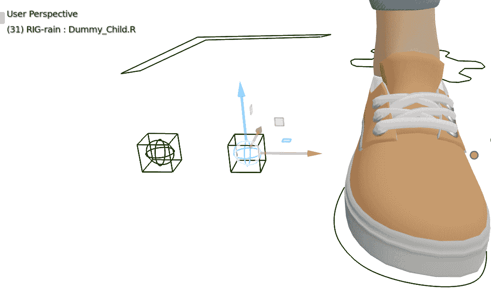

**图 10.12：** Rain 骨架底部的虚拟骨骼

想知道这些骨骼有什么特别之处吗？没有！它们什么都不做，这正是它们如此特别的原因。**虚拟骨骼**没有依赖对象，动画师可以随意使用它们。通常提供它们是为了让道具能依附其上，并作为同一套绑定的一部分进行动画制作。

> **提示**
>
> “虚拟骨骼”是一个实用称呼，而非技术术语。如果一根骨骼在默认情况下移动它不会引发任何动作，它就可以是虚拟骨骼。它们很像**空物体**。如果你正好使用的绑定没有提供虚拟骨骼，你可以用一个**空物体**代替虚拟骨骼，效果是一样的。

我们要找的虚拟骨骼在 Rain 手边，名字里带有“grab”。你能猜到它是做什么的吗？

## 寻找抓取骨骼

我们要的骨骼在 Rain 的右手边，名为 `GRAB-Hand_Child.R`。为了方便，我们称这根特定的虚拟骨骼为*抓取骨骼*：

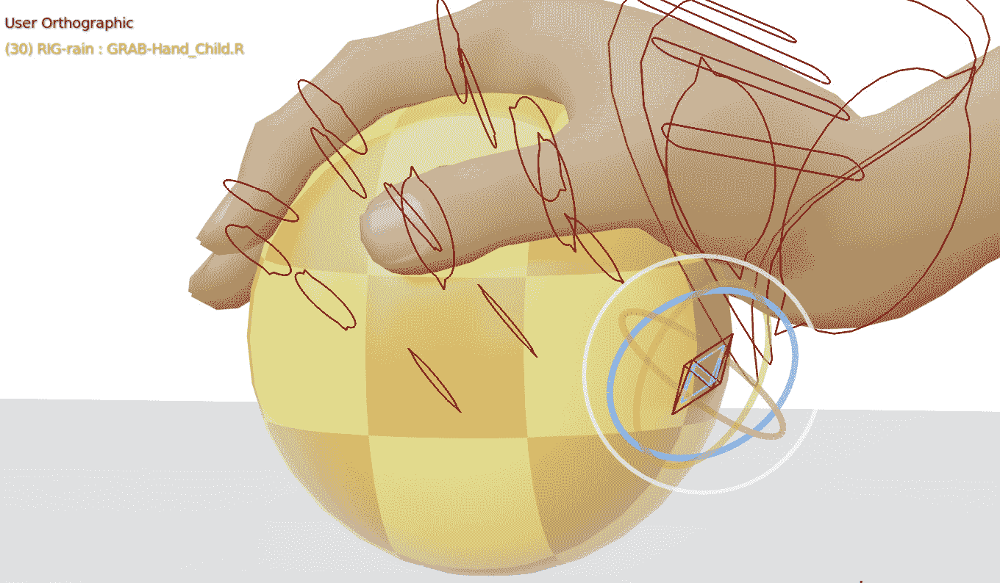

**图 10.13：** 右手的“抓取”骨骼

如果/当这根骨骼在球内部时可能很难定位，所以我们应该启用**显示骨骼 X 射线**功能，以便更轻松地查看和选择它。可以通过 `切换 X 射线` (`Alt` + `Z`) 启用该功能。也可以在 3D 视口标题栏的视口绘制选项中找到它。

让我们选择这根骨骼：

1.  启用 `IK Secondary` 层。
2.  使用 `切换 X 射线` (`Alt` + `Z`) 查看那些原本难以看见的骨骼。
3.  选择骨骼 `GRAB-Hand_Child.R`，它就在其父级 `GRAB-Hand.R` 内部。
4.  你可以隐藏 `GRAB-Hand.R` 以及 `IK Secondary` 层上的所有其他骨骼；我们不需要它们。

> **重要提示**
>
> 确保选择的是子级抓取骨骼 `GRAB-Hand_Child.R`，而不是其父级 `GRAB-Hand.R`。父级上有预先存在的约束，会干扰我们添加和应用额外约束，所以我们就不管它，改用它的子级。这又是嵌套父子骨骼关系有用的一个例证。

注意这根骨骼的名字，它如何漂浮在手掌正前方，以及它实际上是如何作为 Rain 手部的子级的。简直就像绑定师打算让我们用这根骨骼来抓取物体一样！尽管看起来是 Rain 的手——她的手指、手掌等——捡起了球，但从技术上讲，是这根虚拟骨骼在负责提起。

现在我们有了这根特殊骨骼，让我们学习将用于它的新约束。

## 复制变换约束

虽然它自称“抓取”骨骼（我承认我也叫它特殊骨骼），但 `GRAB-Hand_Child.R` 本身没有任何特殊的抓取功能。我们得用一个新约束自己加上去。

简单来说，`复制变换` 约束让一个物体完全处于另一个物体所在的位置。我们想在物体 `Ball` 上使用它，以 `GRAB-Hand_Child.R` 骨骼作为球约束的目标：

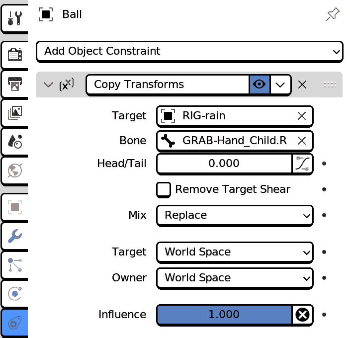

**图 10.14：** 复制变换约束

这就像把 `复制位置`、`复制旋转` 和 `复制缩放` 全都打包在一个约束里！

只有一个问题——如果我们马上创建那个约束，球会从 Rain 手中的位置弹开：

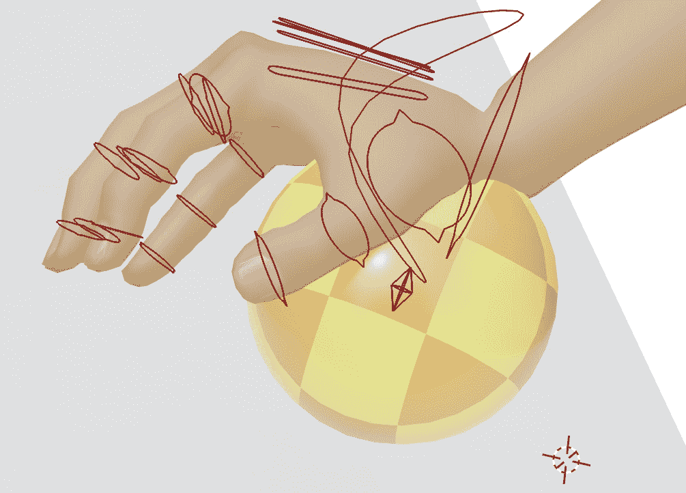

**图 10.15：** 错误的骨骼位置导致错误的球位置

……所以别急着建那个约束！

我们的抓取骨骼不在正确位置；我们从未调整过它。在给球添加 `复制变换` 约束*之前*，抓取骨骼需要先处于正确位置——*正是球当前所在的位置。*

怎么做？当然用另一个 `复制变换` 约束！

### 将抓取骨骼吸附到球的位置

像 Rain 手里的其他骨骼一样，我们必须定位 `GRAB-Hand_Child.R` 以适应被抓取的物体。然而，与其他骨骼不同的是，这根骨骼的摆姿势必须完美。手动移动它到看起来对的位置是不够的。

一种有效方法是在骨骼上使用一个 `复制变换` 约束，然后应用它。

你知道吗？骨骼可以有**骨骼约束**？现在你知道了！

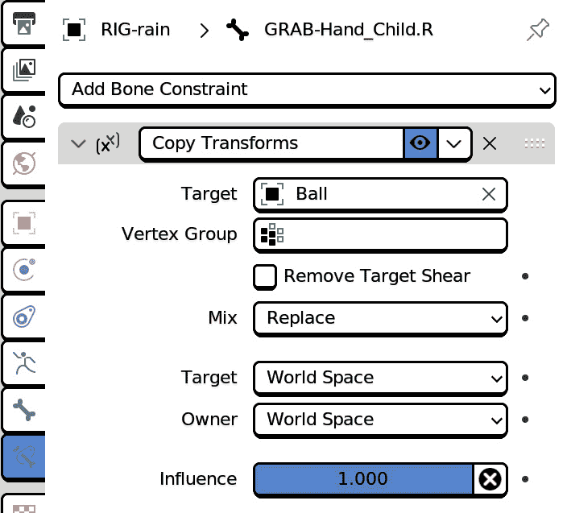

**图 10.16：** GRAB-Hand_Child.R 的骨骼约束

骨骼约束的工作原理与物体约束完全一样，只是针对骨骼。像 Rain 这样高级的骨架会用到大量骨骼约束；它们是绑定中不可或缺的功能。

> **重要提示**
>
> 确保点击属性编辑器中的**骨骼约束**选项卡（带骨骼图标的那个），而不是常规的**约束**选项卡。如果你不小心给 Rain 的整个骨架物体加了约束，会立刻发现错误！

给抓取骨骼添加 `复制变换` 约束：

1.  找到 `GRAB-Hand_Child.R` 的**骨骼约束属性**区域。
2.  添加一个 `复制变换` 约束。
3.  约束的**目标**选择 `Ball` 物体。

激活该约束后，抓取骨骼占据与球相同的空间位置，并具有相同的朝向：

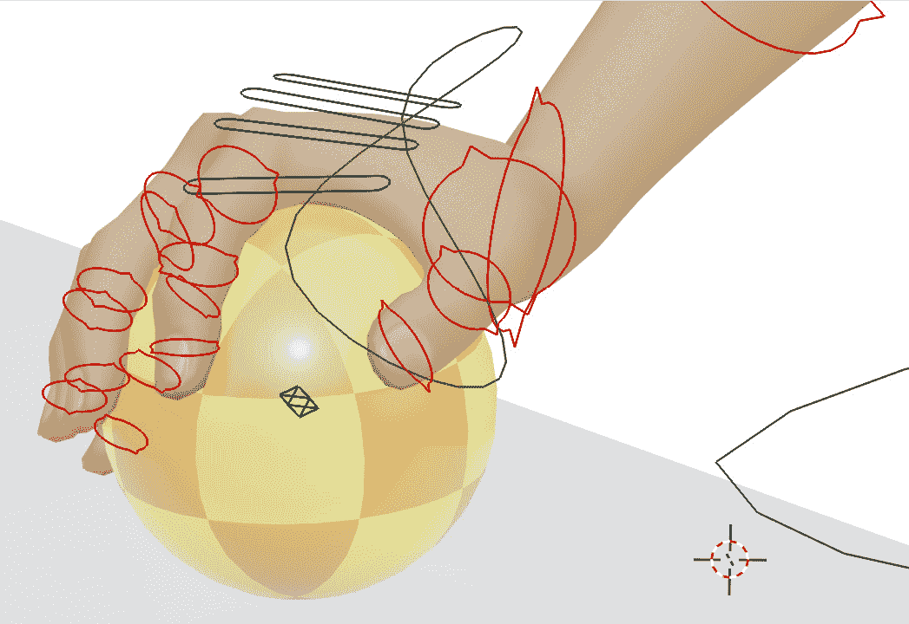

**图 10.17：** 骨骼正好在它该在的位置

不过这层关系不打算长久！

#### 应用约束

做这么多的目的是把球约束到抓取骨骼，而不是抓取骨骼约束到球。所以在建立*那个*约束之前，必须先应用现有的约束，如下所示：

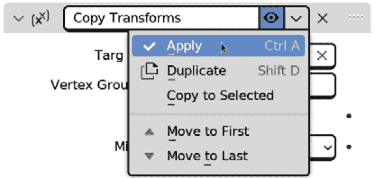

**图 10.18：** 对约束使用应用操作

创建约束时处于哪一帧无所谓，但应用约束时帧数很重要，所以做这一步时确保你在正确的帧上：

1.  转到第 `30` 帧。
2.  应用 (`Ctrl` + `A`) 刚才创建的 `复制变换` 约束。

约束没了，但骨骼还在原地——正好在球的位置。就像我们神奇地知道该把骨骼移动旋转到哪里，而且第一次就精准到位。

> **重要提示**
>
> 两个骨骼/物体不能互为对方的约束目标。如果我们不应用或移除前一个约束就创建下一个，会导致*循环依赖*——一个不可接受的错误。

我们用一个 `复制变换` 约束把抓取骨骼精准放置在球的位置，以球为目标。接下来的 `复制变换` 约束，我们反向再做一遍！

### 给球添加约束

我们刚预览了 `Copy Transforms`（复制变换）约束的功能。现在，正式环节开始了。让我们给球添加一个该约束，并将刚才变换过的抓取骨骼作为其目标（见图 10.14）。

**提示**

在球和 Rain 的姿态骨骼之间切换选择，同时也需要在 `Object Mode`（物体模式）和 `Pose Mode`（姿态模式）之间切换。如果你厌倦了频繁这样做，可以尝试禁用 `Edit`（编辑）| `Lock Object Modes`（锁定物体模式）。你也可以在大纲视图区域选择这些元素。

要将骨骼用作约束目标，我们必须首先指定骨架物体 `RIG-rain` 作为目标。这样做会显示一个次级字段，你可以在其中指定要使用哪根骨骼，而不是骨架物体本身。

**重要提示**

在可用作目标的物体列表中，你可能会看到不止一个版本的 `RIG-rain`。选择那个是 `Library Override`（库覆盖）的版本（其旁边的链接图标上穿过一支箭头）。

让我们继续创建这个至关重要的约束：

1. 选择物体 `Ball` 并前往其 `Object`（物体）`Constraint Properties`（约束属性）。
2. 添加一个 `Copy Transforms`（复制变换）约束。
3. 对于约束的 `Target`（目标），选择物体 `RIG-rain`。
4. 将目标 `Bone`（骨骼）指定为 `GRAB-Hand_Child.R`。

如果你在创建此约束时仍停留在帧 `30`，看起来将好像什么也没发生。这是件好事——这意味着目标 `GRAB-Hand_Child.R` 当前处于完美位置。我们马上就能看到 Rain 移动手时的效果。

### 观察新约束的实际效果

准备好继续角色动画了吗？让我们回到骨架并为下一个姿态设置关键帧，看看新约束为我们做了什么：

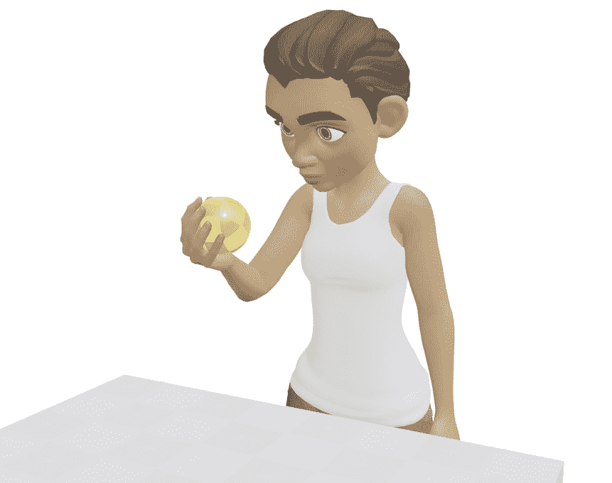

图 10.19：Rain 注视着手中的球

我们也将保持这个姿态 20 帧，给 Rain 一个思考的时间：

1. 前往帧 `40`。
2. 为 Rain 拾起球的姿态设置关键帧。
3. 将该姿态的所有关键帧复制到帧 `60`。

在帧 `30` 之后播放动画，我们可以看到预期的效果。Rain 抬起手，球也随之上升。目前看起来就像我们把球父级绑定到了 Rain 的手上。

恭喜，你让 Rain 拾起了球！但现在，球粘在 Rain 手上，她无法放下。球太“粘人”了！这层关系需要调整。

## 具有动画影响力的约束

让 Rain 抓住球是我们的第一个目标，我们实现了。干得好！事实上，你做得 *有点过头了*。我们的下一个目标，具有讽刺意味的是，让 Rain *不* 抓住球，我的意思不仅仅是指她扔球的时候。

让我们回到动画的开头。这不是我们想要的：

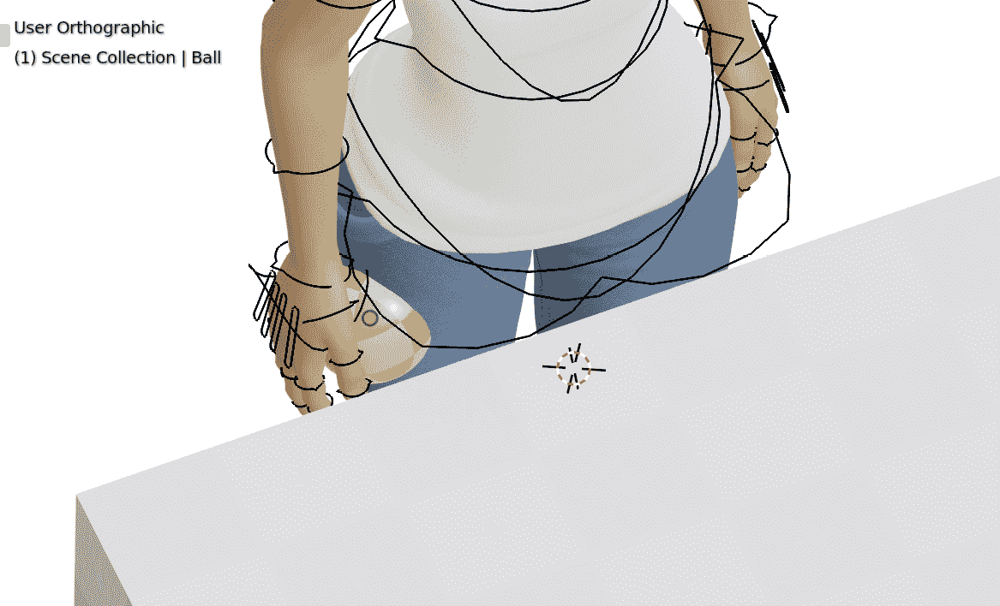

图 10.20：第 1 帧时球粘在 Rain 手上

虽然约束在 Rain 抓住球后生效，但它在她抓住球 *之前* 也生效了；球不再像应该的那样静止在桌子上。我们需要某种方法关闭约束，并等到合适的时刻再开启它。

正是为此，约束拥有 `Influence`（影响力）属性，并且它们可以像其他任何东西一样制作动画。

## 为约束的影响力设置关键帧

约束的 `Influence`（影响力）属性非常直观。值为 `1.0` 时，约束处于“全强度”状态；值为 `0.0` 时，就好像根本没有约束一样。

因此，为了修复前 30 帧的问题，我们只需为球约束的 `Influence` 属性设置关键帧，如下所示：

1. 找到属于 `Ball` 的 `Copy Transforms`（复制变换）约束的 `Influence` 值。
2. 在帧 `30` 将 `Influence` 设为 `0.0` 并设置关键帧，在帧 `31` 设为 `1.0` 并设置关键帧。

我们现在通过为一个重要属性设置关键帧修正了球的行为。前 30 帧的动画恢复正常，直到我们希望它在帧 `31` 生效之前，Rain 的手不会影响球。太棒了！当我们观看动画时，终于能看到 Rain 拾起物体的完整动作了。

接下来，我们要让 Rain 抛掉球，结束这层关系。正如你所料，这意味着我们需要在合适的时刻将球约束的 `Influence` 再次动画化回 `0.0`，但这还不是全部。

## 释放球

有些关系注定不长久。该是 Rain 放手、球继续前行的时候了！首先，我们将为 Rain 制作投掷动画，随后在她张开手指时让球离开手。

除其他外，这要求我们应用（并设置关键帧）约束对一些事物的效果。

## 制作投掷/抛掷动画

好吧，事情是这样的：要制作球离开 Rain 手的动画，我们需要确定她释放球那一刻球在全局空间中的位置：

* 为此，我们需要制作 Rain 手臂投掷的动画。
* 为此，我们需要通过为右臂的 `FK/IK Switch`（FK/IK 切换）属性设置关键帧，从使用 `IK` 过渡到使用 `FK`。
* 为此，我们必须为 `FK` 骨骼的视觉旋转设置关键帧，以便当我们切换到它们时，手臂不会变成这样：

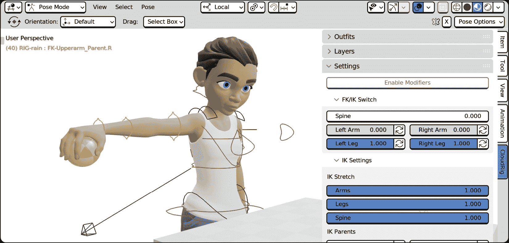

图 10.21：右臂的 FK 骨骼，仍处于原始姿势

哇！让我们从这些 `FK` 骨骼开始。

### 视觉变换关键帧简介

幸运的是，Rain 在拾起球后从帧 `40` 保持姿态到 `60`。这给了我们一个绝佳机会，可以在无人察觉的情况下为 `FK/IK Switch` 属性设置关键帧。

你可能还记得如果我们随意更改此值会发生什么。Rain 的 `FK` 骨骼自带约束，因为我们从未为它们设置过姿势，右臂的 `FK` 骨骼想要回到它们原始的 T 型姿势。为了无缝过渡，我们需要为它们在 *我们视角中显示的位置* 设置关键帧，而不是它们 *想要去的位置*。

这就是 `visual keying`（视觉关键帧）的用武之地。视觉关键帧的选项位于 `Insert Keyframe`（插入关键帧）菜单（`I`）底部附近：

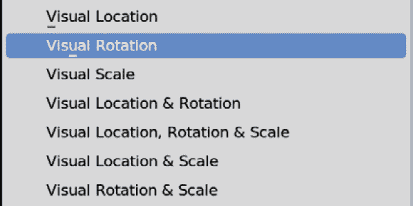

图 10.22：插入关键帧菜单中的视觉关键帧选项

让我们尝试设置 `Visual Rotation`（视觉旋转）关键帧。一旦我们这样做，`FK/IK Switch` 值就可以制作动画了：

1. 选择 Rain 右臂的 `FK` 骨骼。它们是 `FK-Upperarm_Parent.R`、`FK-Forearm.R` 和 `FK-Hand.R`。
2. 前往帧 `40`。
3. 使用 `Animation`（动画）| `Insert Keyframe`（插入关键帧）（`I`）| `Visual Rotation`（视觉旋转）。
4. 在帧 `60` 再次执行此操作（或直接将新关键帧复制到帧 `60`）。
5. 在帧 `40` 和 `60` 之间，为 `FK/IK Switch` | `Right Arm` 值制作动画，使其从 `1.0` 变为 `0.0`。

如果你正确地为 `FK` 骨骼设置了视觉旋转关键帧，当 `FK/IK Switch` 值在帧 `40` 和 `60` 之间变化时，Rain 的手臂看起来不会移动。

**提示**

骨架上的视觉关键帧，其工作原理就如同我们在为骨骼常规设置关键帧之前，使用了 `Pose`（姿态）| `Apply`（应用）（`Ctrl+A`）| `Apply Visual Transform to Pose`（将视觉变换应用到姿态）。重要的部分不是关键帧设置本身，而是将约束应用到设置了关键帧的属性上。

如果你仍不确定这里发生了什么，当我们为球制作动画时，我们将有另一次机会使用此功能。

### 用两个姿势为投掷设置关键帧

在第 `60` 帧之后，我们现在可以使用 Rain 右臂的 `FK` 骨骼来制作投掷/抛掷动作。

这里有一个制作令人信服的投掷动画的技巧：从“蓄力”姿势开始……

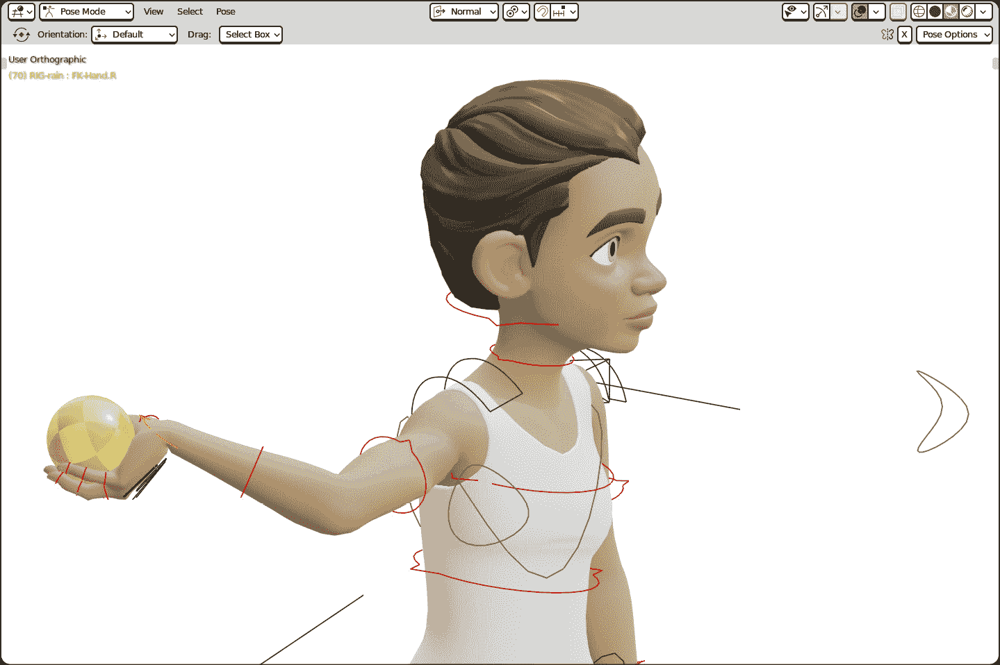

图 10.23：Rain 在第 70 帧蓄力准备抛球

……但随后，*不要* 为 Rain 释放球的那一刻设置姿势：

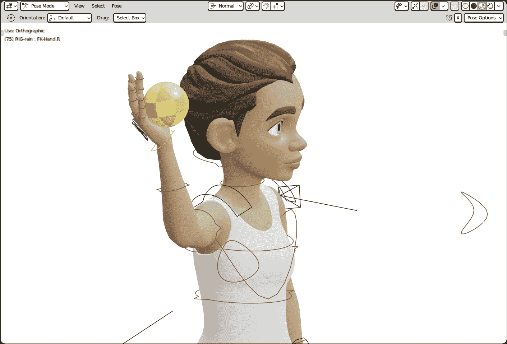

Figure 10.24: Rain 在第 75 帧释放球

这是物体关系结束的时候，但不是 Rain 动作结束的时候。跳过这部分，关键帧“随动”：

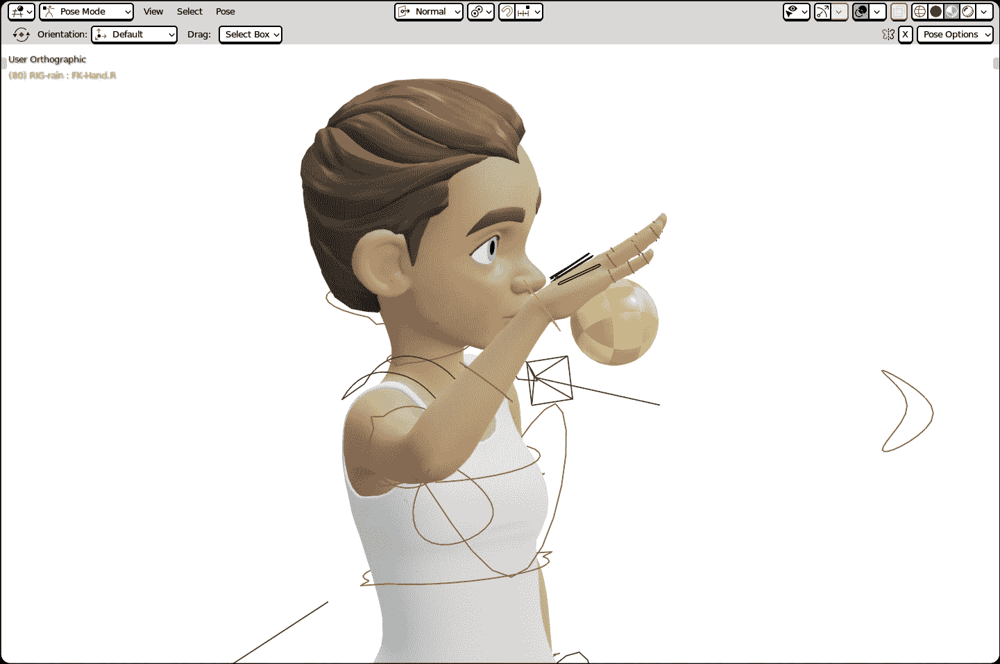

Figure 10.25: 第 80 帧。试着假装球不在那里

关键帧“随动”姿势后，我们可以回到“释放”帧，根据需要调整手和手指：

1.  在第 `70` 帧，为 Rain 关键帧一个“蓄力”姿势。
2.  在第 `80` 帧，为 Rain 关键帧一个“随动”姿势。
3.  关键帧手指和其他区域的任何必要调整，以确保球能在第 `75` 帧后顺利离开 Rain 的手。

完成 Rain 手臂的动作后，我们可以继续制作球的动画。我们快完成了！

## 为投掷出的球制作动画

我们将让球在第 `75` 帧左右离开 Rain 的手，但在我们禁用给它的 `Copy Transforms`（复制变换）约束之前，那东西不会自己去任何地方。所以，只需将 `Influence`（影响力）值从 `1.0` 关键帧回 `0.0`，我们就完成了，对吧？

差不多，但不完全是：

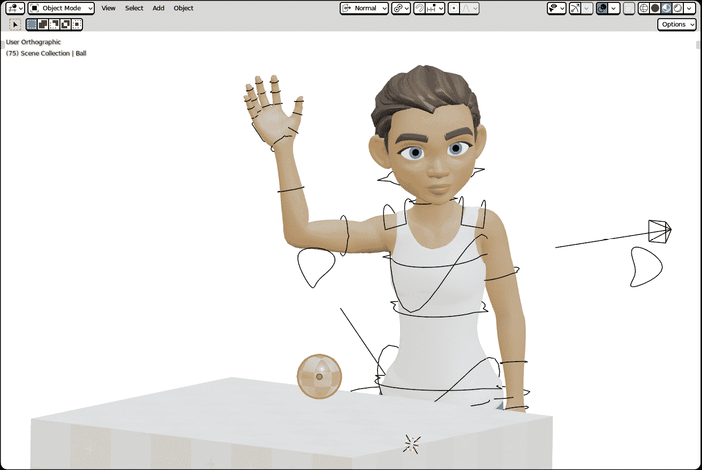

Figure 10.26: 球在第 75 帧时，回到了第 1 帧的位置

也许你期望约束在我们禁用其影响力后，将其“历史”赋予球的变换属性——就好像球会自动到达不同位置，取决于我们是在帧 `75`、`72` 还是 `80` 结束关系。并非如此。如果你相信这一点，那可能是因为你在第 `30` 帧做得太好，以至于被自己的把戏骗了！

将 `Influence` 设为 `0.0`，会释放球，就好像它从未有过任何约束……但它该去哪里？回到我们留下它的地方，带着它从未改变的原始物体变换数值。球可能一直在动，但那些数值没动。它们什么也没感觉到。通过视觉关键帧，我们可以让数值知道它们“睡着”时发生了什么。

### 关键帧物体的视觉变换

让我们更深入地了解视觉关键帧。我们已经在 Rain 的 `FK` 手臂上尝试过一些视觉关键帧，但骨骼相当复杂，而且我们不是自己绑定的 Rain。球将作为一个更好的例子。

球的位置和旋转需要在两个非常重要的帧上关键帧：

*   第 `30` 帧，确定它被捡起前的位置。
*   第 `75` 帧，确定它释放后的位置。

使用传统的插入关键帧方法，为骨骼或物体关键帧变换属性，只会关键帧我们在该骨骼/物体的 `Location`（位置）、`Rotation`（旋转）或 `Scale`（缩放）属性中看到的名义数值——即 `Transform`（变换）面板中恰好出现的任何数字。通常这没问题——我们可以像往常一样在第 `30` 帧关键帧球。

然而，当骨骼或物体被约束时（就像球目前在第 `75` 帧那样），那些看似重要的数字更像是礼貌的*建议*，随后被粗鲁地忽略：

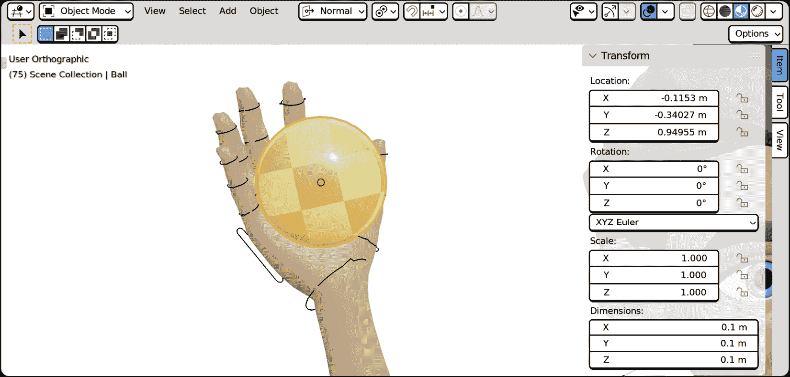

Figure 10.27: 这些数字与球在哪里毫无关系

第 `30` 帧后，被约束球的名义 `Transform` 数值在此没有任何效果，也不受任何约束影响。它们完全没变，所以像平常那样关键帧它们没多大用处。我们这里需要做的是关键帧 `visual transforms`（视觉变换）——即计入约束效果后，物体位置、旋转和缩放的数值。

**重要提示**

此处的“视觉”并不表示一个独特的属性——例如，物体和骨骼除了 `Location` 属性外，并没有 `Visual Location` 属性。它只是指在关键帧之前，将物体约束的效果应用到变换属性的数值上。这完全等同于我们使用 `Object`（物体）| `Apply`（应用）(`Ctrl` + `A`) | `Visual Transform`（视觉变换），然后像往常一样关键帧位置和旋转。使用视觉关键帧方便地一次性执行这两个操作。

这次，我们将关键帧 `Visual Location & Rotation`（视觉位置和旋转）：

1.  选择球。
2.  转到第 `30` 帧。
3.  关键帧球的 `Location & Rotation`（视觉与否无所谓——这一帧无所谓）。
4.  转到第 `75` 帧。
5.  关键帧球的 `Visual Location & Rotation`。

关键帧视觉变换属性后，我们的动画看起来似乎没有任何变化。尽管如此，我们刚刚插入了一些非常重要的关键帧——如果你不信，检查一下你的 F 曲线。不过，那些 F 曲线目前还没多大作用——在我们禁用球的 `Copy Transforms` 约束之前，无法继续为球制作动画。这带我们进入下一步……

### 结束物体关系

最后，我们准备好在第 `75` 帧禁用球的约束。这将有效地结束关系，从今往后允许球像正常一样制作动画。

这部分非常简单。我们将以在第 `31` 帧“启用”它的相同方式，在第 `75` 帧“禁用”约束：

1.  再一次，找到 `Ball` 物体的 `Copy Transforms` 约束。
2.  在第 `74` 帧将 `Influence` 关键帧为 `1.0`，在第 `75` 帧关键帧为 `0.0`。

注意当你调低其约束的 `Influence` 值时，球没有去任何地方。多亏了视觉关键帧，它保持在原地。

#### “那时是我背着你走……”

看看球的 F 曲线，包括其 `Copy Transforms` 约束 `Influence` 的 F 曲线：

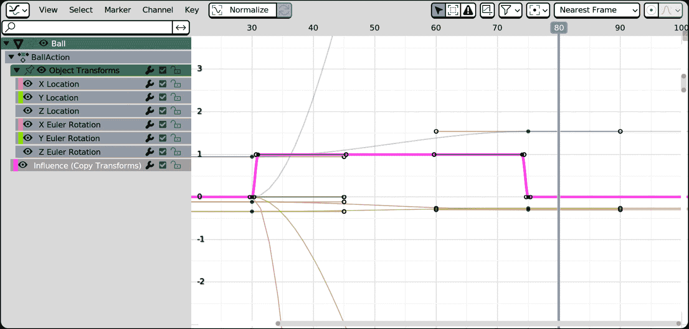

Figure 10.28: 球的 F 曲线

正如你可能猜到的，那些 F 曲线并没有讲完球运动的全部故事。在所有 `Influence` 值为 `1.0` 的帧上，球的 `Copy Transforms` 约束（因此是 `GRAB-Hand_Child.R` 骨骼）才是控制者。我们在第 `30` 帧和 `75` 帧之间使用什么插值并不重要。但球不知道这一点。就好像它以为自己全靠自己到了那里。多可爱！

第 `75` 帧后，球自由了，但它保持静止。把球送完剩下的路程取决于我们。

### 为投掷出的球制作动画

这下一部分不难。你从 *第 2 章* 就知道如何为球制作动画了！然而，这次我们必须考虑投掷球的手。球释放前一瞬间手移动有多快，方向是什么？我们希望球释放的那一刻看起来尽可能平滑。方向或速度的任何显著视觉变化都无法传达被投掷的效果。

让我向你展示一个在释放瞬间捕捉此信息的巧妙技巧。我们将再次关键帧球的视觉变换——不是再次在第 `75` 帧，而是在第 `74` 帧，然后关键帧。这将在 `Graph Editor`（图表编辑器）中揭示一些宝贵的见解：

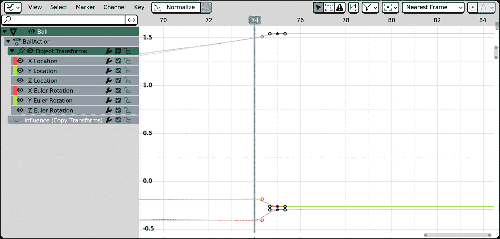

Figure 10.29: 第 74 帧和 75 帧之间球的 F 曲线

我们刚创建的那个额外的“凸起”发生在球仍被约束时，所以它不直接影响球。相反，我们可以用它作为参考，来确定如何塑造其后的 F 曲线段。

通过保持每条 F 曲线后续部分与这些段平滑衔接，我们可以保持球的速度和航向，其运动看起来就会很自然：

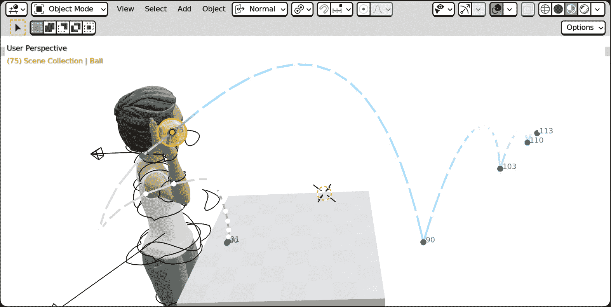

Figure 10.30: 第 75 帧后继续的 F 曲线

为什么不试试看？

1. 在第 `74` 帧应用球的视觉变换并插入关键帧。

2. 以生成的 F 曲线片段为指引，使用 `图表编辑器` 继续制作球离开 Rain 手后的运动。

3. 最后，如果我们愿意，可以使用运动路径来检查我们的工作：

Figure 10.31: 球的运动路径

看起来不错！只是为了好玩，我选择让我的球弹走，但你可能有别的主意。最重要的是球离开场景的那一刻，而是它离开曾约束它的那只手的那些关键帧。一旦球令人信服地做到了这一点，我们就可以宣布胜利——我们与约束进行的三部曲史诗般的战斗结束了！

## 总结

当我们需要一个物体在不同帧上具有不同关系时，这很有挑战性，但没有什么是不可能的。我们只需要做一些仔细的规划，以确定什么影响什么，以及何时影响。我们在这些关系之间的过渡有点像舞台魔术；事物在眨眼间发生变化，观众看不到为设置镜头而进行的所有仔细规划。

不要认为我们刚学到的技术是唯一的方法！例如，我们可以做完全相反的事情——即将球父级设为抓取骨骼，然后在球*不在* Rain 手中的那些帧上，使用一些目标指向其他虚拟骨骼的 `复制变换` 约束。

在其他情况下，我们可能只使用两个相同的球——其中只有一个父级设为手。然后，我们可以在适当的时间让它们出现或消失。这完全取决于具体的镜头和动画师的偏好。

本章结束了我们动画之旅中的角色动画部分。如果你坚持读到了这里，我印象深刻且真心感激。你已经完全准备好在接下来的几章中学习一些高级技术和功能了！

## 问题

1. 为什么在将 Rain 的手放在球上时，使用 `IK` 比 `FK` 更好？

2. 为什么抛球时 `FK` 可能比 `IK` 看起来更好？

3. 为什么虚拟骨骼类似于空物体？

4. 什么是视觉变换？在什么情况下它们与名义变换不同？

5. 在第 `30` 帧，我们可以给球的 `旋转和位置` 或其 `视觉位置和旋转` 设关键帧——选哪个都无所谓。为什么？

6. “Visual”（视觉）表示感知或仿像；某种低于现实的东西。那么，如果它们比名义变换更真实，为什么还叫它们视觉变换？

7. 为球创建 `复制变换` 约束时，如何确保在第 `30` 帧将其目标设为骨骼 `GRAB-Hand_Child.R` 时，没有任何事情发生？

8. 在为 `FK` 骨骼设置视觉位置和旋转关键帧后，为什么当我们通过 `FK/IK 切换` 切换到使用它们时，没有任何事情发生？

9. 为什么球的变换属性在第 `31` 到 `75` 帧之间不起作用？如果它们不起作用，为什么还要在这些帧中为它们制作动画？

10. 为什么我们总是希望*没有任何事情发生*？这种*无事发生*的*发生*为什么对我们的工作如此重要？
