# 第 11 章：F 曲线修改器

随着我们的角色动画之旅告一段落（大部分），让我们回到基础——但不是太基础！这些最后几章是*高级*基础。这一次，我们将访问 `图表编辑器` 来学习另一个功能：`F 曲线修改器`。

*修改器* 是一个在 Blender 中多次出现的术语。你可能熟悉 `属性编辑器` 中更突出的修改器，它们修改你 3D 场景中网格物体的几何体。F 曲线修改器基于类似的想法；它们修改一条 F 曲线，方便地减少了我们为了达到特定结果而需要插入的关键帧数量。在我们的例子中，它们甚至会完全取代 F 曲线！

在本章中，你将学习以下主题：

*   F 曲线修改器在哪里

*   使用 F 曲线修改器制作周期性运动

*   我最喜欢的修改器——`噪波`

*   限制 F 曲线修改器的帧范围

### 技术要求

要开始此练习，请下载以下文件并在 Blender 中打开它：

[`github.com/PacktPublishing/Realizing-3D-Animation-in-Blender`](https://github.com/PacktPublishing/Realizing-3D-Animation-in-Blender)

这是一个落地钟！

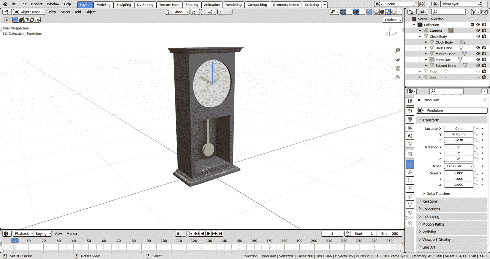

Figure 11.1: 落地钟场景

除了 `摄像机` 物体，此场景中还有几个我们可以纯粹使用 F 曲线修改器来制作动画的东西。

### 在哪里找到 F 曲线修改器

对于这个练习，我们将仅使用 F 曲线修改器为场景中的所有东西制作动画。我希望能说我们完全不需要关键帧，但如果我们要修改 F 曲线，我们需要一些 F 曲线来工作，而要创建那些 F 曲线，我们需要为每条曲线至少插入一个关键帧。在哪一帧？其实无所谓！一旦我们创建了 F 曲线，修改器就可以接管并完成其余工作。

我们的第一个任务是为钟的秒针制作动画，其次是它的摆锤。制作动画时，这两个物体都将绕 *Y* 轴旋转。

让我们开始创建它们的 F 曲线并访问它们：

1.  为物体 `Second Hand`（秒针）和 `Pendulum`（摆锤）插入旋转关键帧。

2.  在 `图表编辑器` 中调出这些物体的 F 曲线。

3.  除了 `Y Euler Rotation`（Y 轴欧拉旋转）F 曲线外，隐藏或删除所有其他曲线。

> **提示**
> 你可以通过右键单击属性并选择 `插入单个关键帧`，一次只为一个变换轴插入关键帧。

在隔离 `Y Euler Rotation` 通道后，剩下的是两条最无聊的 F 曲线：

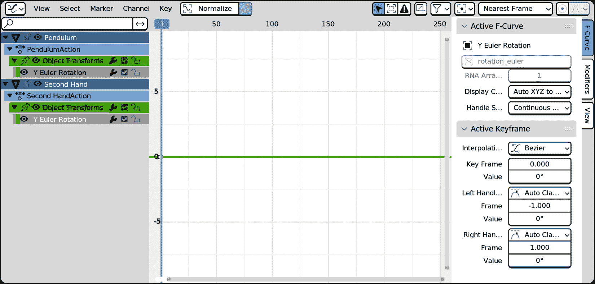

Figure 11.2: 两个动画通道；甚至不值得截图

如果我们想让这里发生任何事情，通常至少要再插入一个关键帧。但这次不是这样！

#### 添加我们的第一个 F 曲线修改器

时钟的部件具有简单、精确、可预测的运动。这使得它们的动画非常适合使用 F 曲线修改器。选中 F 曲线的修改器可以在右侧边栏的 `修改器` 选项卡中找到：

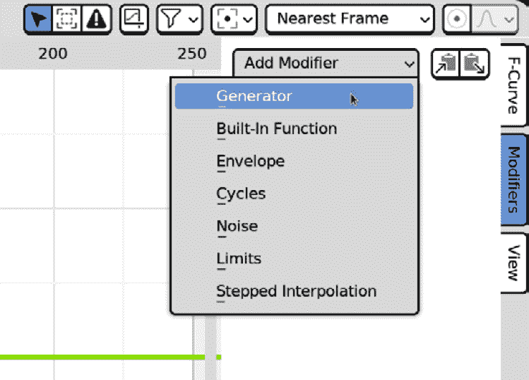

Figure 11.3: 在图表编辑器的边栏中添加修改器

我们的第一个修改器将添加到对象 `Second Hand`（秒针）的 `Y Euler Rotation`（Y 欧拉旋转）F 曲线上。这部分需要根据精确公式无限期旋转。为此，我们可以使用 `Generator`（生成器）修改器。该修改器基于多项式函数“生成”一条 F 曲线，其中 `X` 是帧号，可编辑的值是系数。在我们的例子中，我们需要最简单的可用函数，它给我们一条永不结束的上升直线。

当我们最初添加修改器时，它确实给了我们这条线，但有一个小问题：

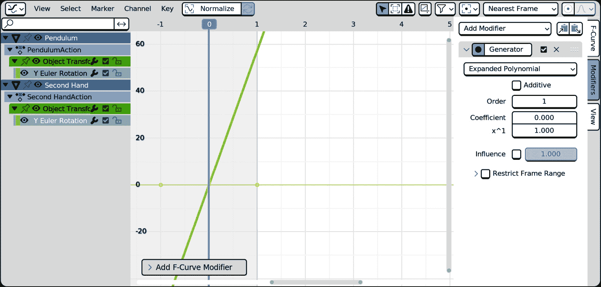

图 11.4：极其陡峭的线性函数

正如你所见，默认公式 `y = 1x + 0` 创建了一条对于大多数用途来说荒谬地陡峭的线。它更像是圆锯的旋转速度！公式中默认的 `1.0` 值是线的斜率，如果它要产生秒针的旋转，则需要小几个数量级。

亲自试一试：

1. 选择对象 `Second Hand` 的 `Y Euler Rotation` F 曲线。
2. 在图表编辑器右侧边栏中找到 `Modifiers`（修改器）选项卡。
3. 点击 `Add Modifier`（添加修改器）| `Generator`（生成器）。
4. 对于 `x¹` 系数，输入一个能让秒针旋转慢得多的值。

你在*步骤 4* 中输入的任何值可能并不完全正确。目前这没关系。让秒针每分钟恰好转一圈需要一点算术运算，我稍后会解释。在此之前，让我们继续添加修改器！

## 玩转 F 曲线修改器

在本节中，我们将了解另外几个 F 曲线修改器，以及如何准确获取参数以实现类时钟周期性的实用解释。

## Stepped Interpolation（阶跃插值）修改器

我们的秒针动画缺少几个关键特性。首先，它不像应该的那样“滴答”走动。`Stepped Interpolation` 修改器可以解决这个问题：

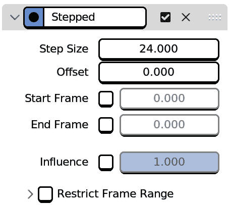

图 11.5：Stepped Interpolation 修改器

此修改器使 F 曲线“分级”，以便每隔特定帧数才产生一次运动。如果我们将该帧数编辑为与我们的每秒帧率（`24`）相同，时钟的秒针将每秒顺时针精确前进一步。

修改器的效果是“叠加”的，因此我们可以在现有的 `Generator` 修改器之后，为同一条 F 曲线添加 `Stepped Interpolation` 修改器：

1. 为 `Second Hand` 的 `Y Euler Rotation` F 曲线添加一个 `Stepped Interpolation` 修改器。
2. 将 `Step Size`（步长）值设置为 `24`。

简单！每次滴答的旋转角度可能还不像真正的时钟那样工作，但至少它像真正的时钟指针那样在滴答走动了。在我们调整设置使其完美之前，让我们也关注一下编辑器中的另一条 F 曲线。

## Built-In Function（内置函数）修改器

`Built-In Function` 修改器用一小部分数学函数来修改或替换 F 曲线。看看可用的各种函数，猜猜哪两个可用于制作摆动的摆锤（提示：不是 `Tangent` 正切）：

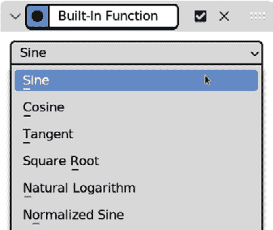

图 11.6：一些内置函数

最初，我们默认得到一个正弦波函数，这非常适合摆动运动（技术上讲，如果你想耍帅，也可以用 `Cosine` 余弦）：

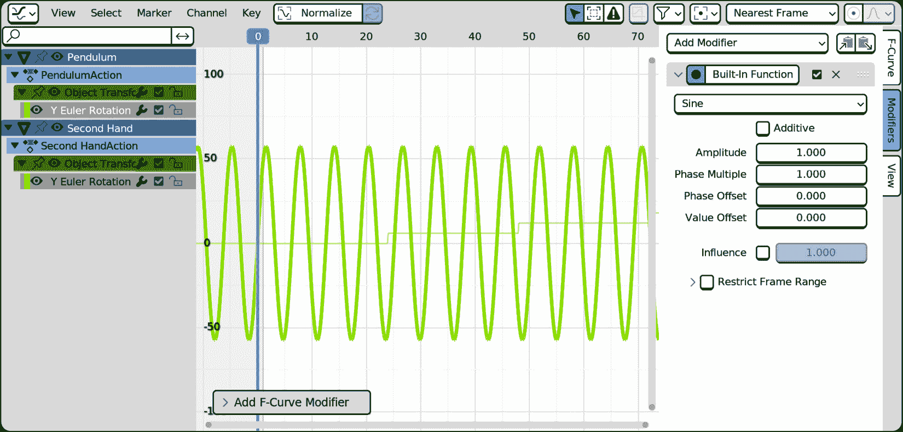

图 11.7：修改器创建的默认正弦波

和以前一样，我们仍需对修改器进行一些调整，以便时钟的摆锤在其盒子内合理摆动，而不是不受控制地振动。

现在让我们用这个修改器来制作摆锤动画：

1. 选择 `Pendulum`（摆锤）的 `Y Euler Rotation` F 曲线。
2. 添加一个 `Built-In Function` 修改器。
3. 调整修改器正弦函数的 `Amplitude`（振幅），使摆锤在时钟内摆动。
4. 通过减小 `Phase Multiple`（相位倍数）值来减慢波函数。

如果你仔细想想，这些修改器的命名并不太贴切。毕竟，`Generator` 修改器本身就使用内置函数，而 `Built-In Function` 修改器也“生成”一条 F 曲线。尽量别为此烦恼。

**提示**

F 曲线修改器也可用于驱动器。这就是那些更怪异的内置函数（如 `Tangent`）派上用场的地方。以这种方式使用时，你可以用数学公式驱动一个值，而无需使用任何 Python 表达式。

创建并调整完我们迄今为止介绍的所有修改器后，你应该会得到一个乍一看似乎正常工作的时钟。尽管如此，还有让它像真正的时钟那样工作的问题。

## 用数学设定时钟

也许你的时钟秒针走得有点太快，或者不够快。摆锤也是如此。这对某些镜头可能没问题，但我有点完美主义，所以我们将做一点三角学运算，让这个时钟精准运行。

这比听起来容易得多，因为 Blender 中的任何数字字段都可以输入数学表达式。我们甚至不需要计算器！

### 摆锤的周期性

摆锤时鰐的一件巧妙之处在于，摆锤的摆动通常决定了 1 秒的确切时长。我们目前的摆锤就是这种情况，它摆向左边需要 1 秒，摆向右边又需要 1 秒。这给我们留下了一个迫切的问题：为了实现这一点，`Built-In Function` 修改器的 `Phase Multiple` 属性应输入的确切数字是多少？

对于 `Built-In Function` 修改器的 `Sine`（正弦）、`Cosine`（余弦）和 `Tangent`（正切）函数，当前帧号与 `Phase Multiple` 属性相乘，然后由 `Sine`/`Cosine`/`Tangent` 函数解析为 `radians`（弧度）。实际上，这意味着 `Phase Multiple` 值应被视为 `pi`（3.14159）的分数。决定半个波周期应持续多少帧（在我们的例子中是 24）。用 `pi` 除以该数，我们就得到了答案：

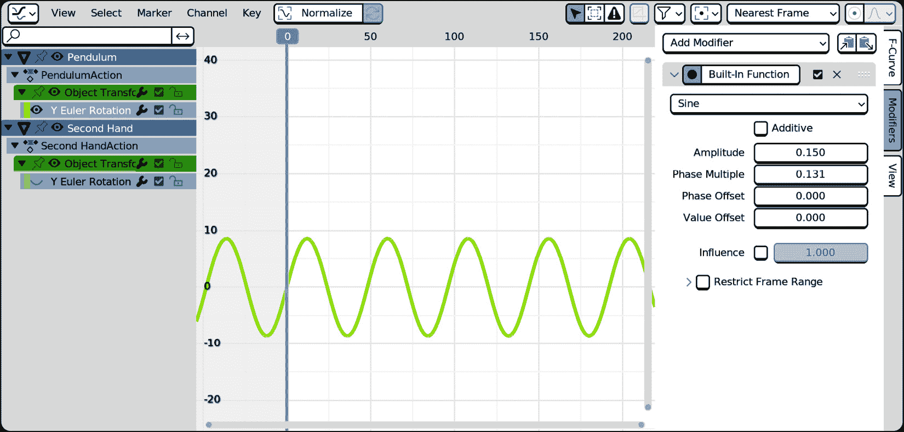

图 11.8：图表编辑器中的完美波函数

### 给秒针设定时间

与摆锤一样，秒针也有一个 F 曲线修改器，我们需要为其一个属性提供精确值。`Generator` 修改器的 `x¹` 系数决定了 F 曲线的线性斜率。如果我们把这个值设得恰到好处，时钟的秒针将每分钟转一圈——每 30 秒转半圈——从而精准计时。

同样像摆锤一样，这要求我们用弧度思考，即使 `Generator` 修改器不使用三角函数。这是因为 `Euler Rotation` 值本身就是按弧度计算的，尽管它们在 `Graph Editor` 中显示为度数！

因此，我们需要计算秒针半圈旋转应持续多少帧。对我们来说，那是 30 秒乘以每秒 24 帧。然后用 `pi` 除以该数：

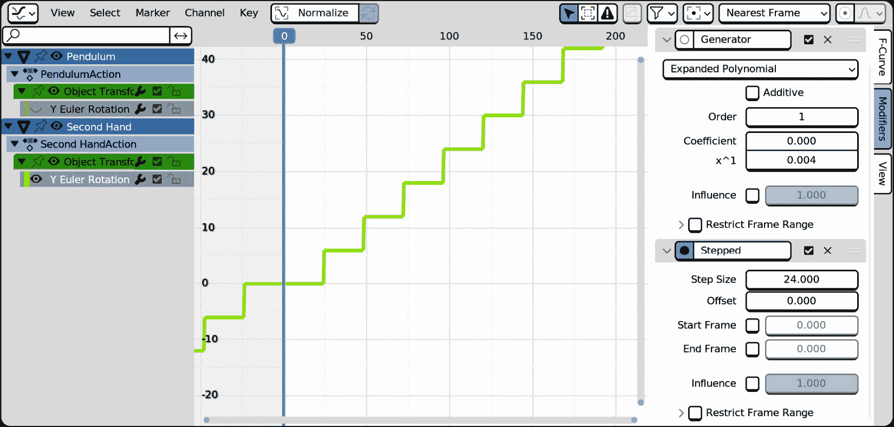

图 11.9：秒针旋转的理想 Generator 修改器

### 直接在数字字段中输入表达式

回顾一下，以下是完善我们的 F 曲线修改器设置的步骤。请注意，我们不需要进行任何计算，因为可以直接将任何喜欢的数学表达式输入数字字段，Blender 会处理其余的工作。

你甚至可以直接输入 `pi` 作为 `pi`：

1. 找到我们为 `Pendulum`（摆锤）的 `Y Euler Rotation`（Y 欧拉旋转）F 曲线创建的 `Built-In Function`（内置函数）修改器。
2. 在 `Phase Multiple`（相位倍数）属性字段中输入 `pi/24`。
3. 找到我们为 `Second Hand`（秒针）的 `Y Euler Rotation`（Y 欧拉旋转）F 曲线创建的 `Generator`（生成器）修改器。
4. 在 `x¹` 系数字段中输入 `pi/(30*24)`。

这就完成了：一个完美精准的座钟。可能比真实的还要精准……至少如果我们也给分针和时针做动画的话……

别担心——那太无聊了。谁想盯着时钟看整整一小时？相反，在本章的后半部分，我将向你展示我最喜欢的 F 曲线修改器以及我最喜欢用它做的事情。

## 使用 Noise 修改器

这无疑是 Blender 提供的最有用的 F 曲线修改器：

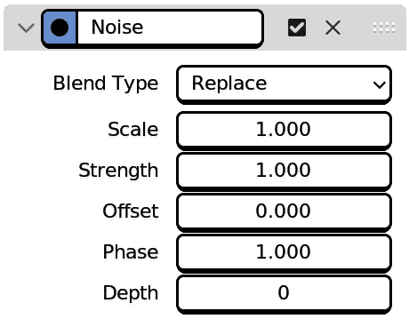

图 11.10：Noise 修改器

`Noise` 修改器会沿着 F 曲线生成 `pseudorandom noise`（伪随机噪声），这是一种花哨的说法，意思是它 `deterministically randomizes`（确定性地随机化）F 曲线，这又是一种花哨的说法，意思是它让 F 曲线 `go all wiggly`（变得弯弯曲曲）。这和“嘈杂”音频波形的形状没太大区别。任何时候我们想要创建抖动的随机运动，而不需要手动插入一堆随机关键帧时，这都非常棒。

在本练习中，我们将把 `Noise` 修改器用于其最常见的用例：模拟相机抖动。

## 添加 Noise 修改器

当有人在没有支架或三脚架的情况下操作摄像机时，他们的手会自然地轻微抖动。这种效果可以在录制的视频中看到。在 3D 动画中，我们必须刻意模拟这一点，使相机看起来像是被角色或真人手持的。我们可以通过在动画相机的每个 `Rotation`（旋转）和 `Location`（位置）F 曲线上添加 `Noise` 修改器来在 Blender 中实现这一点。

> **重要提示**
>
> 当你在 `Graph Editor`（图表编辑器）中处理相机的 F 曲线时，你还应该让一个 3D 视口处于 `Camera View`（相机视图）模式，以便你可以通过相机预览结果。

让我们首先创建相机所需的所有 F 曲线。和以前一样，你在哪一帧插入这些关键帧并不重要；只需确保相机指向时钟。然后，我们将添加初始的 `Noise` 修改器：

1. 为对象 `Camera` 插入 `Location & Rotation`（位置和旋转）关键帧。
2. 在 `Graph Editor` 中，选择相机的 `X` `Location` F 曲线。
3. 添加一个 `Noise` 修改器。

我们现在有了第一个可用的 `Noise` 修改器，但天哪！

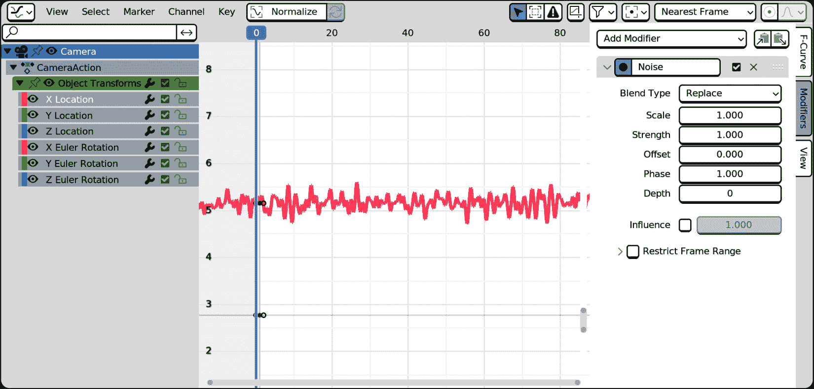

图 11.11：剧烈抖动的 F 曲线

### 调整 Noise 修改器

与我们之前添加的 F 曲线修改器一样，`Noise` 修改器的默认设置速度太快了。这在其他情况下可能是可取的，但不适合我们的情况。

我们需要使用修改器的 `Scale`（缩放）属性来降低抖动速度，并用 `Strength`（强度）属性稍微衰减其整体效果。为了弥补噪声减速过多的问题，我们还将使用 `Depth`（深度）来增加其细节：

1. 将 `Noise` 修改器的 `Scale` 调高到约 50.0。
2. 将修改器的 `Strength` 调低到一个小得多的值——比如 `0.5`。
3. 将 `Depth` 值增加到 `2` 或 `3`。

现在，我们的噪声看起来更适合手持相机那种缓慢、微妙的抖动。一旦我们将这个修改器复制到其他 F 曲线，效果将出奇地真实！

> **提示**
>
> 虽然 `Noise` 修改器的 `Blend Type`（混合类型）设置显示为 `Replace`（替换），但它实际上并不会替换 F 曲线或其关键帧。所有内容仍可像往常一样编辑。

## 复制修改器

要为剩下的两个位置 F 曲线添加噪声，我们不需要重复所有步骤。相反，我们可以复制刚才创建的 `Noise` 修改器并将其粘贴到另外两个 F 曲线上。

修改器的 `Copy`（复制）和 `Paste`（粘贴）操作符位于 `Modifiers`（修改器）选项卡顶部的那两个小剪贴板图标按钮中：

1. 点击 `Copy F-Modifiers`（复制 F 修改器）按钮以复制 `Noise` 修改器。
2. 选择 `Y` `Location` F 曲线。
3. 点击 `Paste F-Modifiers`（粘贴 F 修改器）按钮将复制的修改器粘贴到 `Y` `Location` F 曲线。
4. 对 `Z` `Location` F 曲线再做一次相同操作。

> **重要提示**
>
> `Copy F-Modifiers` 和 `Paste F-Modifiers` 操作符会复制和粘贴一个 F 曲线堆栈中的所有修改器。如果你只需要复制/粘贴其中的一个修改器，你将需要复制/粘贴所有修改器，然后稍后删除不需要的那些。

我们现在有了三个设置理想的相同 `Noise` 修改器，而且我们不需要为每一个修改 `Scale`、`Strength` 和 `Depth` 设置。不幸的是，我们不希望 `Noise` 修改器完全相同！还有一两个设置我们必须调整。

### 让随机化更随机

为每个 F 曲线使用相同的噪声会使相机沿着一条直的对角线抖动，这有点毫无意义。这就是伪随机函数的麻烦所在——随机性可能有点太可预测了！

我们需要每个 F 曲线以不同的方式随机。为了解决这个问题，我们将使用 `Phase`（相位）属性，它可以平滑地改变噪声函数的种子。`Offset`（偏移）属性也可以通过按给定帧数在时间上偏移波形来帮助实现这一点。

为每个 `Noise` 修改器稍微修改这些属性有一些有趣的应用。但在我们的例子中，我们只希望这些值 `completely`（完全）不同。点击属性并疯狂地向任一方向拖动鼠标，或者用拳头砸键盘输入一些你自己的随机数！重要的是每个 F 曲线看起来都不同，尽管它们仍将具有相同的 `Scale`、`Strength` 和 `Depth`。

我们还将为旋转 F 曲线添加一些 `Noise` 修改器，并对它们做同样的处理：

1. 对于每个 `Noise` 修改器，更改 `Phase` 和/或 `Offset` 属性，使没有两条 F 曲线看起来相同。
2. 继续制作相机抖动效果，为其中一条 `Euler` `Rotation` F 曲线创建一个类似的 `Noise` 修改器。
3. 对于我们的相机，旋转属性对噪声的“敏感度”比位置更高，因此你需要相应地调整新修改器的 `Strength`，以免相机抖动过度。
4. 将修改器复制并粘贴到其他 `Euler` `Rotation` F 曲线。
5. 最后，也更改这最后三个 `Noise` 修改器的 `Phase` 和/或 `Offset` 属性，使它们彼此毫无相似之处。

就这样——我们得到了六个不同的噪声 F 曲线！

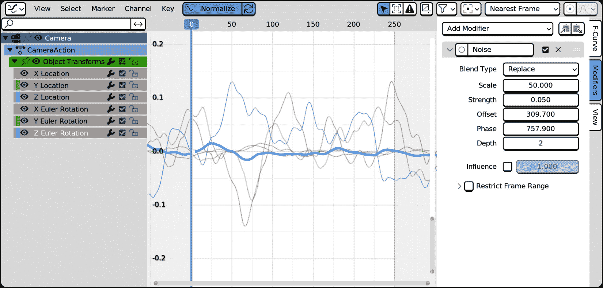

图 11.12：F 曲线中完成的相机抖动效果

在 `Camera View`（相机视图）中播放动画以查看效果！它应该看起来像这样：

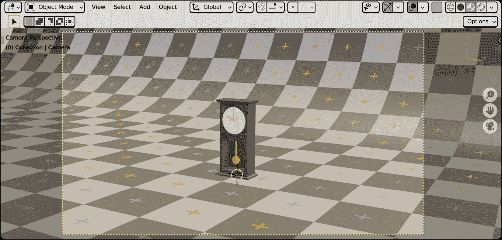

图 11.13：相机视图（地板未隐藏）

哦，对了——印刷页面无法播放动画。就把书举在手臂长度的前面，好吗？这就是我们要追求的效果。

如果有什么看起来不对劲，继续调整设置，直到获得你看起来不错的那种抖动感。

## Noise 修改器的更多妙用

我希望你从这些练习中学到了东西，因为我得承认——这是一个无聊的动画。谁想看一个愚蠢的时钟，哪怕只有 10 秒？这算什么——某种前卫媒体装置？我们在 `Tate Modern`（泰特现代美术馆）吗？！

## 第 11 章：F 曲线修改器的更多妙用

不妨给我们的小项目增添些刺激？比如……画外来个爆炸。那肯定能让事情“摇晃”起来。

## 使用 `Noise` 修改器模拟爆炸

默认情况下，`Noise` 修改器非常嘈杂，会导致动画物体表现得反复无常。这未必是坏事！使用具有不同设置的额外 `Noise` 修改器，我们可以让相机剧烈抖动，仿佛被画面外的爆炸震动一样。

来吧，现在添加一个新的：

1. 给相机的 `Z Euler Rotation`（Z 欧拉旋转）F 曲线添加另一个 `Noise` 修改器。
2. 在这个新修改器上，保持 `Scale` 不变，但将 `Strength` 降至约 `0.2`（那应该足够强了）。

好了——现在相机真的在抖动了！肯定发生了什么疯狂的事……而且一直在发生，持续发生，不断发生：

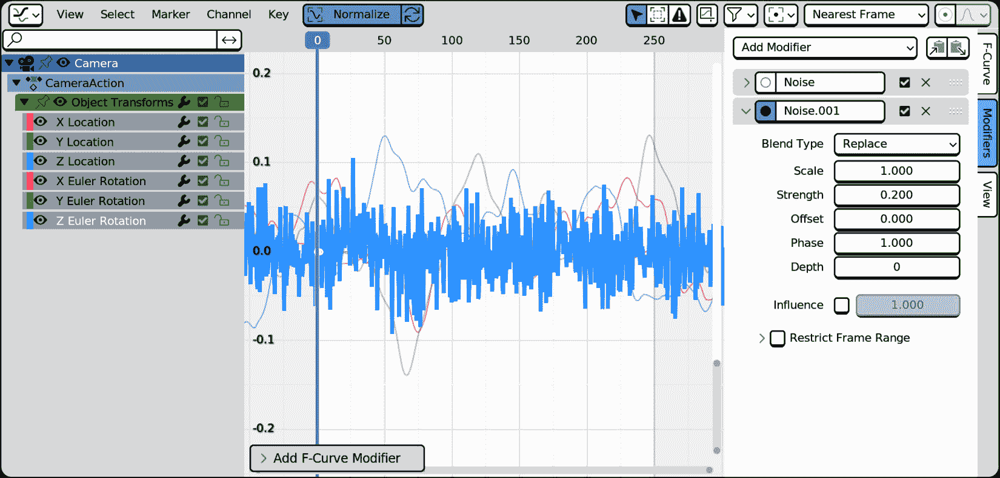

图 11.14：额外的 Noise 修改器

当然，爆炸本应是一次性事件，而不是永远持续下去的东西。接下来，我们将学习如何通过给这个修改器设定开始和结束来控制爆炸的时机。

## 限制修改器的帧范围

所有 F 曲线修改器都带有 `Restrict Frame Range`（限制帧范围）功能。启用后，我们可以定义修改器何时开始和/或结束。我们还可以让修改器“淡出”，使其以巨大的效果开始，然后逐渐消失。

现在试试：

1. 为新的 `Noise` 修改器启用 `Restrict Frame Range`。
2. 在 `Restrict Frame Range` 参数下，将 `Start` 帧设为 `50`，`End` 帧设为 `80`。
3. 将 `Blend Out` 值调高到 `30`（修改器的总时长）。

调整 `Phase` 属性——或任何你喜欢的其他属性——直到效果令你满意。你可能还想考虑给 `X Location` 和 `Y Location` F 曲线添加类似的修改器，就像本例中我所做的那样：

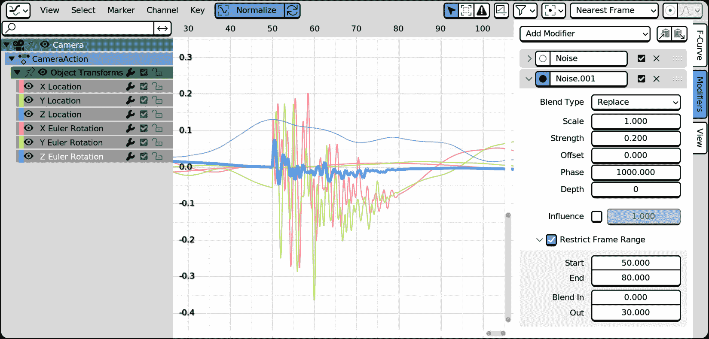

图 11.15：具有帧限制噪声的多条 F 曲线

要查看最终效果应是什么样子，请回顾图 11.13，但这次真正地左右摇晃这本书。

## 总结

`Noise` 修改器还有无数其他用途——地震、闪烁的灯光、随风摇曳的物体——在紧要关头，甚至可以用在角色的骨骼上，让他们站在那里时看起来更生动。多么棒的功能！哦——我们学过的那些其他修改器也很酷，我想。

另一件很酷的事是，除了开头不得不插入的强制性关键帧外，我们几乎不用任何关键帧就能完成这么多工作。添加修改器后，甚至那些关键帧也可以删除，F 曲线仍会保留（不过别那么做）。就我个人而言，我喜欢极少甚至不需要打关键帧的程序化动画技术。但请记住，修改器不必取代常规动画流程；它们也可以作为我们想让 F 曲线做的任何其他事情的补充。

有时放手不管，几乎不加关键帧，让 Blender 为我们程序化地制作动画，也挺有趣的，对吧？如果你同意，下一章你会玩得很开心……

## 问题

1. 如果网格修改器在三个维度工作，F 曲线修改器在几个维度工作？
2. 对于将被修改的 F 曲线，为什么（有时）我们在哪里插入初始关键帧无关紧要？
3. `Generator` 修改器还可以使用二次和三次多项式函数生成 F 曲线。这些可能有什么用？
4. 在什么情况下 `pi` 是 F 曲线修改器中的重要数字？为什么？
5. 一些修改器有 `Additive` 选项。启用它允许我们做什么？
6. 如果在修改器栈中，我们练习中的 `Stepped Interpolation` 修改器位于 `Generator` 修改器之前，会发生什么？
7. 当你尝试为 F 曲线修改器的属性制作动画时，会发生什么？
8. 既然现代相机和视频软件都试图从实拍素材中消除抖动，为什么还要费心在动画中模拟相机抖动？
